# Owner Material 037 — Star Wars D20 Drive folder (Core, Revised Core and Saga Edition): Living Force Campaign/Adventures/Among the Stars/Year 4/401 - Jedi Code - Padawannabes.pdf [Star Wars Roleplaying Game Revised Core (d20, 2002)]

- **Source:** Wizards of the Coast Star Wars Roleplaying Game books, web enhancements, Living Force campaign modules and articles (2000–2010), from the owner's "Star Wars D20" Drive folder (only the three edition subfolders; "General" was not read, as instructed). Secondary source (licensed Legends reference). Scan OCR'd on the box; the scan stays box-only and is **not** published.
- **Method:** every scanned page was OCR'd and machine-screened sentence by sentence for power-relevant statements (fights, kills, defeats, Force feats, rankings, superweapons) that name a character on our roster; each kept sentence is quoted verbatim from the OCR text and has a crop of the printed passage directly under it. Pages with nothing power-relevant are still listed with what is on them.
- **Citation:** "*401 - Jedi Code - Padawannabes* (SWRPG d20 Revised Core), p.X" by printed page ("scan p.X" where no printed number applies). **Weight:** Licensed RPG material: a secondary source. Narrative text sums up Legends lore; game statistics are rules for players, not canon power levels, and rank lowest.

## p.1 (scan page 1)

Page contents: 138 words, 7 paragraphs | headings/entries: LFA401; Padawannabes

## p.2 (scan page 2)

Page contents: 853 words, 21 paragraphs | headings/entries: House Rules; Atoning for Dark Side Points; Dissipate Energy; Illusion; Padawannabes; Stun; Hero Earnings; Page 2

## p.3 (scan page 3)

Page contents: 889 words, 18 paragraphs | headings/entries: General Notes to the GM; Padawannabes; GM Overview; Page 3

## p.4 (scan page 4)

Page contents: 745 words, 27 paragraphs | headings/entries: Encounter 1: A Turn of Phrase; Encounter 4: Shooting Off To The Shooting; Encounter 5: A Shot at Heroism; Padawannabes; Important Note to Judges:; Opening Crawl; Encounter 1: A Turn of Phrase; Page 4

- **No single roster character (rules/setting/general)** — entry/section: Opening crawl: "The Cularin system seems headed for dark times. Relations between Cularin and the Thaereian system have broken down. Worse, the Thaereians are still at least nominally the contracted Republic policing force for this system.
Fortunately, there is a rumor that a negotiator has arrived from Thaere to meet with Senator Wren. Perhaps there is still hope for a peaceful settlement. The question still remains: after all that's happened, do the people of Cularin want a peaceful settlement?" Source: *401 - Jedi Code - Padawannabes* (SWRPG d20 Revised Core), p.4
  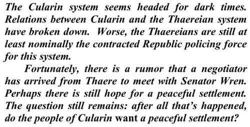

## p.1–4 (scan page 1)

Page contents: Title, blurb; house rules; GM overview of the Lermyn assassination plot and the frame of Osten Dal'Nay; encounter summaries; opening crawl (hand-read)

## p.5 (scan page 5)

Page contents: 910 words, 27 paragraphs | headings/entries: Padawannabes; Page 5

- **No single roster character (rules/setting/general)** — entry/section: Thaereian conspirator (overheard): ""Lermyn won't speak for five minutes. He'll never stop Thaere."" Source: *401 - Jedi Code - Padawannabes* (SWRPG d20 Revised Core), p.5
  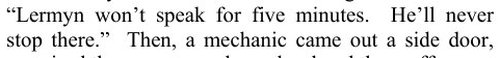

## p.6 (scan page 6)

Page contents: 960 words, 17 paragraphs | headings/entries: Padawannabes; Page 6

- **No single roster character (rules/setting/general)** — entry/section: Thaereian thugs: ""Hey, we thought one of them had stolen something from our speeder; we don't want no trouble,"" Source: *401 - Jedi Code - Padawannabes* (SWRPG d20 Revised Core), p.6
  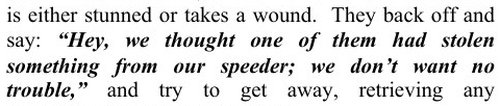

## p.7 (scan page 7)

Page contents: 863 words, 41 paragraphs | headings/entries: Important; Padawannabes; Page 7

## p.8 (scan page 8)

Page contents: 1006 words, 17 paragraphs | headings/entries: Padawannabes; Questioning the shop owner and employees:; Page 8

## p.9 (scan page 9)

Page contents: 876 words, 37 paragraphs | headings/entries: How did you get into trouble?; Padawannabes; Why were they chasing you?; What was that about what you overheard?; Why; Cularin; Page 9

- **No single roster character (rules/setting/general)** — entry/section: Vinda: ""I told them to boost off; they started to go. Then the guys who own that speeder got the jellies and ran after them, telling them to stop. The kids started running. That's it."" Source: *401 - Jedi Code - Padawannabes* (SWRPG d20 Revised Core), p.9
  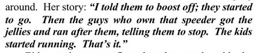
- **No single roster character (rules/setting/general)** — entry/section: Naja Delan: "Naja: We spotted two guys that looked suspicious and trailed them. I have a nose for this sort of thing.
Biko, laughing: Yeah, for the first time in two years you manage to get us chased.
Meera: Naja knows what he's doing. He's been around. I have, too." Source: *401 - Jedi Code - Padawannabes* (SWRPG d20 Revised Core), p.9
  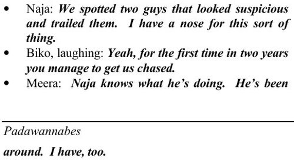
- **No single roster character (rules/setting/general)** — entry/section: Padawannabes: "Biko: There needs to be a reason? We were nosy and they like to hunt?
Oora: They claimed that they thought we'd stolen something from their speeder, but we never got near it.
Naja: We were eavesdropping on them, but we didn't hear anything important, just some stuff about a long-winded lecturer.
Meera: They gave me a creepy feeling. They wanted to hurt us. I'm sure of it." Source: *401 - Jedi Code - Padawannabes* (SWRPG d20 Revised Core), p.9
  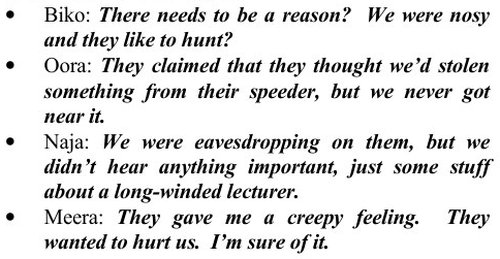
- **No single roster character (rules/setting/general)** — entry/section: Biko: "Biko: Let me think. Yes. It was this. "Lermyn won't speak for five minutes. He'll never stop there." I guess this Lermyn talks too much?
Naja: Maybe, but that makes no sense. Why chase us about that?" Source: *401 - Jedi Code - Padawannabes* (SWRPG d20 Revised Core), p.9
  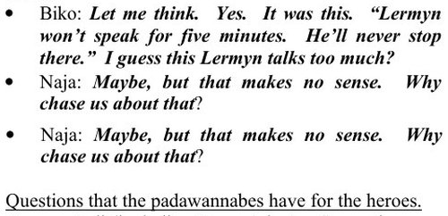
- **No single roster character (rules/setting/general)** — entry/section: Padawannabes: ""I've heard of you. You've done all sorts of things for Cularin. Please, tell me how you got into doing stuff like that."
... Likely from Oora: "How can you find time to go off saving people and planets and hold down a day job?"
... "You really took care of those nullbits back there, in no time flat. Guess they recognized you, too. Was it exciting? You've been in a lot of fights, I bet."
... Likely from Naja: "How do you decide when to fight honorably and when to just cut loose?" "How can you tell when you have a truly dangerous opponent and when it's just vapors like those ones who chased us?"
... "I want to learn how to be like you. Cularin needs heroes and you're a hero."" Source: *401 - Jedi Code - Padawannabes* (SWRPG d20 Revised Core), p.9
  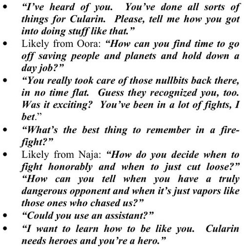

## p.10 (scan page 10)

Page contents: 909 words, 19 paragraphs | headings/entries: Keeping the Padawannabes with the heroes:; Padawannabes; Page 10

- **No single roster character (rules/setting/general)** — entry/section: Biko: "Likely from Biko: "So, how many opponents have you hunted?" "Killed many?"" Source: *401 - Jedi Code - Padawannabes* (SWRPG d20 Revised Core), p.10
  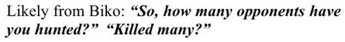

## p.11 (scan page 11)

Page contents: 937 words, 26 paragraphs | headings/entries: Padawannabes; Page 11

- **No single roster character (rules/setting/general)** — entry/section: Thaereian spy leader: ""We're Cularin Militia. Stand still; draw no weapons. You have gotten into something way over your heads. We can do this the easy way, or the hard way. You can drop all weapons and come with us to a house. You will be sitting in that house for a very short while, two to three hours. You can watch holo, if you like.
"At the end of that time, you will be released.
"This is important Cularin Militia business, and you can't be allowed to foul it up. Sorry."" Source: *401 - Jedi Code - Padawannabes* (SWRPG d20 Revised Core), p.11
  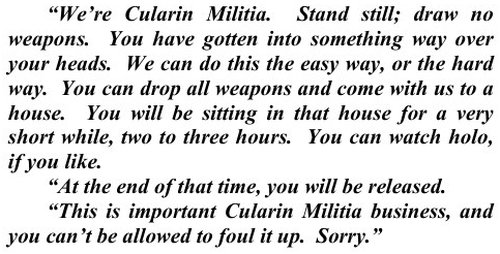
- **No single roster character (rules/setting/general)** — entry/section: Thaereian spy leader: ""What's going on?" "Sorry, need to know basis. You don't need to know."
"No, really, I do." "Get used to disappointment. Now drop your weapons and come along."
"I'm a member of the Militia and I don't recognize you." "I don't recognize you, either. Guess there must be more than twenty of us, eh?"" Source: *401 - Jedi Code - Padawannabes* (SWRPG d20 Revised Core), p.11
  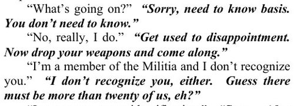
- **No single roster character (rules/setting/general)** — entry/section: Black Queen: "A brilliant, emerald-green lightsaber blade lances through the side of the truck, narrowly missing. It carves three sides of a rectangle in the wall, then extinguishes, and the sound of rapidly retreating feet is heard." Source: *401 - Jedi Code - Padawannabes* (SWRPG d20 Revised Core), p.11
  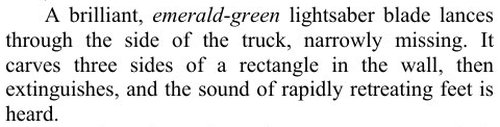

## p.12 (scan page 12)

Page contents: 929 words, 23 paragraphs | headings/entries: Padawannabes; Encounter 4: Shooting Off To The Shooting; Page 12

- **No single roster character (rules/setting/general)** — entry/section: Padawannabes: ""I've always wanted to be a hero, to be like the Jedi. I think that maybe I could die for a good cause. But how can you do something that might get your friends killed?
"This is crazy. They were trying to kill us. How can people take life so lightly?"
"But you walk around armed all the time, don't you? Isn't that going to make it more likely that people will start shooting? That innocents will die?"
To Jedi, if any: "I've always believed that the Jedi way was supposed to preserve life at all costs. I don't understand. You have the deadliest hand weapon in the galaxy."" Source: *401 - Jedi Code - Padawannabes* (SWRPG d20 Revised Core), p.12
  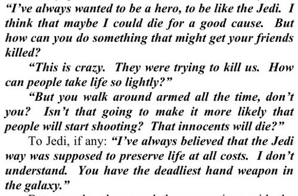

## p.4–12 (scan page 4)

Page contents: E1 thugs chasing the padawannabes in Bayonard; E2 investigation, repair shop, padawannabe Q&A; E3 the fake Militia ambush and the Black Queen's lightsaber rescue (hand-read)

## p.13 (scan page 13)

Page contents: 910 words, 26 paragraphs | headings/entries: Encounter 5: A Shot at Heroism; Padawannabes; Points of information:; Page 13

- **No single roster character (rules/setting/general)** — entry/section: Padawannabes: ""So, is that why you don't marry, or have relationships? Because you're afraid that your loved ones would be killed? How terrible."
"But— you must have friends, mentors, followers. They could be killed just as easily. So, why draw apart from the rest of us?"" Source: *401 - Jedi Code - Padawannabes* (SWRPG d20 Revised Core), p.13
  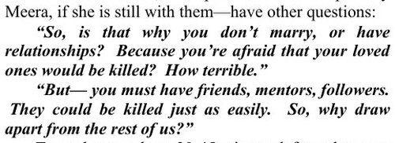

## p.14 (scan page 14)

Page contents: 1017 words, 17 paragraphs | headings/entries: Padawannabes; Page 14

- **No single roster character (rules/setting/general)** — entry/section: Assassin's battle droids: ""For the sake of a free Cularin, die."" Source: *401 - Jedi Code - Padawannabes* (SWRPG d20 Revised Core), p.14
  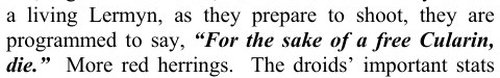

## p.15 (scan page 15)

Page contents: 805 words, 32 paragraphs | headings/entries: Conclusion; Padawannabes; Page 15

- **No single roster character (rules/setting/general)** — entry/section: Gavid Lermyn: ""My friends, old and, now, new. It is clear to me that I have been the unwitting lamb in a heinous plot. Myself: a target of assassination. Evidence to be planted to implicate Osten, an expatriate Thaereian. And, apparently, only the Militia knew where and when the meeting would take place.
"Only the Militia— and my own government."" Source: *401 - Jedi Code - Padawannabes* (SWRPG d20 Revised Core), p.15
  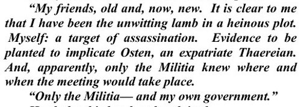
- **No single roster character (rules/setting/general)** — entry/section: Gavid Lermyn: ""It seems that what I have feared has come to pass. The Military faction and certain expansionist extremists have secured their grip on our government. They support Colonel Tramsig and his activities in Cularin. I have been speaking against them for years, in favor of peace and trade. I flatter myself that I have achieved some popularity among the common people of Thaere. It must be so, for it was too dangerous for me to have an "accident" back home. But how convenient this would have been—the barbaric, Separatist Cularin government— yes, that's what they call you— and the 'gang of thugs', the Cularin Militia led by a 'renegade, dishonorably discharged former Thaereian soldier', assassinate an ambassador of peace.
"I am ashamed. But I vow to expose this treachery. Alas, alas for the Supreme Chancellor."" Source: *401 - Jedi Code - Padawannabes* (SWRPG d20 Revised Core), p.15
  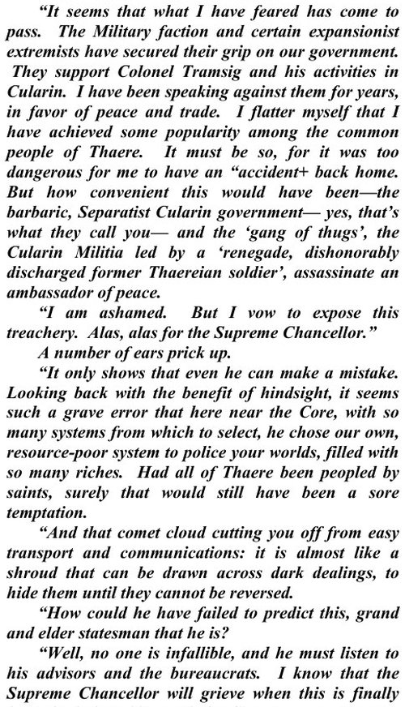
- **No single roster character (rules/setting/general)** — entry/section: Gavid Lermyn: ""It only shows that even he can make a mistake. Looking back with the benefit of hindsight, it seems such a grave error that here near the Core, with so many systems from which to select, he chose our own, resource-poor system to police your worlds, filled with so many riches. Had all of Thaere been peopled by saints, surely that would still have been a sore temptation.
"And that comet cloud cutting you off from easy transport and communications: it is almost like a Shroud that can be drawn across dark dealings, to hide them until they cannot be reversed.
"How could he have failed to predict this, grand and elder statesman that he is?
"Well, no one is infallible, and he must listen to his advisors and the bureaucrats. I know that the Supreme Chancellor will grieve when this is finally brought before him and the Senate. But we must collect more evidence, firm evidence, of my treacherous government's intent,"
...
"At least I have that opportunity now. Thanks to you, the true heroes of the hour."" Source: *401 - Jedi Code - Padawannabes* (SWRPG d20 Revised Core), p.15
  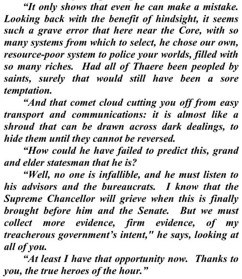

## p.16 (scan page 16)

Page contents: 858 words, 24 paragraphs | headings/entries: Padawannabes; If the heroes captured/killed the assassin:; If the assassin got away:; Page 16

- **No single roster character (rules/setting/general)** — entry/section: Osten Dal'Nay: ""No, hiding anything at this juncture would just make things worse."" Source: *401 - Jedi Code - Padawannabes* (SWRPG d20 Revised Core), p.16
  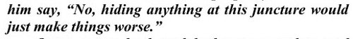
- **No single roster character (rules/setting/general)** — entry/section: Osten Dal'Nay: ""It seems that the hairs on the shred of cloth ... are mine. Of course, having been away in Gadrin, I do not have a good alibi, except for a couple of Militia members there. Who could be in my pay."
...
"OPS will see to it that all of the evidence is kept safe and available for further examination. I want my name cleared more than anyone else could."" Source: *401 - Jedi Code - Padawannabes* (SWRPG d20 Revised Core), p.16
  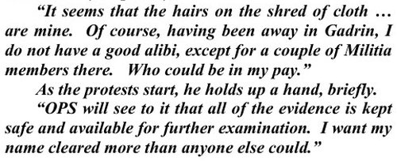
- **No single roster character (rules/setting/general)** — entry/section: Osten Dal'Nay: ""Thank you all for what you've been trying to do for me. I'm sure that the truth will come out in the end. And thank you most for saving the life of Gavid, here, who is still one of our best hopes for peace.
"We know that out foes are ruthless. But with heroes such as you, in the end, our victory is ensured." Source: *401 - Jedi Code - Padawannabes* (SWRPG d20 Revised Core), p.16
  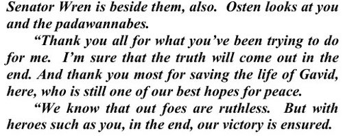
- **No single roster character (rules/setting/general)** — entry/section: OPS forensic scientist: ""We'll have to do further tests, of course. However, it is incontrovertible that the hairs we found on this piece of cloth, at the assassin's position, belong to Osten Dal'Nay! You can't argue with genetic scan evidence. I'm, ah, I'm sure that there's a reasonable explanation for all this. Where did you say Dal'Nay is?"" Source: *401 - Jedi Code - Padawannabes* (SWRPG d20 Revised Core), p.16
  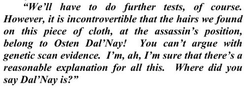

## p.17 (scan page 17)

Page contents: 712 words, 30 paragraphs | headings/entries: Experience Point Summary; Adventure Experience Award:; Padawannabes; Loot Summary; Credits; Spend a Little Time With Me; Conclusion; Weapons Permits; Page 17

- **No single roster character (rules/setting/general)** — entry/section: Meera Lisso: ""I know that you must be feeling terrible, after all you've— we've— been through. But you've certainly taught me one thing about being heroes: you're not one bit less heroic just because you don't succeed. It's the will to do right, even against the odds, that makes you heroic."" Source: *401 - Jedi Code - Padawannabes* (SWRPG d20 Revised Core), p.17
  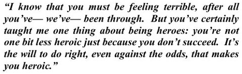
- **No single roster character (rules/setting/general)** — entry/section: Hero of Cularin medal: "This medal represents that the hero named above has assisted the people of Cularin in a time of great peril. Every citizen of Cularin should treat this being with the utmost dignity and respect." Source: *401 - Jedi Code - Padawannabes* (SWRPG d20 Revised Core), p.17
  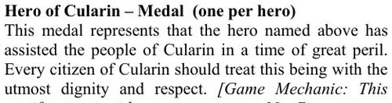

## p.18 (scan page 18)

Page contents: 673 words, 18 paragraphs | headings/entries: Ikas-Adno 22-B Nightfalcon (Customized) For; Padawannabes; Page 18

## p.12–18 (scan page 12)

Page contents: E4 ride to the Hiironi Irstat; E5 the assassination attempt; conclusions (Lermyn's speech, Osten's hairs, Meera's condolence); XP; loot certificates (hand-read)

## p.19 (scan page 19)

Page contents: 18 words, 3 paragraphs | headings/entries: Padawannabes Page 19

## p.20 (scan page 20)

Page contents: 21 words, 3 paragraphs | headings/entries: Padawannabes Page 20

## p.21 (scan page 21)

Page contents: 0 words, 0 paragraphs | headings/entries: 

## p.22 (scan page 22)

Page contents: 839 words, 21 paragraphs | headings/entries: Middle Tier (levels 4-6); Padawannabes; Page 22

## p.23 (scan page 23)

Page contents: 871 words, 27 paragraphs | headings/entries: Low Tier (levels 1-3); Mid Tier (levels 4-6); Padawannabes; High Tier (levels 7-9); Page 23

## p.24 (scan page 24)

Page contents: 822 words, 23 paragraphs | headings/entries: Encounter 5: A Shot at Heroism; Jaris Vollrath - the Assassin; Tactical notes for all tiers:; Padawannabes; Low Tier (levels 1-3); Mid Tier (levels 4-6); Page 24

## p.25 (scan page 25)

Page contents: 175 words, 9 paragraphs | headings/entries: Upper Tier (levels 10-12); Padawannabes; Page 25

## p.26 (scan page 26)

Page contents: 828 words, 20 paragraphs | headings/entries: GM Aid 2 — Padawannabes; Padawannabes; For those who do not have; Page 26

## p.27 (scan page 27)

Page contents: 904 words, 29 paragraphs | headings/entries: Typical questions from Oora:; Padawannabes; Page 27

## p.28 (scan page 28)

Page contents: 991 words, 28 paragraphs | headings/entries: Typical questions from Biko:; Padawannabes; Page 28

- **No single roster character (rules/setting/general)** — entry/section: Biko: ""Really? Yes! Thank you, thank you, mighty Hunter..."" Source: *401 - Jedi Code - Padawannabes* (SWRPG d20 Revised Core), p.28
  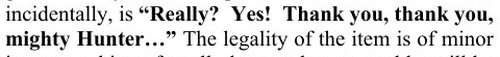
- **No single roster character (rules/setting/general)** — entry/section: Biko: "(To a Jedi) "Could you teach me how to use a lightsaber? I mean, if I promised to use it very, very carefully and only against ee-vil?"
"No? Well, how about a blaster rifle?"
"Don't you think that someone who trained as both a soldier and a Jedi would be the best kind of Jedi Guardian? You'd have all the fighting skills and you'd know the weaknesses of your most powerful potential enemies."
"What do Jedi Consulars actually do? I mean, even if you win the argument, won't there always be more argument? Dead is dead."
"Is that midi-chlorian thing for real? Sounds like a lot of bantha pudu to me. If it is, can you get a transfusion?"
"What does a hero do when his opponents have bigger guns?"
"Have you ever been afraid of anything? Did you let it live?"" Source: *401 - Jedi Code - Padawannabes* (SWRPG d20 Revised Core), p.28
  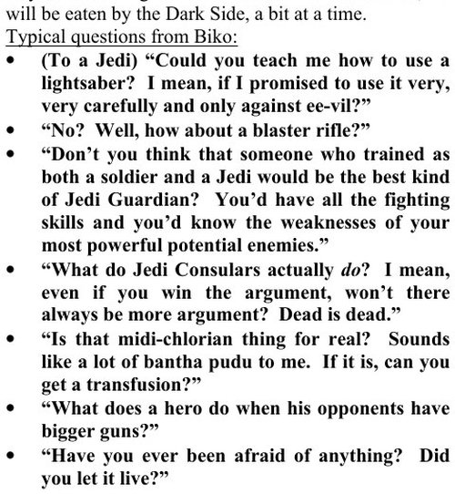

## p.29 (scan page 29)

Page contents: 905 words, 33 paragraphs | headings/entries: Typical questions from Meera:; Padawannabes; Page 29

- **No single roster character (rules/setting/general)** — entry/section: Meera Lisso: ""Which is better — to win, or to play fair?"
"What if winning is really important?"
"If enough people die for the cause, doesn't the cause eventually vanish?"
"So, how do we get to be heroes, like you?"
(To Jedi, especially, but to any, also) "If you had a chance to defend an innocent from the attack of a bad person, but you had to stab him from behind, unannounced, would you do it?"
(If no) "Then how are you defending the weak?"
(If yes) "Then how is that noble or honorable — or defensive?"
(To Jedi) "So, how is the whole celibacy thing working out?"
"Wanna fall off the speeder?"" Source: *401 - Jedi Code - Padawannabes* (SWRPG d20 Revised Core), p.29
  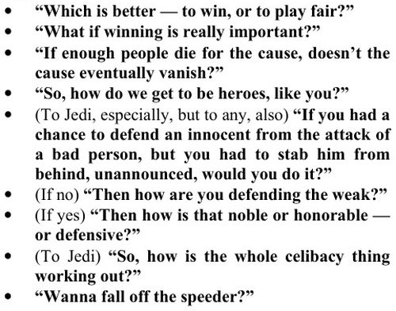
- **No single roster character (rules/setting/general)** — entry/section: Naja Delan: "Views/questions about heroism and the Jedi: Ordinary people can be heroes. Jedi are noble defenders of the galaxy, against overwhelming odds." Source: *401 - Jedi Code - Padawannabes* (SWRPG d20 Revised Core), p.29
  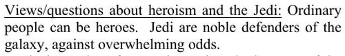

## p.30 (scan page 30)

Page contents: 29 words, 4 paragraphs | headings/entries: Padawannabes Page 30

## p.31 (scan page 31)

Page contents: 16 words, 4 paragraphs | headings/entries: Padawannabes Page 31

## p.32 (scan page 32)

Page contents: 136 words, 12 paragraphs | headings/entries: Critical Event Summary Padawannabes; Other (please specify); GM Name, RPGA#:; GM Email Address:; Convention Name/Date; Padawannabes Page 32

## p.19–32 (scan page 19)

Page contents: Player handouts (maps); GM Aid 1 stats; GM Aid 2 padawannabe profiles and questions; GM Aids 3-4 maps; critical event summary (hand-read)

