# Owner Material 037 — Star Wars D20 Drive folder (Core, Revised Core and Saga Edition): Living Force Campaign/Adventures/Among the Stars/Year 4/402 - Jedi Code - The Way of the Force.pdf [Star Wars Roleplaying Game Revised Core (d20, 2002)]

- **Source:** Wizards of the Coast Star Wars Roleplaying Game books, web enhancements, Living Force campaign modules and articles (2000–2010), from the owner's "Star Wars D20" Drive folder (only the three edition subfolders; "General" was not read, as instructed). Secondary source (licensed Legends reference). Scan OCR'd on the box; the scan stays box-only and is **not** published.
- **Method:** every scanned page was OCR'd and machine-screened sentence by sentence for power-relevant statements (fights, kills, defeats, Force feats, rankings, superweapons) that name a character on our roster; each kept sentence is quoted verbatim from the OCR text and has a crop of the printed passage directly under it. Pages with nothing power-relevant are still listed with what is on them.
- **Citation:** "*402 - Jedi Code - The Way of the Force* (SWRPG d20 Revised Core), p.X" by printed page ("scan p.X" where no printed number applies). **Weight:** Licensed RPG material: a secondary source. Narrative text sums up Legends lore; game statistics are rules for players, not canon power levels, and rank lowest.

## scan p.1 (scan page 1)

Page contents: 198 words, 8 paragraphs | headings/entries: LFA402; The Way of the Force

- **No single roster character (rules/setting/general)** — entry/section: Blurb: "If your character will simply never do anything unless it is for personal profit, (hand wave), "This is not the scenario you're looking for."" Source: *402 - Jedi Code - The Way of the Force* (SWRPG d20 Revised Core), scan p.1
  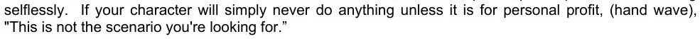

## p.1 (scan page 2)

Page contents: 852 words, 21 paragraphs | headings/entries: House Rules; Atoning for Dark Side Points; Dissipate Energy; The Way of the Force; Illusion; Stun; Hero Earnings; Page |

## p.2 (scan page 3)

Page contents: 894 words, 17 paragraphs | headings/entries: The Way of the Force; GM Overview; Page 2

## p.3 (scan page 4)

Page contents: 784 words, 25 paragraphs | headings/entries: Encounter 1: Trial Runs; Encounter 2: Robotnik, Or Is_ That Droidnik?; Encounter 7: Setting Up the Board; The Way of the Force; Important Note to Judges:; Page 3

## p.4 (scan page 5)

Page contents: 880 words, 22 paragraphs | headings/entries: Opening Crawl; Encounter 1: Trial Runs; The Way of the Force; Page 4

- **No single roster character (rules/setting/general)** — entry/section: Opening crawl: "It is a portentous time for the Almas Jedi Academy. Many of the Padawans are nearing the time of testing, after which their names are submitted for consideration for the rank of Jedi Knight.
At the same time, controversy regarding the Academy's training programs has arisen, both inside and outside the Academy. Some of Cularin's heroes are asked to show support for Almas by undertaking to help with preparations for the Trials.
And all the while, Master Lanius Qel-Bertuk ponders another question: who is the Black Queen?" Source: *402 - Jedi Code - The Way of the Force* (SWRPG d20 Revised Core), p.4
  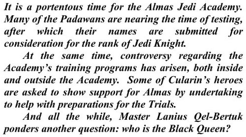
- **No single roster character (rules/setting/general)** — entry/section: Lanius Qel-Bertok: ""That's right," he repeats, "I would like you to assist us with our upcoming Jedi Trials, specifically the Test of the Lightsaber.
"Friends," he begins, "you have been of service to Cularin and you have helped our Academy more than once. Some of you have personally helped me. Now, I ask you to help our Padawans who are near to becoming Knights. In the dark times since the Battle of Geonosis, the Jedi Order has had greater need than ever before of properly trained Knights. I must emphasize the phrase 'properly trained'.
"I have a couple of missions that I would like you to undertake, without letting any of the Padawans at the Academy know that you are doing them."" Source: *402 - Jedi Code - The Way of the Force* (SWRPG d20 Revised Core), p.4
  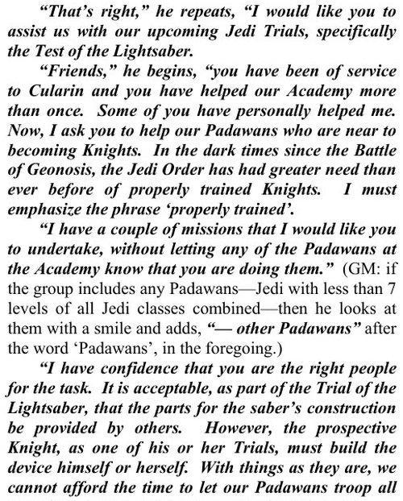
- **No single roster character (rules/setting/general)** — entry/section: Lanius Qel-Bertok: ""I have confidence that you are the right people for the task. It is acceptable, as part of the Trial of the Lightsaber, that the parts for the saber's construction be provided by others. However, the prospective Knight, as one of his or her Trials, must build the device himself or herself. With things as they are, we cannot afford the time to let our Padawans troop all over Cularin system on a scavenger hunt for parts.
"I have a shipment of the specialized energy cells used for lightsabers coming in from out-system. Those will be delivered. However, there are two other runs that I would like you to make. An old friend of mine, a Sullustan named Snem Noonb, runs a factory on Edic Bar. He manufactures plasma relays, power conduits and drive components, as well as some other starship systems. As a favor to us, he also makes up package lots of some of the components of a lightsaber: the activation plates, blade-length adjusters, emitter matrices, lens assemblies and power conduits. I'd like you to go there and pick up ten sets. They're paid for. Be prepared: Snem won't likely let you go before he shows you his plant; he's a typical Sullustan and very proud of the business he's built. In truth, it's only marginally successful, because competition is fierce and he refuses to gouge.
"The other task is a little more dangerous than the first. There is a secret deposit of Adegan crystals known to us at the fringes of the asteroid belt, on a rather unassuming rock. It's almost exhausted, but there should be a few left. We'd like you to go there and extract the last few crystals and bring them back. Then we'll have to find a new source."" Source: *402 - Jedi Code - The Way of the Force* (SWRPG d20 Revised Core), p.4
  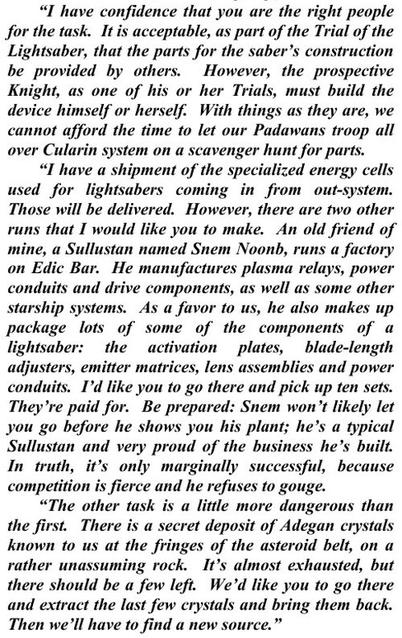

## scan p.1–4 (scan page 1)

Page contents: Title and blurb; house rules; GM overview (Lanius' secret test of the heroes, Ki-Adi-Mundi's judgement, the Black Queen's tampering); encounter summaries; judges' notes; opening crawl (hand-read)

## p.5 (scan page 6)

Page contents: 869 words, 21 paragraphs | headings/entries: The Way of the Force; Encounter 2: Robotnik, Or Is That Droidnik?; Page 5

- **No single roster character (rules/setting/general)** — entry/section: Lanius Qel-Bertok: ""It is the Way of the Force that a thing does not end well if it is begun badly. You were approached because your choice will be governed by your attitudes towards Cularin, towards Almas, and towards our Jedi Padawans. I have faith that you will do this because you wish to help us— even if you feel that you will best help us by showing us that non-Jedi can do some things better than Jedi."" Source: *402 - Jedi Code - The Way of the Force* (SWRPG d20 Revised Core), p.5
  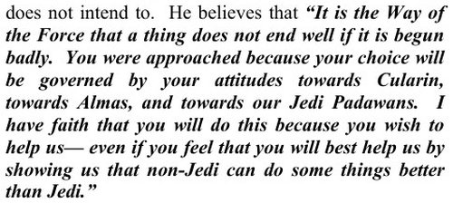

## p.6 (scan page 7)

Page contents: 853 words, 27 paragraphs | headings/entries: The Way of the Force; Page 6

- **No single roster character (rules/setting/general)** — entry/section: Snem Noonb: ""Ah, ah, so Lanius has entrusted you with his precious shipment of lightsaber bits? You must be greatly important people."
...
"But, of course, of course, of course you are. Heroes of Cularin system, if I recognize some of you as I believe I do. I am honored. Please, please, allow me to show you my humble establishment, and then I will speed you on your way with your parts. Well, not your parts, but the parts for the lightsabers, heh-eheh."" Source: *402 - Jedi Code - The Way of the Force* (SWRPG d20 Revised Core), p.6
  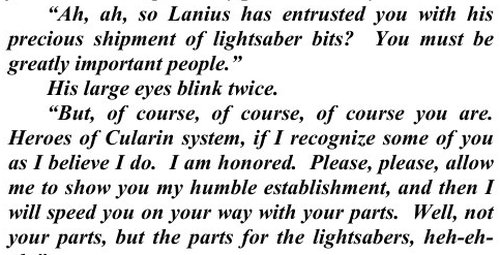
- **No single roster character (rules/setting/general)** — entry/section: Snem Noonb: ""It's the only way to stay competitive," he laments, "I have to sink almost every credit of profit back into the operation to stay current. Of course, of course, I only use people for the jobs requiring true intelligence and decision-making. Automation and low-level, cheap droids allow me to economize."" Source: *402 - Jedi Code - The Way of the Force* (SWRPG d20 Revised Core), p.6
  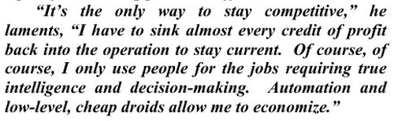
- **No single roster character (rules/setting/general)** — entry/section: Snem Noonb: ""Since we manufacture and bottle blaster gases and ion cannon charges, as part of our operations, I thought, 'Well, we're stripping electrons from the atoms, anyway, to make ions— why not recycle the electrons as extra current and use the cooling ion plasmas to supplement our light sources?'"" Source: *402 - Jedi Code - The Way of the Force* (SWRPG d20 Revised Core), p.6
  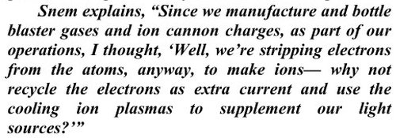
- **No single roster character (rules/setting/general)** — entry/section: Snem Noonb: ""Ho-ho-ho, yes, yes, yes," explains Snem, "I got a really good deal on a job lot of these things, right after the battle of Naboo. Had to fix them up a bit, though, and adapt them with plasma welders." Source: *402 - Jedi Code - The Way of the Force* (SWRPG d20 Revised Core), p.6
  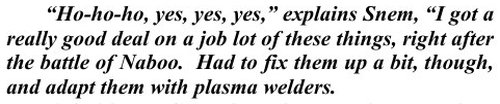

## p.7 (scan page 8)

Page contents: 880 words, 27 paragraphs | headings/entries: The droid nods. "Expediting, roger-roger."; The Way of the Force; Page 7

- **No single roster character (rules/setting/general)** — entry/section: Factory control droid: ""Errm, expedite— errrr— errrr— exterminate! Exterminate!"
"Oh, my," gasps Noonb, "oh, oh, oh--"" Source: *402 - Jedi Code - The Way of the Force* (SWRPG d20 Revised Core), p.7
  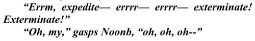

## p.8 (scan page 9)

Page contents: 929 words, 15 paragraphs | headings/entries: The Way of the Force; Encounter 3: Jumping Claim Jumpers; Page 8

## p.9 (scan page 10)

Page contents: 985 words, 23 paragraphs | headings/entries: The Way of the Force; Who are you? Wormies?"; Page 9

- **No single roster character (rules/setting/general)** — entry/section: Jag Murrock: ""Through the hole-- "
-- bweeowp! goes the blaster.
...
"That was your warning shot, Wormies. Reckon I don't want no claim jumpers on my rock."" Source: *402 - Jedi Code - The Way of the Force* (SWRPG d20 Revised Core), p.9
  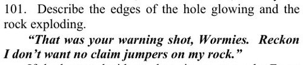
- **No single roster character (rules/setting/general)** — entry/section: Jag Murrock: "Who are you? "Name's Jag Murrock. Who're you Wormies?"" Source: *402 - Jedi Code - The Way of the Force* (SWRPG d20 Revised Core), p.9
  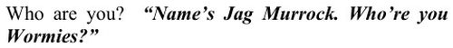

## p.3–9 (scan page 4)

Page contents: E1 Lanius' briefing; E2 Snem Noonb's factory and the droid revolt; E3 Jag Murrock's claim (hand-read)

## p.10 (scan page 11)

Page contents: 815 words, 21 paragraphs | headings/entries: The Way of the Force; Can we buy some of these? market."; Who? "None o' your durn business."; Page 10

- **No single roster character (rules/setting/general)** — entry/section: Jag Murrock: "But the Jedi have been taking crystals from this asteroid for years, I thought. "Oh, have they? That's mighty innerestin'. That would explain where they went."
(Protestations of misunderstanding.) "You jest let me worrit about that. Time for you to clear out."
How do we know this thing is genuine? "If you're so daft you can't recognize a proper claim, I can't prove it no better. Go ask the Registry. Now git."
Would you donate them to the Jedi? "Hey, I jest noticed sumpin'— it's durn foolish to try to spit inside a spacesuit."
You have something against Jedi? "Not partickilarly, though they're purty uppity folks. I got somethin' against throwin' away money."" Source: *402 - Jedi Code - The Way of the Force* (SWRPG d20 Revised Core), p.10
  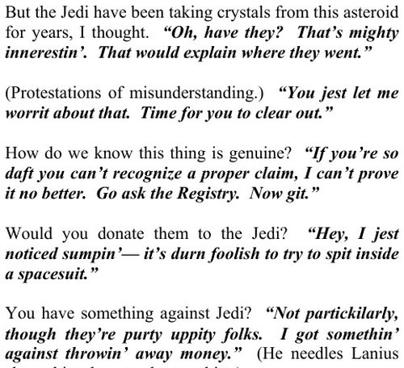
- **No single roster character (rules/setting/general)** — entry/section: Lanius Qel-Bertok: ""Sometimes, how you seek a thing is more important than if you find it. That, also, is part of the Way of the Force."" Source: *402 - Jedi Code - The Way of the Force* (SWRPG d20 Revised Core), p.10
  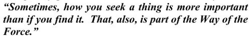

## p.11 (scan page 12)

Page contents: 955 words, 19 paragraphs | headings/entries: The Way of the Force; Page 11

- **No single roster character (rules/setting/general)** — entry/section: Lanius Qel-Bertok: ""The Academy is in your debt for your efforts. Another matter related to the Trials has come up quite recently. I was going to send out some others, but now that you're here..."
...
"You may recall I mentioned that we have a shipment of lightsaber energy cells coming in, from Coruscant, actually. It seems that the cells and some other goods were diverted to a smuggler's holdings. It appears as though the smugglers in question have diversified into theft. Information about this has come to me. Ordinarily I could go through local law enforcement, but in Tolea Biqua, that's pointless.
"Would you mind dropping over to Tolea Biqua and retrieving our package? I have no evidence that the smugglers' other items in their warehouse are illegal or stolen, so it wouldn't be appropriate to do anything else about the other goods. If they are absent, we'll content ourselves by leaving them this datacard-- "
...
"—with a warning to them. If they're actually there, and you think that you can arrest them without causing a major outburst in the area, feel free to do so and bring them here. Time is of the essence. We need to evaluate a critical Test in the next 24 hours."" Source: *402 - Jedi Code - The Way of the Force* (SWRPG d20 Revised Core), p.11
  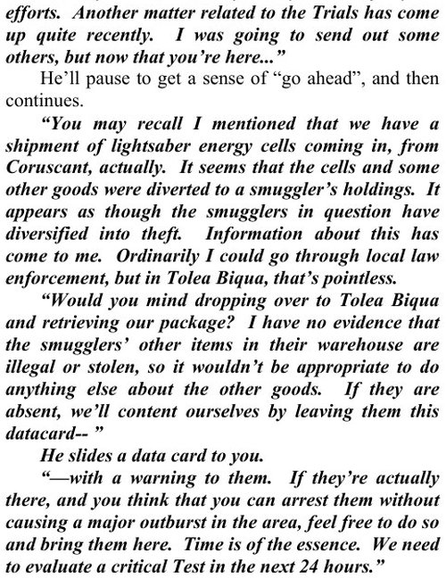
- **No single roster character (rules/setting/general)** — entry/section: Lanius Qel-Bertok: ""Cularin is in a time of shadow. There are many forces gathering against her—and against the Jedi. Some people who have seemed to be criminals or enemies have turned out to have the system's best interests at heart. Others, who seemed trustworthy, have showed themselves treacherous. What I would like you to accomplish is to get the energy cells back, with as little disturbance or recrimination against the Jedi as possible. Certainly, I would like to see no loss of life, or even serious injury, if it can possibly be avoided. If you are convinced that you have the smugglers, and that they can be arrested for the theft of our cells justly and safely, then do so. Otherwise, let your good sense, and, above all, your hearts, be your guide. And for those of you that do: trust to the Force."" Source: *402 - Jedi Code - The Way of the Force* (SWRPG d20 Revised Core), p.11
  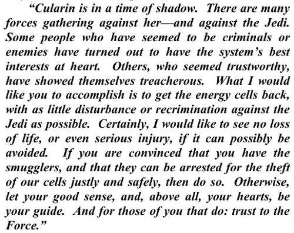

## p.12 (scan page 13)

Page contents: 1063 words, 18 paragraphs | headings/entries: The Way of the Force; Page 12

- **No single roster character (rules/setting/general)** — entry/section: Alto Janss: "One of Alto's people says, "Would serve 'em right", to which she shrugs, replying, "Maybe, maybe not. Anyway, it could have a tracer. Leave it."" Source: *402 - Jedi Code - The Way of the Force* (SWRPG d20 Revised Core), p.12
  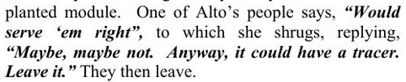
- **No single roster character (rules/setting/general)** — entry/section: Alto Janss: ""Fry the idiots."" Source: *402 - Jedi Code - The Way of the Force* (SWRPG d20 Revised Core), p.12
  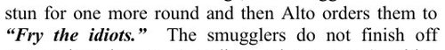

## p.13 (scan page 14)

Page contents: 871 words, 23 paragraphs | headings/entries: The Way of the Force; Page 13

- **No single roster character (rules/setting/general)** — entry/section: Griz: "A scarred Trandoshan of immense size grates out, "Null moves, civ-worms. Hand over energy cells. You in Rancor Rider territory."" Source: *402 - Jedi Code - The Way of the Force* (SWRPG d20 Revised Core), p.13
  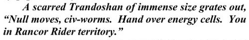
- **No single roster character (rules/setting/general)** — entry/section: Rancor Riders: "Do you have any idea who we are? "No." "Yeah, you're the civ-scivs who stole some cells. Now we're stealin' 'em." "Yeah, yeah, better answer."
These aren't the cells you're looking for. You couldn't use them or sell them. "Sure, civ. Just hand them over."
How did you know we have energy cells? "Hah, you admit it." "We got powerful contacts." "Yeah, we're not stupid."
Actually, you are pretty stupid. "Rancor Riders, Rumble!"" Source: *402 - Jedi Code - The Way of the Force* (SWRPG d20 Revised Core), p.13
  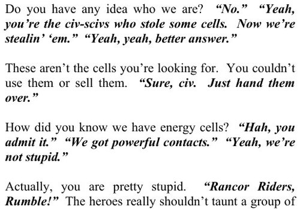

## p.14 (scan page 15)

Page contents: 793 words, 28 paragraphs | headings/entries: The Way of the Force; The Debriefing:; Page 14

## p.15 (scan page 16)

Page contents: 895 words, 33 paragraphs | headings/entries: Lanius, "ah, should I..."; The Way of the Force; Page 15

- **No single roster character (rules/setting/general)** — entry/section: Lanius Qel-Bertok: ""As these good people were telling me of the Test, and based on your earlier, transmitted report, it becomes clear that something I had feared may have indeed come to pass. But go and refresh yourself. There is still much of the evening to come. Has my other guest arrived?"" Source: *402 - Jedi Code - The Way of the Force* (SWRPG d20 Revised Core), p.15
  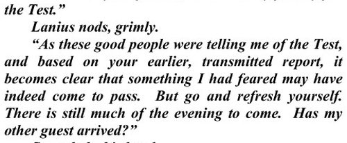
- **No single roster character (rules/setting/general)** — entry/section: Lanius Qel-Bertok: ""You were willing to spend the fruits of hard labor and dangerous adventure to help our Padawans. There are more ways than one to be a hero, and not all of them involve blaster fire or a large fanfare. Thank you."" Source: *402 - Jedi Code - The Way of the Force* (SWRPG d20 Revised Core), p.15
  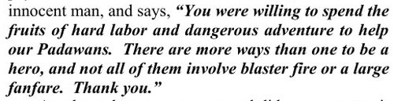

## p.16 (scan page 17)

Page contents: 931 words, 17 paragraphs | headings/entries: The Way of the Force; The Lesson:; Page 16

- **No single roster character (rules/setting/general)** — entry/section: Lanius Qel-Bertok: ""There are some others who would also like to ask you some questions regarding your 'Trials', my friends. I would be further in your debt if you would do me the honor of speaking with them."" Source: *402 - Jedi Code - The Way of the Force* (SWRPG d20 Revised Core), p.16
  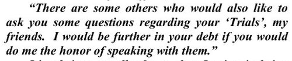

## p.17 (scan page 18)

Page contents: 898 words, 33 paragraphs | headings/entries: The Way of the Force; Page 17

- **No single roster character (rules/setting/general)** — entry/section: Padawan: ""Master, the kitchen sent some refreshment," the Padawan says.
"Thank you," replies an unseen, urbane voice, with undertones of power and dignity, "please come in."" Source: *402 - Jedi Code - The Way of the Force* (SWRPG d20 Revised Core), p.17
  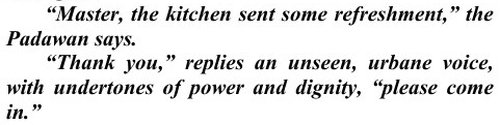
- **No single roster character (rules/setting/general)** — entry/section: Lanius Qel-Bertok: ""Padawan learners," says Lanius, "as you all know, our Academy has been the center of some controversy for years. Some of you have been here since a very young age. Others have joined us later in life, and ours is the only Jedi Academy currently allowed to do this.
"You know that my philosophy has always been that we have much to learn from the world around us, and from all its people. However, that learning is not restricted to those who have first lived in the universe outside our Order and who have then felt drawn to it. All can offer us wisdom. Tonight, we have brought you some of the best. Ask, and learn..."" Source: *402 - Jedi Code - The Way of the Force* (SWRPG d20 Revised Core), p.17
  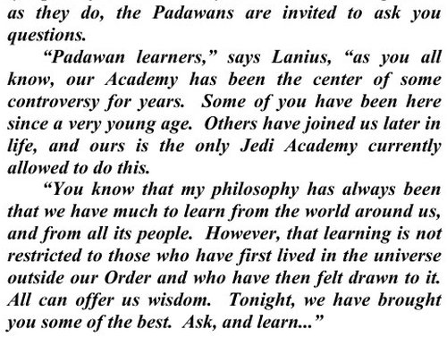
- **No single roster character (rules/setting/general)** — entry/section: Lanius Qel-Bertok: ""This is the strength of the Light Side: not the quick and easy path of aggression, not the cruel and prideful path of imposing one's will by force.
"How you pursue a thing is as important as finding it.
"The Way of the Force is to cherish life, to seek, always, alternatives to harm, to never even use the powers of the Force unless all other avenues have been exhausted. If we live in harmony with others, if they see our healing, and negotiation, and willingness to sacrifice our own safety for their well being, then we will be able to work hand in hand with all species.
"We must not let arrogance, pride, fear, or foolishness spur us to take action where action is not needed, to flaunt our prowess where it is not wanted, to impose our will, or even what we believe is the will of the Force. That way lies the path to the Dark Side. We are the servants of the Way of the Force, but it is not everyone's Way.
"As one of my own teachers once said, 'If fear us they do, hate us they will.'
"Well, Padawans, this evening's finished. Do you have anything to say?"" Source: *402 - Jedi Code - The Way of the Force* (SWRPG d20 Revised Core), p.17
  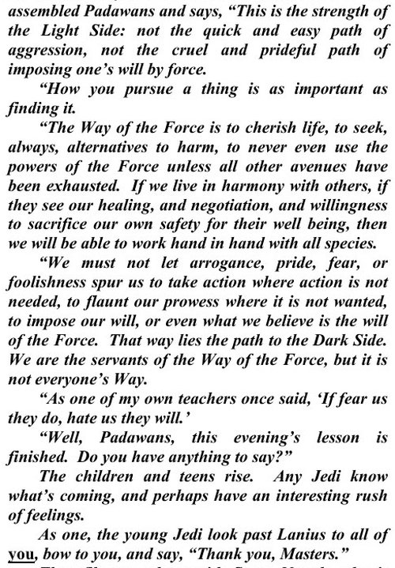
- **No single roster character (rules/setting/general)** — entry/section: Almas Padawans: "As one, the young Jedi look past Lanius to all of you, bow to you, and say, "Thank you, Masters."" Source: *402 - Jedi Code - The Way of the Force* (SWRPG d20 Revised Core), p.17
  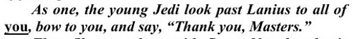

## p.9–17 (scan page 10)

Page contents: E4 the energy cells and Alto Janss' smugglers; E5 the Rancor Riders; E6 debriefing, grading and The Lesson; E7 Ki-Adi-Mundi's verdict and the Black Queen mission (hand-read)

## p.18 (scan page 19)

Page contents: 849 words, 26 paragraphs | headings/entries: Encounter 7: Setting Up the Board; Ki-Adi-Mundi turns to Lanius and says:; The Way of the Force; Conclusion; Page 18

- **Ki-Adi-Mundi** — entry/section: Lanius Qel-Bertok: ""<Insert hero names>, I have the honor to introduce to you Master Ki-Adi-Mundi, member of the Jedi Council, of the Jedi Temple on Coruscant."" Source: *402 - Jedi Code - The Way of the Force* (SWRPG d20 Revised Core), p.18
  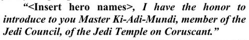
- **Ki-Adi-Mundi** — entry/section: Ki-Adi-Mundi: ""Please," he says, "let us all sit. I have been observing your lesson with great interest, teachers. But talking is dry work, and there are refreshments here."" Source: *402 - Jedi Code - The Way of the Force* (SWRPG d20 Revised Core), p.18
  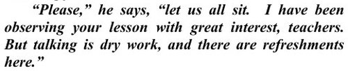
- **Ki-Adi-Mundi** — entry/section: Ki-Adi-Mundi: ""As we Cereans are fond of saying, there are many sides to arguments, and many ways of accomplishing the same goal. As you yourselves have proven."" Source: *402 - Jedi Code - The Way of the Force* (SWRPG d20 Revised Core), p.18
  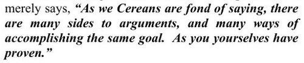
- **Ki-Adi-Mundi; Yoda** — entry/section: Ki-Adi-Mundi: ""I can now see why Master Yoda, when he sent me here, said that he wanted a Jedi who could carefully weigh both sides of an argument. It is as you have said, Master Qel-Bertok. The Jedi of Cularin, at least, can stand to benefit from the worldly wisdom afforded by those from outside the Order. They can also learn from those who have come late to join it. I still perceive great dangers in your unorthodox methods, but I have decided that they are balanced by the benefits."" Source: *402 - Jedi Code - The Way of the Force* (SWRPG d20 Revised Core), p.18
  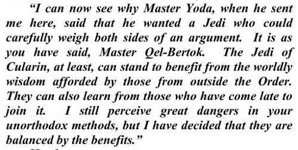
- **Ki-Adi-Mundi** — entry/section: Ki-Adi-Mundi: ""So, Lanius, since you placed so much faith in these people, to put your own future and the future of this Academy in their hands, I do not think that you will mind them hearing the results of your Trial: your probationary period is at an end. You are confirmed as Master of this Academy, and its tenure is extended.
"With the current upheaval, I will not hide from these good people that some argued that this Academy be closed. It is still a worry that further controversy about the Jedi, and our methods and training, could add fuel to the fires of mistrust."" Source: *402 - Jedi Code - The Way of the Force* (SWRPG d20 Revised Core), p.18
  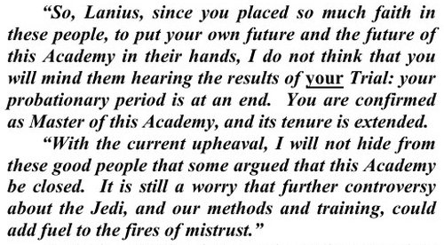
- **No single roster character (rules/setting/general)** — entry/section: Lanius Qel-Bertok: ""I have found out, from Snem Noonb, and based upon the reports of our helpers, here, that the Test of the Droid factory was tampered with, to make it more lethal than intended. It also seems that the incidents involving the smugglers and the street gang were set up from outside. Only someone who knew the parameters of this part of the Trials could have done so. Only one of our own students."
...
"In the midst of this evening's joy, sadness. My friends," he says, turning to you, "I have once or two last inquiries to make, but I am convinced that one of the Almas Academy's former students is now a criminal known as The Black Queen. She must be found and brought back to us, or she must be dealt with.
"For a mission of this sensitivity, I can think of no people better to ask than those I would entrust with teaching our Padawans. This would be a dangerous mission. Will you undertake it?" Source: *402 - Jedi Code - The Way of the Force* (SWRPG d20 Revised Core), p.18
  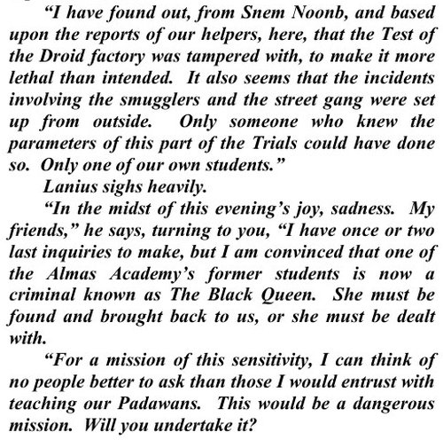

## p.19 (scan page 20)

Page contents: 694 words, 26 paragraphs | headings/entries: Here Ends "The Way of the Force"; Experience Point Summary; Adventure Experience Award:; The Way of the Force; Loot Summary; Page 19

- **No single roster character (rules/setting/general)** — entry/section: Closing crawl: "A milestone has been reached and passed in the history of the Almas Jedi Academy. Both the Academy and its Master have been tested and found sufficient, thanks to the heroes of Cularin.
Now, another danger looms, as the power of the Dark Side beckons...but that, as they say, is another tale." Source: *402 - Jedi Code - The Way of the Force* (SWRPG d20 Revised Core), p.19
  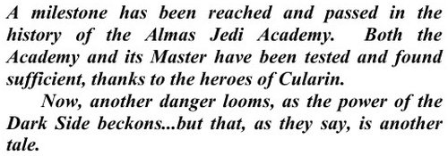
- **No single roster character (rules/setting/general)** — entry/section: Adegan Crystal: "This crystal was put into the keeping of the hero named above by Master Lanius of the Almas Academy. It is pale and about the size of a Human child's fist, with odd markings on each of 20 faces. It is strong in the Force, but also somewhat unstable. Its ultimate uses are as yet unknown." Source: *402 - Jedi Code - The Way of the Force* (SWRPG d20 Revised Core), p.19
  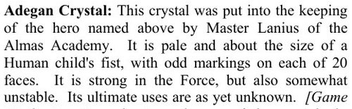

## p.20 (scan page 21)

Page contents: 645 words, 20 paragraphs | headings/entries: Complete success only, Jedi Only:; For Jedi heroes levels 1-3; For Jedi heroes levels 4-6; The Way of the Force; Page 20

- **Ki-Adi-Mundi; Yoda** — entry/section: Commendation from Master Ki-Adi-Mundi: "From Ki-Adi-Mundi to Master Yoda and the Jedi Council at Coruscant. As a result of events that occurred during the Jedi Trials on Almas, I would like to commend to your attention the individual named above, who has shown exceptional sensitivity and understanding of the way of the Force even at this early point in training. Signed: Ki-Adi-Mundi, Witnessed: Lanius Qel-Bertuk" Source: *402 - Jedi Code - The Way of the Force* (SWRPG d20 Revised Core), p.20
  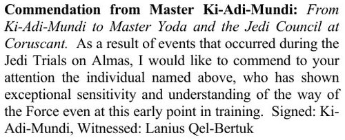
- **Ki-Adi-Mundi; Yoda** — entry/section: Commendation from Master Ki-Adi-Mundi: "From Ki-Adi-Mundi to Master Yoda and the Jedi Council at Coruscant. As a result of events that occurred during the Jedi Trials on Almas, I would like to commend to your attention the individual named above, who should be considered to have successfully completed the Jedi Trials, presuming that the level of Jedi Knight is attained and that this Padawan continues in such exemplary service. Signed: Ki-Adi-Mundi, Witnessed: Lanius Qel-Bertuk" Source: *402 - Jedi Code - The Way of the Force* (SWRPG d20 Revised Core), p.20
  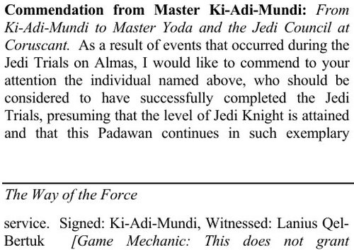
- **Ki-Adi-Mundi; Yoda** — entry/section: Commendation from Master Ki-Adi-Mundi: "From Ki-Adi-Mundi to Master Yoda and the Jedi Council at Coruscant. As a result of events that occurred during the Jedi Trials on Almas, I would like to commend to your attention the individual named above, who has shown exceptional sensitivity and understanding of the way of the Force. Should this Knight ever decide to retire to Coruscant the Jedi Temple would gain an excellent instructor. Signed: Ki-Adi-Mundi, Witnessed: Lanius Qel-Bertuk" Source: *402 - Jedi Code - The Way of the Force* (SWRPG d20 Revised Core), p.20
  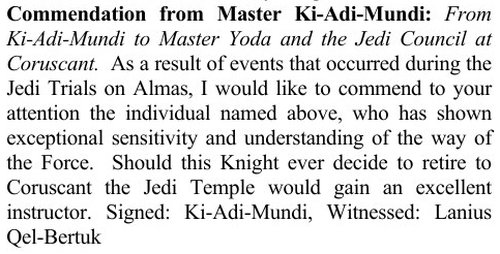
- **Ki-Adi-Mundi; Yoda** — entry/section: Commendation from Master Ki-Adi-Mundi: "From Ki-Adi-Mundi to Master Yoda and the Jedi Council at Coruscant.As a result of events that occurred during the Jedi Trials on Almas, I would like to commend to your attention the individual named above, who has shown exceptional sensitivity and understanding of the way of the Force and has successfully completed the Jedi Trials, attaining the level of Jedi Knight. Signed: Ki-Adi-Mundi, Witnessed: Lanius Qel-Bertuk" Source: *402 - Jedi Code - The Way of the Force* (SWRPG d20 Revised Core), p.20
  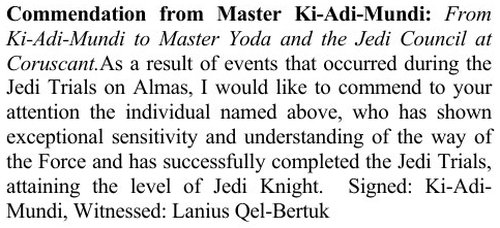

## p.21 (scan page 22)

Page contents: 159 words, 17 paragraphs | headings/entries: Class: Space Transport; Size: Small (26.7 meters); Hyperdrive: x2, x12 backup; Passengers: 6; Cargo Capacity: 100 metric tons; Consumables: 2 months; Cost: 150,000 (new), 37,500 (used); Crew: | or 2; Initiative: +1 size, plus crew mod; Shield Points: 30 (DR 10) (A modification); Hull Points: 120 (DR 10); The Way of the Force Page 21

## p.22 (scan page 23)

Page contents: 793 words, 25 paragraphs | headings/entries: GM Aid #1: NPC Statistics; Encounter #2: Robotnik, Or Is_ That; Droidnik?; Numbers of Droids:; The Way of the Force; Low Tier (levels 1-3); Mid Tier (levels 4-6); Page 22

## p.23 (scan page 24)

Page contents: 802 words, 22 paragraphs | headings/entries: High and Upper Tiers (levels 7-12); The Way of the Force; Low Tier (levels 1-3); Page 23

- **No single roster character (rules/setting/general)** — entry/section: Alto Janss: "Description: she has auburn hair, hazel eyes, is very good looking. High cheekbones, coffee-andcream skin. Her hair is cut short but feminine. She is all business now, but can out-con and out-negotiate just about anyone she's met." Source: *402 - Jedi Code - The Way of the Force* (SWRPG d20 Revised Core), p.23
  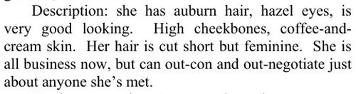

## p.24 (scan page 25)

Page contents: 766 words, 29 paragraphs | headings/entries: Feats: Improved Initiative, Point Blank Shot; Middle tier (levels 4-6); The Way of the Force; Encounter 5: Interlude: Sitting Ducks. No,; Page 24

## p.25 (scan page 26)

Page contents: 203 words, 8 paragraphs | headings/entries: The Way of the Force; Page 25

## p.26 (scan page 27)

Page contents: 159 words, 17 paragraphs | headings/entries: Class: Space Transport; Size: Small (26.7 meters); Hyperdrive: x2, x12 backup; Passengers: 6; Cargo Capacity: 100 metric tons; Consumables: 2 months; Cost: 150,000 (new), 37,500 (used); Crew: | or 2; Initiative: +1 size, plus crew mod; Shield Points: 30 (DR 10) (A modification); Hull Points: 120 (DR 10); The Way of the Force Page 26

## p.27 (scan page 28)

Page contents: 85 words, 5 paragraphs | headings/entries: Machinery Pillar; The Way of the Force Page 27

## p.28 (scan page 29)

Page contents: 71 words, 4 paragraphs | headings/entries: The Way of the Force; Page 28

## p.29 (scan page 30)

Page contents: 772 words, 22 paragraphs | headings/entries: Legend:; The Way of the Force; Page 29

- **No single roster character (rules/setting/general)** — entry/section: Binks Enterprises spokesbeing: "Okie-day! Yousa usin' dese rules to— nope, sorry, going to have to translate for the Binks Enterprises spokesbeing." Source: *402 - Jedi Code - The Way of the Force* (SWRPG d20 Revised Core), p.29
  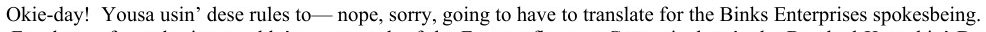

## p.30 (scan page 31)

Page contents: 351 words, 14 paragraphs | headings/entries: Roll | Result Roll | Result; The Control Nexus:; The Way of the Force Page 30

## p.18–30 (scan page 19)

Page contents: Conclusion crawl; XP; loot certificates; Seeker; NPC stats; factory map and minigame rules; critical event summary (hand-read)

## p.31 (scan page 32)

Page contents: 128 words, 9 paragraphs | headings/entries: OC Yes CINo; GM Name, RPGA#:; GM Email Address:; Convention Name/Date; The Way of the Force Page 31

