# Owner Material 037 — Star Wars D20 Drive folder (Core, Revised Core and Saga Edition): Living Force Campaign/Adventures/Among the Stars/Year 4/403 - Jedi Code - The Dark Side Beckons.pdf [Star Wars Roleplaying Game Revised Core (d20, 2002)]

- **Source:** Wizards of the Coast Star Wars Roleplaying Game books, web enhancements, Living Force campaign modules and articles (2000–2010), from the owner's "Star Wars D20" Drive folder (only the three edition subfolders; "General" was not read, as instructed). Secondary source (licensed Legends reference). Scan OCR'd on the box; the scan stays box-only and is **not** published.
- **Method:** every scanned page was OCR'd and machine-screened sentence by sentence for power-relevant statements (fights, kills, defeats, Force feats, rankings, superweapons) that name a character on our roster; each kept sentence is quoted verbatim from the OCR text and has a crop of the printed passage directly under it. Pages with nothing power-relevant are still listed with what is on them.
- **Citation:** "*403 - Jedi Code - The Dark Side Beckons* (SWRPG d20 Revised Core), p.X" by printed page ("scan p.X" where no printed number applies). **Weight:** Licensed RPG material: a secondary source. Narrative text sums up Legends lore; game statistics are rules for players, not canon power levels, and rank lowest.

## p.1 (scan page 1)

Page contents: 180 words, 7 paragraphs | headings/entries: LFA403; The Dark Side Beckons

- **No single roster character (rules/setting/general)** — entry/section: Blurb: "The Almas Academy has come to know that it can trust Cularin's heroes, even those who do not always agree with the Jedi traditions. Master Lanius again seeks your aid, this time to bring in the Black Queen. She was once an Almas student -- is she now Cularin's latest crimelord?" Source: *403 - Jedi Code - The Dark Side Beckons* (SWRPG d20 Revised Core), p.1
  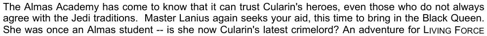

## p.2 (scan page 2)

Page contents: 850 words, 21 paragraphs | headings/entries: House Rules; Atoning for Dark Side Points; Dissipate Energy; The Dark Side Beckons; Illusion; Stun; Hero Earnings; Page 2

## p.3 (scan page 3)

Page contents: 827 words, 19 paragraphs | headings/entries: The Dark Side Beckons; GM Overview; Page 3

## p.4 (scan page 4)

Page contents: 907 words, 27 paragraphs | headings/entries: Important Note to Judges:; The Dark Side Beckons; Page 4

## p.5 (scan page 5)

Page contents: 778 words, 24 paragraphs | headings/entries: Opening Crawl; The Dark Side Beckons; Page 5

- **No single roster character (rules/setting/general)** — entry/section: Opening crawl: "The Almas Academy Jedi Trials have ended. In the Great Hall, where some of Cularin's heroes recently instructed students in the Way of the Force, the final lesson of the Trials is taught. The Narrator is a special guest and almost all the members of the Academy who are not occupied with important duties are there, listening.
The heroes of Cularin, too, are there, and are finding the story very, very personally involving." Source: *403 - Jedi Code - The Dark Side Beckons* (SWRPG d20 Revised Core), p.5
  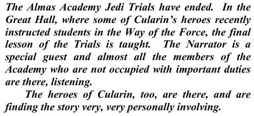
- **No single roster character (rules/setting/general)** — entry/section: The Storyteller: ""Master Lanius Qel-Bertuk was seated in his office, with a number of Cularin's adventuresome individualists, entrepreneurs — heroes. He had assembled them for a mission as sensitive as it was perilous, as dark as it was essential,"" Source: *403 - Jedi Code - The Dark Side Beckons* (SWRPG d20 Revised Core), p.5
  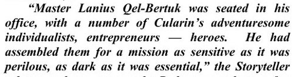
- **No single roster character (rules/setting/general)** — entry/section: Lanius Qel-Bertok: ""Thank you for coming once more," Master Lanius says to you. "After all that happened during your collection of those items that we needed for the Trials, it was obvious that something would have to be done. I have called upon my sources of information, and I have confirmed that the criminal individual known as the Black Queen was responsible for altering the Tests. Also, I have confirmed that she is a former member of this Academy.
"To put it simply, I would like you to track her down and bring her in, if possible."" Source: *403 - Jedi Code - The Dark Side Beckons* (SWRPG d20 Revised Core), p.5
  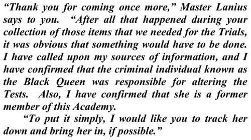

## p.6 (scan page 6)

Page contents: 920 words, 16 paragraphs | headings/entries: The Dark Side Beckons; Page 6

- **No single roster character (rules/setting/general)** — entry/section: Lanius Qel-Bertok: "Why did she leave the Academy? "Zelice disagreed with my basic philosophy. She was a Jedi trained from infancy. She always was sensitive to the slightest failing in Padawans who had joined us later in life, and felt that they were not 'worthy' to become Jedi Knights. That was the error of pride and elitism, of course, one of the main things that I am trying to avoid with Almas graduates. When she became a Knight, she resisted being partnered with 'Latecomers', as she called them. I insisted. As it turned out, her first partner who was not Jedi-trained from infancy did poorly on his first mission. Sadly, he did not survive it. She was distraught at his death and vowed that she would never again partner with a 'Latecomer'. I indicated that that decision could not be hers alone. She went into seclusion shortly thereafter, indicating that she had to come to terms with her thoughts and feelings. We respected that need. Then after a few months, she dropped out of sight, after accepting a solo mission to investigate some criminal action on Tolea Biqua. We knew that she was still alive; she sent a message saying that it was going well. Since then, so many things have happened to occupy us that I could not make tracking her down a very high priority. Only when it became a concern that she might not be intending to return, and might be turning down the dark path, did I make earnest inquiry. The result is this meeting."" Source: *403 - Jedi Code - The Dark Side Beckons* (SWRPG d20 Revised Core), p.6
  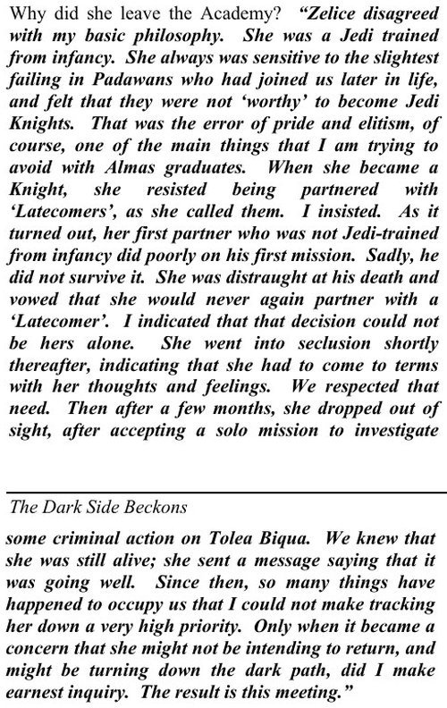
- **No single roster character (rules/setting/general)** — entry/section: Lanius Qel-Bertok: "How powerful is Zelice Sturm (low to high tier tables)? Lanius looks bleak. "She is a fully-trained Jedi Knight who has left our Order without sanction or explanation. She is very powerful, as most measure power. She has been absent for two years and she may have progressed on her own, or with the wrong sort of help. My belief is that she was in the Cularin system when it disappeared."
How powerful is she (upper tier table, where the Black Queen is level 12)? Lanius looks bleak. "She trained with me from childhood, for 20 years. She is one of our most powerful graduates, not much weaker in the Force than I. Had she remained with us, she would be a Master and teacher. I still find it difficult to believe that she could go astray. She has been absent for two years and she may have progressed on her own, or with the wrong sort of help. My belief is that she was in the Cularin system when it disappeared."" Source: *403 - Jedi Code - The Dark Side Beckons* (SWRPG d20 Revised Core), p.6
  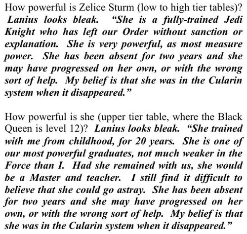
- **No single roster character (rules/setting/general)** — entry/section: Lanius Qel-Bertok: "What makes you think we can take her? "I would advise against turning this into a fight. I am hoping that you can find her and convince her to come in and talk. If you think the situation too dangerous, you can also call for help. If you do make contact and feel that your group is a match for her, then if she won't come voluntarily, she should be captured, for her own good. I fear that she is falling towards the dark side."
If it gets to a fight, we might have to kill her—strictly in self-defense, of course. Pain washes over Lanius' face for an instant, and then submerges. "I have called upon you because I trust that you will do the right thing. I do not expect you to sacrifice yourselves to save her. If it comes to that, and if there is no other way, do what you must do."" Source: *403 - Jedi Code - The Dark Side Beckons* (SWRPG d20 Revised Core), p.6
  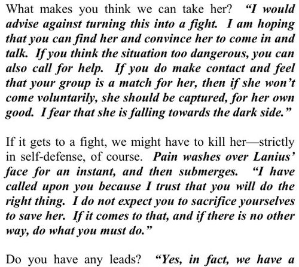

## p.7 (scan page 7)

Page contents: 926 words, 14 paragraphs | headings/entries: The Dark Side Beckons; Page 7

- **No single roster character (rules/setting/general)** — entry/section: Lanius Qel-Bertok: "What are you paying us? "What do you want? With the current anti-Jedi sentiments being stirred up by those who would divide the system, I do not wish to send a full team of Almas Jedi to do this. We are also needed in too many places. I have called upon you because you have shown yourselves trustworthy. Of course, we'll certainly cover reasonable expenses, up to 1000 credits. Do you require more?"" Source: *403 - Jedi Code - The Dark Side Beckons* (SWRPG d20 Revised Core), p.7
  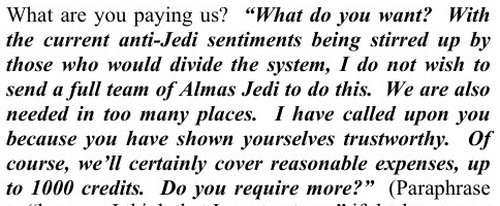

## p.1–7 (scan page 1)

Page contents: Title, blurb, house rules, GM overview with the secret Narrator and reward stages, opening crawl, E1 Lanius' briefing on Zelice Sturm (hand-read)

## p.8 (scan page 8)

Page contents: 932 words, 25 paragraphs | headings/entries: The Dark Side Beckons; If she had to call them:; Page 8

- **No single roster character (rules/setting/general)** — entry/section: Tolea Biqua: "As your ship drops into the clouds of Genarius, towards Tolea Biqua, the city gleams like some multifaceted rainbow gem— until you can get a good look. Then it looks like what happens about 5 minutes after your pet eats a set of miniature plastic buildings, complete with the colorful wrapper.
This testimony to the bad taste and extravagance of the vanished Riboga the Hutt could drop into the gas giant and leave no city planner unhappy. Yet, it is crowded and full of commerce of all sorts, legal and illegal. It isn't a "wretched hive"; it's a whole wretched metropolis." Source: *403 - Jedi Code - The Dark Side Beckons* (SWRPG d20 Revised Core), p.8
  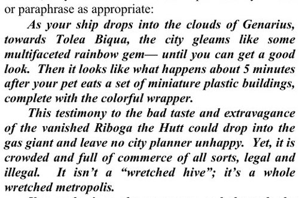

## p.9 (scan page 9)

Page contents: 936 words, 29 paragraphs | headings/entries: Follow either of the above with:; The Dark Side Beckons; Page 9

- **No single roster character (rules/setting/general)** — entry/section: Zelice Sturm as Pindy Streeto: ""There's two places in there, and two people. One's a courier for the Black Queen's gang, a Toydarian named Berpo. He's a real slime grub. He'd knife someone in the back for pocket creds; in fact I've seen him do it. He may be carrying a message for her. The place is where he usually hangs out while waiting to make his contact. It's called the Near Vacuum Cantina.
"The other's part of her gang. He's a Devaronian named Oxvar Niph. I'm not sure what his job is in the gang, but he's important. He works in the starport, has something to do with the stuff that gets shipped in and out. So, he probably helps the gang steal or smuggle stuff. I heard he keeps some stuff in a stash in his office, somewhere. You could try to find them, or put the muscle on him. He doesn't have a house, lives out of his recreational speeder, so I can't tell you where to roust him.
"Either of them could be a good lead, or could come up blank, but they're your best bet."" Source: *403 - Jedi Code - The Dark Side Beckons* (SWRPG d20 Revised Core), p.9
  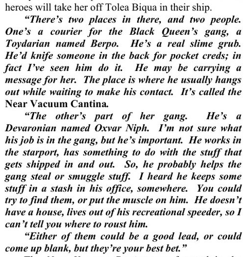

## p.10 (scan page 10)

Page contents: 964 words, 18 paragraphs | headings/entries: The events in the warehouse:; The Dark Side Beckons; Page 10

## p.11 (scan page 11)

Page contents: 914 words, 15 paragraphs | headings/entries: The Dark Side Beckons; Encounter 3: Exchange of Pawns: Refused; Page 11

- **No single roster character (rules/setting/general)** — entry/section: Zelice Sturm as Pindy Streeto: ""all those rules seem pretty silly to anyone with some real life experience, don't they?"" Source: *403 - Jedi Code - The Dark Side Beckons* (SWRPG d20 Revised Core), p.11
  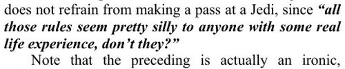
- **No single roster character (rules/setting/general)** — entry/section: Near Vacuum Cantina: "It's a Spacer Bar, but its inside is about as tasteless as all of Tolea Biqua's outsides are. There's a phony holo-starscape flickering on the ceiling and walls. Waitresses wear ludicrous "spacesuits" with transparent arms, legs and midriffs. The Gamorrean waitress should really have an opaque suit. Really. But nobody's telling her that.
Still, the cantina is reasonably clean and the drinks are decent, and not too overpriced. There's a live band that's still playing a recent razzu tune that's pretty catchy. It will probably make its way out to cantinas in wretched hives of scum and villainy on Rimworlds in about twenty years or so." Source: *403 - Jedi Code - The Dark Side Beckons* (SWRPG d20 Revised Core), p.11
  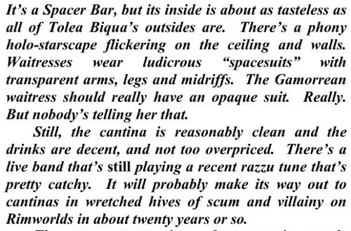

## p.12 (scan page 12)

Page contents: 899 words, 24 paragraphs | headings/entries: The Dark Side Beckons; Page 12

- **No single roster character (rules/setting/general)** — entry/section: Berpo: ""Back off! Anyone comes closer, I kill her! Just get out of here and leave me alone! I fly, or she dies!"" Source: *403 - Jedi Code - The Dark Side Beckons* (SWRPG d20 Revised Core), p.12
  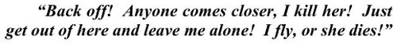

## p.13 (scan page 13)

Page contents: 965 words, 16 paragraphs | headings/entries: Some possible actions and results:; The Dark Side Beckons; Page 13

## p.14 (scan page 14)

Page contents: 897 words, 22 paragraphs | headings/entries: The Dark Side Beckons; Page 14

## p.15 (scan page 15)

Page contents: 1029 words, 15 paragraphs | headings/entries: The Dark Side Beckons; Page 15

## p.16 (scan page 16)

Page contents: 1029 words, 20 paragraphs | headings/entries: The Dark Side Beckons; Page 16

## p.7–16 (scan page 7)

Page contents: E2 the false Pindy and the Defel ambush; E3 Berpo's hostage standoff in the Near Vacuum Cantina; E4 Oxvar Niph, the RV ambush and the freighter rescue (hand-read)

## p.17 (scan page 17)

Page contents: 840 words, 26 paragraphs | headings/entries: The Dark Side Beckons; Page 17

- **No single roster character (rules/setting/general)** — entry/section: Dark Edge Dancetorium holo: ""Re-opening for One Night Only, the Dark Edge Dancetorium. Come on in and dance with us. We have exactly <hero number> places left. Hurry, or you'll miss the show."" Source: *403 - Jedi Code - The Dark Side Beckons* (SWRPG d20 Revised Core), p.17
  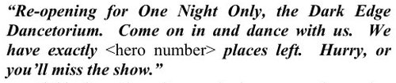
- **No single roster character (rules/setting/general)** — entry/section: Zelice Sturm: "Down on the "dance floor" is the object of your search: the Black Queen. She is certainly kitted out to suit her new name: gone are the austere robes of a Jedi. They have been replaced with a form-fitting costume that seems to be composed of an articulated series of leather bands, running from her neck to her calves. At first glance, they are black, but then you see that they are actually an extremely dark green, the color of some exotic plants you've seen. The clothing is accented with far too many steel buckles and studs for them all to be functional: if the effect is intended to convey menace, it certainly does the job. She wears a hooded half-cape of slate gray, with the hood down.
Zelice Sturm looks to be in her late twenties, but that could be deceiving.
...
Her skin is paler, suggesting a lot of time spent indoors or out only at night. Her hair is a glossy black; so black it seems almost to have blue highlights." Source: *403 - Jedi Code - The Dark Side Beckons* (SWRPG d20 Revised Core), p.17
  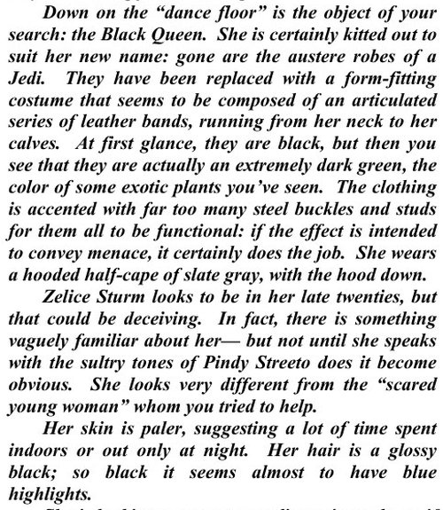
- **No single roster character (rules/setting/general)** — entry/section: Zelice Sturm: ""So, shall we get down to the business of killing each other, 'heroes', or do you have anything that you want to say first? Lanius always loved talk."" Source: *403 - Jedi Code - The Dark Side Beckons* (SWRPG d20 Revised Core), p.17
  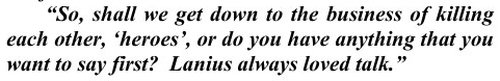

## p.18 (scan page 18)

Page contents: 909 words, 22 paragraphs | headings/entries: The Dark Side Beckons; Page 18

- **No single roster character (rules/setting/general)** — entry/section: Zelice Sturm: ""So be it. Your choice, 'heroes'."" Source: *403 - Jedi Code - The Dark Side Beckons* (SWRPG d20 Revised Core), p.18
  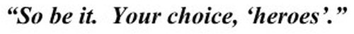

## p.19 (scan page 19)

Page contents: 1016 words, 22 paragraphs | headings/entries: The Dark Side Beckons; Page 19

- **No single roster character (rules/setting/general)** — entry/section: Zelice Sturm: ""Don't try that again, unless you want a fight on your hands. Do you think there's any point to giving amnesty to a killer who still has a blaster pointed at you? There's no easy out for me."" Source: *403 - Jedi Code - The Dark Side Beckons* (SWRPG d20 Revised Core), p.19
  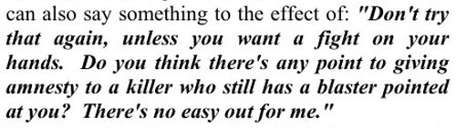

## p.20 (scan page 20)

Page contents: 820 words, 34 paragraphs | headings/entries: Result Dmg_ Spirit Site; The Dark Side Beckons; Mod Source; Page 20

- **No single roster character (rules/setting/general)** — entry/section: Turning point: ""Sometimes a contest of philosophies is more exhausting than a battle with blasters. It is obvious that you are not just trying to convince Zelice Sturm to return to Almas for judgment: you are waging a battle for her spirit, which has begun the downward spiral to the dark side. Despite her arguments, Zelice has hung upon your every word with the intensity of a drowning woman watching a lifeline. The question now is: will she grasp it and be saved, or will she doom herself forever to be a pawn to the dark side of the Force?"" Source: *403 - Jedi Code - The Dark Side Beckons* (SWRPG d20 Revised Core), p.20
  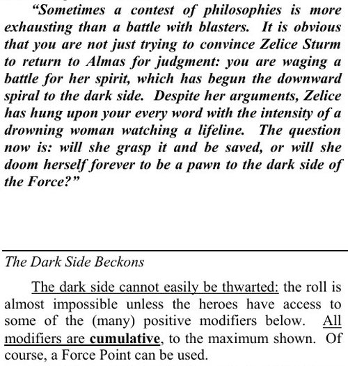

## p.21 (scan page 21)

Page contents: 997 words, 19 paragraphs | headings/entries: The Dark Side Beckons; Page 21

## p.22 (scan page 22)

Page contents: 910 words, 29 paragraphs | headings/entries: The Dark Side Beckons; Page 22

- **No single roster character (rules/setting/general)** — entry/section: Zelice Sturm: "Zelice has been looking at the floor for the last minute. She looks up, and there are tears in her eyes. Her right arm extends out from her body, sideways, her fingers curled lightly around her lightsaber. There is the characteristic click and rushing hum as it ignites. It is a brilliant, emerald green.
"I accept that you truly believe that what you say is the truth. But it is not. And now I have to show you. I have had reports of all of those wonderful things you have done as you've tried to help Lanius. But in the end, you're just too good at what you do. You always win -- because you outclass your opponents. That is the weakness of the Jedi Code. What do you do if your opponent is simply more powerful than you, simply a better killer? As I am.
"Can you still be a hero, if you cannot win?"
...
"All you can do, in the end, is kill me. There is your truth."" Source: *403 - Jedi Code - The Dark Side Beckons* (SWRPG d20 Revised Core), p.22
  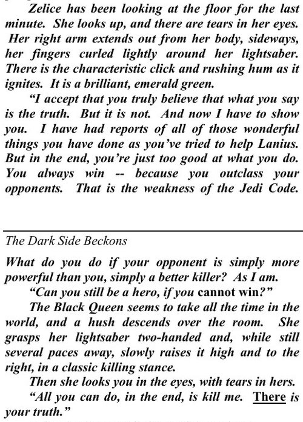

## p.23 (scan page 23)

Page contents: 962 words, 26 paragraphs | headings/entries: Isn't that right?"; The Dark Side Beckons; Page 23

- **No single roster character (rules/setting/general)** — entry/section: Zelice Sturm: ""What's the matter with you? Don't you understand that you're going to die? What use is a dead hero?"" Source: *403 - Jedi Code - The Dark Side Beckons* (SWRPG d20 Revised Core), p.23
  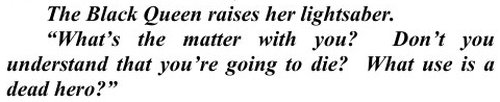
- **No single roster character (rules/setting/general)** — entry/section: Zelice Sturm: "Time grinds to a halt: The Black Queen moves forward jerkily, like some impossible marionette. Her face is working. She looks at you with something that could be love, or hate, or both.
You have never felt so connected to Life, to the Force, to whatever they call it, before.
The lightsaber sweeps down in its terrible arc—" Source: *403 - Jedi Code - The Dark Side Beckons* (SWRPG d20 Revised Core), p.23
  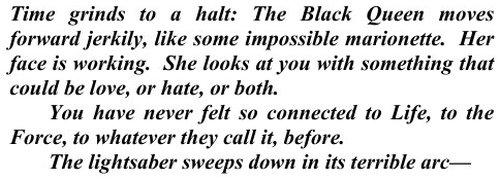

## p.24 (scan page 24)

Page contents: 830 words, 33 paragraphs | headings/entries: Pause for just a moment, then:; The Dark Side Beckons; Page 24

- **No single roster character (rules/setting/general)** — entry/section: Zelice Sturm: "The lightsaber sweeps down in its terrible arc— and at the last instant, the blade flickers out of existence.
Zelice drops the lightsaber.
"Perhaps... perhaps you're right. In the end, only what you make of your life matters, not how much of it you have.
"It's over. Thank the Force, it's over."" Source: *403 - Jedi Code - The Dark Side Beckons* (SWRPG d20 Revised Core), p.24
  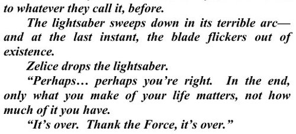
- **No single roster character (rules/setting/general)** — entry/section: Black Queen's gangsters: ""You're nuts to fight these guys!" "You'll get us all killed!"" Source: *403 - Jedi Code - The Dark Side Beckons* (SWRPG d20 Revised Core), p.24
  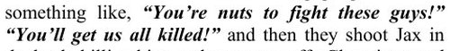
- **Jax Pavan**: ""You'll get us all killed!" and then they shoot Jax in the back, killing him, and try to run off." Source: *403 - Jedi Code - The Dark Side Beckons* (SWRPG d20 Revised Core), p.24
  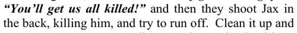

## p.25 (scan page 25)

Page contents: 886 words, 27 paragraphs | headings/entries: The Dark Side Beckons; Page 25

- **Ki-Adi-Mundi** — entry/section: Ki-Adi-Mundi: ""These people," Ki-Adi-Mundi continues, indicating your group, "have been through grievous trials in the Academy's behalf. When confronted with violence and deception, they chose to offer reason and a chance to return to the light. For the present, that offer would seem to have been rejected by our lost sister."
...
"So, once more, we thank the helpers of the Almas Academy for being both learners and teachers. Look to the example that they provide, not to the decision made by the Black Queen.
"I must now return to Coruscant. There are many events in motion, and all of our abilities and service will be needed. To the Padawans, and to our new Knights, I give this admonition, from the Coruscant Temple: learn well the lessons of the light side of the Force, lest the dark side beckon.
"We will be watching, in hope."" Source: *403 - Jedi Code - The Dark Side Beckons* (SWRPG d20 Revised Core), p.25
  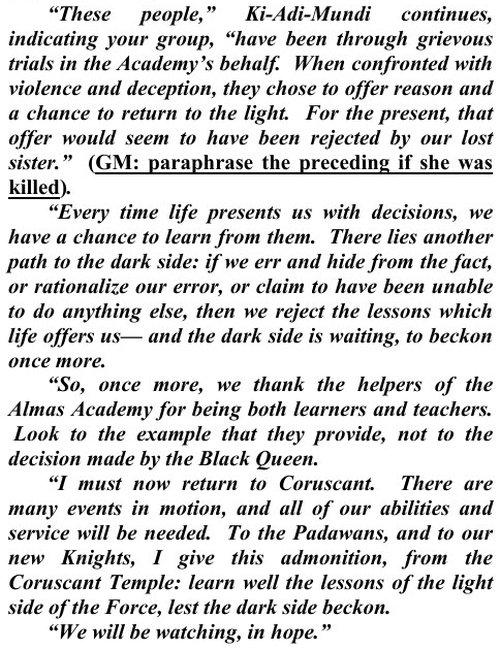

## p.26 (scan page 26)

Page contents: 791 words, 33 paragraphs | headings/entries: The Dark Side Beckons; Here Ends "The Dark Side Beckons"; Experience Point Summary; Adventure Experience Award:; Page 26

- **Ki-Adi-Mundi** — entry/section: Ki-Adi-Mundi: "For a moment, the Cerean Master simply looks at Zelice. Then, he murmurs, "Welcome home."
Zelice smiles, again, tears bright in her eyes, and then impulsively hugs the reserved-looking Cerean. Not everyone watching can restrain his or her amusement.
"Well," says Ki-Adi-Mundi, somewhat breathless, "it seems that not only you Padawans and Knights have learned a lesson from the story, here, tonight.
"In behalf of the Jedi Council, and for myself, I must thank Master Lanius and our special guests, for providing us with such a fine storyteller."" Source: *403 - Jedi Code - The Dark Side Beckons* (SWRPG d20 Revised Core), p.26
  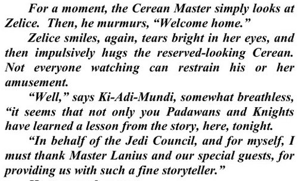
- **Ki-Adi-Mundi** — entry/section: Ki-Adi-Mundi: ""I must now return to Coruscant. There are many events in motion, and all of our abilities and service will be needed. To the Padawans, and to our new Knights, I give this admonition, from the Coruscant Temple: learn well the lessons of the light Side of the Force, lest the dark side beckon.
"We will be watching, confident that you will prevail."" Source: *403 - Jedi Code - The Dark Side Beckons* (SWRPG d20 Revised Core), p.26
  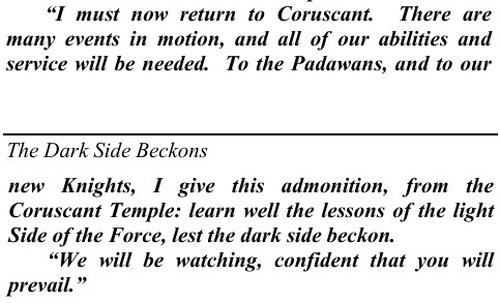
- **No single roster character (rules/setting/general)** — entry/section: End credits: "The year ahead portends to be one of turmoil, conflict and maybe even open war for Cularin. But Senator Wren is fighting for the system's rights in the Senate. The Almas Jedi are countering the dark side and galactic criminals wherever they are found.
And, you, the heroes of Cularin, are going to be in the vanguard of the forces battling for justice and peace in the galaxy — as always." Source: *403 - Jedi Code - The Dark Side Beckons* (SWRPG d20 Revised Core), p.26
  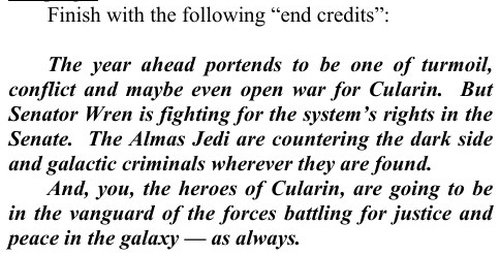

## p.17–26 (scan page 17)

Page contents: E5 the Dark Edge Dancetorium: the Black Queen's challenge, persuasion, the sacrifice and flash-forward; E6 three endings with Ki-Adi-Mundi; end credits (hand-read)

## p.27 (scan page 27)

Page contents: 783 words, 24 paragraphs | headings/entries: Adventure Experience: Roleplaying Experience:; Total Possible Experience: 1,000 xp; Loot Summary; The Dark Side Beckons; Certificate and Reward Descriptions, by Encounter; Page 27

## p.28 (scan page 28)

Page contents: 812 words, 19 paragraphs | headings/entries: Encounter 4; Encounter 3 or 5; Encounter 6; All heroes except as Noted:; The Dark Side Beckons; Page 28

- **No single roster character (rules/setting/general)** — entry/section: Coruscant Temple Jedi Utility Belt: "In recognition of services performed for the Jedi Order by the hero named above, the Jedi Temple on Coruscant has provided a Jedi Utility Belt. While these are usually not provided to non-Jedi, this individual is considered to exemplify the spirit of the Jedi Code. The buckle bears the symbol of the Coruscant Jedi Temple, with the logo of the Almas Academy inset." Source: *403 - Jedi Code - The Dark Side Beckons* (SWRPG d20 Revised Core), p.28
  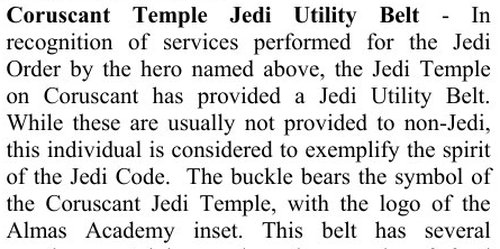
- **No single roster character (rules/setting/general)** — entry/section: The Call of the Force: "During a climactic moment, you discovered that you do, indeed, believe in the Force and that, down so deep it you never realized until now, you are connected to it. If you make Master Lanius aware of this, he offers admission to Almas Jedi Academy. Welcome to a larger universe..." Source: *403 - Jedi Code - The Dark Side Beckons* (SWRPG d20 Revised Core), p.28
  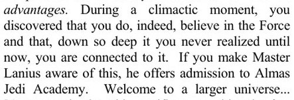

## p.29 (scan page 29)

Page contents: 574 words, 11 paragraphs | headings/entries: The Dark Side Beckons; For Force Adepts only; Bonus Force Feat:; Page 29

- **No single roster character (rules/setting/general)** — entry/section: Focused On the Light: "During a climactic moment, you made a powerful and personal connection with the light side of the Force. In a moment of blinding insight, you committed yourself to the light side of the Force, shedding the darkness within. You are fully cleansed. Because you have been forgiven? No, because you have forgiven yourself." Source: *403 - Jedi Code - The Dark Side Beckons* (SWRPG d20 Revised Core), p.29
  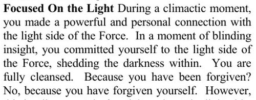
- **No single roster character (rules/setting/general)** — entry/section: Advanced Training: "As part of her atonement for her errors, Zelice Sturm, formerly the Black Queen, will take the time to personally instruct you in a free, bonus Force feat." Source: *403 - Jedi Code - The Dark Side Beckons* (SWRPG d20 Revised Core), p.29
  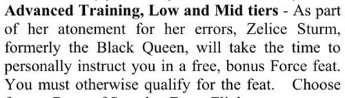

## p.30 (scan page 30)

Page contents: 284 words, 21 paragraphs | headings/entries: Hero Name:; Did the "bad guys" ever capture you?; Section 3: In general:; The Dark Side Beckons Page 30

## p.31 (scan page 31)

Page contents: 8 words, 2 paragraphs | headings/entries: Player Handout 2: Encounter

## p.32 (scan page 32)

Page contents: 23 words, 5 paragraphs | headings/entries: Dance Floor / Stage; Back Area; The Dark Side Beckons Page 32

## p.33 (scan page 33)

Page contents: 46 words, 8 paragraphs | headings/entries: Lad iad oe; The Dark Side Beckons; Page 33

## p.34 (scan page 34)

Page contents: 695 words, 31 paragraphs | headings/entries: GM Aid #1: NPC Statistics; The Defel in _ this; LowTier (levels 1-3); The Dark Side Beckons; In areas of; Middle Tier (levels 4-6); High and Upper Tier (levels 7-12); Page 34

## p.35 (scan page 35)

Page contents: 771 words, 34 paragraphs | headings/entries: High and Upper Tier (levels 7-12); The Dark Side Beckons; Low Tier (levels 1-3); Feats: Improved Initiative, Point Blank Shot; Middle Tier (levels 4-6); The Black Queen's Male Human "Lieutenants" and; Page 35

## p.36 (scan page 36)

Page contents: 508 words, 25 paragraphs | headings/entries: High and Upper Tier (levels 7-12); The Dark Side Beckons; Page 36

## p.37 (scan page 37)

Page contents: 792 words, 27 paragraphs | headings/entries: GM Aid #2 — The Black Queen; Low and Middle Tier (Levels 1-3, 4-6); The Dark Side Beckons; Upper Tier (Levels 10-12); Page 37

## p.38 (scan page 38)

Page contents: 829 words, 16 paragraphs | headings/entries: The Dark Side Beckons; Page 38

- **No single roster character (rules/setting/general)** — entry/section: Zelice Sturm: "That was two years ago. Zelice made an error that has cost her dearly. Ambushed by some street gangers who regularly dealt with the smugglers, she tried to intimidate them and face them down into surrender. She badly misjudged how making the leaders lose face would enrage them. When the gangs swarmed at her, she became afraid and reacted with far more force than was needful. By the time they fled, she had killed one leader and five other gangers, who turned out to have been pitifully under-equipped and under-skilled.
...
Zelice was consumed by regret and shame. She was no longer fit to be a Jedi. Her lack of worldly experience had caused her to kill. She was fit only to be a hunted criminal— and so, she became what she had hunted." Source: *403 - Jedi Code - The Dark Side Beckons* (SWRPG d20 Revised Core), p.38
  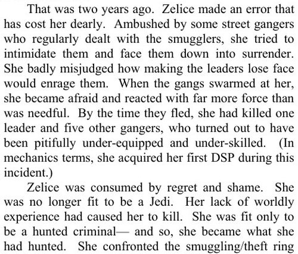

## p.39 (scan page 39)

Page contents: 606 words, 20 paragraphs | headings/entries: The Dark Side Beckons; Page 39

## p.40 (scan page 40)

Page contents: 26 words, 4 paragraphs | headings/entries: Page 40; The Dark Side Beckons

## p.41 (scan page 41)

Page contents: 24 words, 7 paragraphs | headings/entries: Dance Floor / Stage; Back Area; The Dark Side Beckons; Entrance; Page 41

## p.42 (scan page 42)

Page contents: 192 words, 11 paragraphs | headings/entries: F 6; The Dark Side Beckons Page 42

## p.43 (scan page 43)

Page contents: 188 words, 18 paragraphs | headings/entries: Critical Event Summary The Dark Side Beckons; Other (please specify); GM Name, RPGA#:; GM Email Address:; Convention Name/Date; Convention Coordinator:; Or email to: [email removed]; Check http://www.living-force.net for other methods; The Dark Side Beckons Page 43

## p.26–43 (scan page 26)

Page contents: XP and loot certificates; questionnaire; player maps; NPC stats; the Black Queen's stats, background and conversation points; GM maps; critical event summary (hand-read)

