# Owner Material 037 — Star Wars D20 Drive folder (Core, Revised Core and Saga Edition): Living Force Campaign/Adventures/Among the Stars/Year 4/404 - Jedi Code - For Fun and Profit.pdf [Star Wars Roleplaying Game Revised Core (d20, 2002)]

- **Source:** Wizards of the Coast Star Wars Roleplaying Game books, web enhancements, Living Force campaign modules and articles (2000–2010), from the owner's "Star Wars D20" Drive folder (only the three edition subfolders; "General" was not read, as instructed). Secondary source (licensed Legends reference). Scan OCR'd on the box; the scan stays box-only and is **not** published.
- **Method:** every scanned page was OCR'd and machine-screened sentence by sentence for power-relevant statements (fights, kills, defeats, Force feats, rankings, superweapons) that name a character on our roster; each kept sentence is quoted verbatim from the OCR text and has a crop of the printed passage directly under it. Pages with nothing power-relevant are still listed with what is on them.
- **Citation:** "*404 - Jedi Code - For Fun and Profit* (SWRPG d20 Revised Core), p.X" by printed page ("scan p.X" where no printed number applies). **Weight:** Licensed RPG material: a secondary source. Narrative text sums up Legends lore; game statistics are rules for players, not canon power levels, and rank lowest.

## scan p.1 (scan page 1)

Page contents: 151 words, 8 paragraphs | headings/entries: LFA404; For Fun and Profit; A One-Round LIVING FORCE Interactive; Edited by Ron Heintz and Jae Walker

- **No single roster character (rules/setting/general)** — entry/section: Blurb: "A group of Cularin-based businesses has formed the Trade Alliance, a member-run initiative that is dedicated to putting Cularin back on the galactic trade map. On the eve of their inaugural Trade Show, the Alliance is prepared to unveil a new technology that will eliminate a long-standing barrier to commerce in the system." Source: *404 - Jedi Code - For Fun and Profit* (SWRPG d20 Revised Core), scan p.1
  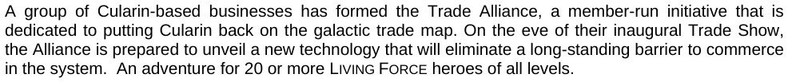

## p.1 (scan page 2)

Page contents: 890 words, 21 paragraphs | headings/entries: Hero Earnings; Issuing Force and Dark Side Points; For Fun and Profit; General Notes to the GM; Page 1

## p.2 (scan page 3)

Page contents: 782 words, 22 paragraphs | headings/entries: The Story; For Fun and Profit; Area 1: The Prosperity Casino; Area 2: Trade Show Booths; Area 3: Trade Hall Floor; Keynote Address:; Cy Taegen, VP Media Relations and Business; Page 2

## p.3 (scan page 4)

Page contents: 661 words, 22 paragraphs | headings/entries: Mini-Mission:; Conclusion:; For Fun and Profit; Opening Crawl; Area 1: Prosperity Casino and Entertainment Center; Page 3

- **No single roster character (rules/setting/general)** — entry/section: Opening crawl: "It is a period of economic turbulence in the Cularin system. Ten years of absence from galactic trade has seen many Cularin businesses lose their contracts to out-system competitors. Eager to regain their lost business, and to find new economic prosperity for Cularin, many businesses have banded together to form the Cularin Trade Alliance. This organization is preparing to hold an immense Trade Show aboard a space-going convention center. But, even as the first exhibitors and guests arrive disturbing rumors begin to circulate about new technology aboard this Trade Alliance ship that will change forever the face of Cularin economics ." Source: *404 - Jedi Code - For Fun and Profit* (SWRPG d20 Revised Core), p.3
  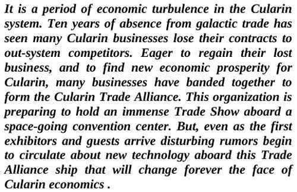

## scan p.1–3 (scan page 1)

Page contents: Title, blurb, boilerplate, the story of the Trade Alliance and the TAV Prosperity, timeline, opening crawl, the casino (hand-read)

## p.4 (scan page 5)

Page contents: 791 words, 29 paragraphs | headings/entries: NPC's Here: Dealer Droids, Grrandash; Rumors Here; Area 2: Trade Show Booths; For Fun and Profit; NPC's Here: Cy Taegen; Rumors Here:; Booth 2 — Nenmo's Curios; NPC's Here: Nenmo; Rumors Here:; Page 4

- **No single roster character (rules/setting/general)** — entry/section: Grrandash rumor: "That Jedi-lady been by asking about force users. Grrandash told her that if she wasn't betting she need to go. She not seem to like that very much." Source: *404 - Jedi Code - For Fun and Profit* (SWRPG d20 Revised Core), p.4
  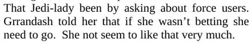
- **No single roster character (rules/setting/general)** — entry/section: Nenmo: "Hey... did you hear? There's-a some big thing planned for the keynote address this afternoon. Something they say is going to bring all kinds of new business to the system. Sounds good huh? Maybe old Nenmo can bring you some much finer things eh?" Source: *404 - Jedi Code - For Fun and Profit* (SWRPG d20 Revised Core), p.4
  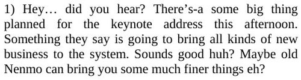

## p.5 (scan page 6)

Page contents: 841 words, 23 paragraphs | headings/entries: NPC's Here: Rumors Here:; Booth 4 - Joh's Droid Emporium; NPC's Here: Seelana; Rumors Here:; For Fun and Profit; NPC's Here: Quinlu Naj; Rumors Here:; Booth 6 - Kashyyyk Academy of Wrestling; Page 5

- **No single roster character (rules/setting/general)** — entry/section: Joh's rumor: "The collector's series of droids commemorating Kirlocca's death is sold out! It was the fastest selling production of droids the Cularin system has ever seen." Source: *404 - Jedi Code - For Fun and Profit* (SWRPG d20 Revised Core), p.5
  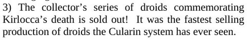

## p.6 (scan page 7)

Page contents: 725 words, 27 paragraphs | headings/entries: For Fun and Profit; Area 3: Trade Hall Floor; Cularin Militia Recruiters (MetaOrg); NPC's Here: Osten Dal-Nay Rumors Here:; Lony Hertz's Force Adept Club; NPC's Here: Lony Hertz Rumors Here:; Page 6

## p.7 (scan page 8)

Page contents: 706 words, 27 paragraphs | headings/entries: The Jedi Enclave; Keynote Address:; For Fun and Profit; Mini-Mission:; This is read to the entire room:; Page 7

- **No single roster character (rules/setting/general)** — entry/section: Trade Hall: "The ship lurches about wildly only moments after the hyperdrive test begins. Suddenly it is as if the deck of the Trade Hall wants nothing more to do with the beings or booths inside it. Everyone is sent flying, booths crash into one another and panic begins to spread everywhere!" Source: *404 - Jedi Code - For Fun and Profit* (SWRPG d20 Revised Core), p.7
  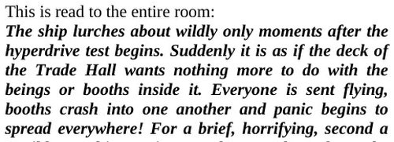

## p.8 (scan page 9)

Page contents: 924 words, 30 paragraphs | headings/entries: What just happened?; How can we help?; For Fun and Profit; Situation; Resolution skills and DC's; Page 8

## p.9 (scan page 10)

Page contents: 800 words, 20 paragraphs | headings/entries: For Fun and Profit; Conclusion; Page 9

- **No single roster character (rules/setting/general)** — entry/section: Cy Taegen: ""Gentlebeings, I must inform you that the vessel experienced a malfunction in its hyperdrive system. We've come out of hyperspace inside the cometary cloud, and have struck a comet fragment. The damage is under control, and engineers expect to have main power back online shortly." Source: *404 - Jedi Code - For Fun and Profit* (SWRPG d20 Revised Core), p.9
  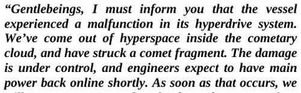
- **No single roster character (rules/setting/general)** — entry/section: Osten Dal'Nay: ""My friends, thanks for coming. We're not out of this yet." Osten points out the magnetic field towards a rotating, twisting view of the interior of the cometary cloud. "As you can see, the ship is spinning adrift through the cloud... a very dense section of the cloud. We need to get out there and buy some time by destroying any incoming comet fragments. We've got some transports and some Headhunters ready to fly. Who's with me?"" Source: *404 - Jedi Code - For Fun and Profit* (SWRPG d20 Revised Core), p.9
  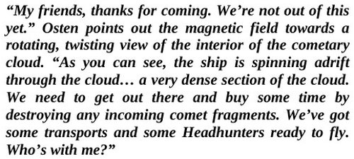
- **No single roster character (rules/setting/general)** — entry/section: Osten Dal'Nay: ""Nice job everyone!" Osten's voice beams over the comm. "Let's escort the Prosperity out of the Cloud, then we'll land and see what else we can help with inside."" Source: *404 - Jedi Code - For Fun and Profit* (SWRPG d20 Revised Core), p.9
  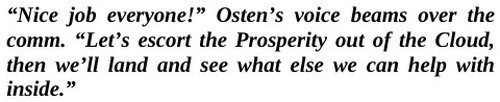

## p.10 (scan page 11)

Page contents: 680 words, 28 paragraphs | headings/entries: Here Ends, "For Fun And Profit"; Experience Point Summary; Adventure Experience Award:; Loot Summary; From the Blaster Rifle Competition:; Trade Show Blaster Contest - Prize; Blastech DLT-20A, Type: Blaster Rifle; Proficiency; For Fun and Profit; Shock-Sink; E-Bacta Shot; Trandoshan Grooming Kit; Page 10

- **No single roster character (rules/setting/general)** — entry/section: Cy Taegen: ""Everyone, we owe these people a debt of thanks for their selfless work in protecting this ship and the lives aboard her. We are now headed back to Cularin orbit, where you will disembark and we will begin the process of determining the source of the problem."
... "The Trade Alliance may not be able to bypass the Cometary Cloud today, but we will continue to investigate the technology and perhaps one day we will be able to open the doors to intergalactic trade a little wider. For now, I think that the commercial interests of Cularin have made a powerful statement today — specifically that we are taking our interests into our own hands and that we are capable of overcoming any adversity that comes our way... what could be more characteristic of Cularin than that?"" Source: *404 - Jedi Code - For Fun and Profit* (SWRPG d20 Revised Core), p.10
  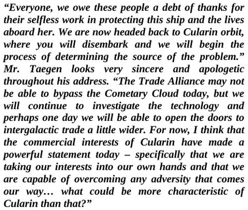

## p.4–10 (scan page 5)

Page contents: Booths 1-7 and the Trade Hall floor NPCs with rumors; keynote; the mini-mission: Trade Hall situations, Osten's ships, saving the Prosperity; conclusion (hand-read)

## p.11 (scan page 12)

Page contents: 614 words, 19 paragraphs | headings/entries: Blast-Dampening Armor; MicroData Pocket Secretary; MicroData Pocket Secretary; For Fun and Profit; From the Kashyyyk Academy of Wrestling:; Page 11

- **No single roster character (rules/setting/general)** — entry/section: Kashyyyk Academy of Wrestling Employment: "The hero named above is gainfully employed as physical trainer at the Kashyyyk Academy of Wrestling on Cularin. The hours are flexible and do not interfere with any "other commitments" the hero might have." Source: *404 - Jedi Code - For Fun and Profit* (SWRPG d20 Revised Core), p.11
  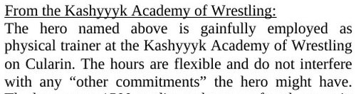
- **No single roster character (rules/setting/general)** — entry/section: Appreciation of the Trade Alliance: "The hero named above was instrumental in protecting the TAV Prosperity during the first annual Cularin Trade Show." Source: *404 - Jedi Code - For Fun and Profit* (SWRPG d20 Revised Core), p.11
  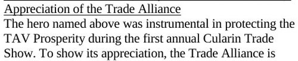

## p.12 (scan page 13)

Page contents: 328 words, 18 paragraphs | headings/entries: Here Ends, "[Scenario name]"; Experience Point Summary; Adventure Experience Award:; For Fun and Profit; Loot Summary; Page 12

## p.13 (scan page 14)

Page contents: 518 words, 23 paragraphs | headings/entries: Sorosuub; The Cularin Spacer's Union (Booth 884); Plus many others!; For Fun and Profit Page 13

- **No single roster character (rules/setting/general)** — entry/section: Player Handout 1: "The Cularin Trade Alliance — By Cularin, For Cularin!
With so many out-system interests vying for control of commerce, isn't it nice to know that someone is looking out for Cularin?
...
The TAV Prosperity - Bringing economic development to Cularin and beyond!" Source: *404 - Jedi Code - For Fun and Profit* (SWRPG d20 Revised Core), p.13
  

## p.14 (scan page 15)

Page contents: 533 words, 13 paragraphs | headings/entries: Booth Aid: Blastech vs. Merr-Sonn vs. SoroSuub; Important Note On Range Increments!; For Fun and Profit Page 14

## p.15 (scan page 16)

Page contents: 32 words, 2 paragraphs | headings/entries: 

## p.16 (scan page 17)

Page contents: 443 words, 27 paragraphs | headings/entries: Booth Aid: Nenmo's Curios Store Inventory; Item; Cost (Max/Min); Number on Hand; Clone Trooper; For Fun and Profit; Page 16

## p.17 (scan page 18)

Page contents: 533 words, 22 paragraphs | headings/entries: Booth Aid: Kashyyyk Academy of Wrestling; Reflexes,; Quickness, Rugged, Toughness; Stamina, Toughness,; Possible Contests:; For Fun and Profit Page 17

## p.18 (scan page 19)

Page contents: 420 words, 16 paragraphs | headings/entries: Booth Aid — The Prosperity Casino; From p. 89 of the SWRPG-RCR; Gambling Result _| Wins or Loses; NPC's Here: Dealer Droids, Grrandash Rumors Here; For Fun and Profit Page 18

## p.10–18 (scan page 11)

Page contents: XP and loot certificates; template leftovers; trade show flyer; booth aids for the blaster contest, Nenmo, the wrestling academy and the casino (hand-read)

## p.19 (scan page 20)

Page contents: 687 words, 32 paragraphs | headings/entries: Appendix 1 — Organizer's Checklist; Definitions; Feature Staff | Status | Notes; Emporium; For Fun and Profit Page 19

## p.20 (scan page 21)

Page contents: 747 words, 15 paragraphs | headings/entries: Appendix 2 — Non Combat PC's; OF:; For Fun and Profit Page 20

- **No single roster character (rules/setting/general)** — entry/section: E1-6RA: "When playing her, it may be easiest to imagine her as C-3PO's slightly less stuffy sister. She has the same stiff speech patterns, but will sometimes attempt humor at inappropriate moments. The jokes are nearly always awful." Source: *404 - Jedi Code - For Fun and Profit* (SWRPG d20 Revised Core), p.20
  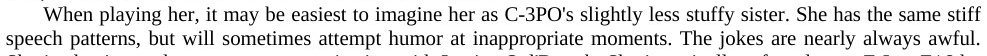
- **No single roster character (rules/setting/general)** — entry/section: Thurm Loogg: "Loogg snatches every opportunity to encourage the citizens of Cularin to think well of the Cartel. His little piggy face and ear-to-ear grin pop up whenever there is a group of people to be found. If it means he has to piggyback on someone else's event or celebration, so much the better, as it helps to keep his expenses down. "Remember," he always says, "the Cartel LOOOOOOOOVES you!"" Source: *404 - Jedi Code - For Fun and Profit* (SWRPG d20 Revised Core), p.20
  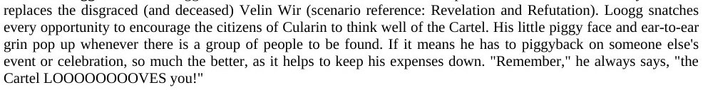
- **No single roster character (rules/setting/general)** — entry/section: Nenmo: "Nenmo is a Toydarian. He loves to sell stuff and talk, not necessarily in that order.
...
If you do not wish to haggle - do not visit Nenmo." Source: *404 - Jedi Code - For Fun and Profit* (SWRPG d20 Revised Core), p.20
  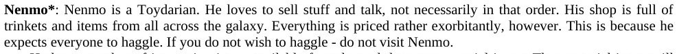

## p.21 (scan page 22)

Page contents: 716 words, 9 paragraphs | headings/entries: Appendix 2 — Non Combat PC's (Continued); For Fun and Profit Page 21

## p.22 (scan page 23)

Page contents: 169 words, 6 paragraphs | headings/entries: Appendix 2 — Non Combat PC's (Continued); For Fun and Profit Page 22

- **No single roster character (rules/setting/general)** — entry/section: Nenneb: "A hard core Sullustan engineer who just honestly does not understand why anyone would prefer any rifle to SoroSuub's Firelance rifle. This weapon is much lighter than the other two and has a stun setting effective to 10m. What else would anyone want?" Source: *404 - Jedi Code - For Fun and Profit* (SWRPG d20 Revised Core), p.22
  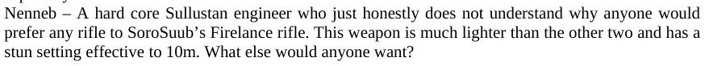

## p.23 (scan page 24)

Page contents: 731 words, 14 paragraphs | headings/entries: For Fun and Profit Page 23

- **No single roster character (rules/setting/general)** — entry/section: Cy Taegen: ""Honored colleagues, distinguished guests, and friends from the media — Welcome to the first annual Cularin Trade Show! I cannot begin to tell you all how pleased we are with the turnout, both in terms of the number of exhibitors and the number of attendees that are with us today." Source: *404 - Jedi Code - For Fun and Profit* (SWRPG d20 Revised Core), p.23
  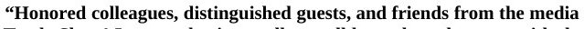
- **No single roster character (rules/setting/general)** — entry/section: Thurm Loogg: ""It could not be a better time to form your Trade Association, friends! I wanted to extend my best wishes on behalf of the Metatheran Cartel to all your ventures and remind you that the Cartel considered it a solemn privilege and honor to uphold your out-system contracts these many years." Source: *404 - Jedi Code - For Fun and Profit* (SWRPG d20 Revised Core), p.23
  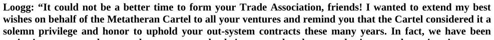
- **No single roster character (rules/setting/general)** — entry/section: Cy Taegen: ""Mr. Loogg! Members of this Trade Alliance have already given you your answer — No! We refuse to ransom back our previous business from you and your 'friends' especially when you insist on sending overseers to help 'manage' any of your so called 'affiliates'. [To Security Officers] Find that holoprojector!"" Source: *404 - Jedi Code - For Fun and Profit* (SWRPG d20 Revised Core), p.23
  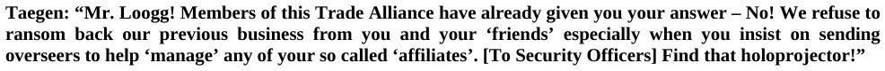
- **No single roster character (rules/setting/general)** — entry/section: Thurm Loogg: ""Well now, this is just untrue.... The Cartel LOVES Cularin! You must understand — the galaxy has changed dramatically in the past 10 years, and you just aren't going to be prepared for it, without our help...
... Remember the Cartel LOOOOOVES you!"" Source: *404 - Jedi Code - For Fun and Profit* (SWRPG d20 Revised Core), p.23
  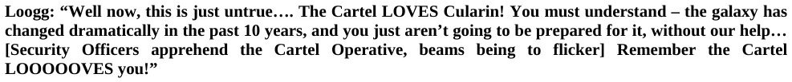
- **No single roster character (rules/setting/general)** — entry/section: Cy Taegen: ""Imagine what trade opportunities would open themselves up if we no longer had to navigate through the cloud at sub-light speeds? We would have faster and safer access to the galaxy's markets. Friends, the day has come. This ship, the Prosperity, has been equipped with an advanced hyperdrive unit which allows us to bypass the cometary cloud entirely." Source: *404 - Jedi Code - For Fun and Profit* (SWRPG d20 Revised Core), p.23
  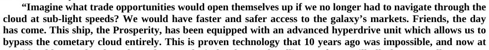

## p.24 (scan page 25)

Page contents: 697 words, 27 paragraphs | headings/entries: Appendix 4 — Space Battle; Ice Fragment Tracking Sheet; ID Points; For Fun and Profit Page 24

## p.25 (scan page 26)

Page contents: 0 words, 0 paragraphs | headings/entries: 

## p.26 (scan page 27)

Page contents: 251 words, 18 paragraphs | headings/entries: Critical Event Summary [Name of Scenario]; Critical Event Summary; Critical Events Summary:; LI Yes LINo; GM Name, RPGA#:; GM Email Address:; Convention Name/Date; Convention Coordinator:; For Fun and Profit Page 26

## p.27 (scan page 28)

Page contents: 55 words, 5 paragraphs | headings/entries: Or email to: [email removed]; Check http://www.living-force.net for other methods; For Fun and Profit Page 27

## p.19–27 (scan page 20)

Page contents: Organizer's checklist; NPC appendix; keynote and Thurm Loogg's addresses; space battle; map placeholder; draft critical event summary (hand-read)

