# Owner Material 037 — Star Wars D20 Drive folder (Core, Revised Core and Saga Edition): Living Force Campaign/Adventures/Among the Stars/Year 4/405 - Contract AA23.pdf [Star Wars Roleplaying Game Revised Core (d20, 2002)]

- **Source:** Wizards of the Coast Star Wars Roleplaying Game books, web enhancements, Living Force campaign modules and articles (2000–2010), from the owner's "Star Wars D20" Drive folder (only the three edition subfolders; "General" was not read, as instructed). Secondary source (licensed Legends reference). Scan OCR'd on the box; the scan stays box-only and is **not** published.
- **Method:** every scanned page was OCR'd and machine-screened sentence by sentence for power-relevant statements (fights, kills, defeats, Force feats, rankings, superweapons) that name a character on our roster; each kept sentence is quoted verbatim from the OCR text and has a crop of the printed passage directly under it. Pages with nothing power-relevant are still listed with what is on them.
- **Citation:** "*405 - Contract AA23* (SWRPG d20 Revised Core), p.X" by printed page ("scan p.X" where no printed number applies). **Weight:** Licensed RPG material: a secondary source. Narrative text sums up Legends lore; game statistics are rules for players, not canon power levels, and rank lowest.

## p.1 (scan page 1)

Page contents: 142 words, 8 paragraphs | headings/entries: LFA405; Contract AA23; A One-Round LIVING FORCE Tournament; Edited by Ron Heintz

- **No single roster character (rules/setting/general)**: "Sent by Master Lanius of the Jedi Academy on Almas, the heroes embark for the den of scum and villainy known as Nar Shaddaa. Once there, the heroes are to meet a brash, young Noblewoman and escort her back to Cularin. Hardly work for the Heroes of Cularin. After all, what could go wrong on Nar Shaddaa?" Source: *405 - Contract AA23* (SWRPG d20 Revised Core), p.1
  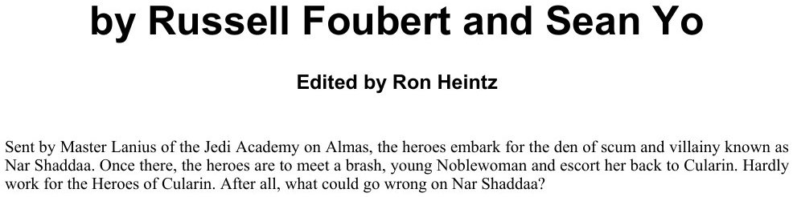

## p.2 (scan page 2)

Page contents: 895 words, 23 paragraphs | headings/entries: House Rules; Atoning for Dark Side Points; Dissipate Energy; Illusion; Stun; Hero Earnings; Contract AA23; Page 2

## p.3 (scan page 3)

Page contents: 956 words, 21 paragraphs | headings/entries: LIVING FORCE adventures are not designed purely; GM Overview; Contract AA23; Page 3

- **No single roster character (rules/setting/general)** — entry/section: GM Overview: "Three experienced bounty hunters have banded together to collect on Contract AA23. Drokka, a Rodian bounty hunter is a master melee fighter and the head of a gang of veteran mercenaries. Shiana Trist is a master assassin, and brilliant sniper. The assassin droid K1-1R is the tactical leader of the group, using his innate computer "expertise" to gather information on his subjects prior to unleashing his swarm of drones to overwhelm his targets." Source: *405 - Contract AA23* (SWRPG d20 Revised Core), p.3
  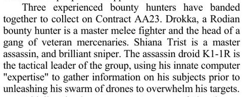

## p.4 (scan page 4)

Page contents: 927 words, 23 paragraphs | headings/entries: Encounter 2: No Reward is Worth This; Encounter 4: The Factory Less Traveled; Encounter 6: The Cartel Strikes Back; Contract AA23; Page 4

## p.5 (scan page 5)

Page contents: 860 words, 23 paragraphs | headings/entries: Encounter 7: Contract Terminated; Important Notes to Gamemasters:; Opening Crawl; Encounter 1: Happy Hour on Nar Shaddaa; Contract AA23; Page 5

- **No single roster character (rules/setting/general)** — entry/section: Opening Crawl: "A dark time for the Republic looms in the distance, but for now it is nothing more than rumors and whispers in the shadows. Jasso Toryn, a respected senator, stands strong against the tides of dangerous change. A long time and loyal supporter of the Jedi, he has begun to fear for his safety. While Senator Toryn marches on, regardless of the danger he faces, he has sent word to his old friend Lanius Qel-Bertuk, now master of the Jedi Academy in Cularin. He wishes his only child, Korlana, to be given asylum there, to protect her from the intrigue and dangers of Coruscant." Source: *405 - Contract AA23* (SWRPG d20 Revised Core), p.5
  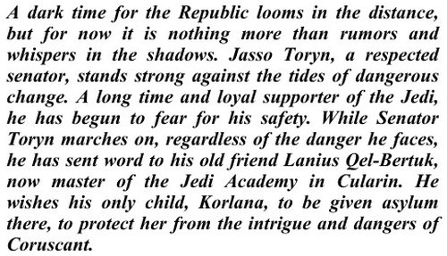

## p.1–5 (scan page 1)

Page contents: Title and blurb; boilerplate and house rules; GM overview of Contract AA23 and the three bounty hunters; encounter summaries; opening crawl (hand-read)

## p.6 (scan page 6)

Page contents: 939 words, 20 paragraphs | headings/entries: Combat Details; Contract AA23; Page 6

## p.7 (scan page 7)

Page contents: 963 words, 22 paragraphs | headings/entries: Encounter 2: No Reward is Worth This; Contract AA23; Page 7

## p.8 (scan page 8)

Page contents: 943 words, 24 paragraphs | headings/entries: Contract AA23; Page 8

- **No single roster character (rules/setting/general)** — entry/section: Korlana Toryn: ""I'm not about to follow a gang of father's hired goons anywhere!"" Source: *405 - Contract AA23* (SWRPG d20 Revised Core), p.8
  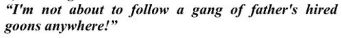
- **No single roster character (rules/setting/general)** — entry/section: Korlana Toryn: ""My reasons for coming here are my own! However, I suppose your arrival here could have been timed worse. E-3P0, provide them with a token of my appreciation."" Source: *405 - Contract AA23* (SWRPG d20 Revised Core), p.8
  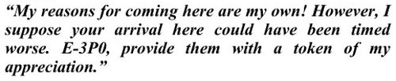

## p.9 (scan page 9)

Page contents: 765 words, 26 paragraphs | headings/entries: The Ruined Barge; DC Information Gathered; Intimidate (DC 15/20/25); SPECIAL; Contract AA23; Page 9

- **No single roster character (rules/setting/general)** — entry/section: E-3PO: "Well why did the Senator send her here anyways? An unfortunate necessity. His enemies are influential in the Republic. He goes on in a whisper: Separatists, you know! Nar Shaddaa may be dangerous, but at least that offers some protection from our enemies." Source: *405 - Contract AA23* (SWRPG d20 Revised Core), p.9
  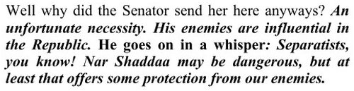
- **No single roster character (rules/setting/general)** — entry/section: E-3PO: "Why did your lady leave the hotel? Only the Maker knows why. She is always charging off into peril. I swear that I'll burn out my circuits one of these days." Source: *405 - Contract AA23* (SWRPG d20 Revised Core), p.9
  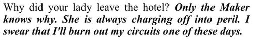

## p.10 (scan page 10)

Page contents: 867 words, 20 paragraphs | headings/entries: Read this read-aloud text last:; Contract AA23; Page 10

## p.11 (scan page 11)

Page contents: 934 words, 20 paragraphs | headings/entries: Contract AA23; Page 11

- **No single roster character (rules/setting/general)** — entry/section: Hohn Ryntz: "Do you mind telling us who wants us dead this time? Dead? Oh no-- not dead. You are wanted alive. The contract clearly states that you are to be removed from the affairs of the Cularin system, alive, for an indefinite period of time. The posted reward is reduced to 10% of its total value should you be killed." Source: *405 - Contract AA23* (SWRPG d20 Revised Core), p.11
  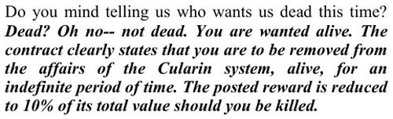
- **No single roster character (rules/setting/general)** — entry/section: Hohn Ryntz: "Maybe you think so. Who was it? Velin Wir. The head of our original attempts to introduce the benefits of the Cartel to Cularin. He apparently was very proactive in settling his political vendettas, and had arranged for this contract prior to his death. I am sure that you ran afoul of him or his remaining supporters at some point." Source: *405 - Contract AA23* (SWRPG d20 Revised Core), p.11
  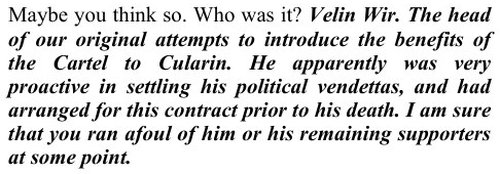

## p.12 (scan page 12)

Page contents: 953 words, 19 paragraphs | headings/entries: Contract AA23; Page 12

- **No single roster character (rules/setting/general)** — entry/section: Hohn Ryntz: "So how much are we worth? The contract is worth nearly a half million credits." Source: *405 - Contract AA23* (SWRPG d20 Revised Core), p.12
  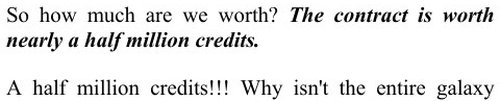
- **No single roster character (rules/setting/general)** — entry/section: Hohn Ryntz: "You can do that? I hope I can. I did manage to find the authorization codes Wir had created for this contract. There is just one problem. To verify the codes, I will need to provide a DNA sample from Mr. Wir. I wish I could turn back time and pull his personal effects from the incinerator. If I even had a hair, or a few skin cells from a personal item of his... what's the use? I have to hope that the Hutts will find something humorous in all this and permit the cancellation anyway." Source: *405 - Contract AA23* (SWRPG d20 Revised Core), p.12
  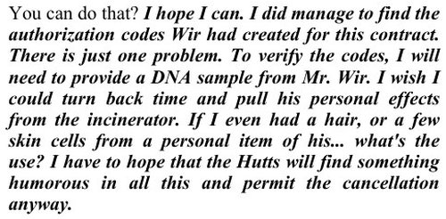

## p.13 (scan page 13)

Page contents: 934 words, 22 paragraphs | headings/entries: Encounter 4: The Factory Less Traveled; Environmental Hazards:; Contract AA23; Page 13

## p.5–13 (scan page 5)

Page contents: E1 the Totor's Party Kave bar fight and crash; E2 Korlana, E-3PO and the attackers; E3 Hohn Ryntz explains Contract AA23 (hand-read)

## p.14 (scan page 14)

Page contents: 866 words, 21 paragraphs | headings/entries: Korlana (and possibly Hohn):; A Respite:; Contract AA23; Page 14

## p.15 (scan page 15)

Page contents: 884 words, 24 paragraphs | headings/entries: Silent Stalkers:; NOTE TO THE GM:; Combat Overview:; Contract AA23; Page 15

## p.16 (scan page 16)

Page contents: 953 words, 18 paragraphs | headings/entries: Everything goes black:; Contract AA23; Page 16

- **No single roster character (rules/setting/general)** — entry/section: Encounter 5: "Shiana is well hidden with a high-powered slugthrowing rifle nearly 60m above the floor of the conveyor room. She has two types of ammunition with her (taking a move-equivalent action to switch them). She mainly uses the mercy slugs to incapacitate whatever heroes she can, as well as Korlana. For combat hardened heroes and heroes fond of wearing heavy armor, Shiana can also fire explosive ammunition. An experienced sniper, Shiana makes use of a Shadowsuit to augment her stealth. Locating Shiana's hiding place requires a Spot skill check (DC 30/35/40). Even still, the sniper has the equivalent of three-quarters cover (+7 Def, +3 Ref saves), and is also prone." Source: *405 - Contract AA23* (SWRPG d20 Revised Core), p.16
  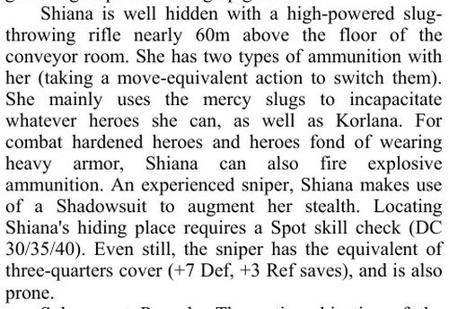
- **No single roster character (rules/setting/general)** — entry/section: Encounter 5: "3) The droids are overwhelming. At the beginning of each round, you may bring in as many new seeker droids as you need to bring their total count up to six. K1-1R has nearly three dozen of the seekers he can bring in on this attack; so do not worry about running out." Source: *405 - Contract AA23* (SWRPG d20 Revised Core), p.16
  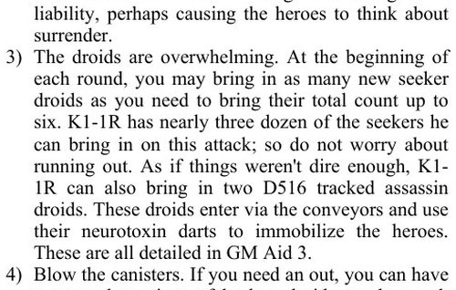

## p.17 (scan page 17)

Page contents: 887 words, 27 paragraphs | headings/entries: Encounter 6: The Cartel Strikes Back; For the mechanically inclined:; Contract AA23; Page 17

- **No single roster character (rules/setting/general)** — entry/section: K1-1R: ""Our priority targets are those defined by Contract AA23," the Voice explains. "Korlana Toryn is expendable. She is the logical choice for testing the chamber."" Source: *405 - Contract AA23* (SWRPG d20 Revised Core), p.17
  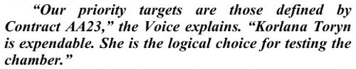
- **No single roster character (rules/setting/general)** — entry/section: Drokka: ""Relax!" a gruff, heavily accented male voice interjects. "We can pin this on our subjects! Shiana's good at planting evidence... me and my boys can dump the bodies and loose their ship somewhere. This is Nar Shaddaa!!! We can do whatever we want!"" Source: *405 - Contract AA23* (SWRPG d20 Revised Core), p.17
  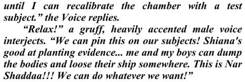
- **No single roster character (rules/setting/general)** — entry/section: Drokka / K1-1R: ""The Republic is dying... we don't need to fear any fool Senator!" growls Drokka.
"Affirmative." The Voice chimes in. "I have allies who oppose the Republic. Senator Toryn will pose us no threat."" Source: *405 - Contract AA23* (SWRPG d20 Revised Core), p.17
  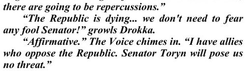
- **No single roster character (rules/setting/general)** — entry/section: K1-1R: ""Targets... My designation is K1-1R." The droid informs you. "You have been positively identified as the subjects of bounty contract AA23, posted on behalf of the Metatheran Cartel. You will be frozen in carbonite and removed from the affairs of the Cartel indefinitely."" Source: *405 - Contract AA23* (SWRPG d20 Revised Core), p.17
  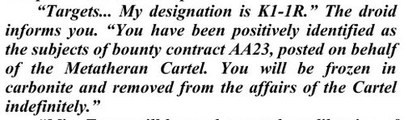

## p.18 (scan page 18)

Page contents: 932 words, 23 paragraphs | headings/entries: Contract AA23; Page 18

- **No single roster character (rules/setting/general)** — entry/section: K1-1R: "K1-1IR is a bit harder to convince. He has absolutely no fear of repercussions from Senator Toryn, unlike his partners in this matter. He lacks the emotional weakness of Drokka, and the sense of mortality that might convince Shiana to leave Korlana unharmed." Source: *405 - Contract AA23* (SWRPG d20 Revised Core), p.18
  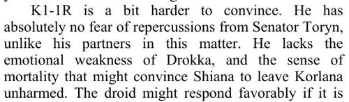

## p.19 (scan page 19)

Page contents: 896 words, 24 paragraphs | headings/entries: If Korlana is being frozen:; Encounter 7: Contract Terminated; Contract AA23; Page 19

- **No single roster character (rules/setting/general)** — entry/section: Encounter 7: "Jedi characters notice that Drokka proudly wears their lightsaber(s) on his belt as trophies." Source: *405 - Contract AA23* (SWRPG d20 Revised Core), p.19
  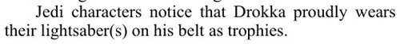

## p.20 (scan page 20)

Page contents: 889 words, 26 paragraphs | headings/entries: Running this fight:; Heroic Caarite; Contract AA23; Page 20

- **No single roster character (rules/setting/general)** — entry/section: A Powerful Ally It Is: "Sensing a _ pivotal opportunity, [FORCE USER] reaches out with the Force. With a shriek of tortured metal, a barely contained capacitor trunk suddenly falls from the ceiling of the chamber and rakes K1-1R with electrical current!" Source: *405 - Contract AA23* (SWRPG d20 Revised Core), p.20
  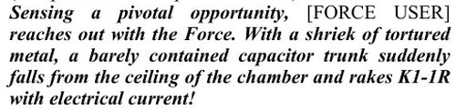

## p.21 (scan page 21)

Page contents: 845 words, 28 paragraphs | headings/entries: This fight is too hard!; This fight is too easy!; Conclusion; Here Ends Contract AA23; Experience Point Summary; Contract AA23; Page 21

- **No single roster character (rules/setting/general)** — entry/section: K1-1R: ""TERMINATE ALL ORGANICS!" K1-1R screeches, his vocabulator obviously malfunctioning. With sudden deadly purpose the droids turn on the nearest living being, regardless of where loyalties stood just moments ago. Now Drokka, his men and Shiana are all targets of the malfunctioning droid's rage!" Source: *405 - Contract AA23* (SWRPG d20 Revised Core), p.21
  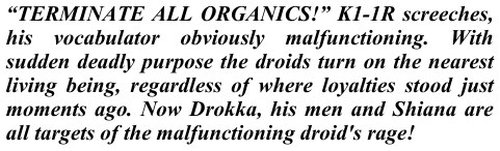
- **No single roster character (rules/setting/general)** — entry/section: Lanius Qel-Bertuk: "The Jedi Master stops for a moment and takes a deep breath. "I have received word that Contract AA23 has been suspended by the Hutts, but not yet cancelled. I am sure those gangsters are merely weighing the options of keeping the Contact active. I feel that in time, they will cancel it outright, but until then, continue to be cautious if you journey outside Cularin."" Source: *405 - Contract AA23* (SWRPG d20 Revised Core), p.21
  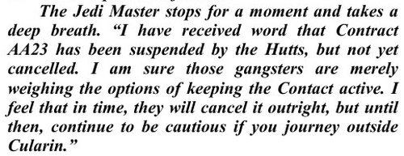

## p.13–21 (scan page 13)

Page contents: E4 factory hazards; E5 the ambush and capture; E6 the carbon-freezing argument; E7 the breakout fight; conclusion with Lanius (hand-read)

## p.22 (scan page 22)

Page contents: 727 words, 34 paragraphs | headings/entries: Adventure Experience: Roleplaying Experience:; Total Possible Experience: 750 XP; Loot Summary; Encounter 4:; A number of medpacs (hero number +1); One unused medkit; Encounter 7 and Conclusion:; Rheshalva Interstellar Armaments Rodian Repulsor Throwing-Razor; Contract AA23; Page 22

- **No single roster character (rules/setting/general)** — entry/section: Effects of an Experimental Carbon-Freeze: "The hero named above was exposed to a horrendously calibrated carbon-freezing chamber. By rights, the hero should be dead. Through some chance factor, not only is the hero alive but somehow hardier as a result of the process." Source: *405 - Contract AA23* (SWRPG d20 Revised Core), p.22
  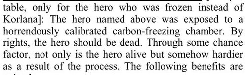

## p.23 (scan page 23)

Page contents: 591 words, 16 paragraphs | headings/entries: Customized Czerka Adventurer; Contract AA23; Page 23

- **No single roster character (rules/setting/general)** — entry/section: Ancient Holocron Fragment: "This crystalline fragment is said to be a splinter of some ancient Jedi holocron. There is to be no way to confirm this, but the fragment might make an excellent piece of jewelry." Source: *405 - Contract AA23* (SWRPG d20 Revised Core), p.23
  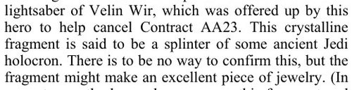

## p.24 (scan page 24)

Page contents: 563 words, 11 paragraphs | headings/entries: Player Handout 1: Welcome to Nar Shaddaa; Nar Shaddaa — The Smuggler's Moon; Totor's Party Kave; Contract AA23 Page 24

## p.25 (scan page 25)

Page contents: 221 words, 17 paragraphs | headings/entries: Player Handout 2: Contract AA23; Contract Designation: AA23, Cularin-404; Client: Velin Wir; Target(s):; See attached documentation designating 'Heroes of Cularin'; Restrictions:; Terms:; Time line:; Contract AA23 Page 25

- **No single roster character (rules/setting/general)** — entry/section: Player Handout 2: Contract AA23: "Restrictions:
No lethal force. Absolutely no disintegrations. Sanction must occur external to Cularin system. Penalty clause applied for undue media attention paid to the removal of targets." Source: *405 - Contract AA23* (SWRPG d20 Revised Core), p.25
  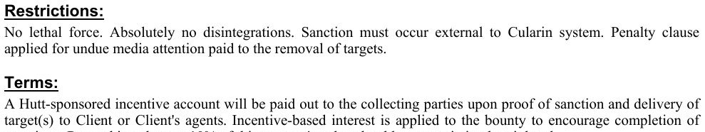

## p.26 (scan page 26)

Page contents: 647 words, 11 paragraphs | headings/entries: Contract AA23 Page 26

- **No single roster character (rules/setting/general)** — entry/section: Korlana Toryn: "The daughter of the popular and powerful Senator Jasso Toryn, Korlana Toryn was born to a life of privilege. Her father is a longtime member of the Republic Senate and has always been a strong supporter of the Jedi. In fact, he even wanted to be a Jedi, like his childhood friend Lanius Qel-Bertuk." Source: *405 - Contract AA23* (SWRPG d20 Revised Core), p.26
  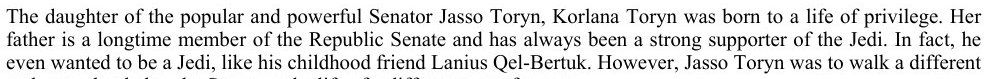
- **No single roster character (rules/setting/general)** — entry/section: Korlana Toryn: "Lanius was a natural choice not only as a powerful Jedi, but also as an old friend of the family that used to bounce Korlana on his knee." Source: *405 - Contract AA23* (SWRPG d20 Revised Core), p.26
  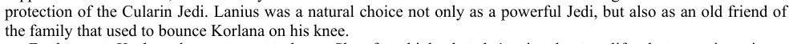

## p.27 (scan page 27)

Page contents: 696 words, 12 paragraphs | headings/entries: Contract AA23 Page 27

- **No single roster character (rules/setting/general)** — entry/section: Hohn Ryntz: "He used to work as an administrative assistant for Velin Wir, the original leader of the Cartel's interests in Cularin. Wir turned out to be a power-mad force adept. Not only that, but he had taken a contract out on a group of troublesome do-gooders in the system that had been a thorn in his side." Source: *405 - Contract AA23* (SWRPG d20 Revised Core), p.27
  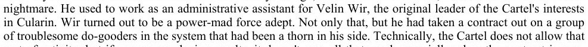

## p.28 (scan page 28)

Page contents: 687 words, 14 paragraphs | headings/entries: Contract AA23 Page 28

- **No single roster character (rules/setting/general)** — entry/section: K1-1R: "K1-1R is a killing machine, literally. Designed to excel both in the field and in command, K1-1R is a total package. K1-1R is a thorough planner, who exhausts all options before committing himself to a course of action. Lucky for it, it is able to evaluate those options in seconds instead of hours. Unlucky for K1-1R's former master. When faced with a guaranteed failure mission, K1-1R abandoned its master, as its survival subroutines overrode any sense of loyalty it had. Since then it has been on its own, as a very successful bounty hunter." Source: *405 - Contract AA23* (SWRPG d20 Revised Core), p.28
  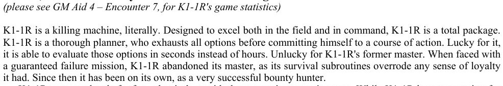
- **No single roster character (rules/setting/general)** — entry/section: K1-1R: "While K1-1R has a reputation for elaborate planning, near perfect execution, and an unflinching will to finish any job, those that work with it would say K1-1R is almost happy when it's in the middle of a mission." Source: *405 - Contract AA23* (SWRPG d20 Revised Core), p.28
  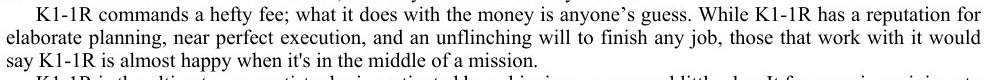
- **No single roster character (rules/setting/general)** — entry/section: K1-1R: "When playing K1-1R, be precise and even. K1-1R never loses its cool; it never gets excited. It doesn't even get annoyed. K1-1R is an efficient, emotionless machine with one purpose: to kill." Source: *405 - Contract AA23* (SWRPG d20 Revised Core), p.28
  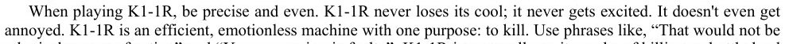

## p.29 (scan page 29)

Page contents: 685 words, 12 paragraphs | headings/entries: Shiana Trist, Professional Assassin; Contract AA23 Page 29

- **No single roster character (rules/setting/general)** — entry/section: Drokka: "Drokka is mean and nasty Rodian with a mean and nasty temper. A classic tough guy Bounty Hunter Drokka is a hard man who does what it takes to get the job done — even if (or perhaps especially if) it take cracking a few skulls. He loves violence, mostly because he's very good at it." Source: *405 - Contract AA23* (SWRPG d20 Revised Core), p.29
  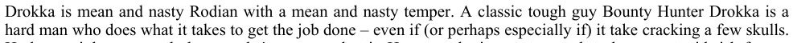
- **No single roster character (rules/setting/general)** — entry/section: Shiana Trist: "An ex-soldier, Shiana Trist is a hell of a great shot. A sniper by trade, she is careful and extremely, terribly, perfectly patient. She is in this for the money." Source: *405 - Contract AA23* (SWRPG d20 Revised Core), p.29
  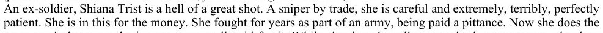
- **No single roster character (rules/setting/general)** — entry/section: Shiana Trist: "Shiana has an excellent reputation both for the quality of her work and her success rate." Source: *405 - Contract AA23* (SWRPG d20 Revised Core), p.29
  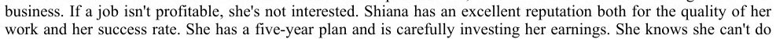

## p.30 (scan page 30)

Page contents: 455 words, 16 paragraphs | headings/entries: Skills: Intimidate +5, Jump +3; Notes on vehicles in this encounter:; Notes on tiering this encounter:; Drokka's Men (6-9) —; Contract AA23 Page 30

## p.31 (scan page 31)

Page contents: 48 words, 8 paragraphs | headings/entries: Contract AA23; Page 31

## p.32 (scan page 32)

Page contents: 483 words, 13 paragraphs | headings/entries: Contract AA23 Page 32

## p.33 (scan page 33)

Page contents: 249 words, 3 paragraphs | headings/entries: Contract AA23 Page 33

## p.34 (scan page 34)

Page contents: 690 words, 14 paragraphs | headings/entries: Contract AA23 Page 34

### Stat block notes (game mechanics, not feats)

- Drokka: Drokka: Adult Male Rodian, Soldier 4/Scoundrel 3/Bounty Hunter 3; VP/WP 89/16; Def 20; Rep +7; DSPs 4 (Source: *405 - Contract AA23* (SWRPG d20 Revised Core), p.34)
- Shiana Trist: Shiana Trist: Adult Female Human, Soldier 4/Scoundrel 1/Sharpshooter 5; VP/WP 86/12; Def 19 (Source: *405 - Contract AA23* (SWRPG d20 Revised Core), p.34)

## p.35 (scan page 35)

Page contents: 437 words, 19 paragraphs | headings/entries: AbMnanal Matalin Cavan; Shiana Trist; Contract AA23; Page 35

### Stat block notes (game mechanics, not feats)

- K1-1R: K1-1R (table, p35 image): Def 18, DR 10 shield (only ion weapons bypass), VP/WP 127/19; Computer Use +20, Gather Information +16 (Source: *405 - Contract AA23* (SWRPG d20 Revised Core), p.35)

## p.36 (scan page 36)

Page contents: 45 words, 4 paragraphs | headings/entries: Contract AA23 Page 36

## p.37 (scan page 37)

Page contents: 115 words, 5 paragraphs | headings/entries: How to tier this encounter:; Contract AA23 Page 37

## p.38 (scan page 38)

Page contents: 20 words, 2 paragraphs | headings/entries: Contract AA23 Page 38

## p.39 (scan page 39)

Page contents: 4 words, 1 paragraphs | headings/entries: 

## p.40 (scan page 40)

Page contents: 11 words, 2 paragraphs | headings/entries: GM Aid #6: Conveyor Belt Room Map; Contract AA23 Page 40

## p.41 (scan page 41)

Page contents: 11 words, 2 paragraphs | headings/entries: GM Aid #7: Carbon Freezing Chamber Map; Contract AA23 Page 41

## p.42 (scan page 42)

Page contents: 183 words, 12 paragraphs | headings/entries: Critical Event Summary Contract AA 23; Please make notes; GM Name, RPGA#:; GM Email Address:; Convention Name/Date; Contract AA23 Page 42

## p.21–42 (scan page 21)

Page contents: XP and loot certificates; player handouts (Nar Shaddaa, contract text); GM character profiles; combat stats; tier notes; maps; critical event summary (hand-read)

