# Owner Material 037 — Star Wars D20 Drive folder (Core, Revised Core and Saga Edition): Living Force Campaign/Adventures/Among the Stars/Year 4/406 - Jigsaw - A Portrait of the Artist as a Young Rodian.pdf [Star Wars Roleplaying Game Revised Core (d20, 2002)]

- **Source:** Wizards of the Coast Star Wars Roleplaying Game books, web enhancements, Living Force campaign modules and articles (2000–2010), from the owner's "Star Wars D20" Drive folder (only the three edition subfolders; "General" was not read, as instructed). Secondary source (licensed Legends reference). Scan OCR'd on the box; the scan stays box-only and is **not** published.
- **Method:** every scanned page was OCR'd and machine-screened sentence by sentence for power-relevant statements (fights, kills, defeats, Force feats, rankings, superweapons) that name a character on our roster; each kept sentence is quoted verbatim from the OCR text and has a crop of the printed passage directly under it. Pages with nothing power-relevant are still listed with what is on them.
- **Citation:** "*406 - Jigsaw - A Portrait of the Artist as a Young Rodian* (SWRPG d20 Revised Core), p.X" by printed page ("scan p.X" where no printed number applies). **Weight:** Licensed RPG material: a secondary source. Narrative text sums up Legends lore; game statistics are rules for players, not canon power levels, and rank lowest.

## p.1 (scan page 1)

Page contents: 115 words, 6 paragraphs | headings/entries: LFA406

## p.2 (scan page 2)

Page contents: 897 words, 22 paragraphs | headings/entries: House Rules; Atoning for Dark Side Points; Dissipate Energy; Illusion; Stun; Hero Earnings; Page 2

## p.3 (scan page 3)

Page contents: 887 words, 18 paragraphs | headings/entries: General Notes to the GM; GM Overview; Page 3

- **No single roster character (rules/setting/general)** — entry/section: GM Overview: "Twenty-four years ago the Jedi Council dispatched a single Jedi Knight to infiltrate the criminal organization of Riboga the Hutt on Cularin. Rumors abounded that Riboga traded in slaves. Because Lanius Qel-Bertuk had only just taken over the Almas Enclave, it was decided that an outside agent should be employed. A wily young Knight named Ji-Ad Sarain was chosen for the task." Source: *406 - Jigsaw - A Portrait of the Artist as a Young Rodian* (SWRPG d20 Revised Core), p.3
  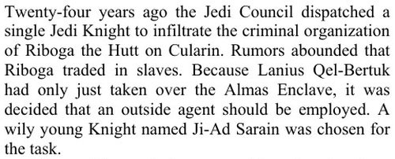
- **No single roster character (rules/setting/general)** — entry/section: GM Overview: "Sarain infiltrated the operation, posing as a mercenary, and managed to locate this facility. After calling for backup from the Almas Enclave, he attempted to rescue the imprisoned beings. During the ensuing battle, charging a band of the Hutt's enforcers while the slaves made their escape, Sarain was overcome and captured. Fearing a reprisal by the Jedi, the slavers fled the facility, but not before carbonfreezing their Jedi captive as a safety measure." Source: *406 - Jigsaw - A Portrait of the Artist as a Young Rodian* (SWRPG d20 Revised Core), p.3
  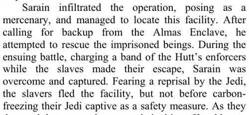

## p.4 (scan page 4)

Page contents: 934 words, 24 paragraphs | headings/entries: Scenario flow; Encounter 1: A Droid in Need; Encounter 2: Warehouse 151; Encounter 4: Under the Starlight; Page 4

- **No single roster character (rules/setting/general)** — entry/section: GM Overview: "Gomalo the Rodian has a long memory, however. After twenty-five years he was released, and returned to Cularin to see if he couldn't find some new business. It was much to his surprise, then, when he saw his sculpture on display in a museum on planet. Calling on some old contacts, he assembled a team and stole the item, intent on recovering his lost loot." Source: *406 - Jigsaw - A Portrait of the Artist as a Young Rodian* (SWRPG d20 Revised Core), p.4
  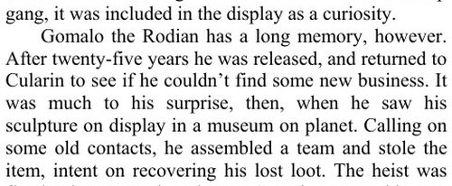
- **Ezra Bridger**: "By defeating him (or conning the information) they can determine where Ezra is." Source: *406 - Jigsaw - A Portrait of the Artist as a Young Rodian* (SWRPG d20 Revised Core), p.4
  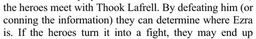

## p.5 (scan page 5)

Page contents: 774 words, 28 paragraphs | headings/entries: Encounter 5: Doing Business; Encounter 7: Deep Space Showdown; Important Note to GMs:; Opening Crawl; Encounter 1: A Droid in Need; Page 5

- **No single roster character (rules/setting/general)** — entry/section: Opening Crawl: "Though Riboga the Hutt removed his operation from the Cularin System decades ago, one of his minions has returned. Rumors persist of some unfinished business, an affair that might bring danger and death to the system..." Source: *406 - Jigsaw - A Portrait of the Artist as a Young Rodian* (SWRPG d20 Revised Core), p.5
  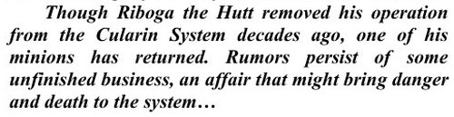
- **No single roster character (rules/setting/general)** — entry/section: MT-D6: ""Oh please, good citizen, my master is in dire need of assistance."" Source: *406 - Jigsaw - A Portrait of the Artist as a Young Rodian* (SWRPG d20 Revised Core), p.5
  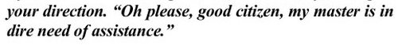
- **No single roster character (rules/setting/general)** — entry/section: MT-D6: "Although outraged that a being could be so mercenary, he is one of those rare messenger droids programmed for deceit—he is frequently used in undercover activities, after all—and is willing to promise whatever it takes in order to secure assistance." Source: *406 - Jigsaw - A Portrait of the Artist as a Young Rodian* (SWRPG d20 Revised Core), p.5
  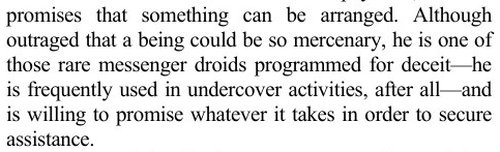

## p.1–5 (scan page 1)

Page contents: Title and blurb; boilerplate, house rules and FP/DSP guidance; GM overview of Ji-Ad Sarain's fate and Gomalo's bas-relief map; scenario flow; opening crawl (hand-read)

## p.6 (scan page 6)

Page contents: 816 words, 22 paragraphs | headings/entries: Encounter 2: Strands of Evidence; Tier Number of kouhun Low 1-2; Medium 2-3 High 3-4; Upper 4-5; The Quick Method; Page 6

## p.7 (scan page 7)

Page contents: 878 words, 29 paragraphs | headings/entries: DC | Information Gathered; The Slower Method; Encounter 4: Under the Starlight; Page 7

- **No single roster character (rules/setting/general)** — entry/section: Sherk: "What was she looking for? Who knows? Pictures? People who could move er, um, luxury items." Source: *406 - Jigsaw - A Portrait of the Artist as a Young Rodian* (SWRPG d20 Revised Core), p.7
  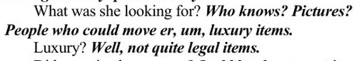
- **No single roster character (rules/setting/general)** — entry/section: Sherk: "Where can we find him right away? (He looks very nervous but will come around with more money, more talk or more intimidation) Starlight Lounge. He hangs out there." Source: *406 - Jigsaw - A Portrait of the Artist as a Young Rodian* (SWRPG d20 Revised Core), p.7
  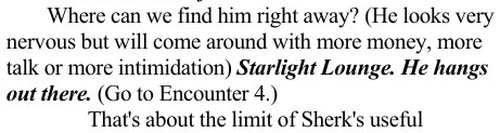
- **No single roster character (rules/setting/general)** — entry/section: Encounter 4: "Thook Lafrell believes that it is more profitable and safer for him to keep her alive and in relatively good health." Source: *406 - Jigsaw - A Portrait of the Artist as a Young Rodian* (SWRPG d20 Revised Core), p.7
  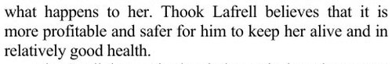
- **No single roster character (rules/setting/general)** — entry/section: Encounter 4: "First of all, it should be noted that any Jedi entering the establishment who have not taken pains to conceal their affiliation automatically attract a great deal of attention. Such characters receive outright hostile stares from most of the customers, but Gomalo's goons and the locals know better than to cause trouble with Jedi when it can be avoided." Source: *406 - Jigsaw - A Portrait of the Artist as a Young Rodian* (SWRPG d20 Revised Core), p.7
  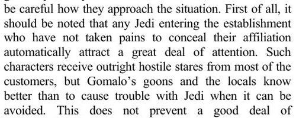

## p.8 (scan page 8)

Page contents: 891 words, 28 paragraphs | headings/entries: Information Gathered; DC Information Gathered; Page 8

- **No single roster character (rules/setting/general)** — entry/section: Thook Lafrell: "If the heroes still press him with an accusation, he warns them "Stay out of other beings' business."" Source: *406 - Jigsaw - A Portrait of the Artist as a Young Rodian* (SWRPG d20 Revised Core), p.8
  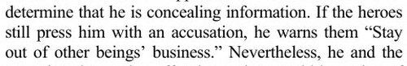
- **Ezra Bridger**: "Unless the heroes can successfully steal a key-card for the turbolift, sneak into Room 1, defeat the Defel, rescue Ezra and slip out of the Starlight without attracting any attention, Thook and the Togorians are likely to see what's happening and take exception to it." Source: *406 - Jigsaw - A Portrait of the Artist as a Young Rodian* (SWRPG d20 Revised Core), p.8
  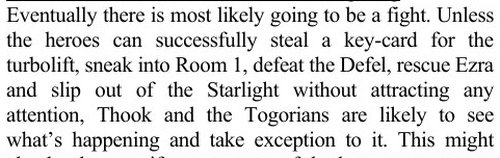

## p.9 (scan page 9)

Page contents: 896 words, 24 paragraphs | headings/entries: Encounter 5: Doing Business; Negotiating with Thook; Intimidating Thook; Page 9

- **No single roster character (rules/setting/general)** — entry/section: Thook Lafrell: "He wants a 1000 credits finder's fee for the art (about 10% of the estimated value) and 2000 credits reward for "rescuing" the OPS officer. Yes, he calls it rescuing." Source: *406 - Jigsaw - A Portrait of the Artist as a Young Rodian* (SWRPG d20 Revised Core), p.9
  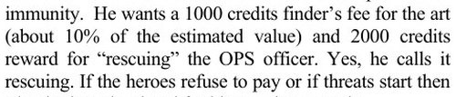

## p.10 (scan page 10)

Page contents: 931 words, 19 paragraphs | headings/entries: Calling in Some Backup; Page 10

- **No single roster character (rules/setting/general)** — entry/section: Nog and Cham Teleus: "(This even applies to Jedi, whom the Tynnans encourage to "Buy yourself a spiffy new robe or something else nice.")" Source: *406 - Jigsaw - A Portrait of the Artist as a Young Rodian* (SWRPG d20 Revised Core), p.10
  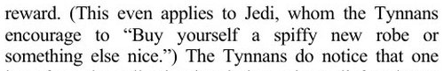
- **No single roster character (rules/setting/general)** — entry/section: Encounter 6: "The secret of the sculpture is that it does not depict real individuals, but instead conceals a map to the location of the pod in which Sarain was dumped. The star on each of the uniforms depicts the location of a planet along the Corellian Run—Tynna, Cularin, Rodia and Ryloth, respectively." Source: *406 - Jigsaw - A Portrait of the Artist as a Young Rodian* (SWRPG d20 Revised Core), p.10
  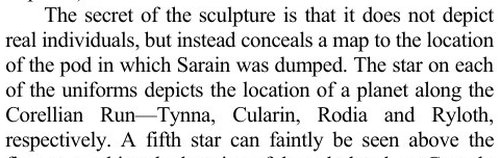

## p.11 (scan page 11)

Page contents: 842 words, 24 paragraphs | headings/entries: Encounter 7: Deep Space Showdown; The fight:; Check Result; Page 11

- **No single roster character (rules/setting/general)** — entry/section: Lanius Qel-Bertuk: "When the name of either Gomalo the Rodian or Ji-Ad Sarain is mentioned, the heroes are immediately put through to the Master Lannius. With great surprise he urges them to pursue the mission and relates the tale of the lost Jedi Knight." Source: *406 - Jigsaw - A Portrait of the Artist as a Young Rodian* (SWRPG d20 Revised Core), p.11
  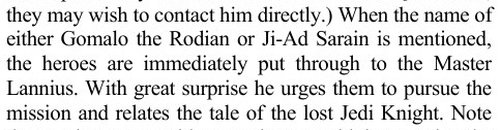

## p.5–11 (scan page 5)

Page contents: E1 MT-D6 asks for help; E2 kouhun at Warehouse 151; E3 Sherk Q&A; E4 the Starlight Lounge fight; E5 doing business with Thook Lafrell; E6 Ezra, the Tynnans and the sculpture (hand-read)

## p.12 (scan page 12)

Page contents: 832 words, 24 paragraphs | headings/entries: Conclusion; Experience Point Summary; Adventure Experience Award:; Page 12

- **No single roster character (rules/setting/general)** — entry/section: Encounter 7: "After all, blowing up the starship is likely to kill Ji-Ad, even if he is frozen in carbonite." Source: *406 - Jigsaw - A Portrait of the Artist as a Young Rodian* (SWRPG d20 Revised Core), p.12
  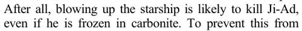
- **No single roster character (rules/setting/general)** — entry/section: Conclusion: "As the command is typed into the control console, a flare of light breaks the cold gray metal that covers the Jedi's face. Like the twin suns of Cularin rising over the jungle, the light begins to spread; beneath the disappearing metal coat appears a youthful but wizened face. When the last remnant of the carbonite prison disappears, Ji-Ad Sarain curls forward and falls into the waiting arms of a pair of Padawans and he is taken away for medical treatment." Source: *406 - Jigsaw - A Portrait of the Artist as a Young Rodian* (SWRPG d20 Revised Core), p.12
  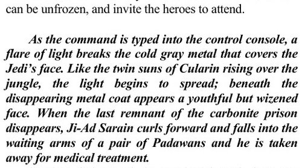
- **No single roster character (rules/setting/general)** — entry/section: Lanius Qel-Bertuk: "Lanius Qel-Bertuk is overjoyed and does not conceal it. "My friends, you have won a major victory for the forces of good in the Cularin system. In this time of darkness you have brought back, as if from death, one who help us defend peace and justice in the galaxy. My friends, I thank you."" Source: *406 - Jigsaw - A Portrait of the Artist as a Young Rodian* (SWRPG d20 Revised Core), p.12
  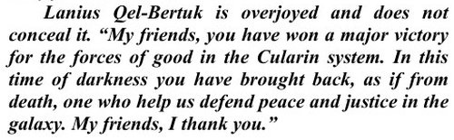

## p.13 (scan page 13)

Page contents: 275 words, 11 paragraphs | headings/entries: Loot Summary; Page 13

## p.14 (scan page 14)

Page contents: 16 words, 2 paragraphs | headings/entries: Player Handout 1: The Sculpture

## p.15 (scan page 15)

Page contents: 133 words, 6 paragraphs | headings/entries: Player Handout 2: The Hero's Spaceship

## p.16 (scan page 16)

Page contents: 615 words, 18 paragraphs | headings/entries: GM Aid 1: Combat Statistics, NPCs

### Stat block notes (game mechanics, not feats)

- Gomalo: Gomalo the Rodian: Rodian Scoundrel 4; VP/WP 17/12; Bluff +12; Feats Fame, Influence (Source: *406 - Jigsaw - A Portrait of the Artist as a Young Rodian* (SWRPG d20 Revised Core), p.16)
- Nak'har: Nak'har: Male Defel Scoundrel 3; VP/WP 18/12; SQ Invisibility (50% miss chance in low light) (Source: *406 - Jigsaw - A Portrait of the Artist as a Young Rodian* (SWRPG d20 Revised Core), p.16)
- Thook Lafrell: Thook Lafrell: Human Scoundrel 4; VP/WP 15/10; Tumble +13 (Source: *406 - Jigsaw - A Portrait of the Artist as a Young Rodian* (SWRPG d20 Revised Core), p.16)

## p.17 (scan page 17)

Page contents: 567 words, 25 paragraphs | headings/entries: GM Aid #1: Combat Statistics, NPCs; Tier 1-3; Tier 4-6; Tier 7-9; Tier 10-12

- **No single roster character (rules/setting/general)** — entry/section: Togorians: "They are known throughout the galaxy as ruthless pirates and mercenaries. They are brutal and short-tempered." Source: *406 - Jigsaw - A Portrait of the Artist as a Young Rodian* (SWRPG d20 Revised Core), p.17
  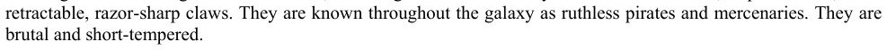

## p.18 (scan page 18)

Page contents: 380 words, 15 paragraphs | headings/entries: GM Aid #1: Combat Statistics, Space Ships; Initiative Maneuver Attack Bonus

## p.19 (scan page 19)

Page contents: 31 words, 3 paragraphs | headings/entries: HH Warehouse 151 H HH

## p.20 (scan page 20)

Page contents: 25 words, 5 paragraphs | headings/entries: GM Aid 3: Starlight (Ground Level) Map; The Starlight Lounge; Ground Level

## p.21 (scan page 21)

Page contents: 25 words, 4 paragraphs | headings/entries: The Starlight Lounge Upper Levels

## p.22 (scan page 22)

Page contents: 18 words, 2 paragraphs | headings/entries: GM Aid 5: Starlight (Underground Level) Map

## p.23 (scan page 23)

Page contents: 99 words, 9 paragraphs | headings/entries: GM Email Address:; Convention Name/Date; Or e-mail them to: [email removed]; Or fax to: (425) 687-8287

## p.11–23 (scan page 11)

Page contents: E7 Deep Space Showdown; conclusion with Ji-Ad Sarain's unfreezing; XP and loot; handouts; NPC and ship stats; maps; critical event summary (hand-read)

