# Owner Material 037 — Star Wars D20 Drive folder (Core, Revised Core and Saga Edition): Living Force Campaign/Adventures/Among the Stars/Year 4/407 - Jigsaw - In Name of the Maker.pdf [Star Wars Roleplaying Game Revised Core (d20, 2002)]

- **Source:** Wizards of the Coast Star Wars Roleplaying Game books, web enhancements, Living Force campaign modules and articles (2000–2010), from the owner's "Star Wars D20" Drive folder (only the three edition subfolders; "General" was not read, as instructed). Secondary source (licensed Legends reference). Scan OCR'd on the box; the scan stays box-only and is **not** published.
- **Method:** every scanned page was OCR'd and machine-screened sentence by sentence for power-relevant statements (fights, kills, defeats, Force feats, rankings, superweapons) that name a character on our roster; each kept sentence is quoted verbatim from the OCR text and has a crop of the printed passage directly under it. Pages with nothing power-relevant are still listed with what is on them.
- **Citation:** "*407 - Jigsaw - In Name of the Maker* (SWRPG d20 Revised Core), p.X" by printed page ("scan p.X" where no printed number applies). **Weight:** Licensed RPG material: a secondary source. Narrative text sums up Legends lore; game statistics are rules for players, not canon power levels, and rank lowest.

## p.1 (scan page 1)

Page contents: 158 words, 7 paragraphs | headings/entries: LFA407; In the Name of the Maker; Edited by Ron and Margaret Heintz

## p.2 (scan page 2)

Page contents: 854 words, 21 paragraphs | headings/entries: House Rules; Atoning for Dark Side Points; Dissipate Energy; In the Name of the Maker; Illusion; Stun; Hero Earnings; Page 2

## p.3 (scan page 3)

Page contents: 872 words, 16 paragraphs | headings/entries: In the Name of the Maker; GM Overview; Page 3

- **No single roster character (rules/setting/general)** — entry/section: GM Overview: "Little does he realize that his research has been usurped by criminal beings—Fireclaw Horde mercenaries—who intend to use his droids as weapons in an ambush of the luxury liner Queen of Cularin." Source: *407 - Jigsaw - In Name of the Maker* (SWRPG d20 Revised Core), p.3
  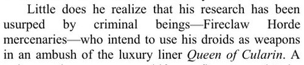

## p.4 (scan page 4)

Page contents: 674 words, 30 paragraphs | headings/entries: Encounter 2: Aftermath; Encounter 4: Local Wildlife; Encounter 5: The Watcher in the Shadows; Encounter 7: An Engagement with the Queen; In the Name of the Maker; Opening Crawl; Spot or Tier 4; Listen DC DC DC DC 26; Page 4

- **No single roster character (rules/setting/general)** — entry/section: Opening Crawl: "Throughout the Cularin System, industrious beings toil every day to improve life for themselves and others. Ingenuity brings new invention, and technology evolves to make labor more productive and relaxation more plentiful. When this inventiveness is harnessed by the unscrupulous, however, it can spell danger and death for others..." Source: *407 - Jigsaw - In Name of the Maker* (SWRPG d20 Revised Core), p.4
  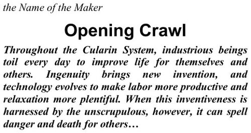
- **No single roster character (rules/setting/general)** — entry/section: Encounter 1: "There's no doubt about it. Since the conflict between Cularin and Thaere has started Gadrin and Hedrett have become more... rowdy. Whether it's due to Militia personnel blowing off steam or half of the Office of Public Safety being tied up with things more important than street patrols the result is the same. More noise, more traffic, more chaos." Source: *407 - Jigsaw - In Name of the Maker* (SWRPG d20 Revised Core), p.4
  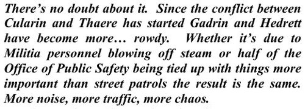

## p.5 (scan page 5)

Page contents: 847 words, 22 paragraphs | headings/entries: DC | Information Gathered; In the Name of the Maker; Page 5

## p.1–5 (scan page 1)

Page contents: Title and blurb; boilerplate and house rules; GM overview of the stolen MMR-8 plans and the Fireclaw Horde; summaries; opening crawl; E1 speeder chase (hand-read)

## p.6 (scan page 6)

Page contents: 829 words, 28 paragraphs | headings/entries: Encounter 2: Aftermath; In the Name of the Maker; SoroSuub offices at Gadrin; Page 6

- **No single roster character (rules/setting/general)** — entry/section: Encounter 1: "The Togorians are highly trained and fiercely loyal to their organization; they fight to the death." Source: *407 - Jigsaw - In Name of the Maker* (SWRPG d20 Revised Core), p.6
  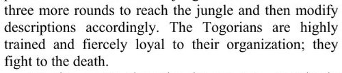
- **No single roster character (rules/setting/general)** — entry/section: Imik Suum: ""A thousand thank yous! Your daring and courage have rescued me from assassins! Would that you had been nearer when they killed my co-workers! Ah, the horror!"" Source: *407 - Jigsaw - In Name of the Maker* (SWRPG d20 Revised Core), p.6
  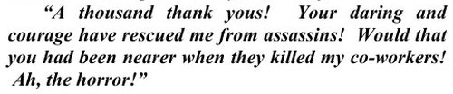
- **No single roster character (rules/setting/general)** — entry/section: Imik Suum: "Why were they chasing you? Ah. Likely because I witnessed them murdering my coworkers." Source: *407 - Jigsaw - In Name of the Maker* (SWRPG d20 Revised Core), p.6
  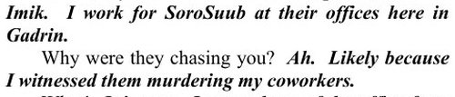
- **No single roster character (rules/setting/general)** — entry/section: Imik Suum: "What! It is true. I stepped out of the office for a mere few minutes. When I was returning I heard the sound of blaster fire. I am afraid that curiosity and fear overrode my instinct to flee until it was nearly too late. I was seen as they left." Source: *407 - Jigsaw - In Name of the Maker* (SWRPG d20 Revised Core), p.6
  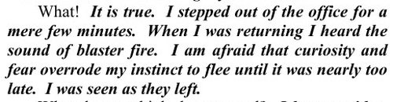

## p.7 (scan page 7)

Page contents: 812 words, 32 paragraphs | headings/entries: Repair DC Result; Computer Use | Information Gathered ie; Less than 5/10/10/10; In the Name of the Maker; Can you; Encounter 3: Welcome to Nub Saar; Page 7

- **No single roster character (rules/setting/general)** — entry/section: Imik Suum: ""Please. You are brave and daring. Can you investigate this and avenge my co-workers?"" Source: *407 - Jigsaw - In Name of the Maker* (SWRPG d20 Revised Core), p.7
  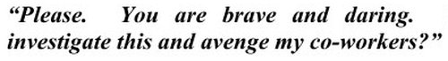
- **No single roster character (rules/setting/general)** — entry/section: Encounter 3: "closer inspections reveals this to be a small floating monument inscribed with the names of the more than one thousand beings who died in the radiation storms that devastated the city." Source: *407 - Jigsaw - In Name of the Maker* (SWRPG d20 Revised Core), p.7
  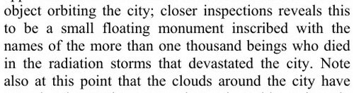

## p.8 (scan page 8)

Page contents: 838 words, 21 paragraphs | headings/entries: Information Gathered; In the Name of the Maker; Encounter 4: Local Wildlife; Skrannix Attack; Page 8

- **No single roster character (rules/setting/general)** — entry/section: Encounter 3: "It was the first cloud city to be built over Genarius, administered by a Trandoshan named Russok. In a series of three radiation storms, each more intense than the last, the entire place was devastated. Almost every bit of technology on the city was destroyed, and in some places metal was peeled from the walls." Source: *407 - Jigsaw - In Name of the Maker* (SWRPG d20 Revised Core), p.8
  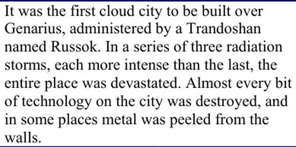

## p.9 (scan page 9)

Page contents: 836 words, 22 paragraphs | headings/entries: Tier Number of skrannix ]; Medium 2 High 4; Upper 6; Dead Local Wildlife; Encounter 5: The Watcher in the Shadows; In the Name of the Maker; Page 9

- **No single roster character (rules/setting/general)** — entry/section: Nitram Con Queecon: "THE SPIRITS OF THE LOST WILL DESTROY YOU ALL!" Source: *407 - Jigsaw - In Name of the Maker* (SWRPG d20 Revised Core), p.9
  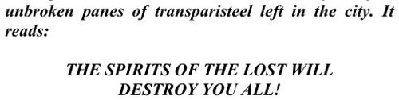
- **No single roster character (rules/setting/general)** — entry/section: Nitram Con Queecon: "The Ranat is not an evil being; he simply desires for things to go back to how they used to be." Source: *407 - Jigsaw - In Name of the Maker* (SWRPG d20 Revised Core), p.9
  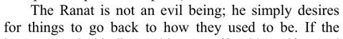

## p.10 (scan page 10)

Page contents: 789 words, 31 paragraphs | headings/entries: Diplomacy; They can't; Nitram can lead you there, avoid; Diplomacy; Encounter 6: The Reprocessing Facility; In the Name of the Maker; Page 10

- **No single roster character (rules/setting/general)** — entry/section: Nitram Con Queecon: "You let Nitram let go? Go find hungry Togorians. Make them go away. Nitram not bother you. Togarians are at reprocessing plant. Nitram tell you how to get there." Source: *407 - Jigsaw - In Name of the Maker* (SWRPG d20 Revised Core), p.10
  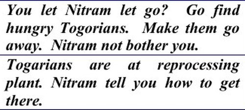

## p.11 (scan page 11)

Page contents: 789 words, 23 paragraphs | headings/entries: Encounter 7: An Engagement with a Queen; In the Name of the Maker; Conclusion; Experience Point Summary; Page 11

- **No single roster character (rules/setting/general)** — entry/section: Fireclaw prisoners: "Any of the prisoners taunt the heroes with a sneering "We've got a date with the Queen."" Source: *407 - Jigsaw - In Name of the Maker* (SWRPG d20 Revised Core), p.11
  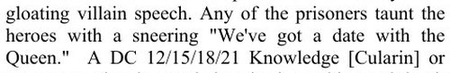
- **No single roster character (rules/setting/general)** — entry/section: Conclusion: "As the pirate vessel turns tail and runs, the hail of cannon fire ceases. Although the vacuum of space prevents sound from being transmitted, you can see dozens of beings through the viewports of the luxury liner, cheering wildly at their daring rescue." Source: *407 - Jigsaw - In Name of the Maker* (SWRPG d20 Revised Core), p.11
  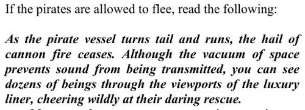

## p.6–11 (scan page 6)

Page contents: E2 Ezra Du'Re and Imik Suum at the SoroSuub office; E3 arriving at Nub Saar; E4 skrannix; E5 Nitram the Ranat; E6 the Fireclaw hideout; E7 defending the Queen of Cularin; conclusion (hand-read)

## p.12 (scan page 12)

Page contents: 238 words, 11 paragraphs | headings/entries: Adventure Experience Award:; Loot Summary; In the Name of the Maker; Page 12

## p.13 (scan page 13)

Page contents: 277 words, 12 paragraphs | headings/entries: Player Handout 1: N'Wan's Data; Queen of Cularin

## p.14 (scan page 14)

Page contents: 198 words, 10 paragraphs | headings/entries: Player Handout 2: Available Vehicles and Ships; Commandeered Groundspeeder; Available Space Transport

## p.15 (scan page 15)

Page contents: 17 words, 3 paragraphs | headings/entries: Player Handout 3: Warehouse Map; Old Warehouse [| =2m

## p.16 (scan page 16)

Page contents: 17 words, 4 paragraphs | headings/entries: Player Handout 4: Reprocessing Facility; Reprocessing Facility

## p.17 (scan page 17)

Page contents: 528 words, 18 paragraphs | headings/entries: GM Aid #1: Non-tiered NPCs

### Stat block notes (game mechanics, not feats)

- Imik Suum: Imik Suum: Male Sullustan Tech Specialist 3; VP/WP 7/12; Craft: droids +10 (Source: *407 - Jigsaw - In Name of the Maker* (SWRPG d20 Revised Core), p.17)
- Eaba N'Wan: Eaba N'Wan: Male Sullustan Scoundrel 4; VP/WP 13/10; Craft: droids +13 (Source: *407 - Jigsaw - In Name of the Maker* (SWRPG d20 Revised Core), p.17)

## p.18 (scan page 18)

Page contents: 553 words, 26 paragraphs | headings/entries: GM Aid #2: Tiered NPCs Tier 1-3

## p.19 (scan page 19)

Page contents: 598 words, 32 paragraphs | headings/entries: GM Aid #2: Tiered NPCs, con't; Tier 7-9; Tier 10-12

### Stat block notes (game mechanics, not feats)

- MMR-8 Marauder: MMR-8 Marauder (top tier): Large walking assault droid, Soldier 8; VP/WP 52/14; Str 22; DR 7; heavy cutting torches 2d8+6 (Source: *407 - Jigsaw - In Name of the Maker* (SWRPG d20 Revised Core), p.19)

## p.20 (scan page 20)

Page contents: 288 words, 13 paragraphs | headings/entries: GM Aid #3: Vehicles and Ships; Commandeered Groundspeeder; Available Space Transport; Villain's Ship

## p.21 (scan page 21)

Page contents: 36 words, 9 paragraphs | headings/entries: GM Aid #4: Old Warehouse Map; Old Warehouse

## p.22 (scan page 22)

Page contents: 45 words, 11 paragraphs | headings/entries: GM Aid #5: Reprocessing Facilit; Area; A= 6m conveyor belt B= overhead hoist; C= control stations; D= deconstruction cells E= sorting; F= storage shelves; G= assault droid; Reprocessing Facility

## p.23 (scan page 23)

Page contents: 279 words, 13 paragraphs | headings/entries: GM Aid #6: References; Nub Saar; Skrannix; Ranat

- **No single roster character (rules/setting/general)** — entry/section: Nub Saar: "Nub Saar was the first of Genarius' cloud cities. Constructed quickly, at a low orbit and without adequate shielding to protect the inhabitants from the massive radiation storms it quickly became a ghost town. Although most of the approximately 5000 initial inhabitants fled before the storms grew too fierce several hundred men refused to leave and perished." Source: *407 - Jigsaw - In Name of the Maker* (SWRPG d20 Revised Core), p.23
  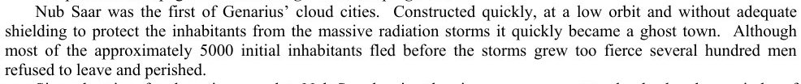

## p.24 (scan page 24)

Page contents: 82 words, 8 paragraphs | headings/entries: C1 Yes CINo; GM Name, RPGA#: GM Email Address:; Convention Name/Date

## p.12–24 (scan page 12)

Page contents: XP and loot placeholder; handouts; NPC stats by tier; ship stats; maps; references; critical event summary (hand-read)

