# Owner Material 037 — Star Wars D20 Drive folder (Core, Revised Core and Saga Edition): Living Force Campaign/Adventures/Among the Stars/Year 4/408 - Jigsaw - Cloak and Vibroblade.pdf [Star Wars Roleplaying Game Revised Core (d20, 2002)]

- **Source:** Wizards of the Coast Star Wars Roleplaying Game books, web enhancements, Living Force campaign modules and articles (2000–2010), from the owner's "Star Wars D20" Drive folder (only the three edition subfolders; "General" was not read, as instructed). Secondary source (licensed Legends reference). Scan OCR'd on the box; the scan stays box-only and is **not** published.
- **Method:** every scanned page was OCR'd and machine-screened sentence by sentence for power-relevant statements (fights, kills, defeats, Force feats, rankings, superweapons) that name a character on our roster; each kept sentence is quoted verbatim from the OCR text and has a crop of the printed passage directly under it. Pages with nothing power-relevant are still listed with what is on them.
- **Citation:** "*408 - Jigsaw - Cloak and Vibroblade* (SWRPG d20 Revised Core), p.X" by printed page ("scan p.X" where no printed number applies). **Weight:** Licensed RPG material: a secondary source. Narrative text sums up Legends lore; game statistics are rules for players, not canon power levels, and rank lowest.

## p.1 (scan page 1)

Page contents: 130 words, 7 paragraphs | headings/entries: LFA408; Cloak and Vibroblade; Edited by Ron and Margaret Heintz

## p.2 (scan page 2)

Page contents: 848 words, 21 paragraphs | headings/entries: House Rules; Atoning for Dark Side Points; Dissipate Energy; Cloak and Vibroblade; Illusion; Stun; Hero Earnings; Page 2

## p.3 (scan page 3)

Page contents: 856 words, 15 paragraphs | headings/entries: Cloak and Vibroblade; GM Overview; Page 3

- **No single roster character (rules/setting/general)** — entry/section: GM Overview: "The true mastermind behind their plots is a Dark Side adept named Mebara Jos. She is a Togorian who was refused by the Almas Enclave twenty years ago after a fight with one of her fellow Jedi candidates. Her first two attempts at vengeance, the capture of the carbonite encased Jedi, and the destruction of the Queen of Cularin, were disrupted by local heroes. As such, her hatred for the beings of the Cularin System has only grown more intense." Source: *408 - Jigsaw - Cloak and Vibroblade* (SWRPG d20 Revised Core), p.3
  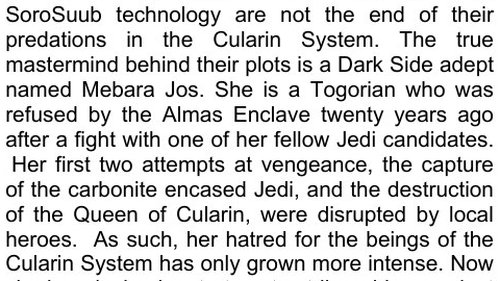

## p.4 (scan page 4)

Page contents: 739 words, 22 paragraphs | headings/entries: Cloak and Vibroblade; Page 4

- **No single roster character (rules/setting/general)** — entry/section: GM Overview: "Using information stolen from the SoroSuub office on Gadrin, she intends to jam the controls of the remote vehicle, sending it out of control and into the crowd. She then intends for her "allies", some Togorians, to take the blame for the casualties." Source: *408 - Jigsaw - Cloak and Vibroblade* (SWRPG d20 Revised Core), p.4
  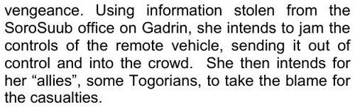

## p.5 (scan page 5)

Page contents: 692 words, 19 paragraphs | headings/entries: Opening Crawl; Cloak and Vibroblade; The Dancing Flame Tavern; Encounter 2: The Missing Patron; The fight begins to wind down. The; Page 5

- **No single roster character (rules/setting/general)** — entry/section: Opening Crawl: "It is a time of great promise as well as conflict in the Cularin System. Thaereian and Cularin military jockey for position. However, ordinary citizens still hope for prosperity and crave diversion." Source: *408 - Jigsaw - Cloak and Vibroblade* (SWRPG d20 Revised Core), p.5
  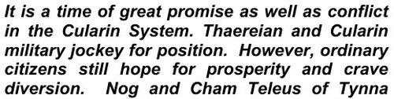
- **No single roster character (rules/setting/general)** — entry/section: Corellian tough: ""Yeah," taunts the Coreworlder, "that's what I thought. No hick from Cularin could ever stand up to a Corellian."" Source: *408 - Jigsaw - Cloak and Vibroblade* (SWRPG d20 Revised Core), p.5
  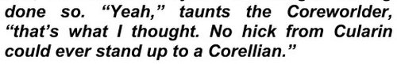

## p.1–5 (scan page 1)

Page contents: Title and blurb; boilerplate and house rules; GM overview of Mebara Jos' revenge plot at the Cularin Classic; summaries; opening crawl; E1 tavern brawl (hand-read)

## p.6 (scan page 6)

Page contents: 717 words, 30 paragraphs | headings/entries: Cloak and Vibroblade; From any captured Blood Raptors:; One of Our Patrons is Missing; From Chadra-Fan:; Page 6

## p.7 (scan page 7)

Page contents: 732 words, 22 paragraphs | headings/entries: From any captured Corellians:; Other Avenues; Moving Along the Scenario; Cloak and Vibroblade; Encounter 3a: Finding The Swooper Hideout; Page 7

- **No single roster character (rules/setting/general)** — entry/section: Seng Windrunner: "(Because if he can't race and win he sure as Reidi-Artom's-baby-finger doesn't want a Blood Raptor to win)." Source: *408 - Jigsaw - Cloak and Vibroblade* (SWRPG d20 Revised Core), p.7
  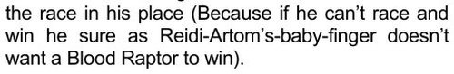

## p.8 (scan page 8)

Page contents: 781 words, 31 paragraphs | headings/entries: Casing out Landing Bay 216; Should any hero announce they're looking; Cloak and Vibroblade; Senq's Arrival; Page 8

- **No single roster character (rules/setting/general)** — entry/section: Seng Windrunner: ""I'm Seng," the driver says, bracing himself against the swoop. A dirty gray cast can be seen wrapped around his lower leg. "What are you doing on Talon turf?"" Source: *408 - Jigsaw - Cloak and Vibroblade* (SWRPG d20 Revised Core), p.8
  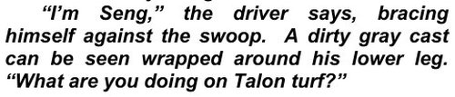

## p.9 (scan page 9)

Page contents: 760 words, 21 paragraphs | headings/entries: A DC 10/12/14/16 Diplomacy check or adequate; Cloak and Vibroblade; Encounter 3b: Visiting The Swooper Hideout; Page 9

- **No single roster character (rules/setting/general)** — entry/section: Seng Windrunner: "Plot? She was vague. A "plot that could bring great harm to the beings of Cularin." You believed her? Well, it sounded a bit dramatic. But Di'hal hangs around the swoop track a bit and she did sound scared." Source: *408 - Jigsaw - Cloak and Vibroblade* (SWRPG d20 Revised Core), p.9
  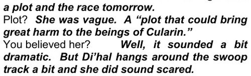
- **No single roster character (rules/setting/general)** — entry/section: Di'hal'uma: "But someone is very interested in this race and has been researching all the teams. Even when I think about it, it sounds too vague; all smoke and no fire. But I must have gotten somebody worried, or they wouldn't have tried to grab me." Source: *408 - Jigsaw - Cloak and Vibroblade* (SWRPG d20 Revised Core), p.9
  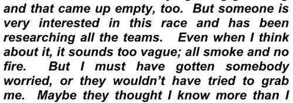
- **No single roster character (rules/setting/general)** — entry/section: Seng Windrunner: "Seng: We chose Di'hal because she knows a lot about swoop and bike racing. And she has a knack for seeing things that look unimportant but aren't." Source: *408 - Jigsaw - Cloak and Vibroblade* (SWRPG d20 Revised Core), p.9
  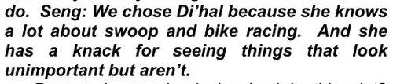

## p.10 (scan page 10)

Page contents: 699 words, 31 paragraphs | headings/entries: Cloak and Vibroblade; The Arena; Room Occupant; Team SoroSuub; Talons (now the heroes) Gotals; Dugs; Blood Raptors; NOOK W; Page 10

## p.11 (scan page 11)

Page contents: 672 words, 31 paragraphs | headings/entries: Information Gathered; Cloak and Vibroblade; DC Information Gathered; Page 11

## p.5–11 (scan page 5)

Page contents: E2 Di'hal'uma's abduction and the clues; E3a/3b the Talons' hideout, Queg, Seng Windrunner and Di'hal Q&A; E4 infiltrating the race backstage (hand-read)

## p.12 (scan page 12)

Page contents: 770 words, 17 paragraphs | headings/entries: Cloak and Vibroblade; The Race; Page 12

- **No single roster character (rules/setting/general)** — entry/section: Race announcer: ""Ladies and Gentlebeings, for the thousands in attendance today and the millions watching throughout the galaxy, welcome to the first annual Cularin Classic!" Source: *408 - Jigsaw - Cloak and Vibroblade* (SWRPG d20 Revised Core), p.12
  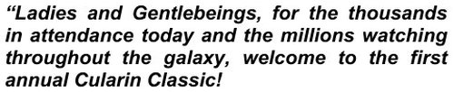

## p.13 (scan page 13)

Page contents: 745 words, 21 paragraphs | headings/entries: Mebara's Attack; Cloak and Vibroblade; Page 13

- **No single roster character (rules/setting/general)** — entry/section: Mebara's Attack: "It is Mebara's intent to create the maximum possible terror and chaos so that as many people are hurt and killed as well as giving her the best chance of escape in the confusion." Source: *408 - Jigsaw - Cloak and Vibroblade* (SWRPG d20 Revised Core), p.13
  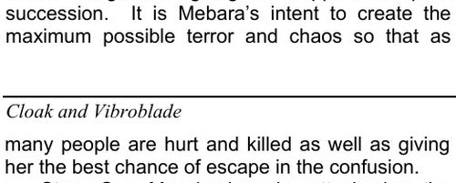
- **No single roster character (rules/setting/general)** — entry/section: Mebara Jos: ""Beings of Cularin," she taunts, "let the galaxy bear witness to your weakness, and to my revenge." As she speaks the drone swoop continues on it's course as the deflector shield that protects the crowd shimmers and then disappears." Source: *408 - Jigsaw - Cloak and Vibroblade* (SWRPG d20 Revised Core), p.13
  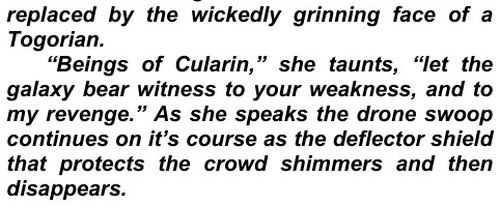

## p.14 (scan page 14)

Page contents: 664 words, 26 paragraphs | headings/entries: Conclusion; Cloak and Vibroblade; Here Ends; Experience Point Summary; Adventure Experience Award:; Page 14

- **No single roster character (rules/setting/general)** — entry/section: Encounter 6: "If the drone is disabled, Mebara is finally pushed over the edge and into the depths of her rage. She emerges from the door marked with an X on the map and attacks the heroes." Source: *408 - Jigsaw - Cloak and Vibroblade* (SWRPG d20 Revised Core), p.14
  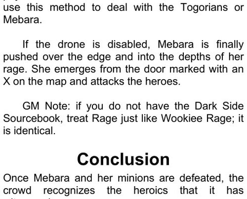
- **No single roster character (rules/setting/general)** — entry/section: Conclusion: "For a moment all is silent. Then the crowd erupts in cheering and applause, coming to its feet as one in a massive ovation." Source: *408 - Jigsaw - Cloak and Vibroblade* (SWRPG d20 Revised Core), p.14
  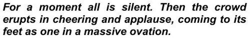

## p.15 (scan page 15)

Page contents: 180 words, 9 paragraphs | headings/entries: Loot Summary; Cloak and Vibroblade; Page 15

## p.11–15 (scan page 11)

Page contents: E5 investigating the teams, the Duckonians and Mebara Jos; the race and its obstacles; E6 Mebara's attack and the runaway drone; conclusion; XP; loot (hand-read)

## p.16 (scan page 16)

Page contents: 17 words, 3 paragraphs | headings/entries: Player Handout 1: Landing Bay 216/The Dive; Docking Bay 216 [| =2m; Cloak and Vibroblade Page 16

## p.17 (scan page 17)

Page contents: 40 words, 11 paragraphs | headings/entries: Cloak and Vibroblade; Backstage Area [| =2m; Player Handout 2:; Backstage Area Map; OODNAONRWN =; Gotals Dugs; Page 17

## p.18 (scan page 18)

Page contents: 32 words, 8 paragraphs | headings/entries: The Swoop Track; Cloak and Vibroblade Page 18

## p.19 (scan page 19)

Page contents: 327 words, 17 paragraphs | headings/entries: Player Handout 4: The Pilots; Team 1: Team SoroSuub; Team 4: Dugs; Cloak and Vibroblade Page 19

- **No single roster character (rules/setting/general)** — entry/section: Ribuk: "Even though over a decade has passed since Sebulba was the king of the pod circuit every dug racer is compared to him and wants to surpass his records." Source: *408 - Jigsaw - Cloak and Vibroblade* (SWRPG d20 Revised Core), p.19
  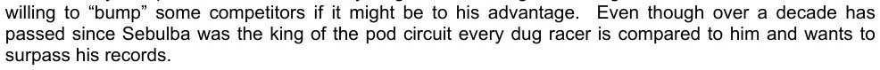

## p.20 (scan page 20)

Page contents: 214 words, 11 paragraphs | headings/entries: Team 5: Blood Raptors; Pilot: Zosh Vexonuk; Team 6: Duckonians; Pilot: Otsock; Cloak and Vibroblade Page 20

- **No single roster character (rules/setting/general)** — entry/section: Zosh Vexonuk: "Zosh wants to win. Very badly. He'll take risks and is willing to "bump" some competitors if it might be to his advantage. Zosh sees winning this race as a ticket off of Cularin." Source: *408 - Jigsaw - Cloak and Vibroblade* (SWRPG d20 Revised Core), p.20
  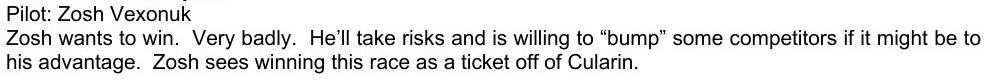

## p.21 (scan page 21)

Page contents: 515 words, 26 paragraphs | headings/entries: GM Aid #1: Combat Statistics; Searching the holonet; TIO/AL/A3; Cloak and Vibroblade Page 21

- **No single roster character (rules/setting/general)** — entry/section: Mebara Jos: "Mebara is an outcast twice over. Shunned and feared by her own people for her ability to use the force, she traveled to Almas to apply for training there. This training was refused, as the application team easily saw that rage and revenge were her prime motivations. Mebara did not take the second rejection well and, after putting a few fellow candidates into the infirmary, swore vengeance on the Togorians and Almas." Source: *408 - Jigsaw - Cloak and Vibroblade* (SWRPG d20 Revised Core), p.21
  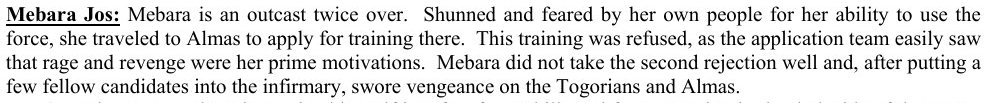
- **No single roster character (rules/setting/general)** — entry/section: Mebara Jos: "Over the years Mebara has trained herself in a few force skills and feats, growing in the dark side of the Force. Her hatred, too, has grown and she has enlarged it to include the entire population of both Togoria and the Cularin system." Source: *408 - Jigsaw - Cloak and Vibroblade* (SWRPG d20 Revised Core), p.21
  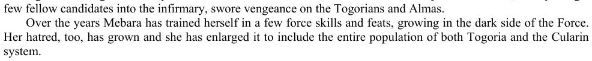
- **No single roster character (rules/setting/general)** — entry/section: Duckonians: "There are no Duckonians. The Duckonians were created by Mebara to disguise the Togorians who have had a bit too much exposure in the last few months." Source: *408 - Jigsaw - Cloak and Vibroblade* (SWRPG d20 Revised Core), p.21
  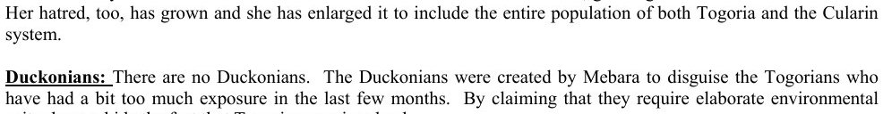
- **No single roster character (rules/setting/general)** — entry/section: Di'hal'uma: "Di'hal'uma is a Twi'lek investigator. She is a force sensitive to a minor degree with no formal training. However, she does get "hunches" and seems to have an ability to put seemingly random facts into a pattern." Source: *408 - Jigsaw - Cloak and Vibroblade* (SWRPG d20 Revised Core), p.21
  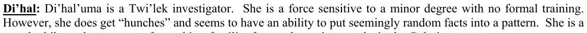

## p.22 (scan page 22)

Page contents: 570 words, 23 paragraphs | headings/entries: GM Aid #1: Combat Statistics; Encounter 6: Tier 1-3; Cloak and Vibroblade Page 22

### Stat block notes (game mechanics, not feats)

- Mebara Jos: Mebara Jos (tier 1-3): Female Togorian Force Adept 2; VP/WP 18/16; Battlemind +8, Drain Energy +8, Enhance Ability +8; DSP 2 (Source: *408 - Jigsaw - Cloak and Vibroblade* (SWRPG d20 Revised Core), p.22)
- Zosh Vexonuk: Zosh Vexonuk: Male Human Fringer 3; Pilot +14 (Source: *408 - Jigsaw - Cloak and Vibroblade* (SWRPG d20 Revised Core), p.22)

## p.23 (scan page 23)

Page contents: 631 words, 25 paragraphs | headings/entries: Tier 4-6; Tier 7-9; Cloak and Vibroblade Page 23

### Stat block notes (game mechanics, not feats)

- Mebara Jos: Mebara Jos (mid tiers): Force Adept 4 (VP/WP 27/16) and Force Adept 4/Force Warrior 3 (VP/WP 43/16; Atk +11/+6 melee 3d6+5 unarmed; Battlemind/Drain Energy/Enhance Ability +13; DSP 4) (Source: *408 - Jigsaw - Cloak and Vibroblade* (SWRPG d20 Revised Core), p.23)

## p.24 (scan page 24)

Page contents: 525 words, 19 paragraphs | headings/entries: Tier 10-12; Cloak and Vibroblade Page 24

### Stat block notes (game mechanics, not feats)

- Mebara Jos: Mebara Jos (top tier): Female Togorian Force Adept 4/Force Warrior 5/Dark Side Marauder 2; VP/WP 65/16; Atk +16/+11 melee (5d6+6, unarmed); Str 22; Battlemind +17, Drain Energy +17, Enhance Ability +17; Feats include Rage; DSP 5 (Source: *408 - Jigsaw - Cloak and Vibroblade* (SWRPG d20 Revised Core), p.24)

## p.25 (scan page 25)

Page contents: 415 words, 13 paragraphs | headings/entries: Team 1; Team 3; Team 4; Team 5; Team 6; Cloak and Vibroblade Page 25

- **No single roster character (rules/setting/general)** — entry/section: Team 4: "They tend to be a rather surly bunch, as they suffer from endless comparisons to their more successful and less ethical cousin, Sebulba; wherever they go to compete, everyone seems to think that they're planning on cheating." Source: *408 - Jigsaw - Cloak and Vibroblade* (SWRPG d20 Revised Core), p.25
  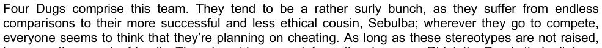

## p.26 (scan page 26)

Page contents: 22 words, 6 paragraphs | headings/entries: GM Aid #3: Dancing Flame Tavern Map; Upper Level; Lower Level; Dancing Flame Tavern Gadrin; Cloak and Vibroblade Page 26

## p.27 (scan page 27)

Page contents: 32 words, 6 paragraphs | headings/entries: GM Aid #4: Swooper Hangout Map; Docking Bay 216 [| =2m; Cloak and Vibroblade; Page 27

## p.28 (scan page 28)

Page contents: 63 words, 9 paragraphs | headings/entries: GM Aid #5:; Arena Layout; SN || ut; YY; YY i; Cloak and Vibroblade Page 28

## p.29 (scan page 29)

Page contents: 106 words, 11 paragraphs | headings/entries: GM Aid #6: Backstage Area Map; Team #4: Dugs; ONAARWN =; Cloak and Vibroblade Page 29

## p.30 (scan page 30)

Page contents: 0 words, 0 paragraphs | headings/entries: 

## p.31 (scan page 31)

Page contents: 139 words, 9 paragraphs | headings/entries: Cloak and Vibroblade Page 31

## p.32 (scan page 32)

Page contents: 281 words, 8 paragraphs | headings/entries: GM Aid #8: Vehicles; Cloak and Vibroblade Page 32

## p.33 (scan page 33)

Page contents: 90 words, 8 paragraphs | headings/entries: Critical Event Summary Cloak and Vibroblade; C1 Yes CINo; GM Name, RPGA#: GM Email Address:; Convention Name/Date; Cloak and Vibroblade Page 33

## p.16–33 (scan page 16)

Page contents: Player handouts (maps, the pilots); GM Aid 1 profiles and combat stats; GM Aid 2 competitors; maps; vehicles; critical event summary (hand-read)

