# Owner Material 037 — Star Wars D20 Drive folder (Core, Revised Core and Saga Edition): Living Force Campaign/Adventures/Among the Stars/Year 4/410 - Inside-Out - Lockdown On Soboll.pdf [Star Wars Roleplaying Game Revised Core (d20, 2002)]

- **Source:** Wizards of the Coast Star Wars Roleplaying Game books, web enhancements, Living Force campaign modules and articles (2000–2010), from the owner's "Star Wars D20" Drive folder (only the three edition subfolders; "General" was not read, as instructed). Secondary source (licensed Legends reference). Scan OCR'd on the box; the scan stays box-only and is **not** published.
- **Method:** every scanned page was OCR'd and machine-screened sentence by sentence for power-relevant statements (fights, kills, defeats, Force feats, rankings, superweapons) that name a character on our roster; each kept sentence is quoted verbatim from the OCR text and has a crop of the printed passage directly under it. Pages with nothing power-relevant are still listed with what is on them.
- **Citation:** "*410 - Inside-Out - Lockdown On Soboll* (SWRPG d20 Revised Core), p.X" by printed page ("scan p.X" where no printed number applies). **Weight:** Licensed RPG material: a secondary source. Narrative text sums up Legends lore; game statistics are rules for players, not canon power levels, and rank lowest.

## p.1 (scan page 1)

Page contents: 131 words, 6 paragraphs | headings/entries: LFA410; Lockdown on Soboll

## p.2 (scan page 2)

Page contents: 907 words, 18 paragraphs | headings/entries: Event name; Issuing Force and Dark Side Points; Page 2

## p.3 (scan page 3)

Page contents: 826 words, 22 paragraphs | headings/entries: General Notes to the GM; Event name; GM Overview; Encounter 1: Deepest, Darkest; Encounter 2: In-flight Briefing; Encounter 3: Platform Shoes; Page 3

- **No single roster character (rules/setting/general)** — entry/section: GM Overview: "All this changed very recently, when Cularin's Senator, Senator Wren, broadcast a message stating that the Thaereians were working against the Cularin system instead of protecting them. The broadcast was coordinated with the Cularin Militia so they could capture Thaereian strong points before they could react." Source: *410 - Inside-Out - Lockdown On Soboll* (SWRPG d20 Revised Core), p.3
  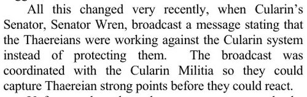
- **No single roster character (rules/setting/general)** — entry/section: GM Overview: "What the Militia needs is a few good sentients to go in to Soboll and capture the Base Commander, Major Kurth San. And Major Xirossk of the Militia has just the right people in mind..." Source: *410 - Inside-Out - Lockdown On Soboll* (SWRPG d20 Revised Core), p.3
  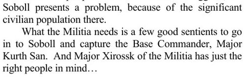

## p.4 (scan page 4)

Page contents: 752 words, 23 paragraphs | headings/entries: Encounter 5: Here goes nothing...!; Encounter 6: Soboll Standoff; Opening Crawl; Event name; Encounter 1: Deepest, Darkest; Page 4

- **No single roster character (rules/setting/general)** — entry/section: Opening Crawl: "Things change. The peace of the Republic is shattered, and war consumes the galaxy. The people of Cularin have endured their share of surprises in recent years, with no end yet in sight. Still, not all change is for the worse, and as Cularin stands on the brink of yet another milestone, it will be the responsibility of a brave few heroes to determine the fate of a world..." Source: *410 - Inside-Out - Lockdown On Soboll* (SWRPG d20 Revised Core), p.4
  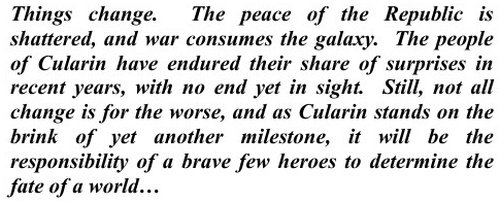
- **No single roster character (rules/setting/general)** — entry/section: Encounter 1: "Finally, at least the two rogue droids have left a trail wide enough that even a concussed bantha could follow it." Source: *410 - Inside-Out - Lockdown On Soboll* (SWRPG d20 Revised Core), p.4
  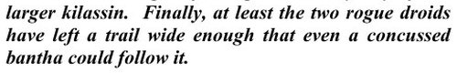

## p.1–4 (scan page 1)

Page contents: Title and blurb; boilerplate and house rules; GM overview of the Thaereian fallback to Soboll; encounter summaries; judges' note; opening crawl (hand-read)

## p.5 (scan page 5)

Page contents: 826 words, 24 paragraphs | headings/entries: Encounter 2: In-flight Briefings; Event name; Page 5

- **No single roster character (rules/setting/general)** — entry/section: Major Xirossk: ""There you are," says the Trandoshan, showing his teeth in pleasure "I was beginning to think we'd lost you. You had better come aboard."" Source: *410 - Inside-Out - Lockdown On Soboll* (SWRPG d20 Revised Core), p.5
  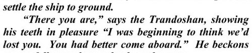
- **No single roster character (rules/setting/general)** — entry/section: Major Xirossk: "The Trandoshan is Major Xirossk, an ex-Thaereian intelligence officer." Source: *410 - Inside-Out - Lockdown On Soboll* (SWRPG d20 Revised Core), p.5
  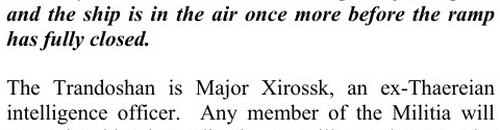
- **No single roster character (rules/setting/general)** — entry/section: Major Xirossk: "Xirossk talks quickly, and earnestly, because he believes (rightly) that this day is going to go into Cularin's history books, and he wants it to be for the right reason." Source: *410 - Inside-Out - Lockdown On Soboll* (SWRPG d20 Revised Core), p.5
  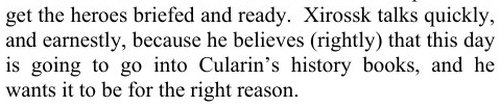
- **No single roster character (rules/setting/general)** — entry/section: Major Xirossk: ""The Senate has yet to hear our case let alone rescind the contract that Thaere has to provide protection for the Cularin system. The Senator has cancelled the payments but Thaere is taking the fees, plus some extra, in confiscated goods." Source: *410 - Inside-Out - Lockdown On Soboll* (SWRPG d20 Revised Core), p.5
  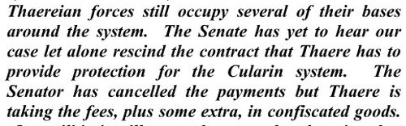
- **No single roster character (rules/setting/general)** — entry/section: Major Xirossk: ""You may want to consider yourself flattered; that wild droid chase you've just been on was designed to keep you out of the way during all this. Seems the Thaereians were worried you might mess things up for them. Frankly, I'd hate to disappoint them, so let's see what we can do about that, eh?"" Source: *410 - Inside-Out - Lockdown On Soboll* (SWRPG d20 Revised Core), p.5
  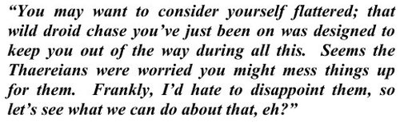
- **No single roster character (rules/setting/general)** — entry/section: Major Xirossk: ""What we need is a group of people to infiltrate the city, get to Base Commander Major Kurth San and arrange a surrender. We need Major San alive, though, so no disintegrations." Xirossk waves a taloned finger to underline that point." Source: *410 - Inside-Out - Lockdown On Soboll* (SWRPG d20 Revised Core), p.5
  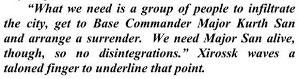

## p.6 (scan page 6)

Page contents: 817 words, 21 paragraphs | headings/entries: Event name; Encounter 3: Platform Shoes; Page 6

- **No single roster character (rules/setting/general)** — entry/section: Major Xirossk: "Anything else? Lots, but we're out of time. We're coming up to the drop zone right now. Good luck, the fate of a planet rests on your shoulders today." Source: *410 - Inside-Out - Lockdown On Soboll* (SWRPG d20 Revised Core), p.6
  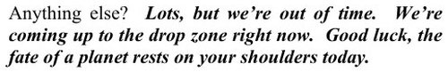

## p.7 (scan page 7)

Page contents: 681 words, 26 paragraphs | headings/entries: Knowledge Spot; You think you can see a; Event name; In addition, have the heroes encounter:; Page 7

- **No single roster character (rules/setting/general)** — entry/section: Encounter 3: "If it were easy, Xirossk wouldn't need heroes." Source: *410 - Inside-Out - Lockdown On Soboll* (SWRPG d20 Revised Core), p.7
  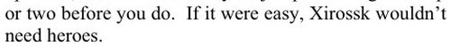

## p.8 (scan page 8)

Page contents: 788 words, 25 paragraphs | headings/entries: Event name; Encounter 4: Underground in the sky; Page 8

- **No single roster character (rules/setting/general)** — entry/section: 3-C With a single bound: "No sane person would go this way. It's going to be like scaling a kilometer tall mountain with razor sharp cliffs and occasional chasms to cross." Source: *410 - Inside-Out - Lockdown On Soboll* (SWRPG d20 Revised Core), p.8
  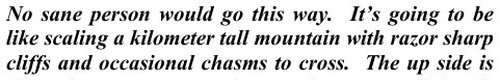

## p.4–8 (scan page 4)

Page contents: E1 the rogue droid decoy; E2 Xirossk's shuttle briefing; E3 the four conduit routes up Soboll's central pillar (hand-read)

## p.9 (scan page 9)

Page contents: 886 words, 24 paragraphs | headings/entries: Looking for Betrek; Event name; Page 9

- **No single roster character (rules/setting/general)** — entry/section: Mub Tyeb: "A nervous-looking Sullustan answers the door. "I've been expecting you," he says in basic "Or, I think I have. Did you have something particular you wanted to say to me?"" Source: *410 - Inside-Out - Lockdown On Soboll* (SWRPG d20 Revised Core), p.9
  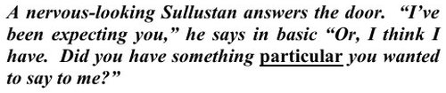

## p.10 (scan page 10)

Page contents: 802 words, 26 paragraphs | headings/entries: Encounter 5: Here goes nothing...!; Event name; This will make getting; Over the wall; Moving around the base; Page 10

- **No single roster character (rules/setting/general)** — entry/section: Mub Tyeb: "And the good news? Oh yes ... the good news. (Mub smiles) The good news is that I designed large parts of the security system there, and can make you a hole big enough, I suppose, to drive a herd of bantha through, if, do you see, you needed me to." Source: *410 - Inside-Out - Lockdown On Soboll* (SWRPG d20 Revised Core), p.10
  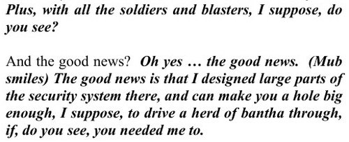
- **No single roster character (rules/setting/general)** — entry/section: Mub Tyeb: "You don't sound sure? I'm not. But, I have to see this through, for my sister, do you see?" Source: *410 - Inside-Out - Lockdown On Soboll* (SWRPG d20 Revised Core), p.10
  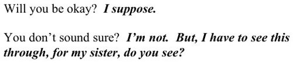

## p.11 (scan page 11)

Page contents: 835 words, 25 paragraphs | headings/entries: Event name; Encounter 6: Soboll Standoff; Page 11

- **No single roster character (rules/setting/general)** — entry/section: Major Kurth San: "Major Kurth San looms over the tactical display, watching like a hawk. He is tall and bulky, but moves with grace. His precise, military appearance is marked, though hardly spoiled, by an old scar on his left cheek." Source: *410 - Inside-Out - Lockdown On Soboll* (SWRPG d20 Revised Core), p.11
  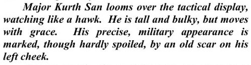

## p.12 (scan page 12)

Page contents: 837 words, 26 paragraphs | headings/entries: Assuming the heroes follow their orders:; Event name; Disarming the devices; Page 12

- **No single roster character (rules/setting/general)** — entry/section: Major Kurth San: "The Major sneers at you. "So, the Militia's hit squad has finally arrived. And just after the nick of time. Frankly, I'm disappointed."" Source: *410 - Inside-Out - Lockdown On Soboll* (SWRPG d20 Revised Core), p.12
  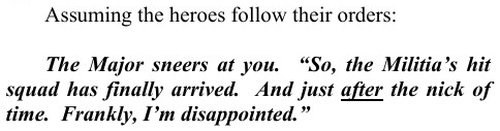
- **No single roster character (rules/setting/general)** — entry/section: Major Kurth San: ""Your friends are in a great deal of trouble, I'm afraid. We, on the other hand, will have fallen back to our ships in the center of Soboll and should be able to get away with minimal losses. A frustrating defeat for us, I have no doubt, but a crippling blow to your Militia, and I will take that victory, indeed I will."" Source: *410 - Inside-Out - Lockdown On Soboll* (SWRPG d20 Revised Core), p.12
  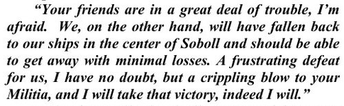
- **No single roster character (rules/setting/general)** — entry/section: Major Kurth San: "Major San smiles ironically "My condolences on your loss."" Source: *410 - Inside-Out - Lockdown On Soboll* (SWRPG d20 Revised Core), p.12
  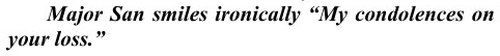
- **No single roster character (rules/setting/general)** — entry/section: Major Kurth San: ""A communications blackout is the first phase of this protocol, I'm afraid," Major San adds helpfully." Source: *410 - Inside-Out - Lockdown On Soboll* (SWRPG d20 Revised Core), p.12
  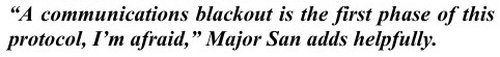

## p.13 (scan page 13)

Page contents: 876 words, 20 paragraphs | headings/entries: Dealing with Major Kurth San; Event name; If the heroes persuade the Major:; Page 13

- **No single roster character (rules/setting/general)** — entry/section: Major Kurth San: ""I imagine your Militia friends will be fully committed by now," the Major observes, smugly. "How's your little project coming?"" Source: *410 - Inside-Out - Lockdown On Soboll* (SWRPG d20 Revised Core), p.13
  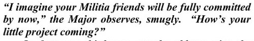
- **No single roster character (rules/setting/general)** — entry/section: Major Kurth San: "He will ask the heroes about their background, how long they've worked in Black Ops, what they think of Osten del'Nay and Xirossk (he knows both of these ex-Thaereians personally)." Source: *410 - Inside-Out - Lockdown On Soboll* (SWRPG d20 Revised Core), p.13
  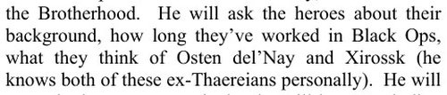
- **No single roster character (rules/setting/general)** — entry/section: Major Kurth San: "I'm told those Jedi mind tricks only work on the weak willed. I'm annoyed you thought they would work on me." Source: *410 - Inside-Out - Lockdown On Soboll* (SWRPG d20 Revised Core), p.13
  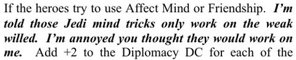
- **No single roster character (rules/setting/general)** — entry/section: Major Kurth San: "This is a military installation. Anybody moving here must weigh the potential risk before making their decision to do so, and they chose to accept that risk. I ... regret the necessity, but they are acceptable losses." Source: *410 - Inside-Out - Lockdown On Soboll* (SWRPG d20 Revised Core), p.13
  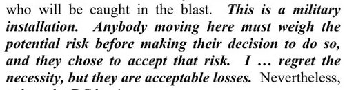
- **No single roster character (rules/setting/general)** — entry/section: Major Kurth San: "That is the most ludicrous thing I have heard. To come all this way, only to release me? No, I do not believe you." Source: *410 - Inside-Out - Lockdown On Soboll* (SWRPG d20 Revised Core), p.13
  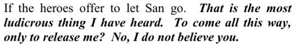
- **No single roster character (rules/setting/general)** — entry/section: Major Kurth San: "The Major laughs. I think you misunderstand the bargaining positions here. But, very well. You may leave unmolested in exactly 20 minutes. My men will not harm you, but I will not accompany you. And my gift for the Militia goes ahead." Source: *410 - Inside-Out - Lockdown On Soboll* (SWRPG d20 Revised Core), p.13
  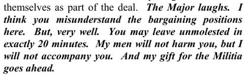

## p.14 (scan page 14)

Page contents: 830 words, 24 paragraphs | headings/entries: Event name; Page 14

- **No single roster character (rules/setting/general)** — entry/section: Major Kurth San: ""I have disabled the jamming device, and put the explosives on hold. Speak with your masters. If they abide by your deal, I will abort the detonation. If they do not, I'm afraid hundreds of civilians will pay the price for your infamy."" Source: *410 - Inside-Out - Lockdown On Soboll* (SWRPG d20 Revised Core), p.14
  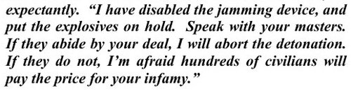
- **No single roster character (rules/setting/general)** — entry/section: Encounter 7: "And really, don't let them die here; this is supposed to be the triumphant escape, not the inglorious death." Source: *410 - Inside-Out - Lockdown On Soboll* (SWRPG d20 Revised Core), p.14
  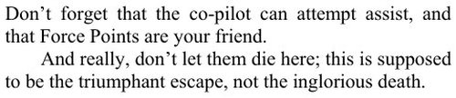

## p.15 (scan page 15)

Page contents: 765 words, 29 paragraphs | headings/entries: Conclusion; Event name; If they were successful in capturing San:; Here Ends, "Lockdown on Soboll"; Experience Point Summary; Page 15

- **No single roster character (rules/setting/general)** — entry/section: Lieutenant Lalande: ""Thank you for your help today, but despite it, it has been a black day for the Militia. We have taken a heavy beating today, and I suspect we will need your help again, in the not too distant future."" Source: *410 - Inside-Out - Lockdown On Soboll* (SWRPG d20 Revised Core), p.15
  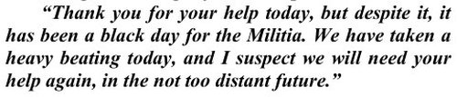
- **No single roster character (rules/setting/general)** — entry/section: Major Xirossk: ""You've done us a great service here today, and we are grateful," Major Xirossk smiles. "San knows a lot about the upper reaches of the Thaereian military, and while he is not going to give away too much too quickly, I think we can get there. Even the areas he shies away from will tell us something." Source: *410 - Inside-Out - Lockdown On Soboll* (SWRPG d20 Revised Core), p.15
  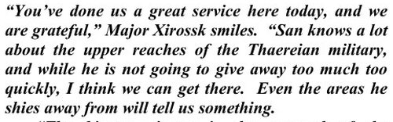
- **No single roster character (rules/setting/general)** — entry/section: Major Xirossk: ""Now. There are about ten places I could use people of your talents right about now. Get some rest, but don't get too comfortable, I have just the place in mind for you."" Source: *410 - Inside-Out - Lockdown On Soboll* (SWRPG d20 Revised Core), p.15
  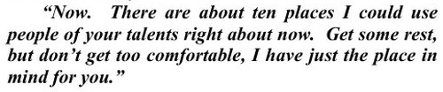

## p.8–15 (scan page 8)

Page contents: E4 the informers and the Medoric trap; E5 infiltrating the command center; E6 the standoff and the explosives trap; E7 the airspeeder escape; conclusions (hand-read)

## p.16 (scan page 16)

Page contents: 299 words, 14 paragraphs | headings/entries: Adventure Experience Award:; Loot Summary; Player Handout 1: Xirossk's Contacts; Event name Page 16

## p.17 (scan page 17)

Page contents: 135 words, 8 paragraphs | headings/entries: Betrek Moy'nast; Recognition code: RODIAN MIME; Mub Tyeb; Recognition code: ELDER SISTER; Event name Page 17

- **No single roster character (rules/setting/general)** — entry/section: Mub Tyeb: "Male Sullustan. Sensors expert employed as a consultant by the Thaereian security forces to monitor, maintain and upgrade security systems. Mub's position is highly sensitive, but consequentially useful." Source: *410 - Inside-Out - Lockdown On Soboll* (SWRPG d20 Revised Core), p.17
  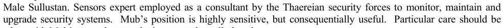

## p.18 (scan page 18)

Page contents: 28 words, 8 paragraphs | headings/entries: Player Handout 2: Soboll Command Center Sketch; Plan View; Vehicle bays Perimeter Vall; Main entrance 7 a; Sentry towers; Central command tower; Elevation View; Event name Page 18

## p.19 (scan page 19)

Page contents: 64 words, 4 paragraphs | headings/entries: Player Handout 3: Vehicles; Event name Page 19

## p.20 (scan page 20)

Page contents: 347 words, 19 paragraphs | headings/entries: Encounter 1: Deepest, Darkest; Equipment: Light Armor, Blaster carbine, self-destruct mechaism; Equipment: Blaster pistol, Baton; Skills: Intimidate +3; Equipment: Blaster pistol, Baton; Skills: Intimidate +5; Event name Page 20

### Stat block notes (game mechanics, not feats)

- Thaereian soldiers: Thaereian soldiers (5) Various Thug 2, VP/WP 0/15; Thaereian Sergeant (1) Thug 4, VP/WP 0/15 (bold headers read from page image) (Source: *410 - Inside-Out - Lockdown On Soboll* (SWRPG d20 Revised Core), p.20)
- Rogue droids: "Rogue" droids (2): Modified Eradicator Series walking battle droid, Thug 8; VP/WP 0/19; self-destruct mechanism (Source: *410 - Inside-Out - Lockdown On Soboll* (SWRPG d20 Revised Core), p.20)

## p.21 (scan page 21)

Page contents: 495 words, 22 paragraphs | headings/entries: Equipment: Blaster pistol, Baton; Skills: Intimidate +5; Equipment: Blaster pistol, Baton; Equipment: Blaster pistol, Baton; Equipment: Heavy blaster pistol, Baton; Event name Page 21

### Stat block notes (game mechanics, not feats)

- Thaereian elite: Thaereian elite: Low Thug 4 (0/15); Mid Thug 4/Soldier 2 (16/15); High Thug 4/Soldier 4 (28/15); Upper Thug 4/Soldier 6 (40/15) (read from page image) (Source: *410 - Inside-Out - Lockdown On Soboll* (SWRPG d20 Revised Core), p.21)

## p.22 (scan page 22)

Page contents: 226 words, 9 paragraphs | headings/entries: GM Aid #2: Vehicles; GM Aid #3: Major Kurth San; Equipment: Uniform, Blaster pistol; Event name Page 22

### Stat block notes (game mechanics, not feats)

- Major Kurth San: Kurth San: Male Human Soldier 6/Officer 8; Init +6; Defense 21; VP/WP 99/17; Atk +15/+10/+5; FP 4; Rep +11; Knowledge (scholar - military tactics) +17; Martial Arts, Persuasive (Source: *410 - Inside-Out - Lockdown On Soboll* (SWRPG d20 Revised Core), p.22)

## p.23 (scan page 23)

Page contents: 97 words, 9 paragraphs | headings/entries: Critical Event Summary Lockdown on Soboll; Convention Name/Date; Convention Coordinator:; Or fax to: (425) 687-8287; Event name Page 23

## p.15–23 (scan page 15)

Page contents: XP and loot; Player handouts (contacts, sketch, vehicles); GM Aid 1-3 stats (pp20-21 read from images); critical event summary (hand-read)

