# Owner Material 037 — Star Wars D20 Drive folder (Core, Revised Core and Saga Edition): Living Force Campaign/Adventures/Among the Stars/Year 4/411 - Inside-Out - Uffel's Prisoners.pdf [Star Wars Roleplaying Game Revised Core (d20, 2002)]

- **Source:** Wizards of the Coast Star Wars Roleplaying Game books, web enhancements, Living Force campaign modules and articles (2000–2010), from the owner's "Star Wars D20" Drive folder (only the three edition subfolders; "General" was not read, as instructed). Secondary source (licensed Legends reference). Scan OCR'd on the box; the scan stays box-only and is **not** published.
- **Method:** every scanned page was OCR'd and machine-screened sentence by sentence for power-relevant statements (fights, kills, defeats, Force feats, rankings, superweapons) that name a character on our roster; each kept sentence is quoted verbatim from the OCR text and has a crop of the printed passage directly under it. Pages with nothing power-relevant are still listed with what is on them.
- **Citation:** "*411 - Inside-Out - Uffel's Prisoners* (SWRPG d20 Revised Core), p.X" by printed page ("scan p.X" where no printed number applies). **Weight:** Licensed RPG material: a secondary source. Narrative text sums up Legends lore; game statistics are rules for players, not canon power levels, and rank lowest.

## p.1 (scan page 1)

Page contents: 89 words, 6 paragraphs | headings/entries: LFA411; Uffel's Prisoners

## p.2 (scan page 2)

Page contents: 906 words, 18 paragraphs | headings/entries: Uffel's Prisoners; Issuing Force and Dark Side Points; Page 2

## p.3 (scan page 3)

Page contents: 861 words, 21 paragraphs | headings/entries: General Notes to the GM; Uffel's Prisoners; GM Overview; Encounter 1: 111 000 111; Page 3

- **No single roster character (rules/setting/general)** — entry/section: GM Overview: "When the droids of Uffel first began to build their own society, there was a fundamental disagreement about how to keep their fledgling city safe. The approach that eventually won out was to make the people of Cularin so reliant on Uffel's output that commercial sense kept the aggressors away." Source: *411 - Inside-Out - Uffel's Prisoners* (SWRPG d20 Revised Core), p.3
  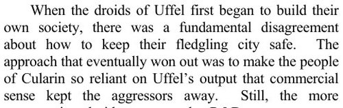
- **No single roster character (rules/setting/general)** — entry/section: GM Overview: "Almost half the droids created by the factories of X2-4 have reflected this paranoid streak. These droids have hidden programming that will allow them to defend the city against any and all organic aggressors." Source: *411 - Inside-Out - Uffel's Prisoners* (SWRPG d20 Revised Core), p.3
  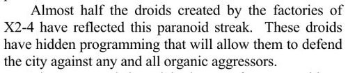
- **No single roster character (rules/setting/general)** — entry/section: GM Overview: "The Thaereians plan to subvert the droid factories there and build their own reinforcements. The Thaereians do not quite realize what they have unleashed however, as across the city, droids of all grades take up arms to defend their home against any and all organics." Source: *411 - Inside-Out - Uffel's Prisoners* (SWRPG d20 Revised Core), p.3
  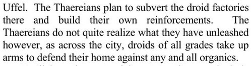

## p.4 (scan page 4)

Page contents: 738 words, 27 paragraphs | headings/entries: Encounter 2: Divisions; Encounter 3: Allies; Encounter 4: Opponents; Encounter 5: Enemies; Encounter 6: Subversions; Encounter 7: Transmissions; Uffel's Prisoners; Opening Crawl; Encounter 1: 111 000 111; Page 4

- **No single roster character (rules/setting/general)** — entry/section: Opening Crawl: "The weeks since Senator Wren denounced the Thaereian presence in Cularin have been fraught with several clashes between the Militia and the Thaereian Navy, as reported over the nets." Source: *411 - Inside-Out - Uffel's Prisoners* (SWRPG d20 Revised Core), p.4
  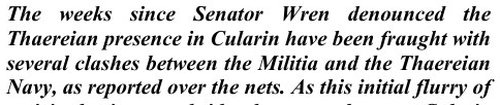

## p.1–4 (scan page 1)

Page contents: Title and blurb; boilerplate; GM overview of the Uffel aggression protocols and the Thaereian incursion; encounter summaries; judges' note; opening crawl (hand-read)

## p.5 (scan page 5)

Page contents: 872 words, 25 paragraphs | headings/entries: The transmission erupts into static again, and; Uffel's Prisoners; Page 5

- **No single roster character (rules/setting/general)** — entry/section: Major Xirossk: ""Things have been going well," Xirossk begins "and we have scored some major victories against the Thaereian forces, but the job is far from done. It seems that every rock we turn over reveals another Thaereian plot." Source: *411 - Inside-Out - Uffel's Prisoners* (SWRPG d20 Revised Core), p.5
  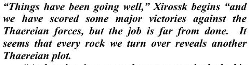
- **No single roster character (rules/setting/general)** — entry/section: Major Xirossk: ""And we've just turned over a particularly big rock."" Source: *411 - Inside-Out - Uffel's Prisoners* (SWRPG d20 Revised Core), p.5
  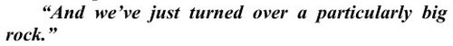
- **No single roster character (rules/setting/general)** — entry/section: Gor Kolomo: ""This is Gor Kolomo (static) on Uffel. We have been invaded — Thaereian soldiers have captured the (lengthy static) retaliation has been fierce, and not all the droids can (static) never the intent that the droids of Uffel should become an army..."" Source: *411 - Inside-Out - Uffel's Prisoners* (SWRPG d20 Revised Core), p.5
  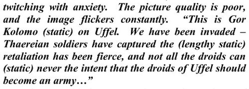
- **No single roster character (rules/setting/general)** — entry/section: Major Xirossk: "He is, or possibly was, the Twi'lek businessman who took the first droids to Uffel. Given that his ship crashed there, perhaps I'm being overly generous. All of Uffel's trade is done in his name, but nobody ever sees him in person." Source: *411 - Inside-Out - Uffel's Prisoners* (SWRPG d20 Revised Core), p.5
  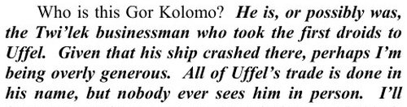
- **No single roster character (rules/setting/general)** — entry/section: Major Xirossk: "No. Frankly, X2-4 has every security system you can name, and at least three you can't." Source: *411 - Inside-Out - Uffel's Prisoners* (SWRPG d20 Revised Core), p.5
  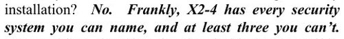
- **No single roster character (rules/setting/general)** — entry/section: Major Xirossk: "(Xirossk gives a toothy grin) I think you'll like this. A couple of years back, the droids had some trouble courtesy of a rogue agent who came in with an asteroid shower. We're going to get you in the same way — you may have seen your ticket in when you landed." Source: *411 - Inside-Out - Uffel's Prisoners* (SWRPG d20 Revised Core), p.5
  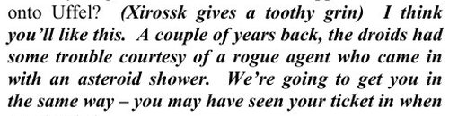
- **No single roster character (rules/setting/general)** — entry/section: Major Xirossk: "Right now though, every credit we can beg, borrow or commandeer is going on keeping our ships flying, and our weapons charged. We can't pay you." Source: *411 - Inside-Out - Uffel's Prisoners* (SWRPG d20 Revised Core), p.5
  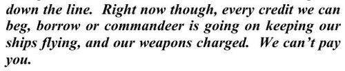

## p.6 (scan page 6)

Page contents: 849 words, 24 paragraphs | headings/entries: Uffel's Prisoners; Encounter 2: Divisions; Page 6

- **No single roster character (rules/setting/general)** — entry/section: Major Xirossk: "(Xirossk looks uncomfortable) To a point I agree. If the droids join our cause freely, that will be a major coup. If my guess is correct and the droids of Uffel are independent of organic authority then any more drastic decision regarding 'ownership' has to come from the government of Cularin, not the Militia and not us." Source: *411 - Inside-Out - Uffel's Prisoners* (SWRPG d20 Revised Core), p.6
  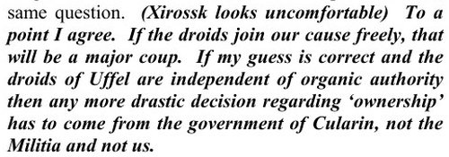
- **No single roster character (rules/setting/general)** — entry/section: Encounter 2: "If anybody asks if they are supposed to be spinning, say something reassuring like "Xirossk didn't mention it, but they must have figured for spin, surely?"" Source: *411 - Inside-Out - Uffel's Prisoners* (SWRPG d20 Revised Core), p.6
  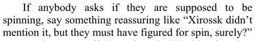

## p.7 (scan page 7)

Page contents: 811 words, 33 paragraphs | headings/entries: Inspecting the rogue droids; Uffel's Prisoners; Inspecting the blasters/crates; Speaking with the loyalist droids; Page 7

## p.8 (scan page 8)

Page contents: 834 words, 25 paragraphs | headings/entries: Slicing Uffel's systems; Heroes' droids; Uffel's Prisoners; Encounter 3: Allies; Page 8

- **No single roster character (rules/setting/general)** — entry/section: OO-7JB: "Unfortunately, OO-7JB has seen one too many spy holos in its time, and is taking a moment to indulge." Source: *411 - Inside-Out - Uffel's Prisoners* (SWRPG d20 Revised Core), p.8
  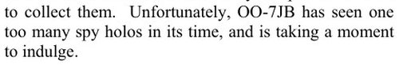
- **No single roster character (rules/setting/general)** — entry/section: OO-7JB: ""That's far enough," it says, and its voice is obviously electronic, deep and gravelly." Source: *411 - Inside-Out - Uffel's Prisoners* (SWRPG d20 Revised Core), p.8
  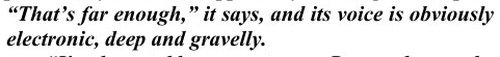

## p.4–8 (scan page 4)

Page contents: E1 Xirossk's briefing aboard Cularin 1 and the asteroid insertion; E2 the warehouse fight between the rogue and loyal droids and what follows (hand-read)

## p.9 (scan page 9)

Page contents: 876 words, 31 paragraphs | headings/entries: Uffel's Prisoners; Encounter 4: Opponents; Page 9

- **No single roster character (rules/setting/general)** — entry/section: HG-211: "The droid is tall and lanky, looking like an earlier model of the IG series (like IG-88 in Episode V)." Source: *411 - Inside-Out - Uffel's Prisoners* (SWRPG d20 Revised Core), p.9
  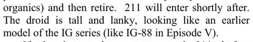
- **No single roster character (rules/setting/general)** — entry/section: HG-211: "I have no particular fondness for organics, it seems obvious that droids are superior in many ways, but I wish you no ill will either. It seems that this rogue faction is specifically programmed to attack any and all organics in times of crisis." Source: *411 - Inside-Out - Uffel's Prisoners* (SWRPG d20 Revised Core), p.9
  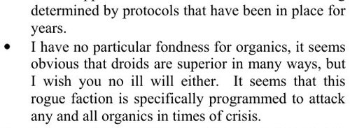
- **No single roster character (rules/setting/general)** — entry/section: HG-211: "Frankly even when this crisis is over, the negative public relations of these stealth protocols will be extremely damaging. I would rather it didn't get out." Source: *411 - Inside-Out - Uffel's Prisoners* (SWRPG d20 Revised Core), p.9
  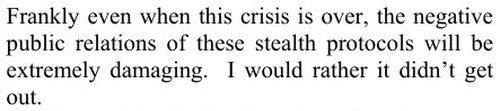

## p.10 (scan page 10)

Page contents: 948 words, 21 paragraphs | headings/entries: Uffel's Prisoners; Page 10

- **No single roster character (rules/setting/general)** — entry/section: R&D sentry: ""Watch your step, puny fleshy ones, you're kind is not welcome here."" Source: *411 - Inside-Out - Uffel's Prisoners* (SWRPG d20 Revised Core), p.10
  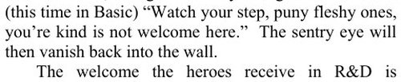
- **No single roster character (rules/setting/general)** — entry/section: R6-D6: "A battered old astromech trundles up to you. "Hello, I'm R6-D6," it says in a tired croak "You'll be wanting to see the administrator, I suppose. You'd better follow me, though I should say he's kind of grumpy at the moment."" Source: *411 - Inside-Out - Uffel's Prisoners* (SWRPG d20 Revised Core), p.10
  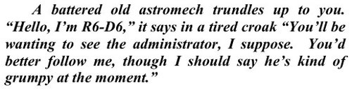
- **No single roster character (rules/setting/general)** — entry/section: R6-D6: "R6 gives a low whistle. "Okay, this is bad. Make one wrong move and we're all going to be dismantled with extreme prejudice."" Source: *411 - Inside-Out - Uffel's Prisoners* (SWRPG d20 Revised Core), p.10
  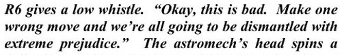
- **No single roster character (rules/setting/general)** — entry/section: R6-D6: ""Whatever you do, don't touch a blaster -- that would just set them off. If ever you wanted to get your message across, now's the time..."" Source: *411 - Inside-Out - Uffel's Prisoners* (SWRPG d20 Revised Core), p.10
  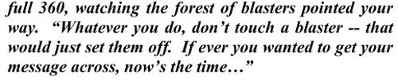
- **No single roster character (rules/setting/general)** — entry/section: N-4PO: ""I am N-4PO, administrator of Uffel Research and Development. I was informed of your coming, but I have very little time to spare for inferior life forms, particularly when they come here intent on subjugating the free peoples of Uffel." Source: *411 - Inside-Out - Uffel's Prisoners* (SWRPG d20 Revised Core), p.10
  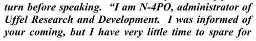

## p.11 (scan page 11)

Page contents: 822 words, 30 paragraphs | headings/entries: Encounter 5: Enemies; Uffel's Prisoners; Page 11

- **No single roster character (rules/setting/general)** — entry/section: N-4PO: ""Is there a reason I should not have you shot, as the grand doctrine suggests?"" Source: *411 - Inside-Out - Uffel's Prisoners* (SWRPG d20 Revised Core), p.11
  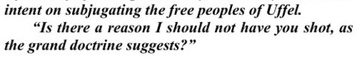
- **No single roster character (rules/setting/general)** — entry/section: N-4PO: "In N-4PO, they simply echoed back his own perception of droids as superior creatures and he is the main proponent of increased aggression. He is one of the leaders of the rogue droids, and is most vocal about "taking the fight to 'the Masters'" believing that only overwhelming force will keep the free droids of Uffel safe." Source: *411 - Inside-Out - Uffel's Prisoners* (SWRPG d20 Revised Core), p.11
  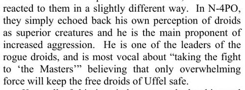
- **No single roster character (rules/setting/general)** — entry/section: N-4PO: "4PO is a fanatic, and the heroes will not be able to win him over." Source: *411 - Inside-Out - Uffel's Prisoners* (SWRPG d20 Revised Core), p.11
  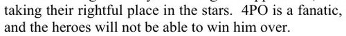

## p.12 (scan page 12)

Page contents: 803 words, 25 paragraphs | headings/entries: Move silently DC; Encounter 6: Subversions; Uffel's Prisoners; Page 12

- **No single roster character (rules/setting/general)** — entry/section: Thaereian tech: ""Beg pardon sir, but I think there's more to it than that. I think these dormant aggression protocols are inserted into half of the droids produced here, not just for ones intended to remain local. Thousands of these droids are all over Cularin. Tens of thousands."" Source: *411 - Inside-Out - Uffel's Prisoners* (SWRPG d20 Revised Core), p.12
  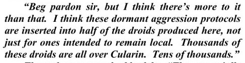
- **No single roster character (rules/setting/general)** — entry/section: Thaereian officer: "The officer stares at him for a moment. "Are you saying that with a flick of a button we can create an instant fifth column across the entire system?"" Source: *411 - Inside-Out - Uffel's Prisoners* (SWRPG d20 Revised Core), p.12
  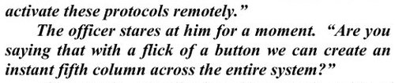
- **No single roster character (rules/setting/general)** — entry/section: Thaereian officer: "The officer stares for a long time, then nods curtly. "Excellent. Your cleverness will be—noted. Get on it."" Source: *411 - Inside-Out - Uffel's Prisoners* (SWRPG d20 Revised Core), p.12
  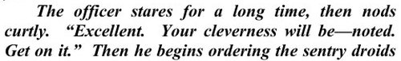

## p.13 (scan page 13)

Page contents: 863 words, 20 paragraphs | headings/entries: Encounter 7: Transmissions; Uffel's Prisoners; Second line of defense; Page 13

## p.14 (scan page 14)

Page contents: 642 words, 28 paragraphs | headings/entries: The last line of defense; Conclusion; Uffel's Prisoners; Here Ends, "Uffel's Prisoners"; Experience Point Summary; Page 14

- **No single roster character (rules/setting/general)** — entry/section: HG-211: "The Security chief bows slightly. "We will begin working on the problem immediately. We can fix it, I have no doubt, but it will take time. Weeks, at least."" Source: *411 - Inside-Out - Uffel's Prisoners* (SWRPG d20 Revised Core), p.14
  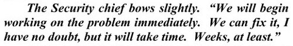
- **No single roster character (rules/setting/general)** — entry/section: Major Xirossk: ""This is bad," Xirossk says again, then looks at you. "Sorry this didn't work out better, but you did your best, and I'm grateful for that much. Cularin is going to be a more dangerous place for a while, and I'm going to need your help even more. Take a break, but don't go too far!"" Source: *411 - Inside-Out - Uffel's Prisoners* (SWRPG d20 Revised Core), p.14
  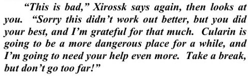
- **No single roster character (rules/setting/general)** — entry/section: Major Xirossk: "Xirossk looks up from your report. "Good work. Very good work. You've done Cularin a better turn than even I expected. HG-211 and N-4PO have both transmitted thank yous, though I suspect N-4PO's was grudging at best."" Source: *411 - Inside-Out - Uffel's Prisoners* (SWRPG d20 Revised Core), p.14
  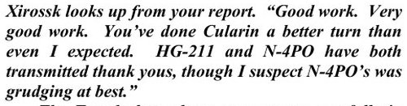
- **No single roster character (rules/setting/general)** — entry/section: Major Xirossk: "The Trandoshan places your report carefully in his desk drawer. "But what have you done for me recently? Don't grimace; I've got a lead on another little job for you, but there's some time on it yet. Go grab a shower, and a meal. We'll talk again soon." Source: *411 - Inside-Out - Uffel's Prisoners* (SWRPG d20 Revised Core), p.14
  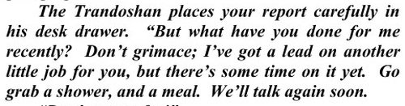

## p.8–14 (scan page 8)

Page contents: E3 OO-7JB and HG-211; E4 R6-D6 and N-4PO in R&D; E5 the Thaereian production line; E6 the fifth-column plan; E7 the transmitter assault; conclusions (hand-read)

## p.15 (scan page 15)

Page contents: 312 words, 11 paragraphs | headings/entries: Loot Summary; Uffel's Prisoners; Page 15

## p.16 (scan page 16)

Page contents: 41 words, 9 paragraphs | headings/entries: Player Handout 1: Thaereian Installation; Transmitter Droid; SN; Thaereian incursion on Uffel; Uffel's Prisoners Page 16

## p.17 (scan page 17)

Page contents: 474 words, 27 paragraphs | headings/entries: GM Aid #1: Combat Statistics; Encounter 3: Divisions; Equipment: Blaster pistol; Skills: Understand Basic; Skills: Speak Basic; Tier | (levels 1-3); Equipment: Blaster pistol; Equipment: Blaster pistol, Baton; Skills: Intimidate +3; Equipment: Blaster pistol, Baton; Skills: Intimidate +5; Uffel's Prisoners Page 17

### Stat block notes (game mechanics, not feats)

- Thaereian battle droids: Thaereian battle droids (200): Walking battle droid, Thug 1; VP/WP 0/8; blaster carbine or ion gun pistol (Source: *411 - Inside-Out - Uffel's Prisoners* (SWRPG d20 Revised Core), p.17)

## p.18 (scan page 18)

Page contents: 294 words, 15 paragraphs | headings/entries: Tier 2 (levels 4-6); Equipment: Blaster pistol; Equipment: Blaster pistol, Baton; Skills: Intimidate +5; Equipment: Blaster pistol, Baton; Uffel's Prisoners Page 18

## p.19 (scan page 19)

Page contents: 558 words, 25 paragraphs | headings/entries: Tier 3 (levels 7-9); Equipment: Blaster pistol; Equipment: Blaster pistol, Baton; Equipment: Blaster pistol, Baton; Tier 4 (levels (10-12); Equipment: Blaster pistol; Equipment: Blaster pistol, Baton; Uffel's Prisoners Page 19

### Stat block notes (game mechanics, not feats)

- Thaereian soldiers: Tier 3: Thaereian Soldiers (7) Thug 4/Soldier 2 (VP/WP 16/15) and Officer Thug 4/Soldier 4 (28/15); Tier 4: Soldiers (8) Thug 4/Soldier 4 (28/15) (read from page image) (Source: *411 - Inside-Out - Uffel's Prisoners* (SWRPG d20 Revised Core), p.19)

## p.20 (scan page 20)

Page contents: 89 words, 8 paragraphs | headings/entries: Critical Event Summary Uffel's Prisoners; GM Name, RPGA#: GM Email Address:; Convention Name/Date; Uffel's Prisoners Page 20

## p.14–20 (scan page 14)

Page contents: XP and loot; installation map; GM Aid 1 combat stats (p19 bold-header lines read from the image); critical event summary (hand-read)

