# Owner Material 037 — Star Wars D20 Drive folder (Core, Revised Core and Saga Edition): Living Force Campaign/Adventures/Among the Stars/Year 4/412 - Inside-Out - Storm's Depths.pdf [Star Wars Roleplaying Game Revised Core (d20, 2002)]

- **Source:** Wizards of the Coast Star Wars Roleplaying Game books, web enhancements, Living Force campaign modules and articles (2000–2010), from the owner's "Star Wars D20" Drive folder (only the three edition subfolders; "General" was not read, as instructed). Secondary source (licensed Legends reference). Scan OCR'd on the box; the scan stays box-only and is **not** published.
- **Method:** every scanned page was OCR'd and machine-screened sentence by sentence for power-relevant statements (fights, kills, defeats, Force feats, rankings, superweapons) that name a character on our roster; each kept sentence is quoted verbatim from the OCR text and has a crop of the printed passage directly under it. Pages with nothing power-relevant are still listed with what is on them.
- **Citation:** "*412 - Inside-Out - Storm's Depths* (SWRPG d20 Revised Core), p.X" by printed page ("scan p.X" where no printed number applies). **Weight:** Licensed RPG material: a secondary source. Narrative text sums up Legends lore; game statistics are rules for players, not canon power levels, and rank lowest.

## p.1 (scan page 1)

Page contents: 141 words, 6 paragraphs | headings/entries: LFA412; Storm's Depths

## p.2 (scan page 2)

Page contents: 821 words, 18 paragraphs | headings/entries: Storm's Depths; Hero Earnings; Issuing Force and Dark Side Points; Page 2

## p.3 (scan page 3)

Page contents: 840 words, 18 paragraphs | headings/entries: Storm's Depths; GM Overview; Page 3

- **No single roster character (rules/setting/general)** — entry/section: GM Overview: "In the city of Nub Saar the Thaereians had begun production of a drug which, properly refined, gave the user some protection against the mind powers of the Force. Harvesting a life-form native to Genarius, the Thaereians went into mass-production, and over the last year have amassed quite a stockpile." Source: *412 - Inside-Out - Storm's Depths* (SWRPG d20 Revised Core), p.3
  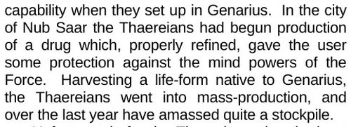
- **No single roster character (rules/setting/general)** — entry/section: GM Overview: "The Thaereians, in their ignorance, extracted what they needed from the cloud-grazers, and then dumped the rest. The net result was a trail from Nub Saar into the depths of the Genarius. Eventually, the predators came to call." Source: *412 - Inside-Out - Storm's Depths* (SWRPG d20 Revised Core), p.3
  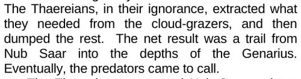

## p.4 (scan page 4)

Page contents: 779 words, 22 paragraphs | headings/entries: Encounter 2: Scene of the crime; Encounter 3: Echoes; Encounter 4: Noise; Storm's Depths; Encounter 5: Defects; Encounter 6: Defections; Page 4

- **No single roster character (rules/setting/general)** — entry/section: GM Overview: "With heavy hearts, and a view to future history, the Admirals and Generals of Thaere mounted a coup. The action was over quickly, and the military could once again begin to look towards the criminals, vagabonds and rogue Jedi of the Cularin system..." Source: *412 - Inside-Out - Storm's Depths* (SWRPG d20 Revised Core), p.4
  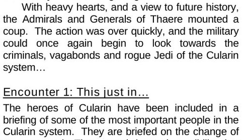

## p.5 (scan page 5)

Page contents: 679 words, 23 paragraphs | headings/entries: Opening Crawl; Storm's Depths; Page 5

- **No single roster character (rules/setting/general)** — entry/section: Opening Crawl: "As the conflict with Thaere begins to escalate, Cularin hangs in the balance. The Militia and a few brave heroes have bought some breathing room, but this cannot last. Every hard-won victory leads to another encounter and Cularin's arsenal pales before the strength of Thaere's military." Source: *412 - Inside-Out - Storm's Depths* (SWRPG d20 Revised Core), p.5
  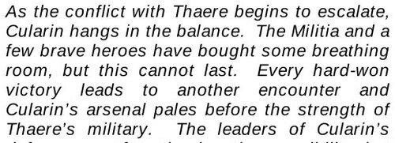
- **No single roster character (rules/setting/general)** — entry/section: Osten del'Nay: "Osten del'Nay clicks off the holo-projector. "These pictures are a week old," he says "smuggled off Thaere by a Bothan sympathizer. They certainly seem to confirm the reports we've been getting these last few weeks of a military coup in the Thaereian system."" Source: *412 - Inside-Out - Storm's Depths* (SWRPG d20 Revised Core), p.5
  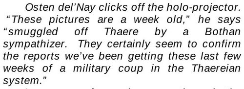
- **No single roster character (rules/setting/general)** — entry/section: Osten del'Nay: ""The faces may have changed, but the rhetoric hasn't. The Thaereian military governor has already made a speech about the need for continued vigilance with regard to the 'criminals, vagabonds and rogue Jedi of the Cularin system'." Source: *412 - Inside-Out - Storm's Depths* (SWRPG d20 Revised Core), p.5
  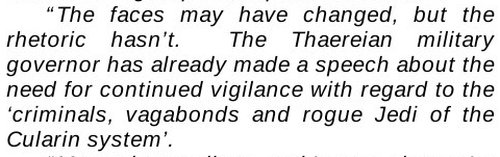
- **No single roster character (rules/setting/general)** — entry/section: Osten del'Nay: ""I wish I could be sure on that point, Renna. I'm no Jedi, and even Master Lanius," Osten nods at the Jedi master "can't tell me the shape of that future." Source: *412 - Inside-Out - Storm's Depths* (SWRPG d20 Revised Core), p.5
  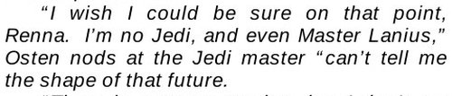
- **No single roster character (rules/setting/general)** — entry/section: Osten del'Nay: ""There is a storm coming, but I don't yet know how big or how violent, but conflict is inevitable. We must use this calm to prepare while we have it."" Source: *412 - Inside-Out - Storm's Depths* (SWRPG d20 Revised Core), p.5
  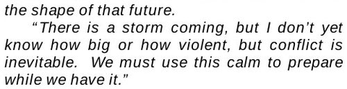
- **No single roster character (rules/setting/general)** — entry/section: Osten del'Nay: ""That concludes this briefing. Thank you all for attending and," he smiles towards the Jedi contingent again "may the Force be with us all."" Source: *412 - Inside-Out - Storm's Depths* (SWRPG d20 Revised Core), p.5
  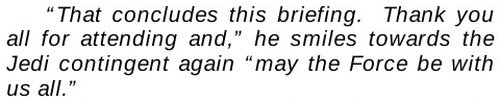

## p.1–5 (scan page 1)

Page contents: Title and blurb; boilerplate; GM overview of Nub Saar's cochlera drug, the predators and the coup on Thaere; summaries; judges' note; opening crawl (hand-read)

## p.6 (scan page 6)

Page contents: 720 words, 22 paragraphs | headings/entries: When it's time to leave:; Storm's Depths; Page 6

- **No single roster character (rules/setting/general)** — entry/section: Major Xirossk: "Xirossk grins, and beckons with a taloned finger. "You. You. And you, hiding at the back, I see you too. Come with me. I've a bit of a present for you."" Source: *412 - Inside-Out - Storm's Depths* (SWRPG d20 Revised Core), p.6
  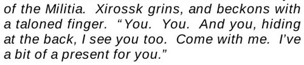
- **No single roster character (rules/setting/general)** — entry/section: Major Xirossk: ""You've done me some good work in recent weeks, and I'm grateful. I've not been able to pay you at all, but I'd like the chance to correct that. See, I've got another little job for you, and this time it's sponsored."" Source: *412 - Inside-Out - Storm's Depths* (SWRPG d20 Revised Core), p.6
  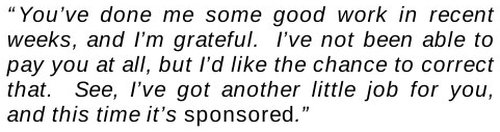
- **No single roster character (rules/setting/general)** — entry/section: Major Xirossk: ""We want to know why. And we want those ships, if possible. And I think you're the people to set it up."" Source: *412 - Inside-Out - Storm's Depths* (SWRPG d20 Revised Core), p.6
  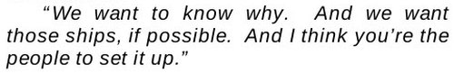
- **No single roster character (rules/setting/general)** — entry/section: Major Xirossk: "Possibly. The Thaereians may have left behind booby-traps or security systems, but compared to some of your escapades, this should be easy money. My gift to you. (Xirossk shows his teeth again.)" Source: *412 - Inside-Out - Storm's Depths* (SWRPG d20 Revised Core), p.6
  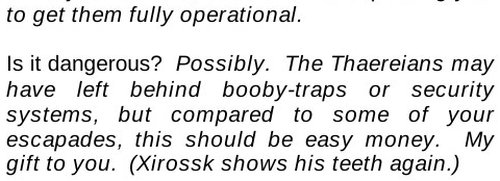

## p.7 (scan page 7)

Page contents: 661 words, 28 paragraphs | headings/entries: Encounter 2: Scene of the crime; Storm's Depths; DC What's found; DC What's found; Page 7

## p.8 (scan page 8)

Page contents: 719 words, 24 paragraphs | headings/entries: Storm's Depths; Encounter 3: Echoes; Page 8

- **No single roster character (rules/setting/general)** — entry/section: Nub Saar: "Nub Saar is a City of the Dead. It is gloomy, desolate, depressing and uninhabitable." Source: *412 - Inside-Out - Storm's Depths* (SWRPG d20 Revised Core), p.8
  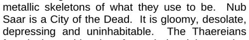

## p.9 (scan page 9)

Page contents: 719 words, 25 paragraphs | headings/entries: Looting; Storm's Depths; Investigating the chemical plant; Page 9

## p.10 (scan page 10)

Page contents: 672 words, 25 paragraphs | headings/entries: Heading for the capital ships; Encounter 4: Noise; Storm's Depths; If the heroes are "clean"; If the heroes are not "clean"; Page 10

- **No single roster character (rules/setting/general)** — entry/section: Cochlera predators: "It should be noted that the predators are in constant pain due to the low pressure they are experiencing this high in Genarius' atmosphere. This makes them far more aggressive and dangerous than normal, and will attack anything bearing even a trace of their natural prey." Source: *412 - Inside-Out - Storm's Depths* (SWRPG d20 Revised Core), p.10
  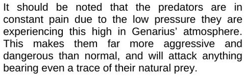

## p.11 (scan page 11)

Page contents: 740 words, 22 paragraphs | headings/entries: Storm's Depths; Encounter 5: Defects; Aboard the Aurora; Aboard the Nimbus; Page 11

## p.5–11 (scan page 5)

Page contents: E1 Osten del'Nay's briefing and Xirossk's sponsored job; E2 arriving at Nub Saar; E3 the dead city and chemical plant; E4 the gas predators (hand-read)

## p.12 (scan page 12)

Page contents: 717 words, 25 paragraphs | headings/entries: Each — individual gun; Storm's Depths; Encounter 6: Defections; Page 12

## p.13 (scan page 13)

Page contents: 787 words, 26 paragraphs | headings/entries: If the heroes do grant the request:; Storm's Depths; An act of piracy?; Page 13

- **No single roster character (rules/setting/general)** — entry/section: Nimbus crew: "A Human comes forward and addresses the camera. "We are the crew of the Nimbus, trapped here for a week now. What is the status of those blasted gas balls -- are they contained?"" Source: *412 - Inside-Out - Storm's Depths* (SWRPG d20 Revised Core), p.13
  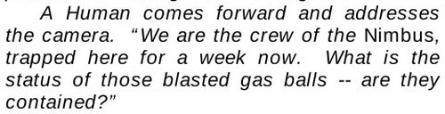
- **No single roster character (rules/setting/general)** — entry/section: Lt. Siobhan Stern: ""Look, not all of us agree with the military's stance on Cularin. Sure, you're a lucrative little cash bantha — no offence — but we have enough problems at home without buying more trouble that a war would cause." Source: *412 - Inside-Out - Storm's Depths* (SWRPG d20 Revised Core), p.13
  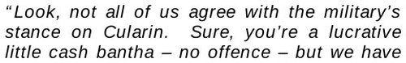
- **No single roster character (rules/setting/general)** — entry/section: Lt. Siobhan Stern: ""This coup is a bad business, and bad for business. I don't want to be a part of it, and some of the lads agree. I can't vouch for everyone, but a dozen ... yeah, a dozen I'd trust." Source: *412 - Inside-Out - Storm's Depths* (SWRPG d20 Revised Core), p.13
  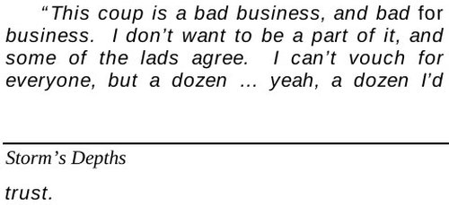
- **No single roster character (rules/setting/general)** — entry/section: Lt. Siobhan Stern: ""This is what we made here. Processed from the life forms we captured, the cochlera. It makes you immune to Jedi mind-bending. Or so I'm told. It only lasts a short while, but I've never had a reason to try it out before now."" Source: *412 - Inside-Out - Storm's Depths* (SWRPG d20 Revised Core), p.13
  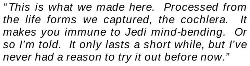
- **No single roster character (rules/setting/general)** — entry/section: Lt. Siobhan Stern: ""I'd hope it's obvious. This isn't for you; it's for my crew. This is so they will know that you've not used your mind tricks on me, if I go back and tell them you've agreed to the deal."" Source: *412 - Inside-Out - Storm's Depths* (SWRPG d20 Revised Core), p.13
  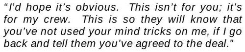

## p.14 (scan page 14)

Page contents: 738 words, 23 paragraphs | headings/entries: Storm's Depths; Page 14

- **No single roster character (rules/setting/general)** — entry/section: Tarasin Dream: ""This is the trader vessel Tarasin Dream of Cularin. We are under attack by a Thaereian Headhunters patrol claiming we are running contraband. Please assist! We are unarmed! Co-ordinates follow."" Source: *412 - Inside-Out - Storm's Depths* (SWRPG d20 Revised Core), p.14
  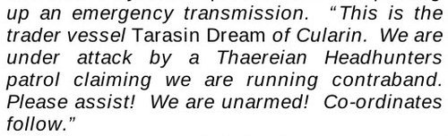
- **No single roster character (rules/setting/general)** — entry/section: Thaereian patrol leader: ""Hardly unknown. Welcome, Nimbus. We don't really need your help with this smuggling scum, but perhaps you want to give them a demonstration of Thaereian strength?"" Source: *412 - Inside-Out - Storm's Depths* (SWRPG d20 Revised Core), p.14
  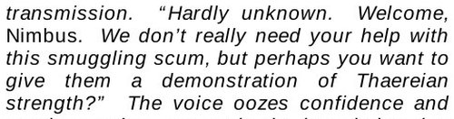

## p.15 (scan page 15)

Page contents: 732 words, 29 paragraphs | headings/entries: Running the combat; Tiering the combat; Storm's Depths; Heroes level 10-12; Ifthe heroes did not bring Nimbus; Page 15

## p.16 (scan page 16)

Page contents: 351 words, 20 paragraphs | headings/entries: Conclusion; Here Ends, "Storm's Depths"; Experience Point Summary; Experience is calculated as follows for LIVING; Adventure Experience Award:; Adventure Experience: Roleplaying Experience:; Storm's Depths; Page 16

- **No single roster character (rules/setting/general)** — entry/section: Major Xirossk: "He looks up from the datapad and smiles. "You amaze me again, my friends. With these two ships added to our fleet, we have the core of a creditable space navy." Source: *412 - Inside-Out - Storm's Depths* (SWRPG d20 Revised Core), p.16
  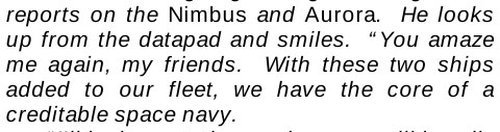
- **No single roster character (rules/setting/general)** — entry/section: Major Xirossk: "You should be proud. And I'm proud to be working with you."" Source: *412 - Inside-Out - Storm's Depths* (SWRPG d20 Revised Core), p.16
  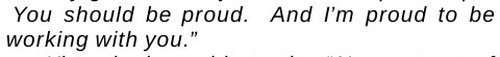
- **No single roster character (rules/setting/general)** — entry/section: Major Xirossk: "Xirossk shows his teeth. "Now get out of my office before I find you something else to do!"" Source: *412 - Inside-Out - Storm's Depths* (SWRPG d20 Revised Core), p.16
  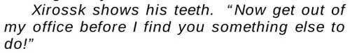

## p.17 (scan page 17)

Page contents: 315 words, 9 paragraphs | headings/entries: Loot Summary; Storm's Depths; Page 17

- **No single roster character (rules/setting/general)** — entry/section: Respect of Thaereian Military: "They may not like the hero, or even Thaere, but they trust the hero to keep their word." Source: *412 - Inside-Out - Storm's Depths* (SWRPG d20 Revised Core), p.17
  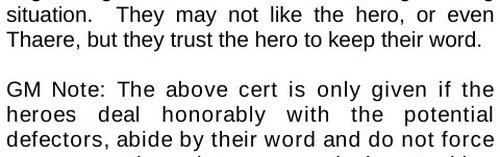

## p.11–17 (scan page 11)

Page contents: E5 repairing the Nimbus and the dead Aurora; E6 the trapped crew and Lt. Siobhan Stern; E7 the Tarasin Dream convoy fight; conclusion; XP; loot (hand-read)

## p.18 (scan page 18)

Page contents: 347 words, 15 paragraphs | headings/entries: Player Handout 1: Militia resources; Personnel; Equipment: Toolkit, Militia uniform; Militia ships; Storm's Depths Page 18

- **No single roster character (rules/setting/general)** — entry/section: Rigo Devane: "Rigo is an amiable sort, and will get on with anybody who doesn't get between him and interesting technology. He has an uncanny knack for fading into the background when not required." Source: *412 - Inside-Out - Storm's Depths* (SWRPG d20 Revised Core), p.18
  

## p.19 (scan page 19)

Page contents: 164 words, 8 paragraphs | headings/entries: Player Handout 2: The Nimbus; Storm's Depths Page 19

### Stat block notes (game mechanics, not feats)

- The Nimbus: The Nimbus "Corellian Gunship": Capital Ship, 120m, crew 91; 8 heavy double turbolaser cannons, 6 quad lasers, 4 concussion missile launchers (Source: *412 - Inside-Out - Storm's Depths* (SWRPG d20 Revised Core), p.19)

## p.20 (scan page 20)

Page contents: 419 words, 17 paragraphs | headings/entries: GM Aid #1: Militia resources; Personnel; Equipment: Toolkit, Militia uniform; Ships; Storm's Depths Page 20

### Stat block notes (game mechanics, not feats)

- Rigo Devane: Rigo Devane: Human Tech Specialist 2; Def 15; VP/WP 14/14; FP 1; Computer Use +10, Repair +10 (stat line read from page image) (Source: *412 - Inside-Out - Storm's Depths* (SWRPG d20 Revised Core), p.20)

## p.21 (scan page 21)

Page contents: 437 words, 13 paragraphs | headings/entries: Nub Saar; Combating the predators; Storm's Depths Page 21

- **No single roster character (rules/setting/general)** — entry/section: Nub Saar: "Although most of the approximately 5000 initial inhabitants fled before the storms grew too fierce, several hundred men refused to leave and perished." Source: *412 - Inside-Out - Storm's Depths* (SWRPG d20 Revised Core), p.21
  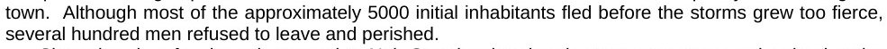

## p.22 (scan page 22)

Page contents: 426 words, 14 paragraphs | headings/entries: Feats: Track (see page 116-117 RCR); Storm's Depths Page 22

### Stat block notes (game mechanics, not feats)

- Cochlera predators: Nub Saar Predators: Predator 2 (VP/WP 16/16) to Predator 11 (85/16); DR 15 (energy only), immune to mental Force powers and normal physical damage (Source: *412 - Inside-Out - Storm's Depths* (SWRPG d20 Revised Core), p.22)

## p.23 (scan page 23)

Page contents: 474 words, 15 paragraphs | headings/entries: Storm's Depths Page 23

## p.24 (scan page 24)

Page contents: 66 words, 9 paragraphs | headings/entries: Critical Event Summary Storm's Depths; Q Yes Q No; Q Yes Q No; GM Name; GM RPGA# Date Convention Name; Storm's Depths Page 24

## p.18–24 (scan page 18)

Page contents: Player handouts (Militia resources, the Nimbus); GM Aid 1-3 (Rigo Devane, the predators, the Thaereian patrol); critical event summary (hand-read)

