# Owner Material 037 — Star Wars D20 Drive folder (Core, Revised Core and Saga Edition): Living Force Campaign/Adventures/Among the Stars/Year 4/413 - The Replacements.pdf [Star Wars Roleplaying Game Revised Core (d20, 2002)]

- **Source:** Wizards of the Coast Star Wars Roleplaying Game books, web enhancements, Living Force campaign modules and articles (2000–2010), from the owner's "Star Wars D20" Drive folder (only the three edition subfolders; "General" was not read, as instructed). Secondary source (licensed Legends reference). Scan OCR'd on the box; the scan stays box-only and is **not** published.
- **Method:** every scanned page was OCR'd and machine-screened sentence by sentence for power-relevant statements (fights, kills, defeats, Force feats, rankings, superweapons) that name a character on our roster; each kept sentence is quoted verbatim from the OCR text and has a crop of the printed passage directly under it. Pages with nothing power-relevant are still listed with what is on them.
- **Citation:** "*413 - The Replacements* (SWRPG d20 Revised Core), p.X" by printed page ("scan p.X" where no printed number applies). **Weight:** Licensed RPG material: a secondary source. Narrative text sums up Legends lore; game statistics are rules for players, not canon power levels, and rank lowest.

## p.1 (scan page 1)

Page contents: 100 words, 7 paragraphs | headings/entries: LFA413; The Replacements; A One-Round LIVING FORCE Tournament; Edited by Ron Heintz and Margaret Heintz

## p.2 (scan page 2)

Page contents: 874 words, 23 paragraphs | headings/entries: House Rules; Atoning for Dark Side Points; Dissipate Energy; Illusion; Stun; Hero Earnings; Issuing Force and Dark Side Points; The Replacements; Page 2

## p.3 (scan page 3)

Page contents: 887 words, 20 paragraphs | headings/entries: General Notes to the GM; GM Overview; Scenario Overview; The Replacements; Page 3

## p.4 (scan page 4)

Page contents: 833 words, 30 paragraphs | headings/entries: Encounter 1: The Replacements; Encounter 2: Taking Care Of Business; Encounter 3: Punching The Clock; Encounter 6: How To Void The Warranty; Conclusion; Important Note to Judges:; Opening Crawl; The Replacements; Page 4

## p.5 (scan page 5)

Page contents: 822 words, 22 paragraphs | headings/entries: Encounter 1: The Replacements; The Replacements; Page 5

- **No single roster character (rules/setting/general)** — entry/section: Opening Crawl: "Fortune favors the bold. Only time will tell if it favors these young Heroes as well." Source: *413 - The Replacements* (SWRPG d20 Revised Core), p.5
  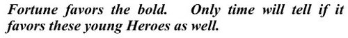
- **No single roster character (rules/setting/general)** — entry/section: Janvar Jan: ""Welcome to Cularin Stellar Tours... I know the place doesn't look like much, but believe you me, we are busier than a Jedi at a Separatist Rally."" Source: *413 - The Replacements* (SWRPG d20 Revised Core), p.5
  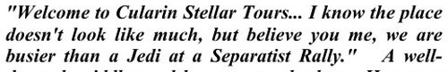
- **No single roster character (rules/setting/general)** — entry/section: Janvar Jan: ""I know what you're probably thinking... another fly-by-night contract, someone needs an errand run... find my lost mynock... and so on. It's more than that. You see, people's lives are going to depend on you. Come with me to our conference room."" Source: *413 - The Replacements* (SWRPG d20 Revised Core), p.5
  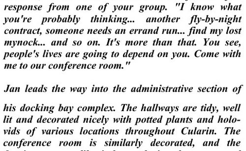
- **No single roster character (rules/setting/general)** — entry/section: Janvar Jan: ""Ever since the Cularin system reappeared, people from all over the galaxy have been rushing to visit the system. After all, how often does someone get to visit system that vanishes without a trace for 10 years?"" Source: *413 - The Replacements* (SWRPG d20 Revised Core), p.5
  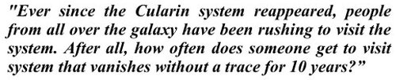
- **No single roster character (rules/setting/general)** — entry/section: Janvar Jan: "Its the insurance underwriters... they insist I provide 'emergency assistance' services to my clients while within the Cularin system. Seems like insurance premiums are up quite a bit for star systems that tend to jump through time." Source: *413 - The Replacements* (SWRPG d20 Revised Core), p.5
  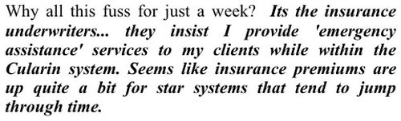

## p.1–5 (scan page 1)

Page contents: Title and blurb; boilerplate and house rules; GM and scenario overview (Janvar Jan's smuggling scheme); encounter summaries; judges' note; opening crawl (hand-read)

## p.6 (scan page 6)

Page contents: 874 words, 20 paragraphs | headings/entries: Move Along... Move Along; Encounter 2: Taking Care of Business; A ship in need of repairs; The Replacements; Page 6

- **No single roster character (rules/setting/general)** — entry/section: Janvar Jan: "You see, Cularin has a bit of an issue with 'local authorities'... there aren't many." Source: *413 - The Replacements* (SWRPG d20 Revised Core), p.6
  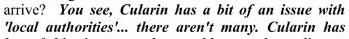
- **No single roster character (rules/setting/general)** — entry/section: Janvar Jan: ""I know it doesn't look like much... but believe you me — some new parts, some paint and she'll be as good as new." Jan beams." Source: *413 - The Replacements* (SWRPG d20 Revised Core), p.6
  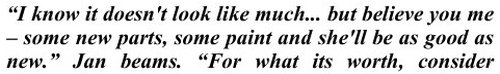

## p.7 (scan page 7)

Page contents: 835 words, 24 paragraphs | headings/entries: What happened to this ship?; DC Information Gathered; What's broken?; The Replacements; Page 7

## p.8 (scan page 8)

Page contents: 838 words, 18 paragraphs | headings/entries: Gaining additional repair checks:; Encounter 3: Punching the Clock; Encounter 3a: A Cularin Vacation; The Replacements; Page 8

## p.9 (scan page 9)

Page contents: 850 words, 22 paragraphs | headings/entries: Possible resolutions; The Replacements; Page 9

- **No single roster character (rules/setting/general)** — entry/section: Syub Kyak: "Thank the Maker! No one else was responding to our signal and our helm control is out, but it shouldn't be! I can't understand how this circuitry could even function in the first place! Who in their right mind designs a system without 6 levels of redundancy!" Source: *413 - The Replacements* (SWRPG d20 Revised Core), p.9
  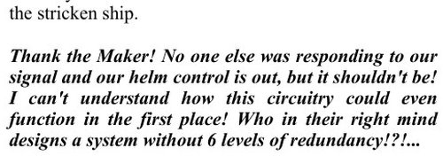
- **No single roster character (rules/setting/general)** — entry/section: Syub Kyak: "For some reason my children decided to rewire the navigational controls! The entire system is nonresponsive!" Source: *413 - The Replacements* (SWRPG d20 Revised Core), p.9
  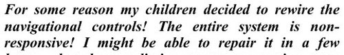

## p.10 (scan page 10)

Page contents: 779 words, 33 paragraphs | headings/entries: Wrap-up; Encounter 3b: Mynock Roundup; The Situation:; Courses of action; The Replacements; Page 10

### Stat block notes (game mechanics, not feats)

- Mynocks: Mynock (6): Vacuum parasite 1; VP/WP 4/11; electricity/ion resistance 10 (Source: *413 - The Replacements* (SWRPG d20 Revised Core), p.10)

## p.11 (scan page 11)

Page contents: 783 words, 28 paragraphs | headings/entries: Spoiler!!!; The Replacements; Page 11

- **No single roster character (rules/setting/general)** — entry/section: Dr. Dantari: ""Starchaser? This is Dr. Dantari aboard the Perihelion. Thanks for your help! It seems as though our survey equipment attracted those pests!" Source: *413 - The Replacements* (SWRPG d20 Revised Core), p.11
  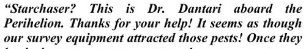

## p.12 (scan page 12)

Page contents: 872 words, 30 paragraphs | headings/entries: Option for law abiding/law enforcing heroes; Options for "grey zone" heroes; The Replacements; Page 12

- **No single roster character (rules/setting/general)** — entry/section: Rodian smuggler: ""You are come out now!" one of the Rodians says in thickly accented basic. "We are for Mr. Jan."" Source: *413 - The Replacements* (SWRPG d20 Revised Core), p.12
  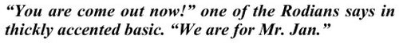
- **No single roster character (rules/setting/general)** — entry/section: Rodian smuggler: "Today, Crest of Dawn... tomorrow different ship. It is Jan's way. Is clever? Three ships registered, fourth ship not registered — can be any of three registered ships." Source: *413 - The Replacements* (SWRPG d20 Revised Core), p.12
  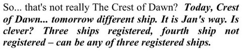
- **No single roster character (rules/setting/general)** — entry/section: Rodian smuggler: "Janvar boss say nothing about this! I said to Koobis we are come too early to Cularin!" Source: *413 - The Replacements* (SWRPG d20 Revised Core), p.12
  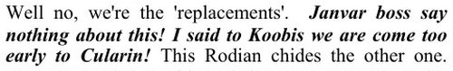

## p.13 (scan page 13)

Page contents: 745 words, 25 paragraphs | headings/entries: Questions and Answers:; The Replacements; Page 13

- **No single roster character (rules/setting/general)** — entry/section: LF-R3D: "'Attention emergency workers, my designation is LF- R3D, personal valet to Lord VenHalgon's household. Your presence is immediately required at our coordinates.'" Source: *413 - The Replacements* (SWRPG d20 Revised Core), p.13
  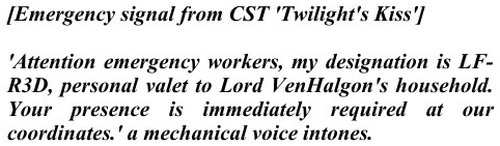
- **No single roster character (rules/setting/general)** — entry/section: LF-R3D: "Lord VenHalgon has mastered the challenges of the simulated hunting grounds he maintains at his estate. I feel the "authentic" challenges of this world's teeming jungle may have overcome him." Source: *413 - The Replacements* (SWRPG d20 Revised Core), p.13
  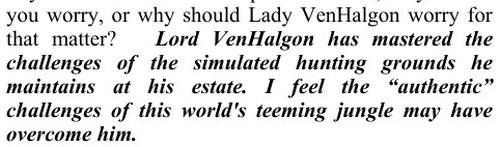
- **No single roster character (rules/setting/general)** — entry/section: LF-R3D: "Lord VenHalgon's party had taken no additional food or water... or navigational devices... or emergency equipment... or a portable shelter." Source: *413 - The Replacements* (SWRPG d20 Revised Core), p.13
  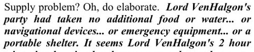

## p.5–13 (scan page 5)

Page contents: E1 hired by Janvar Jan; E2 refitting the Starchaser IV; E3a the Kyak family; E3b the mynocks on the Perihelion; E3c the fourth-yacht smugglers at Tolea Biqua (hand-read)

## p.14 (scan page 14)

Page contents: 888 words, 24 paragraphs | headings/entries: Sector D2 — The Waterfall; The Replacements; Page 14

## p.15 (scan page 15)

Page contents: 816 words, 26 paragraphs | headings/entries: The Replacements; Page 15

- **No single roster character (rules/setting/general)** — entry/section: Lord Sargo VenHalgon: "I say! Excellently done men, excellently done! I'll be sure to tell your Regimental Commander about your work here today. Reminds me of that time on Keeara Major... heh-heh." Source: *413 - The Replacements* (SWRPG d20 Revised Core), p.15
  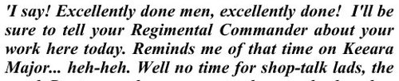
- **No single roster character (rules/setting/general)** — entry/section: Lady VenHalgon: "'Sargo! Darling! You left the ship without your sweater and trailboots, not to mention food and water. " Lady VenHalgon says disapprovingly. 'The very next thing and you'll be leaving the palace at home without your pants I should think!" Source: *413 - The Replacements* (SWRPG d20 Revised Core), p.15
  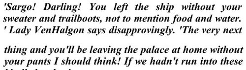
- **No single roster character (rules/setting/general)** — entry/section: LF-R3D: "I am only a droid, a most grateful droid, as such I do not have power to properly thank you for what you have done. At least... not here. Should you ever visit the Empress Teta system, please contact me!" Source: *413 - The Replacements* (SWRPG d20 Revised Core), p.15
  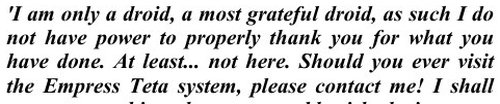

### Stat block notes (game mechanics, not feats)

- Kilassin: Kilassin: Predator 5, Huge (9.4m); VP/WP 52/36 (32/36 lower tier); claws +8/+8 (1d6+7) (Source: *413 - The Replacements* (SWRPG d20 Revised Core), p.15)

## p.16 (scan page 16)

Page contents: 889 words, 23 paragraphs | headings/entries: Talk to the Bounty Hunter; The Replacements; Page 16

- **No single roster character (rules/setting/general)** — entry/section: Shiana Trist: ""Sorry to cut you off.. If your boss continues blabbing all over space like that, things will get a lot more difficult. Cut your engines... we have some business to attend to."" Source: *413 - The Replacements* (SWRPG d20 Revised Core), p.16
  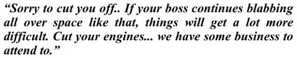
- **No single roster character (rules/setting/general)** — entry/section: Shiana Trist: ""Cease fire! I only want to talk."" Source: *413 - The Replacements* (SWRPG d20 Revised Core), p.16
  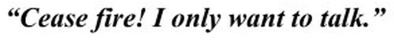
- **No single roster character (rules/setting/general)** — entry/section: Shiana Trist: "Look, why don't we all just power down our weapons and be friends for a few minutes?" Source: *413 - The Replacements* (SWRPG d20 Revised Core), p.16
  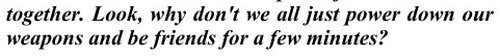
- **No single roster character (rules/setting/general)** — entry/section: Shiana Trist: "I'm after a group of slicers — the Liana Liberators. The Republic wants them brought in. Word is that these guys are in the pockets of the Trade Federation and possibly the Techno Union." Source: *413 - The Replacements* (SWRPG d20 Revised Core), p.16
  
- **No single roster character (rules/setting/general)** — entry/section: Shiana Trist: "So do I. No hard feelings. That contract is not my concern anymore, and everything that happened on Nar Shadda, can stay on Nar Shadda. This is just business, people. Are you in or out?" Source: *413 - The Replacements* (SWRPG d20 Revised Core), p.16
  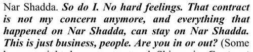

## p.17 (scan page 17)

Page contents: 852 words, 25 paragraphs | headings/entries: Data File: The Liana Liberators; Tracking the slicers; The Replacements; Page 17

## p.18 (scan page 18)

Page contents: 801 words, 27 paragraphs | headings/entries: Flying through the asteroid field:; Picking up the trail:; Getting rid of Shiana:; The Replacements; Page 18

- **No single roster character (rules/setting/general)** — entry/section: Encounter 6: "That's no moon! [Sorry, we've always wanted to write that.]" Source: *413 - The Replacements* (SWRPG d20 Revised Core), p.18
  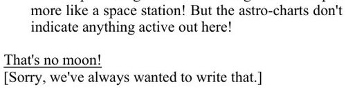

## p.19 (scan page 19)

Page contents: 848 words, 22 paragraphs | headings/entries: Once inside; Attack of the Drones!; The Replacements; Page 19

- **No single roster character (rules/setting/general)** — entry/section: Shiana Trist: "'They've found a way to activate the station's antiasteroid batteries!' the bounty hunter growls as she peels her fighter through a tight, evasive turn. 'Starchaser, you go after them, I'll draw the laser battery fire to give you a chance to get inside to flush them out!'" Source: *413 - The Replacements* (SWRPG d20 Revised Core), p.19
  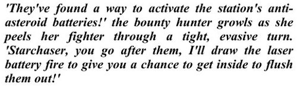

## p.20 (scan page 20)

Page contents: 815 words, 25 paragraphs | headings/entries: Halt or we'll shoot!; Mechanics for this stage of the Encounter:; The Replacements; Page 20

## p.21 (scan page 21)

Page contents: 822 words, 24 paragraphs | headings/entries: Conclusion; Turning in Jan; Condoning Jan's Smuggling Operation; If The Heroes Captured The Liberators; The Replacements; Page 21

- **No single roster character (rules/setting/general)** — entry/section: Conclusion: "You saw for one brief moment the face of a true and vengeful enemy." Source: *413 - The Replacements* (SWRPG d20 Revised Core), p.21
  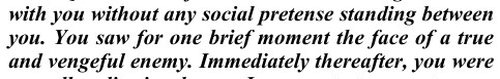

## p.13–21 (scan page 13)

Page contents: E4 rescuing Lord VenHalgon from the kilassin; E5 Shiana Trist and the Liana Liberators; E6 the chase through the Czerka mine; conclusions (hand-read)

## p.22 (scan page 22)

Page contents: 733 words, 30 paragraphs | headings/entries: Here Ends, "The Replacements"; Experience Point Summary; Adventure Experience Award:; Loot Summary; Encounter 1:; Contractual rewards: 1500 (possible 2000) credits; Encounter 2:; Encounter 4:; Conclusion:; The Replacements; Page 22

## p.23 (scan page 23)

Page contents: 75 words, 3 paragraphs | headings/entries: The Replacements Page 23

## p.24 (scan page 24)

Page contents: 728 words, 17 paragraphs | headings/entries: Starting Hooks:; New Talent Wanted; Please see Player Handout A; Cularin New Comer; Jedi Intelligence; The Replacements Page 24

## p.25 (scan page 25)

Page contents: 462 words, 17 paragraphs | headings/entries: Player Handout 1-A; Player Handout 1-B; Player Handout 1-C; End Transmission"; The Replacements Page 25

## p.26 (scan page 26)

Page contents: 605 words, 19 paragraphs | headings/entries: Player Handout 1-D; Cularin; Cularin the System; Cularin the Planet; Gadrin; Hedrett; The Replacements Page 26

- **No single roster character (rules/setting/general)** — entry/section: New Comer's Guide: "In the words of the head of Cartel operations in Cularin, Thurm Loog, "We Love Cularin!"" Source: *413 - The Replacements* (SWRPG d20 Revised Core), p.26
  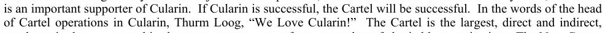

## p.27 (scan page 27)

Page contents: 721 words, 11 paragraphs | headings/entries: Platform Cities; Tarasin Irstats; Asteroid Belt; Genarius; The Replacements Page 27

## p.28 (scan page 28)

Page contents: 417 words, 18 paragraphs | headings/entries: Player Handout 2: Cularin Star Tours; The Ships of Cularin Star Tours (CST); Passenger Manifests:; Twilight's Kiss; Mrs. Worrita; LF-R3D (Valet droid); The Perihelion; Dr. P. Dantari; Dr. L. Raine; The Replacements Page 28

## p.29 (scan page 29)

Page contents: 588 words, 17 paragraphs | headings/entries: Wayfarer-class Medium Transport; Hull Points (30; Gaining additional repair checks:; The Replacements Page 29

## p.30 (scan page 30)

Page contents: 375 words, 15 paragraphs | headings/entries: Player Handout 3: Decisions — Part 2; Other Considerations:; The Replacements Page 30

## p.31 (scan page 31)

Page contents: 128 words, 5 paragraphs | headings/entries: The Replacements Page 31

## p.32 (scan page 32)

Page contents: 806 words, 15 paragraphs | headings/entries: GM Aid 1- Janvar Jan Profile; Cularin Stellar Tours; Search and Rescue Team; The Replacements Page 32

- **No single roster character (rules/setting/general)** — entry/section: Janvar Jan: "Janvar Jan is a very good-looking man, which goes along way to hide his ugly personality. A career criminal, Jan is now middle aged. Gone are the days of foolish risks and daredevil jobs. Now he is careful and experienced — a dangerous combination in a criminal." Source: *413 - The Replacements* (SWRPG d20 Revised Core), p.32
  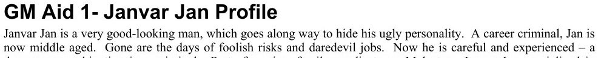

### Stat block notes (game mechanics, not feats)

- Janvar Jan: Janvar Jan: Male Human Scoundrel 6/Crime Lord 2; Def 17; VP/WP 32/11; Rep 6; Bluff +18, Intimidate +18; Infamy, Persuasive (Source: *413 - The Replacements* (SWRPG d20 Revised Core), p.32)

## p.33 (scan page 33)

Page contents: 843 words, 27 paragraphs | headings/entries: Kuat Systems Engineering Wayfarer-class Medium Transport; Compartment Key; The Replacements Page 33

## p.34 (scan page 34)

Page contents: 30 words, 14 paragraphs | headings/entries: Wayfarer-class Medium Transport; Cargo Crates; Computer; Hatch. Alelock; Hyperdrive; Power Core; Power Loader; Refresher; Shield Generator; Sublight Engine; June 03 Dungeon/Polyhedron 21; The Replacements

## p.35 (scan page 35)

Page contents: 78 words, 15 paragraphs | headings/entries: GM Aid 3 — CST Passenger Manifest; Twilight's Kiss; Mrs. Worrita; LF-R3D (Valet droid); The Perihelion; Dr. P. Dantari; Dr. L. Raine; The Fourth Yacht; Nawara Blen (Twi'lek); The Replacements; Page 35

## p.36 (scan page 36)

Page contents: 287 words, 20 paragraphs | headings/entries: Deepest, Darkest Cularin— Random Events; Roll (1d6) 1; Challenge; Game Effect; You've lost your bearings!; Loose terrain gives way!; Sprayed by Mulissikis!; The Replacements; Page 36

## p.37 (scan page 37)

Page contents: 636 words, 12 paragraphs | headings/entries: GM Aid 5 — Shiana Trist Profile; Shiana Trist, Professional Assassin; The Replacements Page 37

- **No single roster character (rules/setting/general)** — entry/section: Shiana Trist: "Don't think she's an assassin with a heart of gold — she's not. However, neither is she a heartless killer. If she can do some good without interfering with her mission, she'll do it." Source: *413 - The Replacements* (SWRPG d20 Revised Core), p.37
  
- **No single roster character (rules/setting/general)** — entry/section: Shiana Trist: "It's not that she's shy; rather she just doesn't really like people." Source: *413 - The Replacements* (SWRPG d20 Revised Core), p.37
  

### Stat block notes (game mechanics, not feats)

- Shiana Trist: Shiana Trist: Female Human Soldier 4/Scoundrel 1/Sharpshooter 5; Def 19; VP/WP 86/12; FP 3; Rep +5; custom slugthrower rifle, heavy blaster pistol, modified Z-95 (Source: *413 - The Replacements* (SWRPG d20 Revised Core), p.37)

## p.38 (scan page 38)

Page contents: 347 words, 16 paragraphs | headings/entries: GM Aid 6 — Pacing and Problems; Encounter 2 — We want it all; Solution; Encounter 5 — Possible tangents; Encounter 6 — Encounter Ending Asteroid; The Replacements; Page 38

## p.22–38 (scan page 22)

Page contents: XP and loot; player handouts (hooks, New Comer's Guide, CST ad, repair decisions, jungle map); GM Aids 1-6 (Janvar Jan, Wayfarer, manifest, jungle events, Shiana Trist, pacing) (hand-read)

