# Owner Material 037 — Star Wars D20 Drive folder (Core, Revised Core and Saga Edition): Living Force Campaign/Adventures/Among the Stars/Year 4/414 - A Mon Alone.pdf [Star Wars Roleplaying Game Revised Core (d20, 2002)] (scan pages 1–56)

- **Source:** Wizards of the Coast Star Wars Roleplaying Game books, web enhancements, Living Force campaign modules and articles (2000–2010), from the owner's "Star Wars D20" Drive folder (only the three edition subfolders; "General" was not read, as instructed). Secondary source (licensed Legends reference). Scan OCR'd on the box; the scan stays box-only and is **not** published.
- **Method:** every scanned page was OCR'd and machine-screened sentence by sentence for power-relevant statements (fights, kills, defeats, Force feats, rankings, superweapons) that name a character on our roster; each kept sentence is quoted verbatim from the OCR text and has a crop of the printed passage directly under it. Pages with nothing power-relevant are still listed with what is on them.
- **Citation:** "*414 - A Mon Alone* (SWRPG d20 Revised Core), p.X" by printed page ("scan p.X" where no printed number applies). **Weight:** Licensed RPG material: a secondary source. Narrative text sums up Legends lore; game statistics are rules for players, not canon power levels, and rank lowest.

## p.1 (scan page 1)

Page contents: 104 words, 5 paragraphs | headings/entries: A Mon Alone; A Two-Round High-Level LIVING FORCE Tournament

- **No single roster character (rules/setting/general)** — entry/section: Blurb: ""Slavery". If there's a less pleasant word, it's probably "Sith". Fortunately, there are no slavers in Cularin, and the Sith fortress is dormant. No slavers, dormant fortress... that's correct — isn't it?" Source: *414 - A Mon Alone* (SWRPG d20 Revised Core), p.1
  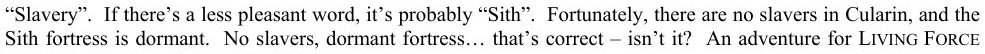

## p.2 (scan page 2)

Page contents: 918 words, 23 paragraphs | headings/entries: Hero Earnings; A Mon Alone; Issuing Force and Dark Side Points; Page 2

## p.3 (scan page 3)

Page contents: 953 words, 20 paragraphs | headings/entries: General Notes to the GM; A Mon Alone; GM Overview; Page 3

- **Darth Rivan** — entry/section: 414 - A Mon Alone: "Darth Rivan came to Cularin, and even the Sith Lord feared the darkstaff, wanting to destroy it." Source: *414 - A Mon Alone* (SWRPG d20 Revised Core), p.3
  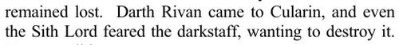
- **Darth Rivan** — entry/section: 414 - A Mon Alone: "While Darth Rivan did not succeed in destroying the darkstaff, he did create something almost as frightening centuries ago in Cularin — his Battlelords, senior soldiers who permanently Force-bonded their armies." Source: *414 - A Mon Alone* (SWRPG d20 Revised Core), p.3
  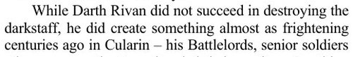
- **No single roster character (rules/setting/general)** — entry/section: GM Overview: "There are threats, and then there are Threats. There is evil, and then there is Evil. Let me tell you a little story about Evil, and the Threats it creates." Source: *414 - A Mon Alone* (SWRPG d20 Revised Core), p.3
  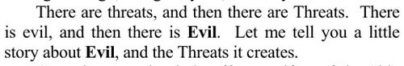
- **Darth Rivan** — entry/section: GM Overview: "Darth Rivan came to Cularin, and even the Sith Lord feared the darkstaff, wanting to destroy it. He never did." Source: *414 - A Mon Alone* (SWRPG d20 Revised Core), p.3
  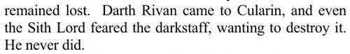
- **Darth Rivan** — entry/section: GM Overview: "While Darth Rivan did not succeed in destroying the darkstaff, he did create something almost as frightening centuries ago in Cularin — his Battlelords, senior soldiers who permanently Force-bonded their armies. Anything the Battlelord commanded, the bonded soldiers had to do or be left behind. Soldiers who found themselves too far removed from their Battlelords wasted away and died, most horribly and painfully." Source: *414 - A Mon Alone* (SWRPG d20 Revised Core), p.3
  

## p.4 (scan page 4)

Page contents: 965 words, 19 paragraphs | headings/entries: A Mon Alone; Encounter 1: Onset; Encounter 2: Insert; Encounter 3: Overt; Page 4

## p.5 (scan page 5)

Page contents: 907 words, 18 paragraphs | headings/entries: Encounter 4: Inert; Encounter 5: Inter; Encounter 6: Return; Intermission; A Mon Alone; Encounter 7: Approach; Encounter 8: Avoidance; Encounter 9: Conflict; Encounter 10: Valence; Page 5

## p.6 (scan page 6)

Page contents: 827 words, 18 paragraphs | headings/entries: Encounter 11: Force; A Mon Alone; Opening Crawl; Encounter 1: Onset; Page 6

- **No single roster character (rules/setting/general)** — entry/section: Opening Crawl: "The Clone Wars have come to Cularin. Death and destruction, loss and strife, all the companions of war, have come as well." Source: *414 - A Mon Alone* (SWRPG d20 Revised Core), p.6
  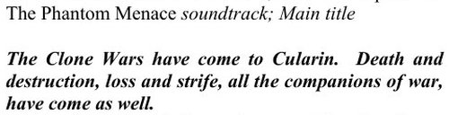
- **No single roster character (rules/setting/general)** — entry/section: Opening Crawl: "A half-dozen people know of the existence of this ship. That number is about to double..." Source: *414 - A Mon Alone* (SWRPG d20 Revised Core), p.6
  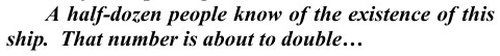

## p.1–6 (scan page 1)

Page contents: Title, blurb, rules notes; GM overview of the darkstaff, Phylus Mon and Darth Rivan's Battlelords; encounter summaries; opening crawl (hand-read)

## p.7 (scan page 7)

Page contents: 882 words, 22 paragraphs | headings/entries: A Mon Alone; Page 7

- **No single roster character (rules/setting/general)** — entry/section: Lanius Qel-Bertuk: ""We have been attacked. If we don't look as though we're under attack, that's because it happened to the south."" Source: *414 - A Mon Alone* (SWRPG d20 Revised Core), p.7
  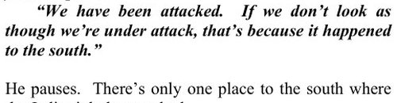
- **No single roster character (rules/setting/general)** — entry/section: Lanius Qel-Bertuk: ""Three of them have become one with the Force. Three others are missing, probably inside the fortress." Source: *414 - A Mon Alone* (SWRPG d20 Revised Core), p.7
  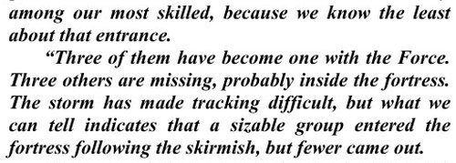

## p.8 (scan page 8)

Page contents: 738 words, 26 paragraphs | headings/entries: That's; You think that's where they went? one; A Mon Alone; Page 8

- **No single roster character (rules/setting/general)** — entry/section: Lanius Qel-Bertuk: "Slip out? How do you "slip" past Jedi? If I had to guess, I'd say they used illusions to augment the sandstorm. But if they created illusions that fooled Jedi, these individuals aren't to be trifled with." Source: *414 - A Mon Alone* (SWRPG d20 Revised Core), p.8
  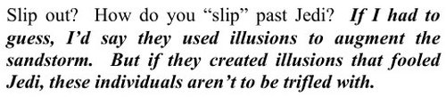
- **No single roster character (rules/setting/general)** — entry/section: Lanius Qel-Bertuk: "Are Master Devan and the others we saw leaving going down there? Master Devan is not. Her place, like mine, is here. If there is another attack coming against us, I suspect it will come against the academy proper." Source: *414 - A Mon Alone* (SWRPG d20 Revised Core), p.8
  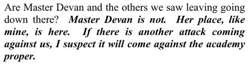

## p.9 (scan page 9)

Page contents: 825 words, 25 paragraphs | headings/entries: Encounter 2: Insert; A Mon Alone; Viewing the Area; Page 9

- **No single roster character (rules/setting/general)** — entry/section: Lanius Qel-Bertuk: "Why us? Because you have shown yourselves to be some of Cularin's most dependable, resourceful, hardy heroes. We need the best." Source: *414 - A Mon Alone* (SWRPG d20 Revised Core), p.9
  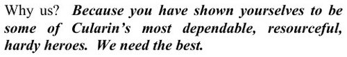
- **No single roster character (rules/setting/general)** — entry/section: Lanius Qel-Bertuk: ""Go, then. And may the Force be with you."" Source: *414 - A Mon Alone* (SWRPG d20 Revised Core), p.9
  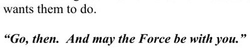

## p.10 (scan page 10)

Page contents: 765 words, 29 paragraphs | headings/entries: Searching; Survival DC | Information Gained; Three individuals whose movement; Asking Questions; A Mon Alone; Here are some that she definitely; Page 10

## p.11 (scan page 11)

Page contents: 874 words, 20 paragraphs | headings/entries: Encounter 3: Overt; A Mon Alone; Page 11

- **No single roster character (rules/setting/general)** — entry/section: Treibeiu: "Any advice? Come back out alive. Don't believe everything you see. Remember, the pull of the dark side is strong in this place — don't give in." Source: *414 - A Mon Alone* (SWRPG d20 Revised Core), p.11
  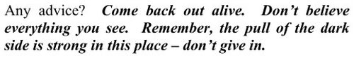

## p.12 (scan page 12)

Page contents: 948 words, 21 paragraphs | headings/entries: A Mon Alone; Page 12

## p.13 (scan page 13)

Page contents: 872 words, 21 paragraphs | headings/entries: A Mon Alone; Encounter 4: Inert; Page 13

## p.14 (scan page 14)

Page contents: 993 words, 19 paragraphs | headings/entries: Walk-through; A Mon Alone; Page 14

- **Darth Rivan** — entry/section: Encounter 4: "What this pseudo-puzzle comes down to is that this is a Sith fortress, and Sith have lived and died by the rule of two since the time of Darth Bane. It was only following the events on Naboo that the rule of two became (relatively) common knowledge, though, so when Darth Rivan set this particular guard in place, he thought using two as the setting for the door would suffice." Source: *414 - A Mon Alone* (SWRPG d20 Revised Core), p.14
  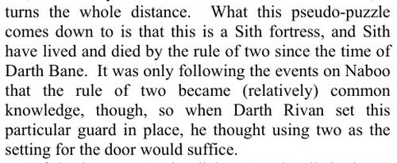

## p.15 (scan page 15)

Page contents: 927 words, 21 paragraphs | headings/entries: A Mon Alone; Encounter 5: Inter; Page 15

## p.6–15 (scan page 6)

Page contents: E1 Lanius's briefing; E2 Treibeiu at the fortress entrance; E3 gundarks and Vorlocca's body; E4 Rivan's mundane traps (hand-read)

## p.16 (scan page 16)

Page contents: 881 words, 18 paragraphs | headings/entries: Guardian Chamber; Storage Chamber; A Mon Alone; Servants' Quarters; Page 16

- **Darth Rivan** — entry/section: Servants' Quarters: "Rivan was a sick individual. It wasn't enough that his servants were slaves. Their enslavement involved stripping them not only of their identities, but also their connection to the Force." Source: *414 - A Mon Alone* (SWRPG d20 Revised Core), p.16
  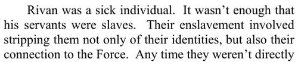

## p.17 (scan page 17)

Page contents: 870 words, 24 paragraphs | headings/entries: Kitchen; Dining Area; A Mon Alone; Practice Hall; Meditation Chamber; Page 17

- **Darth Rivan** — entry/section: Practice Hall: "The material is the result of a Sith ritual conducted by Rivan many years ago, because he got tired of running through prone victims — that is, apprentices — and marring his practice area." Source: *414 - A Mon Alone* (SWRPG d20 Revised Core), p.17
  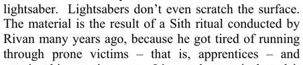
- **No single roster character (rules/setting/general)** — entry/section: Meditation Chamber: "Always two there are. One big rock, one little rock." Source: *414 - A Mon Alone* (SWRPG d20 Revised Core), p.17
  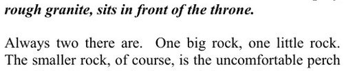

## p.18 (scan page 18)

Page contents: 913 words, 22 paragraphs | headings/entries: Living Quarters and Facilities; Library; Ritual Chamber; A Mon Alone; Page 18

- **No single roster character (rules/setting/general)** — entry/section: Ritual Chamber voices: "Make the promise. Seal the pact. Make the promise. Seal the pact." Source: *414 - A Mon Alone* (SWRPG d20 Revised Core), p.18
  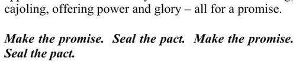
- **No single roster character (rules/setting/general)** — entry/section: Ritual Chamber: "All the places you've been, all the darkness you've seen, all the evil you've faced — nothing has ever felt as utterly wrong as this place feels to you right now." Source: *414 - A Mon Alone* (SWRPG d20 Revised Core), p.18
  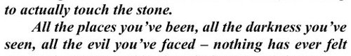

## p.19 (scan page 19)

Page contents: 880 words, 23 paragraphs | headings/entries: None Reduce site power by one step; Force light may be used untrained; A Mon Alone; Tracks; Page 19

## p.20 (scan page 20)

Page contents: 894 words, 20 paragraphs | headings/entries: Catwalk; Crypt; A Mon Alone; Page 20

## p.21 (scan page 21)

Page contents: 940 words, 19 paragraphs | headings/entries: The Sarcophagi; The Secret Exit; A Mon Alone; Darsin's Motivation; Page 21

- **No single roster character (rules/setting/general)** — entry/section: Darsin: "Please, powerful Jedi, be merciful! Do not destroy the poor, lost, weak-willed fool enslaved by Darth Rivan all those centuries ago!" Source: *414 - A Mon Alone* (SWRPG d20 Revised Core), p.21
  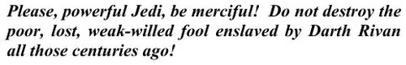

## p.22 (scan page 22)

Page contents: 754 words, 29 paragraphs | headings/entries: A Mon Alone; Page 22

- **No single roster character (rules/setting/general)** — entry/section: Darsin: "Battlelords? What do you mean? Leaders. More than leaders. Individuals to whom the lives of their armies are bonded. As long as the Battlelord lives, the army cannot run away from him. The entire army become slaves to the Battlelord." Source: *414 - A Mon Alone* (SWRPG d20 Revised Core), p.22
  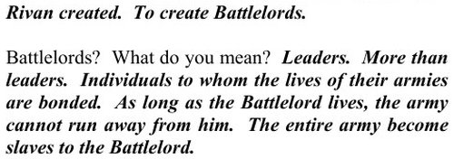

## p.23 (scan page 23)

Page contents: 741 words, 28 paragraphs | headings/entries: Encounter 6: Return; A Mon Alone; Page 23

- **No single roster character (rules/setting/general)** — entry/section: Darsin: "You're a dark side spirit. We have to destroy you. I'm a Slave, tied to a place I must protect for as long as this planet orbits two suns. Please, leave me be." Source: *414 - A Mon Alone* (SWRPG d20 Revised Core), p.23
  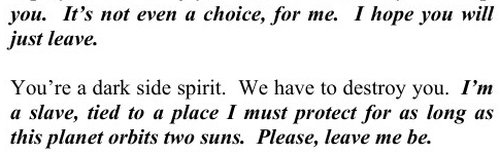

## p.24 (scan page 24)

Page contents: 890 words, 23 paragraphs | headings/entries: A Mon Alone; Page 24

- **No single roster character (rules/setting/general)** — entry/section: Lanius Qel-Bertuk: ""These individuals were brought out by the other two groups. They found them scattered in various areas of the fortress. None of the individuals you see laid out before you are dead. They aren't really alive, either." Source: *414 - A Mon Alone* (SWRPG d20 Revised Core), p.24
  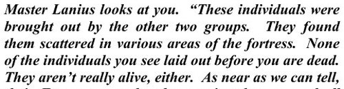
- **No single roster character (rules/setting/general)** — entry/section: Oden Malksch: "The man speaks. "Please, I'm not who I look like. That is, he's not here." He taps an amulet at his chest. The centerpiece of the amulet is an orange gemstone that is cracked from top to bottom. "I'm Oden Malksch. I work here — in the library?"" Source: *414 - A Mon Alone* (SWRPG d20 Revised Core), p.24
  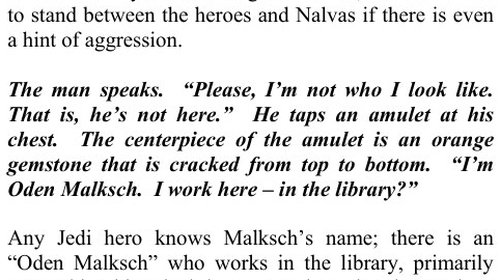

## p.25 (scan page 25)

Page contents: 970 words, 25 paragraphs | headings/entries: A Mon Alone; Page 25

- **No single roster character (rules/setting/general)** — entry/section: Oden Malksch: "What's been done to these individuals is wrong. It's not just wrong when it's done to Jedi like Valiri and Constanten, it's wrong when it's done to Nalvas, too. This is worse than slavery." Source: *414 - A Mon Alone* (SWRPG d20 Revised Core), p.25
  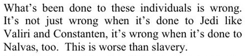
- **No single roster character (rules/setting/general)** — entry/section: Oden Malksch: "Even a man like Nalvas deserves better than that. Enslaved, he would never have any hope of redemption." Source: *414 - A Mon Alone* (SWRPG d20 Revised Core), p.25
  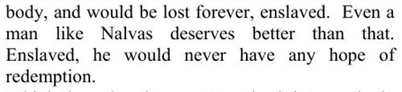

## p.26 (scan page 26)

Page contents: 856 words, 24 paragraphs | headings/entries: Examining the Bodies; A Mon Alone; Contacting Nirama (or others); Intermission; Page 26

## p.15–26 (scan page 15)

Page contents: E5 the lower fortress, the ritual chamber dark side site and the Sith spirit Darsin; E6 the drained bodies, Oden Malksch in Karae Nalvas's body (hand-read)

## p.27 (scan page 27)

Page contents: 865 words, 27 paragraphs | headings/entries: Encounter 7: Approach; A Mon Alone; The Combat; Approaching the Animiasma; Page 27

## p.28 (scan page 28)

Page contents: 843 words, 23 paragraphs | headings/entries: Encounter 8: Avoidance; A Mon Alone; Page 28

- **No single roster character (rules/setting/general)** — entry/section: Oden Malksch: "You come around an asteroid and Malksch points at the viewscreen. "There." You see nothing but the space between two asteroids. "It's there. I feel it."" Source: *414 - A Mon Alone* (SWRPG d20 Revised Core), p.28
  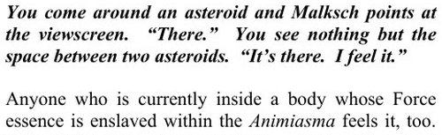

## p.29 (scan page 29)

Page contents: 888 words, 19 paragraphs | headings/entries: A Mon Alone; Encounter 9: Conflict; Page 29

## p.30 (scan page 30)

Page contents: 908 words, 21 paragraphs | headings/entries: A Mon Alone; Page 30

- **No single roster character (rules/setting/general)** — entry/section: Nikto guard: ""Children are too weak for hyperspace travel. I don't care what price they will fetch — I say we kill the lizard-brats now, and save ourselves the trouble of watching them!"" Source: *414 - A Mon Alone* (SWRPG d20 Revised Core), p.30
  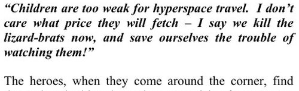

## p.31 (scan page 31)

Page contents: 1010 words, 11 paragraphs | headings/entries: A Mon Alone; Page 31

- **No single roster character (rules/setting/general)** — entry/section: K'Mi: ""Cute? I'm not cute. I'm dark and dangerous! Now, you gacked the guards. Let me out of here!"" Source: *414 - A Mon Alone* (SWRPG d20 Revised Core), p.31
  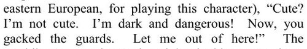

## p.32 (scan page 32)

Page contents: 977 words, 11 paragraphs | headings/entries: A Mon Alone; Page 32

## p.33 (scan page 33)

Page contents: 902 words, 20 paragraphs | headings/entries: Encounter 10: Valence; A Mon Alone; Ignore your foolish; Page 33

## p.34 (scan page 34)

Page contents: 912 words, 19 paragraphs | headings/entries: A Mon Alone; Page 34

- **No single roster character (rules/setting/general)** — entry/section: Darkstaff: "I need these essences to restore myself, just as I have used other essences to sustain myself. We all use others for our own ends. Even the noble Jedi are not innocent, in that regard." Source: *414 - A Mon Alone* (SWRPG d20 Revised Core), p.34
  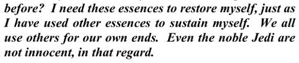
- **No single roster character (rules/setting/general)** — entry/section: Darkstaff: "A borrowed body? Then you're no better than I am, are you? You have enslaved another being to protect yourself. Hypocrisy. This reeks of Jedi." Source: *414 - A Mon Alone* (SWRPG d20 Revised Core), p.34
  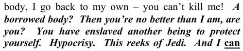
- **No single roster character (rules/setting/general)** — entry/section: Darkstaff: "You can't win. We have the Force on our side. You have a small part of the Force, the part that is yours. I have the Force from worlds. I have the Force from creatures so great, so powerful, that armies tried to hunt them down. I have the Force of the Sith. When I am done, I will have yours as well." Source: *414 - A Mon Alone* (SWRPG d20 Revised Core), p.34
  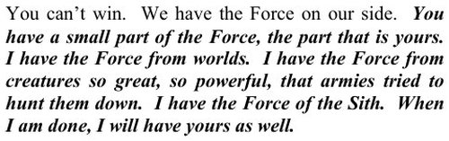
- **No single roster character (rules/setting/general)** — entry/section: Darkstaff: "So you admit that you destroyed the Oblee? Of course I did. I have nothing to hide. Lives end. I am powerful, so I have the right to choose when they end. The strong have always made such choices for the weak. Some are never destined to be more than slaves. It is the natural way of things." Source: *414 - A Mon Alone* (SWRPG d20 Revised Core), p.34
  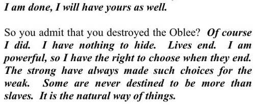
- **No single roster character (rules/setting/general)** — entry/section: Darkstaff: "You're insane. I am Sith. Insanity is nothing but a word invented by the weak to explain why the strong have power." Source: *414 - A Mon Alone* (SWRPG d20 Revised Core), p.34
  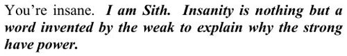
- **No single roster character (rules/setting/general)** — entry/section: Darkstaff: "Why are you doing this? Because I, like all living things, wish to be whole. Because Mon is greedy, and easily manipulated. Because I CAN." Source: *414 - A Mon Alone* (SWRPG d20 Revised Core), p.34
  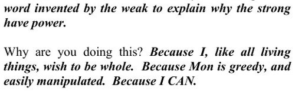

## p.35 (scan page 35)

Page contents: 889 words, 20 paragraphs | headings/entries: Encounter 11: Force; A Mon Alone; Opening the Door; Page 35

- **No single roster character (rules/setting/general)** — entry/section: Darkstaff: "So you're a coward. No. I know how to use my resources. Why exert myself killing you, when Mon and his menagerie will do it for me?" Source: *414 - A Mon Alone* (SWRPG d20 Revised Core), p.35
  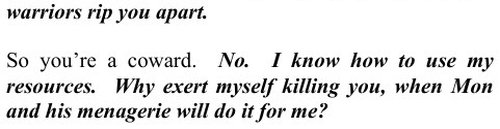

## p.36 (scan page 36)

Page contents: 890 words, 22 paragraphs | headings/entries: Mon's Greeting; A Mon Alone; Tactics, Round 1; Tactics, Round 2; Page 36

- **No single roster character (rules/setting/general)** — entry/section: Phylus Mon: ""I don't care — find it, it can't just disappear. It can't!"" Source: *414 - A Mon Alone* (SWRPG d20 Revised Core), p.36
  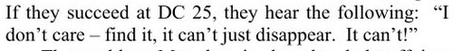
- **No single roster character (rules/setting/general)** — entry/section: Phylus Mon: "He looks up as you enter, regards you, and speaks in gruff Basic. "You have one chance to leave. Go now, or become mine."" Source: *414 - A Mon Alone* (SWRPG d20 Revised Core), p.36
  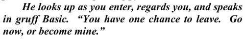

## p.37 (scan page 37)

Page contents: 930 words, 20 paragraphs | headings/entries: General Tactics; A Mon Alone; Page 37

- **No single roster character (rules/setting/general)** — entry/section: Mischa Vorfren: ""I want to be free. I want to kill him. I can't, because if I do, an explosive in my chest goes off and I die. Free me, and I'll help you!"" Source: *414 - A Mon Alone* (SWRPG d20 Revised Core), p.37
  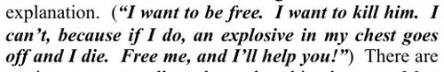
- **No single roster character (rules/setting/general)** — entry/section: Phylus Mon: ""Kill me, and all who are bound to me die as well. Even the lizardchildren I took from your jungle world."" Source: *414 - A Mon Alone* (SWRPG d20 Revised Core), p.37
  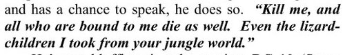

## p.38 (scan page 38)

Page contents: 955 words, 18 paragraphs | headings/entries: The Pyramid; A Mon Alone; Resolutions; Page 38

## p.39 (scan page 39)

Page contents: 763 words, 25 paragraphs | headings/entries: Destroying the Animiasma; Key Things Mon Knows; Conclusion; A Mon Alone; Phylus Mon; The Animiasma; Returning to Almas; Page 39

- **No single roster character (rules/setting/general)** — entry/section: Nirama: "All within the sound of my voice — this is Nirama. I have heard a rumor that the slaver Phylus Mon is in Cularin. Anyone who brings him to me will be rewarded. Handsomely. Alive or dead, I do not care." Source: *414 - A Mon Alone* (SWRPG d20 Revised Core), p.39
  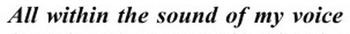

## p.40 (scan page 40)

Page contents: 749 words, 26 paragraphs | headings/entries: A Mon Alone; Here Ends, "A Mon Alone"; Experience Point Summary; Adventure Experience Award:; Loot Summary; Page 40

- **No single roster character (rules/setting/general)** — entry/section: Sa'Arli: ""You have stepped into a larger world, into a greater role. You are among the strongest, the smartest, the quickest of Cularin's citizens. This means you must protect them. From the things they know, from the things they don't know — and from the knowing itself." Source: *414 - A Mon Alone* (SWRPG d20 Revised Core), p.40
  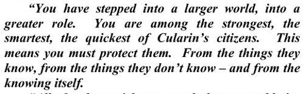
- **No single roster character (rules/setting/general)** — entry/section: Sa'Arli: ""I cannot give you a parade today. But Senator Wren asked that I give you these."" Source: *414 - A Mon Alone* (SWRPG d20 Revised Core), p.40
  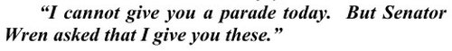

## p.41 (scan page 41)

Page contents: 616 words, 17 paragraphs | headings/entries: Encounter 9; A Mon Alone; Page 41

## p.26–41 (scan page 26)

Page contents: E7-E8 the Animiasma; E9 Mon's zoo; E10 the darkstaff speaks through Alianda; E11 Mon's throne room; conclusion, XP, loot (hand-read)

## p.42 (scan page 42)

Page contents: 94 words, 8 paragraphs | headings/entries: Player Handout 1: Preparation; Character Name Class(es); Non-standard Knowledge skills; Hero's ultimate life goal; A Mon Alone Page 42

## p.43 (scan page 43)

Page contents: 883 words, 9 paragraphs | headings/entries: Player Handout #2: Kaarror, the Wookiee; A Mon Alone Page 43

### Stat block notes (game mechanics, not feats)

- Kaarror: Kaarror: Male Wookiee Scoundrel 2/Scout 1/Soldier 5/Bounty Hunter 6; Def 19; VP/WP 112/14; vibro-axe +17/+12/+7 (2d8+7/19-20) (Source: *414 - A Mon Alone* (SWRPG d20 Revised Core), p.43)

## p.44 (scan page 44)

Page contents: 369 words, 9 paragraphs | headings/entries: A Mon Alone Page 44

## p.45 (scan page 45)

Page contents: 976 words, 8 paragraphs | headings/entries: Player Handout #3: Gorak, the Trandoshan; A Mon Alone Page 45

## p.46 (scan page 46)

Page contents: 420 words, 10 paragraphs | headings/entries: A Mon Alone Page 46

## p.47 (scan page 47)

Page contents: 929 words, 9 paragraphs | headings/entries: Player Handout #4: Nalz, the Spiner; A Mon Alone Page 47

## p.48 (scan page 48)

Page contents: 666 words, 10 paragraphs | headings/entries: A Mon Alone Page 48

### Stat block notes (game mechanics, not feats)

- Nalz: Nalz: Male Spiner Scoundrel 6/Scout 6/Bounty Hunter 2; Def 22; VP/WP 120/16; blaster rifle +14/+9 (3d8+2/19-20) (Source: *414 - A Mon Alone* (SWRPG d20 Revised Core), p.48)

## p.49 (scan page 49)

Page contents: 958 words, 8 paragraphs | headings/entries: Player Handout #5: Yerj, the Barabel; A Mon Alone Page 49

## p.50 (scan page 50)

Page contents: 361 words, 11 paragraphs | headings/entries: A Mon Alone Page 50

### Stat block notes (game mechanics, not feats)

- Yerj: Yerj: Male Barabel Soldier 2/Dark Side Marauder 4/Force Warrior 8; Def 24; VP/WP 199/14; unarmed +16/+11/+6 (3d4+3d6+4/17-20) (Source: *414 - A Mon Alone* (SWRPG d20 Revised Core), p.50)

## p.51 (scan page 51)

Page contents: 949 words, 10 paragraphs | headings/entries: A Mon Alone Page 51

## p.52 (scan page 52)

Page contents: 424 words, 11 paragraphs | headings/entries: A Mon Alone Page 52

### Stat block notes (game mechanics, not feats)

- Valiri: Valiri: Male Skrilling Jedi Guardian 12/Jedi Investigator 2; Def 21; VP/WP 118/12; lightsaber +20/+15/+10 (5d8+7/19-20) (Source: *414 - A Mon Alone* (SWRPG d20 Revised Core), p.52)

## p.53 (scan page 53)

Page contents: 934 words, 11 paragraphs | headings/entries: Player Handout #7: Constanten, Tarasin Jedi Knight; A Mon Alone Page 53

## p.54 (scan page 54)

Page contents: 425 words, 12 paragraphs | headings/entries: Force Feats: oF : :; A Mon Alone Page 54

### Stat block notes (game mechanics, not feats)

- Constanten: Constanten: Tarasin Jedi Guardian 13; Def 22; VP/WP 126/14; lightsaber +18/+13/+8 (4d8+1/18-20) (Source: *414 - A Mon Alone* (SWRPG d20 Revised Core), p.54)

## p.55 (scan page 55)

Page contents: 364 words, 9 paragraphs | headings/entries: A Mon Alone Page 55

## p.56 (scan page 56)

Page contents: 402 words, 8 paragraphs | headings/entries: A Mon Alone Page 56

- **No single roster character (rules/setting/general)** — entry/section: Sith warrior (via Kei Loo Bross): ""Lord j'Hien commands all escara jian. Many men fight for Lord j'Hien, kind Jedi meiyok ahndahl die. All Sith fight together under Lord j'Hien. Fighting apart many Sith die. Moving apart many Sith die. Please kind Jedi meiyok ahndahl die. Remove pain. All escara jian leave Sith. Remove pain and I serve Jedi loyally."" Source: *414 - A Mon Alone* (SWRPG d20 Revised Core), p.56
  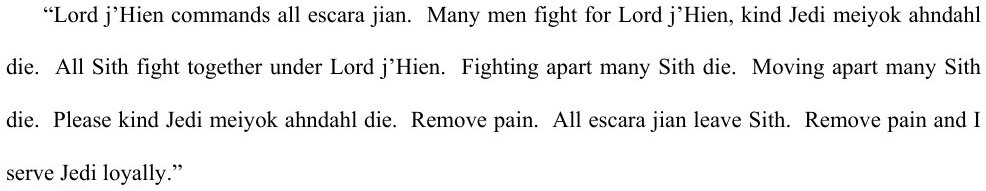

## p.42–69 (scan page 42)

Page contents: Player handouts (preparation card, six borrowed bodies, Sith Battlelords, Phylus Mon); GM Aids (maps, stat blocks); critical event summary (hand-read)

