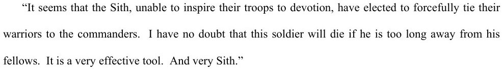
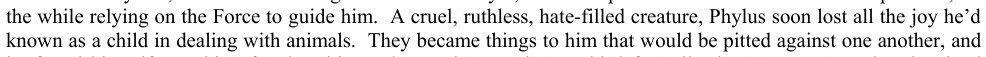
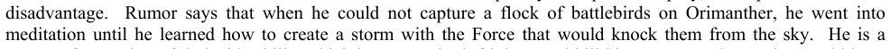
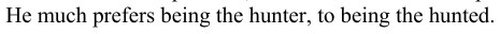

# Owner Material 037 — Star Wars D20 Drive folder (Core, Revised Core and Saga Edition): Living Force Campaign/Adventures/Among the Stars/Year 4/414 - A Mon Alone.pdf [Star Wars Roleplaying Game Revised Core (d20, 2002)] (scan pages 57–69)

- **Source:** Wizards of the Coast Star Wars Roleplaying Game books, web enhancements, Living Force campaign modules and articles (2000–2010), from the owner's "Star Wars D20" Drive folder (only the three edition subfolders; "General" was not read, as instructed). Secondary source (licensed Legends reference). Scan OCR'd on the box; the scan stays box-only and is **not** published.
- **Method:** every scanned page was OCR'd and machine-screened sentence by sentence for power-relevant statements (fights, kills, defeats, Force feats, rankings, superweapons) that name a character on our roster; each kept sentence is quoted verbatim from the OCR text and has a crop of the printed passage directly under it. Pages with nothing power-relevant are still listed with what is on them.
- **Citation:** "*414 - A Mon Alone* (SWRPG d20 Revised Core), p.X" by printed page ("scan p.X" where no printed number applies). **Weight:** Licensed RPG material: a secondary source. Narrative text sums up Legends lore; game statistics are rules for players, not canon power levels, and rank lowest.

## p.57 (scan page 57)

Page contents: 357 words, 7 paragraphs | headings/entries: A Mon Alone Page 57

- **No single roster character (rules/setting/general)** — entry/section: Kei Loo Bross: ""It seems that the Sith, unable to inspire their troops to devotion, have elected to forcefully tie their warriors to the commanders. I have no doubt that this soldier will die if he is too long away from his fellows. It is a very effective tool. And very Sith."" Source: *414 - A Mon Alone* (SWRPG d20 Revised Core), p.57
  

## p.58 (scan page 58)

Page contents: 671 words, 10 paragraphs | headings/entries: Player Handout #9: Phylus Mon; A Mon Alone Page 58

- **No single roster character (rules/setting/general)** — entry/section: Phylus Mon: "A cruel, ruthless, hate-filled creature, Phylus soon lost all the joy he'd known as a child in dealing with animals." Source: *414 - A Mon Alone* (SWRPG d20 Revised Core), p.58
  
- **No single roster character (rules/setting/general)** — entry/section: Phylus Mon: "Rumor says that when he could not capture a flock of battlebirds on Orimanther, he went into meditation until he learned how to create a storm with the Force that would knock them from the sky." Source: *414 - A Mon Alone* (SWRPG d20 Revised Core), p.58
  
- **No single roster character (rules/setting/general)** — entry/section: Phylus Mon: "He much prefers being the hunter, to being the hunted." Source: *414 - A Mon Alone* (SWRPG d20 Revised Core), p.58
  

## p.59 (scan page 59)

Page contents: 254 words, 14 paragraphs | headings/entries: SESSeee) SPassree; Pt ttt] tT tat tT Tt; Page 59; A Mon Alone

## p.60 (scan page 60)

Page contents: 25 words, 4 paragraphs | headings/entries: Meditation Charmber; Kitchen |; A Mon Alone Page 60

## p.61 (scan page 61)

Page contents: 25 words, 3 paragraphs | headings/entries: A Mon Alone Page 61

## p.62 (scan page 62)

Page contents: 692 words, 29 paragraphs | headings/entries: GM Aid #3: Stat Blocks; Encounter 3; Encounter 5; A Mon Alone Page 62

### Stat block notes (game mechanics, not feats)

- Darsin: Darsin: Human Dark Side Spirit Soldier 1/Dark Side Marauder 5/Dark Side Devotee 2/Sith Acolyte 4/Sith Warrior 4; Def 26; VP/WP 147/22; Affect Mind +21, Fear +21, Illusion +20; fast healing 3; Force travel; six animated lightsabers (WP 22, +14/+9/+4, 4d8+1) (Source: *414 - A Mon Alone* (SWRPG d20 Revised Core), p.62)
- Maddened Gundarks: Maddened Male Gundarks (3): Predator 7; Def 19; VP/WP 132/20; 4 punches +16/+11 (1d6+5) (Source: *414 - A Mon Alone* (SWRPG d20 Revised Core), p.62)

## p.63 (scan page 63)

Page contents: 613 words, 22 paragraphs | headings/entries: Encounter 6; Encounter 7; Encounter 9; A Mon Alone Page 63

### Stat block notes (game mechanics, not feats)

- Oden Malksch/Karae Nalvas: Oden Malksch/Karae Nalvas: Jedi Consular 8/Jedi Investigator 2/Dark Side Marauder 4; Def 21; VP/WP 120/14; lightsaber +15/+10/+5 (4d8+5/18-20); FP 12 (2); DSP 0 (10) (Source: *414 - A Mon Alone* (SWRPG d20 Revised Core), p.63)
- Gluss'sa'Nikto Guards: Gluss'sa'Nikto Guards (4): Soldier 12; Def 24; VP/WP 128/19; vibroblade +15/+10/+5 (2d6+4), blaster rifle +17/+12/+7 (3d8/18-20); SQ Really ugly (Source: *414 - A Mon Alone* (SWRPG d20 Revised Core), p.63)

## p.64 (scan page 64)

Page contents: 701 words, 22 paragraphs | headings/entries: Encounter 12; A Mon Alone Page 64

### Stat block notes (game mechanics, not feats)

- Phylus Mon: Phylus Mon: Dark Side Male Chevin Force Adept 8/Dark Side Devotee 10; Def 24 (25); VP/WP 191/20 (191/22); 3-tailed barbed whip +12/+7/+2 (3d4+1); Force Weapon +3d8; DR 2 (toughened hide); FP 2; DSP 20; Rep 4; Drain Energy +19, Fear +21, Force Grip +21, Force Lightning +12 (Source: *414 - A Mon Alone* (SWRPG d20 Revised Core), p.64)
- Ku-Kak: Ku-Kak: Dark Side Male Wampa Predator 3/Soldier 3/Dark Side Marauder 10; Def 28 (29); VP/WP 250/26 (250/28); Sith sword +23/+18/+13/+8 (2d6+10/18-20); powered and buffed +30/+25/+20/+15 (6d6+15/18-20); FP 9; DSP 12 (Source: *414 - A Mon Alone* (SWRPG d20 Revised Core), p.64)
- Niv, Tosh and Drik: Niv, Tosh and Drik: Tainted Male Chev Force Adept 7; Def 16 (17); VP/WP 64/16 (64/18); Force Mind; Illusion +14, Force Strike +12 (Source: *414 - A Mon Alone* (SWRPG d20 Revised Core), p.64)

## p.65 (scan page 65)

Page contents: 875 words, 19 paragraphs | headings/entries: A Mon Alone Page 65

### Stat block notes (game mechanics, not feats)

- Mischa Vorfren: Mischa Vorfren: Male Anzat Soldier 8/Dark Side Marauder 6; Def 23 (24); VP/WP 135/14 (135/16); unarmed +20/+15/+10 (3d4+7), lightsaber +19/+14/+9 (2d8+5); Hypnosis, Proboscises; FP 3; DSP 4; Rep 7 (Source: *414 - A Mon Alone* (SWRPG d20 Revised Core), p.65)

## p.66 (scan page 66)

Page contents: 813 words, 15 paragraphs | headings/entries: A Mon Alone Page 66

### Stat block notes (game mechanics, not feats)

- Ke Len: Ke Len: Female Blood Carver Scoundrel 6/Soldier 4/Bounty Hunter 5; Def 24 (25); VP/WP 123/14 (123/16); Sneak Attack +5d6; FP 3; DSP 3; Rep 6 (Source: *414 - A Mon Alone* (SWRPG d20 Revised Core), p.66)

## p.67 (scan page 67)

Page contents: 57 words, 3 paragraphs | headings/entries: GM Aid #4: Map of the Zoo; A Mon Alone Page 67

## p.68 (scan page 68)

Page contents: 64 words, 8 paragraphs | headings/entries: A Mon Alone; Page 68

## p.69 (scan page 69)

Page contents: 125 words, 11 paragraphs | headings/entries: Critical Event Summary A MmAIlme; Q Killed Q Captured Q Escaped; Hero name, player name, player RPGA #; A Mon Alone Page 69

