# Owner Material 037 — Star Wars D20 Drive folder (Core, Revised Core and Saga Edition): Living Force Campaign/Adventures/Among the Stars/Year 4/415 - Hunting the Wyrd.pdf [Star Wars Roleplaying Game Revised Core (d20, 2002)]

- **Source:** Wizards of the Coast Star Wars Roleplaying Game books, web enhancements, Living Force campaign modules and articles (2000–2010), from the owner's "Star Wars D20" Drive folder (only the three edition subfolders; "General" was not read, as instructed). Secondary source (licensed Legends reference). Scan OCR'd on the box; the scan stays box-only and is **not** published.
- **Method:** every scanned page was OCR'd and machine-screened sentence by sentence for power-relevant statements (fights, kills, defeats, Force feats, rankings, superweapons) that name a character on our roster; each kept sentence is quoted verbatim from the OCR text and has a crop of the printed passage directly under it. Pages with nothing power-relevant are still listed with what is on them.
- **Citation:** "*415 - Hunting the Wyrd* (SWRPG d20 Revised Core), p.X" by printed page ("scan p.X" where no printed number applies). **Weight:** Licensed RPG material: a secondary source. Narrative text sums up Legends lore; game statistics are rules for players, not canon power levels, and rank lowest.

## p.1 (scan page 1)

Page contents: 204 words, 7 paragraphs | headings/entries: LFA415; Hunting the Wyrd; A One-Round LIVING FORCE Tournament; Edited by Ron and Margaret Heintz

- **No single roster character (rules/setting/general)** — entry/section: Blurb: "The Wyrd, the Tarasin Force-users who turned to the Dark Side and who have perverted the powers of nature to help them defeat their opponents, have become an increasing problem." Source: *415 - Hunting the Wyrd* (SWRPG d20 Revised Core), p.1
  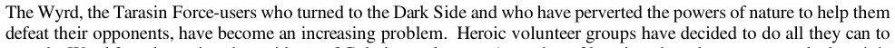
- **No single roster character (rules/setting/general)** — entry/section: Blurb: "The heroes of Cularin must decide — is the element of surprise worth the risk of facing the Wyrd on their home turf?" Source: *415 - Hunting the Wyrd* (SWRPG d20 Revised Core), p.1
  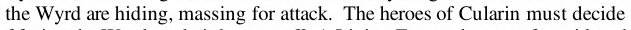

## p.2 (scan page 2)

Page contents: 946 words, 21 paragraphs | headings/entries: House Rules; Atoning for Dark Side Points; Dissipate Energy; Illusion; Hunting the Wyrd; Stun; Hero Earnings; Page 2

## p.3 (scan page 3)

Page contents: 943 words, 24 paragraphs | headings/entries: General Notes to the GM; Hunting the Wyrd; GM Overview; Page 3

- **No single roster character (rules/setting/general)** — entry/section: GM Overview: "Wyrd. Just the word strikes fear into every Tarasin on Cularin. Parents have terrified their children with stories of the Wyrd taking bad little Tarasin who don't listen away into the jungle. While some of this is fiction, some of it is real." Source: *415 - Hunting the Wyrd* (SWRPG d20 Revised Core), p.3
  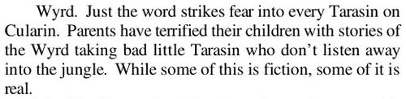
- **No single roster character (rules/setting/general)** — entry/section: GM Overview: "Mother Dariana has been approached because she is perhaps the wisest Tarasin on Cularin, and her older sister is a member of the Wyrd. She knows more about the Wyrd than any other non-Wyrd being." Source: *415 - Hunting the Wyrd* (SWRPG d20 Revised Core), p.3
  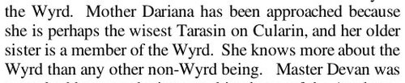

## p.4 (scan page 4)

Page contents: 870 words, 30 paragraphs | headings/entries: Encounter 2: The Lost Six; Encounter 4: Thaereians ... Here?; Encounter 6: Shadow Irstat; Hunting the Wyrd; Opening Crawl; Page 4

- **No single roster character (rules/setting/general)** — entry/section: Opening Crawl: "Darkness is rising all over Cularin. It's inky tendrils wrapping around the light, seeking to extinguish it. War has finally come to the system, a war with many enemies, each with their own agenda." Source: *415 - Hunting the Wyrd* (SWRPG d20 Revised Core), p.4
  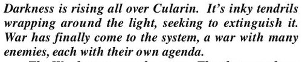
- **No single roster character (rules/setting/general)** — entry/section: Opening Crawl: "The Wyrd are one such enemy. They have not been seen often. But when they have been, their wrath has been terrible." Source: *415 - Hunting the Wyrd* (SWRPG d20 Revised Core), p.4
  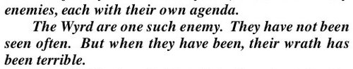

## p.1–4 (scan page 1)

Page contents: Title, blurb, house rules, DSP guidance, GM overview of the Wyrd and the Militia plan, encounter summaries, judges' notes, opening crawl (hand-read)

## p.5 (scan page 5)

Page contents: 896 words, 27 paragraphs | headings/entries: Encounter 1: Jungle Drop; Hunting the Wyrd; Page 5

- **No single roster character (rules/setting/general)** — entry/section: Major Xirossk: ""The mission is simple. We want you to search the jungle for Wyrd enclaves and bases. Then destroy them. They have become too active and dangerous for Cularin to ignore any longer." Source: *415 - Hunting the Wyrd* (SWRPG d20 Revised Core), p.5
  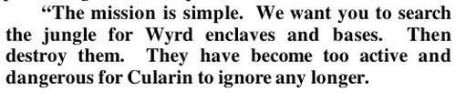
- **No single roster character (rules/setting/general)** — entry/section: Major Xirossk: "Though the Wyrd started off as a group that seemingly just wanted Cularin for Tarasin alone, the Mothers tell me that the Wyrd's long association with what the Jedi call the Dark Side of the Force has turned them into something vile. Now, they would be just as happy if all Tarasin who did not follow their ways were exterminated, too." Source: *415 - Hunting the Wyrd* (SWRPG d20 Revised Core), p.5
  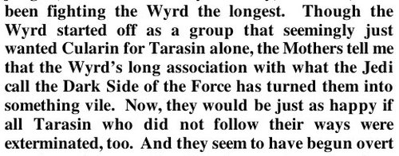
- **No single roster character (rules/setting/general)** — entry/section: Major Xirossk: ""The ranks before me are filled with those, as well, who simply wish to fight for the survival of Cularin. Heroes, many of you, who have proven your bravery over and over. Your actions have not gone unnoticed or been forgotten." Source: *415 - Hunting the Wyrd* (SWRPG d20 Revised Core), p.5
  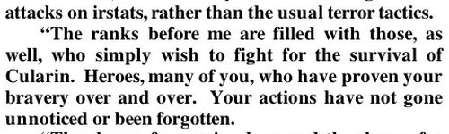
- **No single roster character (rules/setting/general)** — entry/section: Major Xirossk: ""And so it is left to you. I will not hide from you — or lie to you about - the danger of this mission. But it is vital."" Source: *415 - Hunting the Wyrd* (SWRPG d20 Revised Core), p.5
  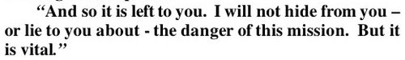

## p.6 (scan page 6)

Page contents: 825 words, 31 paragraphs | headings/entries: Hunting the Wyrd; The speeder begins to decelerate. "Ten seconds."; Page 6

- **No single roster character (rules/setting/general)** — entry/section: Major Xirossk: ""Understand this: you must choose wisely on engaging the Wyrd. Should they find you, they will show no mercy. None. That is their way." Source: *415 - Hunting the Wyrd* (SWRPG d20 Revised Core), p.6
  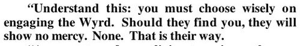
- **No single roster character (rules/setting/general)** — entry/section: Major Xirossk: ""A report to us from a living team is worth more than a report that you were found, dead. If the Wyrd you find are too tough to handle, there is no shame in a strategic retreat. Choose your battles wisely." Source: *415 - Hunting the Wyrd* (SWRPG d20 Revised Core), p.6
  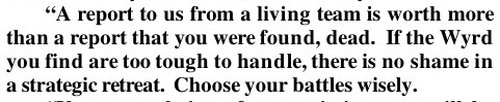
- **No single roster character (rules/setting/general)** — entry/section: Militia pilot: ""Good luck, Saber Six. May the Force be with you," crackles the pilots voice over your headsets as the speeder accelerates away from your position." Source: *415 - Hunting the Wyrd* (SWRPG d20 Revised Core), p.6
  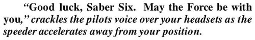

## p.7 (scan page 7)

Page contents: 938 words, 29 paragraphs | headings/entries: Hunting the Wyrd; Encounter 2: The Lost Six; Page 7

- **No single roster character (rules/setting/general)** — entry/section: Major Xirossk: ""Sabre Eight, this is Sabre Hilt. Respond, over." You recognize the somber voice of Major Xirossk. "Saber Eight, this is Saber Hilt. Respond."" Source: *415 - Hunting the Wyrd* (SWRPG d20 Revised Core), p.7
  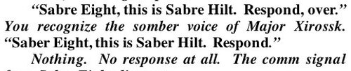

## p.8 (scan page 8)

Page contents: 964 words, 20 paragraphs | headings/entries: Hunting the Wyrd; Page 8

## p.9 (scan page 9)

Page contents: 837 words, 32 paragraphs | headings/entries: What Tanora knows:; Hunting the Wyrd; Encounter 3: Ambush; Crying. An; Page 9

- **No single roster character (rules/setting/general)** — entry/section: Tanora: "They — the Wyrd — looked like no other Tarasin she had ever seen. Their scales were very dark. They seemed to swallow light. They also laughed and seemed to enjoy the pain they were causing." Source: *415 - Hunting the Wyrd* (SWRPG d20 Revised Core), p.9
  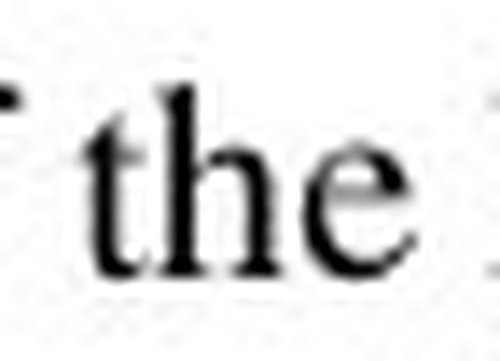

## p.10 (scan page 10)

Page contents: 945 words, 30 paragraphs | headings/entries: Hunting the Wyrd; Encounter 4: Thaereians ... Here?; Page 10

## p.11 (scan page 11)

Page contents: 923 words, 30 paragraphs | headings/entries: Examining the Bothan reveals the following:; Hunting the Wyrd; Page 11

- **No single roster character (rules/setting/general)** — entry/section: GM Note: "This group was inserted by the Thaereian military, to contact the Wyrd and offer them support in return for fomenting insurrection and rebellion. Unfortunately, the Wyrd do not play well with others." Source: *415 - Hunting the Wyrd* (SWRPG d20 Revised Core), p.11
  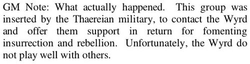

## p.5–11 (scan page 5)

Page contents: E1 the drop and Xirossk's briefing; E2 Sabre Eight's last call and Tanora; E3 the infant ambush; E4 the kilassin and the Thaereian mercenaries' recording (hand-read)

## p.12 (scan page 12)

Page contents: 918 words, 28 paragraphs | headings/entries: Encounter 5: Irstat Under Attack; Hunting the Wyrd; Page 12

## p.13 (scan page 13)

Page contents: 893 words, 29 paragraphs | headings/entries: Hunting the Wyrd; Encounter 6: Shadow Irstat; Page 13

- **No single roster character (rules/setting/general)** — entry/section: Rinajaa villagers: "The Wyrd sisters, and their human guardian, then proceeded to kill several villagers while a floating Mother watched. Then one of the Wyrd killed Mother without touching her." Source: *415 - Hunting the Wyrd* (SWRPG d20 Revised Core), p.13
  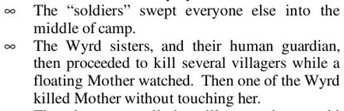
- **No single roster character (rules/setting/general)** — entry/section: Rinajaa villagers: "The evil that can in the night will forever stain this place and only fire can release the spirits to rest forever in the light." Source: *415 - Hunting the Wyrd* (SWRPG d20 Revised Core), p.13
  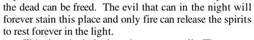
- **No single roster character (rules/setting/general)** — entry/section: Mother Kimania: "If the heroes saved the Wyrd's lives, they see a faint, glowing irstat Mother in the flickering flames of her hut. She smiles at the heroes and nods before fading from sight." Source: *415 - Hunting the Wyrd* (SWRPG d20 Revised Core), p.13
  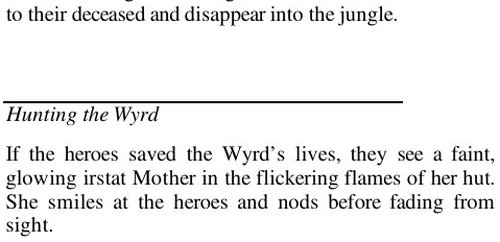

## p.14 (scan page 14)

Page contents: 896 words, 28 paragraphs | headings/entries: Hunting the Wyrd; Encounter 7: A Wyrd Place to Be; Page 14

- **No single roster character (rules/setting/general)** — entry/section: Encounter 6: "The place radiates the Dark Side. They could feel it without using any skills; seeing it through See Force is truly disturbing. There is nothing around the heroes not touched by the Dark Side. A place of evil this is." Source: *415 - Hunting the Wyrd* (SWRPG d20 Revised Core), p.14
  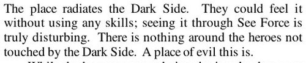
- **No single roster character (rules/setting/general)** — entry/section: Encounter 6: "Welcome to Zhadorii irstat. The Shadow Village." Source: *415 - Hunting the Wyrd* (SWRPG d20 Revised Core), p.14
  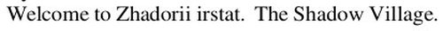
- **No single roster character (rules/setting/general)** — entry/section: Encounter 7: "Through the foliage, you scan the place you have sought. An... irstat? ... of Wyrd. A place that radiates such evil you don't need to be a Jedi, Force Adept or even Force sensitive to feel it." Source: *415 - Hunting the Wyrd* (SWRPG d20 Revised Core), p.14
  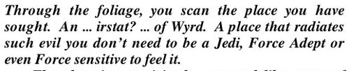

## p.15 (scan page 15)

Page contents: 956 words, 25 paragraphs | headings/entries: Hunting the Wyrd; Page 15

- **No single roster character (rules/setting/general)** — entry/section: Encounter 7: "The remaining Tarasin are slaves at best. A herd of nerfs is more akin to what they are." Source: *415 - Hunting the Wyrd* (SWRPG d20 Revised Core), p.15
  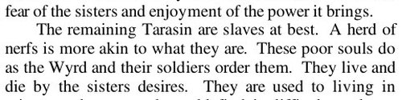

## p.16 (scan page 16)

Page contents: 1041 words, 21 paragraphs | headings/entries: Hunting the Wyrd; Page 16

- **No single roster character (rules/setting/general)** — entry/section: Encounter 7: "A small Tarasin child, around three or so, runs out of the hut. A Wyrd sister steps out of the dwelling and gestures. The child freezes and rises off the dirt." Source: *415 - Hunting the Wyrd* (SWRPG d20 Revised Core), p.16
  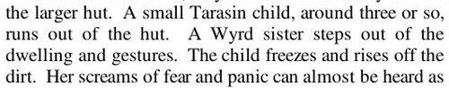

## p.17 (scan page 17)

Page contents: 789 words, 37 paragraphs | headings/entries: Conclusion; Hunting the Wyrd; Here Ends, "Hunting the Wyrd"; Experience Point Summary; Page 17

- **No single roster character (rules/setting/general)** — entry/section: Militia soldier: ""Major Xirossk sends his compliments and congratulations and wishes for you to return to HQ immediately for a debrief, sirs (and ma'ams)."" Source: *415 - Hunting the Wyrd* (SWRPG d20 Revised Core), p.17
  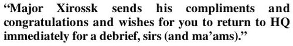
- **No single roster character (rules/setting/general)** — entry/section: Major Xirossk: ""Excellent job. Come, we have much to talk about."" Source: *415 - Hunting the Wyrd* (SWRPG d20 Revised Core), p.17
  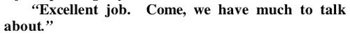
- **No single roster character (rules/setting/general)** — entry/section: Major Xirossk: ""A job well done. It's good to know that you folk have judgment and know when to call in. Please, we have much to talk about."" Source: *415 - Hunting the Wyrd* (SWRPG d20 Revised Core), p.17
  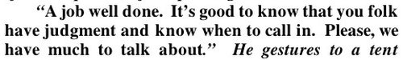
- **No single roster character (rules/setting/general)** — entry/section: Major Xirossk: ""Perhaps I am being too optimistic, but they're on the run, now. If the Tarasin and we keep up the pressure, they may never recover--" Source: *415 - Hunting the Wyrd* (SWRPG d20 Revised Core), p.17
  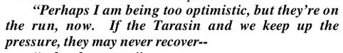

## p.12–17 (scan page 12)

Page contents: E5 the Rinajaa irstat and the burning; E6 the approach to Zhadorii irstat; E7 the airstrike and the command hut; conclusion (hand-read)

## p.18 (scan page 18)

Page contents: 294 words, 11 paragraphs | headings/entries: Loot Summary; Hunting the Wyrd; Page 18

## p.19 (scan page 19)

Page contents: 143 words, 11 paragraphs | headings/entries: Player Handout 1: Why am I here?; Hunting the Wyrd Page 19

- **No single roster character (rules/setting/general)** — entry/section: Player Handout 1: "Heroes who have played through From the Trees: come on, you get to shoot the Wyrd." Source: *415 - Hunting the Wyrd* (SWRPG d20 Revised Core), p.19
  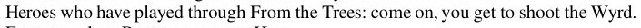
- **No single roster character (rules/setting/general)** — entry/section: Player Handout 1: "Please come up with some reason why your hero would not want a bunch of Dark Sider Tarasin sociopaths to take over Cularin. Thank you." Source: *415 - Hunting the Wyrd* (SWRPG d20 Revised Core), p.19
  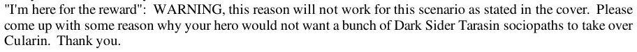

## p.20 (scan page 20)

Page contents: 398 words, 8 paragraphs | headings/entries: Hunting the Wyrd Page 20

## p.21 (scan page 21)

Page contents: 508 words, 21 paragraphs | headings/entries: GM Aid #1: NPCs; Generic Wyrd Hunters; Generic Wyrd Sisters Mid-Level (4'"-6"" level heroes); Upper-Level (7""-9" level heroes); Hunting the Wyrd Page 21

## p.22 (scan page 22)

Page contents: 407 words, 19 paragraphs | headings/entries: High-Level (10'"-12" level heroes); Skills: Listen +4, Spot +4, Survival +2; Feats: Cleave, Power Attack, Track; Upper-Level (10""-12" level heroes); Skills: Listen +5, Spot +5, Survival +3; Feats: Cleave, Power Attack, Track; Force Feats: Force Sensitive, Sense; Hunting the Wyrd Page 22

### Stat block notes (game mechanics, not feats)

- Force-using Kilassin: Kilassin (upper tier): Force-using Predator 5; Def 16; VP/WP 64/18; claws +9/+9 (1d6+6); Enhance Ability +8, Fear +4 to +7 (Source: *415 - Hunting the Wyrd* (SWRPG d20 Revised Core), p.22)

## p.23 (scan page 23)

Page contents: 557 words, 18 paragraphs | headings/entries: Hunting the Wyrd Page 23

### Stat block notes (game mechanics, not feats)

- Naelora: Naelora: Female Tarasin Force Adept 3/Dark Side Devotee 1/Force Witch 2; Def 20; VP/WP 50/15; FP 2; DSP 9; Force Lightning +15, Affect Mind +13 (Source: *415 - Hunting the Wyrd* (SWRPG d20 Revised Core), p.23)

## p.24 (scan page 24)

Page contents: 594 words, 17 paragraphs | headings/entries: Hunting the Wyrd Page 24

### Stat block notes (game mechanics, not feats)

- Torunin: Torunin: Female Tarasin Force Adept 3/Dark Side Devotee 2/Force Witch 4; Def 21; VP/WP 82/16; FP 4; DSP 14; Affect Mind +19, Force Lightning +18 (Source: *415 - Hunting the Wyrd* (SWRPG d20 Revised Core), p.24)

## p.25 (scan page 25)

Page contents: 615 words, 18 paragraphs | headings/entries: Upper-Level (10'"-12" level heroes); Hunting the Wyrd Page 25

### Stat block notes (game mechanics, not feats)

- Baeshana: Baeshana: Female Tarasin Force Adept 3/Dark Side Devotee 2/Force Witch 7; Def 23; VP/WP 109/16; FP 6; DSP 19; Affect Mind +22, Force Lightning +21, Friendship +19, Illusion +18; Enshroud, Force flight (10m) (Source: *415 - Hunting the Wyrd* (SWRPG d20 Revised Core), p.25)
- Veshin: Veshin: Female Tarasin Soldier 4/Bodyguard 7; Def 22 (24); VP/WP 111/14; masterwork vibrodaggers +14/+9 or +12/+12/+7 (2d4+2) (Source: *415 - Hunting the Wyrd* (SWRPG d20 Revised Core), p.25)

## p.26 (scan page 26)

Page contents: 511 words, 11 paragraphs | headings/entries: GM Aid #2: Talon Raal; Hunting the Wyrd Page 26

### Stat block notes (game mechanics, not feats)

- Talon Raal: Talon Raal: Female Human Scout 2/Soldier 2 (mid), Scout 5/Soldier 2 (high), Scout 6/Soldier 4 (upper); VP/WP 34/12, 55/12, 80/12; blaster carbine 3d8/19-20 (Source: *415 - Hunting the Wyrd* (SWRPG d20 Revised Core), p.26)

## p.27 (scan page 27)

Page contents: 362 words, 11 paragraphs | headings/entries: GM Aid #3: Major Xirossk's Q&A Session; Hunting the Wyrd Page 27

- **No single roster character (rules/setting/general)** — entry/section: Major Xirossk: "A: *Hrmph* We shall see. You need to concentrate more on the mission at hand right now." Source: *415 - Hunting the Wyrd* (SWRPG d20 Revised Core), p.27
  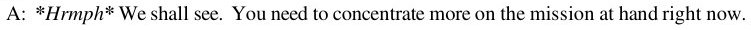

## p.28 (scan page 28)

Page contents: 292 words, 10 paragraphs | headings/entries: Hunting the Wyrd Page 28

## p.17–28 (scan page 17)

Page contents: XP, loot, player handouts, GM Aids (Wyrd and kilassin stats, the three Wyrd leaders and their bodyguards, Talon Raal, Xirossk's Q&A, loot columns) (hand-read)

