# Owner Material 037 — Star Wars D20 Drive folder (Core, Revised Core and Saga Edition): Living Force Campaign/Adventures/Among the Stars/Year 4/416 - Decisions - Decision Almas.pdf [Star Wars Roleplaying Game Revised Core (d20, 2002)]

- **Source:** Wizards of the Coast Star Wars Roleplaying Game books, web enhancements, Living Force campaign modules and articles (2000–2010), from the owner's "Star Wars D20" Drive folder (only the three edition subfolders; "General" was not read, as instructed). Secondary source (licensed Legends reference). Scan OCR'd on the box; the scan stays box-only and is **not** published.
- **Method:** every scanned page was OCR'd and machine-screened sentence by sentence for power-relevant statements (fights, kills, defeats, Force feats, rankings, superweapons) that name a character on our roster; each kept sentence is quoted verbatim from the OCR text and has a crop of the printed passage directly under it. Pages with nothing power-relevant are still listed with what is on them.
- **Citation:** "*416 - Decisions - Decision Almas* (SWRPG d20 Revised Core), p.X" by printed page ("scan p.X" where no printed number applies). **Weight:** Licensed RPG material: a secondary source. Narrative text sums up Legends lore; game statistics are rules for players, not canon power levels, and rank lowest.

## p.1 (scan page 1)

Page contents: 225 words, 9 paragraphs | headings/entries: LFA416; Decision: Almas; Edited by Margaret Heintz

- **No single roster character (rules/setting/general)** — entry/section: Blurb: "It has become increasingly clear that dark forces, both Force Sensitive and not, seek to discredit or destroy the Jedi of Almas. Moreover, the Almas Academy's nonstandard philosophy has continuously been called into question." Source: *416 - Decisions - Decision Almas* (SWRPG d20 Revised Core), p.1
  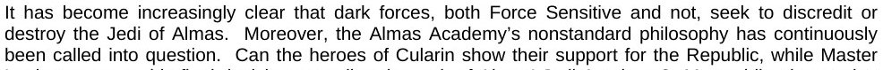

## p.2 (scan page 2)

Page contents: 821 words, 21 paragraphs | headings/entries: House Rules; Atoning for Dark Side Points; Dissipate Energy; Decision: Almas; Illusion; Stun; Hero Earnings; Issuing Force and Dark Side Points; Page 2

## p.3 (scan page 3)

Page contents: 867 words, 27 paragraphs | headings/entries: Decision: Almas; General Notes to the GM; GM Overview; Page 3

## p.4 (scan page 4)

Page contents: 771 words, 24 paragraphs | headings/entries: Encounter 1: Mission: Clone Wars; Encounter 2: Transit; Encounter 3: Digression Aggression; Encounter 4: Would You Believe It?; Encounter 5: Strike Force Cularin; Encounter 6: The Almas Decision; Decision: Almas; Opening Crawl; Encounter 1: Mission: Clone Wars; Page 4

- **No single roster character (rules/setting/general)** — entry/section: Opening Crawl: "It is a time of conflict and strife in the galaxy. The Republic Army, aided by the Jedi Knights, is inexorably driving back the Separatist Forces, and some feel that the end of the Clone Wars is in sight." Source: *416 - Decisions - Decision Almas* (SWRPG d20 Revised Core), p.4
  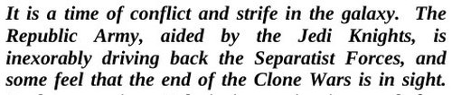
- **No single roster character (rules/setting/general)** — entry/section: Opening Crawl: "Now, Cularin's heroes prepare to demonstrate their system's loyalty to the Republic." Source: *416 - Decisions - Decision Almas* (SWRPG d20 Revised Core), p.4
  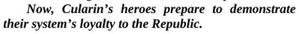

## p.1–4 (scan page 1)

Page contents: Title, blurb, house rules, DSP guidance, GM overview, encounter summaries, timing notes, opening crawl (hand-read)

## p.5 (scan page 5)

Page contents: 877 words, 21 paragraphs | headings/entries: Decision: Almas; Page 5

- **No single roster character (rules/setting/general)** — entry/section: Osten Dal'Nay: ""For once, we should have the upper hand in numbers and equipment."" Source: *416 - Decisions - Decision Almas* (SWRPG d20 Revised Core), p.5
  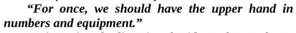
- **No single roster character (rules/setting/general)** — entry/section: Senator Wren: ""Strike Force Cularin will become part of this mission at my request. It will consist of two companies of ground troops, one squadron of fighter pilots to augment the Republic's flight, and some mission specialists of my acquaintance."" Source: *416 - Decisions - Decision Almas* (SWRPG d20 Revised Core), p.5
  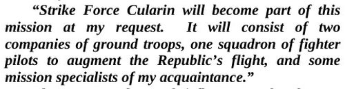
- **No single roster character (rules/setting/general)** — entry/section: Senator Wren: "It is my hope that it will be clearly demonstrated to the Republic that Cularin is completely loyal, and that an enfranchised, self-governed Cularin is ready to take its place in the Galactic Senate as a valued ally." Source: *416 - Decisions - Decision Almas* (SWRPG d20 Revised Core), p.5
  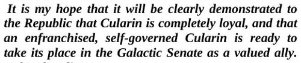
- **No single roster character (rules/setting/general)** — entry/section: Colonel Ardine: ""Members of the Cularin Militia, and 'specialists'. I'm going to be frank, too, and I'm probably going to be saying some things you won't like to hear." Source: *416 - Decisions - Decision Almas* (SWRPG d20 Revised Core), p.5
  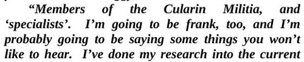

## p.6 (scan page 6)

Page contents: 885 words, 21 paragraphs | headings/entries: Decision: Almas; Encounter 2: Transit; Page 6

- **No single roster character (rules/setting/general)** — entry/section: Master Lanius: ""This is a critical time for the academy. We have been criticized and attacked from many quarters. Now, the fact that we have restricted our activities mainly to the Cularin system and have primarily been supporting the new government, is being touted as evidence that we are too insular, if not actually disloyal to the Republic."" Source: *416 - Decisions - Decision Almas* (SWRPG d20 Revised Core), p.6
  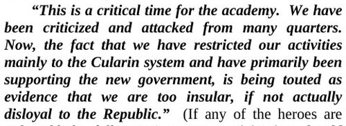
- **No single roster character (rules/setting/general)** — entry/section: Night Wren: ""Mother tells me that you may have to go on a mission with Colonel Rast'tul. I can't think of anyone else that I'd rather have along with dear 'Uncle Colonel', to make sure that he's looked after properly." Source: *416 - Decisions - Decision Almas* (SWRPG d20 Revised Core), p.6
  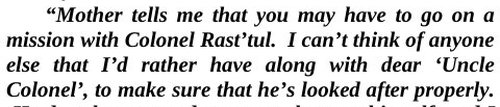

## p.7 (scan page 7)

Page contents: 821 words, 26 paragraphs | headings/entries: Decision: Almas; Page 7

- **No single roster character (rules/setting/general)** — entry/section: Biko: ""Hoy-o, out there. We go hunt Separatists, eh? Guess what? Biko got big guns now! This Militia thing is zooti!"" Source: *416 - Decisions - Decision Almas* (SWRPG d20 Revised Core), p.7
  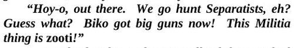
- **No single roster character (rules/setting/general)** — entry/section: Colonel Rast'tul: ""I thank the fates that I have the opportunity to have such fine people as yourselves serve under me. You may be sure that I have forgotten nothing of your illustrious actions to date." Source: *416 - Decisions - Decision Almas* (SWRPG d20 Revised Core), p.7
  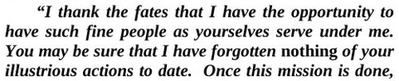
- **No single roster character (rules/setting/general)** — entry/section: Colonel Rast'tul: ""Try not to run us into anything, hmm?"" Source: *416 - Decisions - Decision Almas* (SWRPG d20 Revised Core), p.7
  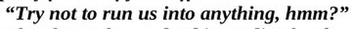

## p.8 (scan page 8)

Page contents: 853 words, 27 paragraphs | headings/entries: Decision: Almas; Page 8

- **No single roster character (rules/setting/general)** — entry/section: Lieutenant Marko: ""Too late, too late, you Cularite scum!" crows Lieutenant Marko." Source: *416 - Decisions - Decision Almas* (SWRPG d20 Revised Core), p.8
  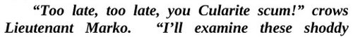
- **No single roster character (rules/setting/general)** — entry/section: Lieutenant Marko: ""Just a moment, ensign, if you please! Just you keep your sensors focused on these criminal vermin, and not that—oh, spirits of the VOID!"" Source: *416 - Decisions - Decision Almas* (SWRPG d20 Revised Core), p.8
  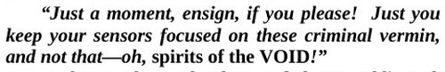
- **No single roster character (rules/setting/general)** — entry/section: Captain Meeba: ""What in the name of my Aunt Sadie's armored underdrawers are you misbegotten idiots doing blocking my ships? "" Source: *416 - Decisions - Decision Almas* (SWRPG d20 Revised Core), p.8
  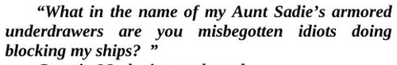

## p.9 (scan page 9)

Page contents: 743 words, 17 paragraphs | headings/entries: Encounter 3: Digression Aggression; Decision: Almas; Page 9

## p.4–9 (scan page 4)

Page contents: E1 the capitol briefing and Night's holo message; E2 the hails from Teeloo and Biko, Rast'tul's comm, Lieutenant Marko's blockade (hand-read)

## p.10 (scan page 10)

Page contents: 859 words, 19 paragraphs | headings/entries: Decision: Almas; Encounter 4: Would You Believe It?; The actual survivors aboard the Separatist cruiser; Page 10

## p.11 (scan page 11)

Page contents: 934 words, 14 paragraphs | headings/entries: Decision: Almas; Suggested sequence of events:; Page 11

- **No single roster character (rules/setting/general)** — entry/section: Political Background: "The Wyrd have little actual use for the Believers, other than as potential allies against the Jedi. When the Wyrd come to power on Cularin, they intend to discard the Believers along with all other offworlders." Source: *416 - Decisions - Decision Almas* (SWRPG d20 Revised Core), p.11
  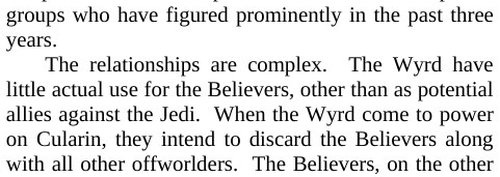
- **No single roster character (rules/setting/general)** — entry/section: Political Background: "That plan is moving exactly as foreseen by a dark, brooding presence located far away from either here or the Cularin system." Source: *416 - Decisions - Decision Almas* (SWRPG d20 Revised Core), p.11
  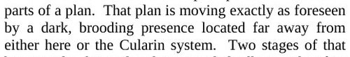

## p.12 (scan page 12)

Page contents: 991 words, 22 paragraphs | headings/entries: Once inside:; Decision: Almas; Page 12

- **No single roster character (rules/setting/general)** — entry/section: Gura Tran: ""I know you—friends of the Almas Jedi! Solenoid, we need their ship. Kill them!"" Source: *416 - Decisions - Decision Almas* (SWRPG d20 Revised Core), p.12
  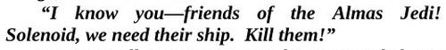

## p.13 (scan page 13)

Page contents: 973 words, 15 paragraphs | headings/entries: Decision: Almas; Page 13

## p.14 (scan page 14)

Page contents: 1005 words, 14 paragraphs | headings/entries: Decision: Almas; Page 14

## p.9–14 (scan page 9)

Page contents: E3 the Separatist raiders; E4 the derelict cruiser, political background, Gura Tran, Solenoid, Cartroll, the Thaereian fighter, Sheel (hand-read)

## p.15 (scan page 15)

Page contents: 929 words, 15 paragraphs | headings/entries: Encounter 5: Strike Force Cularin; Decision: Almas; Page 15

- **No single roster character (rules/setting/general)** — entry/section: Captain Meeba: ""You've all been through a harrowing time and have accomplished a great deal for the Republic, so we'll let that go." Source: *416 - Decisions - Decision Almas* (SWRPG d20 Revised Core), p.15
  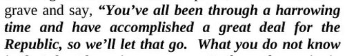
- **No single roster character (rules/setting/general)** — entry/section: Encounter 5: "You have been in a lot of combat situations in your time, but it comes home hard, in the quiet moments before the go signal: this is war..." Source: *416 - Decisions - Decision Almas* (SWRPG d20 Revised Core), p.15
  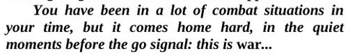

## p.16 (scan page 16)

Page contents: 906 words, 17 paragraphs | headings/entries: Decision: Almas; Page 16

## p.17 (scan page 17)

Page contents: 915 words, 35 paragraphs | headings/entries: Decision: Almas; Either way, finish with:; Page 17

- **No single roster character (rules/setting/general)** — entry/section: Biko: ""We need to secure the trench just in front of the base doors, so we can blow them. There's a group of elites there and my squad is pinned down here. Can you folks take them out and relieve the pressure?" Source: *416 - Decisions - Decision Almas* (SWRPG d20 Revised Core), p.17
  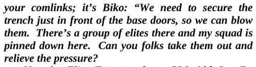
- **No single roster character (rules/setting/general)** — entry/section: Colonel Rast'tul: ""No. No. Not you. Wasn't ruining my chances for advancement enough? Why did you save me?"" Source: *416 - Decisions - Decision Almas* (SWRPG d20 Revised Core), p.17
  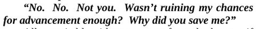
- **No single roster character (rules/setting/general)** — entry/section: Colonel Rast'tul: ""I hate you, you smug Cularite scum. Sitting there with the riches of the universe, laughing at those poorer than you. Your Senator so self-righteous in the media, and before the Senate. Well, your precious Senator danced our tune gladly enough when we had her brat, didn't she?"" Source: *416 - Decisions - Decision Almas* (SWRPG d20 Revised Core), p.17
  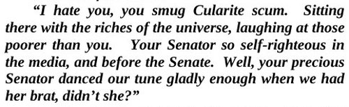
- **No single roster character (rules/setting/general)** — entry/section: Colonel Rast'tul: ""It doesn't end here, you know. Oh, no. We'll destroy you in the Senate and we'll destroy you back in your precious Cularin system. Not all of our people are as incompetent as the one who let you get off that cruiser."" Source: *416 - Decisions - Decision Almas* (SWRPG d20 Revised Core), p.17
  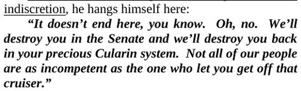
- **No single roster character (rules/setting/general)** — entry/section: Colonel Ardine: ""Colonel Rast'tul, you are under arrest," he barks. "Your confession will be reviewed at a courts martial, where you will be charged with treason while acting under Republic military authority." Source: *416 - Decisions - Decision Almas* (SWRPG d20 Revised Core), p.17
  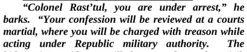
- **No single roster character (rules/setting/general)** — entry/section: Clone Trooper: ""Didn't want to take the chance, sir," says one Clone Trooper." Source: *416 - Decisions - Decision Almas* (SWRPG d20 Revised Core), p.17
  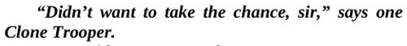

## p.18 (scan page 18)

Page contents: 832 words, 25 paragraphs | headings/entries: Decision: Almas; Encounter 6: The Almas Decision; Page 18

- **No single roster character (rules/setting/general)** — entry/section: Teeloo: ""Hi, bothh, I graduate from Thhchool of Thhhoot Him in Back! Take you thhot!"" Source: *416 - Decisions - Decision Almas* (SWRPG d20 Revised Core), p.18
  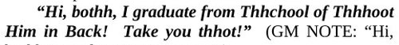
- **No single roster character (rules/setting/general)** — entry/section: Colonel Ardine: ""While it is unwise to judge by a single instance, my report to Command and to the Senate will be a very favorable one. Your troops and your 'specialists', here, performed in an exemplary manner." Source: *416 - Decisions - Decision Almas* (SWRPG d20 Revised Core), p.18
  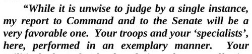

## p.19 (scan page 19)

Page contents: 785 words, 28 paragraphs | headings/entries: Experience Point Summary; Decision: Almas; Adventure Experience Award:; Page 19

- **No single roster character (rules/setting/general)** — entry/section: Master Lanius: ""It is impossible for us to maintain Almas as a haven of calm and education, unless we withhold a good part of our strength and knowledge from the Clone Wars. We certainly do not wish to undermine the gains made by the Cularin system to date. So, we will commit ourselves as fully as the Coruscant Temple has."" Source: *416 - Decisions - Decision Almas* (SWRPG d20 Revised Core), p.19
  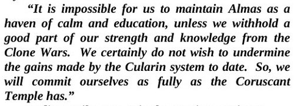
- **No single roster character (rules/setting/general)** — entry/section: Master Lanius: ""This means that we will no longer be accepting students, at least for the duration of the Clone Wars. Our resources are already stretched to the breaking point, and dark forces are hoping to take advantage of that." Source: *416 - Decisions - Decision Almas* (SWRPG d20 Revised Core), p.19
  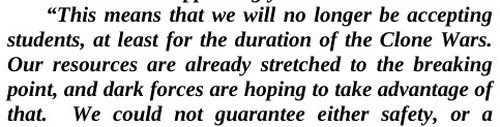
- **No single roster character (rules/setting/general)** — entry/section: Master Lanius: ""And, in the times to come, may the Force be with us all. The Force-- and good friends."" Source: *416 - Decisions - Decision Almas* (SWRPG d20 Revised Core), p.19
  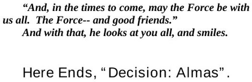
- **No single roster character (rules/setting/general)** — entry/section: Campaign Rule Update: "As of the end of this scenario, "Decision: Almas", the Almas Jedi academy is no longer accepting new Padawan candidates, young or old." Source: *416 - Decisions - Decision Almas* (SWRPG d20 Revised Core), p.19
  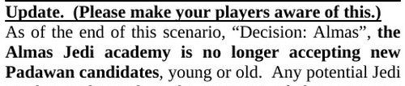

## p.20 (scan page 20)

Page contents: 401 words, 13 paragraphs | headings/entries: Loot Summary; Decision: Almas; Page 20

## p.15–20 (scan page 15)

Page contents: E5 the assault and Rast'tul's arrest; E6 Lanius' decision to close Almas to new students; XP, campaign rule update, loot (hand-read)

## p.21 (scan page 21)

Page contents: 561 words, 27 paragraphs | headings/entries: Player Handout 1: Ships and Gear Available; Kuat Systems Engineering Wayfarer-class Medium Transport; Incom/Subpro Z-95 Headhunter Starfighter; Ordinary (+10); Kuat Systems Engineering Delta-7 Aethersprite-class Starfighter; Decision: Almas Page 21

## p.22 (scan page 22)

Page contents: 69 words, 14 paragraphs | headings/entries: Player Handout 2:; Bridge; Double Turbolaser Cannons; Decision: Almas; Map of the Disabled Cruiser Bridge Area; Corridor 2; Corridor 1; Collar/Airlock (all sealed); Page 22

## p.23 (scan page 23)

Page contents: 105 words, 18 paragraphs | headings/entries: Player Handout 3: Preparatory Checklist; Hero name: Player Name:; Price of Business; From the Trees?; Padawannabes; Homecoming (Night Eyes 3); Decision: Almas; Yes [; Yes [; No [; No [; Page 23

## p.24 (scan page 24)

Page contents: 173 words, 23 paragraphs | headings/entries: GM Aid #1: Preparatory Checklist; From the Trees? (See encounter 4.); Decision: Almas; Yes [ ] Yes [ ]; Yes [ ]; No [ ] No [ ]; No [ ]; Yes [ ] No[ ]; Yes [ ]; Yes [ ]; Yes [ ]; No [ ]; No [ ]; No [ ]; Page 24

## p.25 (scan page 25)

Page contents: 556 words, 15 paragraphs | headings/entries: GM Aid #2: NPCs by Encounter; Encounter #1: Mission: Clone Wars; Senator Lavina Wren; Osten Dal'Nay; Lanius Qel-Bertuk; Colonel Ardine; Encounter #2: Transit; Decision: Almas Page 25

- **No single roster character (rules/setting/general)** — entry/section: Colonel Ardine: "Jedi should never have been given ranks in the Republic military. Civilian police, hunters of those with weird powers like their own: fine. But they are not soldiers." Source: *416 - Decisions - Decision Almas* (SWRPG d20 Revised Core), p.25
  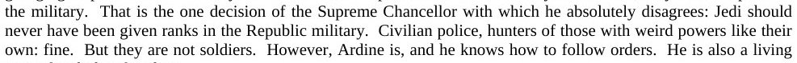

## p.26 (scan page 26)

Page contents: 593 words, 22 paragraphs | headings/entries: Teeloo; Biko; Colonel Rast' tul; Encounter #3: Digression Aggression; Incom/Subpro Z-95 Headhunter Starfighter; Incom/Subpro Z-95 Headhunter Starfighter; Decision: Almas Page 26

- **No single roster character (rules/setting/general)** — entry/section: Colonel Rast'tul: "He is supremely arrogant and self-confident, but has a great flaw, which impedes his skill as a leader: an inability to admit fault." Source: *416 - Decisions - Decision Almas* (SWRPG d20 Revised Core), p.26
  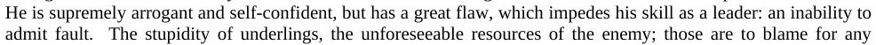

## p.27 (scan page 27)

Page contents: 589 words, 22 paragraphs | headings/entries: Encounter #4: Would You Believe It?; Low Tier (levels 1-3); Mid Tier (levels 4-6); High Tier (levels 7-9); Decision: Almas Page 27

## p.28 (scan page 28)

Page contents: 740 words, 21 paragraphs | headings/entries: Upper Tier (levels 10-12); Low Tier (levels 1-3); Mid Tier (levels 4-6); Decision: Almas Page 28

- **No single roster character (rules/setting/general)** — entry/section: Gura Tran: "After all, the Cularin sytem is rife with crime and opportunistic adventurers: it needs stability; it needs a new order." Source: *416 - Decisions - Decision Almas* (SWRPG d20 Revised Core), p.28
  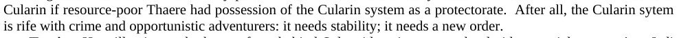

### Stat block notes (game mechanics, not feats)

- Gura Tran: Gura Tran (upper tier): male Human Scoundrel 6/Soldier 6; Def 21/DR2; VP/WP 67/13; custom DY-225 heavy blaster pistol +13/+8 (3d8-1 or stun DC 20); Lucky 2/day; Multishot, Shot on the Run (Source: *416 - Decisions - Decision Almas* (SWRPG d20 Revised Core), p.28)

## p.29 (scan page 29)

Page contents: 654 words, 24 paragraphs | headings/entries: High Tier (levels 7-9); Upper Tier (levels10-12); Low Tier (levels 1-3); Mid Tier (levels 4-6); Decision: Almas Page 29

- **No single roster character (rules/setting/general)** — entry/section: Solenoid: ""Die, meat-bags, for the greater profit of the Techno Union!"" Source: *416 - Decisions - Decision Almas* (SWRPG d20 Revised Core), p.29
  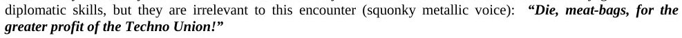

### Stat block notes (game mechanics, not feats)

- Solenoid: Solenoid (upper tier): Droideka-series stats, Thug 12; DR 6 shields; VP/WP 0/18; twin repeating blasters +13/+8/+3 (3d8) (Source: *416 - Decisions - Decision Almas* (SWRPG d20 Revised Core), p.29)

## p.30 (scan page 30)

Page contents: 642 words, 28 paragraphs | headings/entries: High Tier (levels 7-9); Upper Tier (levels10-12); Republic cruiser Captain Meeba; Encounter #5: Strike Force Cularin; Decision: Almas Page 30

- **No single roster character (rules/setting/general)** — entry/section: Sheel: "In the end, they will all be gone, and the Wyrd will remain." Source: *416 - Decisions - Decision Almas* (SWRPG d20 Revised Core), p.30
  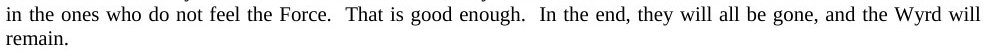

### Stat block notes (game mechanics, not feats)

- Sheel: Sheel (upper tier): Female Tarasin Dark Side Adept, Force Adept 6/Dark Side Devotee 6; Def 20; VP/WP 78/14; spear 3d8-1 (Force Weapon 2d8); DSP 12; Affect Mind +17, Force Lightning +17, Force Whirlwind, Force Mastery; Hide +17 (Source: *416 - Decisions - Decision Almas* (SWRPG d20 Revised Core), p.30)

## p.31 (scan page 31)

Page contents: 673 words, 24 paragraphs | headings/entries: Low Tier (levels 1-3); Decision: Almas Page 31

- **No single roster character (rules/setting/general)** — entry/section: Separatist droids: ""Shoot 'em, roger-roger-- oh zotz, my arm fell off."" Source: *416 - Decisions - Decision Almas* (SWRPG d20 Revised Core), p.31
  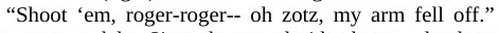

### Stat block notes (game mechanics, not feats)

- Separatist Elite Troopers: Separatist Elite Troopers (upper tier): Soldier 5/Scoundrel 6; Def 19/DR4; VP/WP 58/14; +12/+7 ranged (3d8) (Source: *416 - Decisions - Decision Almas* (SWRPG d20 Revised Core), p.31)

## p.32 (scan page 32)

Page contents: 814 words, 21 paragraphs | headings/entries: High Tier (levels 7-9); Upper Tier (levels10-12); Decision: Almas Page 32

## p.33 (scan page 33)

Page contents: 521 words, 34 paragraphs | headings/entries: Mid Tier (levels 4-6); Decision: Almas Page 33

## p.34 (scan page 34)

Page contents: 358 words, 18 paragraphs | headings/entries: Upper Tier (levels10-12); Decision: Almas Page 34

### Stat block notes (game mechanics, not feats)

- Separatist Fighter Ace: Separatist ace (upper tier): Z-95 Headhunter, crew ace +8/+3; Maneuver +14; triple blasters +10/+5 (3d10x2) (Source: *416 - Decisions - Decision Almas* (SWRPG d20 Revised Core), p.34)

## p.35 (scan page 35)

Page contents: 530 words, 26 paragraphs | headings/entries: GM Aid #3: Ships and Gear Available; Kuat Systems Engineering Wayfarer-class Medium Transport; Incom/Subpro Z-95 Headhunter Starfighter; Ordinary (+10); Kuat Systems Engineering Delta-7 Aethersprite-class Starfighter; Decision: Almas Page 35

## p.36 (scan page 36)

Page contents: 501 words, 26 paragraphs | headings/entries: SoroSuub V-19 Gian Speeder; SoroSuub V-19 Gian Speeder; SoroSuub V-19 Gian Speeder; Decision: Almas Page 36

## p.37 (scan page 37)

Page contents: 442 words, 8 paragraphs | headings/entries: GM Aid #4: Political Background; Decision: Almas Page 37

## p.38 (scan page 38)

Page contents: 116 words, 16 paragraphs | headings/entries: Bridge Corridor 2; A B; Corridor 1; Double Interior; ONnP; Decision: Almas Page 38

## p.21–38 (scan page 21)

Page contents: Player handouts, GM Aids (checklist, NPC sketches and stats by tier, ships and gear, political background, map) (hand-read)

