# Owner Material 037 — Star Wars D20 Drive folder (Core, Revised Core and Saga Edition): Living Force Campaign/Adventures/Among the Stars/Year 4/417 - Decisions - Decision Coruscant.pdf [Star Wars Roleplaying Game Revised Core (d20, 2002)]

- **Source:** Wizards of the Coast Star Wars Roleplaying Game books, web enhancements, Living Force campaign modules and articles (2000–2010), from the owner's "Star Wars D20" Drive folder (only the three edition subfolders; "General" was not read, as instructed). Secondary source (licensed Legends reference). Scan OCR'd on the box; the scan stays box-only and is **not** published.
- **Method:** every scanned page was OCR'd and machine-screened sentence by sentence for power-relevant statements (fights, kills, defeats, Force feats, rankings, superweapons) that name a character on our roster; each kept sentence is quoted verbatim from the OCR text and has a crop of the printed passage directly under it. Pages with nothing power-relevant are still listed with what is on them.
- **Citation:** "*417 - Decisions - Decision Coruscant* (SWRPG d20 Revised Core), p.X" by printed page ("scan p.X" where no printed number applies). **Weight:** Licensed RPG material: a secondary source. Narrative text sums up Legends lore; game statistics are rules for players, not canon power levels, and rank lowest.

## p.1 (scan page 1)

Page contents: 272 words, 8 paragraphs | headings/entries: LFA417; Decision: Coruscant; Edited by Margaret Heintz

- **No single roster character (rules/setting/general)** — entry/section: Blurb: "A mission of paramount importance will send the heroes running a space race and an urban gauntlet to get crucial evidence to the Senate Hearings. The danger remains, however: could Cularin suffer more by winning, than by losing, this decision?" Source: *417 - Decisions - Decision Coruscant* (SWRPG d20 Revised Core), p.1
  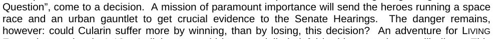

## p.2 (scan page 2)

Page contents: 851 words, 21 paragraphs | headings/entries: House Rules; Atoning for Dark Side Points; Dissipate Energy; Decision: Coruscant; Illusion; Stun; Hero Earnings; Page 2

## p.3 (scan page 3)

Page contents: 827 words, 20 paragraphs | headings/entries: Issuing Dark Side Points; Wookiees, Rage and Dark Side Points; Decision: Coruscant; GM Overview; Encounter 1: In One Basket; Page 3

## p.4 (scan page 4)

Page contents: 868 words, 24 paragraphs | headings/entries: Encounter 2: Race to Hyperspace; Encounter 3: Welcome to my Pad; Encounter 4: Taxi-driver's Terror; Encounter 6:_... Jiggedy-Jig; Decision: Coruscant; Page 4

## p.5 (scan page 5)

Page contents: 838 words, 19 paragraphs | headings/entries: Opening Crawl; Encounter 1: In One Basket; Decision: Coruscant; Page 5

- **No single roster character (rules/setting/general)** — entry/section: Opening Crawl: "But the Thaereians will stop at nothing to prevent them from reaching their goal..." Source: *417 - Decisions - Decision Coruscant* (SWRPG d20 Revised Core), p.5
  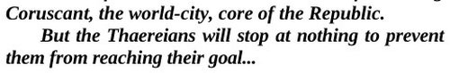
- **No single roster character (rules/setting/general)** — entry/section: Major Xirossk: ""I'll keep this short," grates Xirossk. He deposits a locked attaché case on the table. "In here is a distillation of everything that you recovered, and that we found, during your participation as part of Task Force Cularin." Source: *417 - Decisions - Decision Coruscant* (SWRPG d20 Revised Core), p.5
  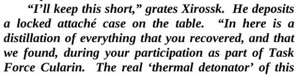
- **No single roster character (rules/setting/general)** — entry/section: Major Xirossk: "Put simply, it links the new Thaereian military government with the Separatists. What they have been accusing us of, for the last year and a half, turns out they've been doing themselves." Source: *417 - Decisions - Decision Coruscant* (SWRPG d20 Revised Core), p.5
  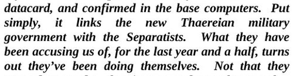

## p.1–5 (scan page 1)

Page contents: Title, blurb, house rules, GM overview, encounter summaries, staging notes, opening crawl (hand-read)

## p.6 (scan page 6)

Page contents: 831 words, 25 paragraphs | headings/entries: Answers to some of the possible questions:; Decision: Coruscant; Encounter 2: Race to Hyperspace; Page 6

- **No single roster character (rules/setting/general)** — entry/section: Major Xirossk: "You're very, very good at what you do—but more importantly, we know that we can trust you with the fate of our system." Source: *417 - Decisions - Decision Coruscant* (SWRPG d20 Revised Core), p.6
  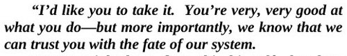
- **No single roster character (rules/setting/general)** — entry/section: Major Xirossk: ""Will you take the case to Coruscant?"" Source: *417 - Decisions - Decision Coruscant* (SWRPG d20 Revised Core), p.6
  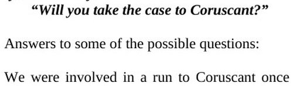
- **No single roster character (rules/setting/general)** — entry/section: Major Xirossk: ""Not this time. These are the goods, my promise. We don't have time to be cute."" Source: *417 - Decisions - Decision Coruscant* (SWRPG d20 Revised Core), p.6
  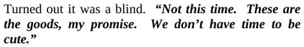
- **No single roster character (rules/setting/general)** — entry/section: Major Xirossk: "And tread lightly! The security level there is rabid enough that they'd likely sort out the corpses later, if you get my drift."" Source: *417 - Decisions - Decision Coruscant* (SWRPG d20 Revised Core), p.6
  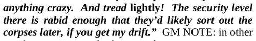
- **No single roster character (rules/setting/general)** — entry/section: Osten Dal'Nay: ""Take what you like on the trip, but on Coruscant, you can't be carrying unless you're licensed there—or a Jedi with a lightsaber," Osten finishes, just a tad sourly." Source: *417 - Decisions - Decision Coruscant* (SWRPG d20 Revised Core), p.6
  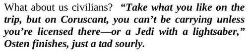

## p.7 (scan page 7)

Page contents: 957 words, 17 paragraphs | headings/entries: Decision: Coruscant; Plotting Time to cross the Comet Cloud; Page 7

## p.8 (scan page 8)

Page contents: 980 words, 23 paragraphs | headings/entries: Plotting; Resolve the firing op in this sequence:; Decision: Coruscant; Page 8

## p.9 (scan page 9)

Page contents: 782 words, 32 paragraphs | headings/entries: Obstacle; Decision: Coruscant; Next stop: Coruscant, the World-City!; Page 9

- **No single roster character (rules/setting/general)** — entry/section: Alto Janss: "She'll thank any heroes she knows from Who Goes Thaere? and say "This makes us square, friends."" Source: *417 - Decisions - Decision Coruscant* (SWRPG d20 Revised Core), p.9
  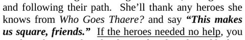
- **No single roster character (rules/setting/general)** — entry/section: Encounter 2: "As you make the jump to hyperspace, the stars elongate into their familiar display of radiating lines, and you leave your enemies behind." Source: *417 - Decisions - Decision Coruscant* (SWRPG d20 Revised Core), p.9
  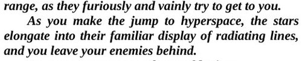

## p.5–9 (scan page 5)

Page contents: E1 Xirossk's briefing and the attache case; E2 the Comet Cloud chase and Alto Janss (hand-read)

## p.10 (scan page 10)

Page contents: 895 words, 19 paragraphs | headings/entries: Encounter 3: Welcome to my Pad; Decision: Coruscant; Page 10

- **No single roster character (rules/setting/general)** — entry/section: Coruscant traffic control: ""All ship's weaponry must be deactivated during descent," traffic control reminds you. "Welcome to the capitol planet of the Republic, citizens."" Source: *417 - Decisions - Decision Coruscant* (SWRPG d20 Revised Core), p.10
  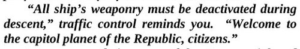
- **No single roster character (rules/setting/general)** — entry/section: Encounter 3: "Even if you have been here before, Coruscant is unique in the galaxy, and an impressive testament to the power, wealth and antiquity of the Republic. It is a world-city; gleaming in space at a huge distance, almost like a small star itself." Source: *417 - Decisions - Decision Coruscant* (SWRPG d20 Revised Core), p.10
  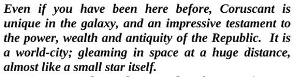

## p.11 (scan page 11)

Page contents: 942 words, 22 paragraphs | headings/entries: Decision: Coruscant; Page 11

- **No single roster character (rules/setting/general)** — entry/section: Encounter 3: "As you disembark, the decorative columns across the platform open. Odd, additional elevators? Full of droids? With guns?" Source: *417 - Decisions - Decision Coruscant* (SWRPG d20 Revised Core), p.11
  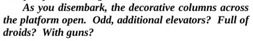
- **No single roster character (rules/setting/general)** — entry/section: Encounter 3: "Suddenly, you see an airspeeder swoop into view, its breaking thrusters roaring. Two figures leap out of the hovering vehicle, down towards your enemies, and a pair of lightsabers ignites: one brilliant green, one lambent blue." Source: *417 - Decisions - Decision Coruscant* (SWRPG d20 Revised Core), p.11
  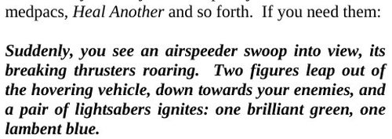
- **No single roster character (rules/setting/general)** — entry/section: Meera Lisso: "She may even cheerily exclaim, "This party is over!" She's heard Master Windu say it once, here on Coruscant, and she loves the line. Such is youth..." Source: *417 - Decisions - Decision Coruscant* (SWRPG d20 Revised Core), p.11
  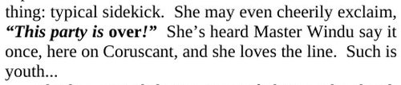

## p.12 (scan page 12)

Page contents: 834 words, 22 paragraphs | headings/entries: Decision: Coruscant; Encounter 4: Taxi-driver's Terror; Page 12

- **No single roster character (rules/setting/general)** — entry/section: Zelice Sturm: ""It's so good to see you again, even if it has to be like this. I wish that we could talk, but that will have to wait for later—Sa'arli briefed us on your mission before we came to pick you up. Take our airspeeder; we'd better explain this to the security forces when they show." Source: *417 - Decisions - Decision Coruscant* (SWRPG d20 Revised Core), p.12
  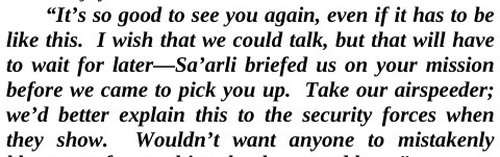
- **No single roster character (rules/setting/general)** — entry/section: Senate transport droid: ""Please enter, couriers. You are expected at the Senate building. I hope your trip thus far has been pleasant."" Source: *417 - Decisions - Decision Coruscant* (SWRPG d20 Revised Core), p.12
  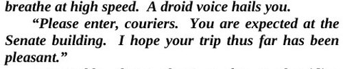

## p.13 (scan page 13)

Page contents: 853 words, 27 paragraphs | headings/entries: Decision: Coruscant; Maneuver/Event/ Suggested DC and Result; Complication There, coming out; Pilot 13/16/19/21 to get out of; Maneuver/Event/ Suggested DC and Result; Complication Two enemies rush; Maneuver/Event/ Complication; Suggested DC and Result; Jump DC 12/15/20/23 to get; Page 13

- **No single roster character (rules/setting/general)** — entry/section: Encounter 4: "Some of the suggested events, below, also allow for the heroes to do a good deed, while trying to avoid being killed by Thaereians who have no such restrictions. With great heroism comes great responsibility..." Source: *417 - Decisions - Decision Coruscant* (SWRPG d20 Revised Core), p.13
  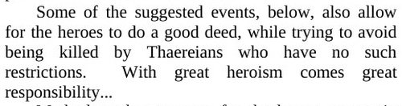

## p.14 (scan page 14)

Page contents: 569 words, 24 paragraphs | headings/entries: Suggested DC and Result; Suggested DC and Result; Suggested DC and Result; Decision: Coruscant; Maneuver/Event/ Complication; Suggested DC and Result; Suggested DC and Result; Suggested DC and Result; Page 14

## p.15 (scan page 15)

Page contents: 45 words, 4 paragraphs | headings/entries: Maneuver/Event/ Suggested DC and Result; Complication; Decision: Coruscant Page 15

## p.16 (scan page 16)

Page contents: 752 words, 23 paragraphs | headings/entries: Suggested DC and Result; Suggested DC and Result; Decision: Coruscant; Page 16

## p.17 (scan page 17)

Page contents: 809 words, 30 paragraphs | headings/entries: Decision: Coruscant; Page 17

- **No single roster character (rules/setting/general)** — entry/section: Bothan guide: ""The Supreme Chancellor has every confidence and reliance upon the Jedi, who have defended the Republic since time immemorial. Why else would he have made them leaders in our military forces, even though this has met with extreme disapproval by many inside and outside the military?" Source: *417 - Decisions - Decision Coruscant* (SWRPG d20 Revised Core), p.17
  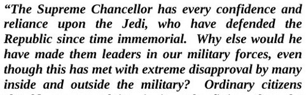
- **No single roster character (rules/setting/general)** — entry/section: GM Note: "Yes, this stance by the Supreme Chancellor almost guarantees that anyone exposed to it will have yet another reason to resent the Jedi and to be just drooling over the prospect of them lousing up. But he can hardly be blamed for idolizing these icons like the rest of us, can he? Best the Jedi don't let us all down..." Source: *417 - Decisions - Decision Coruscant* (SWRPG d20 Revised Core), p.17
  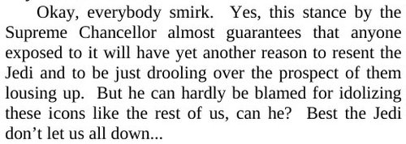
- **No single roster character (rules/setting/general)** — entry/section: Sa'arli: ""Excuse me, but we have no time to lose! The Thaereian delegation is just finishing up its summary and it will be time for our rebuttal. Bring your data, please."" Source: *417 - Decisions - Decision Coruscant* (SWRPG d20 Revised Core), p.17
  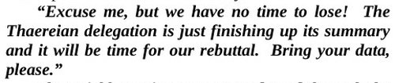
- **No single roster character (rules/setting/general)** — entry/section: Sa'arli: ""Senator Wren has not arrived. We haven't been able to contact her. The Jedi and security are looking. But someone has to rebut the Thaereian claim that the militia members are terrorists and pirates, and that Cularin needs Thaereian supervision."" Source: *417 - Decisions - Decision Coruscant* (SWRPG d20 Revised Core), p.17
  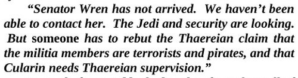
- **Palpatine (Darth Sidious)** — entry/section: Supreme Chancellor Palpatine: ""The chair recognizes the delegation from Cularin. It is noted that Senator Wren is not present: highly irregular." Source: *417 - Decisions - Decision Coruscant* (SWRPG d20 Revised Core), p.17
  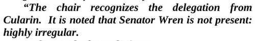
- **Palpatine (Darth Sidious)** — entry/section: Supreme Chancellor Palpatine: ""Who speaks for Cularin?"" Source: *417 - Decisions - Decision Coruscant* (SWRPG d20 Revised Core), p.17
  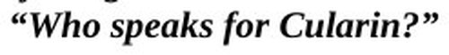

## p.10–17 (scan page 10)

Page contents: E3 the droid ambush on the landing platform, Zelice and Meera; E4 the airspeeder chase and the fight on the Senate steps (hand-read)

## p.18 (scan page 18)

Page contents: 931 words, 18 paragraphs | headings/entries: Decision: Coruscant; Page 18

- **No single roster character (rules/setting/general)** — entry/section: Senator Wren: ""Supreme Chancellor Palpatine, members of the Republic Senate, I ask that you excuse my tardiness in arriving. General Kenobi, of the Coruscant Jedi Temple, is currently handing over to Security forces the survivors of those who attempted to waylay my daughter and myself."" Source: *417 - Decisions - Decision Coruscant* (SWRPG d20 Revised Core), p.18
  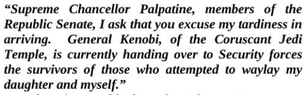
- **No single roster character (rules/setting/general)** — entry/section: Senator Wren: ""Not all of you will know my shame," she says while she causes the platform to slowly turn in place, surveying the thousands here, "but this is not the first time that dark forces have attempted to silence my voice. Once, they succeeded." Source: *417 - Decisions - Decision Coruscant* (SWRPG d20 Revised Core), p.18
  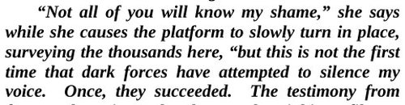

## p.19 (scan page 19)

Page contents: 785 words, 33 paragraphs | headings/entries: Decision: Coruscant; Page 19

- **No single roster character (rules/setting/general)** — entry/section: Senator Wren: ""Members of the Senate—Supreme Chancellor— What say you?"" Source: *417 - Decisions - Decision Coruscant* (SWRPG d20 Revised Core), p.19
  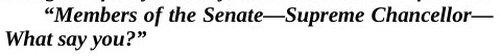
- **Palpatine (Darth Sidious)** — entry/section: Supreme Chancellor Palpatine: "He is the very image of an elder statesman, his white hair haloing his wise and beneficent face." Source: *417 - Decisions - Decision Coruscant* (SWRPG d20 Revised Core), p.19
  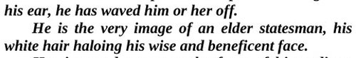
- **Palpatine (Darth Sidious)** — entry/section: Supreme Chancellor Palpatine: ""I recommend that the Senate revoke the Thaerian government's franchise within Cularin, and that all elements of the Thaereian Navy withdraw immediately."" Source: *417 - Decisions - Decision Coruscant* (SWRPG d20 Revised Core), p.19
  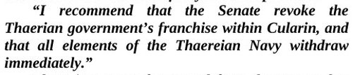
- **No single roster character (rules/setting/general)** — entry/section: Thaereian Senator: ""Objection!" screams the member for Thaere, "Supreme Chancellor, you yourself recommended us, originally. What are you saying?"" Source: *417 - Decisions - Decision Coruscant* (SWRPG d20 Revised Core), p.19
  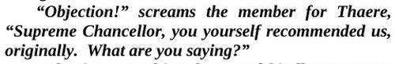
- **Palpatine (Darth Sidious)** — entry/section: Supreme Chancellor Palpatine: ""What I am saying is. Get. Out."" Source: *417 - Decisions - Decision Coruscant* (SWRPG d20 Revised Core), p.19
  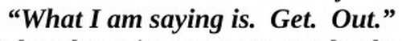
- **Palpatine (Darth Sidious)** — entry/section: Supreme Chancellor Palpatine: "The Supreme Chancellor now turns and looks directly at all of you. His eyes are bright and they seem to see far more than simple appearance." Source: *417 - Decisions - Decision Coruscant* (SWRPG d20 Revised Core), p.19
  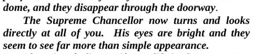
- **Palpatine (Darth Sidious)** — entry/section: Supreme Chancellor Palpatine: ""I am most impressed by the passion and dedication shown by the representatives of Cularin, especially the— impromptu ones, today." Source: *417 - Decisions - Decision Coruscant* (SWRPG d20 Revised Core), p.19
  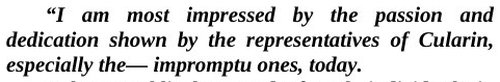
- **Palpatine (Darth Sidious)** — entry/section: Supreme Chancellor Palpatine: ""The Republic has need of such individuals in these times of trouble. You may be sure that I will follow your careers with great interest."" Source: *417 - Decisions - Decision Coruscant* (SWRPG d20 Revised Core), p.19
  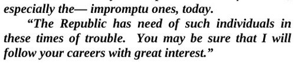
- **Palpatine (Darth Sidious)** — entry/section: Supreme Chancellor Palpatine: ""I further recommend to this body that the endless deliberations about the sovereignty of Cularin be brought to a close. Cularin's self-governance should be recognized, and Cularin take its place as a full, voting member in the Republic Senate."" Source: *417 - Decisions - Decision Coruscant* (SWRPG d20 Revised Core), p.19
  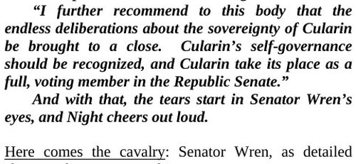
- **No single roster character (rules/setting/general)** — entry/section: Diplomacy note: "There is one hidden penalty to this roll: if the spokesperson is a Jedi, the roll is at —-4, because the speaker is attempting to influence Supreme Chancellor Palpatine." Source: *417 - Decisions - Decision Coruscant* (SWRPG d20 Revised Core), p.19
  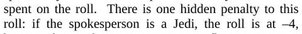

## p.20 (scan page 20)

Page contents: 714 words, 32 paragraphs | headings/entries: Encounter 6: ... Jiggedy-Jig; Decision: Coruscant; Conclusion:; Here Ends, "Decision: Coruscant"; The gearing up for next; Experience Point Summary; Adventure Experience Award:; Page 20

- **No single roster character (rules/setting/general)** — entry/section: Senator Wren: ""I just feel so glad that we finally have someone supporting us," says Wren, still somewhat dazed by success. "If only the Senate will ratify quickly. I can tell you, I'm one person who finally understands the need for emergency executive powers. If the Supreme Chancellor could simply have made the decision himself, this would all be over and done."" Source: *417 - Decisions - Decision Coruscant* (SWRPG d20 Revised Core), p.20
  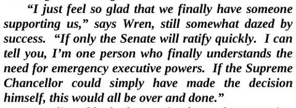
- **No single roster character (rules/setting/general)** — entry/section: Sa'arli: ""The Thaereian delegation, and the few supporters that they have left, have put a motion before the Senate, to stay the decision. They say that it would be pointless, because their forces are already in control of Cularin, and the Senate should leave well enough alone. They say that they invaded a day ago, in response to the Militia's terrorist actions!"" Source: *417 - Decisions - Decision Coruscant* (SWRPG d20 Revised Core), p.20
  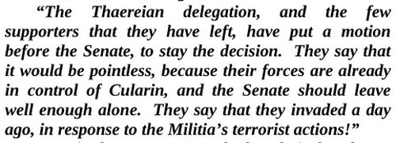
- **No single roster character (rules/setting/general)** — entry/section: Senator Wren: ""You can stay here—or you can get back to Cularin, join up with Xirossk and our forces, and do what's necessary to keep us independent—up to and including kicking Tramsig and his forces clear out of the system. We have the right, now. What do you say?"" Source: *417 - Decisions - Decision Coruscant* (SWRPG d20 Revised Core), p.20
  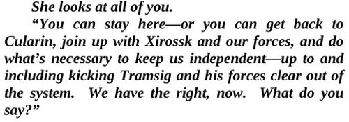
- **No single roster character (rules/setting/general)** — entry/section: Conclusion: "Your wounds seen to, newly equipped, and with the battle of your lives ahead, you blast off for the stars once more. One thing is sure: when you have finished the job to come, the Cularin System will never be the same." Source: *417 - Decisions - Decision Coruscant* (SWRPG d20 Revised Core), p.20
  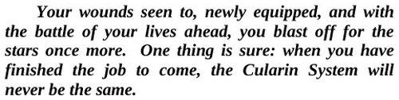

## p.21 (scan page 21)

Page contents: 557 words, 15 paragraphs | headings/entries: Loot Summary; Decision: Coruscant; Page 21

## p.17–21 (scan page 17)

Page contents: E5 the Senate Chamber, depositions, Wren's entrance, Palpatine's verdict; E6 Thaere's claimed invasion; XP, rule update, loot (hand-read)

## p.22 (scan page 22)

Page contents: 175 words, 12 paragraphs | headings/entries: Player Handout 1: Available Starships and Vehicles; Encounter 1; Kuat Systems Engineering Wayfarer-class Medium Transport; Decision: Coruscant Page 22

## p.23 (scan page 23)

Page contents: 100 words, 7 paragraphs | headings/entries: Player Handout 2: Landing Pad; Decision: Coruscant Page 23

## p.24 (scan page 24)

Page contents: 192 words, 5 paragraphs | headings/entries: Decision: Coruscant Page 24

## p.25 (scan page 25)

Page contents: 359 words, 17 paragraphs | headings/entries: GM Aid #1: Player survey; Hero name:; GM Aid #1: Player survey; Hero name:; Decision: Coruscant Page 25

## p.26 (scan page 26)

Page contents: 452 words, 34 paragraphs | headings/entries: Encounter 2: Race to Hyperspace; Low Tier (Levels 1-3); Incom/Subpro Z-95 Headhunter Starfighter (6); Middle Tier (Levels 4-6); Incom/Subpro Z-95 Headhunter Starfighter (6); High Tier (levels 7-9); Incom/Subpro Z-95 Headhunter Starfighter (6); Decision: Coruscant Page 26

## p.27 (scan page 27)

Page contents: 477 words, 20 paragraphs | headings/entries: Upper Tier (levels10-12); Incom/Subpro Z-95 Headhunter Starfighter (6); Here comes the cavalry:; Decision: Coruscant Page 27

### Stat block notes (game mechanics, not feats)

- Alto Janss: Alto Janss: Human female smuggler, Scout 3/Scoundrel 5; VP/WP 40/10; heavy blaster 3d8; Diplomacy +13; FP 5 (Source: *417 - Decisions - Decision Coruscant* (SWRPG d20 Revised Core), p.27)

## p.28 (scan page 28)

Page contents: 670 words, 24 paragraphs | headings/entries: Encounter 3: Welcome to my Pad; Low Tier (levels 1-3); Mid Tier (levels 4-6); Decision: Coruscant Page 28

## p.29 (scan page 29)

Page contents: 494 words, 19 paragraphs | headings/entries: High Tier (levels 7-9); Decision: Coruscant Page 29

## p.30 (scan page 30)

Page contents: 651 words, 18 paragraphs | headings/entries: Upper Tier (levels10-12); Here comes the cavalry:; Decision: Coruscant Page 30

### Stat block notes (game mechanics, not feats)

- Meera Lisso: Meera Lisso: Human female Thug 3/Jedi Guardian 2; VP/WP 23/12; lightsaber 2d8+2 (bright blue blade); Battlemind +6, Force Defense +7 (Source: *417 - Decisions - Decision Coruscant* (SWRPG d20 Revised Core), p.30)
- E522 Assassin Droid: Tracked Assassin Droid E522 Series: Scout 2/Soldier 4; DR 7; VP/WP 40/19; claws 1d6+4, heavy repeating blaster, ion cannon, needler, 2 hunter-seeker missiles (Source: *417 - Decisions - Decision Coruscant* (SWRPG d20 Revised Core), p.30)

## p.31 (scan page 31)

Page contents: 650 words, 16 paragraphs | headings/entries: Low and Middle Tier (Levels 1-3, 4-6); Decision: Coruscant Page 31

- **No single roster character (rules/setting/general)** — entry/section: Zelice Sturm: "She exudes confidence and trust in the Light Side of the Force. She also wears an object on a thin chain around her neck: it looks like a thin sliver of metal, from some bladed weapon." Source: *417 - Decisions - Decision Coruscant* (SWRPG d20 Revised Core), p.31
  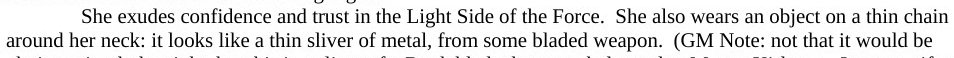

## p.32 (scan page 32)

Page contents: 642 words, 21 paragraphs | headings/entries: High Tier (Levels 7-9); Upper Tier (Levels 10-12); Decision: Coruscant Page 32

### Stat block notes (game mechanics, not feats)

- Zelice Sturm: The Black Queen (Zelice Sturm), Human Female Jedi Guardian 13 (upper tier; 7 low/mid, 10 high); Def 23/28 with ignited lightsaber; VP/WP 108/12; +18/+13/+8 melee (4d8 lightsaber); FP 11; Force Stealth +22; Lightsaber Form V lets her deflect bolts that miss by 10 or less (Source: *417 - Decisions - Decision Coruscant* (SWRPG d20 Revised Core), p.32)

## p.33 (scan page 33)

Page contents: 644 words, 16 paragraphs | headings/entries: Encounter 4: Taxi-driver's Terror; Decision: Coruscant Page 33

## p.34 (scan page 34)

Page contents: 620 words, 25 paragraphs | headings/entries: Low Tier (levels 1-3); Mid Tier (levels 4-6); High Tier (levels 7-9); Decision: Coruscant Page 34

## p.35 (scan page 35)

Page contents: 391 words, 11 paragraphs | headings/entries: Upper Tier (levels10-12); Decision: Coruscant Page 35

### Stat block notes (game mechanics, not feats)

- Thaereian Wetwork team: Thaereian Wetwork team (upper tier): Soldier 5/Scoundrel 6; VP/WP 58/14; +12/+7 ranged (3d8 heavy blaster pistol); Lucky 2/day (Source: *417 - Decisions - Decision Coruscant* (SWRPG d20 Revised Core), p.35)

## p.36 (scan page 36)

Page contents: 370 words, 16 paragraphs | headings/entries: Encounter 1; Kuat Systems Engineering Wayfarer-class Medium Transport; Encounters 3 and 4; Decision: Coruscant Page 36

## p.37 (scan page 37)

Page contents: 186 words, 18 paragraphs | headings/entries: GM Aid #4: Landing Pad; N7AMmoOdOWPpP; Elevator cupola; Sniper; Decision: Coruscant; Page 37

## p.38 (scan page 38)

Page contents: 478 words, 22 paragraphs | headings/entries: Name of character/Scenario(s) encountered; Statement/Support offered; Osten Dal' Nay; Nirama; Possible "cues": Thaereian secret bases,; Thurm Loogg; Decision: Coruscant; Page 38

- **No single roster character (rules/setting/general)** — entry/section: Osten Dal'Nay: "If anyone has been playing games with the Separatists, it's Thaere. They've been trying to dupe the Senate for years."" Source: *417 - Decisions - Decision Coruscant* (SWRPG d20 Revised Core), p.38
  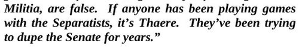
- **No single roster character (rules/setting/general)** — entry/section: Nirama: "It will show conclusively that the major Thaereian interaction with smugglers and pirates in our system was to work with them and profit from them!"" Source: *417 - Decisions - Decision Coruscant* (SWRPG d20 Revised Core), p.38
  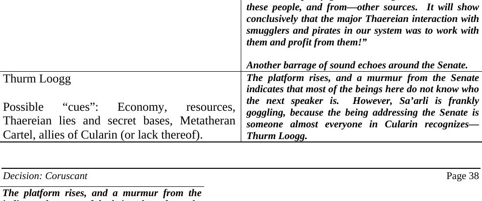

## p.39 (scan page 39)

Page contents: 401 words, 14 paragraphs | headings/entries: Gavid Lermyn; Possible "cues":; Decision: Coruscant; Page 39

- **No single roster character (rules/setting/general)** — entry/section: Thurm Loogg: "Moreover, I am soon to be appointed as the new Trade Commissioner for the Cartel, in Cularin! Why? Because we in the Cartel looooove Cularin!" Source: *417 - Decisions - Decision Coruscant* (SWRPG d20 Revised Core), p.39
  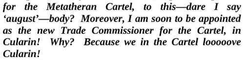
- **No single roster character (rules/setting/general)** — entry/section: Thurm Loogg: ""Also, our massive warship, which remains in orbit right over the main settlements of Cularin, will continue to remain fully stocked with bombs and missiles to help guide the system into its bright and prosperous future."" Source: *417 - Decisions - Decision Coruscant* (SWRPG d20 Revised Core), p.39
  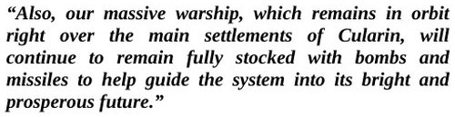
- **No single roster character (rules/setting/general)** — entry/section: Gavid Lermyn: ""I am prepared to fully corroborate what the representatives of Cularin have said, and I also wish to plead for help in ousting the gang of self-serving opportunists and expansionists that have taken power in my home system."" Source: *417 - Decisions - Decision Coruscant* (SWRPG d20 Revised Core), p.39
  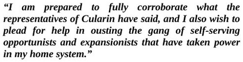

## p.22–39 (scan page 22)

Page contents: Player handouts, GM Aids (survey, NPC and droid stats by tier, vehicles, map, Senate walk-ons) (hand-read)

