# Owner Material 037 — Star Wars D20 Drive folder (Core, Revised Core and Saga Edition): Living Force Campaign/Adventures/Among the Stars/Year 4/418 - Decisions - Decision Cularin.pdf [Star Wars Roleplaying Game Revised Core (d20, 2002)]

- **Source:** Wizards of the Coast Star Wars Roleplaying Game books, web enhancements, Living Force campaign modules and articles (2000–2010), from the owner's "Star Wars D20" Drive folder (only the three edition subfolders; "General" was not read, as instructed). Secondary source (licensed Legends reference). Scan OCR'd on the box; the scan stays box-only and is **not** published.
- **Method:** every scanned page was OCR'd and machine-screened sentence by sentence for power-relevant statements (fights, kills, defeats, Force feats, rankings, superweapons) that name a character on our roster; each kept sentence is quoted verbatim from the OCR text and has a crop of the printed passage directly under it. Pages with nothing power-relevant are still listed with what is on them.
- **Citation:** "*418 - Decisions - Decision Cularin* (SWRPG d20 Revised Core), p.X" by printed page ("scan p.X" where no printed number applies). **Weight:** Licensed RPG material: a secondary source. Narrative text sums up Legends lore; game statistics are rules for players, not canon power levels, and rank lowest.

## p.1 (scan page 1)

Page contents: 245 words, 8 paragraphs | headings/entries: LFA418; Decision: Cularin; Edited by Margaret Heintz

- **No single roster character (rules/setting/general)** — entry/section: Blurb: "As the Senate is about to decide the "Cularin Question", the Thaereians decide to make it simple for them, by rendering the whole process moot. For the moment, the "movers and shakers" of the galaxy turn their eyes to the little system of Cularin." Source: *418 - Decisions - Decision Cularin* (SWRPG d20 Revised Core), p.1
  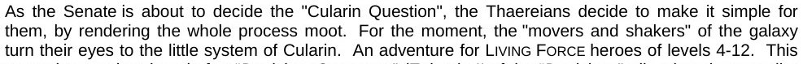

## p.2 (scan page 2)

Page contents: 776 words, 21 paragraphs | headings/entries: House Rules; Atoning for Dark Side Points; Dissipate Energy; Decision: Cularin; Illusion; Stun; Hero Earnings; Issuing Force and Dark Side Points; Page 2

## p.3 (scan page 3)

Page contents: 838 words, 22 paragraphs | headings/entries: Wookiees, Rage and Dark Side Points: Per; Decision: Cularin; General Notes to the GM; Page 3

- **No single roster character (rules/setting/general)** — entry/section: Dark Side Sourcebook (quoted): ""Evil is not always easy to recognize. An innocent act may ultimately result in great suffering. An act of revenge may save the lives of millions of people. The pure at heart can lash out in anger. Evil may lurk beneath a mask of virtue." Source: *418 - Decisions - Decision Cularin* (SWRPG d20 Revised Core), p.3
  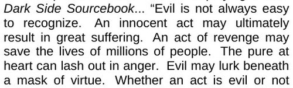

## p.4 (scan page 4)

Page contents: 736 words, 23 paragraphs | headings/entries: Encounter 1: Rendezvous; Decision: Cularin; Encounter 3: Dorumaa Base; Encounter 4: Turbolaser Diplomacy; Encounter 5: Choke Hold; Conclusion: Celebration?; Page 4

## p.5 (scan page 5)

Page contents: 800 words, 17 paragraphs | headings/entries: Opening Crawl; Encounter 1: Rendezvous; Decision: Cularin; Page 5

- **No single roster character (rules/setting/general)** — entry/section: Opening Crawl: "As Senator Wren and Cularin's heroes know, this is bantha pudu. Those same heroes are racing back to their system to do whatever is needed to eliminate the Thaereian menace, and to establish Cularin as a full member of the Galactic Senate and the Republic." Source: *418 - Decisions - Decision Cularin* (SWRPG d20 Revised Core), p.5
  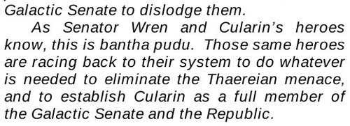

## p.1–5 (scan page 1)

Page contents: Title, blurb, house rules, tiers, GM overview, encounter summaries, opening crawl (hand-read)

## p.6 (scan page 6)

Page contents: 755 words, 20 paragraphs | headings/entries: Encounter 2: Operation: Freedom; Decision: Cularin; Page 6

- **No single roster character (rules/setting/general)** — entry/section: Thaereian patrol: ""Cularin ships. Come to a halt and prepare to surrender your ships immediately. Your crews will be interned, pending investigation. Obey or be destroyed."" Source: *418 - Decisions - Decision Cularin* (SWRPG d20 Revised Core), p.6
  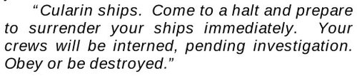
- **No single roster character (rules/setting/general)** — entry/section: Major Xirossk: ""There are two main objectives," explains Xirossk in the briefing room on Cularin 1." Source: *418 - Decisions - Decision Cularin* (SWRPG d20 Revised Core), p.6
  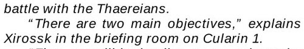
- **No single roster character (rules/setting/general)** — entry/section: Major Xirossk: "Anyone friendly to us, trying to get here from out-system, would be sitting nerfs, trying to avoid the Comet Cloud's hazards as they approach a Thaereian flotilla."" Source: *418 - Decisions - Decision Cularin* (SWRPG d20 Revised Core), p.6
  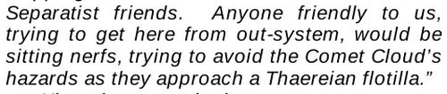
- **No single roster character (rules/setting/general)** — entry/section: Major Xirossk: "You've earned a rest, but we can use all the help that we can get."" Source: *418 - Decisions - Decision Cularin* (SWRPG d20 Revised Core), p.6
  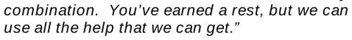

## p.7 (scan page 7)

Page contents: 834 words, 18 paragraphs | headings/entries: Encounter 3: Dorumaa Base; Decision: Cularin; Page 7

- **No single roster character (rules/setting/general)** — entry/section: Encounter 3: "Heroes can fight as infantry, or pilot military vehicles with Really Big Guns and blow things up promiscuously. What could be better?" Source: *418 - Decisions - Decision Cularin* (SWRPG d20 Revised Core), p.7
  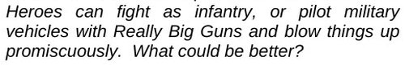
- **Ki-Adi-Mundi** — entry/section: Ki-Adi-Mundi: "They include Biko, Oora Gellandi, and Jedi Master Ki-Adi-Mundi, who once predicted that he would be proud to serve beside the heroes. The master may be wounded, if the dice fall that way, but may not die here. It is not yet his time." Source: *418 - Decisions - Decision Cularin* (SWRPG d20 Revised Core), p.7
  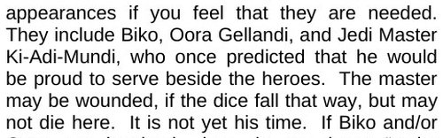

## p.5–7 (scan page 5)

Page contents: E1 Rendezvous with the Thaereian patrol; E2 Operation: Freedom, Xirossk's briefing (hand-read)

## p.8 (scan page 8)

Page contents: 805 words, 21 paragraphs | headings/entries: Decision: Cularin; Page 8

- **No single roster character (rules/setting/general)** — entry/section: Encounter 3: "As members of Cularin's most elite "special forces", your team has a free hand in taking the battle to the enemy." Source: *418 - Decisions - Decision Cularin* (SWRPG d20 Revised Core), p.8
  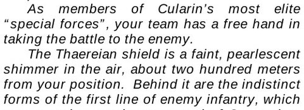
- **No single roster character (rules/setting/general)** — entry/section: Encounter 3: "They're waiting: to get to the base, you have to come to them." Source: *418 - Decisions - Decision Cularin* (SWRPG d20 Revised Core), p.8
  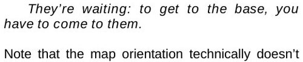
- **No single roster character (rules/setting/general)** — entry/section: Section 2: "Section 2: Tanks for the memories. You already seem to have been pegged as big trouble by the Thaereians: at least, those repulsortanks are heading your way, cannons blazing!" Source: *418 - Decisions - Decision Cularin* (SWRPG d20 Revised Core), p.8
  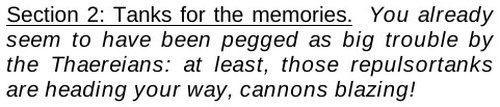

## p.9 (scan page 9)

Page contents: 821 words, 20 paragraphs | headings/entries: Decision: Cularin; Page 9

- **No single roster character (rules/setting/general)** — entry/section: Section 4: "if this weren't such a serious situation, you'd be tempted to call that a "wheely big gun"." Source: *418 - Decisions - Decision Cularin* (SWRPG d20 Revised Core), p.9
  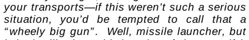
- **No single roster character (rules/setting/general)** — entry/section: Section 5: "You hear a few Militia sergeants yelling, "Get 'em!" and the final surge forward is on!" Source: *418 - Decisions - Decision Cularin* (SWRPG d20 Revised Core), p.9
  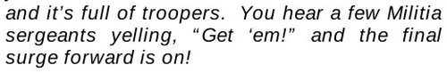
- **No single roster character (rules/setting/general)** — entry/section: Encounter 3: "The second shield emitter tower suddenly shatters like a glass rod, brilliant energies arcing up and out of its structure. With an earsplitting roar, it vanishes in a column of shooting sparks and fire." Source: *418 - Decisions - Decision Cularin* (SWRPG d20 Revised Core), p.9
  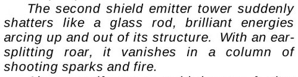

## p.10 (scan page 10)

Page contents: 791 words, 20 paragraphs | headings/entries: Encounter 4: Turbolaser Diplomacy; Decision: Cularin; Page 10

- **No single roster character (rules/setting/general)** — entry/section: Encounter 4: "Can the heroes persuade the officers within to surrender? Even more importantly than data, hundreds of lives depend upon the answer." Source: *418 - Decisions - Decision Cularin* (SWRPG d20 Revised Core), p.10
  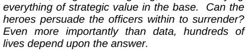

## p.11 (scan page 11)

Page contents: 726 words, 20 paragraphs | headings/entries: Decision: Cularin; Diplomacy; Page 11

- **No single roster character (rules/setting/general)** — entry/section: Major Ren Terlo: ""You did the best that you could—some people are fanatics."" Source: *418 - Decisions - Decision Cularin* (SWRPG d20 Revised Core), p.11
  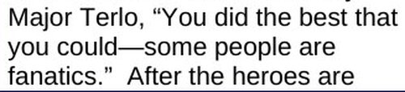

## p.12 (scan page 12)

Page contents: 725 words, 27 paragraphs | headings/entries: Diplomacy check total; Result; Encounter 5: Choke Hold; Decision: Cularin; Page 12

- **No single roster character (rules/setting/general)** — entry/section: Major Vayla Sevren: "then Major Sevren will not survive the surrender—one of her own people will have assassinated her, in the confusion as the Militia moves in to take control." Source: *418 - Decisions - Decision Cularin* (SWRPG d20 Revised Core), p.12
  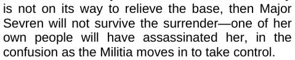
- **No single roster character (rules/setting/general)** — entry/section: Major Xirossk: ""This is the Big One," rasps Xirossk, and you can hear the capitals. "With the base on Dorumaa in our hands, the Thaereians no longer have telemetry and we can force the battle in a way of our own choosing. Their supply depots in our system are non-existent and their time is running out."" Source: *418 - Decisions - Decision Cularin* (SWRPG d20 Revised Core), p.12
  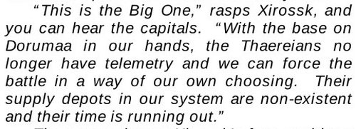
- **No single roster character (rules/setting/general)** — entry/section: Major Xirossk: "The expression on Xirossk's face could not exactly be called a smile." Source: *418 - Decisions - Decision Cularin* (SWRPG d20 Revised Core), p.12
  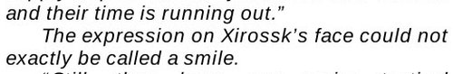
- **No single roster character (rules/setting/general)** — entry/section: Major Xirossk: "And the Thaereians could blow to atoms a force small enough to sneak in, by some uncharted route. So: we have to clear the space lanes." Source: *418 - Decisions - Decision Cularin* (SWRPG d20 Revised Core), p.12
  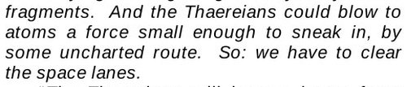

## p.7–12 (scan page 7)

Page contents: E3 the ground battle at Dorumaa Base in five sections; E4 Turbolaser Diplomacy with Major Vayla Sevren (hand-read)

## p.13 (scan page 13)

Page contents: 882 words, 12 paragraphs | headings/entries: Decision: Cularin; Page 13

## p.14 (scan page 14)

Page contents: 802 words, 18 paragraphs | headings/entries: Decision: Cularin; Page 14

- **No single roster character (rules/setting/general)** — entry/section: Hero death: "If that is the player choice, or if death is the result of a knowing commitment to a desperate situation, then let the death be meaningful, heroic and, at the end, applauded as true heroism, in memorial." Source: *418 - Decisions - Decision Cularin* (SWRPG d20 Revised Core), p.14
  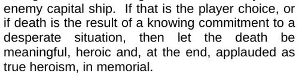
- **No single roster character (rules/setting/general)** — entry/section: Colonel Tramsig: ""That will be our reinforcements arriving. Cularite scum, your cause is lost. Surrender immediately, or we'll wipe you from space."" Source: *418 - Decisions - Decision Cularin* (SWRPG d20 Revised Core), p.14
  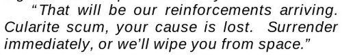

## p.15 (scan page 15)

Page contents: 733 words, 23 paragraphs | headings/entries: Encounter 6: The Republic Strikes Back; Decision: Cularin; Page 15

- **No single roster character (rules/setting/general)** — entry/section: Major Xirossk: ""Militia elements within range, form up on me—we're taking that sleemo out. The rest of you, regroup and follow your section leaders." Source: *418 - Decisions - Decision Cularin* (SWRPG d20 Revised Core), p.15
  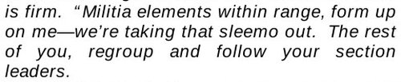
- **No single roster character (rules/setting/general)** — entry/section: Captain Meeba: "We just chased off your Separatist scum allies outside the system, and we'll blow you to vapor if you do not surrender right now."" Source: *418 - Decisions - Decision Cularin* (SWRPG d20 Revised Core), p.15
  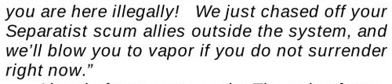
- **No single roster character (rules/setting/general)** — entry/section: Encounter 6: "Ahead of you, you see the Thaereian forces coming apart at the seams and scattering, as the Republic fleet enters and a cloud of fighters form up, including several of the distinctive Jedi starfighters. Cheers echo over your com units." Source: *418 - Decisions - Decision Cularin* (SWRPG d20 Revised Core), p.15
  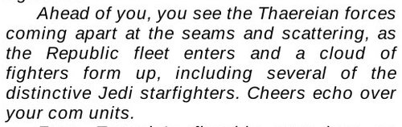
- **No single roster character (rules/setting/general)** — entry/section: Colonel Tramsig: "From Tramsig's flagship, you hear an incoherent scream—and its turbolasers open up in full force at your ships." Source: *418 - Decisions - Decision Cularin* (SWRPG d20 Revised Core), p.15
  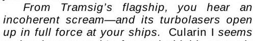
- **No single roster character (rules/setting/general)** — entry/section: Colonel Tramsig: "If even one hero managed to do any hull damage to the Thaereian flagship, then an explosion on the bridge terminated the career of Colonel Tramsig." Source: *418 - Decisions - Decision Cularin* (SWRPG d20 Revised Core), p.15
  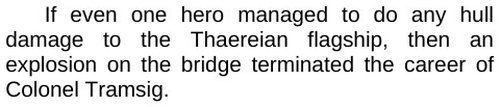

## p.16 (scan page 16)

Page contents: 751 words, 20 paragraphs | headings/entries: Conclusion: Celebration?; Decision: Cularin; Here Ends, "Decision: Cularin"; Experience Point Summary; Experience is calculated as follows for LIVING; Page 16

- **No single roster character (rules/setting/general)** — entry/section: Conclusion: "Whatever the future holds, Cularin has much to thank them for. Still, the reward of a job well done is a harder job..." Source: *418 - Decisions - Decision Cularin* (SWRPG d20 Revised Core), p.16
  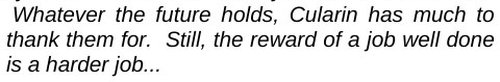
- **No single roster character (rules/setting/general)** — entry/section: Conclusion: "Among the fallen on Dorumaa were Biko and Oora Gellandi, whom many knew: they determined for themselves, in the end, what it meant to be heroes, and will be recorded as such in the battle memorial." Source: *418 - Decisions - Decision Cularin* (SWRPG d20 Revised Core), p.16
  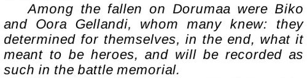
- **No single roster character (rules/setting/general)** — entry/section: Gavid Lermyn: ""Just as yourselves, the common people of Thaere had no desire for expansionism, for war." Source: *418 - Decisions - Decision Cularin* (SWRPG d20 Revised Core), p.16
  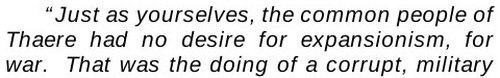
- **No single roster character (rules/setting/general)** — entry/section: Gavid Lermyn: "Let my people be freed, as you have been."" Source: *418 - Decisions - Decision Cularin* (SWRPG d20 Revised Core), p.16
  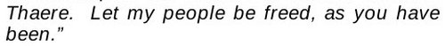
- **Ki-Adi-Mundi** — entry/section: Ki-Adi-Mundi: "you hear the voice of the representative of the Corsucant Jedi Temple, Master Ki-Adi-Mundi, murmur, "Well done, my friends. May the Force be with you— always."" Source: *418 - Decisions - Decision Cularin* (SWRPG d20 Revised Core), p.16
  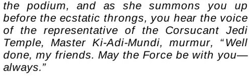

## p.17 (scan page 17)

Page contents: 346 words, 17 paragraphs | headings/entries: Adventure Experience Award:; Loot Summary; Decision: Cularin; Page 17

## p.12–17 (scan page 12)

Page contents: E5 Choke Hold fleet battle; E6 The Republic Strikes Back and Tramsig's end; conclusion, XP, loot (hand-read)

## p.18 (scan page 18)

Page contents: 471 words, 26 paragraphs | headings/entries: Kuat Systems Engineering Wayfarer-class Medium Transport; Incom/Subpro Z-95 Headhunter Starfighter; Ordinary (+10); Kuat Systems Engineering Delta-7 Aethersprite-class Starfighter; Decision: Cularin Page 18

## p.19 (scan page 19)

Page contents: 252 words, 7 paragraphs | headings/entries: Class: Starfighter; Cost: 204 500 credits; Decision: Cularin Page 19

## p.20 (scan page 20)

Page contents: 24 words, 6 paragraphs | headings/entries: Main Doors; Inner Defense Trench; Landing Zone; Decision: Cularin Page 20

## p.21 (scan page 21)

Page contents: 368 words, 16 paragraphs | headings/entries: SoroSuub V-19 Gian Speeder; Decision: Cularin Page 21

## p.22 (scan page 22)

Page contents: 493 words, 26 paragraphs | headings/entries: Kuat Systems Engineering Wayfarer-class Medium Transport; Incom/Subpro Z-95 Headhunter Starfighter; Ordinary (+10); Kuat Systems Engineering Delta-7 Aethersprite-class Starfighter; Decision: Cularin Page 22

## p.23 (scan page 23)

Page contents: 252 words, 7 paragraphs | headings/entries: Class: Starfighter; Cost: 204 500 credits; Decision: Cularin Page 23

## p.24 (scan page 24)

Page contents: 491 words, 28 paragraphs | headings/entries: Incom/Subpro Z-95 Headhunter Starfighter; Incom/Subpro Z-95 Headhunter Starfighter; Encounter 3: Dorumaa Base; Decision: Cularin Page 24

- **No single roster character (rules/setting/general)** — entry/section: Thaereian Extra Troopers: "Skills: Fall down, with smoking hole in armor, saying "Argh!" +5." Source: *418 - Decisions - Decision Cularin* (SWRPG d20 Revised Core), p.24
  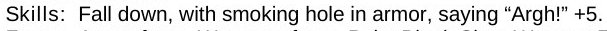

## p.25 (scan page 25)

Page contents: 580 words, 17 paragraphs | headings/entries: Low Tier (levels 1-3); Mid Tier (levels 4-6); Continued next page; Decision: Cularin Page 25

- **No single roster character (rules/setting/general)** — entry/section: Thaereian Extra Droid Troopers: "Tactics: "Shoot 'em, roger-roger-- oh zotz, my arm fell off." These are controlled from inside the base. They're the economy models. Since they are droids, they can be destroyed by the score, with no angst and no messy stains." Source: *418 - Decisions - Decision Cularin* (SWRPG d20 Revised Core), p.25
  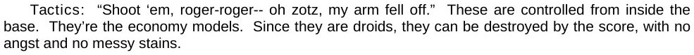

## p.26 (scan page 26)

Page contents: 589 words, 18 paragraphs | headings/entries: High Tier (levels 7-9); Upper Tier (levels10-12); Continued next page; Decision: Cularin Page 26

### Stat block notes (game mechanics, not feats)

- Thaereian Elite Troopers: Thaereian Elite Troopers (upper tier): Soldier 5/Scoundrel 6; VP/WP 58/14; +12/+7 ranged (3d8); up to +8/+8/+8/+3 with Rapid Shot and Multishot; FP 3 (Source: *418 - Decisions - Decision Cularin* (SWRPG d20 Revised Core), p.26)

## p.27 (scan page 27)

Page contents: 729 words, 10 paragraphs | headings/entries: Decision: Cularin Page 27

## p.28 (scan page 28)

Page contents: 586 words, 11 paragraphs | headings/entries: Or, instead use:; Biko; Decision: Cularin Page 28

- **Ki-Adi-Mundi** — entry/section: Ki-Adi-Mundi: "He once said, at the Almas Academy, "I would be proud to serve with any of the beings here tonight. Who knows, perhaps one day I shall?"" Source: *418 - Decisions - Decision Cularin* (SWRPG d20 Revised Core), p.28
  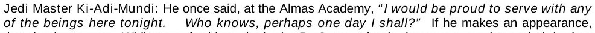
- **Ki-Adi-Mundi** — entry/section: Ki-Adi-Mundi: "he has "script immunity" and only appears to deflect a few blaster bolts, wave away some droids, affect the enemy's minds so that they go away, or whatever is needed." Source: *418 - Decisions - Decision Cularin* (SWRPG d20 Revised Core), p.28
  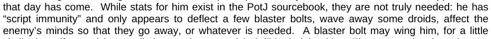
- **No single roster character (rules/setting/general)** — entry/section: Biko: "He is 15, one year short of official, full Rodian adulthood, but lied about his age to get into the Militia. Sadly, he will never reach full adulthood, now." Source: *418 - Decisions - Decision Cularin* (SWRPG d20 Revised Core), p.28
  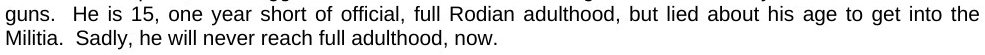
- **No single roster character (rules/setting/general)** — entry/section: Oora Gellandi: "Sadly, Oora pays the price for her own decisions about how to be a hero, in this conflict." Source: *418 - Decisions - Decision Cularin* (SWRPG d20 Revised Core), p.28
  

### Stat block notes (game mechanics, not feats)

- Ki-Adi-Mundi: Ki-Adi-Mundi at the Battle of Cularin (Dorumaa): script immunity; deflects blaster bolts, waves away droids, mind-affects the enemy; may only be winged for a little vitality loss ("this is not his time") (Source: *418 - Decisions - Decision Cularin* (SWRPG d20 Revised Core), p.28)

## p.29 (scan page 29)

Page contents: 421 words, 29 paragraphs | headings/entries: Encounter 4: Turbolaser Diplomacy; Encounter 5: Choke Hold; Corellian Engineering Corporation Corvette Indefatigable; Decision: Cularin Page 29

### Stat block notes (game mechanics, not feats)

- Indefatigable: Corellian Corvette Indefatigable: crew expert +8; Shield 200 (DR 20); Hull 300 (DR 20); 6 double turbolaser cannons +9, 5d10x2 (Source: *418 - Decisions - Decision Cularin* (SWRPG d20 Revised Core), p.29)

## p.30 (scan page 30)

Page contents: 505 words, 30 paragraphs | headings/entries: Tier 1 (levels 4-6); Tier 2 (levels 7-9); Tier 3 (levels10-12); Decision: Cularin Page 30

- **No single roster character (rules/setting/general)** — entry/section: GM Note: "Starship combat has one central trait: it can go from "hey, no problems here" to "what do you mean, I'm an expanding vapor cloud" in one die roll." Source: *418 - Decisions - Decision Cularin* (SWRPG d20 Revised Core), p.30
  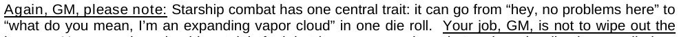

## p.31 (scan page 31)

Page contents: 599 words, 22 paragraphs | headings/entries: Potential "helpers" (not tiered):; Teeloo; Nirama Modified Incom/Subpro Z-95 Headhunter Starfighter (1); Ordinary (+10); Encounter 6: The Republic Strikes Back; Decision: Cularin Page 31

- **No single roster character (rules/setting/general)** — entry/section: Teeloo: "He's a typical Rodian who can do the "puppy dog" look very well, and who "thpeakth with a bit of a lithp". Thaereians blew up the old Neeva Beelo, sadly, but it wasn't much above space junk when it went." Source: *418 - Decisions - Decision Cularin* (SWRPG d20 Revised Core), p.31
  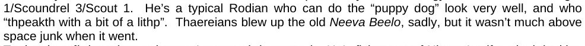

## p.32 (scan page 32)

Page contents: 525 words, 21 paragraphs | headings/entries: SoroSuub V-19 Gian Speeder; Decision: Cularin Page 32

## p.33 (scan page 33)

Page contents: 64 words, 12 paragraphs | headings/entries: GM Aid; T; Shield Emitter a; Inner Defense Trench; Decision: Cularin Page 33

## p.18–33 (scan page 18)

Page contents: Player handouts and GM Aids: ships, vehicles, maps, NPC stats by tier, helpers (hand-read)

