# Owner Material 037 — Star Wars D20 Drive folder (Core, Revised Core and Saga Edition): Living Force Campaign/Adventures/Among the Stars/Year 5/501 - Polarization - Challenge.pdf [Star Wars Roleplaying Game Revised Core (d20, 2002)]

- **Source:** Wizards of the Coast Star Wars Roleplaying Game books, web enhancements, Living Force campaign modules and articles (2000–2010), from the owner's "Star Wars D20" Drive folder (only the three edition subfolders; "General" was not read, as instructed). Secondary source (licensed Legends reference). Scan OCR'd on the box; the scan stays box-only and is **not** published.
- **Method:** every scanned page was OCR'd and machine-screened sentence by sentence for power-relevant statements (fights, kills, defeats, Force feats, rankings, superweapons) that name a character on our roster; each kept sentence is quoted verbatim from the OCR text and has a crop of the printed passage directly under it. Pages with nothing power-relevant are still listed with what is on them.
- **Citation:** "*501 - Polarization - Challenge* (SWRPG d20 Revised Core), p.X" by printed page ("scan p.X" where no printed number applies). **Weight:** Licensed RPG material: a secondary source. Narrative text sums up Legends lore; game statistics are rules for players, not canon power levels, and rank lowest.

## p.1 (scan page 1)

Page contents: 118 words, 8 paragraphs | headings/entries: LFA501; Challenge; Edited by Ron Heintz; Polarization I: Challenge Page 1

- **No single roster character (rules/setting/general)** — entry/section: Blurb: "The heroes are called upon to aid the innocent civilians caught in a sudden conflict between Nirama's organization and a mysterious newcomer bent on taking over." Source: *501 - Polarization - Challenge* (SWRPG d20 Revised Core), p.1
  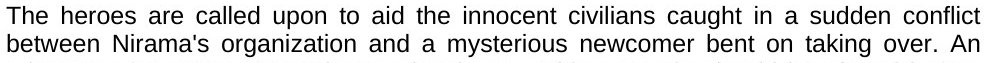

## p.2 (scan page 2)

Page contents: 783 words, 22 paragraphs | headings/entries: Campaign Notes to the GM; Polarization I: Challenge; House Rules; Atoning for Dark Side Points; Dissipate Energy; Illusion; Stun; Page 2

## p.3 (scan page 3)

Page contents: 732 words, 13 paragraphs | headings/entries: Hero Earnings; Polarization I: Challenge; Issuing Dark Side Points; Wookiees, Rage and Dark Side Points; Page 3

## p.4 (scan page 4)

Page contents: 768 words, 22 paragraphs | headings/entries: GM Overview; Encounter 1: Opening Hand; Polarization I: Challenge; Encounter 2: Seven of Flasks; Encounter 3: Six of Coins; Encounter 4: Five of Staves; Encounter 5: Five of Blades; Encounter 6: Pure Sabacc (Wrap-Up); Page 4

- **No single roster character (rules/setting/general)** — entry/section: GM Overview: "In the year 122 A.A. (After Artom) Riboga the Hutt arrived in the Cularin system, looked around and decided to make it his new home. He took over the fledgling groups of independent smugglers, introduced a few vices of his own, made a valuable slavery supply line and sat back to reap the profits." Source: *501 - Polarization - Challenge* (SWRPG d20 Revised Core), p.4
  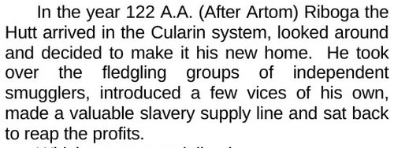
- **No single roster character (rules/setting/general)** — entry/section: GM Overview: "Which never materialized." Source: *501 - Polarization - Challenge* (SWRPG d20 Revised Core), p.4
  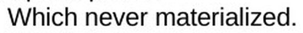
- **No single roster character (rules/setting/general)** — entry/section: Riboga the Hutt: "So, when the accountant and he sat down at their weekly game of sabacc and the accountant casually offered to put up a quarter of a million credits against the entire operation, Riboga laughed. And when the accountant won Riboga packed his bags and, still laughing, left the system." Source: *501 - Polarization - Challenge* (SWRPG d20 Revised Core), p.4
  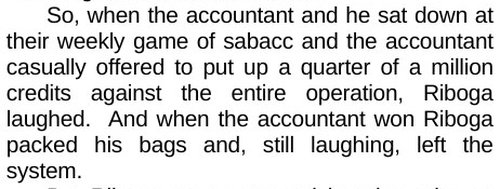
- **No single roster character (rules/setting/general)** — entry/section: Riboga the Hutt: "But Riboga never stopped keeping tabs on his old accountant. And recently, he stopped laughing and started planning. And, now that Cularin is free of Thaereian control and once more a potential treasure trove, it's time to act." Source: *501 - Polarization - Challenge* (SWRPG d20 Revised Core), p.4
  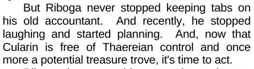
- **No single roster character (rules/setting/general)** — entry/section: Teeloo: "Note that as Plots has not had critical event summaries indicating that Teeloo fell during the recent battles concerning Thaere, it is presumed that he is still alive at the start of this scenario. Alas, not for long." Source: *501 - Polarization - Challenge* (SWRPG d20 Revised Core), p.4
  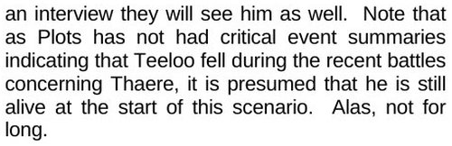

## p.5 (scan page 5)

Page contents: 646 words, 20 paragraphs | headings/entries: Opening Crawl; Polarization I: Challenge; Encounter 1: Opening Hand; Page 5

- **No single roster character (rules/setting/general)** — entry/section: Judges' Note: "There are some things that are destined to happen, despite the heroes best efforts. Riboga is going to oust Nirama and bystanders are going to suffer in the process. The heroes' goal is to minimize collateral damage and save lives." Source: *501 - Polarization - Challenge* (SWRPG d20 Revised Core), p.5
  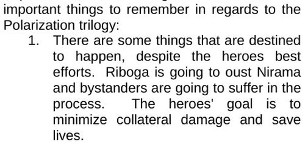
- **No single roster character (rules/setting/general)** — entry/section: Opening Crawl: "Civilians, now safe and secure, want to hear more about the heroes of the Thaereian Conflict. And about those that might not be considered heroes in the traditional sense." Source: *501 - Polarization - Challenge* (SWRPG d20 Revised Core), p.5
  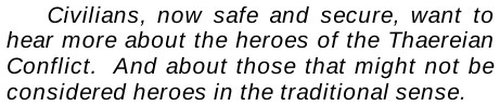
- **No single roster character (rules/setting/general)** — entry/section: Opening Crawl: "Such as Nirama." Source: *501 - Polarization - Challenge* (SWRPG d20 Revised Core), p.5
  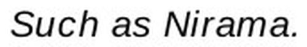

## p.1–5 (scan page 1)

Page contents: Title, blurb, house rules, GM overview of Riboga's return, judges' notes, opening crawl (hand-read)

## p.6 (scan page 6)

Page contents: 721 words, 24 paragraphs | headings/entries: Polarization I: Challenge; Encounter 2: Seven of Flasks; Page 6

- **No single roster character (rules/setting/general)** — entry/section: Teeloo: ""Fwendths. It is good to thhee you have thhurvived the war. Ithn't it wonderful how Nirama ith finally being reconithhed ath a patriot?" Source: *501 - Polarization - Challenge* (SWRPG d20 Revised Core), p.6
  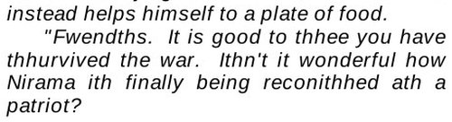
- **No single roster character (rules/setting/general)** — entry/section: Teeloo: ""How do you do? My name ithh Teeloo, pilot and merchant." Source: *501 - Polarization - Challenge* (SWRPG d20 Revised Core), p.6
  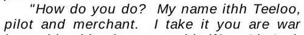
- **No single roster character (rules/setting/general)** — entry/section: Teeloo: "If the heroes seem (or are) unwilling to meet with Teeloo the Rodian is genuinely upset. The war gave him a sense of purpose and he's eager to relive that." Source: *501 - Polarization - Challenge* (SWRPG d20 Revised Core), p.6
  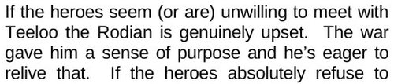

## p.7 (scan page 7)

Page contents: 689 words, 28 paragraphs | headings/entries: DC Listen Spot; Polarization I: Challenge; Page 7

- **No single roster character (rules/setting/general)** — entry/section: Teeloo: "Teeloo is lying there, slumped to one side, his eyes stare past you sightlessly. A small carbon burn can be seen on the chest of his shirt." Source: *501 - Polarization - Challenge* (SWRPG d20 Revised Core), p.7
  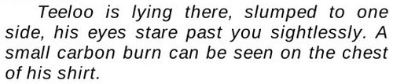
- **No single roster character (rules/setting/general)** — entry/section: Escra Fey'lya: ""Inspector Escra Fey'lya, Cularin OPS, Organized Crime Division. What can you tell me?"" Source: *501 - Polarization - Challenge* (SWRPG d20 Revised Core), p.7
  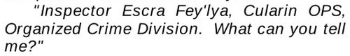
- **No single roster character (rules/setting/general)** — entry/section: Escra Fey'lya: "It's truly bad and you hear a snort of amusement from Escra as she follows your gaze. "They always exaggerate the ears," she mutters." Source: *501 - Polarization - Challenge* (SWRPG d20 Revised Core), p.7
  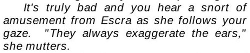

## p.8 (scan page 8)

Page contents: 758 words, 26 paragraphs | headings/entries: Looking for Clues; Polarization I: Challenge; Encounter 3: Six of Coins; Kills' Plan; Page 8

- **No single roster character (rules/setting/general)** — entry/section: Escra Fey'lya: "Escra turns to your group. "Duty calls. Feel free to look around. Turn over everything to my people, of course."" Source: *501 - Polarization - Challenge* (SWRPG d20 Revised Core), p.8
  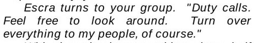
- **No single roster character (rules/setting/general)** — entry/section: Kills: "The boss seemed pretty sure that she could find them." Source: *501 - Polarization - Challenge* (SWRPG d20 Revised Core), p.8
  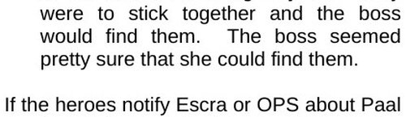
- **No single roster character (rules/setting/general)** — entry/section: Kills: "There is no Plan C - if plan A or B aren't likely to be successful she just walks away and tries again, later." Source: *501 - Polarization - Challenge* (SWRPG d20 Revised Core), p.8
  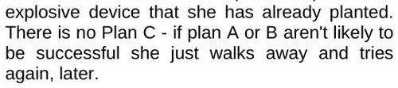

## p.5–8 (scan page 5)

Page contents: E1 the Nirama documentary and Teeloo's invitation; E2 Teeloo's murder, Escra Fey'lya, the first sabacc card (hand-read)

## p.9 (scan page 9)

Page contents: 787 words, 25 paragraphs | headings/entries: Polarization I: Challenge; Card Details; Encounter 4: Five of Staves; Key ideas of this encounter: the heroes; Page 9

- **No single roster character (rules/setting/general)** — entry/section: Kills: "she'll broadcast to the hangar "I've lost my original target. You'll do instead."" Source: *501 - Polarization - Challenge* (SWRPG d20 Revised Core), p.9
  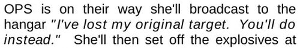
- **No single roster character (rules/setting/general)** — entry/section: Kills: "She then dumps a robe and gun to become a harried mother shopping while the kids are at the sitter. It's a role she's used and practiced often." Source: *501 - Polarization - Challenge* (SWRPG d20 Revised Core), p.9
  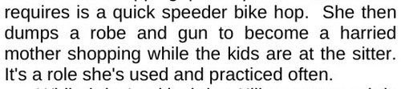

## p.10 (scan page 10)

Page contents: 740 words, 22 paragraphs | headings/entries: Polarization I: Challenge; Page 10

- **No single roster character (rules/setting/general)** — entry/section: Encounter 4: "They say that there is no law on Toleo Biqua. Technically there is; Tolea Biqua Security Corporation, the lowest bidder." Source: *501 - Polarization - Challenge* (SWRPG d20 Revised Core), p.10
  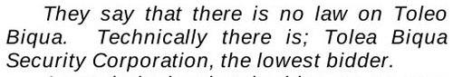
- **No single roster character (rules/setting/general)** — entry/section: Encounter 4: "The casino seems to have only two purposes, separate the credits from their owner and ridicule the Hutt race with as many crude and offensive pictures as possible." Source: *501 - Polarization - Challenge* (SWRPG d20 Revised Core), p.10
  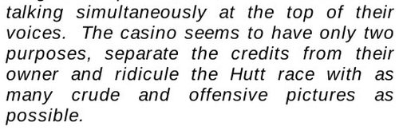
- **No single roster character (rules/setting/general)** — entry/section: Kills: "Think cat and mouse with Kills shooting blaster bolts into the floor as they scramble backwards and it will take her four rounds to kill them both." Source: *501 - Polarization - Challenge* (SWRPG d20 Revised Core), p.10
  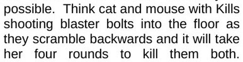

## p.11 (scan page 11)

Page contents: 768 words, 24 paragraphs | headings/entries: What to do with Kills; Encounter 5: Five of Blades; Polarization I: Challenge; Page 11

- **No single roster character (rules/setting/general)** — entry/section: Lola: ""Thank you for the warning. It's best if you simply forget this and went back to your lives. I've seen your faces and names in the holo-news, but this isn't something you can fight like pirates or the Thaereians. Please, walk away from it."" Source: *501 - Polarization - Challenge* (SWRPG d20 Revised Core), p.11
  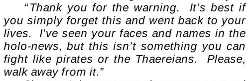
- **No single roster character (rules/setting/general)** — entry/section: Kills: "Feel free to play this up if you have the time; the irony of an assassin and her supposed victim inviting the rescuers for tea and cookies." Source: *501 - Polarization - Challenge* (SWRPG d20 Revised Core), p.11
  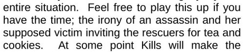

## p.12 (scan page 12)

Page contents: 491 words, 24 paragraphs | headings/entries: Conclusion: Pure Sabacc; Here Ends, "Challenge"; Experience Point Summary; Experience is calculated as follows for LIVING; Polarization I: Challenge; Adventure Experience Award:; Page 12

- **No single roster character (rules/setting/general)** — entry/section: Escra Fey'lya: ""Needless to say, something big is, happening. It's system wide and, until we have a system government and law enforcement, we're still vulnerable. Just as we were to the Thaereians and_ the crimelords."" Source: *501 - Polarization - Challenge* (SWRPG d20 Revised Core), p.12
  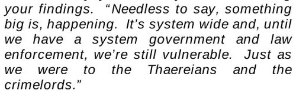
- **No single roster character (rules/setting/general)** — entry/section: Holonews: "an anonymous source Claims that all the victims are suspected or known associates of Nirama, the so-called Crimelord of Cularin."" Source: *501 - Polarization - Challenge* (SWRPG d20 Revised Core), p.12
  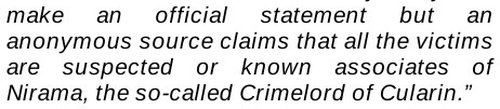
- **No single roster character (rules/setting/general)** — entry/section: Escra Fey'lya: ""Now it has really begun."" Source: *501 - Polarization - Challenge* (SWRPG d20 Revised Core), p.12
  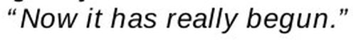

## p.8–12 (scan page 8)

Page contents: E3 Kills at Docking Bay 77; E4 the brawl at Riboga's Barge; E5 Lola and Kills at tea; conclusion; XP and loot (hand-read)

## p.13 (scan page 13)

Page contents: 67 words, 8 paragraphs | headings/entries: Player Handout 1: Interview Questions; Do you feel that you're a criminal?; Why has it changed?; Polarization I: Challenge Page 13

## p.14 (scan page 14)

Page contents: 43 words, 7 paragraphs | headings/entries: Player Handout 2: Sabacc Card Clues; Polarization I: Challenge; Page 14

## p.15 (scan page 15)

Page contents: 75 words, 9 paragraphs | headings/entries: Player Handout 3: Map of Riboga's Barge; Private or Upper Room; Polarization I: Challenge Page 15

## p.16 (scan page 16)

Page contents: 621 words, 23 paragraphs | headings/entries: Kill's Goons:; Mid Tier (levels 4-6); High Tier (levels 7-9); Upper Tier (levels 10-12); Office of Public Safety Officers,; Polarization I: Challenge Page 16

## p.17 (scan page 17)

Page contents: 559 words, 22 paragraphs | headings/entries: Mid Tier (levels 4-6); High Tier (levels 7-9); Upper Tier (levels 10-12); Polarization I: Challenge Page 17

- **No single roster character (rules/setting/general)** — entry/section: Kills: "Kills doesn't particularly like Riboga and no one knows what kind of hold he has over her. It is rumored that Riboga has cloned the assassin so that he will never be without her services should the original be captured or killed." Source: *501 - Polarization - Challenge* (SWRPG d20 Revised Core), p.17
  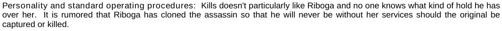

### Stat block notes (game mechanics, not feats)

- Kills: Kills (upper tier): Human Scoundrel 6/Soldier 6; VP/WP 67/13; +13/+8 ranged (3d8, custom sniper rifle); Profession (Assassin) +13; Lucky 2/day (Source: *501 - Polarization - Challenge* (SWRPG d20 Revised Core), p.17)

## p.18 (scan page 18)

Page contents: 682 words, 17 paragraphs | headings/entries: GM Aid #2: Major Players (Not Tiered); Nirama, Male Alien Scoundrel 6/ Crimelord 9; Riboga, Male Hutt Scoundrel 8/ Crimelord 10;; Inspector Escra Fey'lya, Female Bothan Scoundrel 8;; Polarization I: Challenge Page 18

- **No single roster character (rules/setting/general)** — entry/section: Nirama: "Nirama is a person in flux. For his entire life he has made his living through crime." Source: *501 - Polarization - Challenge* (SWRPG d20 Revised Core), p.18
  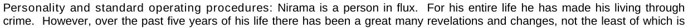
- **No single roster character (rules/setting/general)** — entry/section: Nirama: "While it would be wrong to say that Nirama is seeking to turn legitimate no one can deny that he is no longer the villain he was a few years ago." Source: *501 - Polarization - Challenge* (SWRPG d20 Revised Core), p.18
  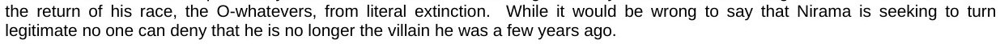
- **No single roster character (rules/setting/general)** — entry/section: Riboga the Hutt: "Riboga is one of those beings that see the entire universe as a play written for their sole amusement. Reversals and failures are to be laughed off (after a few scapegoats are killed) and success is to be accepted as due prerogative." Source: *501 - Polarization - Challenge* (SWRPG d20 Revised Core), p.18
  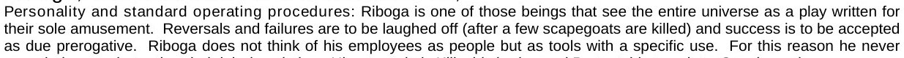
- **No single roster character (rules/setting/general)** — entry/section: Riboga the Hutt: "For this reason he never uses their name but rather their job description. His assassin is Kills, his bodyguard Protect, his translator Speaks and so on." Source: *501 - Polarization - Challenge* (SWRPG d20 Revised Core), p.18
  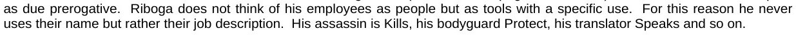
- **No single roster character (rules/setting/general)** — entry/section: Escra Fey'lya: "Escra is the product of the saying "if you can't beat them, recruit them"; a youthful criminal who caught the eye of an OPS officer." Source: *501 - Polarization - Challenge* (SWRPG d20 Revised Core), p.18
  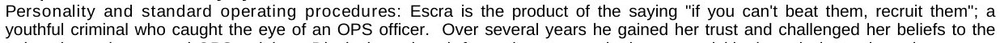

### Stat block notes (game mechanics, not feats)

- Nirama: Nirama, Male Alien Scoundrel 6/Crimelord 9; VP/WP 90/15; Rep 17; Bluff +20, Appraise +19, Diplomacy +19; personal space yacht Viper Wing (Source: *501 - Polarization - Challenge* (SWRPG d20 Revised Core), p.18)
- Riboga the Hutt: Riboga, Male Hutt Scoundrel 8/Crimelord 10 (Source: *501 - Polarization - Challenge* (SWRPG d20 Revised Core), p.18)
- Escra Fey'lya: Inspector Escra Fey'lya, Female Bothan Scoundrel 8; VP/WP 39/13; Bluff +15, Pilot +13; YT-1300 Whirling Stars (Source: *501 - Polarization - Challenge* (SWRPG d20 Revised Core), p.18)

## p.19 (scan page 19)

Page contents: 85 words, 9 paragraphs | headings/entries: GM Aid #3: Map of Riboga's Barge; Polarization I: Challenge Page 19

## p.13–19 (scan page 13)

Page contents: Player handouts and GM Aids: goons, OPS, Kills by tier, Nirama, Riboga, Escra, barge map (hand-read)

