# Owner Material 037 — Star Wars D20 Drive folder (Core, Revised Core and Saga Edition): Living Force Campaign/Adventures/Among the Stars/Year 5/502 - Polarization - Revelations.pdf [Star Wars Roleplaying Game Revised Core (d20, 2002)]

- **Source:** Wizards of the Coast Star Wars Roleplaying Game books, web enhancements, Living Force campaign modules and articles (2000–2010), from the owner's "Star Wars D20" Drive folder (only the three edition subfolders; "General" was not read, as instructed). Secondary source (licensed Legends reference). Scan OCR'd on the box; the scan stays box-only and is **not** published.
- **Method:** every scanned page was OCR'd and machine-screened sentence by sentence for power-relevant statements (fights, kills, defeats, Force feats, rankings, superweapons) that name a character on our roster; each kept sentence is quoted verbatim from the OCR text and has a crop of the printed passage directly under it. Pages with nothing power-relevant are still listed with what is on them.
- **Citation:** "*502 - Polarization - Revelations* (SWRPG d20 Revised Core), p.X" by printed page ("scan p.X" where no printed number applies). **Weight:** Licensed RPG material: a secondary source. Narrative text sums up Legends lore; game statistics are rules for players, not canon power levels, and rank lowest.

## p.1 (scan page 1)

Page contents: 118 words, 8 paragraphs | headings/entries: LFA502; Revelations; Edited by Ron Heintz

- **No single roster character (rules/setting/general)** — entry/section: Blurb: "As the mysterious crime lord is revealed and the personal motives exposed the violence steps up as Nirama realizes that he's fighting not only for his empire, but his life." Source: *502 - Polarization - Revelations* (SWRPG d20 Revised Core), p.1
  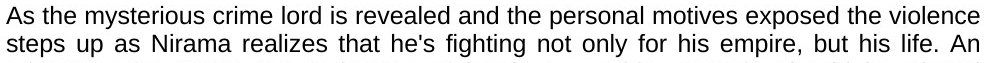

## p.2 (scan page 2)

Page contents: 802 words, 23 paragraphs | headings/entries: Campaign Notes to the GM; House Rules; Atoning for Dark Side Points; Dissipate Energy; Illusion; Stun; Page 2

## p.3 (scan page 3)

Page contents: 714 words, 17 paragraphs | headings/entries: Hero Earnings; Issuing Force Points; Issuing Dark Side Points; Wookiees, Rage and Dark Side Points; Page 3

## p.4 (scan page 4)

Page contents: 703 words, 26 paragraphs | headings/entries: GM Overview; Encounter 1: New Dealer; Encounter 2: Eleven of Coins; Encounter 3: Eleven of Flasks; Encounter 4: Bet; Encounter 5: Call, Hold or Fold; Encounter 6: The Whole Pot; Page 4

- **No single roster character (rules/setting/general)** — entry/section: Nirama: "In the year 179 A.A. (After Artom) Nirama took over from Riboga the Hutt. He quickly abolished the slavery trade and restructured the organization so that his underlings could not attempt a similar coup." Source: *502 - Polarization - Revelations* (SWRPG d20 Revised Core), p.4
  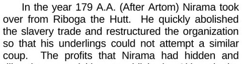
- **No single roster character (rules/setting/general)** — entry/section: Nirama: "But a funny thing happened over the years. Little incidents that affected Nirama's empire required responses that affected Cularin's future. And as Nirama began to see how much his empire was tied to Cularin they became one and the same." Source: *502 - Polarization - Revelations* (SWRPG d20 Revised Core), p.4
  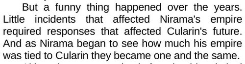
- **No single roster character (rules/setting/general)** — entry/section: Nirama: "Now, instead of operating from the shadows, Nirama stood in the spotlight." Source: *502 - Polarization - Revelations* (SWRPG d20 Revised Core), p.4
  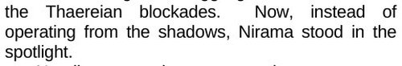
- **No single roster character (rules/setting/general)** — entry/section: Nirama: "Needless to say he was spotted." Source: *502 - Polarization - Revelations* (SWRPG d20 Revised Core), p.4
  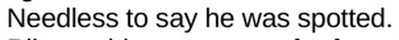
- **No single roster character (rules/setting/general)** — entry/section: Riboga the Hutt: "Nor was he particularly surprised at Nirama's altruism; not every race is gifted with the Hutt's total lack of conscious and greater men than Nirama have succumbed to hero worship. In fact, Riboga approved of it. After all, it made Nirama that much easier to attack." Source: *502 - Polarization - Revelations* (SWRPG d20 Revised Core), p.4
  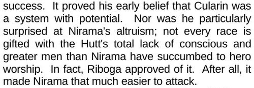
- **No single roster character (rules/setting/general)** — entry/section: Riboga the Hutt: "Riboga believes you can tell much about a being by the tools they use." Source: *502 - Polarization - Revelations* (SWRPG d20 Revised Core), p.4
  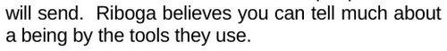
- **No single roster character (rules/setting/general)** — entry/section: Judges' Note: "The players are going to lose this trilogy." Source: *502 - Polarization - Revelations* (SWRPG d20 Revised Core), p.4
  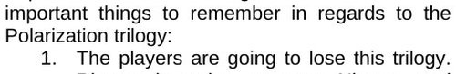

## p.5 (scan page 5)

Page contents: 663 words, 22 paragraphs | headings/entries: Opening Crawl; Encounter 1: New Dealer; Assets; Encounter 2: Eleven of Coins; Page 5

- **No single roster character (rules/setting/general)** — entry/section: Opening Crawl: "The Thaereian War is over but a new war has begun." Source: *502 - Polarization - Revelations* (SWRPG d20 Revised Core), p.5
  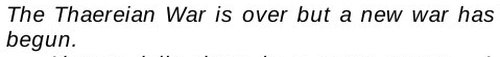

## p.1–5 (scan page 1)

Page contents: Title, blurb, house rules, GM overview of Nirama's rise and Riboga's return, judges' notes, crawl (hand-read)

## p.6 (scan page 6)

Page contents: 690 words, 24 paragraphs | headings/entries: Encounter 3: Eleven of Flasks; Page 6

- **No single roster character (rules/setting/general)** — entry/section: Nirama: ""If you're finished here I would like a few moments of your time."" Source: *502 - Polarization - Revelations* (SWRPG d20 Revised Core), p.6
  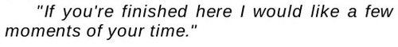
- **No single roster character (rules/setting/general)** — entry/section: Nirama: ""At first the attacks were more precise," he says, gesturing toward the burning building. "However, as you can see, less and less effort is being made to reduce -secondary- damage. Children..."" Source: *502 - Polarization - Revelations* (SWRPG d20 Revised Core), p.6
  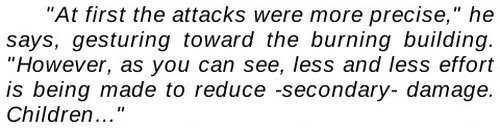
- **No single roster character (rules/setting/general)** — entry/section: Nirama: "His voice trails off as he stares out the window, the expression on his face softening. Suddenly, almost as if a switch is thrown, he turns back to you. Nirama's expression turns hard and cold." Source: *502 - Polarization - Revelations* (SWRPG d20 Revised Core), p.6
  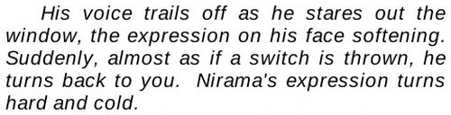
- **No single roster character (rules/setting/general)** — entry/section: Nirama: "Control over these assets is the goal. I find no pleasure in fighting for something I no longer desire." Source: *502 - Polarization - Revelations* (SWRPG d20 Revised Core), p.6
  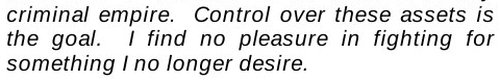
- **No single roster character (rules/setting/general)** — entry/section: Nirama: "Why should we help you? Nirama waves out the window and you see a paramedic holding a breather mask up to a little girls face. "This must stop."" Source: *502 - Polarization - Revelations* (SWRPG d20 Revised Core), p.6
  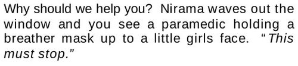
- **No single roster character (rules/setting/general)** — entry/section: Nirama: ""This is your invitation. It will get you safely into Riboga's Barge."" Source: *502 - Polarization - Revelations* (SWRPG d20 Revised Core), p.6
  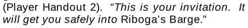

## p.7 (scan page 7)

Page contents: 685 words, 29 paragraphs | headings/entries: Encounter 4: Bet; Muggin; Page 7

- **No single roster character (rules/setting/general)** — entry/section: Escra Fey'lya: ""I'm not asking you not to go but I am asking you to take care and keep your ears open."" Source: *502 - Polarization - Revelations* (SWRPG d20 Revised Core), p.7
  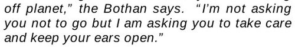
- **No single roster character (rules/setting/general)** — entry/section: Speaks: ""I'm here to take you to the Barge. Don't bother asking me anything. I have my orders and they don't include chatting with lackeys."" Source: *502 - Polarization - Revelations* (SWRPG d20 Revised Core), p.7
  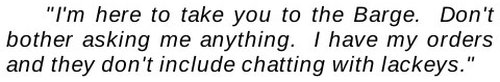
- **No single roster character (rules/setting/general)** — entry/section: Speaks: ""Hey, I'm just the driver. I pick you up; I drop you off. It ain't hyperspace science." Or, "You can call me Speaks. It's my nickname."" Source: *502 - Polarization - Revelations* (SWRPG d20 Revised Core), p.7
  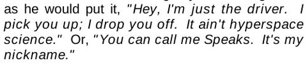
- **No single roster character (rules/setting/general)** — entry/section: Speaks: "The driver makes a short, barking laugh. "Beat it brat."" Source: *502 - Polarization - Revelations* (SWRPG d20 Revised Core), p.7
  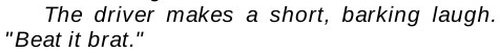
- **No single roster character (rules/setting/general)** — entry/section: Speederjacking: ""Pull over. Road tax," shouts the lead rider. "All your creds and stuff or your speeder. Your choice."" Source: *502 - Polarization - Revelations* (SWRPG d20 Revised Core), p.7
  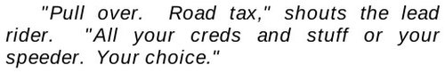

## p.5–7 (scan page 5)

Page contents: E1 the burning-building rescue; E2 Nirama's request; E3 Escra's warning and the driver Speaks (hand-read)

## p.8 (scan page 8)

Page contents: 732 words, 27 paragraphs | headings/entries: Encounter 5: Call, Hold or Fold; Page 8

- **No single roster character (rules/setting/general)** — entry/section: Speaks: "then make "zing - zing - zing" noises at them, an obvious reference to the cowardly Yellow- Bellied Green-Proboscis Marsupial of Gerzob." Source: *502 - Polarization - Revelations* (SWRPG d20 Revised Core), p.8
  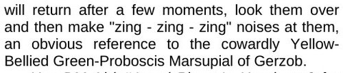
- **No single roster character (rules/setting/general)** — entry/section: Speaks: ""The grand and majestic Riboga has given me the name 'Speaks'. The mighty and wise Riboga bids you welcome. The great and compassionate Riboga assumes that, as the emissaries of Nirama, you are worthy to enter into these negotiations." Source: *502 - Polarization - Revelations* (SWRPG d20 Revised Core), p.8
  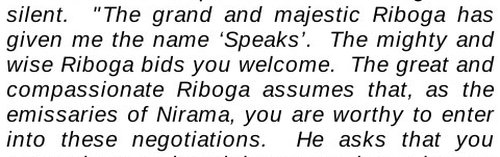
- **No single roster character (rules/setting/general)** — entry/section: Riboga the Hutt: "Oh, and Nirama place his head on a silver platter for Riboga to enjoy." Source: *502 - Polarization - Revelations* (SWRPG d20 Revised Core), p.8
  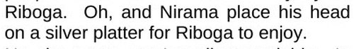
- **No single roster character (rules/setting/general)** — entry/section: Riboga the Hutt: "No, the terms aren't really negotiable. In fact, they aren't really terms. This is what" Source: *502 - Polarization - Revelations* (SWRPG d20 Revised Core), p.8
  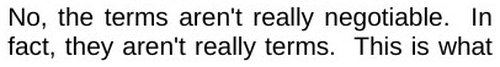

## p.9 (scan page 9)

Page contents: 703 words, 28 paragraphs | headings/entries: Encounter 6: The Whole Pot; Ambush One; Ambush Two; Ambush Three; Page 9

- **No single roster character (rules/setting/general)** — entry/section: Speaks: ""Riboga is amused. He may let you live. Do you have anything else to tell the great and grey Riboga?"" Source: *502 - Polarization - Revelations* (SWRPG d20 Revised Core), p.9
  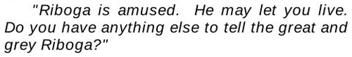
- **No single roster character (rules/setting/general)** — entry/section: Speaks: ""Riboga is now very bored with you. He has decided not to let you live after all. Or rather, one may live to carry the message to the traitor Nirama. You should flee for your lives now."" Source: *502 - Polarization - Revelations* (SWRPG d20 Revised Core), p.9
  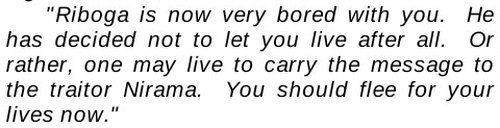
- **No single roster character (rules/setting/general)** — entry/section: Riboga the Hutt: "Riboga Speaks #1: About time you got here! Nirama always hires idiots and incompetents. Step closer but not too close. You reek." Source: *502 - Polarization - Revelations* (SWRPG d20 Revised Core), p.9
  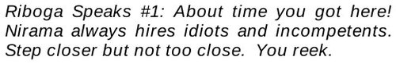
- **No single roster character (rules/setting/general)** — entry/section: Riboga the Hutt: "Riboga Speaks #2: They are brave! But stupid." Source: *502 - Polarization - Revelations* (SWRPG d20 Revised Core), p.9
  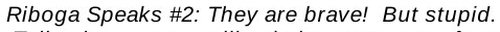
- **No single roster character (rules/setting/general)** — entry/section: Riboga the Hutt: "Riboga Speaks #3: I tire of this. They really are naive and gullible. Make sure one survives to get the message to the three-armed traitor. The rest of them: kill them all." Source: *502 - Polarization - Revelations* (SWRPG d20 Revised Core), p.9
  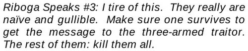
- **No single roster character (rules/setting/general)** — entry/section: Encounter 6: "Your goal with the chase is to recreate the feeling of the bike chase in Return of the Jedi or the airspeeder chase in Attack of the Clones rather than rolling a lot of dice." Source: *502 - Polarization - Revelations* (SWRPG d20 Revised Core), p.9
  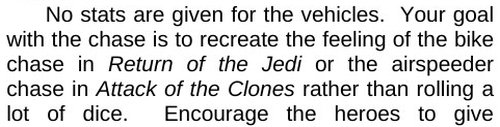

## p.10 (scan page 10)

Page contents: 551 words, 24 paragraphs | headings/entries: Conclusion; Here Ends, "Revelations"; Loot Summary; Page 10

- **No single roster character (rules/setting/general)** — entry/section: Encounter 6: ""Cinematic" is the watchword in this encounter." Source: *502 - Polarization - Revelations* (SWRPG d20 Revised Core), p.10
  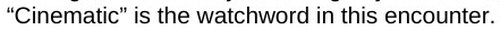
- **No single roster character (rules/setting/general)** — entry/section: Nirama: "Nirama seems to shrink somehow. "I see," he says, wringing two of his hands together nervously while the third drums on the table. "This put things in a new light. I must think."" Source: *502 - Polarization - Revelations* (SWRPG d20 Revised Core), p.10
  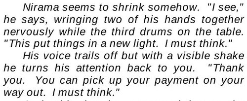
- **No single roster character (rules/setting/general)** — entry/section: Conclusion: "Everyone is surprised to see Riboga back in the system. While new task forces and investigations will begin, ultimately, the next move is Nirama's." Source: *502 - Polarization - Revelations* (SWRPG d20 Revised Core), p.10
  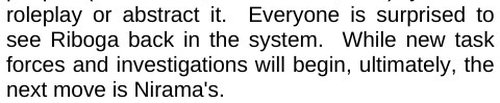

## p.7–10 (scan page 7)

Page contents: E4 Riboga's tests en route; E5 Riboga's hologram audience and terms; E6 the running gun battle; conclusion, XP, loot (hand-read)

## p.11 (scan page 11)

Page contents: 49 words, 22 paragraphs | headings/entries: Player Handout 1: Map of Burning Building; Refresher; Refresher; Kitchen; Bedroom; Living Area; Ground Floor First Floor; Living Area; Second Floor; Dining Area; Uaysadfay; IAA, JTO4S; Kitchen; Dining Area; UaYSauLay; Page 11

## p.12 (scan page 12)

Page contents: 10 words, 2 paragraphs | headings/entries: Player Handout 2: Sabacc Cards

## p.13 (scan page 13)

Page contents: 42 words, 6 paragraphs | headings/entries: Player Handout 3: Map of Riboga's Barge; POOL this has

## p.14 (scan page 14)

Page contents: 114 words, 9 paragraphs | headings/entries: Player Handout 4: Riboga Speaks; Disembowel! Hal! Ha!

## p.15 (scan page 15)

Page contents: 473 words, 19 paragraphs | headings/entries: Riboga's Goons:; Mid Tier (levels 4-6); High Tier (levels 7-9); Upper Tier (levels 10-12)

### Stat block notes (game mechanics, not feats)

- Riboga's Goons: Riboga's Goons (upper tier): Scoundrel 6/Soldier 6; VP/WP 67/13; +13/+8 ranged (3d8) (Source: *502 - Polarization - Revelations* (SWRPG d20 Revised Core), p.15)

## p.16 (scan page 16)

Page contents: 682 words, 16 paragraphs | headings/entries: GM Aid #2: Major Players (Not Tiered); Nirama, Male Alien Scoundrel 6/ Crimelord 9; Riboga, Male Hutt Scoundrel 8/ Crimelord 10;; Inspector Escra Fey'lya, Female Bothan Scoundrel 8;

### Stat block notes (game mechanics, not feats)

- Nirama: Nirama, Male Alien Scoundrel 6/Crimelord 9; VP/WP 90/15; Rep 17; three-armed (per Riboga Speaks #3) (Source: *502 - Polarization - Revelations* (SWRPG d20 Revised Core), p.16)

## p.17 (scan page 17)

Page contents: 54 words, 28 paragraphs | headings/entries: GM Aid #3: Map of Burning Building; Refresher; Supply 6; Room; Refresher; Ground Floor; Living Area; Second Floor; Kitchen; Dining Area; UaYSAuLay; Kitchen; Bedroom; Living Area; First Floor; Dining Area; UaysauLoy; Roof; Page 17

## p.18 (scan page 18)

Page contents: 42 words, 6 paragraphs | headings/entries: GM Aid #4: Map of Riboga's Barge; POOL this has

## p.11–18 (scan page 11)

Page contents: Player handouts (maps, cards, Riboga Speaks) and GM Aids (goons, Nirama, Riboga, Escra, maps) (hand-read)

