# Owner Material 037 — Star Wars D20 Drive folder (Core, Revised Core and Saga Edition): Living Force Campaign/Adventures/Among the Stars/Year 5/503 - Polarization - Showdown.pdf [Star Wars Roleplaying Game Revised Core (d20, 2002)]

- **Source:** Wizards of the Coast Star Wars Roleplaying Game books, web enhancements, Living Force campaign modules and articles (2000–2010), from the owner's "Star Wars D20" Drive folder (only the three edition subfolders; "General" was not read, as instructed). Secondary source (licensed Legends reference). Scan OCR'd on the box; the scan stays box-only and is **not** published.
- **Method:** every scanned page was OCR'd and machine-screened sentence by sentence for power-relevant statements (fights, kills, defeats, Force feats, rankings, superweapons) that name a character on our roster; each kept sentence is quoted verbatim from the OCR text and has a crop of the printed passage directly under it. Pages with nothing power-relevant are still listed with what is on them.
- **Citation:** "*503 - Polarization - Showdown* (SWRPG d20 Revised Core), p.X" by printed page ("scan p.X" where no printed number applies). **Weight:** Licensed RPG material: a secondary source. Narrative text sums up Legends lore; game statistics are rules for players, not canon power levels, and rank lowest.

## p.1 (scan page 1)

Page contents: 105 words, 7 paragraphs | headings/entries: LFA503; Showdown; Edited by Ron Heintz

- **No single roster character (rules/setting/general)** — entry/section: Blurb: "In a final confrontation between Nirama and his adversary, the power structure of Cularin is changed forever." Source: *503 - Polarization - Showdown* (SWRPG d20 Revised Core), p.1
  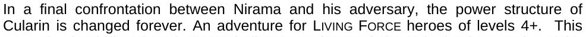

## p.2 (scan page 2)

Page contents: 800 words, 23 paragraphs | headings/entries: Campaign Notes to the GM; House Rules; Atoning for Dark Side Points; Dissipate Energy; Illusion; Stun; Page 2

## p.3 (scan page 3)

Page contents: 715 words, 20 paragraphs | headings/entries: Hero Earnings; Issuing Force Points; Issuing Dark Side Points; Wookiees, Rage and Dark Side Points; Page 3

## p.4 (scan page 4)

Page contents: 741 words, 26 paragraphs | headings/entries: GM Overview; Encounter 1: Fool's Array; Encounter 2: House Rules; Encounter 3: Breather; Encounter 4: Are We There Yet?; Encounter 5: Last Hand; Opening Crawl; Page 4

- **No single roster character (rules/setting/general)** — entry/section: Nirama: "For the past several months he has been financing and organizing the immigration of many of the Oblee. With their former Homeworld converted to an asteroid field Nirama has located a new world for them to settle." Source: *503 - Polarization - Showdown* (SWRPG d20 Revised Core), p.4
  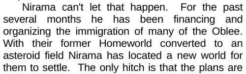
- **No single roster character (rules/setting/general)** — entry/section: Opening Crawl: "For the first time in weeks the city is quiet. The violence of Riboga's crime war, so soon" Source: *503 - Polarization - Showdown* (SWRPG d20 Revised Core), p.4
  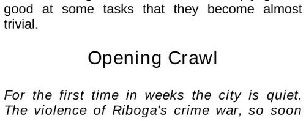

## p.5 (scan page 5)

Page contents: 710 words, 28 paragraphs | headings/entries: Encounter 1: Fool's Array; Further points:; Page 5

- **No single roster character (rules/setting/general)** — entry/section: Encounter 1: "It is said amongst the Jedi that the skill of Farseeing, to see into the future, is the most difficult ability to master. Not in the ability itself, but in the interpretation." Source: *503 - Polarization - Showdown* (SWRPG d20 Revised Core), p.5
  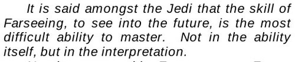
- **No single roster character (rules/setting/general)** — entry/section: Encounter 1: "Not that you need it. Even someone Force- Blind would have expected the invitation." Source: *503 - Polarization - Showdown* (SWRPG d20 Revised Core), p.5
  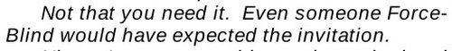
- **No single roster character (rules/setting/general)** — entry/section: Nirama: ""Thank you for coming. First, while I may have used some coercion in your decision to attend I will not use it to force you to agree. I seek volunteers, not conscripts." Source: *503 - Polarization - Showdown* (SWRPG d20 Revised Core), p.5
  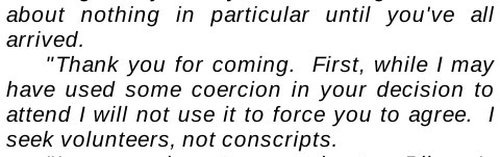
- **No single roster character (rules/setting/general)** — entry/section: Nirama: ""I am going to accede to Riboga's demands. Or as many as I can. I cannot force my people to swear loyalty to him. My life and my assets I do control and I find them easier to surrender than I would have expected."" Source: *503 - Polarization - Showdown* (SWRPG d20 Revised Core), p.5
  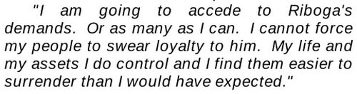
- **No single roster character (rules/setting/general)** — entry/section: Nirama: "Nirama has reached the point where he doesn't value his life above the "greater good". He's as surprised about this as anyone else." Source: *503 - Polarization - Showdown* (SWRPG d20 Revised Core), p.5
  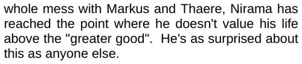
- **No single roster character (rules/setting/general)** — entry/section: Nirama: "Nirama has lots of explosives. Lots and lots. Enough to blow up the estate." Source: *503 - Polarization - Showdown* (SWRPG d20 Revised Core), p.5
  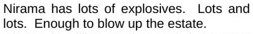
- **No single roster character (rules/setting/general)** — entry/section: Nirama: ""That's the trouble when most of your friends are criminals. Most of your friends are criminals.)" Source: *503 - Polarization - Showdown* (SWRPG d20 Revised Core), p.5
  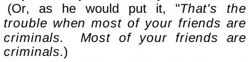

## p.1–5 (scan page 1)

Page contents: Title, blurb, house rules, GM overview of Nirama's Oblee project, encounter summaries, crawl (hand-read)

## p.6 (scan page 6)

Page contents: 670 words, 28 paragraphs | headings/entries: Encounter 2: House Rules; Nirama's Staff; The Computer Room; Armories; Blowing Up The Place; Encounter 3: Breather; Page 6

- **No single roster character (rules/setting/general)** — entry/section: Riboga's Goons: "These thugs, on the other hand, live in total fear of" Source: *503 - Polarization - Showdown* (SWRPG d20 Revised Core), p.6
  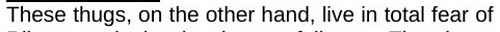
- **No single roster character (rules/setting/general)** — entry/section: Nirama: ""My gratitude will not prevent me from asking another favor."" Source: *503 - Polarization - Showdown* (SWRPG d20 Revised Core), p.6
  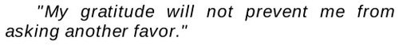

## p.7 (scan page 7)

Page contents: 604 words, 24 paragraphs | headings/entries: Encounter 4: Are We There Yet?; Page 7

- **No single roster character (rules/setting/general)** — entry/section: Nirama: "Nirama has no idea if delaying Riboga serves any purpose other than annoying and frustrating Riboga. Those two reasons are, however, good enough for him." Source: *503 - Polarization - Showdown* (SWRPG d20 Revised Core), p.7
  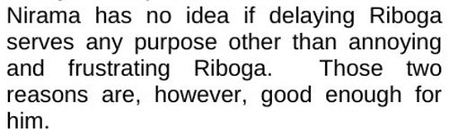
- **No single roster character (rules/setting/general)** — entry/section: Nirama: ""Breathtaking, isn't it? And to think that this was once a world to my people. But soon-" Source: *503 - Polarization - Showdown* (SWRPG d20 Revised Core), p.7
  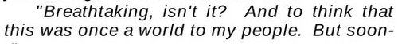
- **No single roster character (rules/setting/general)** — entry/section: Nirama: ""That's my secret project, you see. To give my people a world. To outfit a colony so that the Oblee can have a home. I won't live to see it now, but it's a fitting epitaph."" Source: *503 - Polarization - Showdown* (SWRPG d20 Revised Core), p.7
  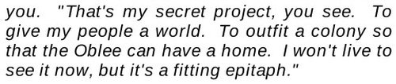
- **No single roster character (rules/setting/general)** — entry/section: Encounter 4: "they're paying big credits for these ships and should get their credits worth of drama out of them." Source: *503 - Polarization - Showdown* (SWRPG d20 Revised Core), p.7
  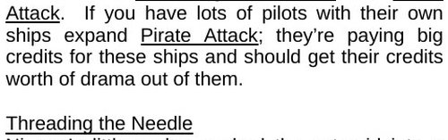

## p.5–7 (scan page 5)

Page contents: E1 Nirama's meeting and plan; E2 destroying the Cularin estate; E3 the asteroid base briefing (hand-read)

## p.8 (scan page 8)

Page contents: 612 words, 38 paragraphs | headings/entries: Pilot 15/18/21; Result of Failure; Repair 25/28/31; Pilot 20/23/26; Repair 25/28/31; Pirate Attack; Arrival; Encounter 5: Last Hand; Page 8

- **No single roster character (rules/setting/general)** — entry/section: Nirama: ""Riboga's a space slug," he broadcasts before turning to you and giving an almost" Source: *503 - Polarization - Showdown* (SWRPG d20 Revised Core), p.8
  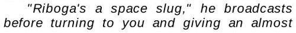
- **No single roster character (rules/setting/general)** — entry/section: Nirama: ""I was much younger when I made up the code phrase."" Source: *503 - Polarization - Showdown* (SWRPG d20 Revised Core), p.8
  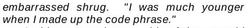
- **No single roster character (rules/setting/general)** — entry/section: Guard droid: ""Pass phrase obsolete. Target identified as Nirama. Targets designated hostile. Fire."" Source: *503 - Polarization - Showdown* (SWRPG d20 Revised Core), p.8
  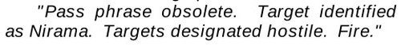

## p.9 (scan page 9)

Page contents: 684 words, 35 paragraphs | headings/entries: Encounter 6: Final Bet; Nirama says,; Begin."; Page 9

- **No single roster character (rules/setting/general)** — entry/section: Nirama: ""He tricked me!" roars Nirama, as the droids bring their weapons to bear." Source: *503 - Polarization - Showdown* (SWRPG d20 Revised Core), p.9
  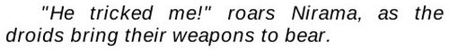
- **No single roster character (rules/setting/general)** — entry/section: Nirama: "As the last droid clatters to the corridor floor you can hear Nirama muttering about the treachery of the Hutt race." Source: *503 - Polarization - Showdown* (SWRPG d20 Revised Core), p.9
  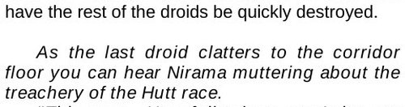
- **No single roster character (rules/setting/general)** — entry/section: Speaks: ""The massive and pensive Riboga is saddened by Nirama's lack of subtlety and guile."" Source: *503 - Polarization - Showdown* (SWRPG d20 Revised Core), p.9
  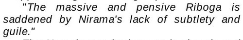
- **No single roster character (rules/setting/general)** — entry/section: Speaks: ""The great Riboga is ashamed that he hired someone so devious and did not notice."" Source: *503 - Polarization - Showdown* (SWRPG d20 Revised Core), p.9
  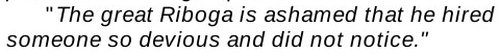
- **No single roster character (rules/setting/general)** — entry/section: Speaks: ""Wise and mighty Riboga is bored with you now. He thinks you are over confident or stupid. Or both."" Source: *503 - Polarization - Showdown* (SWRPG d20 Revised Core), p.9
  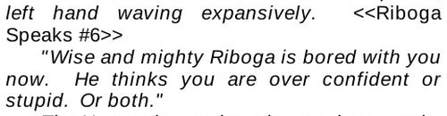
- **No single roster character (rules/setting/general)** — entry/section: Speaks: ""The great and powerful Riboga kills you now. Sixty. Fifty-nine. Fifty-eight."" Source: *503 - Polarization - Showdown* (SWRPG d20 Revised Core), p.9
  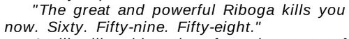
- **No single roster character (rules/setting/general)** — entry/section: Nirama: "Beside you Nirama mutters, "This doesn't look good."" Source: *503 - Polarization - Showdown* (SWRPG d20 Revised Core), p.9
  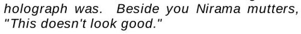

## p.10 (scan page 10)

Page contents: 776 words, 23 paragraphs | headings/entries: Decision Time; Countdown (presuming; Page 10

- **No single roster character (rules/setting/general)** — entry/section: Nirama: ""A deadman switch. How appropriate. Riboga was right. I was greedy and overconfident and now I pay the price. Go. Cularin needs you now more than it needs me."" Source: *503 - Polarization - Showdown* (SWRPG d20 Revised Core), p.10
  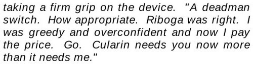
- **No single roster character (rules/setting/general)** — entry/section: Nirama: ""You must survive. Our people are too sparse. There need to be Oblee who have a life to live, not ones living on borrowed time like myself."" Source: *503 - Polarization - Showdown* (SWRPG d20 Revised Core), p.10
  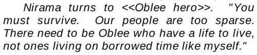
- **No single roster character (rules/setting/general)** — entry/section: Decision Time: "If they refuse to leave and insist on rolling dice until the bomb explodes, then they die. They die heroes, but they die." Source: *503 - Polarization - Showdown* (SWRPG d20 Revised Core), p.10
  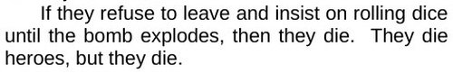

### Stat block notes (game mechanics, not feats)

- Riboga's deadman bomb: Riboga's deadman bomb: sixty-count; Disable Device 25/30/35; explosion: roll all the d6 at the table, Fort DC 41 for half (Source: *503 - Polarization - Showdown* (SWRPG d20 Revised Core), p.10)

## p.11 (scan page 11)

Page contents: 613 words, 29 paragraphs | headings/entries: Events; Countdown (presuming someone is slowing it); Card Up My Sleeve; Conclusion: Fold; Page 11

- **No single roster character (rules/setting/general)** — entry/section: Nirama: ""He said he wanted my head. At least this way my death will mean something. Go quickly."" Source: *503 - Polarization - Showdown* (SWRPG d20 Revised Core), p.11
  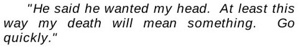
- **No single roster character (rules/setting/general)** — entry/section: Nirama: "The ship launches, your comms automatically picking up the broadcast on all channels. "Three. Two. One."" Source: *503 - Polarization - Showdown* (SWRPG d20 Revised Core), p.11
  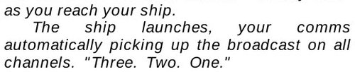
- **No single roster character (rules/setting/general)** — entry/section: Nirama: ""You saved my life but Nirama must still die. My people, friends, allies won't be safe as long as Riboga is hunting me." Source: *503 - Polarization - Showdown* (SWRPG d20 Revised Core), p.11
  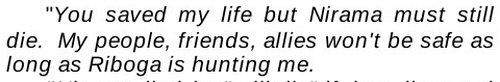
- **No single roster character (rules/setting/general)** — entry/section: Card Up My Sleeve: "Avoid the group hug if possible." Source: *503 - Polarization - Showdown* (SWRPG d20 Revised Core), p.11
  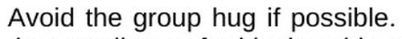
- **No single roster character (rules/setting/general)** — entry/section: Nirama: "I know that the choices I made over the last few days have been good ones and that, because of them, I leave a legacy far different than the one I perhaps deserve."" Source: *503 - Polarization - Showdown* (SWRPG d20 Revised Core), p.11
  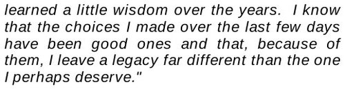

## p.7–11 (scan page 7)

Page contents: E4 the asteroid-field run and pirates; E5 the droid trap; E6 Riboga's recording and the deadman bomb (hand-read)

## p.12 (scan page 12)

Page contents: 520 words, 28 paragraphs | headings/entries: Here Ends, "Showdown"; Conclusion: Bluff; Here Ends, "Showdown"; Experience Point Summary; Experience is calculated as follows for LIVING; Adventure Experience Award:; Loot Summary; Page 12

- **No single roster character (rules/setting/general)** — entry/section: Conclusion: Bluff: "Few know the truth. Master Lanius, Osten Dal'Ney know and Escra's ears twitch every time Nirama's death is mentioned. But beyond those few people, all "know" that Nirama is dead." Source: *503 - Polarization - Showdown* (SWRPG d20 Revised Core), p.12
  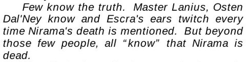

## p.11–12 (scan page 11)

Page contents: Conclusions Fold and Bluff (Nirama's will), XP, loot and certs (hand-read)

## p.13 (scan page 13)

Page contents: 50 words, 9 paragraphs | headings/entries: Player Handout 1: Map of Estate; Informal Dining Kitchen; Meeting Room; Meeting Room; Landing Area; Page 13

## p.14 (scan page 14)

Page contents: 151 words, 8 paragraphs | headings/entries: 

- **No single roster character (rules/setting/general)** — entry/section: Riboga the Hutt: "Riboga Speaks #1: Is this thing working? Kill another technician to hurry the rest along." Source: *503 - Polarization - Showdown* (SWRPG d20 Revised Core), p.14
  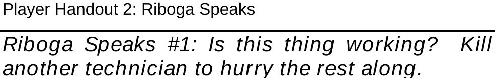
- **No single roster character (rules/setting/general)** — entry/section: Riboga the Hutt: "Riboga Speaks #4: Morons. No one to challenge me anymore. You were a cheat and an embezzler, Nirama, but you kept me thinking." Source: *503 - Polarization - Showdown* (SWRPG d20 Revised Core), p.14
  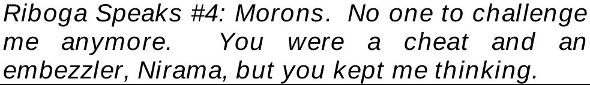
- **No single roster character (rules/setting/general)** — entry/section: Riboga the Hutt: "Riboga Speaks #6: You had your fun. If you'd just given me back my base I wouldn't have had to do this. This is your fault." Source: *503 - Polarization - Showdown* (SWRPG d20 Revised Core), p.14
  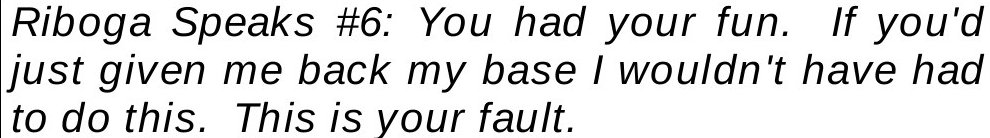
- **No single roster character (rules/setting/general)** — entry/section: Riboga the Hutt: "Riboga Speaks #7: Nirama, you're as predictable as a Jedi. You try to deny me my homes; I deny you your miserable life." Source: *503 - Polarization - Showdown* (SWRPG d20 Revised Core), p.14
  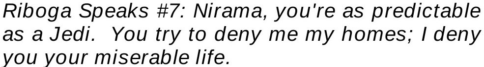

## p.15 (scan page 15)

Page contents: 24 words, 8 paragraphs | headings/entries: Player Handout 3: Map of Asteroid Base; Automated Turbolaser Cannons; Level One; Automated Turbolaser Cannons; Level Two; Page 15

## p.16 (scan page 16)

Page contents: 125 words, 11 paragraphs | headings/entries: Player Handout 4: Wayfarer Space Transport; Kuat Systems Engineering Wayfarer-class Medium Transport

## p.17 (scan page 17)

Page contents: 536 words, 21 paragraphs | headings/entries: Riboga's Goons:; Nirama's Staff:; Mid Tier (levels 4-6); High Tier (levels 7-9); Upper Tier (levels 10-12)

## p.18 (scan page 18)

Page contents: 211 words, 7 paragraphs | headings/entries: 

## p.19 (scan page 19)

Page contents: 413 words, 15 paragraphs | headings/entries: Mid Tier (levels 4-6); Incom/Subpro Z-95 Headhunter Starfighter (2 ships); High Tier (levels 7-9); Incom/Subpro Z-95 Headhunter Starfighter (3 ships); Upper Tier (levels 10-12); Incom/Subpro Z-95 Headhunter Starfighter (4 ships)

### Stat block notes (game mechanics, not feats)

- Pirate Headhunters: Pirate Z-95 Headhunters (upper tier, 4 ships): ace +8/+3 crew; Shield 30 (DR 10), Hull 120 (DR 10); triple blasters +10/+5, 3d10x2 (Source: *503 - Polarization - Showdown* (SWRPG d20 Revised Core), p.19)

## p.20 (scan page 20)

Page contents: 411 words, 11 paragraphs | headings/entries: GM Aid #2: Major Players (Not Tiered); Nirama, Male Alien Scoundrel 6/ Crimelord 9; Riboga, Male Hutt Scoundrel 8/ Crimelord 10;

## p.21 (scan page 21)

Page contents: 50 words, 9 paragraphs | headings/entries: GM Aid #3: Map of Estate; Informal Dining Kitchen; Meeting Room; Meeting Room; Landing Area; Page 21

## p.22 (scan page 22)

Page contents: 80 words, 14 paragraphs | headings/entries: GM Aid #4: Map of Asteroid Base; Automated Turbolaser Cannot; Level One; Automated Turbolaser Cannons; Level Two; A = Landing Bay F= Riboga's Suite

## p.13–22 (scan page 13)

Page contents: Player handouts (maps, Riboga Speaks, Wayfarer) and GM Aids (goons, droids, Headhunters, Nirama, Riboga, maps) (hand-read)

