# Owner Material 037 — Star Wars D20 Drive folder (Core, Revised Core and Saga Edition): Living Force Campaign/Adventures/Among the Stars/Year 5/504 - Plea Bargain.pdf [Star Wars Roleplaying Game Revised Core (d20, 2002)]

- **Source:** Wizards of the Coast Star Wars Roleplaying Game books, web enhancements, Living Force campaign modules and articles (2000–2010), from the owner's "Star Wars D20" Drive folder (only the three edition subfolders; "General" was not read, as instructed). Secondary source (licensed Legends reference). Scan OCR'd on the box; the scan stays box-only and is **not** published.
- **Method:** every scanned page was OCR'd and machine-screened sentence by sentence for power-relevant statements (fights, kills, defeats, Force feats, rankings, superweapons) that name a character on our roster; each kept sentence is quoted verbatim from the OCR text and has a crop of the printed passage directly under it. Pages with nothing power-relevant are still listed with what is on them.
- **Citation:** "*504 - Plea Bargain* (SWRPG d20 Revised Core), p.X" by printed page ("scan p.X" where no printed number applies). **Weight:** Licensed RPG material: a secondary source. Narrative text sums up Legends lore; game statistics are rules for players, not canon power levels, and rank lowest.

## p.1 (scan page 1)

Page contents: 125 words, 7 paragraphs | headings/entries: LFA504; Plea Bargain; A One-Round LIVING FORCE Tournament; Edited by Ron and Margaret Heintz

- **No single roster character (rules/setting/general)** — entry/section: Blurb: "With the future of the newly formed Trade Alliance looking bleak and time running out for Di'San, can the heroes of Cularin unravel the tangled plot and ensure justice is served?" Source: *504 - Plea Bargain* (SWRPG d20 Revised Core), p.1
  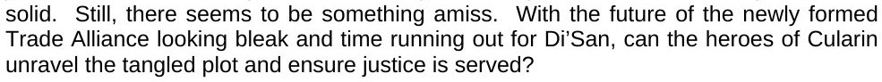

## p.2 (scan page 2)

Page contents: 800 words, 23 paragraphs | headings/entries: Campaign Notes to the GM; Plea Bargain; House Rules; Atoning for Dark Side Points; Dissipate Energy; Illusion; Stun; Page 2

## p.3 (scan page 3)

Page contents: 714 words, 20 paragraphs | headings/entries: Hero Earnings; Issuing Force Points; Issuing Dark Side Points; Plea Bargain; Wookiees, Rage and Dark Side Points; Page 3

## p.4 (scan page 4)

Page contents: 685 words, 27 paragraphs | headings/entries: GM Overview; Encounter 1: Time Off; Plea Bargain; Encounter 2: No Rest; Encounter 3: Questions; Encounter 4: Loose Ends; Encounter 5: The Sting; Encounter 6: Dead Men Tell No Tells; Encounter 7: The End?; Important Note to Judges: This scenario; Page 4

- **No single roster character (rules/setting/general)** — entry/section: GM Overview: "Yet in the shadows there are those who watch and listen, seeking an opportunity to improve their situation at the expense of others." Source: *504 - Plea Bargain* (SWRPG d20 Revised Core), p.4
  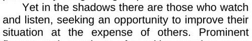

## p.5 (scan page 5)

Page contents: 769 words, 17 paragraphs | headings/entries: Opening Crawl; Encounter 1: Time Off; Plea Bargain; Page 5

- **No single roster character (rules/setting/general)** — entry/section: Judges' Note: "It will make the scenario much more enjoyable if the Judge is thoroughly familiar with the major NPC's and can keep their personalities distinct and separate through different behaviors, voices and visible actions. Academy award nominations to follow..." Source: *504 - Plea Bargain* (SWRPG d20 Revised Core), p.5
  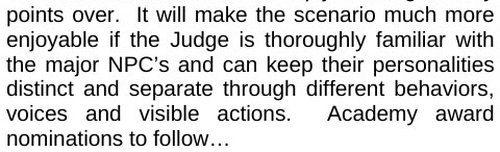
- **No single roster character (rules/setting/general)** — entry/section: Encounter 1: "There's nothing like enjoying the spoils of being a hero of Cularin." Source: *504 - Plea Bargain* (SWRPG d20 Revised Core), p.5
  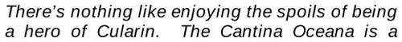
- **No single roster character (rules/setting/general)** — entry/section: Echari Di'San: "Judging by his demeanor it appears he would enjoy spending the rest of the evening with her. Good for him." Source: *504 - Plea Bargain* (SWRPG d20 Revised Core), p.5
  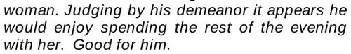
- **No single roster character (rules/setting/general)** — entry/section: Encounter 1: "They are heroes after all and poking their noses into others affairs is what they do_ best." Source: *504 - Plea Bargain* (SWRPG d20 Revised Core), p.5
  

## p.1–5 (scan page 1)

Page contents: Title, blurb, house rules, GM overview, encounter summaries, judges' note, crawl (hand-read)

## p.6 (scan page 6)

Page contents: 824 words, 20 paragraphs | headings/entries: Plea Bargain; Page 6

- **No single roster character (rules/setting/general)** — entry/section: Echari Di'San: "Di'San's face is contorted in rage and anger as he interlocks his fingers into the man's hair and slams his head into the column." Source: *504 - Plea Bargain* (SWRPG d20 Revised Core), p.6
  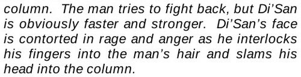

## p.7 (scan page 7)

Page contents: 794 words, 17 paragraphs | headings/entries: Encounter 2: No Rest; The evening at the Cantina Oceana finally; Plea Bargain; Page 7

- **No single roster character (rules/setting/general)** — entry/section: Cyreno Taegan: ""It has come to my attention that you were present at the incident involving our CEO, Echari Di'San." Source: *504 - Plea Bargain* (SWRPG d20 Revised Core), p.7
  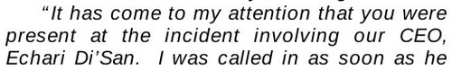
- **No single roster character (rules/setting/general)** — entry/section: Cyreno Taegan: "To be blunt, Echari is in great trouble. Should he be convicted of a capital crime, everything we have worked for in uniting the system businesses and_ trade organizations will crumble." Source: *504 - Plea Bargain* (SWRPG d20 Revised Core), p.7
  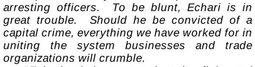
- **No single roster character (rules/setting/general)** — entry/section: Cyreno Taegan: "The authorities tell me it's a pretty open and shut case. I'm not so sure."" Source: *504 - Plea Bargain* (SWRPG d20 Revised Core), p.7
  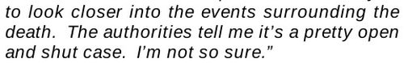

## p.8 (scan page 8)

Page contents: 708 words, 17 paragraphs | headings/entries: Plea Bargain; Page 8

- **No single roster character (rules/setting/general)** — entry/section: Echari Di'San: "A violent father abused Di'San and his mother. As a result he considers those who beat women to be slimier than a Hutt's belly." Source: *504 - Plea Bargain* (SWRPG d20 Revised Core), p.8
  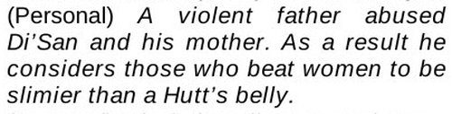

## p.9 (scan page 9)

Page contents: 746 words, 21 paragraphs | headings/entries: Encounter 3: Questions; Plea Bargain; Page 9

- **No single roster character (rules/setting/general)** — entry/section: Kalani: "Under her breath she will mumble, "But he wasn't supposed to die."" Source: *504 - Plea Bargain* (SWRPG d20 Revised Core), p.9
  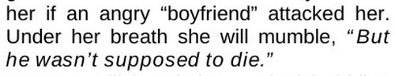

## p.5–9 (scan page 5)

Page contents: E1 the cantina fight and Rysko's death; E2 Cy Taegan and Solen Kove hire the heroes; Di'San's background (hand-read)

## p.10 (scan page 10)

Page contents: 794 words, 21 paragraphs | headings/entries: Plea Bargain; Page 10

- **No single roster character (rules/setting/general)** — entry/section: Thon Larimhor: "He will make a blaster shape out of his fingers and point it at the heroes, give them a" Source: *504 - Plea Bargain* (SWRPG d20 Revised Core), p.10
  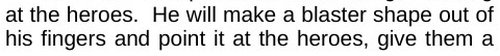

## p.11 (scan page 11)

Page contents: 746 words, 19 paragraphs | headings/entries: Plea Bargain; Cantina Oceana Bartender: (Player Handout 6); Chay can be; Page 11

- **No single roster character (rules/setting/general)** — entry/section: Thon Larimhor: "Intimidation attempts only cause Larimhor to laugh and call the heroes Crusaders of the Lost Cause." Source: *504 - Plea Bargain* (SWRPG d20 Revised Core), p.11
  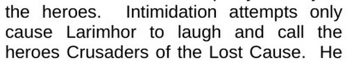
- **No single roster character (rules/setting/general)** — entry/section: Thon Larimhor: "However, the heroes will walk away with the distinct feeling he was simply toying with them as a cat would a mouse." Source: *504 - Plea Bargain* (SWRPG d20 Revised Core), p.11
  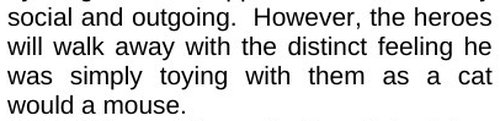

## p.12 (scan page 12)

Page contents: 693 words, 23 paragraphs | headings/entries: Witness #1: (Player Handout 2); Plea Bargain; Witness #2: (Player Handout 3); Page 12

- **No single roster character (rules/setting/general)** — entry/section: Wuglik: "grumbling about having to answer all these Sith inspired questions." Source: *504 - Plea Bargain* (SWRPG d20 Revised Core), p.12
  
- **No single roster character (rules/setting/general)** — entry/section: Wuglik: "If one is to expend the energy to fight, then one must fight with honor and skill. If death results, then you have proven yourself superior over your enemy. This is good." Source: *504 - Plea Bargain* (SWRPG d20 Revised Core), p.12
  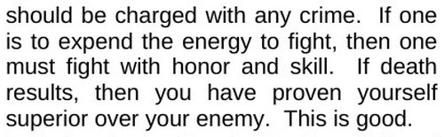
- **No single roster character (rules/setting/general)** — entry/section: Yatter: "Why would he have told the authorities what he saw? It was obvious Di'San split Rysko's skull on the column. Besides, no one asked him." Source: *504 - Plea Bargain* (SWRPG d20 Revised Core), p.12
  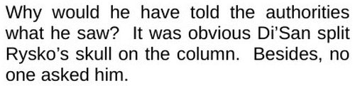

## p.13 (scan page 13)

Page contents: 834 words, 14 paragraphs | headings/entries: Hukno Rit: (Player Handout 6); Plea Bargain; Local Authorities: (Player Handout 5); Page 13

- **No single roster character (rules/setting/general)** — entry/section: Yatter: "Odd thing was, Yatter had watched the entire fight and the pilot had never hit Rit in the face. Not even once. Odd that." Source: *504 - Plea Bargain* (SWRPG d20 Revised Core), p.13
  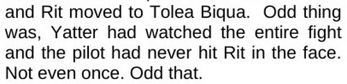

## p.14 (scan page 14)

Page contents: 728 words, 30 paragraphs | headings/entries: System Records Check: Each check represents; Use DC; Conformation of Di'San's Arrest. He; There have been several assaults at; The second time Larimhor calls the authorities; Plea Bargain; Encounter 4: Loose Ends; Page 14

- **No single roster character (rules/setting/general)** — entry/section: Local Authorities: "The Clone War seems to have everyone seeing conspiracy theories in every nook and cranny. It doesn't matter if you are heroes or not. Facts are facts, and they aren't going to change just because you think you are something special." Source: *504 - Plea Bargain* (SWRPG d20 Revised Core), p.14
  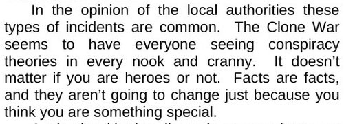

## p.9–14 (scan page 9)

Page contents: E3 witness interviews: Kalani, Larimhor, Chay, Wuglik, Yatter, Hukno Rit, authorities, records (hand-read)

## p.15 (scan page 15)

Page contents: 807 words, 21 paragraphs | headings/entries: Plea Bargain; Page 15

- **No single roster character (rules/setting/general)** — entry/section: Encounter 4: "Nothing to it. Simply another day in the life of a hero of Cularin." Source: *504 - Plea Bargain* (SWRPG d20 Revised Core), p.15
  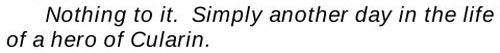
- **No single roster character (rules/setting/general)** — entry/section: Encounter 4: "The ringing in your ears blocks out the sound of your companion's cries for help, leaving only a steady crackle of-- of what? Blaster fire!!" Source: *504 - Plea Bargain* (SWRPG d20 Revised Core), p.15
  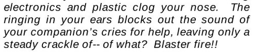

## p.16 (scan page 16)

Page contents: 818 words, 20 paragraphs | headings/entries: Encounter 5: The Sting; Plea Bargain; Page 16

- **No single roster character (rules/setting/general)** — entry/section: Hukno Rit: "He's dead, his throat slit wide open, but he is there. On the wall next to his body the word "Traitor" will be scrawled in blood." Source: *504 - Plea Bargain* (SWRPG d20 Revised Core), p.16
  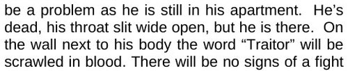
- **No single roster character (rules/setting/general)** — entry/section: Solen Kove: "Solen Kove will rap the table with a utensil, look at the characters and ask, "So, what happened anyway?"" Source: *504 - Plea Bargain* (SWRPG d20 Revised Core), p.16
  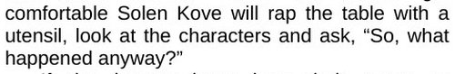

## p.17 (scan page 17)

Page contents: 794 words, 23 paragraphs | headings/entries: Kalani knows quite a bit concerning Larimhor's; Plea Bargain; Intimidation:; Page 17

- **No single roster character (rules/setting/general)** — entry/section: Kalani: ""This was all Thon's plan. He has done it several times before. Paying someone to provoke a fight and lose, then, after the fight, inflicting additional injuries in order to obtain a larger settlement." Source: *504 - Plea Bargain* (SWRPG d20 Revised Core), p.17
  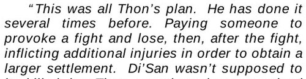
- **No single roster character (rules/setting/general)** — entry/section: Kalani: "When Di'San is cleared Thon will be angry, but he will get over it, there is always another scam to run."" Source: *504 - Plea Bargain* (SWRPG d20 Revised Core), p.17
  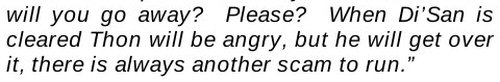
- **No single roster character (rules/setting/general)** — entry/section: Kalani: "She firmly believes Thon loves her and though he uses her he would never seriously harm her as long as she stays with him. If she betrays him though, she knows he will kill her." Source: *504 - Plea Bargain* (SWRPG d20 Revised Core), p.17
  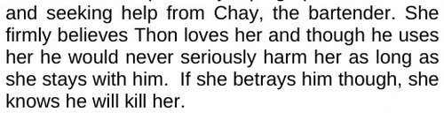
- **Master Thon**: "Di'San wasn't supposed to be killed, but Thon must have been surprised at the viciousness of Di'San attack." Source: *504 - Plea Bargain* (SWRPG d20 Revised Core), p.17
  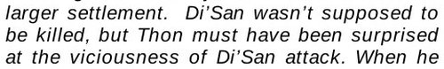

## p.18 (scan page 18)

Page contents: 751 words, 21 paragraphs | headings/entries: Encounter 6: Dead Men Tell No Tales; Plea Bargain; Encounter 6b; Page 18

## p.19 (scan page 19)

Page contents: 501 words, 40 paragraphs | headings/entries: Definitions of Terms; Element Evidence; Motive:; When Di'San showed up | 2; Motive:; Opportunity:; Element; Evidence; Score; Opportunity:; Opportunity:; Capability:; Capability:; Capability:; Contributing:; Contributing:; Contributing:; Plea Bargain; Contributing: Contributing:; Page 19

## p.20 (scan page 20)

Page contents: 560 words, 27 paragraphs | headings/entries: Element | Evidence Score; A hero with legal knowledge and/or strong; Presentation:; Encounter 7: The End?; Plea Bargain; Here Ends, "Plea Bargain"; Encounter 7b: The End?; Page 20

- **No single roster character (rules/setting/general)** — entry/section: Cyreno Taegan: ""I suppose the Cularin Trade Alliance will survive, but I dread to see how this incident will warp the principles and standards Echari has worked so hard to install."" Source: *504 - Plea Bargain* (SWRPG d20 Revised Core), p.20
  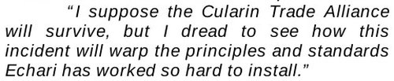

## p.14–20 (scan page 14)

Page contents: E4 the Tolea Biqua ambush and Hukno's murder; E5 Kalani's turn; E6 the bay 6 assault; E6b the hearing (hand-read)

## p.21 (scan page 21)

Page contents: 783 words, 21 paragraphs | headings/entries: This court is very; Plea Bargain; Page 21

- **No single roster character (rules/setting/general)** — entry/section: Thon Larimhor: ""Kill them you fools, or none of you will see daylight again!" With that Larimhor flees from the building." Source: *504 - Plea Bargain* (SWRPG d20 Revised Core), p.21
  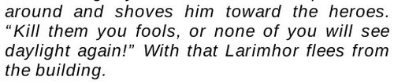

## p.22 (scan page 22)

Page contents: 708 words, 22 paragraphs | headings/entries: No Hazard Sharp Curve. DC: 18/23/28; Plea Bargain; Page 22

- **No single roster character (rules/setting/general)** — entry/section: Encounter 7b: "Screaming across town through heavy traffic, racing across fields, jumping ditches and blasting through fences, these are the things heroes do." Source: *504 - Plea Bargain* (SWRPG d20 Revised Core), p.22
  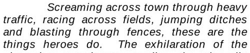
- **No single roster character (rules/setting/general)** — entry/section: Encounter 7b: ""Well that wasn't very smart," you think. But wait. There's more! More company!" Source: *504 - Plea Bargain* (SWRPG d20 Revised Core), p.22
  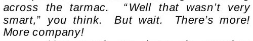
- **No single roster character (rules/setting/general)** — entry/section: Encounter 7b: "There is enough firepower sitting in front of you to light up a platoon of militia." Source: *504 - Plea Bargain* (SWRPG d20 Revised Core), p.22
  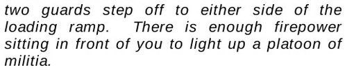
- **No single roster character (rules/setting/general)** — entry/section: Thon Larimhor: ""NOOOOO!!!!" Larimhor screams. But it's too late. There is only he and you left on the tarmac." Source: *504 - Plea Bargain* (SWRPG d20 Revised Core), p.22
  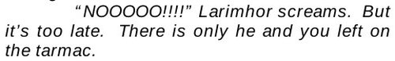

## p.23 (scan page 23)

Page contents: 664 words, 24 paragraphs | headings/entries: Conclusion; Experience Point Summary; Experience is calculated as follows for LIvING; Plea Bargain; Adventure Experience Award:; Loot Summary; Page 23

- **No single roster character (rules/setting/general)** — entry/section: Echari Di'San: ""Isn't it magnificent?" Di'San_ speaks reverently. "Hundreds of systems, millions of cities, all connected in one cohesive trade net. Science, Art, Technology, Food, Textiles, everything you can possibly imagine." Source: *504 - Plea Bargain* (SWRPG d20 Revised Core), p.23
  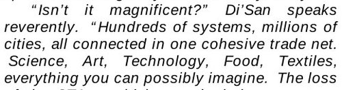

## p.24 (scan page 24)

Page contents: 95 words, 3 paragraphs | headings/entries: Plea Bargain; Page 24

## p.20–24 (scan page 20)

Page contents: E7/E7b verdicts, the Larimhor chase and abandonment; conclusion; XP; certs (hand-read)

## p.25 (scan page 25)

Page contents: 534 words, 14 paragraphs | headings/entries: Player Handout 1: Echari Di'Sans' Statement; Plea Bargain Page 25

- **No single roster character (rules/setting/general)** — entry/section: Echari Di'San: "For reasons we won't go into here, I lost control. It has never been in my nature to see a man strike a woman." Source: *504 - Plea Bargain* (SWRPG d20 Revised Core), p.25
  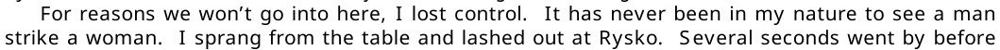
- **No single roster character (rules/setting/general)** — entry/section: Echari Di'San: "I swear I did not strike him hard enough to do such damage. Had I done so he wouldn't have been able to flee the area." Source: *504 - Plea Bargain* (SWRPG d20 Revised Core), p.25
  
- **No single roster character (rules/setting/general)** — entry/section: Echari Di'San: "Answer: (Long silence) I don't know. Yes. I wanted it to stop. I wanted him dead. (Crying)" Source: *504 - Plea Bargain* (SWRPG d20 Revised Core), p.25
  

## p.26 (scan page 26)

Page contents: 540 words, 16 paragraphs | headings/entries: Plea Bargain Page 26

## p.27 (scan page 27)

Page contents: 506 words, 8 paragraphs | headings/entries: Plea Bargain Page 27

## p.28 (scan page 28)

Page contents: 560 words, 23 paragraphs | headings/entries: NOTES:; Local Authorities: Cularin Office of Public Safety; Plea Bargain Page 28

## p.29 (scan page 29)

Page contents: 65 words, 5 paragraphs | headings/entries: Plea Bargain Page 29

## p.30 (scan page 30)

Page contents: 542 words, 20 paragraphs | headings/entries: Encounter #4: Strike Team; All tiers tactics:; Plea Bargain Page 30

## p.31 (scan page 31)

Page contents: 704 words, 21 paragraphs | headings/entries: Upper Tier (Average hero Level 10+); Encounter #6: Assault Team; Plea Bargain Page 31

### Stat block notes (game mechanics, not feats)

- Syndicate Strike Team: Syndicate Strike Team (upper tier, Encounter 4): Human Thug 4/Soldier 5/Elite Trooper 4; Def 27 (with cover); VP/WP 66/12; +15/+10 ranged (SoroSuub X45 Sniper Rifle); Challenge Code E (Source: *504 - Plea Bargain* (SWRPG d20 Revised Core), p.31)

## p.32 (scan page 32)

Page contents: 579 words, 23 paragraphs | headings/entries: Upper Tier (Average hero Level 10+); Encounter #7b: Larimhor's Guards; Upper Tier (Average hero Level 10+); Plea Bargain Page 32

## p.33 (scan page 33)

Page contents: 733 words, 21 paragraphs | headings/entries: Encounter #7b: Strike Force; Upper Tier (Average hero Level 10+); Plea Bargain Page 33

## p.34 (scan page 34)

Page contents: 674 words, 18 paragraphs | headings/entries: Middle Tier (Average hero Level 1-3); Upper Tier (Average hero Level 10+); Plea Bargain Page 34

- **No single roster character (rules/setting/general)** — entry/section: Thon Larimhor: "But in Larimhor's case friendly is only skin deep. He is constantly watching for a lucrative Opportunity to run a high profit, low risk scam." Source: *504 - Plea Bargain* (SWRPG d20 Revised Core), p.34
  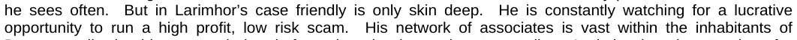
- **No single roster character (rules/setting/general)** — entry/section: Thon Larimhor: "As such, he is a firm supporter of Law Enforcement provided they are working for him and not against him." Source: *504 - Plea Bargain* (SWRPG d20 Revised Core), p.34
  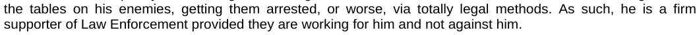

### Stat block notes (game mechanics, not feats)

- Thon Larimhor: Thon Larimhor (upper tier): Zabrak Male, Scoundrel 11/Crime Lord 1; VP/WP 62/10; Bluff +17; Rep 13 (Source: *504 - Plea Bargain* (SWRPG d20 Revised Core), p.34)

## p.35 (scan page 35)

Page contents: 588 words, 11 paragraphs | headings/entries: All Tiers; Plea Bargain Page 35

- **No single roster character (rules/setting/general)** — entry/section: Kalani: "She always as a ready smile and her laugh is the sound fine china bells. But this is not who Kalani started out as." Source: *504 - Plea Bargain* (SWRPG d20 Revised Core), p.35
  
- **No single roster character (rules/setting/general)** — entry/section: Kalani: "In a crisis she would mostly likely forget the small blaster was even available." Source: *504 - Plea Bargain* (SWRPG d20 Revised Core), p.35
  

### Stat block notes (game mechanics, not feats)

- Kalani: Kalani: Human Female Fringer 3; VP/WP 18/10; Challenge Code A (Source: *504 - Plea Bargain* (SWRPG d20 Revised Core), p.35)

## p.36 (scan page 36)

Page contents: 9 words, 3 paragraphs | headings/entries: GM Aid #4:; Dorumaa City; Plea Bargain Page 36

## p.37 (scan page 37)

Page contents: 10 words, 3 paragraphs | headings/entries: GM Aid #5:; Tolea Bique Ambush; Plea Bargain Page 37

## p.38 (scan page 38)

Page contents: 15 words, 4 paragraphs | headings/entries: GM Aid #6:; Gadrin Landing Bay #6; X = Assualt Team; Plea Bargain Page 38

## p.25–38 (scan page 25)

Page contents: Player handouts, GM Aids (strike teams, thugs, Larimhor, Kalani), maps (hand-read)

