# Owner Material 037 — Star Wars D20 Drive folder (Core, Revised Core and Saga Edition): Living Force Campaign/Adventures/Among the Stars/Year 5/505 - For Every Action - Preemptive Strike.pdf [Star Wars Roleplaying Game Revised Core (d20, 2002)]

- **Source:** Wizards of the Coast Star Wars Roleplaying Game books, web enhancements, Living Force campaign modules and articles (2000–2010), from the owner's "Star Wars D20" Drive folder (only the three edition subfolders; "General" was not read, as instructed). Secondary source (licensed Legends reference). Scan OCR'd on the box; the scan stays box-only and is **not** published.
- **Method:** every scanned page was OCR'd and machine-screened sentence by sentence for power-relevant statements (fights, kills, defeats, Force feats, rankings, superweapons) that name a character on our roster; each kept sentence is quoted verbatim from the OCR text and has a crop of the printed passage directly under it. Pages with nothing power-relevant are still listed with what is on them.
- **Citation:** "*505 - For Every Action - Preemptive Strike* (SWRPG d20 Revised Core), p.X" by printed page ("scan p.X" where no printed number applies). **Weight:** Licensed RPG material: a secondary source. Narrative text sums up Legends lore; game statistics are rules for players, not canon power levels, and rank lowest.

## p.1 (scan page 1)

Page contents: 124 words, 7 paragraphs | headings/entries: LFA505; Preemptive Strike; Edited by Ron and Margaret Heintz

## p.2 (scan page 2)

Page contents: 800 words, 23 paragraphs | headings/entries: Campaign Notes to the GM; Preemptive Strike; House Rules; Atoning for Dark Side Points; Dissipate Energy; Illusion; Stun; Page 2

## p.3 (scan page 3)

Page contents: 714 words, 20 paragraphs | headings/entries: Hero Earnings; Issuing Force Points; Issuing Dark Side Points; Preemptive Strike; Wookiees, Rage and Dark Side Points; Page 3

## p.4 (scan page 4)

Page contents: 720 words, 26 paragraphs | headings/entries: GM Overview; Encounter 1: Under New Management; Encounter 2: Crossover; Encounter 3: Turf Wars; Encounter 4: Fire Hazard; Preemptive Strike; Encounter 5: Getting In Is Easy; Opening Crawl; Page 4

- **No single roster character (rules/setting/general)** — entry/section: GM Overview: "For some this change is insignificant, one crime-lord being much like another, but there is a difference — Nirama cared for Cularin and its people beyond simple avarice. Riboga has no such compunction and intends to bring back the dark trades that Nirama shied away from." Source: *505 - For Every Action - Preemptive Strike* (SWRPG d20 Revised Core), p.4
  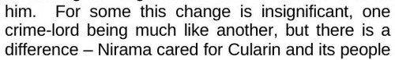
- **No single roster character (rules/setting/general)** — entry/section: GM Overview: "Once again, Cularin must look to its heroes." Source: *505 - For Every Action - Preemptive Strike* (SWRPG d20 Revised Core), p.4
  
- **No single roster character (rules/setting/general)** — entry/section: Opening Crawl: "In times of conflict, some find earning a dishonest credit easier. In the past such activities on Cularin had been watched and controlled by Nirama. Now Nirama's influence is gone, and more vicious sentients are in control once more. Unless something is done soon, Cularin is going to find itself controlled by the Hutts once more..." Source: *505 - For Every Action - Preemptive Strike* (SWRPG d20 Revised Core), p.4
  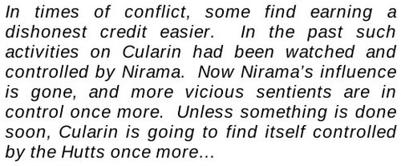

## p.1–4 (scan page 1)

Page contents: Title, blurb, house rules, GM overview, encounter summaries, crawl (hand-read)

## p.5 (scan page 5)

Page contents: 771 words, 22 paragraphs | headings/entries: Encounter 1: Under New Management; Preemptive Strike; Page 5

- **No single roster character (rules/setting/general)** — entry/section: Merik Darou: ""It seems the old cliché about change being the only constant is particularly apt for the people of Cularin. And so it goes." Source: *505 - For Every Action - Preemptive Strike* (SWRPG d20 Revised Core), p.5
  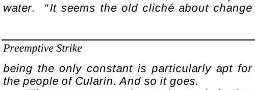
- **No single roster character (rules/setting/general)** — entry/section: Merik Darou: "While I cannot find it in myself to approve of Nirama or his activities, he did display a certain warped fondness and respect for Cularin. There were certain things that he would not do, certain vices he would not tolerate in others, and was more effective at stamping them out than any police force could hope to be." Source: *505 - For Every Action - Preemptive Strike* (SWRPG d20 Revised Core), p.5
  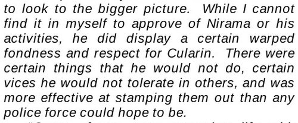
- **No single roster character (rules/setting/general)** — entry/section: Merik Darou: ""Some of you may remember life with Riboga in charge, and will probably agree that he is not pre-disposed towards fondness or respect. He is about as vile a person as you could hope to avoid."" Source: *505 - For Every Action - Preemptive Strike* (SWRPG d20 Revised Core), p.5
  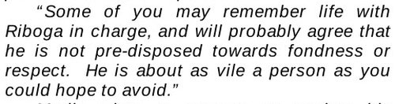
- **No single roster character (rules/setting/general)** — entry/section: Merik Darou: "What needs to be done may involve things that cannot be done through official channels, and the Senator cannot be involved. And is not of course." Source: *505 - For Every Action - Preemptive Strike* (SWRPG d20 Revised Core), p.5
  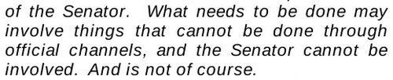
- **No single roster character (rules/setting/general)** — entry/section: Merik Darou: ""So my friends, it comes to this, will you assist Cularin in its hour of need once more?"" Source: *505 - For Every Action - Preemptive Strike* (SWRPG d20 Revised Core), p.5
  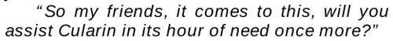

## p.6 (scan page 6)

Page contents: 761 words, 23 paragraphs | headings/entries: Assuming the heroes eventually agree:; Encounter 2: Crossover; Preemptive Strike; Round 1; Page 6

- **No single roster character (rules/setting/general)** — entry/section: Riboga: "telling stories of the vileness of Riboga to encourage the less mercenary (get creative, whatever you come up with, Riboga has probably been involved in worse)." Source: *505 - For Every Action - Preemptive Strike* (SWRPG d20 Revised Core), p.6
  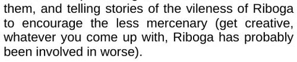
- **No single roster character (rules/setting/general)** — entry/section: Note to the GM: "It should be made abundantly clear that Riboga returning to the system would be a Bad Thing™ and that helping prevent that return is a worthy goal for any hero." Source: *505 - For Every Action - Preemptive Strike* (SWRPG d20 Revised Core), p.6
  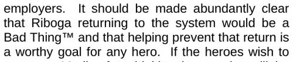
- **No single roster character (rules/setting/general)** — entry/section: Bounty hunters: "The bounty hunters figure that getting paid twice for the same job is a pretty sweet deal." Source: *505 - For Every Action - Preemptive Strike* (SWRPG d20 Revised Core), p.6
  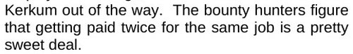

## p.7 (scan page 7)

Page contents: 789 words, 25 paragraphs | headings/entries: Round 2-3; Round 4; Preemptive Strike; Page 7

- **No single roster character (rules/setting/general)** — entry/section: Mattenic and Kerkum: "Mattenic and Kerkum will both fail their fortitude saves (spooky that) and fall unconscious." Source: *505 - For Every Action - Preemptive Strike* (SWRPG d20 Revised Core), p.7
  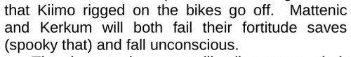
- **No single roster character (rules/setting/general)** — entry/section: Kiimo: "Kiimo will give a sinister little Rodian laugh." Source: *505 - For Every Action - Preemptive Strike* (SWRPG d20 Revised Core), p.7
  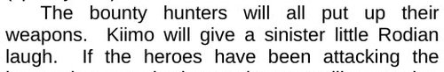
- **No single roster character (rules/setting/general)** — entry/section: Kiimo: "Kiimo will comment that the chase is the fun bit anyway." Source: *505 - For Every Action - Preemptive Strike* (SWRPG d20 Revised Core), p.7
  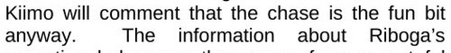
- **No single roster character (rules/setting/general)** — entry/section: Dee'Hars: "But somebody must, all you have to do is follow the credits." Source: *505 - For Every Action - Preemptive Strike* (SWRPG d20 Revised Core), p.7
  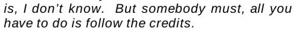
- **No single roster character (rules/setting/general)** — entry/section: Dee'Hars: "but there's no point going after the Frenda fish when there's a Leviathan to net." Source: *505 - For Every Action - Preemptive Strike* (SWRPG d20 Revised Core), p.7
  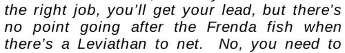

## p.8 (scan page 8)

Page contents: 760 words, 22 paragraphs | headings/entries: Encounter 3: Turf Wars; Fade to:; Preemptive Strike; Page 8

- **No single roster character (rules/setting/general)** — entry/section: Chancellor's Head: "an overweight Human male sits on a small stage wailing "Ooooluna Biqua! City of hopes! Oh! Ooooooluna Biqua!" The patrons are largely ignoring him." Source: *505 - For Every Action - Preemptive Strike* (SWRPG d20 Revised Core), p.8
  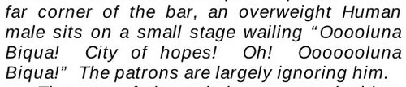
- **No single roster character (rules/setting/general)** — entry/section: Carlin: "He is not stupid, and has recently come to the conclusion that he may have bitten off more than his Gundarks can chew." Source: *505 - For Every Action - Preemptive Strike* (SWRPG d20 Revised Core), p.8
  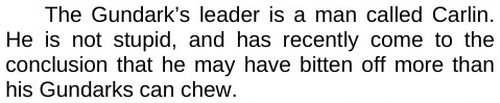

## p.5–8 (scan page 5)

Page contents: E1 Merik Darou's request; E2 the bounty-hunter crossover and Dee'Hars's information (hand-read)

## p.9 (scan page 9)

Page contents: 779 words, 22 paragraphs | headings/entries: Recruiting other gangs; Combat!; Preemptive Strike; Encounter 4: Fire Hazard; Dissolve to:; Page 9

- **No single roster character (rules/setting/general)** — entry/section: Carlin: "No matter how good the hero is Carlin will sniff, comment, "My Gran could do better than that," and invite Zeniff (a Gran) to take a shot." Source: *505 - For Every Action - Preemptive Strike* (SWRPG d20 Revised Core), p.9
  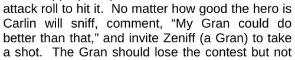
- **No single roster character (rules/setting/general)** — entry/section: Mok Cadrak: "Cadrak will delight in telling the heroes they would not be able to get close without being reduced to radioactive dust." Source: *505 - For Every Action - Preemptive Strike* (SWRPG d20 Revised Core), p.9
  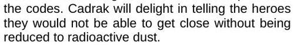

## p.10 (scan page 10)

Page contents: 750 words, 26 paragraphs | headings/entries: Preemptive Strike; Round 1; Round 2; Page 10

- **No single roster character (rules/setting/general)** — entry/section: Encounter 4: "A sudden noise cuts through the air, the unmistakable crack-whine of a blaster shot. Heads turn towards one of the amusement parks, but the holiday-makers dismiss the noise almost immediately." Source: *505 - For Every Action - Preemptive Strike* (SWRPG d20 Revised Core), p.10
  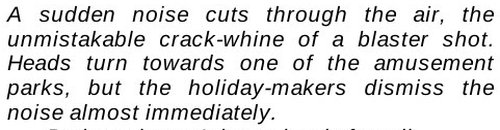
- **No single roster character (rules/setting/general)** — entry/section: Encounter 4: "Perhaps it won't be so hard after all." Source: *505 - For Every Action - Preemptive Strike* (SWRPG d20 Revised Core), p.10
  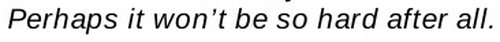
- **No single roster character (rules/setting/general)** — entry/section: Encounter 4: "You hear someone shout, "Go! Go! Go!" as one of the ride's cars pulls away." Source: *505 - For Every Action - Preemptive Strike* (SWRPG d20 Revised Core), p.10
  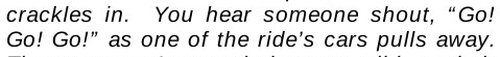
- **No single roster character (rules/setting/general)** — entry/section: Ride manager: "a harassed manager will gasp "Stop them, they're getting away!" and point the heroes to a second ride car." Source: *505 - For Every Action - Preemptive Strike* (SWRPG d20 Revised Core), p.10
  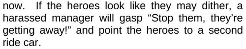

## p.11 (scan page 11)

Page contents: 796 words, 21 paragraphs | headings/entries: Rounds 3-6; Preemptive Strike; Round 10; Encounter 5: Getting In Is Easy; Page 11

- **No single roster character (rules/setting/general)** — entry/section: Encounter 4: "this is nice and cinematic, but a failed jump check will send the hero spiraling into the sea below." Source: *505 - For Every Action - Preemptive Strike* (SWRPG d20 Revised Core), p.11
  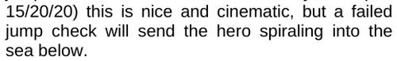

## p.8–11 (scan page 8)

Page contents: E3 Chancellor's Head/Lurid Gundarks vs Mok Cadrak; E4 the Meteor Strike!! rollercoaster chase of Phis Benlip (hand-read)

## p.12 (scan page 12)

Page contents: 718 words, 23 paragraphs | headings/entries: The "treasure" consists of several large chests; Preemptive Strike; Getting back to the hangar; Page 12

- **No single roster character (rules/setting/general)** — entry/section: Protocol droid: ""The Supreme Exalted One has only just returned to the system and regrets the inconvenience caused by these problems." Source: *505 - For Every Action - Preemptive Strike* (SWRPG d20 Revised Core), p.12
  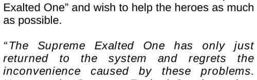
- **No single roster character (rules/setting/general)** — entry/section: Protocol droid: "The Supreme Exalted One has arranged for the goods to be transferred out of system. Expansion is always so expensive."" Source: *505 - For Every Action - Preemptive Strike* (SWRPG d20 Revised Core), p.12
  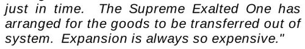
- **No single roster character (rules/setting/general)** — entry/section: Protocol droid: "Actually, the droid will be very happy to show the vault to anyone at the slightest hint of curiosity." Source: *505 - For Every Action - Preemptive Strike* (SWRPG d20 Revised Core), p.12
  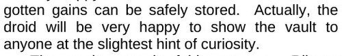
- **No single roster character (rules/setting/general)** — entry/section: Riboga: "Any interior security is because he never trusts his own people 100 percent." Source: *505 - For Every Action - Preemptive Strike* (SWRPG d20 Revised Core), p.12
  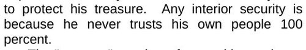
- **No single roster character (rules/setting/general)** — entry/section: Encounter 5: "Mind tricks don't work at all, of course. If all else fails physical force and gunfire can get them into the vault. But, as it says, getting in is easy..." Source: *505 - For Every Action - Preemptive Strike* (SWRPG d20 Revised Core), p.12
  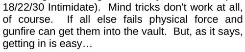
- **No single roster character (rules/setting/general)** — entry/section: Riboga: "Riboga believes in separating trouble from escape and depressurizing the hangar is standard procedure." Source: *505 - For Every Action - Preemptive Strike* (SWRPG d20 Revised Core), p.12
  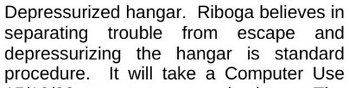

## p.13 (scan page 13)

Page contents: 568 words, 24 paragraphs | headings/entries: Conclusion; Here Ends, "Preemptive Strike"; Experience Point Summary; Experience is calculated as follows for LIVING; Preemptive Strike; Adventure Experience Award:; Page 13

- **No single roster character (rules/setting/general)** — entry/section: Merik Darou: ""My thanks heroes, you have done sterling work this day. You have undoubtedly dented Riboga's activities in Cularin, and given him pause for thought I've no doubt." Source: *505 - For Every Action - Preemptive Strike* (SWRPG d20 Revised Core), p.13
  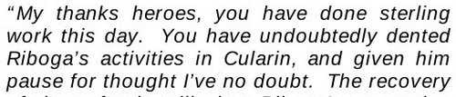

## p.11–13 (scan page 11)

Page contents: E5 Riboga's asteroid vault; E6 escape; conclusion, XP, loot (hand-read)

## p.14 (scan page 14)

Page contents: 29 words, 10 paragraphs | headings/entries: The Chancellor's Head; Back door Stage area; Kitchens and Storage; Entrance; Slot machines; Juke box; Preemptive Strike; Darthoard; Page 14

## p.15 (scan page 15)

Page contents: 584 words, 24 paragraphs | headings/entries: GM Aid #1: Combat Statistics; Equipment: Blaster carbine; Equipment: Heavy Blaster pistol; Equipment: Blaster pistol; Equipment: Blaster carbine; Preemptive Strike Page 15

- **No single roster character (rules/setting/general)** — entry/section: Clargod: "Clargod is the team's muscle and real combat monster. She is almost casually capable with any weapon she uses. Not a big talker, she is scrupulously polite when she does talk." Source: *505 - For Every Action - Preemptive Strike* (SWRPG d20 Revised Core), p.15
  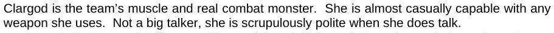
- **No single roster character (rules/setting/general)** — entry/section: Dee'Hars: "The Bothan loves information and always investigates the team's mark (and usually its employer) thoroughly." Source: *505 - For Every Action - Preemptive Strike* (SWRPG d20 Revised Core), p.15
  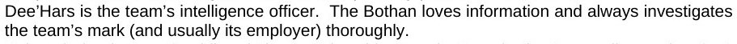

### Stat block notes (game mechanics, not feats)

- Clargod: Clargod: Female Trandoshan Soldier 5; VP/WP 52/14; Str 18 (Source: *505 - For Every Action - Preemptive Strike* (SWRPG d20 Revised Core), p.15)

## p.16 (scan page 16)

Page contents: 600 words, 23 paragraphs | headings/entries: GM Aid #1: Combat Statistics (continued); Equipment: Blaster pistol, Baton; Equipment: Blaster pistol, Baton; Equipment: Blaster pistol, Baton; Encounter 3: Turf Wars; Equipment: Heavy blaster pistol, Baton; Preemptive Strike Page 16

### Stat block notes (game mechanics, not feats)

- Mok Cadrak: Mok Cadrak: Male Devaronian Noble 2/Scoundrel 3/Soldier 3; VP/WP 62/14; Intimidate +13; Frightful presence (DC 16 Will); Rep +6 (Source: *505 - For Every Action - Preemptive Strike* (SWRPG d20 Revised Core), p.16)

## p.17 (scan page 17)

Page contents: 338 words, 9 paragraphs | headings/entries: GM Aid #1: Combat Statistics (continued); Preemptive Strike Page 17

### Stat block notes (game mechanics, not feats)

- Phis Benlip: Phis Benlip: Male Human Soldier 8; Def 21; VP/WP 74/12; +11/+6 ranged (4d6 flame carbine); Rep +6 (Source: *505 - For Every Action - Preemptive Strike* (SWRPG d20 Revised Core), p.17)

## p.18 (scan page 18)

Page contents: 297 words, 21 paragraphs | headings/entries: GM Aid #2: Available Ship; Kuat Systems Engineering Wayfarer-class Medium Transport; Kuat Systems Engineering Wayfarer-class Medium Transport; Preemptive Strike Page 18

## p.14–18 (scan page 14)

Page contents: Pub map, GM Aid 1 combat stats, GM Aid 2 Wayfarer (hand-read)

