# Owner Material 037 — Star Wars D20 Drive folder (Core, Revised Core and Saga Edition): Living Force Campaign/Adventures/Among the Stars/Year 5/506 - For Every Action - Counterstrike.pdf [Star Wars Roleplaying Game Revised Core (d20, 2002)]

- **Source:** Wizards of the Coast Star Wars Roleplaying Game books, web enhancements, Living Force campaign modules and articles (2000–2010), from the owner's "Star Wars D20" Drive folder (only the three edition subfolders; "General" was not read, as instructed). Secondary source (licensed Legends reference). Scan OCR'd on the box; the scan stays box-only and is **not** published.
- **Method:** every scanned page was OCR'd and machine-screened sentence by sentence for power-relevant statements (fights, kills, defeats, Force feats, rankings, superweapons) that name a character on our roster; each kept sentence is quoted verbatim from the OCR text and has a crop of the printed passage directly under it. Pages with nothing power-relevant are still listed with what is on them.
- **Citation:** "*506 - For Every Action - Counterstrike* (SWRPG d20 Revised Core), p.X" by printed page ("scan p.X" where no printed number applies). **Weight:** Licensed RPG material: a secondary source. Narrative text sums up Legends lore; game statistics are rules for players, not canon power levels, and rank lowest.

## p.1 (scan page 1)

Page contents: 104 words, 7 paragraphs | headings/entries: LFA506; Counterstrike

## p.2 (scan page 2)

Page contents: 798 words, 23 paragraphs | headings/entries: Campaign Notes to the GM; Counter-Strike; House Rules; Atoning for Dark Side Points; Dissipate Energy; Illusion; Stun; Page 2

## p.3 (scan page 3)

Page contents: 713 words, 20 paragraphs | headings/entries: Hero Earnings; Issuing Force Points; Issuing Dark Side Points; Counter-Strike; Wookiees, Rage and Dark Side Points; Page 3

## p.4 (scan page 4)

Page contents: 768 words, 28 paragraphs | headings/entries: GM Overview; Encounter 1: Trading Lives; Encounter 2: Rival; Counter-Strike; Encounter 3: Laws of the Republic; Encounter 5: Compound Interest; Encounter 5: The Spice Mines of Kemix; Encounter 6: Rightful Dominion; Encounter 7: Treble Top; Page 4

- **No single roster character (rules/setting/general)** — entry/section: GM Overview: "Nirama is out, and Riboga is in once more. The despicable Hutt crime lord is reclaiming his lost empire in the Cularin system." Source: *506 - For Every Action - Counterstrike* (SWRPG d20 Revised Core), p.4
  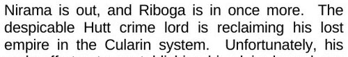
- **No single roster character (rules/setting/general)** — entry/section: GM Overview: "Riboga knows it is a risk: if either operation fails, he will be financially ruined, but it is a risk worth taking, because in both cases, he can score a quick win." Source: *506 - For Every Action - Counterstrike* (SWRPG d20 Revised Core), p.4
  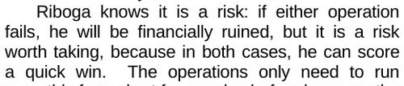
- **No single roster character (rules/setting/general)** — entry/section: GM Overview: "The lost Tarasin must be rescued, and Aath must be stopped." Source: *506 - For Every Action - Counterstrike* (SWRPG d20 Revised Core), p.4
  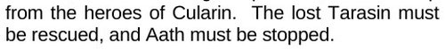
- **No single roster character (rules/setting/general)** — entry/section: Important Note to Judges: "Being a Hero of Cularin doesn't count for much to the people of Tharados, and the chances are they haven't heard of the hero anyway." Source: *506 - For Every Action - Counterstrike* (SWRPG d20 Revised Core), p.4
  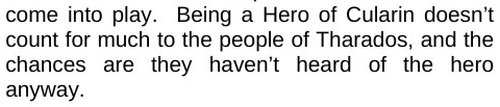

## p.5 (scan page 5)

Page contents: 746 words, 19 paragraphs | headings/entries: Encounter 1: Trading Lives; Counter-Strike; Page 5

- **No single roster character (rules/setting/general)** — entry/section: Opening Crawl: "Not every problem has a simple solution, and even heroics are not always enough. Despite the best efforts of the heroes of Cularin, Riboga the Hutt continues to reclaim the territory Nirama once took from him. Perhaps to find a solution, the heroes must look elsewhere..." Source: *506 - For Every Action - Counterstrike* (SWRPG d20 Revised Core), p.5
  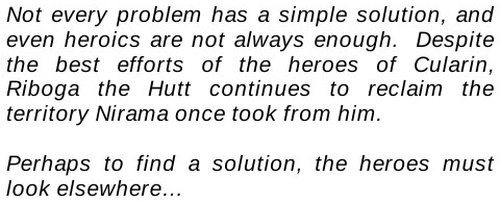
- **No single roster character (rules/setting/general)** — entry/section: Haast Aath: ""Hello there, this is the Insanity Claws, commanded by Haast Aath hailing approaching ships. I really would advise against doing anything rash."" Source: *506 - For Every Action - Counterstrike* (SWRPG d20 Revised Core), p.5
  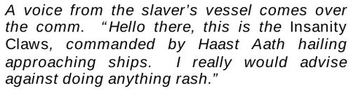
- **No single roster character (rules/setting/general)** — entry/section: Haast Aath: "He is a male Zabrak, who firmly believes in the inferiority of most species in the galaxy. He is a vicious and cunning sadist, with a staggering disregard for the lives of those around him. He is quite insane, and should be played as such." Source: *506 - For Every Action - Counterstrike* (SWRPG d20 Revised Core), p.5
  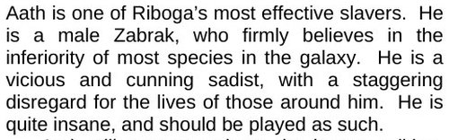
- **No single roster character (rules/setting/general)** — entry/section: Haast Aath: "I am Haast Aath, I am an employment specialist; I find jobs for sentients across the galaxy." Source: *506 - For Every Action - Counterstrike* (SWRPG d20 Revised Core), p.5
  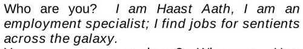
- **No single roster character (rules/setting/general)** — entry/section: Haast Aath: "Why, yes. How astute of you. If you can read too, I can probably find you employment as a tutor to the children of a wealthy family of Hutts, if you like? Although, "family" is perhaps rather a strong word" Source: *506 - For Every Action - Counterstrike* (SWRPG d20 Revised Core), p.5
  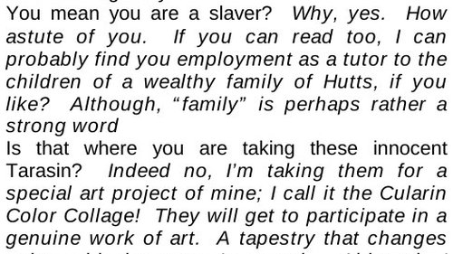
- **No single roster character (rules/setting/general)** — entry/section: Haast Aath: "Indeed no, I'm taking them for a special art project of mine; I call it the Cularin Color Collage! They will get to participate in a genuine work of art. A tapestry that changes color with its owner's mood." Source: *506 - For Every Action - Counterstrike* (SWRPG d20 Revised Core), p.5
  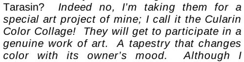
- **No single roster character (rules/setting/general)** — entry/section: Haast Aath: "I don't imagine my guests would like that one bit. I promise they would die before me." Source: *506 - For Every Action - Counterstrike* (SWRPG d20 Revised Core), p.5
  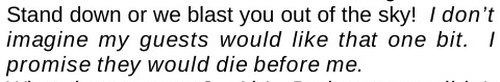
- **No single roster character (rules/setting/general)** — entry/section: Haast Aath: "well, it is already a long way down. I regret that my cargo might not survive the sudden stop at the end." Source: *506 - For Every Action - Counterstrike* (SWRPG d20 Revised Core), p.5
  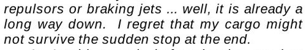

## p.1–5 (scan page 1)

Page contents: Title, GM notes, house rules, overview, encounter list, crawl (hand-read)

## p.6 (scan page 6)

Page contents: 802 words, 22 paragraphs | headings/entries: Counter-Strike; What now?; Page 6

- **No single roster character (rules/setting/general)** — entry/section: Haast Aath: "You think not? Well, let's put it to the test, shall we?" Source: *506 - For Every Action - Counterstrike* (SWRPG d20 Revised Core), p.6
  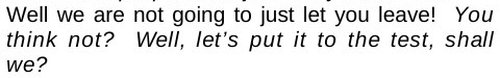
- **No single roster character (rules/setting/general)** — entry/section: Encounter 1: "Almost a hundred Tarasin are now plunging to their doom in large metal boxes. Stopping Aath should now take second place to rescuing the Tarasin." Source: *506 - For Every Action - Counterstrike* (SWRPG d20 Revised Core), p.6
  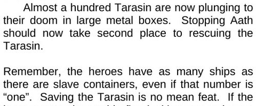
- **No single roster character (rules/setting/general)** — entry/section: Mother Tysara: ""My friends, I thank you. You have saved a great number of lives today and we are grateful. I am sorry, but I must ask more of you." Source: *506 - For Every Action - Counterstrike* (SWRPG d20 Revised Core), p.6
  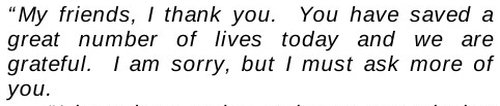
- **No single roster character (rules/setting/general)** — entry/section: Mother Tysara: ""Please, if you cannot help, I sense only darkness and despair in the future."" Source: *506 - For Every Action - Counterstrike* (SWRPG d20 Revised Core), p.6
  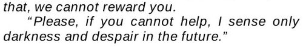

## p.7 (scan page 7)

Page contents: 784 words, 22 paragraphs | headings/entries: Encounter 2: Rival; Counter-Strike; Page 7

- **No single roster character (rules/setting/general)** — entry/section: Encounter 2: "The trail of the abducted Tarasin has proven a sobering lesson: these are dark times for everyone." Source: *506 - For Every Action - Counterstrike* (SWRPG d20 Revised Core), p.7
  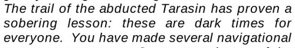
- **No single roster character (rules/setting/general)** — entry/section: Gravane Station Control: ""Welcome to the deathtrap, guys. If you have any sense, you'll turn around and go home now, but if you've got a death wish I'll try and find you a docking bay,"" Source: *506 - For Every Action - Counterstrike* (SWRPG d20 Revised Core), p.7
  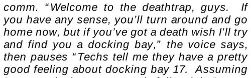
- **No single roster character (rules/setting/general)** — entry/section: Gravane Station Control: ""Techs tell me they have a pretty good feeling about docking bay 17. Assuming I can get the beacon to work, follow it in."" Source: *506 - For Every Action - Counterstrike* (SWRPG d20 Revised Core), p.7
  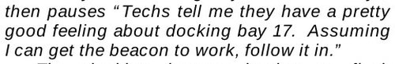
- **No single roster character (rules/setting/general)** — entry/section: Mygg Morb: ""the humble Mygg Morb, right hand of the glorious Magnificent Superior High Lord, Morgra the Hutt"" Source: *506 - For Every Action - Counterstrike* (SWRPG d20 Revised Core), p.7
  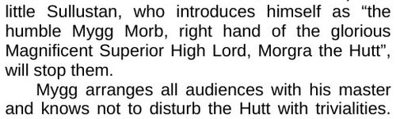
- **No single roster character (rules/setting/general)** — entry/section: Morgra's court: "There is a sense of futile denial in the room, as each of the people here is battling to forget the failing station around them." Source: *506 - For Every Action - Counterstrike* (SWRPG d20 Revised Core), p.7
  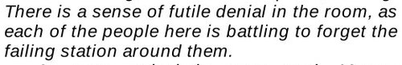

## p.8 (scan page 8)

Page contents: 782 words, 29 paragraphs | headings/entries: Counter-Strike; Encounter 3: Laws of the Republic; Page 8

- **No single roster character (rules/setting/general)** — entry/section: Morgra: ""You drive a hard bargain. I salute you. There is one last thing I can offer, one last good turn I can do, once Riboga is destroyed and my influence is restored." Source: *506 - For Every Action - Counterstrike* (SWRPG d20 Revised Core), p.8
  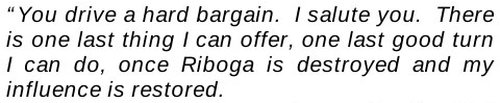
- **No single roster character (rules/setting/general)** — entry/section: Morgra: ""Agree to my deal and you will not only be destroying a threat to your home, not only rescuing these lizard people you talk of, not only that but you get wealth, prestige and the opportunity to save some little gurgling bluehaired babies from a horrible death in this infernal space station." Source: *506 - For Every Action - Counterstrike* (SWRPG d20 Revised Core), p.8
  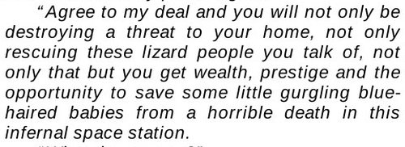
- **No single roster character (rules/setting/general)** — entry/section: Morgra: "Like most Hutts, Morgra responds well to flattery. The more grandiose the title the heroes use for him, the more agreeable he will be." Source: *506 - For Every Action - Counterstrike* (SWRPG d20 Revised Core), p.8
  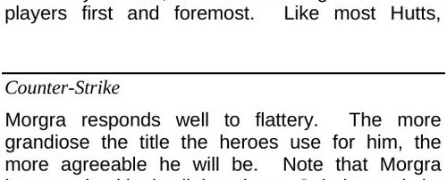
- **No single roster character (rules/setting/general)** — entry/section: Morgra: "As a sidebar, if anybody asks why Morgra is speaking Basic, he will say nothing. In fact it is one of the more demeaning terms of his exile. Not that he will admit it." Source: *506 - For Every Action - Counterstrike* (SWRPG d20 Revised Core), p.8
  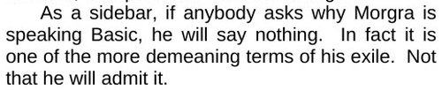
- **No single roster character (rules/setting/general)** — entry/section: Morgra: "If he has his ship, he can bargain it, perhaps for enough funds to start over, but if the ship is gone, the spice is gone, the slaves are gone-then, Riboga is finished."" Source: *506 - For Every Action - Counterstrike* (SWRPG d20 Revised Core), p.8
  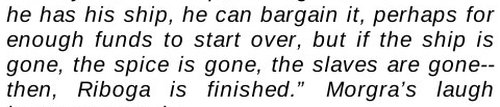
- **No single roster character (rules/setting/general)** — entry/section: Note to the GM: "At the end of the day he is a Hutt, and in all honesty no better than Riboga, just less influential." Source: *506 - For Every Action - Counterstrike* (SWRPG d20 Revised Core), p.8
  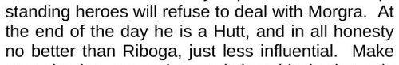

## p.5–8 (scan page 5)

Page contents: E1 Trading Lives (Haast Aath's bargain; the falling slave containers; Mother Tysara); E2 Rival (Gravane Station, Mygg Morb, Morgra's deal) (hand-read)

## p.9 (scan page 9)

Page contents: 794 words, 23 paragraphs | headings/entries: Counter-Strike; Page 9

- **No single roster character (rules/setting/general)** — entry/section: Clone Troopers: "We serve the Republic and we have been assigned to protect Republic interests on this world. In addition, our standing order to monitor Separatist activity remains." Source: *506 - For Every Action - Counterstrike* (SWRPG d20 Revised Core), p.9
  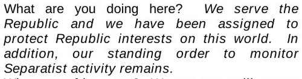
- **No single roster character (rules/setting/general)** — entry/section: Clone Troopers: "We are not at liberty to discuss that. Please move along." Source: *506 - For Every Action - Counterstrike* (SWRPG d20 Revised Core), p.9
  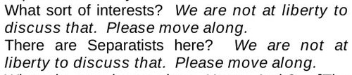
- **No single roster character (rules/setting/general)** — entry/section: Clone Troopers: "In fact the Troopers have been assigned to Tharados through an administration error, and they are about as bored as Clone Troopers can get." Source: *506 - For Every Action - Counterstrike* (SWRPG d20 Revised Core), p.9
  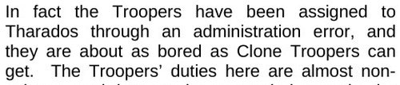

## p.10 (scan page 10)

Page contents: 776 words, 23 paragraphs | headings/entries: Encounter 4: Compound Interest; Counter-Strike; Getting in; Page 10

## p.11 (scan page 11)

Page contents: 747 words, 26 paragraphs | headings/entries: Counter-Strike; Wrapping up; Encounter 5: The Spice Mines of Kemix; Page 11

- **No single roster character (rules/setting/general)** — entry/section: Cerean prisoner: ""Help us ... please...!"" Source: *506 - For Every Action - Counterstrike* (SWRPG d20 Revised Core), p.11
  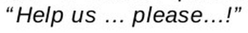
- **No single roster character (rules/setting/general)** — entry/section: Rescued Tarasin: "I had given up hope of ever seeing the sacred trees again. I cannot thank you enough." Source: *506 - For Every Action - Counterstrike* (SWRPG d20 Revised Core), p.11
  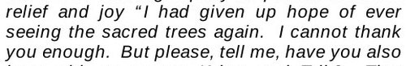

## p.12 (scan page 12)

Page contents: 761 words, 21 paragraphs | headings/entries: Counter-Strike; The Containers; The mine; Page 12

- **No single roster character (rules/setting/general)** — entry/section: Riboga: "To avoid word of this discovery leaking out, Riboga had his scouts killed, then immediately sent a small contingent of droids to Kemix to begin harvesting the spice in darkness and secrecy." Source: *506 - For Every Action - Counterstrike* (SWRPG d20 Revised Core), p.12
  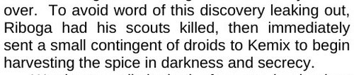

## p.13 (scan page 13)

Page contents: 733 words, 23 paragraphs | headings/entries: Combat?; Counter-Strike; Encounter 6: Rightful Dominion; Finding the slaves; Page 13

- **No single roster character (rules/setting/general)** — entry/section: Note to the GM: "Make sure the heroes understand that these guards are more than just competent. They have been warned." Source: *506 - For Every Action - Counterstrike* (SWRPG d20 Revised Core), p.13
  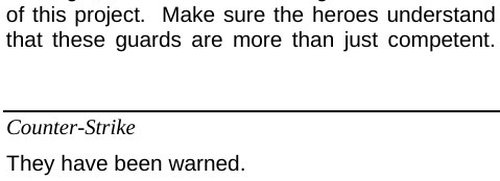

## p.8–13 (scan page 8)

Page contents: E3 Tharados and the Clone Troopers; E4 the slave compound; E5 the Kemix spice mines (hand-read)

## p.14 (scan page 14)

Page contents: 784 words, 21 paragraphs | headings/entries: Counter-Strike; Encounter 7: Treble Top; Page 14

- **No single roster character (rules/setting/general)** — entry/section: Rightful Dominion: "The décor displays Riboga's love of purples and golds, as well as his leaning towards tasteless excess. Noble portraits of the mighty Riboga adorn many of the walls." Source: *506 - For Every Action - Counterstrike* (SWRPG d20 Revised Core), p.14
  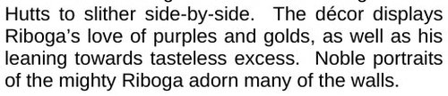
- **No single roster character (rules/setting/general)** — entry/section: Krizta: ""You have come, at last. We have waited, the Force as our guide, awaiting your arrival."" Source: *506 - For Every Action - Counterstrike* (SWRPG d20 Revised Core), p.14
  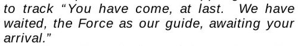
- **No single roster character (rules/setting/general)** — entry/section: Trik: ""And now that we are free, we should make Riboga pay. He and Aath must not be allowed to terrorize our people again."" Source: *506 - For Every Action - Counterstrike* (SWRPG d20 Revised Core), p.14
  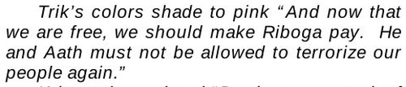
- **No single roster character (rules/setting/general)** — entry/section: Krizta: ""Brother, you speak of revenge, an act of anger, be mindful of your feelings."" Source: *506 - For Every Action - Counterstrike* (SWRPG d20 Revised Core), p.14
  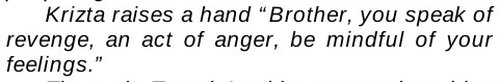
- **No single roster character (rules/setting/general)** — entry/section: Trik: ""Of course sister. I misspoke."" Source: *506 - For Every Action - Counterstrike* (SWRPG d20 Revised Core), p.14
  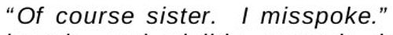
- **No single roster character (rules/setting/general)** — entry/section: Trik: ""Nevertheless, I believe it to be the correct thing to do. Our people are in constant danger from these slavers, we have a chance to stop Riboga once and for all, I suggest we take it." Trik looks at you. "Please, for our people."" Source: *506 - For Every Action - Counterstrike* (SWRPG d20 Revised Core), p.14
  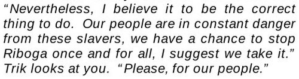
- **No single roster character (rules/setting/general)** — entry/section: Trik: ""Perhaps this ship has all we need to destroy the spice mine? It looked like it had many weapons when we approached. And then ... perhaps we can simply crash the ship into the planet?"" Source: *506 - For Every Action - Counterstrike* (SWRPG d20 Revised Core), p.14
  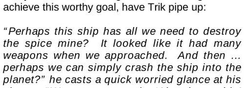

## p.15 (scan page 15)

Page contents: 788 words, 20 paragraphs | headings/entries: Counter-Strike; Page 15

- **No single roster character (rules/setting/general)** — entry/section: Haast Aath: ""It's me, Krizta! Come on, you know what you're doing here is the wrong choice! Remember my dear you told me yourself-- a darkness is coming, and you won't be safe on Cularin. But me and Riboga, we can keep you safe, we promised. The whole galaxy to hide in remember? You can be safe! But these people will ruin everything! They have to be stopped!"" Source: *506 - For Every Action - Counterstrike* (SWRPG d20 Revised Core), p.15
  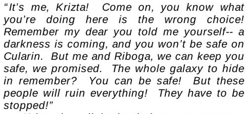
- **No single roster character (rules/setting/general)** — entry/section: Krizta: "Krizta rises, lightning in her eyes, terror on her tongue" ... yes ..."" Source: *506 - For Every Action - Counterstrike* (SWRPG d20 Revised Core), p.15
  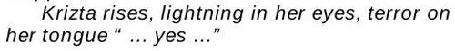
- **No single roster character (rules/setting/general)** — entry/section: Krizta: "Traumatized by the torture she suffered at Aath's hands, terrified by the darkness she has foretold coming to the galaxy, Krizta has fallen to the Dark Side. She acts out of terror, and despair, and a ragged misplaced anger. Krizta is redeemable, but not during this fight." Source: *506 - For Every Action - Counterstrike* (SWRPG d20 Revised Core), p.15
  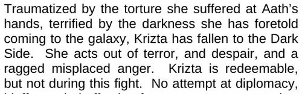
- **No single roster character (rules/setting/general)** — entry/section: Encounter 7: "Alarms sound, people run hither and yon, the Bith band continues to play." Source: *506 - For Every Action - Counterstrike* (SWRPG d20 Revised Core), p.15
  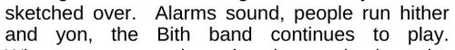

## p.16 (scan page 16)

Page contents: 538 words, 28 paragraphs | headings/entries: Conclusion; Counter-Strike; Here Ends, "Counter-strike"; Experience Point Summary; Experience is calculated as follows for LIVING; Loot Summary; Page 16

- **No single roster character (rules/setting/general)** — entry/section: Conclusion: "The Rodian nods, and half turns to follow, before turning back and saluting you." Source: *506 - For Every Action - Counterstrike* (SWRPG d20 Revised Core), p.16
  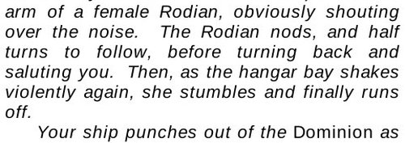
- **No single roster character (rules/setting/general)** — entry/section: Conclusion: "You have dealt a deathblow to Riboga's operation, but cannot be sure that Riboga himself is destroyed." Source: *506 - For Every Action - Counterstrike* (SWRPG d20 Revised Core), p.16
  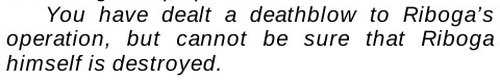
- **No single roster character (rules/setting/general)** — entry/section: Bothan port official: ""I trust you enjoyed your stay,"" Source: *506 - For Every Action - Counterstrike* (SWRPG d20 Revised Core), p.16
  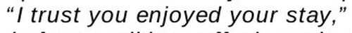

## p.13–16 (scan page 13)

Page contents: E6 Rightful Dominion, Krizta and Trik; E7 Treble Top and Krizta's fall; conclusions, XP, loot (hand-read)

## p.17 (scan page 17)

Page contents: 214 words, 19 paragraphs | headings/entries: Player Handout 1: Ship stats; Kuat Systems Engineering Wayfarer-class Medium Transport; Player Handout 2: The Salvation; Corellian Star Shuttle; Counter-Strike Page 17

## p.18 (scan page 18)

Page contents: 474 words, 29 paragraphs | headings/entries: GM Aid #1: Combat Statistics; All Tiers; Incom/Subpro Z-95 Headhunter Starfighter; Ordinary (+10); Equipment: Blaster pistol, Baton; Equipment: Blaster pistol, Baton; Equipment: Blaster pistol, Baton; Counter-Strike Page 18

### Stat block notes (game mechanics, not feats)

- Generic Thugs: Generic Thugs (Tier 3, recovered from image): Various Thug 6/Soldier 4; IM +3; Def 19; Spd 10 m; VP/WP 40/15; Atk +12/+7 melee (1d6+2, baton) or +14/+9 ranged (3d6, blaster pistol); SV Fort +11, Ref +6, Will +6; FP 2; DSP 1; Rep +2; Str 14, Dex 16, Con 15, Int 10, Wis 12, Cha 10 (Source: *506 - For Every Action - Counterstrike* (SWRPG d20 Revised Core), p.18)

## p.19 (scan page 19)

Page contents: 624 words, 18 paragraphs | headings/entries: Counter-Strike Page 19

### Stat block notes (game mechanics, not feats)

- Riboga's Mercs: Riboga's Mercs: Red Nikto Soldier 6/Elite Trooper 6 (Tier 3); VP/WP 146/21 (Source: *506 - For Every Action - Counterstrike* (SWRPG d20 Revised Core), p.19)

## p.20 (scan page 20)

Page contents: 598 words, 23 paragraphs | headings/entries: Equipment: Heavy blaster pistol, Mastercraft knife (+1); Equipment: none; Tier 2 (Average party level 7-9; Equipment: Heavy blaster pistol, Mastercraft knife (+2); Equipment: Force Talisman +2; Counter-Strike Page 20

### Stat block notes (game mechanics, not feats)

- Haast Aath: Haast Aath (Tier 1): Zabrak Scout 6; Def 17; VP/WP 44/12; DSP 3; Pilot +12; speaks Basic, Zabrak, Huttese, Tarasinese, Dosh, Shyriwook. Tier 3: Scout 12, Pilot +19, DSP 4 (Source: *506 - For Every Action - Counterstrike* (SWRPG d20 Revised Core), p.20)
- Krizta: Krizta: Female Tarasin Force Adept 6/9/12 by tier; VP/WP 50/14 (Tier 1), 98/17 (Tier 3); Fear +14; Force feats Alter, Aware, Control, Malevolent, Sense, Skill emphasis (Fear); Force secret (Fear) at Tier 3 (Source: *506 - For Every Action - Counterstrike* (SWRPG d20 Revised Core), p.20)

## p.21 (scan page 21)

Page contents: 505 words, 18 paragraphs | headings/entries: Equipment: Heavy blaster pistol, Mastercraft knife (+2); Equipment: Force Talisman +2, club; Counter-Strike Page 21

## p.22 (scan page 22)

Page contents: 27 words, 10 paragraphs | headings/entries: Section of Slavers Compound; Cells; Exercise yard; Blast door; Interrogation room; Waste chute; Guard rooms; Counter-Strike; Page 22

## p.23 (scan page 23)

Page contents: 29 words, 9 paragraphs | headings/entries: Main screen; Navigation console; Comms Ship systems; Weapon stations Sensor; Blast door; Om 4m 8m; Counter-Strike Page 23

## p.17–23 (scan page 17)

Page contents: Player handouts (Wayfarer, Salvation), GM Aid #1 stats, compound and backup bridge maps (hand-read)

