# Owner Material 037 — Star Wars D20 Drive folder (Core, Revised Core and Saga Edition): Living Force Campaign/Adventures/Among the Stars/Year 5/507 - For Every Action - Strike III.pdf [Star Wars Roleplaying Game Revised Core (d20, 2002)]

- **Source:** Wizards of the Coast Star Wars Roleplaying Game books, web enhancements, Living Force campaign modules and articles (2000–2010), from the owner's "Star Wars D20" Drive folder (only the three edition subfolders; "General" was not read, as instructed). Secondary source (licensed Legends reference). Scan OCR'd on the box; the scan stays box-only and is **not** published.
- **Method:** every scanned page was OCR'd and machine-screened sentence by sentence for power-relevant statements (fights, kills, defeats, Force feats, rankings, superweapons) that name a character on our roster; each kept sentence is quoted verbatim from the OCR text and has a crop of the printed passage directly under it. Pages with nothing power-relevant are still listed with what is on them.
- **Citation:** "*507 - For Every Action - Strike III* (SWRPG d20 Revised Core), p.X" by printed page ("scan p.X" where no printed number applies). **Weight:** Licensed RPG material: a secondary source. Narrative text sums up Legends lore; game statistics are rules for players, not canon power levels, and rank lowest.

## p.1 (scan page 1)

Page contents: 107 words, 6 paragraphs | headings/entries: LFA507; Strike III

## p.2 (scan page 2)

Page contents: 805 words, 22 paragraphs | headings/entries: House Rules; Atoning for Dark Side Points; Dissipate Energy; Illusion; Stun; Page 2

## p.3 (scan page 3)

Page contents: 715 words, 20 paragraphs | headings/entries: Hero Earnings; Issuing Force Points; Issuing Dark Side Points; Wookiees, Rage and Dark Side Points; Page 3

## p.4 (scan page 4)

Page contents: 791 words, 26 paragraphs | headings/entries: GM Overview; Encounter 3: Kiimo — The Hunter; Encounter 5: Kelyan — The Diplomat; Encounter 6: Dee'Hars — The Spy; Encounter 7: Riboga-—the Hutt; This module is fairly linear, because the; Page 4

- **No single roster character (rules/setting/general)** — entry/section: GM Overview: "It has not been a good few weeks for Riboga the Hutt. Just as it seemed things were finally back on track for him (Nirama gone, Cularin reclaimed, profits on Spice and slaves) he has had it all yanked away from him. And this has largely been caused by the brave heroes of Cularin." Source: *507 - For Every Action - Strike III* (SWRPG d20 Revised Core), p.4
  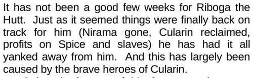
- **No single roster character (rules/setting/general)** — entry/section: GM Overview: "Riboga has hired a group of bounty hunters to take that revenge for him, but it is not enough to simply kill the heroes, he needs to run them through a few hoops first, so the contract states that the heroes should be kept alive long enough to know despair." Source: *507 - For Every Action - Strike III* (SWRPG d20 Revised Core), p.4
  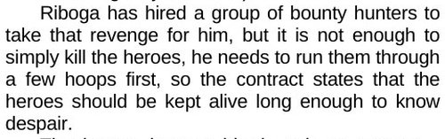
- **No single roster character (rules/setting/general)** — entry/section: Dee'Hars: "In truth, Dee'Hars expects the heroes to survive all this, and has saved his most elaborate trap for last." Source: *507 - For Every Action - Strike III* (SWRPG d20 Revised Core), p.4
  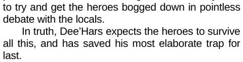
- **No single roster character (rules/setting/general)** — entry/section: Important Note to Judges: "Be careful with this — the villains are definitely out to kill the heroes, but make sure you're not!" Source: *507 - For Every Action - Strike III* (SWRPG d20 Revised Core), p.4
  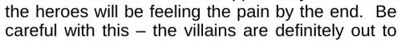

## p.5 (scan page 5)

Page contents: 737 words, 25 paragraphs | headings/entries: Opening Crawl; Page 5

- **No single roster character (rules/setting/general)** — entry/section: Opening Crawl: "Over the past few months the heroes of Cularin have turned their attention inwards. This battle for Cularin isn't overt but rather the insidious takeover at the dark underbelly. The return of Riboga has been delayed and now he seeks his revenge..." Source: *507 - For Every Action - Strike III* (SWRPG d20 Revised Core), p.5
  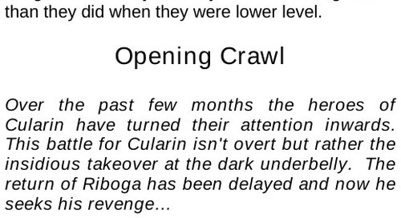
- **No single roster character (rules/setting/general)** — entry/section: Encounter 1: "Even before you open your eyes you know something is wrong. Possibly it is the unmistakable smell of smoke in the air, maybe it the uncomfortable position you appear to be sleeping in. Maybe it's the fact that you hurt all over." Source: *507 - For Every Action - Strike III* (SWRPG d20 Revised Core), p.5
  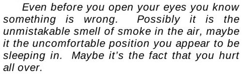
- **No single roster character (rules/setting/general)** — entry/section: Encounter 1: "Yes, that's probably it." Source: *507 - For Every Action - Strike III* (SWRPG d20 Revised Core), p.5
  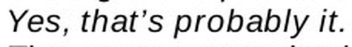

## p.1–5 (scan page 1)

Page contents: Title, GM notes, house rules, overview, encounter list, judges' note, crawl (hand-read)

## p.6 (scan page 6)

Page contents: 752 words, 28 paragraphs | headings/entries: Page 6

- **No single roster character (rules/setting/general)** — entry/section: Dee'Hars: ""Good morning. I trust you are all well? My name, for those who don't recognize me, is Dee'Hars. I am a bounty hunter currently in the employ of Riboga the Hutt. I have been asked to read the terms of my contract to you before we begin."" Source: *507 - For Every Action - Strike III* (SWRPG d20 Revised Core), p.6
  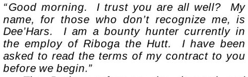
- **No single roster character (rules/setting/general)** — entry/section: Dee'Hars: ""'Two. The targets must be kept alive long enough to learn the cause of their demise.' It is because knowingly or otherwise you have crossed Riboga,"" Source: *507 - For Every Action - Strike III* (SWRPG d20 Revised Core), p.6
  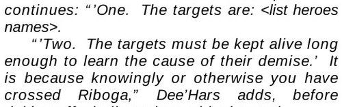
- **No single roster character (rules/setting/general)** — entry/section: Dee'Hars: ""'Three. As they have brought me low, so must they be rendered powerless.'" Dee'Hars reaches out of view, when his hand comes back into the projection it is holding the hilt of a lightsaber. "Check."" Source: *507 - For Every Action - Strike III* (SWRPG d20 Revised Core), p.6
  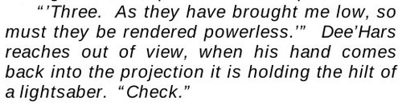
- **No single roster character (rules/setting/general)** — entry/section: Dee'Hars: ""Four. They must be given time to contemplate their fate. Give them false hope that they can escape, before: "Five. Destroy them utterly.'" Source: *507 - For Every Action - Strike III* (SWRPG d20 Revised Core), p.6
  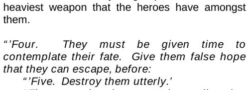
- **No single roster character (rules/setting/general)** — entry/section: Dee'Hars: ""The rest is the normal small print, payment details, default clauses, blah blah blah. Of no interest to you I'm sure, although if it's any conciliation, your lives are worth quite a bit, apparently." Source: *507 - For Every Action - Strike III* (SWRPG d20 Revised Core), p.6
  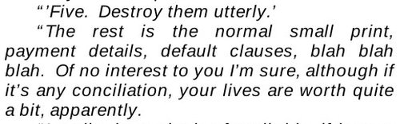
- **No single roster character (rules/setting/general)** — entry/section: Dee'Hars: ""I really do apologize for all this, if it were up to me, I would have given you a clean death when we sabotaged your ship. It would have been far easier to engineer." Source: *507 - For Every Action - Strike III* (SWRPG d20 Revised Core), p.6
  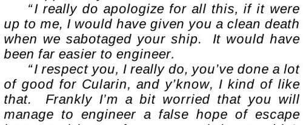
- **No single roster character (rules/setting/general)** — entry/section: Dee'Hars: "you've done a lot of good for Cularin, and y'know, I kind of like that. Frankly I'm a bit worried that you will manage to engineer a false hope of escape into a real hope of escape, and that wouldn't bode well for me or my colleagues. But a contract is a contract." Source: *507 - For Every Action - Strike III* (SWRPG d20 Revised Core), p.6
  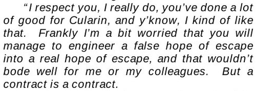

## p.7 (scan page 7)

Page contents: 756 words, 28 paragraphs | headings/entries: Encounter 2: Holador Travelogue; Page 7

- **No single roster character (rules/setting/general)** — entry/section: Dee'Hars: "There should be enough there to get you up in the sky and away from here, back to Cularin in time for tea with a rousing chorus of 'Huzzahs!'." Source: *507 - For Every Action - Strike III* (SWRPG d20 Revised Core), p.7
  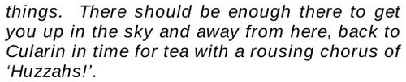
- **No single roster character (rules/setting/general)** — entry/section: Dee'Hars: "From all the research I've done on you, I think there's a chance you will. We'll see. "Two hours fifty nine."" Source: *507 - For Every Action - Strike III* (SWRPG d20 Revised Core), p.7
  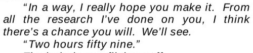
- **No single roster character (rules/setting/general)** — entry/section: Holador: "The planet outside your ship is an uninviting wasteland. The terrain is cut from uniformly black rock, all sharp edges and spiky outcroppings." Source: *507 - For Every Action - Strike III* (SWRPG d20 Revised Core), p.7
  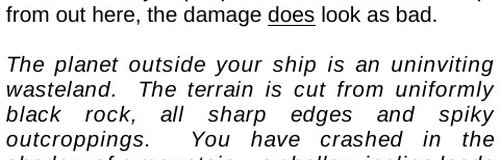
- **No single roster character (rules/setting/general)** — entry/section: Holador: "The air is close and heavy; a smell of sulfur fills your nostrils." Source: *507 - For Every Action - Strike III* (SWRPG d20 Revised Core), p.7
  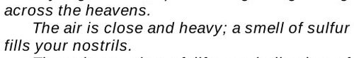

## p.8 (scan page 8)

Page contents: 763 words, 25 paragraphs | headings/entries: Are we being watched?; Is there anything to eat?; Can we find a shortcut?; Encounter 3: Kiimo - The Hunter; Page 8

## p.5–8 (scan page 5)

Page contents: E1 crash and Dee'Hars's contract holo; E2 Holador travelogue (hand-read)

## p.9 (scan page 9)

Page contents: 825 words, 22 paragraphs | headings/entries: Page 9

- **No single roster character (rules/setting/general)** — entry/section: Kiimo: ""Oota goota 'heroes'?" the Rodian laughs." Source: *507 - For Every Action - Strike III* (SWRPG d20 Revised Core), p.9
  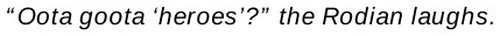
- **No single roster character (rules/setting/general)** — entry/section: Kiimo: "Kiimo, now captured, is a bit whiny and should be played as such. She is very proud that the heroes fell for her trap though, and will give a sinister little Rodian laugh, while telling the heroes they just cost themselves a lot of time, as they've spent the last while trekking the wrong way!" Source: *507 - For Every Action - Strike III* (SWRPG d20 Revised Core), p.9
  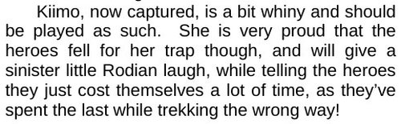

## p.10 (scan page 10)

Page contents: 732 words, 23 paragraphs | headings/entries: Encounter 4: Clargod - The Warrior; Page 10

- **No single roster character (rules/setting/general)** — entry/section: Squib scout: "On the off chance that the heroes speak Squibbian, he's saying "Good grief, more off-worlders, I better go tell the boss."" Source: *507 - For Every Action - Strike III* (SWRPG d20 Revised Core), p.10
  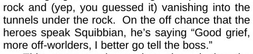
- **No single roster character (rules/setting/general)** — entry/section: Encounter 4: "You pause for a moment to contemplate the almost textbook ambush spot, but you have little choice." Source: *507 - For Every Action - Strike III* (SWRPG d20 Revised Core), p.10
  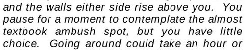
- **No single roster character (rules/setting/general)** — entry/section: Clargod: ""Evenin'," the Trandoshan shouts, her voice carrying across the arena "I can kill at least one of you before you can reach me, and the Sentry droids up on the cliffs could do some damage to the rest of you, so don't make any sudden moves and listen to my offer."" Source: *507 - For Every Action - Strike III* (SWRPG d20 Revised Core), p.10
  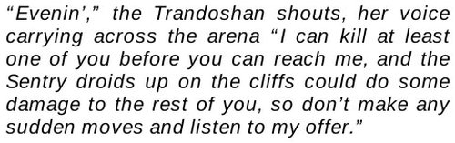

## p.11 (scan page 11)

Page contents: 731 words, 25 paragraphs | headings/entries: Encounter 5: Kelyan - The Diplomat; Page 11

- **No single roster character (rules/setting/general)** — entry/section: Clargod: ""You are not going forwards without fighting me. Take that as read. Anybody comes close enough to try any funny business, I will blast them. What you can decide is who fights." Source: *507 - For Every Action - Strike III* (SWRPG d20 Revised Core), p.11
  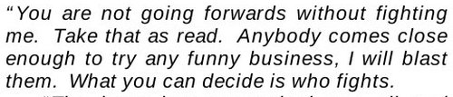
- **No single roster character (rules/setting/general)** — entry/section: Clargod: "But there's no challenge there. I'd rather fight your best than kill your weakest." Source: *507 - For Every Action - Strike III* (SWRPG d20 Revised Core), p.11
  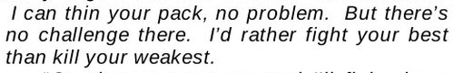
- **No single roster character (rules/setting/general)** — entry/section: Clargod: ""So choose someone, and I'll fight them. One-on-one, no weapons. I'll fight you each in turn, in fact, one of you may get the lucky blow to take me out." Source: *507 - For Every Action - Strike III* (SWRPG d20 Revised Core), p.11
  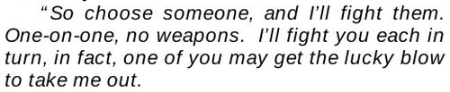
- **No single roster character (rules/setting/general)** — entry/section: Encounter 5: "Once the heroes have slaughtered the innocent bystanders, they can take themselves to Encounter 6. If the heroes made no attempt to defuse this situation, it may be worthy of DSPs." Source: *507 - For Every Action - Strike III* (SWRPG d20 Revised Core), p.11
  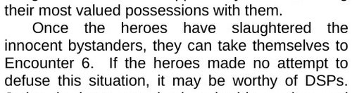

## p.8–11 (scan page 8)

Page contents: E3 Kiimo's traps; E4 Clargod's single-combat challenge (hand-read)

## p.12 (scan page 12)

Page contents: 838 words, 21 paragraphs | headings/entries: Page 12

- **No single roster character (rules/setting/general)** — entry/section: Squibs: "Their greatest held tenet of faith is that one-day Outworlders will come and return the Squibs to the stars, as long as they have remained true to the Holy Icon (the comms relay)." Source: *507 - For Every Action - Strike III* (SWRPG d20 Revised Core), p.12
  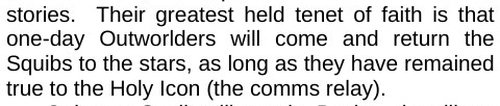
- **No single roster character (rules/setting/general)** — entry/section: Alexem: "Only one Squib still speaks Basic — the village elder Alexem. As yet, he has not admitted this ability to the Twi'Lek, because there is something about her he doesn't entirely trust." Source: *507 - For Every Action - Strike III* (SWRPG d20 Revised Core), p.12
  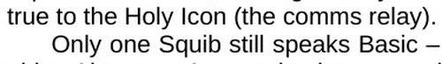
- **No single roster character (rules/setting/general)** — entry/section: Kelyan: "She has told tales of the heroic actions of her colleagues, and the dread Assassin Lords that the heroes supposedly work for." Source: *507 - For Every Action - Strike III* (SWRPG d20 Revised Core), p.12
  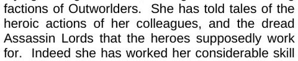
- **No single roster character (rules/setting/general)** — entry/section: Kelyan: ""About time you got here. You've eluded Kiimo and bested Clargod, I'm impressed. And I'm not going to fight you, I couldn't win, so there would be no point. But the tales I've told these little people!" Source: *507 - For Every Action - Strike III* (SWRPG d20 Revised Core), p.12
  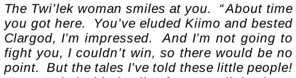
- **No single roster character (rules/setting/general)** — entry/section: Kelyan: "So you'd better explain to the silly old geezer why they shouldn't kill you. "Don't worry if you don't speak Squibbian," the Twi'lek smiles again "I'll translate for you."" Source: *507 - For Every Action - Strike III* (SWRPG d20 Revised Core), p.12
  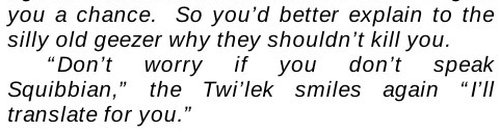
- **No single roster character (rules/setting/general)** — entry/section: Alexem: ""I listen true," he will say in laborious Basic." Source: *507 - For Every Action - Strike III* (SWRPG d20 Revised Core), p.12
  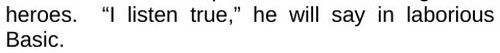

## p.13 (scan page 13)

Page contents: 798 words, 21 paragraphs | headings/entries: Page 13

- **No single roster character (rules/setting/general)** — entry/section: Dee'Hars: "Dee'Hars is the ultimately prepared bounty hunter. While not the physical threat of the others, he has numerous tricks prepared for the heroes." Source: *507 - For Every Action - Strike III* (SWRPG d20 Revised Core), p.13
  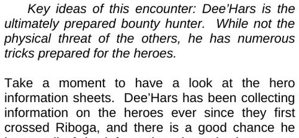
- **No single roster character (rules/setting/general)** — entry/section: Dee'Hars: ""You made it then?" he asks without preamble "Well, your stuff is in here, come get it. You will have to get past me first though."" Source: *507 - For Every Action - Strike III* (SWRPG d20 Revised Core), p.13
  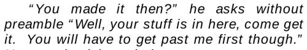
- **No single roster character (rules/setting/general)** — entry/section: Dee'Hars: ""That's it. I'm done. Riboga will not be pleased, but I give up, it's only a contract."" Source: *507 - For Every Action - Strike III* (SWRPG d20 Revised Core), p.13
  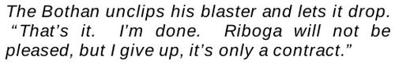

## p.14 (scan page 14)

Page contents: 639 words, 31 paragraphs | headings/entries: Encounter 7: Riboga - The Hutt; Conclusion; Here Ends, "Strike III"; Experience Point Summary; Experience is calculated as follows for LIVING; Adventure Experience Award:; Page 14

- **No single roster character (rules/setting/general)** — entry/section: Dee'Hars: "Dee'Hars grins. "Remember that bit in the contract about 'false hope'?"" Source: *507 - For Every Action - Strike III* (SWRPG d20 Revised Core), p.14
  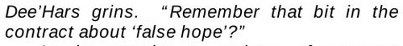
- **No single roster character (rules/setting/general)** — entry/section: Captain Siobhan Stern: ""Good to see you guys, wondered where you got to. This is Captain Siobhan Stern. Had word you boys might be in a little trouble and we've been looking for you for hours."" Source: *507 - For Every Action - Strike III* (SWRPG d20 Revised Core), p.14
  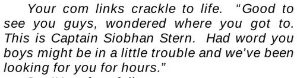
- **No single roster character (rules/setting/general)** — entry/section: Captain Siobhan Stern: ""When we intercepted a signal from Riboga the Hutt down here, figured you might be hereabouts. Tell you what, me and the lads will keep the ship on the ground, you guys round up old slug lord, eh?"" Source: *507 - For Every Action - Strike III* (SWRPG d20 Revised Core), p.14
  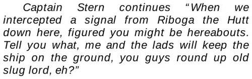
- **No single roster character (rules/setting/general)** — entry/section: Encounter 7: "After the frustrations of fighting with minimal equipment your table may be grateful to get the lightsabers humming again." Source: *507 - For Every Action - Strike III* (SWRPG d20 Revised Core), p.14
  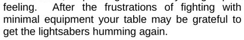
- **No single roster character (rules/setting/general)** — entry/section: Riboga: "When it comes down to it, Riboga surrenders without a fight. He looks tired, beaten and depressed. You could almost feel sorry for him. The Hutt goes quietly, no spluttering oaths of revenge, no name calling or threats." Source: *507 - For Every Action - Strike III* (SWRPG d20 Revised Core), p.14
  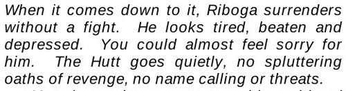
- **No single roster character (rules/setting/general)** — entry/section: Conclusion: "It has been a long time coming, but this actually does seem to be the end of Riboga's shadow over Cularin." Source: *507 - For Every Action - Strike III* (SWRPG d20 Revised Core), p.14
  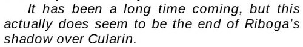

## p.11–14 (scan page 11)

Page contents: E5 Kelyan and the Squib village; E6 Dee'Hars's plateau; E7 the Militia and Riboga; conclusion (hand-read)

## p.15 (scan page 15)

Page contents: 302 words, 10 paragraphs | headings/entries: Loot Summary

- **No single roster character (rules/setting/general)** — entry/section: Commendation: "In recognition of heroic effort on the part of the above named hero in keeping a dangerous criminal from establishing operations in the system of Cularin the peace keeping organizations (Office of Public Safety, Cularin Armed Forces/Militia and the Jedi of Almas) have presented this crystal representation of a ch'hala tree to the above named hero." Source: *507 - For Every Action - Strike III* (SWRPG d20 Revised Core), p.15
  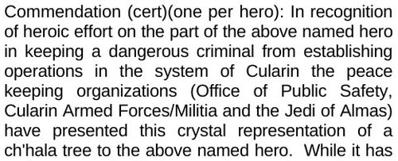
- **No single roster character (rules/setting/general)** — entry/section: Dee'Hars Heavy Blaster Pistol: "This unmodified heavy blaster pistol is remarkable only for the holographic projector built into the handle. When "liberated" the holo played highlights of some of Dee'hars more spectacular "hunts"." Source: *507 - For Every Action - Strike III* (SWRPG d20 Revised Core), p.15
  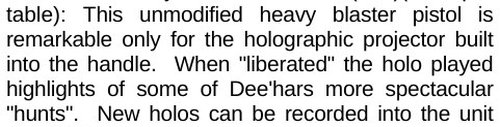

## p.16 (scan page 16)

Page contents: 71 words, 20 paragraphs | headings/entries: Species:; Class(es) and Level(s): Profession:; Militia Rank:; Combat; Preferred melee weapon:; Attack Bonus:; Preferred Ranged weapon: Attack Bonus:; Reputation Reputation bonus (in Cularin):; Character best known for/as:; Class(es) and Level(s): Profession:; Militia Rank:; Combat; Preferred melee weapon:; Attack Bonus:; Preferred Ranged weapon: Attack Bonus:; Reputation Reputation bonus (in Cularin):; Character best known for/as:

## p.17 (scan page 17)

Page contents: 557 words, 22 paragraphs | headings/entries: GM Aid #1: Combat Statistics; Equipment: Blaster carbine, demolitions remote control; Equipment: Blaster carbine, demolitions remote control; Equipment: Blaster carbine, demolitions remote control; Encounter 4: Clargod — the Warrior; Equipment: Blaster carbine; Equipment: Blaster carbine

### Stat block notes (game mechanics, not feats)

- Kiimo: Kiimo: Female Rodian Scout 5/8/11 by tier; VP/WP 37/12 to 79/12; Pilot +14/+18 (Tier 3 prints +12); Skill Mastery (demolitions) (Source: *507 - For Every Action - Strike III* (SWRPG d20 Revised Core), p.17)

## p.18 (scan page 18)

Page contents: 557 words, 21 paragraphs | headings/entries: Equipment: Blaster carbine; Equipment: Spear; Feats: Weapons (simple, primitive), Athletic; Equipment: Blaster pistol; Equipment: Blaster pistol

### Stat block notes (game mechanics, not feats)

- Clargod: Clargod (Tier 3, recovered from image): Female Trandoshan Soldier 11 IM +1; Def 22 (+8 class, +1 Dex, +1 natural, +2 Martial arts); Spd 10 m; VP/WP 112/14; Atk +13/+8/+3 ranged (3d8, blaster carbine), +15/+10/+5 melee (3d4+4 unarmed); SV Fort +9, Ref +4, Will +3; FP 2; DSP 1; Rep +3; Str 19, Dex 13, Con 14, Int 10, Wis 10, Cha 10 (Source: *507 - For Every Action - Strike III* (SWRPG d20 Revised Core), p.18)

## p.19 (scan page 19)

Page contents: 602 words, 20 paragraphs | headings/entries: Equipment: Blaster pistol; Equipment: Heavy Blaster pistol; Equipment: Heavy Blaster pistol; Equipment: Heavy Blaster pistol; Encounter 7: Riboga-— the Hutt

### Stat block notes (game mechanics, not feats)

- Kelyan: Kelyan: Female Twi'lek Noble 11 (Tier 3); VP/WP 57/12; Bluff +23, Diplomacy +23; speaks 14 languages incl. Squibbian (Source: *507 - For Every Action - Strike III* (SWRPG d20 Revised Core), p.19)
- Dee'Hars: Dee'Hars (Tier 3): Male Bothan Scoundrel 5/Soldier 3/Bounty hunter 4; VP/WP 78/12; Gather info +22; Sneak attack 2d6, Target bonus +2 (Source: *507 - For Every Action - Strike III* (SWRPG d20 Revised Core), p.19)

## p.20 (scan page 20)

Page contents: 0 words, 0 paragraphs | headings/entries: 

## p.21 (scan page 21)

Page contents: 13 words, 3 paragraphs | headings/entries: T3

## p.14–21 (scan page 14)

Page contents: XP, loot and certs, hero information sheet, GM Aid #1 stats, plateau map (hand-read)

