# Owner Material 037 — Star Wars D20 Drive folder (Core, Revised Core and Saga Edition): Living Force Campaign/Adventures/Among the Stars/Year 5/508 - Heart of Evil - A Plague of Darkness.pdf [Star Wars Roleplaying Game Revised Core (d20, 2002)]

- **Source:** Wizards of the Coast Star Wars Roleplaying Game books, web enhancements, Living Force campaign modules and articles (2000–2010), from the owner's "Star Wars D20" Drive folder (only the three edition subfolders; "General" was not read, as instructed). Secondary source (licensed Legends reference). Scan OCR'd on the box; the scan stays box-only and is **not** published.
- **Method:** every scanned page was OCR'd and machine-screened sentence by sentence for power-relevant statements (fights, kills, defeats, Force feats, rankings, superweapons) that name a character on our roster; each kept sentence is quoted verbatim from the OCR text and has a crop of the printed passage directly under it. Pages with nothing power-relevant are still listed with what is on them.
- **Citation:** "*508 - Heart of Evil - A Plague of Darkness* (SWRPG d20 Revised Core), p.X" by printed page ("scan p.X" where no printed number applies). **Weight:** Licensed RPG material: a secondary source. Narrative text sums up Legends lore; game statistics are rules for players, not canon power levels, and rank lowest.

## p.1 (scan page 1)

Page contents: 139 words, 7 paragraphs | headings/entries: LFA508; A Plague of Darkness; Edited by Margaret Heintz

## p.2 (scan page 2)

Page contents: 935 words, 23 paragraphs | headings/entries: Campaign Notes to the GM; House Rules; A Plague of Darkness; Atoning for Dark Side Points; Dissipate Energy; Illusion; Stun; Hero Earnings; Page 2

## p.3 (scan page 3)

Page contents: 952 words, 30 paragraphs | headings/entries: Issuing Force Points; Issuing Dark Side Points; A Plague of Darkness; Wookiees, Rage and Dark Side Points; GM Overview; Page 3

- **No single roster character (rules/setting/general)** — entry/section: Issuing Force Points: "Not everything is that extreme, and you don't have to jump from a moving speeder to earn a Force Point, but if a hero does something that makes you, the judge, say, 'Wow,' then they should probably get a FP." Source: *508 - Heart of Evil - A Plague of Darkness* (SWRPG d20 Revised Core), p.3
  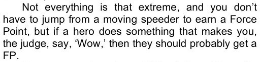
- **No single roster character (rules/setting/general)** — entry/section: GM Overview: "The end of the Wyrd is nigh. They have suffered fairly constant setbacks and depredations, many of them caused by the heroes of Cularin." Source: *508 - Heart of Evil - A Plague of Darkness* (SWRPG d20 Revised Core), p.3
  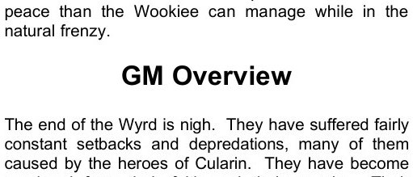
- **No single roster character (rules/setting/general)** — entry/section: GM Overview: "They would rather see Cularin destroyed, by now, than see it "infested and infected with outworlders". In other words, the Dark Side has consumed them." Source: *508 - Heart of Evil - A Plague of Darkness* (SWRPG d20 Revised Core), p.3
  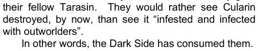
- **No single roster character (rules/setting/general)** — entry/section: Len Markus: "This brought them to the attention of the being known as Len Markus, who has, over the years, become the avatar for a dark power which even he does not fully understand, but for which he yearns with an insane passion." Source: *508 - Heart of Evil - A Plague of Darkness* (SWRPG d20 Revised Core), p.3
  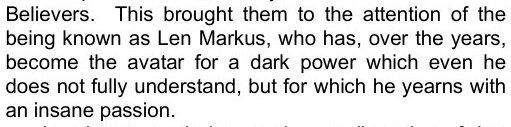
- **No single roster character (rules/setting/general)** — entry/section: World Tree Ch'hala: "they are no ch'hala "trees", there is only one, the World Tree Ch'hala, one vast, living organism, interconnected through its root structure, that encompasses the entire planet of Cularin. It is one of the largest living creatures in the galaxy. And it is selfaware, though not in the same way that animal life forms think of awareness and intelligence. And, finally: it is strong with the Force." Source: *508 - Heart of Evil - A Plague of Darkness* (SWRPG d20 Revised Core), p.3
  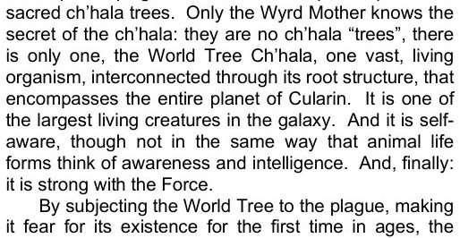

## p.4 (scan page 4)

Page contents: 930 words, 19 paragraphs | headings/entries: A Plague of Darkness; Opening Crawl; Page 4

- **No single roster character (rules/setting/general)** — entry/section: Mother Dariana: "Two different storms are meeting, here on Cularin. Dariana hopes to stem the first one now, with the aid of the heroes of Cularin, before the combined might of the two catastrophes plunges Cularin, and perhaps the entire galaxy, into eternal darkness." Source: *508 - Heart of Evil - A Plague of Darkness* (SWRPG d20 Revised Core), p.4
  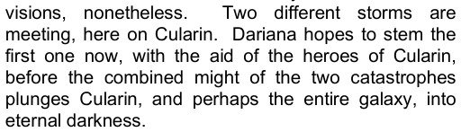
- **No single roster character (rules/setting/general)** — entry/section: Lanius Qel'Bertok: "He becomes one with the Force of the ch'hala, to enable it to discern the Light from the Dark, good from evil. In so doing, he is able to use the tremendous life force of the ch'hala to destroy the plague from within, at the cost of leaving this plane of existence forever." Source: *508 - Heart of Evil - A Plague of Darkness* (SWRPG d20 Revised Core), p.4
  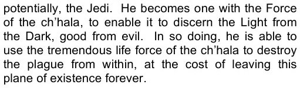
- **No single roster character (rules/setting/general)** — entry/section: Important Notes for Judges: "Having said all of the above: heroes can die in this scenario. This is a dark time for the galaxy, and especially heroes who like to have an 'in your face" approach to evil may very well bite off something that can chew them." Source: *508 - Heart of Evil - A Plague of Darkness* (SWRPG d20 Revised Core), p.4
  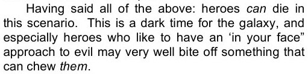
- **No single roster character (rules/setting/general)** — entry/section: Opening Crawl: "Recently, there have been strange rumors of crazed animal attacks and multiple, inexplicable accidents to vehicular traffic in the Cularin jungle. Even the Tarasin, at home in the byways and recesses of the jungle shadows, have been affected by the new, eerie, unnatural menace of the green depths. It is as though a weird plague has driven Cularin itself insane." Source: *508 - Heart of Evil - A Plague of Darkness* (SWRPG d20 Revised Core), p.4
  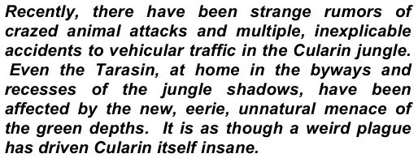

## p.1–4 (scan page 1)

Page contents: Title, GM notes, house rules, overview, encounter summaries, crawl (hand-read)

## p.5 (scan page 5)

Page contents: 940 words, 18 paragraphs | headings/entries: Encounter 1: Plague; A Plague of Darkness; Page 5

- **No single roster character (rules/setting/general)** — entry/section: Look Out: "this time it is a branch from a large, sacred ch'hala tree—unheard of! Sacrilegious!" Source: *508 - Heart of Evil - A Plague of Darkness* (SWRPG d20 Revised Core), p.5
  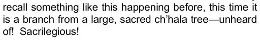

## p.6 (scan page 6)

Page contents: 957 words, 23 paragraphs | headings/entries: A Plague of Darkness; Encounter 2: The Heart of the Matter; Page 6

- **No single roster character (rules/setting/general)** — entry/section: Flying Snake Swarm: "Whatever they are, they're about three meters long and half a meter wide and it looks like the near end has teeth..." Source: *508 - Heart of Evil - A Plague of Darkness* (SWRPG d20 Revised Core), p.6
  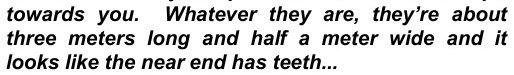
- **No single roster character (rules/setting/general)** — entry/section: Mother Dariana: ""Thank you for answering the call. I must ask you to travel yet again, if you are willing."" Source: *508 - Heart of Evil - A Plague of Darkness* (SWRPG d20 Revised Core), p.6
  
- **No single roster character (rules/setting/general)** — entry/section: Mother Dariana: ""You have proven yourselves, time and again, to have the good of Cularin at heart. The next thing I do, I do not do lightly, for it involves breaking millennia of tradition and revealing the great secret of my people and of this very world." Source: *508 - Heart of Evil - A Plague of Darkness* (SWRPG d20 Revised Core), p.6
  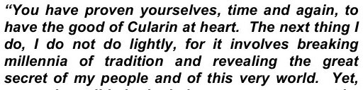

## p.7 (scan page 7)

Page contents: 866 words, 29 paragraphs | headings/entries: A Plague of Darkness; Page 7

- **No single roster character (rules/setting/general)** — entry/section: Mother Dariana: ""Then we must go as quickly as we can, to a hidden place in the Deep Jungle. I will come with you. Though I do not like mechanical conveyances, there is not a moment to be lost. Cularin is dying."" Source: *508 - Heart of Evil - A Plague of Darkness* (SWRPG d20 Revised Core), p.7
  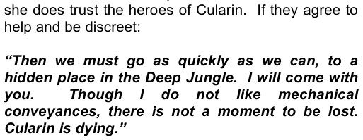
- **No single roster character (rules/setting/general)** — entry/section: Mother Dariana: ""The Heart of our people is still strong, and guards us," explains Dariana. "But, for how much longer?" Source: *508 - Heart of Evil - A Plague of Darkness* (SWRPG d20 Revised Core), p.7
  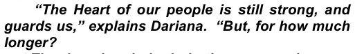
- **No single roster character (rules/setting/general)** — entry/section: Heart Tree: "It is fully two hundred meters in diameter and extends upwards literally out of sight, its titanic main branches wide enough for villages to be built upon them" Source: *508 - Heart of Evil - A Plague of Darkness* (SWRPG d20 Revised Core), p.7
  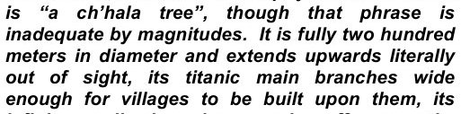
- **No single roster character (rules/setting/general)** — entry/section: Mother Dariana: ""Hear, now, the heart of my people. There are no 'ch'hala trees'. There is only this, the Heart Tree, the World-Tree, Ch'hala. Over all of Cularin it grows, this one being. What you think of as groves, forests, jungles are all but the offshoots of its infinite roots. It is One. It is Ch'hala. It is The Heart. It is Cularin." Source: *508 - Heart of Evil - A Plague of Darkness* (SWRPG d20 Revised Core), p.7
  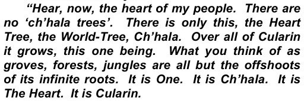
- **No single roster character (rules/setting/general)** — entry/section: Mother Dariana: ""The Wyrd have done something obscene. Somehow, they have infected The Heart with a darkness. For the first time since the dawn of the world, Ch'hala is afraid, sick and afraid."" Source: *508 - Heart of Evil - A Plague of Darkness* (SWRPG d20 Revised Core), p.7
  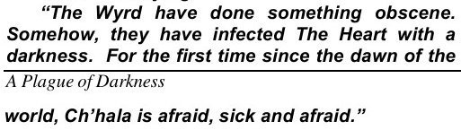
- **No single roster character (rules/setting/general)** — entry/section: Lanius Qel'Bertok: "It is none other than Master Lanius Qel'Bertok, just in the nick of late." Source: *508 - Heart of Evil - A Plague of Darkness* (SWRPG d20 Revised Core), p.7
  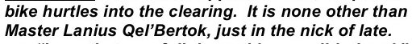
- **No single roster character (rules/setting/general)** — entry/section: Lanius Qel'Bertok: ""I got your call. I am here to help, as we agreed. It seems that the time is upon us."" Source: *508 - Heart of Evil - A Plague of Darkness* (SWRPG d20 Revised Core), p.7
  

## p.8 (scan page 8)

Page contents: 1063 words, 18 paragraphs | headings/entries: Encounter 3: Enclave of Evil; A Plague of Darkness; Page 8

- **No single roster character (rules/setting/general)** — entry/section: First Witch of the Wyrd: "This darkscaled, aged female, with a twisting purple pattern of markings, is strong in the Force and terrible in combat, not to mention totally insane. She can kill a deep jungle lizard with a wave of her hand. She has no name; destroying her name was one of the first rituals she undertook." Source: *508 - Heart of Evil - A Plague of Darkness* (SWRPG d20 Revised Core), p.8
  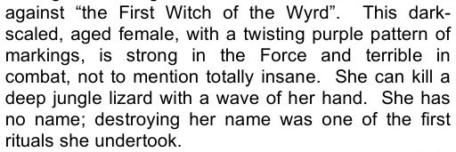
- **No single roster character (rules/setting/general)** — entry/section: Mother Dariana: ""Her days will end, and soon," predicts Dariana, "but your goal must be to save Ch'hala. Please hurry."" Source: *508 - Heart of Evil - A Plague of Darkness* (SWRPG d20 Revised Core), p.8
  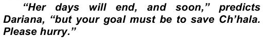

## p.5–8 (scan page 5)

Page contents: E1 Plague; E2 Heart of the Matter (World Tree reveal, Wyrd attack, Lanius) (hand-read)

## p.9 (scan page 9)

Page contents: 1027 words, 19 paragraphs | headings/entries: A Plague of Darkness; Another missing section, then:; Page 9

- **No single roster character (rules/setting/general)** — entry/section: Holo record: ""the Ritual of the Power of the Dark— channel through the shard—hatred and fear will accomplish what force cannot—turn from within— nothing can withstand the power of the Dark Side."" Source: *508 - Heart of Evil - A Plague of Darkness* (SWRPG d20 Revised Core), p.9
  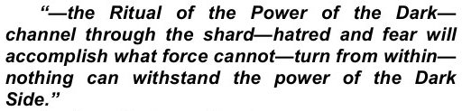
- **No single roster character (rules/setting/general)** — entry/section: Holo record: ""in the ultimate extremity, there is always the path of blood. What cannot be turned can always be destroyed, no matter how powerful, if the blood price is paid. Strike at the heart, and the body dies."" Source: *508 - Heart of Evil - A Plague of Darkness* (SWRPG d20 Revised Core), p.9
  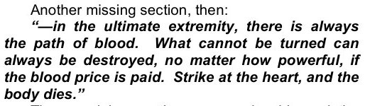
- **No single roster character (rules/setting/general)** — entry/section: Cheelru: "Who are you? "I am Cheelru, of the Inner Circle. You should abase yourself."" Source: *508 - Heart of Evil - A Plague of Darkness* (SWRPG d20 Revised Core), p.9
  

## p.10 (scan page 10)

Page contents: 977 words, 28 paragraphs | headings/entries: Encounter 4: Final Solution; Page 10

- **No single roster character (rules/setting/general)** — entry/section: Cheelru: "Why are you chained to the wall? "Because otherwise I would escape. Stupid."" Source: *508 - Heart of Evil - A Plague of Darkness* (SWRPG d20 Revised Core), p.10
  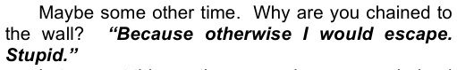
- **No single roster character (rules/setting/general)** — entry/section: Cheelru: ""I disagreed with the First Witch. I am right, but she is more powerful. So much for Truth."" Source: *508 - Heart of Evil - A Plague of Darkness* (SWRPG d20 Revised Core), p.10
  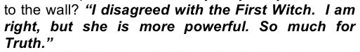
- **No single roster character (rules/setting/general)** — entry/section: Cheelru: ""That which will make The Heart our ally and give us Cularin to rule. Then we will destroy or drive off all you filthy outworlders. I vote for destroy."" Source: *508 - Heart of Evil - A Plague of Darkness* (SWRPG d20 Revised Core), p.10
  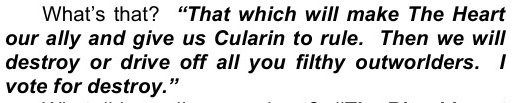
- **No single roster character (rules/setting/general)** — entry/section: Cheelru: ""The Ritual is not absolutely certain. It may be that the Heart can resist it. If so, we have lost. The First Witch is too unwilling to lose again. If that happens, she will destroy all, and us with it. She will kill the Heart with blood."" Source: *508 - Heart of Evil - A Plague of Darkness* (SWRPG d20 Revised Core), p.10
  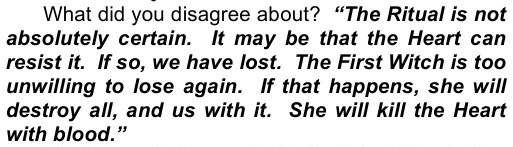
- **No single roster character (rules/setting/general)** — entry/section: Cheelru: "What would you do for us in exchange? "I would kill you. It would be a mercy and an honor for you."" Source: *508 - Heart of Evil - A Plague of Darkness* (SWRPG d20 Revised Core), p.10
  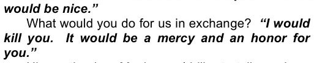
- **No single roster character (rules/setting/general)** — entry/section: Cheelru: ""When will the world end? I am not sure—I can't see the sun from here. What time is it?"" Source: *508 - Heart of Evil - A Plague of Darkness* (SWRPG d20 Revised Core), p.10
  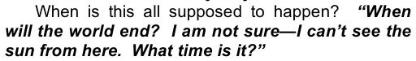
- **No single roster character (rules/setting/general)** — entry/section: Lanius Qel'Bertok: ""If things get desperate, call for me—but right now, Mother Dariana and I are all that are stopping Ch'hala from succumbing to fear and anger."" Source: *508 - Heart of Evil - A Plague of Darkness* (SWRPG d20 Revised Core), p.10
  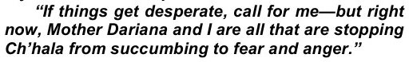

## p.11 (scan page 11)

Page contents: 998 words, 21 paragraphs | headings/entries: A Plague of Darkness; It's likely to be a fairly; Encounter 5: Sacrifice; Page 11

- **No single roster character (rules/setting/general)** — entry/section: First Witch's assistant: ""No! Mistress!" cries the First Witch's assistant, "they have broken the ritual! We cannot turn The Heart, now!"" Source: *508 - Heart of Evil - A Plague of Darkness* (SWRPG d20 Revised Core), p.11
  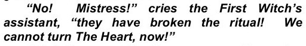
- **No single roster character (rules/setting/general)** — entry/section: Encounter 4: "Everyone suddenly experiences a very bad feeling about this." Source: *508 - Heart of Evil - A Plague of Darkness* (SWRPG d20 Revised Core), p.11
  
- **No single roster character (rules/setting/general)** — entry/section: GM: Melodrama alert: "Paraphrase them to your comfort level, but please try to get the gist across, especially where Lanius' sacrifice is concerned. He's been with us since the start, but everything has an ending." Source: *508 - Heart of Evil - A Plague of Darkness* (SWRPG d20 Revised Core), p.11
  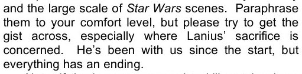

## p.8–11 (scan page 8)

Page contents: E3 Enclave of Evil (Cheelru, holo record); E4 Final Solution (hand-read)

## p.12 (scan page 12)

Page contents: 922 words, 30 paragraphs | headings/entries: A Plague of Darkness; Encounter 6: Legacy

- **No single roster character (rules/setting/general)** — entry/section: First Witch of the Wyrd: "The First Witch screams with rage and calls out, "You have not won, fools! You have simply caused the end of days!"" Source: *508 - Heart of Evil - A Plague of Darkness* (SWRPG d20 Revised Core), p.12
  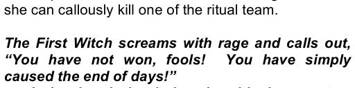
- **No single roster character (rules/setting/general)** — entry/section: First Witch of the Wyrd: ""Thus we triumph!" screams the First Witch, holding the spike of the rod towards herself, as her assistant watches with adoring eyes. "I invoke the Path of Blood!"" Source: *508 - Heart of Evil - A Plague of Darkness* (SWRPG d20 Revised Core), p.12
  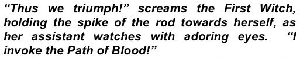
- **No single roster character (rules/setting/general)** — entry/section: First Witch of the Wyrd: ""No. You won't," replies the First Witch, as she plunges the spike into her assistant's breast." Source: *508 - Heart of Evil - A Plague of Darkness* (SWRPG d20 Revised Core), p.12
  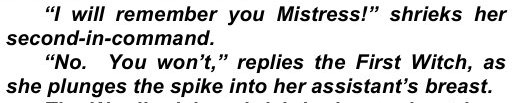
- **No single roster character (rules/setting/general)** — entry/section: First Witch of the Wyrd: ""It all ends now!" cries the First Witch, "Ch'hala, you would not join us—now, die!"" Source: *508 - Heart of Evil - A Plague of Darkness* (SWRPG d20 Revised Core), p.12
  
- **No single roster character (rules/setting/general)** — entry/section: Lanius Qel'Bertok: ""No, friend Ch'hala, there is another way. Despair is a lie. Embrace hope."" Source: *508 - Heart of Evil - A Plague of Darkness* (SWRPG d20 Revised Core), p.12
  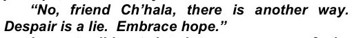
- **No single roster character (rules/setting/general)** — entry/section: Lanius Qel'Bertok: ""No," he says calmly, "I will not desert you." With a ponderous explosion of sound, the branch smashes into the ground. Master Lanius Qel'Bertok is gone." Source: *508 - Heart of Evil - A Plague of Darkness* (SWRPG d20 Revised Core), p.12
  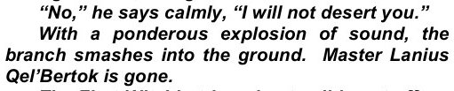
- **No single roster character (rules/setting/general)** — entry/section: Lanius Qel'Bertok: "At the base of the World-Tree Ch'hala can be found the empty robes of a Jedi Master." Source: *508 - Heart of Evil - A Plague of Darkness* (SWRPG d20 Revised Core), p.12
  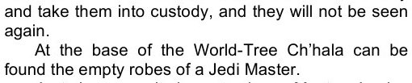
- **No single roster character (rules/setting/general)** — entry/section: Lanius Qel'Bertok: "Just in case it is not clear, Master Lanius voluntarily became a Force Spirit, but in an atypical manner—he merged his essence with that of Ch'hala, lending it his strength and knowledge of the Light Side and, perhaps even more importantly, helping it to realize that it had an ally and a friend from the outside world." Source: *508 - Heart of Evil - A Plague of Darkness* (SWRPG d20 Revised Core), p.12
  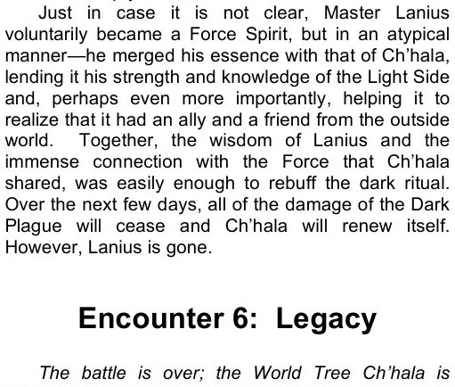

## p.13 (scan page 13)

Page contents: 974 words, 21 paragraphs | headings/entries: Page 13

- **No single roster character (rules/setting/general)** — entry/section: Encounter 6: "If not, just abstract the info to something like: "There's a big hole. You can hide in it later, if you like." Then move on to the loot section. Sigh." Source: *508 - Heart of Evil - A Plague of Darkness* (SWRPG d20 Revised Core), p.13
  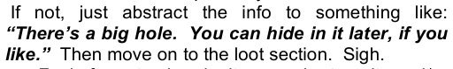
- **No single roster character (rules/setting/general)** — entry/section: Mother Dariana: ""You have been here at the end and at the beginning. Though Master Lanius has gone before, it will not be long before I, too, go to my long sleep, my rest. I do not fear it. I welcome it, but I must first finish my work." Source: *508 - Heart of Evil - A Plague of Darkness* (SWRPG d20 Revised Core), p.13
  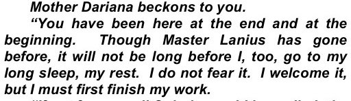
- **No single roster character (rules/setting/general)** — entry/section: Mother Dariana: ""You are come within the Great Plan. These are but the Outer Precincts. There are several cubic kilometers of connected caves and tunnels, the Caverns of Forever." Source: *508 - Heart of Evil - A Plague of Darkness* (SWRPG d20 Revised Core), p.13
  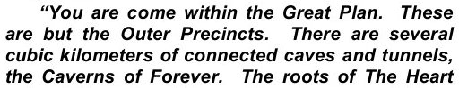
- **No single roster character (rules/setting/general)** — entry/section: Mother Dariana: "Not even the Jedi Council of Coruscant knows of this place. Lanius disagreed on this point, but respected my demands." Source: *508 - Heart of Evil - A Plague of Darkness* (SWRPG d20 Revised Core), p.13
  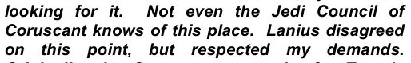
- **No single roster character (rules/setting/general)** — entry/section: Mother Dariana: ""For his sacrifice, and for your aid, this place will be made available, should the dark storm, which Lanius and I have foreseen, truly descend upon the galaxy. The Jedi of Almas, and other foes of evil and the Dark, will, if they wish, find refuge here." Source: *508 - Heart of Evil - A Plague of Darkness* (SWRPG d20 Revised Core), p.13
  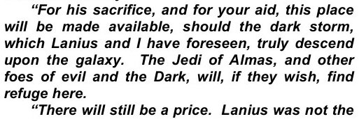
- **No single roster character (rules/setting/general)** — entry/section: Mother Dariana: "Moreover, they will not be allowed to use their abilities of the Force, or train with them, lest they betray and doom all. It will be as if they had ceased to exist. But they will be able to learn, and teach, and carry on a new hope for the future." Source: *508 - Heart of Evil - A Plague of Darkness* (SWRPG d20 Revised Core), p.13
  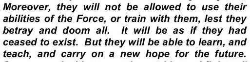

## p.14 (scan page 14)

Page contents: 766 words, 28 paragraphs | headings/entries: Conclusion; A Plague of Darkness; Here Ends, "Heart of Evil"; Experience Point Summary; Adventure Experience Award:; Page 14

- **No single roster character (rules/setting/general)** — entry/section: Lanius Qel'Bertok: "And, as you try to take it all in, a quiet, calm, familiar voice seems to whisper in your mind: "The Force will be with you always, my friend."" Source: *508 - Heart of Evil - A Plague of Darkness* (SWRPG d20 Revised Core), p.14
  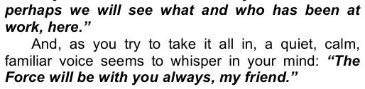
- **No single roster character (rules/setting/general)** — entry/section: Mother Dariana: "A different source gave the knowledge of the Plague of Darkness to the Wyrd: the Believers, led by the one known as Len Markus. The ritual drew on the power of some sort of ancient, evil artifact, created by extinct users of the Dark Side." Source: *508 - Heart of Evil - A Plague of Darkness* (SWRPG d20 Revised Core), p.14
  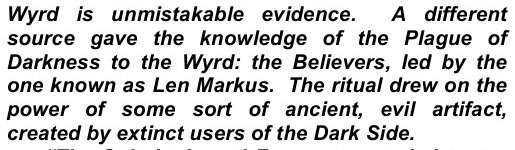
- **No single roster character (rules/setting/general)** — entry/section: Mother Dariana: ""Apparently, officials very, very high in the Republic think highly of you, as a 'special forces team', they call it—and insisted that you be offered the opportunity. Will you go?"" Source: *508 - Heart of Evil - A Plague of Darkness* (SWRPG d20 Revised Core), p.14
  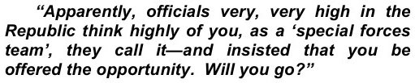
- **No single roster character (rules/setting/general)** — entry/section: Conclusion: "Of course they will—but that's another story." Source: *508 - Heart of Evil - A Plague of Darkness* (SWRPG d20 Revised Core), p.14
  

## p.15 (scan page 15)

Page contents: 285 words, 4 paragraphs | headings/entries: A Plague of Darkness; Page 15

## p.11–15 (scan page 11)

Page contents: E5 Sacrifice (Lanius becomes one with Ch'hala); E6 Legacy (Caverns of Forever); conclusion; XP and certs (hand-read)

## p.16 (scan page 16)

Page contents: 252 words, 21 paragraphs | headings/entries: Player Handout 1: Loaner Landspeeders; Player Copy; SoroSuub X-34 Landpeeder; Player Copy; SoroSuub X-34 Landpeeder; SoroSuub X-34 Landpeeder; GM Aid #1: Loaner Landspeeders; SoroSuub X-34 Landpeeder; A Plague of Darkness Page 16

## p.17 (scan page 17)

Page contents: 14 words, 2 paragraphs | headings/entries: A Plague of Darkness Page 17

## p.18 (scan page 18)

Page contents: 14 words, 2 paragraphs | headings/entries: A Plague of Darkness Page 18

## p.19 (scan page 19)

Page contents: 597 words, 32 paragraphs | headings/entries: Mid-Level (4'"-6"" level heroes); Feats: Run-By (Fly By) Attack; Feats: Cleave, Power Attack, Track; Upper-Level (7'"-9"" level heroes); Feats: Run-By (Fly By) Attack; Feats: Cleave, Power Attack, Track; High-Level (10""-12" level heroes); Feats: Run-By (Fly By) Attack; Feats: Cleave, Power Attack, Track; A Plague of Darkness Page 19

### Stat block notes (game mechanics, not feats)

- Predator Kilassin: Predator Kilassin: Size H; VP/WP 32/36 to 80/36; Atk up to +13/+13 melee (1d6+7, claws); "Many teeth on rancor sized organic platform." (Source: *508 - Heart of Evil - A Plague of Darkness* (SWRPG d20 Revised Core), p.19)

## p.20 (scan page 20)

Page contents: 600 words, 23 paragraphs | headings/entries: High-Level (10""-12™ level heroes); A Plague of Darkness Page 20

## p.21 (scan page 21)

Page contents: 334 words, 15 paragraphs | headings/entries: All Tiers; Mid-Level (4'"-6" level heroes); A Plague of Darkness Page 21

## p.22 (scan page 22)

Page contents: 417 words, 16 paragraphs | headings/entries: High-Level (7""-9"" level heroes); A Plague of Darkness Page 22

## p.23 (scan page 23)

Page contents: 760 words, 20 paragraphs | headings/entries: Mid-Level (4'"-6"" level heroes); A Plague of Darkness Page 23

### Stat block notes (game mechanics, not feats)

- First Witch of the Wyrd: First Witch of the Wyrd: Female Tarasin Force Adept 3/Dark Side Devotee 2/Force Witch 4/7/10 by tier; VP/WP 41 (out of 82)/16, 109/16, 125/16; DSP 14/19/19; Affect Mind +19/+22/+25, Force Lightning +18/+21/+24 (Source: *508 - Heart of Evil - A Plague of Darkness* (SWRPG d20 Revised Core), p.23)

## p.24 (scan page 24)

Page contents: 792 words, 21 paragraphs | headings/entries: High-Level (7'"-9"" level heroes); A Plague of Darkness Page 24

## p.25 (scan page 25)

Page contents: 802 words, 21 paragraphs | headings/entries: Upper-Level (10'"-12" level heroes); A Plague of Darkness Page 25

### Stat block notes (game mechanics, not feats)

- Wyrd Elite Guard: Wyrd Elite Guard (top tier): Male Tarasin Soldier 4/Bodyguard 7; Def 22 (24); VP/WP 111/14; Atk +14/+9 or +12/+12/+7 melee (2d4+2, masterwork vibrodagger) (Source: *508 - Heart of Evil - A Plague of Darkness* (SWRPG d20 Revised Core), p.25)
- Ritual Team Member: Ritual Team Member (top tier, 5): Female Tarasin Force Adept 2/Force Witch 9; VP/WP 35(out of 70)/12; Force Lightning +16, Move Object +18 (Source: *508 - Heart of Evil - A Plague of Darkness* (SWRPG d20 Revised Core), p.25)

## p.26 (scan page 26)

Page contents: 60 words, 9 paragraphs | headings/entries: GM Aid #3: Map of Wyrd Encampment; P| Large sleeping cubical; A Plague of Darkness; A Co; Page 26

## p.16–26 (scan page 16)

Page contents: Landspeeder handouts, encampment maps, GM Aid #2 stats, map key (hand-read)

