# Owner Material 037 — Star Wars D20 Drive folder (Core, Revised Core and Saga Edition): Living Force Campaign/Adventures/Among the Stars/Year 5/509 - Heart of Evil - Destruction.pdf [Star Wars Roleplaying Game Revised Core (d20, 2002)]

- **Source:** Wizards of the Coast Star Wars Roleplaying Game books, web enhancements, Living Force campaign modules and articles (2000–2010), from the owner's "Star Wars D20" Drive folder (only the three edition subfolders; "General" was not read, as instructed). Secondary source (licensed Legends reference). Scan OCR'd on the box; the scan stays box-only and is **not** published.
- **Method:** every scanned page was OCR'd and machine-screened sentence by sentence for power-relevant statements (fights, kills, defeats, Force feats, rankings, superweapons) that name a character on our roster; each kept sentence is quoted verbatim from the OCR text and has a crop of the printed passage directly under it. Pages with nothing power-relevant are still listed with what is on them.
- **Citation:** "*509 - Heart of Evil - Destruction* (SWRPG d20 Revised Core), p.X" by printed page ("scan p.X" where no printed number applies). **Weight:** Licensed RPG material: a secondary source. Narrative text sums up Legends lore; game statistics are rules for players, not canon power levels, and rank lowest.

## p.1 (scan page 1)

Page contents: 198 words, 8 paragraphs | headings/entries: LFA509; Destruction; Edited by Margaret Heintz

## p.2 (scan page 2)

Page contents: 774 words, 21 paragraphs | headings/entries: House Rules; Atoning for Dark Side Points; Dissipate Energy; Destruction; Illusion; Stun; Hero Earnings; Issuing Force and Dark Side Points; Page 2

## p.3 (scan page 3)

Page contents: 814 words, 25 paragraphs | headings/entries: Wookiees, Rage and Dark Side Points: Per; Destruction; General Notes to the GM; GM Overview; Page 3

- **No single roster character (rules/setting/general)** — entry/section: GM Overview: "Well, Judge, this is it: the Fall of Almas and the beginning of the end for the Jedi of Cularin. Despite the ray of hope offered at the end of Plague of Darkness, this scenario and the next will be very dark. Many well-known NPCs will die. It is possible that some heroes may, as well." Source: *509 - Heart of Evil - Destruction* (SWRPG d20 Revised Core), p.3
  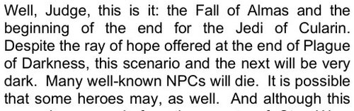

## p.4 (scan page 4)

Page contents: 702 words, 20 paragraphs | headings/entries: Clarification regarding tiering notation: when; Destruction; Opening Crawl; Encounter 1: Sic; Page 4

- **No single roster character (rules/setting/general)** — entry/section: GM Overview: "However, even in dark times, there are always those who will fight despair and be light-bearers for the rest..." Source: *509 - Heart of Evil - Destruction* (SWRPG d20 Revised Core), p.4
  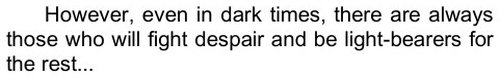
- **No single roster character (rules/setting/general)** — entry/section: Opening Crawl: "Darkness is falling on the Republic and on Cularin. Master Lanius Qel'Bertok has fallen and the Clone Wars are raging towards their final outcome. Against this backdrop, the heroes of Cularin must decide what part they will play in the events that will shape the destiny of a galaxy..." Source: *509 - Heart of Evil - Destruction* (SWRPG d20 Revised Core), p.4
  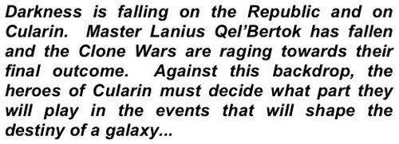
- **No single roster character (rules/setting/general)** — entry/section: GM NOTE: ""Sic transit gloria mundi" loosely translates as "Thus passes the glory of the world" and is an allusion to the nearing end of the Jedi Order and also is a play on words, regarding the themes of the various encounters. In this encounter, the heroes are recruited, say "yes", and thus begin the end." Source: *509 - Heart of Evil - Destruction* (SWRPG d20 Revised Core), p.4
  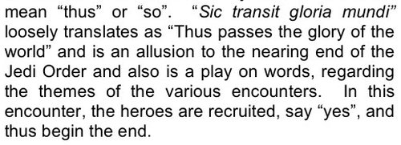

## p.1–4 (scan page 1)

Page contents: Title, house rules, GM notes, overview, encounter list, judges' note, crawl (hand-read)

## p.5 (scan page 5)

Page contents: 855 words, 14 paragraphs | headings/entries: Destruction; Page 5

- **No single roster character (rules/setting/general)** — entry/section: Encounter 1: "The Wyrd have been smashed; now it is the turn of the Believers. If only they knew..." Source: *509 - Heart of Evil - Destruction* (SWRPG d20 Revised Core), p.5
  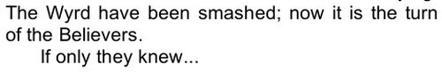
- **No single roster character (rules/setting/general)** — entry/section: Xirossk: "Osten will have been shaken by the passage of Lanius and Xirossk, in his own gruff way, mourns the passing of the "hidden warrior inside the calm shell'." Source: *509 - Heart of Evil - Destruction* (SWRPG d20 Revised Core), p.5
  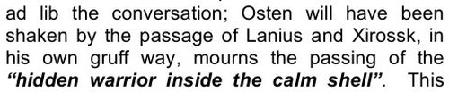

## p.6 (scan page 6)

Page contents: 744 words, 16 paragraphs | headings/entries: Encounter 2: Transit; Destruction; Page 6

- **No single roster character (rules/setting/general)** — entry/section: Vigilance pilot: ""Ah, we were just in a posting orbit around Almas. Talk about boredom. Nothing but supply transports and the occasional Jedi ship. Now they stuck one of the old Thaereian customs ships that Cularin captured, there. Heh, better them than me. Who the void would attack Almas, anyway? Half the Jedi in the galaxy would serve you up 'en lightsaber'."" Source: *509 - Heart of Evil - Destruction* (SWRPG d20 Revised Core), p.6
  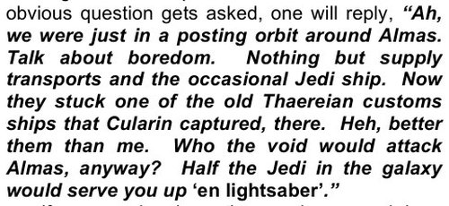
- **No single roster character (rules/setting/general)** — entry/section: Encounter 2: "Even in these more peaceful times, and in a Core-ward system, it seems that no one is taking chances. No, indeed..." Source: *509 - Heart of Evil - Destruction* (SWRPG d20 Revised Core), p.6
  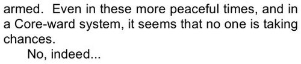

## p.7 (scan page 7)

Page contents: 831 words, 18 paragraphs | headings/entries: Encounter 3: Gloria; Destruction; Page 7

- **No single roster character (rules/setting/general)** — entry/section: Captain Suubrin: ""Scans have indicated minimal power: no life forms, and there doesn't seem to be even much in the way of powered-up droids. The base is deserted." Source: *509 - Heart of Evil - Destruction* (SWRPG d20 Revised Core), p.7
  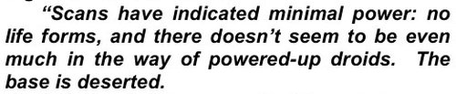
- **No single roster character (rules/setting/general)** — entry/section: Encounter 3: "This mission is a ruse and a trap, but it is not designed to kill the heroes. A dark and shadowy manipulator wants them alive to see the ruin of that for which they have fought. Out of that despair, anger, and thirst for revenge, it is hoped that they may be turned to the Dark Side and become minions of the New Order." Source: *509 - Heart of Evil - Destruction* (SWRPG d20 Revised Core), p.7
  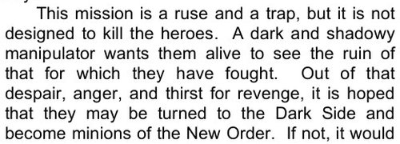

## p.8 (scan page 8)

Page contents: 726 words, 21 paragraphs | headings/entries: Destruction; Page 8

- **No single roster character (rules/setting/general)** — entry/section: Darth Sidious: "It is the voice of "Darth Sidious/Emperor-to-be Palpatine", masked and recorded, but no hero would recognize it. Still, here's your chance to do your Emperor voice." Source: *509 - Heart of Evil - Destruction* (SWRPG d20 Revised Core), p.8
  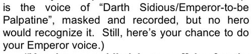
- **Palpatine (Darth Sidious)** — entry/section: Darth Sidious: ""You have meddled in my affairs for the last time, 'heroes'. Be so kind as to die. Sixty. Fifty-nine. Fifty-eight..."" Source: *509 - Heart of Evil - Destruction* (SWRPG d20 Revised Core), p.8
  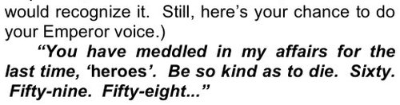

## p.9 (scan page 9)

Page contents: 764 words, 27 paragraphs | headings/entries: Destruction; Encounter 4: Mundi; Page 9

- **Palpatine (Darth Sidious)** — entry/section: Darth Sidious: ""Eh-heh-heh. I hope that you will forgive my little jest. As you can see, nothing happened. I present this base to you as a free gift. Oh, unfortunately, you will find that it is quite devoid of information of any use." Source: *509 - Heart of Evil - Destruction* (SWRPG d20 Revised Core), p.9
  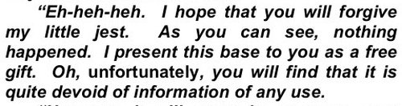
- **Palpatine (Darth Sidious)** — entry/section: Darth Sidious: ""However, it will serve its purpose, now that you are trapped inside. Do not worry. If you have no friends to get you out, the doors will open in three hours. You see, the whole point of this was to keep you safe."" Source: *509 - Heart of Evil - Destruction* (SWRPG d20 Revised Core), p.9
  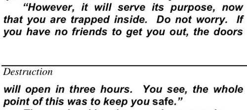
- **Palpatine (Darth Sidious)** — entry/section: Darth Sidious: ""Oh, yes, nothing must happen to you."" Source: *509 - Heart of Evil - Destruction* (SWRPG d20 Revised Core), p.9
  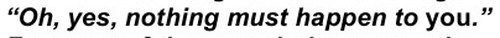
- **No single roster character (rules/setting/general)** — entry/section: Garth Ezzar: ""May I proceed, my Master?"" Source: *509 - Heart of Evil - Destruction* (SWRPG d20 Revised Core), p.9
  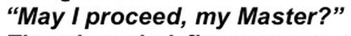
- **Palpatine (Darth Sidious)** — entry/section: Darth Sidious: ""Yes. Go there and kill them. Kill them all."" Source: *509 - Heart of Evil - Destruction* (SWRPG d20 Revised Core), p.9
  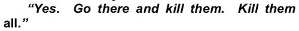
- **No single roster character (rules/setting/general)** — entry/section: Garth Ezzar: "Use your best Darth Vader voice for the second speaker. No. It's not him. But the players will forgive you for not getting the deep voice of Garth Ezzar quite right." Source: *509 - Heart of Evil - Destruction* (SWRPG d20 Revised Core), p.9
  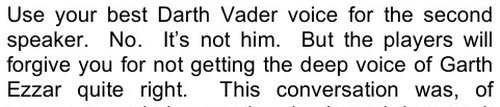
- **Ki-Adi-Mundi** — entry/section: Ki-Adi-Mundi: "The heroes meet Ki-Adi-Mundi, the Council member with the most connection to the Almas Academy, for the last time. His information sends the heroes speeding back towards Almas." Source: *509 - Heart of Evil - Destruction* (SWRPG d20 Revised Core), p.9
  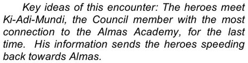

## p.4–9 (scan page 4)

Page contents: E1 Sic briefing; E2 Transit space battle; E3 Gloria base trap and recordings (hand-read)

## p.10 (scan page 10)

Page contents: 833 words, 23 paragraphs | headings/entries: Destruction; Page 10

- **Ki-Adi-Mundi** — entry/section: Ki-Adi-Mundi: "From the Captain's conference room, of the main bridge, Ki-Adi-Mundi walks in. For once, his characteristic calm seems somewhat shaken." Source: *509 - Heart of Evil - Destruction* (SWRPG d20 Revised Core), p.10
  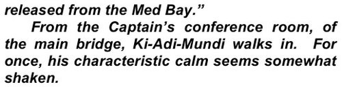
- **Ki-Adi-Mundi** — entry/section: Ki-Adi-Mundi: ""My friends. We have no time. Since the Force has arranged for you to be here, this may work out." Source: *509 - Heart of Evil - Destruction* (SWRPG d20 Revised Core), p.10
  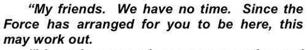
- **Ki-Adi-Mundi** — entry/section: Ki-Adi-Mundi: ""I have been torn between two paths, and you may know that some Cereans can be almost immobilized by such paradoxes. I was not, but I came perilously close to having to put personal insight against that of the Council." Source: *509 - Heart of Evil - Destruction* (SWRPG d20 Revised Core), p.10
  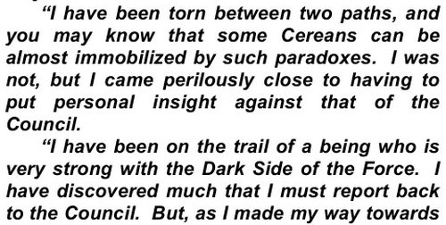
- **Ki-Adi-Mundi** — entry/section: Ki-Adi-Mundi: ""I have been on the trail of a being who is very strong with the Dark Side of the Force. I have discovered much that I must report back to the Council. But, as I made my way towards Coruscant, I had a premonition of such intensity, and of such—horror—that I felt the need to deviate towards the Cularin system. On the way, I was attacked, perhaps by that very being that I thought was the object of my hunt. I now begin to think that the hunter was not I." Source: *509 - Heart of Evil - Destruction* (SWRPG d20 Revised Core), p.10
  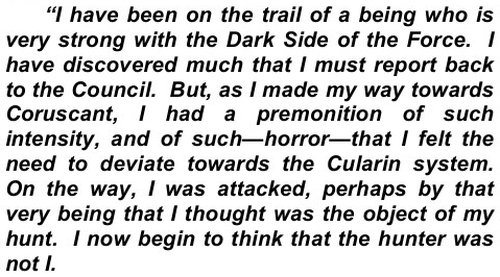
- **Ki-Adi-Mundi** — entry/section: Ki-Adi-Mundi: ""He fled when your flotilla approached. Now, it is imperative that I return to Coruscant. But you—you must return to the Cularin system, to Almas. Please. Hurry."" Source: *509 - Heart of Evil - Destruction* (SWRPG d20 Revised Core), p.10
  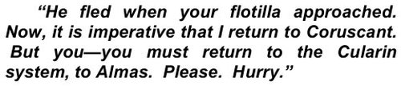
- **Ki-Adi-Mundi** — entry/section: Ki-Adi-Mundi: "If the heroes press for details, Ki-Adi-Mundi will say, "It is too dark, too uncertain— and I do not wish to discourage you."" Source: *509 - Heart of Evil - Destruction* (SWRPG d20 Revised Core), p.10
  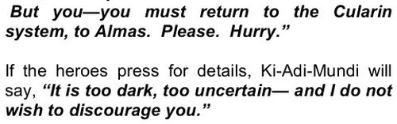
- **Ki-Adi-Mundi** — entry/section: Ki-Adi-Mundi: "If they insist, he will say, with a distraught look on his face, "I saw Almas— burning." That should really get them on their way." Source: *509 - Heart of Evil - Destruction* (SWRPG d20 Revised Core), p.10
  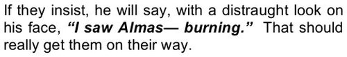
- **Ki-Adi-Mundi** — entry/section: Ki-Adi-Mundi: "Then, he leaves to go to the rest of the Coruscant Jedi, and to his destiny..." Source: *509 - Heart of Evil - Destruction* (SWRPG d20 Revised Core), p.10
  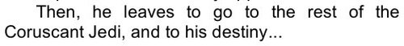
- **No single roster character (rules/setting/general)** — entry/section: Encounter 4: "Any Force-sensitives will have an "Obi-Wan and Alderaan moment". They feel a terrible stab of darkness and destruction, and they know that people on Almas are dying." Source: *509 - Heart of Evil - Destruction* (SWRPG d20 Revised Core), p.10
  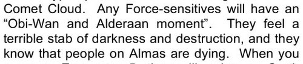

## p.11 (scan page 11)

Page contents: 607 words, 19 paragraphs | headings/entries: Encounter 5: Almas Burning; Destruction; Page 11

- **No single roster character (rules/setting/general)** — entry/section: Encounter 5: "Even so, the Academy Jedi destroyed the larger attacking vessel ship within 5 minutes, and only about a dozen of the mercenaries and other minions are left alive. This was nothing like a fair fight." Source: *509 - Heart of Evil - Destruction* (SWRPG d20 Revised Core), p.11
  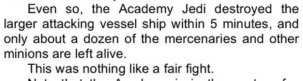
- **No single roster character (rules/setting/general)** — entry/section: Garth Ezzar: "Garth Ezzar approaches Almas and is ordered to dock with the orbiting ship. Smiling evilly, he complies." Source: *509 - Heart of Evil - Destruction* (SWRPG d20 Revised Core), p.11
  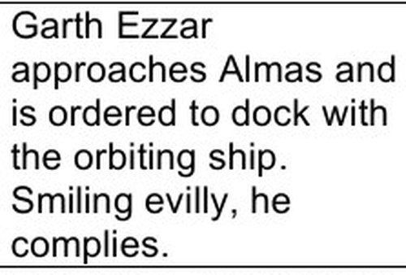

## p.12 (scan page 12)

Page contents: 703 words, 15 paragraphs | headings/entries: Destruction; Page 12

- **No single roster character (rules/setting/general)** — entry/section: Devan: "Ezzar kills Devan, though Devan wounds him." Source: *509 - Heart of Evil - Destruction* (SWRPG d20 Revised Core), p.12
  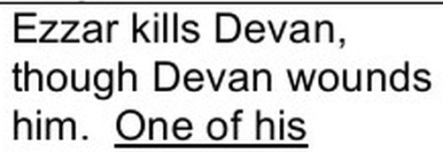
- **No single roster character (rules/setting/general)** — entry/section: Zelice Sturm: "Ezzar meets Zelice Sturm, the former Black Queen, in battle." Source: *509 - Heart of Evil - Destruction* (SWRPG d20 Revised Core), p.12
  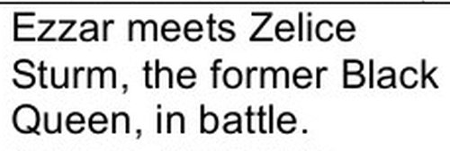
- **No single roster character (rules/setting/general)** — entry/section: Almas Academy: "Blackened, crumbled walls, broken pillars, cindered trees and gardens, pools boiled away, frying electrical conduits, palls of black smoke, escaping vapor, the stench of burning: it is a Dante-esque picture of the Pits." Source: *509 - Heart of Evil - Destruction* (SWRPG d20 Revised Core), p.12
  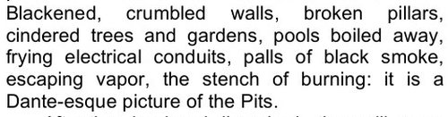

## p.13 (scan page 13)

Page contents: 828 words, 23 paragraphs | headings/entries: Destruction; Page 13

- **No single roster character (rules/setting/general)** — entry/section: Judge note: "They feel that any villain is a number to be crunched, and that if they can find a way to get into combat, then by Munchkin the Mighty, they must be allowed combat!" Source: *509 - Heart of Evil - Destruction* (SWRPG d20 Revised Core), p.13
  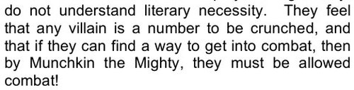
- **No single roster character (rules/setting/general)** — entry/section: Meera Lisso: "Suddenly, the balefully gleaming red lightsaber darts forward in a spiraling thrust, anda female scream rings out: "NOOOOOOO!" But it is a different, silent Jedi that falls, her blue lightsaber dropping from her hands." Source: *509 - Heart of Evil - Destruction* (SWRPG d20 Revised Core), p.13
  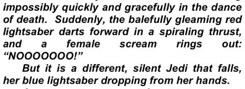
- **No single roster character (rules/setting/general)** — entry/section: Garth Ezzar: "You hear the whine of a speeder bike and, projected mechanically, a deep, evil voice that says, "Not yet. Come to me in Coruscant's Undercity."" Source: *509 - Heart of Evil - Destruction* (SWRPG d20 Revised Core), p.13
  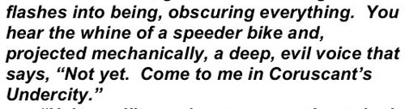
- **No single roster character (rules/setting/general)** — entry/section: Meera Lisso: ""Help me!" a voice screams through the diminishing whirlwind, "help me! Help her!"" Source: *509 - Heart of Evil - Destruction* (SWRPG d20 Revised Core), p.13
  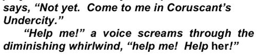

## p.14 (scan page 14)

Page contents: 852 words, 19 paragraphs | headings/entries: Destruction; Conclusion: A Hero Seeks Not Vengeance; Page 14

- **No single roster character (rules/setting/general)** — entry/section: Judge note: ""Run, Luke, run!" wouldn't quite work here. "Fly, you fools!" is right out, sorry." Source: *509 - Heart of Evil - Destruction* (SWRPG d20 Revised Core), p.14
  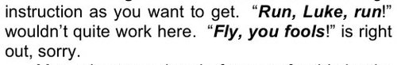
- **No single roster character (rules/setting/general)** — entry/section: Garth Ezzar: "It will not bother him in the slightest to sacrifice his minions; that's what they are for." Source: *509 - Heart of Evil - Destruction* (SWRPG d20 Revised Core), p.14
  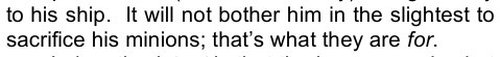
- **No single roster character (rules/setting/general)** — entry/section: Zelice Sturm: "Zelice's features show no fierceness or anger, composed in death. There is a peacefulness that seems completely out of place with the circumstance of her death, and with her surroundings." Source: *509 - Heart of Evil - Destruction* (SWRPG d20 Revised Core), p.14
  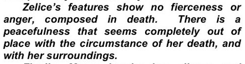
- **No single roster character (rules/setting/general)** — entry/section: Conclusion: "As she does so, the sound of aircraft can be heard and you see emergency relief vehicles and CAF vehicles arriving on the scene— far, far too late." Source: *509 - Heart of Evil - Destruction* (SWRPG d20 Revised Core), p.14
  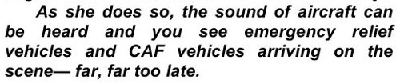

## p.9–14 (scan page 9)

Page contents: E4 Mundi; E5 Almas Burning (timeline, Devan and Zelice Sturm killed, Ezzar escapes) (hand-read)

## p.15 (scan page 15)

Page contents: 741 words, 28 paragraphs | headings/entries: Pause a beat. Then:; Destruction; Page 15

- **No single roster character (rules/setting/general)** — entry/section: Meera Lisso: ""You! Now you're here? You pompous, preaching slimo, where were YOU when we needed you?"" Source: *509 - Heart of Evil - Destruction* (SWRPG d20 Revised Core), p.15
  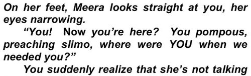
- **No single roster character (rules/setting/general)** — entry/section: Lanius Qel'Bertok: "Turning, you see an eerie apparition. It is Master Lanius Qel'Bertok, a life-sized sculpture of blue, gold-flecked light, standing there and looking sadly at both yourselves and the devastation around." Source: *509 - Heart of Evil - Destruction* (SWRPG d20 Revised Core), p.15
  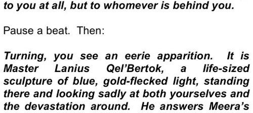
- **No single roster character (rules/setting/general)** — entry/section: Lanius Qel'Bertok: ""Could I have prevented this? I do not know. Maybe. The future was, and is, clouded by the Dark Side, in these times. One thing is certain: if I had deserted Ch'hala in its time of need, Almas might be safe, or not— but Cularin would be dying. And the Tarasin's sanctuary would not exist."" Source: *509 - Heart of Evil - Destruction* (SWRPG d20 Revised Core), p.15
  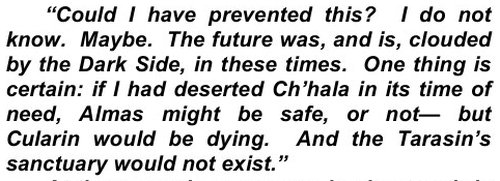
- **No single roster character (rules/setting/general)** — entry/section: Meera Lisso: ""Are you crazy?" screams Meera. "If no one else will, I'll hunt him down and kill this Barth, or Garth, or Darth whatever, with my bare hands."" Source: *509 - Heart of Evil - Destruction* (SWRPG d20 Revised Core), p.15
  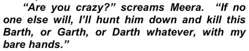
- **No single roster character (rules/setting/general)** — entry/section: Conclusion: "You do not have to be Force Sensitive to feel the darkness gathering." Source: *509 - Heart of Evil - Destruction* (SWRPG d20 Revised Core), p.15
  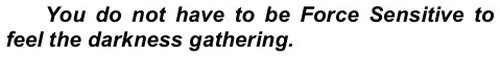
- **No single roster character (rules/setting/general)** — entry/section: Lanius Qel'Bertok: ""I cannot make decisions for any, and even my counsel must be limited. The decision to pursue or not must be yours." Source: *509 - Heart of Evil - Destruction* (SWRPG d20 Revised Core), p.15
  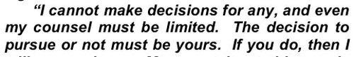
- **No single roster character (rules/setting/general)** — entry/section: Lanius Qel'Bertok: ""Remember, it is always allowed to defend the weak, or yourselves, and to stop evil. But a hero seeks not vengeance. That way lies a double victory for the Dark Side." Source: *509 - Heart of Evil - Destruction* (SWRPG d20 Revised Core), p.15
  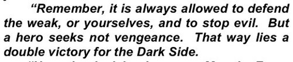
- **No single roster character (rules/setting/general)** — entry/section: Lanius Qel'Bertok: ""Now, the decision is yours. May the Force be with you." And Master Lanius fades from view." Source: *509 - Heart of Evil - Destruction* (SWRPG d20 Revised Core), p.15
  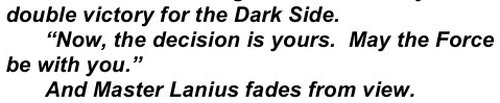

## p.16 (scan page 16)

Page contents: 593 words, 20 paragraphs | headings/entries: Here Ends, "Destruction"; Experience Point Summary; Experience is calculated as follows for LIVING; Adventure Experience Award:; Destruction; Loot Summary; Page 16

- **No single roster character (rules/setting/general)** — entry/section: Targeted By The Sith: "Certificate: Targeted By The Sith. Somebody doesn't like you..." Source: *509 - Heart of Evil - Destruction* (SWRPG d20 Revised Core), p.16
  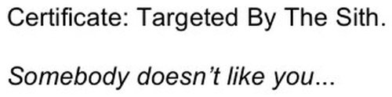
- **No single roster character (rules/setting/general)** — entry/section: Targeted By The Sith: "This certificate entitles the hero to a potential galaxy of hurt. This certainly does not guarantee the hero's death, but does guarantee that when facing the biggest, "baddest" minions of the Dark Side, this hero will be at the top of their interest list." Source: *509 - Heart of Evil - Destruction* (SWRPG d20 Revised Core), p.16
  

## p.14–16 (scan page 14)

Page contents: Conclusion with Meera and Lanius's ghost; XP, cert (hand-read)

## p.17 (scan page 17)

Page contents: 505 words, 28 paragraphs | headings/entries: Player Handout #1: Ships and Gear Available; Kuat Systems Engineering Wayfarer-class Medium Transport; Incom/Subpro Z-95 Headhunter Starfighter; Ordinary (+10); Kuat Systems Engineering Delta-7 Aethersprite-class Starfighter; Gear (skill kits):; Gear (Weapons and Armor):; Destruction Page 17

## p.18 (scan page 18)

Page contents: 12 words, 2 paragraphs | headings/entries: Destruction Page 18

## p.19 (scan page 19)

Page contents: 0 words, 0 paragraphs | headings/entries: 

## p.20 (scan page 20)

Page contents: 43 words, 13 paragraphs | headings/entries: Scale lom=370m City blocks approx YSO m; Buildings Buildings; Academy grounds; Buildings; Destruction; Page 20

## p.21 (scan page 21)

Page contents: 505 words, 28 paragraphs | headings/entries: GM Aid #1: Ships and Gear Available; Kuat Systems Engineering Wayfarer-class Medium Transport; Incom/Subpro Z-95 Headhunter Starfighter; Ordinary (+10); Kuat Systems Engineering Delta-7 Aethersprite-class Starfighter; Gear (skill kits):; Gear (Weapons and Armor):; Destruction Page 21

## p.22 (scan page 22)

Page contents: 509 words, 34 paragraphs | headings/entries: GM Aid #2: NPCs by Encounter; Encounter #1: Sic; Osten Dal'Nay; Encounter #2: Transit; Tier 1 (levels 4-6); Believer Starfighter: Incom/Subpro Z-95 Headhunter Starfighter; Tier 2 (levels 7-9); Believer Starfighter: Incom/Subpro Z-95 Headhunter Starfighter; Tier 3 (levels 10-12); Believer "Extra" Starfighter: Incom/Subpro Z-95 Headhunter Starfighter; Destruction Page 22

## p.23 (scan page 23)

Page contents: 582 words, 25 paragraphs | headings/entries: Encounter #3: Gloria Tier 1 (levels 4-6); Description and Tactics: see below; Description and Tactics: see below; Description and Tactics: see below; Description and Tactics: see below; Tier 3 (levels 10-12); Destruction Page 23

## p.24 (scan page 24)

Page contents: 610 words, 18 paragraphs | headings/entries: Description and Tactics: see below; Description and Tactics: see below; Encounter #4: Mundi; Encounter #5: Almas Burning; Tier 1 (levels 4-6); Destruction Page 24

- **No single roster character (rules/setting/general)** — entry/section: CAF Marine: ""Move it, move it! We have a job to do, grunt! If you're lucky, maybe one day you'll grow up to be like one of these heroes leading us."" Source: *509 - Heart of Evil - Destruction* (SWRPG d20 Revised Core), p.24
  
- **No single roster character (rules/setting/general)** — entry/section: Opponent Droids: "who plays "possum" in Star Wars?" Source: *509 - Heart of Evil - Destruction* (SWRPG d20 Revised Core), p.24
  

### Stat block notes (game mechanics, not feats)

- Droideka-type droid: Opponent Droids (Tier 3, droideka-type): Thug 12; Defense 15; DR 6 (shields); VP/WP 0/18; Atk +13/+8/+3 ranged (3d8/20, repeating blaster) (Source: *509 - Heart of Evil - Destruction* (SWRPG d20 Revised Core), p.24)

## p.25 (scan page 25)

Page contents: 703 words, 22 paragraphs | headings/entries: Description and Tactics: see below; Description and Tactics: see below; Tier 3 (levels 10-12); Destruction Page 25

### Stat block notes (game mechanics, not feats)

- Meera Lisso: Meera Lisso: Human female Thug 3/Jedi Guardian 4 (untiered); Defense 15/16; VP/WP 39/12; Atk +7 melee (2d8+2 lightsaber 2-handed); FP 5; DSP 1; Battlemind +7, Enhance Ability +7, Force Defense +8 (Source: *509 - Heart of Evil - Destruction* (SWRPG d20 Revised Core), p.25)

## p.26 (scan page 26)

Page contents: 347 words, 7 paragraphs | headings/entries: Destruction Page 26

- **No single roster character (rules/setting/general)** — entry/section: Meera Lisso: "Meera is a beautiful young Human woman with very dark skin and long hair dyed golden." Source: *509 - Heart of Evil - Destruction* (SWRPG d20 Revised Core), p.26
  
- **No single roster character (rules/setting/general)** — entry/section: Meera Lisso: "However, Meera's own future is now in grave jeopardy. She wants revenge, and wants it badly. She is vulnerable, and could easily fall to the Dark Side without proper guidance— and all her guides are dead. Aren't they?" Source: *509 - Heart of Evil - Destruction* (SWRPG d20 Revised Core), p.26
  

## p.27 (scan page 27)

Page contents: 43 words, 8 paragraphs | headings/entries: Control Console; Destruction Page 27

## p.28 (scan page 28)

Page contents: 66 words, 10 paragraphs | headings/entries: Buildings Buildings; Academy grounds; Road; Heroes approach from spaceport _ quarter. Buildings; Destruction

## p.29 (scan page 29)

Page contents: 761 words, 16 paragraphs | headings/entries: GM Aid #5: Garth Ezzar; Destruction Page 29

- **No single roster character (rules/setting/general)** — entry/section: Garth Ezzar: "Background: Garth Ezzar is the ultimate "wannabe". He is a big-time loser, on whom the Dark Side played a nasty trick: it made him powerful with the Force." Source: *509 - Heart of Evil - Destruction* (SWRPG d20 Revised Core), p.29
  
- **No single roster character (rules/setting/general)** — entry/section: Garth Ezzar: "After three more years of crime and travel, Garth Ezzar found his way to Coruscant, hoping either to connect with a major criminal organization, or to found one. Instead, someone found him." Source: *509 - Heart of Evil - Destruction* (SWRPG d20 Revised Core), p.29
  
- **No single roster character (rules/setting/general)** — entry/section: Garth Ezzar: ""The Master", always hooded and hidden, demonstrated and promised to Ezzar power beyond his darkest dreams, more power than that possessed by "any mere Jedi"." Source: *509 - Heart of Evil - Destruction* (SWRPG d20 Revised Core), p.29
  
- **Palpatine (Darth Sidious)** — entry/section: Darth Sidious: "What Garth does not realize is that his Master has never intended Garth to become his "right hand man. Garth is too old to learn the special philosophies of his Master, but he is an excellent tool and distraction." Source: *509 - Heart of Evil - Destruction* (SWRPG d20 Revised Core), p.29
  
- **Palpatine (Darth Sidious)** — entry/section: Darth Sidious: "Then, one of two things will happen: either the heroes will kill Ezzar and feel that the danger is past, or he will kill them and then be disposed of by the new, true Sith Lord. All is proceeding according to The Master's plan." Source: *509 - Heart of Evil - Destruction* (SWRPG d20 Revised Core), p.29
  

## p.30 (scan page 30)

Page contents: 849 words, 13 paragraphs | headings/entries: Destruction Page 30

- **No single roster character (rules/setting/general)** — entry/section: Garth Ezzar: "No, it does not look like Darth Vader's suit at all." Source: *509 - Heart of Evil - Destruction* (SWRPG d20 Revised Core), p.30
  
- **No single roster character (rules/setting/general)** — entry/section: Garth Ezzar: "He loves his cape." Source: *509 - Heart of Evil - Destruction* (SWRPG d20 Revised Core), p.30
  

### Stat block notes (game mechanics, not feats)

- Garth Ezzar: Garth Ezzar: male Human Soldier 1/Scoundrel 3/Dark Side Marauder 4/Sith Warrior 6 (level 14, untiered); Def 27; VP/WP 150/16; Atk +20/+15/+10 melee (5d8+3/19-20 plus 5d8+3/19-20, double-bladed lightsaber); FP 14; DSP 16; Battlemind +15; Lightsaber Form Five Mastery, Rage, Force Speed (Source: *509 - Heart of Evil - Destruction* (SWRPG d20 Revised Core), p.30)

## p.31 (scan page 31)

Page contents: 572 words, 14 paragraphs | headings/entries: Scratch built custom speeder bike ("Sith Speeder"); Weapon: None; Destruction Page 31

- **No single roster character (rules/setting/general)** — entry/section: Garth Ezzar: "megalomaniac and thinks that he cannot die." Source: *509 - Heart of Evil - Destruction* (SWRPG d20 Revised Core), p.31
  
- **No single roster character (rules/setting/general)** — entry/section: Garth Ezzar: "Note that he will only use his lightsaber single-bladed, in this scenario. He is going to dramatically reveal it to be double-bladed in the next scenario, at the climactic battle, just as Darth Maul did in Star Wars Episode One: The Phantom Menace." Source: *509 - Heart of Evil - Destruction* (SWRPG d20 Revised Core), p.31
  
- **No single roster character (rules/setting/general)** — entry/section: Garth Ezzar: "Final tactical notes for Destruction: Scare them, hurt them and get away. No disintegrations." Source: *509 - Heart of Evil - Destruction* (SWRPG d20 Revised Core), p.31
  

## p.17–31 (scan page 17)

Page contents: Handouts, maps, GM Aids (ships, NPCs, Meera Lisso, Garth Ezzar) (hand-read)

