# Owner Material 037 — Star Wars D20 Drive folder (Core, Revised Core and Saga Edition): Living Force Campaign/Adventures/Among the Stars/Year 5/510 - Heart of Evil - A Hero Seeks Not Vengeance.pdf [Star Wars Roleplaying Game Revised Core (d20, 2002)]

- **Source:** Wizards of the Coast Star Wars Roleplaying Game books, web enhancements, Living Force campaign modules and articles (2000–2010), from the owner's "Star Wars D20" Drive folder (only the three edition subfolders; "General" was not read, as instructed). Secondary source (licensed Legends reference). Scan OCR'd on the box; the scan stays box-only and is **not** published.
- **Method:** every scanned page was OCR'd and machine-screened sentence by sentence for power-relevant statements (fights, kills, defeats, Force feats, rankings, superweapons) that name a character on our roster; each kept sentence is quoted verbatim from the OCR text and has a crop of the printed passage directly under it. Pages with nothing power-relevant are still listed with what is on them.
- **Citation:** "*510 - Heart of Evil - A Hero Seeks Not Vengeance* (SWRPG d20 Revised Core), p.X" by printed page ("scan p.X" where no printed number applies). **Weight:** Licensed RPG material: a secondary source. Narrative text sums up Legends lore; game statistics are rules for players, not canon power levels, and rank lowest.

## p.1 (scan page 1)

Page contents: 154 words, 7 paragraphs | headings/entries: LFA510; A Hero Seeks Not Vengeance; Edited by Margaret Heintz

## p.2 (scan page 2)

Page contents: 765 words, 20 paragraphs | headings/entries: House Rules; Atoning for Dark Side Points; Dissipate Energy; A Hero Seeks Not Vengeance; Illusion; Stun; Hero Earnings; Issuing Force and Dark Side Points; Page 2

## p.3 (scan page 3)

Page contents: 777 words, 19 paragraphs | headings/entries: A Hero Seeks Not Vengeance; GM Overview; Page 3

- **No single roster character (rules/setting/general)** — entry/section: GM Overview: "In A Hero Seeks Not Vengeance, the heroes are on a mission of vengeance— or justice. An unknown Master of the Dark Side of the Force has spearheaded the destruction of the Almas Jedi Academy, and the heroes are out to bring him in— or make him pay?" Source: *510 - Heart of Evil - A Hero Seeks Not Vengeance* (SWRPG d20 Revised Core), p.3
  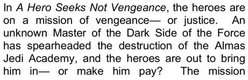

## p.4 (scan page 4)

Page contents: 743 words, 20 paragraphs | headings/entries: Encounter 3: Hunting Grounds. This is a; A Hero Seeks Not Vengeance; Encounter 6: Epilogue. The scenario; Opening Crawl; The Republic broadcast went out far and; Page 4

- **No single roster character (rules/setting/general)** — entry/section: GM Overview: "The dark menace of Garth Ezzar must be stopped, but at the same time, the heroes must avoid falling prey to hate, fear and aggression, and must help Jedi Padawan Meera Lisso to do so, also." Source: *510 - Heart of Evil - A Hero Seeks Not Vengeance* (SWRPG d20 Revised Core), p.4
  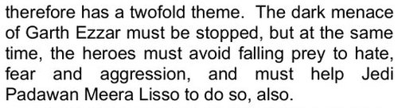
- **No single roster character (rules/setting/general)** — entry/section: Encounter 5 summary: "The end of this encounter will establish these events as happening near the beginning of Star Wars Episode 3: Revenge of the Sith." Source: *510 - Heart of Evil - A Hero Seeks Not Vengeance* (SWRPG d20 Revised Core), p.4
  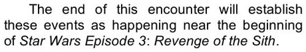
- **No single roster character (rules/setting/general)** — entry/section: Garth Ezzar: "He is a combat monster." Source: *510 - Heart of Evil - A Hero Seeks Not Vengeance* (SWRPG d20 Revised Core), p.4
  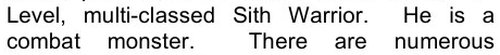

## p.1–4 (scan page 1)

Page contents: Title, house rules, GM notes, overview, encounter list, judges' note (hand-read)

## p.5 (scan page 5)

Page contents: 765 words, 18 paragraphs | headings/entries: A Hero Seeks Not Vengeance; Page 5

- **No single roster character (rules/setting/general)** — entry/section: Opening Crawl: "A Separatist strike force descended on the Academy, and, though they took heavy losses and were forced to retreat, rather than continue into the system, destroyed the Academy utterly. Few, if any, Jedi survived." Source: *510 - Heart of Evil - A Hero Seeks Not Vengeance* (SWRPG d20 Revised Core), p.5
  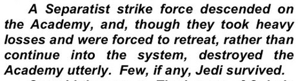
- **No single roster character (rules/setting/general)** — entry/section: Opening Crawl: "So said the report. You know differently. Perhaps the monster you are trailing works for the Separatists, perhaps not. One thing is sure: the Dark Side of the Force is his ally, and a hideously strong ally it is." Source: *510 - Heart of Evil - A Hero Seeks Not Vengeance* (SWRPG d20 Revised Core), p.5
  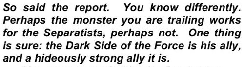
- **No single roster character (rules/setting/general)** — entry/section: Meera Lisso: "Only a hundred against the Almas Academy? No, only a hundred against what was left of it. Without any defenses and with our shields knocked out by the corvette, you wouldn't believe how fast a bombardment could level the place." Source: *510 - Heart of Evil - A Hero Seeks Not Vengeance* (SWRPG d20 Revised Core), p.5
  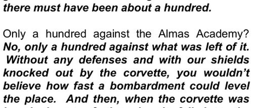
- **No single roster character (rules/setting/general)** — entry/section: Meera Lisso: "He felt bad. And very powerful. You could just feel the hate and the rage and the, the joy at killing, like a furnace heat all around him. He killed anyone that came near, Padawans, Knights. No one even touched him. Then Master Devan arrived." Source: *510 - Heart of Evil - A Hero Seeks Not Vengeance* (SWRPG d20 Revised Core), p.5
  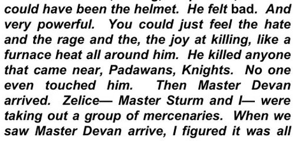
- **No single roster character (rules/setting/general)** — entry/section: Meera Lisso: "When we saw Master Devan arrive, I figured it was all over." Source: *510 - Heart of Evil - A Hero Seeks Not Vengeance* (SWRPG d20 Revised Core), p.5
  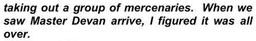

## p.6 (scan page 6)

Page contents: 779 words, 21 paragraphs | headings/entries: A Hero Seeks Not Vengeance; Page 6

- **No single roster character (rules/setting/general)** — entry/section: Meera Lisso: "Anyway. As far as we could tell, that left it to Master Sturm and me. And that's about where you came in." Source: *510 - Heart of Evil - A Hero Seeks Not Vengeance* (SWRPG d20 Revised Core), p.6
  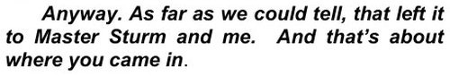
- **No single roster character (rules/setting/general)** — entry/section: E1-6RA: "Why would they want the droid? He's a walking archive and history of the Almas Academy, and of the Jedi in general. Maybe someone wants to see if he has secrets." Source: *510 - Heart of Evil - A Hero Seeks Not Vengeance* (SWRPG d20 Revised Core), p.6
  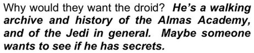
- **No single roster character (rules/setting/general)** — entry/section: Meera Lisso: "Does he? I have no idea. But I want to get him back. And I want this maniac murderer dead. Or, um, in custody, I guess..." Source: *510 - Heart of Evil - A Hero Seeks Not Vengeance* (SWRPG d20 Revised Core), p.6
  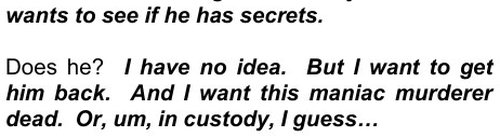
- **No single roster character (rules/setting/general)** — entry/section: Meera Lisso: "She is very fragile at the moment, full of fear and anger, and could very, very easily give in to the Dark Side. One of the hero goals of this scenario is to prevent her from slipping into darkness. Do not tell them that." Source: *510 - Heart of Evil - A Hero Seeks Not Vengeance* (SWRPG d20 Revised Core), p.6
  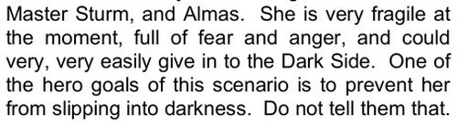

## p.7 (scan page 7)

Page contents: 723 words, 12 paragraphs | headings/entries: A Hero Seeks Not Vengeance; Page 7

- **No single roster character (rules/setting/general)** — entry/section: Traffic Control: ""Not many ships of that configuration, in fact— none. No, wait, one. Must be a custom job. Let's see, it's registered to one-- Lanius Qel'Bertok of Almas, Cularin." Source: *510 - Heart of Evil - A Hero Seeks Not Vengeance* (SWRPG d20 Revised Core), p.7
  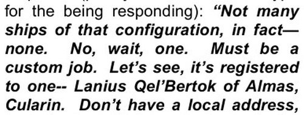
- **No single roster character (rules/setting/general)** — entry/section: Garth Ezzar: "Using Qel'Bertok's name was Ezzar's rather pathetic attempt at ironic and subtle humor. He expects to be traced, but then they'll all be dead or turned, and his powerful Master can take care of any inquiries." Source: *510 - Heart of Evil - A Hero Seeks Not Vengeance* (SWRPG d20 Revised Core), p.7
  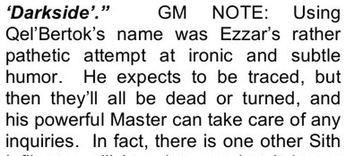
- **No single roster character (rules/setting/general)** — entry/section: Coruscant Security: ""Wearing armor may be the latest style on the Rimworlds, but here in civilization we usually take off our spacesuits, planetside. Heavy armor usually means trouble."" Source: *510 - Heart of Evil - A Hero Seeks Not Vengeance* (SWRPG d20 Revised Core), p.7
  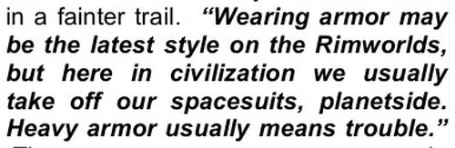
- **General Grievous**: "Although the evil droid Separatist leader, General Grievous, is suffering defeats at every turn, he has still managed to elude the valiant Republic Clone Army and its Jedi allies." Source: *510 - Heart of Evil - A Hero Seeks Not Vengeance* (SWRPG d20 Revised Core), p.7
  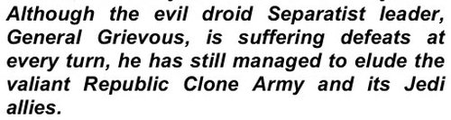

## p.8 (scan page 8)

Page contents: 747 words, 14 paragraphs | headings/entries: A Hero Seeks Not Vengeance; Page 8

- **No single roster character (rules/setting/general)** — entry/section: Jodoo Kreen: "Alas, it will prove useless, as Garth Ezzar killed Kreen just before setting out on his mission of destruction." Source: *510 - Heart of Evil - A Hero Seeks Not Vengeance* (SWRPG d20 Revised Core), p.8
  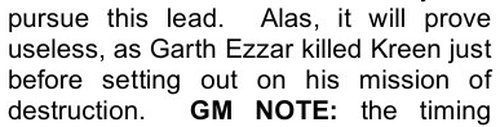

## p.4–8 (scan page 4)

Page contents: Crawl; E1 Pursuit flashback with Meera; E2 Undercity leads to Darkside (hand-read)

## p.9 (scan page 9)

Page contents: 784 words, 17 paragraphs | headings/entries: A Hero Seeks Not Vengeance; Residential Sector:; Page 9

- **No single roster character (rules/setting/general)** — entry/section: Darkside: "Some, however, became the refuge for the living jetsam of the galaxy, beings who made it to the world of promise, Coruscant, only to find that they couldn't make a living there and couldn't afford to leave even as refugees." Source: *510 - Heart of Evil - A Hero Seeks Not Vengeance* (SWRPG d20 Revised Core), p.9
  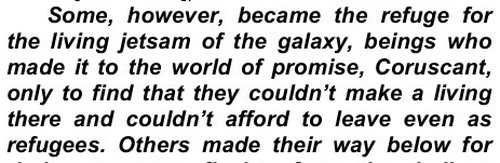

## p.10 (scan page 10)

Page contents: 818 words, 14 paragraphs | headings/entries: NPCs, Hazards, Obstacles, Events:; A Hero Seeks Not Vengeance; Page 10

## p.11 (scan page 11)

Page contents: 813 words, 16 paragraphs | headings/entries: A Hero Seeks Not Vengeance; Recycling Sector (GM Aid #3):; NPCs, Hazards, Obstacles, Events:; Page 11

- **No single roster character (rules/setting/general)** — entry/section: Meera Lisso: "Meera will realize that this is one example of why the Jedi cannot involve themselves with every dispute. Could they relocate every family here?" Source: *510 - Heart of Evil - A Hero Seeks Not Vengeance* (SWRPG d20 Revised Core), p.11
  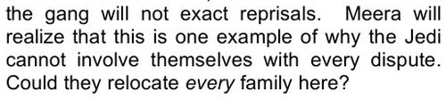
- **No single roster character (rules/setting/general)** — entry/section: Garth Ezzar: "He is simply "the Jedi in black" to them— yes, he has represented himself as a Jedi, sort of a "Jedi thug", completely unlike hero Jedi." Source: *510 - Heart of Evil - A Hero Seeks Not Vengeance* (SWRPG d20 Revised Core), p.11
  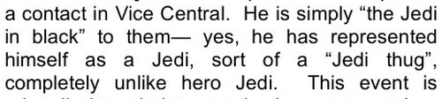
- **No single roster character (rules/setting/general)** — entry/section: Garth Ezzar: "It is generally held to be death to mention it out loud." Source: *510 - Heart of Evil - A Hero Seeks Not Vengeance* (SWRPG d20 Revised Core), p.11
  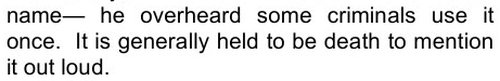

## p.12 (scan page 12)

Page contents: 788 words, 17 paragraphs | headings/entries: Typical item; A Hero Seeks Not Vengeance; Page 12

- **No single roster character (rules/setting/general)** — entry/section: Refuse Rain: "All damage is to vitality. Don't drop a truck on a Tier 1 team, please." Source: *510 - Heart of Evil - A Hero Seeks Not Vengeance* (SWRPG d20 Revised Core), p.12
  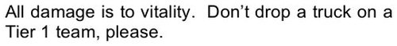
- **No single roster character (rules/setting/general)** — entry/section: Recycling: "They can't build a vest-pocket Death Star, but they can come up with annoyances, distracters, and possibly even low-grade functional weaponry." Source: *510 - Heart of Evil - A Hero Seeks Not Vengeance* (SWRPG d20 Revised Core), p.12
  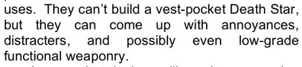

## p.13 (scan page 13)

Page contents: 693 words, 14 paragraphs | headings/entries: Industrial Sector (GM Aid #4):; A Hero Seeks Not Vengeance; NPCs, Hazards, Obstacles, Events:; Page 13

## p.14 (scan page 14)

Page contents: 403 words, 20 paragraphs | headings/entries: Machine/Event Effect; A Conveyor belt; B Blast Furnace; Cc Trough; D Pressure Molds; F Incinerator Pit; A Hero Seeks Not Vengeance; Machine/Event; Winch; Effect; Barrels of goo; Page 14

## p.15 (scan page 15)

Page contents: 840 words, 15 paragraphs | headings/entries: A Hero Seeks Not Vengeance; Services Sector/"Vice Central" (GM Aid #5):; Page 15

- **No single roster character (rules/setting/general)** — entry/section: Industrial: "Note that clever use even of skills like Computer, at the proper time and with the proper build-up, could be dramatic enough to earn a Force Point. It's not all blasters and lightsabers." Source: *510 - Heart of Evil - A Hero Seeks Not Vengeance* (SWRPG d20 Revised Core), p.15
  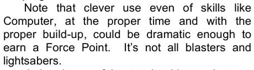
- **No single roster character (rules/setting/general)** — entry/section: Services: ""Services" is a wretched hive of scum and villainy in the shadowy underbelly of Coruscant's gleaming capitol." Source: *510 - Heart of Evil - A Hero Seeks Not Vengeance* (SWRPG d20 Revised Core), p.15
  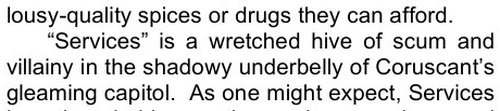

## p.16 (scan page 16)

Page contents: 859 words, 14 paragraphs | headings/entries: A Hero Seeks Not Vengeance; NPCs, Hazards, Obstacles, Events:; Page 16

- **No single roster character (rules/setting/general)** — entry/section: Lucky You: "For an hour, you get to live like an Uptowner, a successful person. Many cry when their hour is up." Source: *510 - Heart of Evil - A Hero Seeks Not Vengeance* (SWRPG d20 Revised Core), p.16
  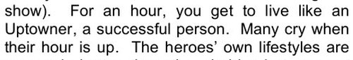
- **No single roster character (rules/setting/general)** — entry/section: Garth Ezzar: "He did not cry, though he laughed a few times, in a way that made the actors shudder." Source: *510 - Heart of Evil - A Hero Seeks Not Vengeance* (SWRPG d20 Revised Core), p.16
  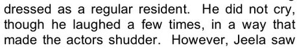
- **No single roster character (rules/setting/general)** — entry/section: Jeela Cthon: ""He's massive, a Human, tall. Black, shoulder-length hair, grey eyes. Deep voice, always sounds mocking and nasty. He might have been handsome, once. He looks like he spends too much of his time hating everyone" Source: *510 - Heart of Evil - A Hero Seeks Not Vengeance* (SWRPG d20 Revised Core), p.16
  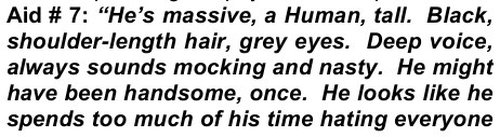

## p.17 (scan page 17)

Page contents: 813 words, 16 paragraphs | headings/entries: A Hero Seeks Not Vengeance; Page 17

- **No single roster character (rules/setting/general)** — entry/section: Encounter 4: "Judge, if you have run The Dark Side Beckons, this encounter answers the unasked question from that trilogy: "What if you cannot simply beat down your opponent and you cannot 'redeem' him or her?"" Source: *510 - Heart of Evil - A Hero Seeks Not Vengeance* (SWRPG d20 Revised Core), p.17
  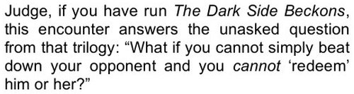
- **No single roster character (rules/setting/general)** — entry/section: Encounter 4: "The answer, of course, is that you use your head and hedge your bets." Source: *510 - Heart of Evil - A Hero Seeks Not Vengeance* (SWRPG d20 Revised Core), p.17
  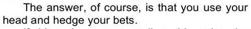

## p.8–17 (scan page 8)

Page contents: E3 Hunting Grounds: Residential, Recycling, Industrial, Services/Vice Central (hand-read)

## p.18 (scan page 18)

Page contents: 890 words, 13 paragraphs | headings/entries: A Hero Seeks Not Vengeance; Page 18

- **No single roster character (rules/setting/general)** — entry/section: Garth Ezzar: ""Your dress sense bites" isn't likely to do much. "You're a bit of a nerf without a hundred mercenaries to back you" is likely to have him foaming at the faceplate." Source: *510 - Heart of Evil - A Hero Seeks Not Vengeance* (SWRPG d20 Revised Core), p.18
  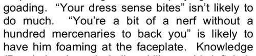
- **No single roster character (rules/setting/general)** — entry/section: Garth Ezzar: "Finally, Ezzar's WIL save is already his worst, and various mind skills might give the heroes an edge. Not "Friendship", though— come on." Source: *510 - Heart of Evil - A Hero Seeks Not Vengeance* (SWRPG d20 Revised Core), p.18
  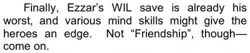
- **Palpatine (Darth Sidious)** — entry/section: Darth Sidious: "(The Emperor only wants one apprentice, and it's not Garth—he was just a potential backup and fall guy. Ezzar will vanish during the Jedi pogrom, due to his failures— apology accepted.)" Source: *510 - Heart of Evil - A Hero Seeks Not Vengeance* (SWRPG d20 Revised Core), p.18
  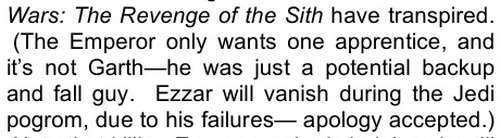

## p.19 (scan page 19)

Page contents: 849 words, 17 paragraphs | headings/entries: A Hero Seeks Not Vengeance; Dialog for Garth Ezzar:; Page 19

- **No single roster character (rules/setting/general)** — entry/section: Encounter 4: "As well, the pigheadedness mentioned above can result in hero death. Sometimes you just don't butt heads with the bull." Source: *510 - Heart of Evil - A Hero Seeks Not Vengeance* (SWRPG d20 Revised Core), p.19
  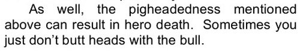
- **No single roster character (rules/setting/general)** — entry/section: Meera Lisso: "She will simply say, "All right then, if you think it's necessary, go for backup. I'll keep an eye on matters here." That will be the last they ever see or hear of her." Source: *510 - Heart of Evil - A Hero Seeks Not Vengeance* (SWRPG d20 Revised Core), p.19
  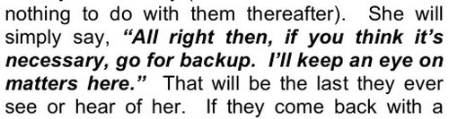
- **No single roster character (rules/setting/general)** — entry/section: Garth Ezzar: "And now, you finally get to do it: when battle is about to be joined, or at the most dramatic moment, you may have Garth extend the second blade of his double-bladed lightsaber. (He did not do so on Almas.)" Source: *510 - Heart of Evil - A Hero Seeks Not Vengeance* (SWRPG d20 Revised Core), p.19
  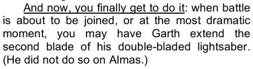
- **No single roster character (rules/setting/general)** — entry/section: Garth Ezzar: ""At last, you have me right where I want you."" Source: *510 - Heart of Evil - A Hero Seeks Not Vengeance* (SWRPG d20 Revised Core), p.19
  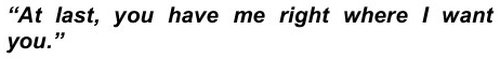
- **No single roster character (rules/setting/general)** — entry/section: Garth Ezzar: ""Sad. If I am dealing with such idiots, then this will be far too short."" Source: *510 - Heart of Evil - A Hero Seeks Not Vengeance* (SWRPG d20 Revised Core), p.19
  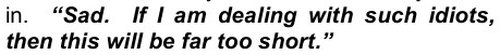

## p.20 (scan page 20)

Page contents: 803 words, 17 paragraphs | headings/entries: A Hero Seeks Not Vengeance; Page 20

- **No single roster character (rules/setting/general)** — entry/section: Garth Ezzar: ""You have one chance of survival. Drop all weapons and surrender. I don't even require you to be sincere. Once you arrive at my 'learning center', we can take care of sincerity."" Source: *510 - Heart of Evil - A Hero Seeks Not Vengeance* (SWRPG d20 Revised Core), p.20
  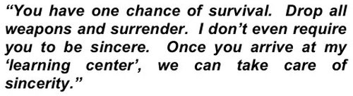
- **No single roster character (rules/setting/general)** — entry/section: Garth Ezzar: ""Then perhaps one of you righteous and powerful Jedi wishes to challenge me to single combat? It wouldn't be fair for you to gang up on me, would it? Is the Jedi Code the way of cowardice?"" Source: *510 - Heart of Evil - A Hero Seeks Not Vengeance* (SWRPG d20 Revised Core), p.20
  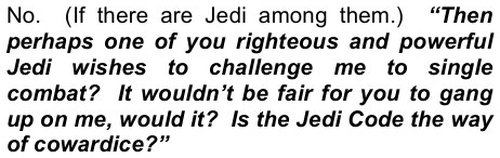
- **No single roster character (rules/setting/general)** — entry/section: Garth Ezzar: ""Come then. Your group will have its average intelligence raised in a moment."" Source: *510 - Heart of Evil - A Hero Seeks Not Vengeance* (SWRPG d20 Revised Core), p.20
  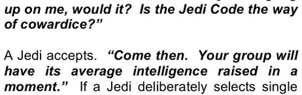
- **No single roster character (rules/setting/general)** — entry/section: Garth Ezzar: ""Excellent. It will not alter the outcome in the least, but it's good to know that you are not complete morons."" Source: *510 - Heart of Evil - A Hero Seeks Not Vengeance* (SWRPG d20 Revised Core), p.20
  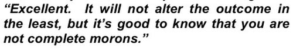
- **No single roster character (rules/setting/general)** — entry/section: Garth Ezzar: ""Good, I like a (man/woman) who can lie with a straight face."" Source: *510 - Heart of Evil - A Hero Seeks Not Vengeance* (SWRPG d20 Revised Core), p.20
  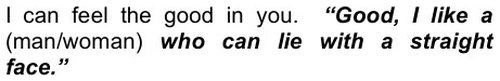
- **No single roster character (rules/setting/general)** — entry/section: Garth Ezzar: ""I see that you learned nothing on Almas. If you want to join your dead, stupid Mistress, I'll be happy to oblige."" Source: *510 - Heart of Evil - A Hero Seeks Not Vengeance* (SWRPG d20 Revised Core), p.20
  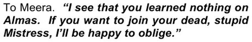
- **No single roster character (rules/setting/general)** — entry/section: Garth Ezzar: ""Fools. You face a fully trained Sith Warrior. This is your last battle."" Source: *510 - Heart of Evil - A Hero Seeks Not Vengeance* (SWRPG d20 Revised Core), p.20
  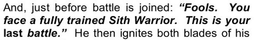
- **No single roster character (rules/setting/general)** — entry/section: Encounter 4: "Remember, intent is as important as actions and the end never justifies the means, where the Force is concerned." Source: *510 - Heart of Evil - A Hero Seeks Not Vengeance* (SWRPG d20 Revised Core), p.20
  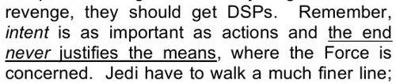
- **No single roster character (rules/setting/general)** — entry/section: Garth Ezzar: ""The Dark Side could make you strong, maybe strong enough to actually hit me once."" Source: *510 - Heart of Evil - A Hero Seeks Not Vengeance* (SWRPG d20 Revised Core), p.20
  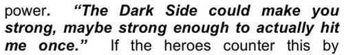

## p.21 (scan page 21)

Page contents: 746 words, 19 paragraphs | headings/entries: A Hero Seeks Not Vengeance; Page 21

- **No single roster character (rules/setting/general)** — entry/section: Encounter 5: "Your enemy lies before you, defeated, silent. The brooding aura of the Dark Side is still around him." Source: *510 - Heart of Evil - A Hero Seeks Not Vengeance* (SWRPG d20 Revised Core), p.21
  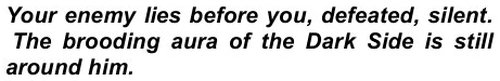
- **No single roster character (rules/setting/general)** — entry/section: Meera Lisso: "Meera Lisso looks down at him, just as silently, as if in communion with herself, or perhaps with another. Tears slowly flow down her cheeks." Source: *510 - Heart of Evil - A Hero Seeks Not Vengeance* (SWRPG d20 Revised Core), p.21
  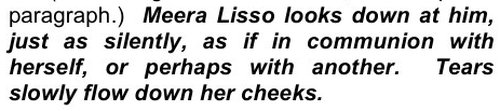
- **No single roster character (rules/setting/general)** — entry/section: E1-6RA: ""Thank you for rescuing me. During the attack on the Academy, after the main devastation—"" Source: *510 - Heart of Evil - A Hero Seeks Not Vengeance* (SWRPG d20 Revised Core), p.21
  

## p.22 (scan page 22)

Page contents: 814 words, 20 paragraphs | headings/entries: A Hero Seeks Not Vengeance; Page 22

- **No single roster character (rules/setting/general)** — entry/section: E1-6RA: ""I restarted here on Coruscant. The vile murderer didn't even ask me any questions. Instead, I had to listen to him reviling the Jedi and just about everyone else in the Universe, including some shadowy 'Master'." Source: *510 - Heart of Evil - A Hero Seeks Not Vengeance* (SWRPG d20 Revised Core), p.22
  
- **No single roster character (rules/setting/general)** — entry/section: E1-6RA: ""I am glad. Master Lanius always advocated peace, but that was not a man; that was a monster. It had to be stopped." Source: *510 - Heart of Evil - A Hero Seeks Not Vengeance* (SWRPG d20 Revised Core), p.22
  
- **No single roster character (rules/setting/general)** — entry/section: E1-6RA: ""Now, I would very much like to go to Cularin. Almas is no longer my home, and a directive in my programming has been unlocked. it is time for me to retire."" Source: *510 - Heart of Evil - A Hero Seeks Not Vengeance* (SWRPG d20 Revised Core), p.22
  
- **No single roster character (rules/setting/general)** — entry/section: Garth Ezzar: "Your opponent is dead. His body lies on the ground, something like smoke rising from his suit. It also has a neat, round hole burned through the heart area. His lightsaber is nowhere to be seen, although the hands that held it are— about two meters away from his body." Source: *510 - Heart of Evil - A Hero Seeks Not Vengeance* (SWRPG d20 Revised Core), p.22
  

## p.23 (scan page 23)

Page contents: 625 words, 26 paragraphs | headings/entries: A Hero Seeks Not Vengeance; Conclusion; Here Ends, "A Hero Seeks Not Vengeance"; Page

- **No single roster character (rules/setting/general)** — entry/section: Meera Lisso: ""I can't thank you enough for helping me stay true to Zelice's teachings, and to the Jedi Code. I've come to realize, though, that I need a lot more training— and now does not look like a good time." Source: *510 - Heart of Evil - A Hero Seeks Not Vengeance* (SWRPG d20 Revised Core), p.23
  
- **No single roster character (rules/setting/general)** — entry/section: Meera Lisso: ""So, I guess that this is good-bye— until we meet again, in paths beyond adventure."" Source: *510 - Heart of Evil - A Hero Seeks Not Vengeance* (SWRPG d20 Revised Core), p.23
  
- **No single roster character (rules/setting/general)** — entry/section: E1-6RA: ""So many changes, so quickly. As a droid, one gets used to the ephemeral quality of the organic world, but—"" Source: *510 - Heart of Evil - A Hero Seeks Not Vengeance* (SWRPG d20 Revised Core), p.23
  
- **No single roster character (rules/setting/general)** — entry/section: E1-6RA: ""Even I can wish that some things would not chance, and that some— people— could have remained longer." Source: *510 - Heart of Evil - A Hero Seeks Not Vengeance* (SWRPG d20 Revised Core), p.23
  
- **No single roster character (rules/setting/general)** — entry/section: Conclusion: "The threat of Garth Ezzar is ended. In a way, this terrible menace seems almost to have been a postscript to the ending of something much larger: a way of life in the Cularin system and, who knows, perhaps in the whole galaxy." Source: *510 - Heart of Evil - A Hero Seeks Not Vengeance* (SWRPG d20 Revised Core), p.23
  
- **No single roster character (rules/setting/general)** — entry/section: Conclusion: "GM NOTE: Fat chance. Still, the adventure continues, and the fate of Len Markus and the Darkstaff will be determined— but that is another story." Source: *510 - Heart of Evil - A Hero Seeks Not Vengeance* (SWRPG d20 Revised Core), p.23
  

## p.17–23 (scan page 17)

Page contents: E4 confrontation with Garth Ezzar; E5 outcomes; E6 Epilogue; Conclusion (hand-read)

## p.24 (scan page 24)

Page contents: 668 words, 22 paragraphs | headings/entries: Experience Point Summary; Experience is calculated as follows for LIVING; Adventure Experience Award:; Loot Summary; A Hero Seeks Not Vengeance; Page 24

## p.25 (scan page 25)

Page contents: 581 words, 11 paragraphs | headings/entries: A Hero Seeks Not Vengeance; Page 25

- **No single roster character (rules/setting/general)** — entry/section: School of Hard Knocks: "School of Hard Knocks (cert)(one per hero): Some people just live faster than others. They are called "heroes"." Source: *510 - Heart of Evil - A Hero Seeks Not Vengeance* (SWRPG d20 Revised Core), p.25
  

## p.26 (scan page 26)

Page contents: 315 words, 14 paragraphs | headings/entries: Player Handout 1:; Ikass-Adno 22-B Nightfalcon; A Hero Seeks Not Vengeance Page 26

## p.27 (scan page 27)

Page contents: 16 words, 3 paragraphs | headings/entries: Industrial; A Hero Seeks Not Vengeance Page 27

## p.28 (scan page 28)

Page contents: 23 words, 3 paragraphs | headings/entries: A Hero Seeks Not Vengeance Page 28

## p.29 (scan page 29)

Page contents: 30 words, 6 paragraphs | headings/entries: A Hero Seeks Not Vengeance Page 29

## p.30 (scan page 30)

Page contents: 16 words, 2 paragraphs | headings/entries: A Hero Seeks Not Vengeance Page 30

## p.31 (scan page 31)

Page contents: 625 words, 25 paragraphs | headings/entries: GM Aid #1: NPCs; All Areas - All Tiers; Ezzar's Spies; All Areas - Tier 1; Ezzar's Thugs; All Areas — Tier 2; Ezzar's Thugs; A Hero Seeks Not Vengeance Page 31

## p.32 (scan page 32)

Page contents: 620 words, 21 paragraphs | headings/entries: All Areas - Tier 3; Ezzar's Thugs; Residential and Services - All Tiers; Darkside Civilians; Residential and Services - Tier 1; Darkside Generic Scum; A Hero Seeks Not Vengeance Page 32

### Stat block notes (game mechanics, not feats)

- Ezzar's Thugs: Ezzar's Thugs (Tier 3): Human Soldier 5/Scoundrel 6; Def 19; VP/WP 58/14; Atk +12/+7 ranged (3d8, heavy blaster pistol or blaster rifle); FP 4; DSP 1 (Source: *510 - Heart of Evil - A Hero Seeks Not Vengeance* (SWRPG d20 Revised Core), p.32)

## p.33 (scan page 33)

Page contents: 517 words, 16 paragraphs | headings/entries: Residential and Services - Tier2; Darkside Generic Scum; Industrial - Tier 1; Manufacturing Droids; A Hero Seeks Not Vengeance Page 33

## p.34 (scan page 34)

Page contents: 474 words, 19 paragraphs | headings/entries: Industrial - Tier2; Manufacturing Droids; Recycling - Tier 1 Scavenger Droids; A Hero Seeks Not Vengeance Page 34

## p.35 (scan page 35)

Page contents: 555 words, 21 paragraphs | headings/entries: Refuge Stingers; Scavengers (humanoids); Recycling - Tier2; Refuge Stingers; A Hero Seeks Not Vengeance Page 35

## p.36 (scan page 36)

Page contents: 500 words, 17 paragraphs | headings/entries: Scavengers (humanoids); Recycling - Tier 3; Refuge Stingers; A Hero Seeks Not Vengeance Page 36

### Stat block notes (game mechanics, not feats)

- Refuge Stinger: Refuge Stingers (Tier 3): Predator 11; Defense 24; VP/WP 85/16; Attack +17/+12/+7 (tendril 2d6 energy) (Source: *510 - Heart of Evil - A Hero Seeks Not Vengeance* (SWRPG d20 Revised Core), p.36)

## p.37 (scan page 37)

Page contents: 242 words, 7 paragraphs | headings/entries: Scavengers (humanoids); A Hero Seeks Not Vengeance Page 37

## p.38 (scan page 38)

Page contents: 16 words, 4 paragraphs | headings/entries: GM Aid #2: Darkside Overview Map; Services Residential; Industrial; A Hero Seeks Not Vengeance Page 38

## p.39 (scan page 39)

Page contents: 23 words, 3 paragraphs | headings/entries: Oo & + CU BOE sy Bi; A Hero Seeks Not Vengeance Page 39

## p.40 (scan page 40)

Page contents: 25 words, 9 paragraphs | headings/entries: GM Aid #4: Darkside Industrial Sector Map; N i ||| bo; OP; F->; A Hero Seeks Not Vengeance Page 40

## p.41 (scan page 41)

Page contents: 16 words, 2 paragraphs | headings/entries: A Hero Seeks Not Vengeance Page 41

## p.42 (scan page 42)

Page contents: 229 words, 8 paragraphs | headings/entries: GM Aid #6: Darkside Map Key; A Hero Seeks Not Vengeance; Page 42

## p.43 (scan page 43)

Page contents: 699 words, 14 paragraphs | headings/entries: GM Aid #7: Garth Ezzar; A Hero Seeks Not Vengeance Page 43

- **No single roster character (rules/setting/general)** — entry/section: Garth Ezzar: "If he were a role-player, he'd constantly complain that there wasn't enough combat, and then constantly demand that all the combats be winnable by him, personally." Source: *510 - Heart of Evil - A Hero Seeks Not Vengeance* (SWRPG d20 Revised Core), p.43
  
- **No single roster character (rules/setting/general)** — entry/section: Garth Ezzar: "She was only slightly more surprised than Garth when her student, enraged by yet another betrayal, drew on unimaginable power from the Dark Side and killed her." Source: *510 - Heart of Evil - A Hero Seeks Not Vengeance* (SWRPG d20 Revised Core), p.43
  
- **Palpatine (Darth Sidious)** — entry/section: Darth Sidious: "The Master has been following another's career with great interest, unknown to Garth, and now that that one is ready to be turned, Ezzar will be discarded. He will not even know who his Master really was. GM NOTE: Garth does NOT know of "Darth Sidious", or that his Master is Supreme Chancellor Palpatine." Source: *510 - Heart of Evil - A Hero Seeks Not Vengeance* (SWRPG d20 Revised Core), p.43
  

## p.44 (scan page 44)

Page contents: 831 words, 11 paragraphs | headings/entries: A Hero Seeks Not Vengeance Page 44

### Stat block notes (game mechanics, not feats)

- Garth Ezzar: Garth Ezzar: male Human Soldier 1/Scoundrel 3/Dark Side Marauder 4/Sith Warrior 6 (level 14, untiered); Def 27; VP/WP 150/16; Atk +20/+15/+10 melee (5d8+3/19-20 plus 5d8+3/19-20, double-bladed lightsaber), +19/+14/+9 ranged (3d8-1, custom heavy blaster pistol); FP 14; DSP 16; Battlemind +15, Affect Mind +13, Force Lightning +12; Lightsaber Form Five Mastery, Rage, Force Whirlwind (Source: *510 - Heart of Evil - A Hero Seeks Not Vengeance* (SWRPG d20 Revised Core), p.44)

## p.45 (scan page 45)

Page contents: 1024 words, 11 paragraphs | headings/entries: A Hero Seeks Not Vengeance Page 45

- **No single roster character (rules/setting/general)** — entry/section: Garth Ezzar: "Also, a Jedi trying to use "Friendship" on him will fail—let's be serious." Source: *510 - Heart of Evil - A Hero Seeks Not Vengeance* (SWRPG d20 Revised Core), p.45
  
- **No single roster character (rules/setting/general)** — entry/section: Garth Ezzar: "If a hero clearly wants a full-on death battle with this miniature version of Darth Vader, then so be it." Source: *510 - Heart of Evil - A Hero Seeks Not Vengeance* (SWRPG d20 Revised Core), p.45
  
- **No single roster character (rules/setting/general)** — entry/section: Garth Ezzar: "GM NOTE re Sunder: Garth Ezzar does not try to sunder lightsabers; he collects them as trophies." Source: *510 - Heart of Evil - A Hero Seeks Not Vengeance* (SWRPG d20 Revised Core), p.45
  

## p.46 (scan page 46)

Page contents: 199 words, 9 paragraphs | headings/entries: Scratch built custom speeder bike ("Sith Speeder"); Weapon: None; A Hero Seeks Not Vengeance Page 46

## p.47 (scan page 47)

Page contents: 669 words, 12 paragraphs | headings/entries: GM Aid #8: Meera Lisso; A Hero Seeks Not Vengeance Page 47

- **No single roster character (rules/setting/general)** — entry/section: Meera Lisso: "Meera has no desire to throw her life away, but, even when in control, knows that Ezzar must be stopped." Source: *510 - Heart of Evil - A Hero Seeks Not Vengeance* (SWRPG d20 Revised Core), p.47
  
- **No single roster character (rules/setting/general)** — entry/section: Meera Lisso: "She is quite willing to give her life for her team, or if it is the only way to bring Ezzar down." Source: *510 - Heart of Evil - A Hero Seeks Not Vengeance* (SWRPG d20 Revised Core), p.47
  

### Stat block notes (game mechanics, not feats)

- Meera Lisso: Meera Lisso: Human female Thug 3/Jedi Guardian 4 (untiered); Defense 15/16; VP/WP 39/12; Atk +7 melee (2d8+2 lightsaber); FP 5; DSP 2; Battlemind +7, Force Defense +8 (Source: *510 - Heart of Evil - A Hero Seeks Not Vengeance* (SWRPG d20 Revised Core), p.47)

## p.48 (scan page 48)

Page contents: 458 words, 6 paragraphs | headings/entries: A Hero Seeks Not Vengeance Page 48

- **No single roster character (rules/setting/general)** — entry/section: Meera Lisso: "This definitely a case of "do as I do", not "do as I say"." Source: *510 - Heart of Evil - A Hero Seeks Not Vengeance* (SWRPG d20 Revised Core), p.48
  

## p.24–48 (scan page 24)

Page contents: XP, loot certs, handouts, maps, GM Aids (NPCs, Garth Ezzar, Meera Lisso) (hand-read)

