# Owner Material 037 — Star Wars D20 Drive folder (Core, Revised Core and Saga Edition): Living Force Campaign/Adventures/Among the Stars/Year 5/513 - EndTimes - The Heart.pdf [Star Wars Roleplaying Game Revised Core (d20, 2002)]

- **Source:** Wizards of the Coast Star Wars Roleplaying Game books, web enhancements, Living Force campaign modules and articles (2000–2010), from the owner's "Star Wars D20" Drive folder (only the three edition subfolders; "General" was not read, as instructed). Secondary source (licensed Legends reference). Scan OCR'd on the box; the scan stays box-only and is **not** published.
- **Method:** every scanned page was OCR'd and machine-screened sentence by sentence for power-relevant statements (fights, kills, defeats, Force feats, rankings, superweapons) that name a character on our roster; each kept sentence is quoted verbatim from the OCR text and has a crop of the printed passage directly under it. Pages with nothing power-relevant are still listed with what is on them.
- **Citation:** "*513 - EndTimes - The Heart* (SWRPG d20 Revised Core), p.X" by printed page ("scan p.X" where no printed number applies). **Weight:** Licensed RPG material: a secondary source. Narrative text sums up Legends lore; game statistics are rules for players, not canon power levels, and rank lowest.

## p.1 (scan page 1)

Page contents: 126 words, 6 paragraphs | headings/entries: LFA513; The Heart

## p.2 (scan page 2)

Page contents: 776 words, 21 paragraphs | headings/entries: House Rules; Atoning for Dark Side Points; Dissipate Energy; Illusion; Stun; Hero Earnings; Issuing Force and Dark Side Points; The Heart; Page 2

## p.3 (scan page 3)

Page contents: 805 words, 24 paragraphs | headings/entries: General Notes to the GM; GM Overview; The Heart; Page 3

- **No single roster character (rules/setting/general)** — entry/section: General Notes: "That being said, this is the finale trilogy for the campaign. If there's a time for characters to go out in the proverbial "blaze of glory," this is probably it." Source: *513 - EndTimes - The Heart* (SWRPG d20 Revised Core), p.3
  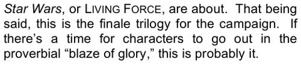
- **No single roster character (rules/setting/general)** — entry/section: GM Overview: "That's one of the beauties of roleplaying in a shared world environment like this — the story isn't over just because there aren't any more modules." Source: *513 - EndTimes - The Heart* (SWRPG d20 Revised Core), p.3
  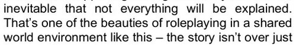

## p.4 (scan page 4)

Page contents: 815 words, 18 paragraphs | headings/entries: Sounds simple enough — right?; Encounter 1: Threat Level Four; Encounter 2: Deeper Down; Encounter 3: In the Jungle; Encounter 4: Threat Level Three; Encounter 5: Tunnel Rats; The Heart; Page 4

- **No single roster character (rules/setting/general)** — entry/section: GM Overview: ""The Heart" gives the heroes a chance to track the Believers, the faction of Sith-worshippers who've been troubling Cularin for the past few years, to their final stronghold." Source: *513 - EndTimes - The Heart* (SWRPG d20 Revised Core), p.4
  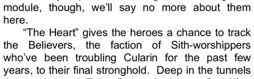
- **No single roster character (rules/setting/general)** — entry/section: GM Overview: "Sounds simple enough — right?" Source: *513 - EndTimes - The Heart* (SWRPG d20 Revised Core), p.4
  

## p.5 (scan page 5)

Page contents: 718 words, 20 paragraphs | headings/entries: Encounter 7: Threat Level One; Opening Crawl; The Heart; Page 5

- **No single roster character (rules/setting/general)** — entry/section: Opening Crawl: "Life in Cularin grows more strained by the day. For every obstacle that is overcome, two more emerge. Friends disappear, enemies reappear, and the threat of death lingers everywhere." Source: *513 - EndTimes - The Heart* (SWRPG d20 Revised Core), p.5
  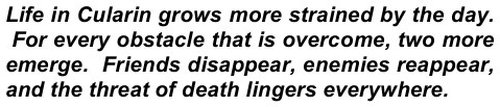
- **No single roster character (rules/setting/general)** — entry/section: Opening Crawl: "Not everyone wants peace, though. If ever there has been a time for heroes, that time is now..." Source: *513 - EndTimes - The Heart* (SWRPG d20 Revised Core), p.5
  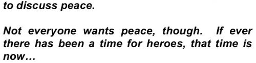
- **No single roster character (rules/setting/general)** — entry/section: Gavin Bresch: ""Lieutenant Gavin Bresch, Cularin Militia, requests your presence aboard the Cularin IV, in orbit above Cularin. Your prior service on behalf of Cularin has not gone unnoticed." Source: *513 - EndTimes - The Heart* (SWRPG d20 Revised Core), p.5
  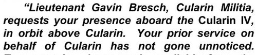
- **No single roster character (rules/setting/general)** — entry/section: Huusk: "DC 112 Sense Motive to recognize that he's just a plot-plant stuck in by the authors to make the heroes paranoid about potential inside jobs" Source: *513 - EndTimes - The Heart* (SWRPG d20 Revised Core), p.5
  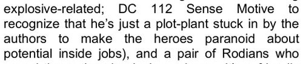

## p.1–5 (scan page 1)

Page contents: Title, house rules, GM notes, overview, encounter list, crawl (hand-read)

## p.6 (scan page 6)

Page contents: 655 words, 24 paragraphs | headings/entries: The Heart; Page 6

- **No single roster character (rules/setting/general)** — entry/section: Gavin Bresch: ""Thank you for coming. Please, be seated." Source: *513 - EndTimes - The Heart* (SWRPG d20 Revised Core), p.6
  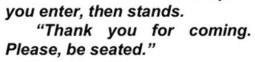
- **No single roster character (rules/setting/general)** — entry/section: Gavin Bresch: "Because of how quickly the disinformation spread, I'm concerned that we have a mole. Strike that. I'm convinced this is the case." Source: *513 - EndTimes - The Heart* (SWRPG d20 Revised Core), p.6
  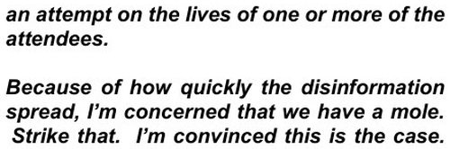
- **No single roster character (rules/setting/general)** — entry/section: Gavin Bresch: "Finding the mole is not — I repeat NOT — your responsibility. I want you to track down likely strike teams that may be coming after the summit. I will handle the mole." Source: *513 - EndTimes - The Heart* (SWRPG d20 Revised Core), p.6
  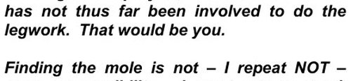
- **No single roster character (rules/setting/general)** — entry/section: Gavin Bresch: "We know the Believers are few, but suspect there is at least one major cell remaining. In addition, we've heard a rumor that their leader may have come to the system to assist in the attack on this summit." Source: *513 - EndTimes - The Heart* (SWRPG d20 Revised Core), p.6
  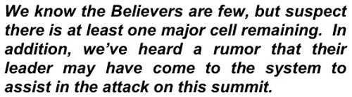

## p.7 (scan page 7)

Page contents: 748 words, 21 paragraphs | headings/entries: Encounter 2: Deeper Down; The Heart; Page 7

- **No single roster character (rules/setting/general)** — entry/section: Gavin Bresch: "You need to pick a code name for your team; I'll use that code name, and no other identifying information, when contacting you. I will identify myself as "Nightfalcon."" Source: *513 - EndTimes - The Heart* (SWRPG d20 Revised Core), p.7
  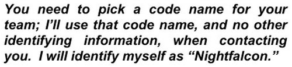
- **No single roster character (rules/setting/general)** — entry/section: Gavin Bresch: "SERIOUSLY, HE'S NOT THE MOLE. YOU NEED TO HURRY UP OR YOU'RE GOING TO MISS THE REST OF THE MODULE!" Source: *513 - EndTimes - The Heart* (SWRPG d20 Revised Core), p.7
  
- **No single roster character (rules/setting/general)** — entry/section: Wookiee guards: "He's a Wookiee; they aren't generally known for subtlety." Source: *513 - EndTimes - The Heart* (SWRPG d20 Revised Core), p.7
  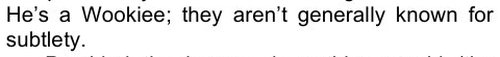

## p.8 (scan page 8)

Page contents: 682 words, 28 paragraphs | headings/entries: Searching the Conference Room; Search DC What the heroes find; Querying Abnormal Signals To or From Tilnes; Encounter 3: In the Jungle; The Heart; Page 8

- **No single roster character (rules/setting/general)** — entry/section: Tilnes conference room: "The room resonates with quiet." Source: *513 - EndTimes - The Heart* (SWRPG d20 Revised Core), p.8
  
- **No single roster character (rules/setting/general)** — entry/section: Search table: "There's a control box for the lights, computers, and security system in the far corner of the room. There's also this big wooden table thing." Source: *513 - EndTimes - The Heart* (SWRPG d20 Revised Core), p.8
  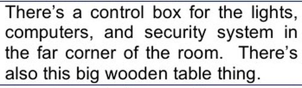

## p.9 (scan page 9)

Page contents: 885 words, 14 paragraphs | headings/entries: The Heart; Page 9

- **No single roster character (rules/setting/general)** — entry/section: Encounter 3: "So put the top up on the landspeeder, kiddies. It's not a short ride out to the coordinates they've been given." Source: *513 - EndTimes - The Heart* (SWRPG d20 Revised Core), p.9
  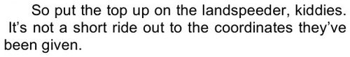
- **No single roster character (rules/setting/general)** — entry/section: Encounter 3: "Speaking of which, we should go there now..." Source: *513 - EndTimes - The Heart* (SWRPG d20 Revised Core), p.9
  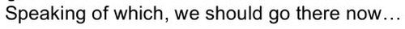

## p.10 (scan page 10)

Page contents: 801 words, 17 paragraphs | headings/entries: Encounter 4: Threat Level Three; The mob scene; The Heart; Page 10

- **No single roster character (rules/setting/general)** — entry/section: Believer saboteurs: "I'd give you a Search DC, but honestly — they've killed the captives and need a lead. I don't want to run the risk of them not finding it!" Source: *513 - EndTimes - The Heart* (SWRPG d20 Revised Core), p.10
  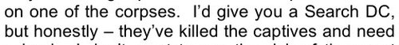

## p.5–10 (scan page 5)

Page contents: E1 Bresch briefing; E2 Tilnes conference room; E3 decoy site saboteurs (hand-read)

## p.11 (scan page 11)

Page contents: 824 words, 18 paragraphs | headings/entries: Encounter 5: Tunnel Rats; The Heart; Page 11

- **No single roster character (rules/setting/general)** — entry/section: The mob: "It may be the "in" thing on Coruscant right now, but it's a bad time to be a Sith worshipper in Cularin." Source: *513 - EndTimes - The Heart* (SWRPG d20 Revised Core), p.11
  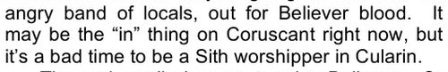
- **No single roster character (rules/setting/general)** — entry/section: The mob: "You hear the mob before you see them. They come around the corner, some brandishing makeshift weapons — bars, arc welders, hydrospanners — some wielding blasters. Their voices meld into a single continuous burst of anger, but through it all, you hear four words that send chills down your spine. "Death to the Believers!"" Source: *513 - EndTimes - The Heart* (SWRPG d20 Revised Core), p.11
  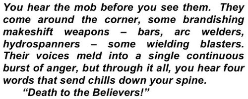
- **No single roster character (rules/setting/general)** — entry/section: Tryn: "His name is Tryn, and he's the most charismatic Level 1 Expert the heroes have run across." Source: *513 - EndTimes - The Heart* (SWRPG d20 Revised Core), p.11
  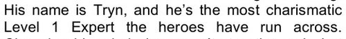
- **No single roster character (rules/setting/general)** — entry/section: Old Believer stronghold: "This is such a dead-end. Everything has been removed, and when the cleaning was done, the warehouse the Believers were using was set on fire. It's now a burned-out husk. Zero clues. This is not the encounter you're looking for. Move along." Source: *513 - EndTimes - The Heart* (SWRPG d20 Revised Core), p.11
  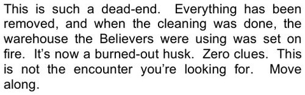

## p.12 (scan page 12)

Page contents: 817 words, 17 paragraphs | headings/entries: The Heart; Page 12

- **No single roster character (rules/setting/general)** — entry/section: Encounter 5: "Oh, and depending on how the encounter goes, you may end up handing out DSPs like candy. If this happens, try to avoid letting the party turn on one another." Source: *513 - EndTimes - The Heart* (SWRPG d20 Revised Core), p.12
  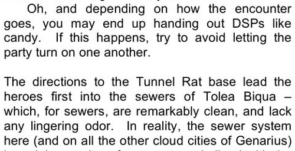
- **No single roster character (rules/setting/general)** — entry/section: Tunnel Rats: "As malign presences go, the Rats... aren't." Source: *513 - EndTimes - The Heart* (SWRPG d20 Revised Core), p.12
  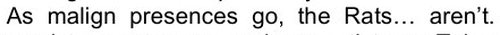
- **No single roster character (rules/setting/general)** — entry/section: Rancer: ""Ere, now. Who are you, and what's your business with the Rats?"" Source: *513 - EndTimes - The Heart* (SWRPG d20 Revised Core), p.12
  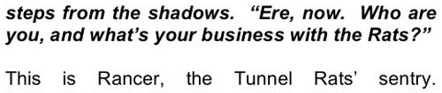
- **No single roster character (rules/setting/general)** — entry/section: Rancer: ""Aye, you're gonna love this."" Source: *513 - EndTimes - The Heart* (SWRPG d20 Revised Core), p.12
  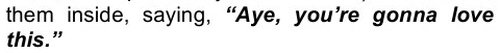
- **No single roster character (rules/setting/general)** — entry/section: Rancer: ""Oy, we got Believer-huntin' comp'ny!"" Source: *513 - EndTimes - The Heart* (SWRPG d20 Revised Core), p.12
  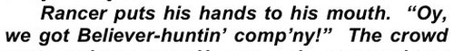
- **No single roster character (rules/setting/general)** — entry/section: Rydna: "Rydna is a Believer. That will become clear when he's allowed to speak. Currently, he's not. The last time he said, "Death to the Unbelievers," someone broke his nose." Source: *513 - EndTimes - The Heart* (SWRPG d20 Revised Core), p.12
  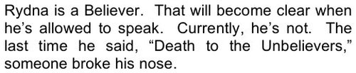
- **No single roster character (rules/setting/general)** — entry/section: Cheese: ""Welcome, friends. We were just in the process of extracting this creature's knowledge from his disloyal head. He's not been forthcoming. Any suggestions on how we might improve our technique? I was thinking..." She glances over her shoulder at the bound man. "I was thinking fingernails."" Source: *513 - EndTimes - The Heart* (SWRPG d20 Revised Core), p.12
  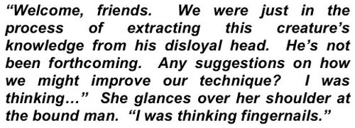

## p.13 (scan page 13)

Page contents: 778 words, 21 paragraphs | headings/entries: Death to the Unbelievers!; The Heart; Page 13

- **No single roster character (rules/setting/general)** — entry/section: Tunnel Rat: ""You think he'd stop someone torturing you? Look what we took off him." He holds up a silver tube. With a familiar snap-hiss, the lightsaber's teal blade ignites." Source: *513 - EndTimes - The Heart* (SWRPG d20 Revised Core), p.13
  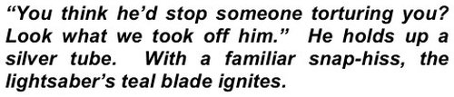
- **No single roster character (rules/setting/general)** — entry/section: Devan: "Jedi need not roll. They've only seen one teal-bladed lightsaber, and that saber was wielded by Master Devan, the lightsaber instructor who took over when Kirlocca was killed, and who died in the destruction of the Almas Academy." Source: *513 - EndTimes - The Heart* (SWRPG d20 Revised Core), p.13
  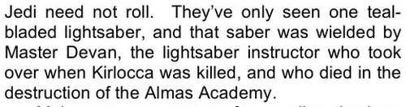
- **No single roster character (rules/setting/general)** — entry/section: Rydna: "Part of the reason is, Rydna wants to die. He believes he's lost already. The Believers are mostly wiped out. And Alina Impeveri doesn't like him." Source: *513 - EndTimes - The Heart* (SWRPG d20 Revised Core), p.13
  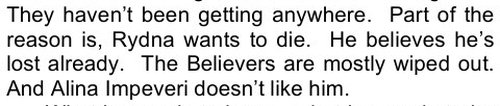
- **No single roster character (rules/setting/general)** — entry/section: Rydna: "What he needs to hear — what he needs to be made to BELIEVE — is that the Believers lost because it was the will of the Force, and that his life still has meaning." Source: *513 - EndTimes - The Heart* (SWRPG d20 Revised Core), p.13
  
- **No single roster character (rules/setting/general)** — entry/section: Rydna: "I took that saber from the Jedi witch's limp fingers." Source: *513 - EndTimes - The Heart* (SWRPG d20 Revised Core), p.13
  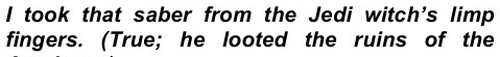
- **No single roster character (rules/setting/general)** — entry/section: Rydna: "Then she opened her eyes and looked at me. So I lit that stick and killed her myself!" Source: *513 - EndTimes - The Heart* (SWRPG d20 Revised Core), p.13
  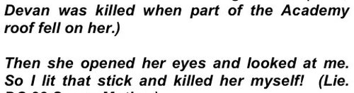
- **No single roster character (rules/setting/general)** — entry/section: Rydna: "We may not be many, but Alina said the boss is here." Source: *513 - EndTimes - The Heart* (SWRPG d20 Revised Core), p.13
  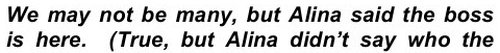
- **No single roster character (rules/setting/general)** — entry/section: Rydna: "You're all gonna die! Death to the Unbelievers! (Yeah, yeah. We know.)" Source: *513 - EndTimes - The Heart* (SWRPG d20 Revised Core), p.13
  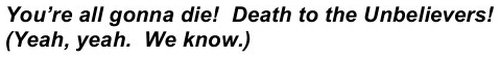
- **No single roster character (rules/setting/general)** — entry/section: Alina Impeveri: "If they're surprised she's with the Believers, well, what else is a dark side Force-using gal supposed to do these days?" Source: *513 - EndTimes - The Heart* (SWRPG d20 Revised Core), p.13
  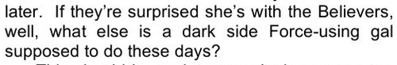

## p.14 (scan page 14)

Page contents: 789 words, 19 paragraphs | headings/entries: Encounter 6: Threat Level Two; Roll Result; The Heart; Page 14

- **No single roster character (rules/setting/general)** — entry/section: Cheese: "She's got a healthy respect for Jedi, having seen them in action over the past few years, and had always planned on turning over the saber to someone who could use it." Source: *513 - EndTimes - The Heart* (SWRPG d20 Revised Core), p.14
  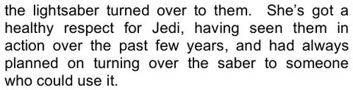
- **No single roster character (rules/setting/general)** — entry/section: Encounter 6: "The directions are simple: Whenever you have the opportunity, go down." Source: *513 - EndTimes - The Heart* (SWRPG d20 Revised Core), p.14
  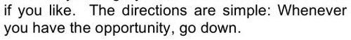
- **No single roster character (rules/setting/general)** — entry/section: Encounter 6: "The air is heavy and stale, like the smoke from every surface cantina drifted down here to die for the past decade." Source: *513 - EndTimes - The Heart* (SWRPG d20 Revised Core), p.14
  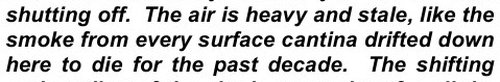
- **No single roster character (rules/setting/general)** — entry/section: Encounter 6: ""DEATH TO THE UNBELIEVERS!" has been painted on the wall of the tunnel in a very crude hand. (For fun, go ahead and roll another d20. If it comes up 5 or less, "Unbelievers" has been misspelled.)" Source: *513 - EndTimes - The Heart* (SWRPG d20 Revised Core), p.14
  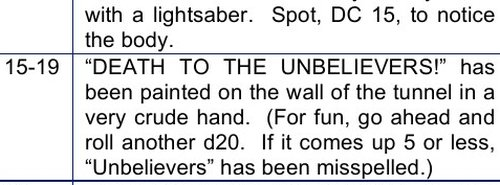

## p.15 (scan page 15)

Page contents: 868 words, 13 paragraphs | headings/entries: Encounter 7: Threat Level One; The Heart; Page 15

## p.10–15 (scan page 10)

Page contents: E4 mob on Tolea Biqua; E5 Tunnel Rats and Rydna; E6 tunnel table (hand-read)

## p.16 (scan page 16)

Page contents: 820 words, 17 paragraphs | headings/entries: Notes on Tactics; Captives; The Heart; Page 16

- **No single roster character (rules/setting/general)** — entry/section: Thek: "Thek is huge, even for a Feeorin. Over 2.5 meters tall, he has dead-black skin and bright red eyes." Source: *513 - EndTimes - The Heart* (SWRPG d20 Revised Core), p.16
  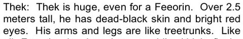
- **No single roster character (rules/setting/general)** — entry/section: Thek: "You reap what you sow when you break the big meanie's toy." Source: *513 - EndTimes - The Heart* (SWRPG d20 Revised Core), p.16
  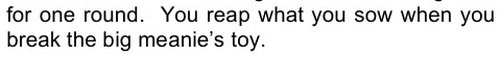
- **No single roster character (rules/setting/general)** — entry/section: Rolf: "Rolf thinks of himself as a lover, not a fighter." Source: *513 - EndTimes - The Heart* (SWRPG d20 Revised Core), p.16
  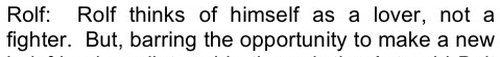
- **No single roster character (rules/setting/general)** — entry/section: Ov and Squick: "Both of them wanted to be Jedi — but neither is more Force sensitive than your average rock." Source: *513 - EndTimes - The Heart* (SWRPG d20 Revised Core), p.16
  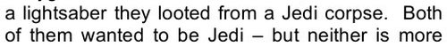
- **No single roster character (rules/setting/general)** — entry/section: Alina Impeveri: "Alina: Ah, sweet Alina. Her tactics can be summed in one word: Illusion." Source: *513 - EndTimes - The Heart* (SWRPG d20 Revised Core), p.16
  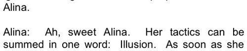
- **No single roster character (rules/setting/general)** — entry/section: Alina Impeveri: ""I hope you took your pills this morning"" Source: *513 - EndTimes - The Heart* (SWRPG d20 Revised Core), p.16
  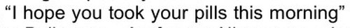
- **No single roster character (rules/setting/general)** — entry/section: Alina Impeveri: "As far as Alina goes, she's not all that committed to the Believer organization, but as a Force user, she knew she could rise pretty high with all the wannabe's." Source: *513 - EndTimes - The Heart* (SWRPG d20 Revised Core), p.16
  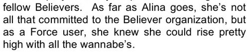
- **No single roster character (rules/setting/general)** — entry/section: Captives: "3. Their Master is Len Markus, Nirama's former right-hand man, and the tool of the Sith is described as a black rod, about a meter long," Source: *513 - EndTimes - The Heart* (SWRPG d20 Revised Core), p.16
  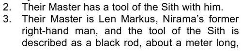

## p.17 (scan page 17)

Page contents: 625 words, 29 paragraphs | headings/entries: Conclusion; Here Ends, "The Heart"; Experience Point Summary; Experience is calculated as follows for LIVING; Adventure Experience Award:; Adventure Experience: Roleplaying Experience:; Total Possible Experience: 2.250 xp; Loot Summary; The Heart; Page 17

- **No single roster character (rules/setting/general)** — entry/section: Captives: "4. Their Master ordered them to destroy the individuals attending the summit. He was particularly concerned that they kill Mother Dariana." Source: *513 - EndTimes - The Heart* (SWRPG d20 Revised Core), p.17
  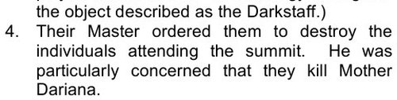
- **No single roster character (rules/setting/general)** — entry/section: Captives: "In short, the Believers have finally run out of belief." Source: *513 - EndTimes - The Heart* (SWRPG d20 Revised Core), p.17
  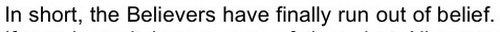
- **No single roster character (rules/setting/general)** — entry/section: Captives: "The Master is powerful, but they know he isn't really Sith. If the Sith had come to Cularin and helped fight the Jedi, it really would have been death to the unbelievers." Source: *513 - EndTimes - The Heart* (SWRPG d20 Revised Core), p.17
  
- **No single roster character (rules/setting/general)** — entry/section: Thek: "Thek, if he lived through the combat, begs for mercy in his own way: He asks the heroes to kill him. He has failed in his duty, and wishes to die." Source: *513 - EndTimes - The Heart* (SWRPG d20 Revised Core), p.17
  
- **No single roster character (rules/setting/general)** — entry/section: Captives: "Trust us. It's fun." Source: *513 - EndTimes - The Heart* (SWRPG d20 Revised Core), p.17
  
- **No single roster character (rules/setting/general)** — entry/section: Conclusion: "Based on your intel, Bresch again moved the summit. In this new "undisclosed location," it went off without a hitch, and the dignitaries have all returned to their respective homes and businesses. What will come of the summit remains to be seen..." Source: *513 - EndTimes - The Heart* (SWRPG d20 Revised Core), p.17
  

## p.18 (scan page 18)

Page contents: 374 words, 10 paragraphs | headings/entries: The Heart; Page 18

- **No single roster character (rules/setting/general)** — entry/section: Devan's Lightsaber: "Devan's Lightsaber (cert)(one per table) — This lightsaber was constructed and wielded by Master Devan, late of the Almas Academy. It has a bright teal blade, and functions as a +2 mastercraft lightsaber." Source: *513 - EndTimes - The Heart* (SWRPG d20 Revised Core), p.18
  
- **No single roster character (rules/setting/general)** — entry/section: Hand-Painted Sabacc Deck: "You once saw a deck like this on display on Riboga's Barge, but that's been some time ago..." Source: *513 - EndTimes - The Heart* (SWRPG d20 Revised Core), p.18
  

## p.15–18 (scan page 15)

Page contents: E7 Believer stronghold fight with Alina Impeveri; captives; conclusion, XP, loot (hand-read)

## p.19 (scan page 19)

Page contents: 123 words, 9 paragraphs | headings/entries: The Heart Page 19

## p.20 (scan page 20)

Page contents: 599 words, 23 paragraphs | headings/entries: GM Aid #1: Combat Statistics; Encounter 3: In the Jungle; The Heart Page 20

## p.21 (scan page 21)

Page contents: 625 words, 21 paragraphs | headings/entries: Encounter 7: Threat Level One Second Tier:; The Heart Page 21

### Stat block notes (game mechanics, not feats)

- Alina Impeveri: Alina Impeveri: Female Human Noble 4/Force Adept 9; Def 18; VP/WP 44/12 (max 74; 74/12 in the top tier); Atk +10/+5 ranged (3d4, hold-out blaster); FP 6; DSP 4; Affect Mind +25, Illusion +25, Drain Energy +14, Fear +9 (Source: *513 - EndTimes - The Heart* (SWRPG d20 Revised Core), p.21)
- Executive VP Security Consultants: Executive VP Security Consultants (2): Fringer 6/Scoundrel 6; Def 20; VP/WP 84/14; Atk +11/+6 ranged (3d8 or DC 18 stun, heavy blaster pistol) (Source: *513 - EndTimes - The Heart* (SWRPG d20 Revised Core), p.21)

## p.22 (scan page 22)

Page contents: 648 words, 21 paragraphs | headings/entries: Third Tier:; The Heart Page 22

### Stat block notes (game mechanics, not feats)

- Ov and Squick: Squick and Ov: Trandoshan Soldiers 3; Defense 14; DR 2; VP/WP 31/14; Atk +8 melee (2d8+6, 19-20, lightsaber wielded two-handed); FP 2; DSP 1 (Source: *513 - EndTimes - The Heart* (SWRPG d20 Revised Core), p.22)

## p.23 (scan page 23)

Page contents: 639 words, 23 paragraphs | headings/entries: Fourth Tier:; The Heart Page 23

- **No single roster character (rules/setting/general)** — entry/section: Ov and Squick: "Yes, it's true. The guys with the lightsabers aren't even remotely the scariest things on the battlefield!" Source: *513 - EndTimes - The Heart* (SWRPG d20 Revised Core), p.23
  

## p.24 (scan page 24)

Page contents: 589 words, 18 paragraphs | headings/entries: The Heart Page 24

- **No single roster character (rules/setting/general)** — entry/section: Ov and Squick: "How long CAN a third-level soldier with a lightsaber stand up to a 12th-level Jedi Master? Email me if these guys make it past round 2!" Source: *513 - EndTimes - The Heart* (SWRPG d20 Revised Core), p.24
  

### Stat block notes (game mechanics, not feats)

- Thek: Thek (top tier): Feeorin Male Soldier 12; Defense 20; VP/WP 106/16; Atk +14/+9/+4/+14/+9 melee (2d6+4/2d6+4/2d6+4/2d6+2/2d6+2, +1 mastercraft double vibroblade); FP 2; DSP 4 (Source: *513 - EndTimes - The Heart* (SWRPG d20 Revised Core), p.24)

## p.25 (scan page 25)

Page contents: 103 words, 9 paragraphs | headings/entries: Random boxes, pile of trash Computer; Array; The Heart; Page 25

## p.19–25 (scan page 19)

Page contents: Handout, GM Aid #1 stats, GM Aid #2 map (hand-read)

