# Owner Material 037 — Star Wars D20 Drive folder (Core, Revised Core and Saga Edition): Living Force Campaign/Adventures/Among the Stars/Year 5/514 - EndTimes - The Hand.pdf [Star Wars Roleplaying Game Revised Core (d20, 2002)]

- **Source:** Wizards of the Coast Star Wars Roleplaying Game books, web enhancements, Living Force campaign modules and articles (2000–2010), from the owner's "Star Wars D20" Drive folder (only the three edition subfolders; "General" was not read, as instructed). Secondary source (licensed Legends reference). Scan OCR'd on the box; the scan stays box-only and is **not** published.
- **Method:** every scanned page was OCR'd and machine-screened sentence by sentence for power-relevant statements (fights, kills, defeats, Force feats, rankings, superweapons) that name a character on our roster; each kept sentence is quoted verbatim from the OCR text and has a crop of the printed passage directly under it. Pages with nothing power-relevant are still listed with what is on them.
- **Citation:** "*514 - EndTimes - The Hand* (SWRPG d20 Revised Core), p.X" by printed page ("scan p.X" where no printed number applies). **Weight:** Licensed RPG material: a secondary source. Narrative text sums up Legends lore; game statistics are rules for players, not canon power levels, and rank lowest.

## p.1 (scan page 1)

Page contents: 135 words, 6 paragraphs | headings/entries: LFA514; The Hand

## p.2 (scan page 2)

Page contents: 776 words, 21 paragraphs | headings/entries: House Rules; Atoning for Dark Side Points; Dissipate Energy; Illusion; Stun; Hero Earnings; Issuing Force and Dark Side Points; The Hand; Page 2

## p.3 (scan page 3)

Page contents: 800 words, 25 paragraphs | headings/entries: General Notes to the GM; GM Overview; The Hand; Page 3

- **No single roster character (rules/setting/general)** — entry/section: GM Overview: "Some time ago, events transpired that left the population of Cularin believing that one of their allies, the crimelord Nirama, had been killed. Nirama wasn't dead, a fact known to some heroes — but the return of certain other elements did force him to flee." Source: *514 - EndTimes - The Hand* (SWRPG d20 Revised Core), p.3
  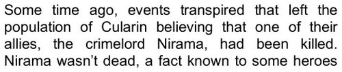
- **No single roster character (rules/setting/general)** — entry/section: Nirama: "For better or worse, he isn't the type to stay retired." Source: *514 - EndTimes - The Hand* (SWRPG d20 Revised Core), p.3
  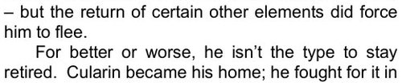

## p.4 (scan page 4)

Page contents: 782 words, 18 paragraphs | headings/entries: Encounter 1: Distress; Encounter 2: Transitions; Encounter 3: Intruders; Encounter 4: Dinky; Encounter 5: Broadcast; Encounter 6: Disposable Assets; The Hand; Page 4

- **No single roster character (rules/setting/general)** — entry/section: Nirama: "More than a few heroes died to bring back the Oblee, and Nirama could not in good conscience leave Cularin to its fate." Source: *514 - EndTimes - The Hand* (SWRPG d20 Revised Core), p.4
  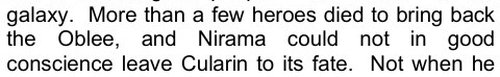
- **No single roster character (rules/setting/general)** — entry/section: Nirama: "He isn't sure he's going to make it out alive, but knows that he owes his adopted home his life, if necessary." Source: *514 - EndTimes - The Hand* (SWRPG d20 Revised Core), p.4
  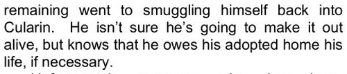

## p.5 (scan page 5)

Page contents: 745 words, 19 paragraphs | headings/entries: Opening Crawl; Encounter 1: Distress; The Hand; Page 5

- **No single roster character (rules/setting/general)** — entry/section: Nirama: "Important Note to Judges: We're not sure if anyone is really "neutral" about Nirama. He's pretty much love-him or hate-him. You need to leverage this." Source: *514 - EndTimes - The Hand* (SWRPG d20 Revised Core), p.5
  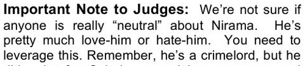
- **No single roster character (rules/setting/general)** — entry/section: GM note: "This may be a draining module, in a number of respects; there are a lot of potential combats, but this is also the end for yet another of Cularin's prominent personages." Source: *514 - EndTimes - The Hand* (SWRPG d20 Revised Core), p.5
  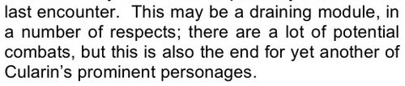
- **No single roster character (rules/setting/general)** — entry/section: Opening Crawl: "It is a time of strife in Cularin. Dark forces are on the move." Source: *514 - EndTimes - The Hand* (SWRPG d20 Revised Core), p.5
  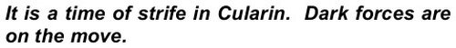
- **No single roster character (rules/setting/general)** — entry/section: Opening Crawl: "Rumor has their leader in the system, though — Len Markus, an individual with whom the heroes are all too familiar. What exactly he has planned remains to be seen..." Source: *514 - EndTimes - The Hand* (SWRPG d20 Revised Core), p.5
  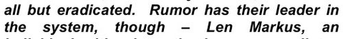
- **No single roster character (rules/setting/general)** — entry/section: Encounter 1: "Ultimately, they were going to have to answer it, one way or another; if you don't go into the theater, after all, you can't see the movie." Source: *514 - EndTimes - The Hand* (SWRPG d20 Revised Core), p.5
  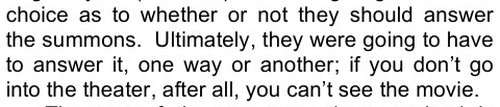
- **No single roster character (rules/setting/general)** — entry/section: Encounter 1: "The Groundport smells of grease, with a halting undertone of something burned. Nothing new there." Source: *514 - EndTimes - The Hand* (SWRPG d20 Revised Core), p.5
  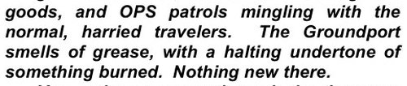
- **No single roster character (rules/setting/general)** — entry/section: Encounter 1: "The message the courier brought this morning shouldn't have existed. And yet, it did." Source: *514 - EndTimes - The Hand* (SWRPG d20 Revised Core), p.5
  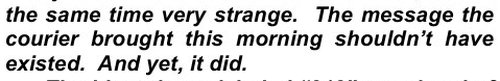
- **No single roster character (rules/setting/general)** — entry/section: Nirama: "Greetings. Recent events were necessarily exaggerated, for purposes of survival. I apologize for any undue concern my disappearance may have caused, but in matters of self-preservation I can only plead necessity." Source: *514 - EndTimes - The Hand* (SWRPG d20 Revised Core), p.5
  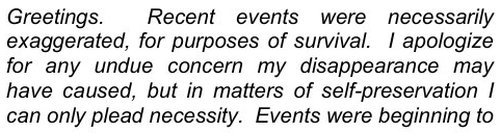

## p.1–5 (scan page 1)

Page contents: Title, house rules, GM notes, overview, encounter list, crawl (hand-read)

## p.6 (scan page 6)

Page contents: 828 words, 22 paragraphs | headings/entries: Come to me soon. ~N; The Hand; Page 6

- **No single roster character (rules/setting/general)** — entry/section: Nirama: "I knew Markus was returning with his 'darkstaff,' and knew that I must do my part to stop him from doing the will of that thing. It must be destroyed." Source: *514 - EndTimes - The Hand* (SWRPG d20 Revised Core), p.6
  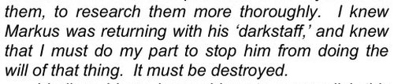
- **No single roster character (rules/setting/general)** — entry/section: Nirama: "The Hutt did not take my life, only my ability to function as effectively as I once did. I need your assistance for this, our most critical mission. If Markus is not stopped, I believe he may kill every living creature in Cularin. I cannot allow this." Source: *514 - EndTimes - The Hand* (SWRPG d20 Revised Core), p.6
  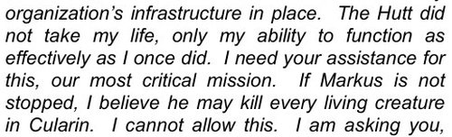
- **No single roster character (rules/setting/general)** — entry/section: Nirama: "Come to me soon. ~N" Source: *514 - EndTimes - The Hand* (SWRPG d20 Revised Core), p.6
  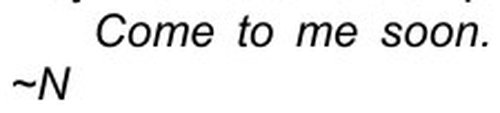
- **No single roster character (rules/setting/general)** — entry/section: Nirama: "Cularin depends on you." Source: *514 - EndTimes - The Hand* (SWRPG d20 Revised Core), p.6
  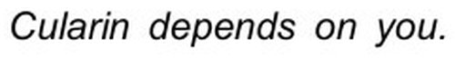
- **No single roster character (rules/setting/general)** — entry/section: Grug and Gurg: "Grug and Gurg, the Trandoshans, aren't exactly particle physicists. They're thugs who like to hurt people and blow things up, usually (but not necessarily) in that order." Source: *514 - EndTimes - The Hand* (SWRPG d20 Revised Core), p.6
  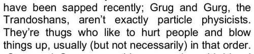
- **No single roster character (rules/setting/general)** — entry/section: Len Markus: "He holds a pretty mean grudge." Source: *514 - EndTimes - The Hand* (SWRPG d20 Revised Core), p.6
  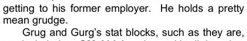
- **No single roster character (rules/setting/general)** — entry/section: Acan: "And Acan? He's dead. Someone tossed him a frag grenade, and he reflexively caught it." Source: *514 - EndTimes - The Hand* (SWRPG d20 Revised Core), p.6
  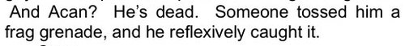
- **No single roster character (rules/setting/general)** — entry/section: Acan: "Oops." Source: *514 - EndTimes - The Hand* (SWRPG d20 Revised Core), p.6
  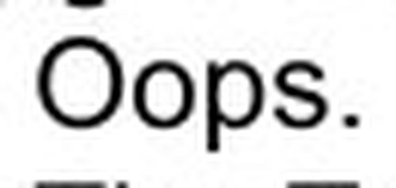
- **No single roster character (rules/setting/general)** — entry/section: Grug and Gurg: "The answer to (a) is "The pale man." That's all Grug and Gurg knew Markus as" Source: *514 - EndTimes - The Hand* (SWRPG d20 Revised Core), p.6
  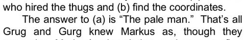
- **No single roster character (rules/setting/general)** — entry/section: Nirama: ""I have left the coordinates where you may find me on the ship."" Source: *514 - EndTimes - The Hand* (SWRPG d20 Revised Core), p.6
  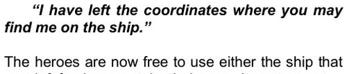

## p.7 (scan page 7)

Page contents: 790 words, 20 paragraphs | headings/entries: Encounter 2: Transitions; Spot; Survival; Computer Use; The Hand; Page 7

- **No single roster character (rules/setting/general)** — entry/section: Red Sector: "Now, the inside of the asteroid is as silent as its outside. It's a little eerie, and more than a touch disconcerting." Source: *514 - EndTimes - The Hand* (SWRPG d20 Revised Core), p.7
  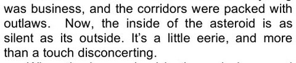
- **No single roster character (rules/setting/general)** — entry/section: Red Sector: "Whatever went down here in the end, it wasn't pretty." Source: *514 - EndTimes - The Hand* (SWRPG d20 Revised Core), p.7
  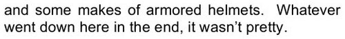
- **No single roster character (rules/setting/general)** — entry/section: Red Sector: "Everything is a little bit too perfect." Source: *514 - EndTimes - The Hand* (SWRPG d20 Revised Core), p.7
  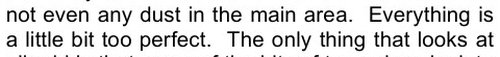

## p.8 (scan page 8)

Page contents: 800 words, 18 paragraphs | headings/entries: Search; Disable Device; Encounter 3: Intruders; The Hand; Page 8

- **No single roster character (rules/setting/general)** — entry/section: Nirama: ""Thank you for coming. I have powered down the internal communication system, to make it more difficult for scanners to detect our presence." Source: *514 - EndTimes - The Hand* (SWRPG d20 Revised Core), p.8
  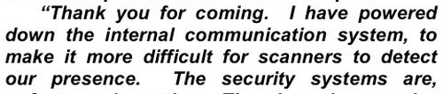
- **No single roster character (rules/setting/general)** — entry/section: Nirama: "I am on the lower level, in the security center. Come to me, and we will discuss Markus."" Source: *514 - EndTimes - The Hand* (SWRPG d20 Revised Core), p.8
  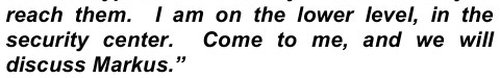
- **No single roster character (rules/setting/general)** — entry/section: Encounter 3: "If they make all the rolls on the first try, feel free to sigh and look frustrated and say, "You are so lucky" while shaking your head and flipping to the next encounter." Source: *514 - EndTimes - The Hand* (SWRPG d20 Revised Core), p.8
  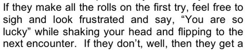

## p.5–8 (scan page 5)

Page contents: E1 Distress at hangar 318; E2 Transitions in the Red Sector bay (hand-read)

## p.9 (scan page 9)

Page contents: 826 words, 24 paragraphs | headings/entries: Tracking; Disable Device; The Hand; Page 9

- **No single roster character (rules/setting/general)** — entry/section: Encounter 3: "We want heroic action, not a bunch of players sitting on their hands because none of them have technical skills." Source: *514 - EndTimes - The Hand* (SWRPG d20 Revised Core), p.9
  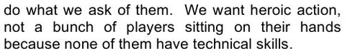
- **No single roster character (rules/setting/general)** — entry/section: Encounter 3: "It's completely intentional on our parts, since we wanted a sense of circularity in the finale scenarios." Source: *514 - EndTimes - The Hand* (SWRPG d20 Revised Core), p.9
  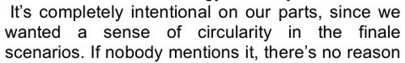

## p.10 (scan page 10)

Page contents: 816 words, 19 paragraphs | headings/entries: Blind Heroic Charging; Encounter 4: Dinky; The Hand; Page 10

- **No single roster character (rules/setting/general)** — entry/section: Blind Heroic Charging: "It's not exactly the "smart" or "sane" solution, but it's certainly cinematic, in a very red-shirted kind of way, at least." Source: *514 - EndTimes - The Hand* (SWRPG d20 Revised Core), p.10
  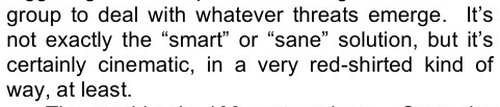
- **No single roster character (rules/setting/general)** — entry/section: Blind Heroic Charging: "Being knocked unconscious is bad, since at that point the hero pretty much falls down and does an impression of bacon in the microwave." Source: *514 - EndTimes - The Hand* (SWRPG d20 Revised Core), p.10
  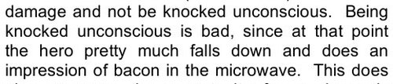
- **No single roster character (rules/setting/general)** — entry/section: Encounter 3: "So, there you have it. Two pages for an encounter that probably gets resolved with three skill checks for most parties. But then, they're heroes — they're supposed to be good at what they do, right?" Source: *514 - EndTimes - The Hand* (SWRPG d20 Revised Core), p.10
  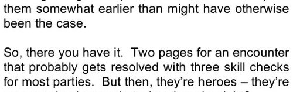

## p.11 (scan page 11)

Page contents: 817 words, 17 paragraphs | headings/entries: Encounter 5: Broadcast; Speakers set into the wall near ceiling-level; The Hand; Page 11

- **No single roster character (rules/setting/general)** — entry/section: Encounter 4: "(Just got tired of writing "Read the following;" sue me.)" Source: *514 - EndTimes - The Hand* (SWRPG d20 Revised Core), p.11
  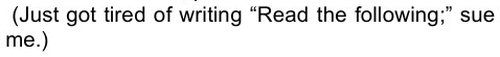
- **No single roster character (rules/setting/general)** — entry/section: Dinky: "You hear a grunt, and something moving around through the far doors. Then an enormous, wrinkled face emerges, snarling through razor-sharp teeth!" Source: *514 - EndTimes - The Hand* (SWRPG d20 Revised Core), p.11
  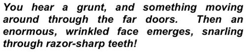
- **No single roster character (rules/setting/general)** — entry/section: Dinky: "Dinky had to eat his son three weeks ago; he's not particularly sentimental (he's a RANCOR), but at this point, there's not a whole lot left to eat, and the heroes seem both warm and chewy." Source: *514 - EndTimes - The Hand* (SWRPG d20 Revised Core), p.11
  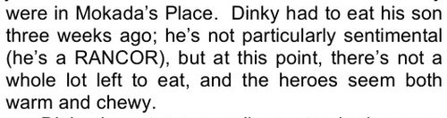
- **No single roster character (rules/setting/general)** — entry/section: Dinky: "He's very straightforward, this rancor of ours. He's hungry, and these moving things smell like food." Source: *514 - EndTimes - The Hand* (SWRPG d20 Revised Core), p.11
  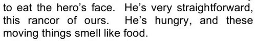

## p.12 (scan page 12)

Page contents: 872 words, 15 paragraphs | headings/entries: Encounter 6: Disposable Assets; The Hand; Page 12

- **No single roster character (rules/setting/general)** — entry/section: Nirama: ""— do not know how long blast doors will hold —" More crackling. "— to destroy the darkstaff, you must —" Still more crackling, followed by an explosion. "— tresim volat —"" Source: *514 - EndTimes - The Hand* (SWRPG d20 Revised Core), p.12
  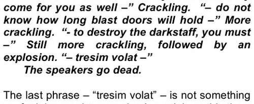
- **No single roster character (rules/setting/general)** — entry/section: Encounter 5: "It might be a name, it might be a warning, or it might be the sound of Nirama gargling. No way to know." Source: *514 - EndTimes - The Hand* (SWRPG d20 Revised Core), p.12
  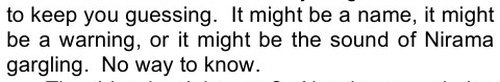
- **No single roster character (rules/setting/general)** — entry/section: Encounter 5: "Which means, in the grand tradition of Star Wars, it's time for a running fight." Source: *514 - EndTimes - The Hand* (SWRPG d20 Revised Core), p.12
  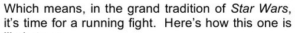
- **No single roster character (rules/setting/general)** — entry/section: Encounter 5: "It's the sacrifice that saves Nirama, in the end. We're big believers in parity." Source: *514 - EndTimes - The Hand* (SWRPG d20 Revised Core), p.12
  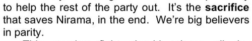

## p.13 (scan page 13)

Page contents: 831 words, 19 paragraphs | headings/entries: One near you_ speaks. relinquish your weapons."; Encounter 7: Endings; The Hand; Page 13

- **No single roster character (rules/setting/general)** — entry/section: Battle droid: "As you step into the room, you're greeted by the sight of what must be sixty or seventy battle droids, fully armed. Every head turns toward you, then every droid rises in unison and turns..." Source: *514 - EndTimes - The Hand* (SWRPG d20 Revised Core), p.13
  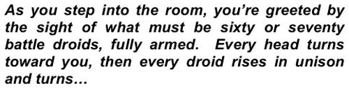
- **No single roster character (rules/setting/general)** — entry/section: Battle droid: "A mad, heroic dash is fine. A dash that is consciously informed by the fact that it's very hard for a fourth-level thug to hit a Jedi Master is not." Source: *514 - EndTimes - The Hand* (SWRPG d20 Revised Core), p.13
  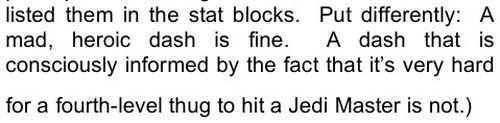
- **No single roster character (rules/setting/general)** — entry/section: Len Markus: "Gaunt and white-haired, with eyes as cold and pale as distant stars, the man whose pursuit of the darkstaff took Cularin out of the galaxy for almost ten years stares out at you." Source: *514 - EndTimes - The Hand* (SWRPG d20 Revised Core), p.13
  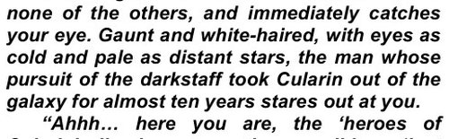
- **No single roster character (rules/setting/general)** — entry/section: Len Markus: ""Ahhh... here you are, the 'heroes of Cularin'. I've been expecting you. I'd say 'just in the nick of time, as usual', but it would seem that this time you're a little too late. Come to save LORD Nirama and stop me, have you? Such charming, if misguided, optimism. Nirama is, as you see, already my guest."" Source: *514 - EndTimes - The Hand* (SWRPG d20 Revised Core), p.13
  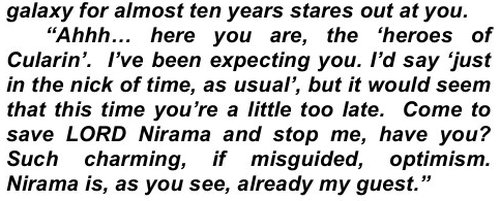

## p.8–13 (scan page 8)

Page contents: E3 security corridor; E4 Dinky the rancor; E5 broadcast and running fight; E6 droid lockdown (hand-read)

## p.14 (scan page 14)

Page contents: 840 words, 14 paragraphs | headings/entries: The Hand; Page 14

- **No single roster character (rules/setting/general)** — entry/section: Len Markus: ""Greet our guests, Nirama," Markus grates" Source: *514 - EndTimes - The Hand* (SWRPG d20 Revised Core), p.14
  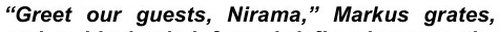
- **No single roster character (rules/setting/general)** — entry/section: Len Markus: "You're reduced to hiding in asteroids, cringing in fear and calling on Cularin's so-called heroes for help. You can't stop me from having you executed before the eyes of your lackeys, as you once executed my Cell members. You can't do anything at all." Source: *514 - EndTimes - The Hand* (SWRPG d20 Revised Core), p.14
  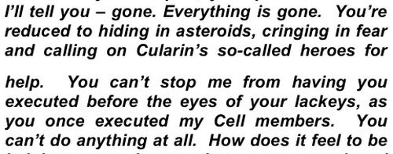
- **No single roster character (rules/setting/general)** — entry/section: Len Markus: "Yeah, Len has pretty much lost it." Source: *514 - EndTimes - The Hand* (SWRPG d20 Revised Core), p.14
  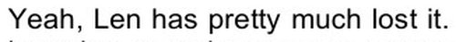
- **No single roster character (rules/setting/general)** — entry/section: Darkstaff: "The darkstaff wants him to be heard. It wants everyone to know exactly how mad he's become" Source: *514 - EndTimes - The Hand* (SWRPG d20 Revised Core), p.14
  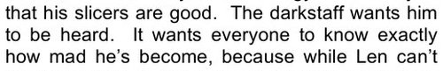
- **No single roster character (rules/setting/general)** — entry/section: Len Markus: ""As for you pathetic would-be heroes — you can't stop me. I suppose you'll try — your sort always does — but if you're smart, you'll get out of Cularin. Fast. Don't stop for your belongings, or even your loved ones. If you go now, you might be able to escape with your worthless lives."" Source: *514 - EndTimes - The Hand* (SWRPG d20 Revised Core), p.14
  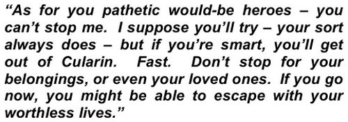
- **No single roster character (rules/setting/general)** — entry/section: Len Markus: ""Tick tock, heroes. Your time is up. Consider yourselves privileged to view the disposal of this pitiful thing that once had the ambition of power. Nirama — crimelord no longer. Just meat."" Source: *514 - EndTimes - The Hand* (SWRPG d20 Revised Core), p.14
  
- **No single roster character (rules/setting/general)** — entry/section: Executioner: ""Anything you wanna say, LORD Nirama?"" Source: *514 - EndTimes - The Hand* (SWRPG d20 Revised Core), p.14
  

## p.15 (scan page 15)

Page contents: 862 words, 20 paragraphs | headings/entries: The Hand; Page 15

- **No single roster character (rules/setting/general)** — entry/section: Nirama: "Then he shouts, "Cularin!" and lunges at the unseen individual holding the blaster." Source: *514 - EndTimes - The Hand* (SWRPG d20 Revised Core), p.15
  
- **No single roster character (rules/setting/general)** — entry/section: Nirama: "The symmetry should not be lost on anyone who played the event in question, nor is it lost on Len Markus, who laughs wickedly as the killing shot is delivered." Source: *514 - EndTimes - The Hand* (SWRPG d20 Revised Core), p.15
  
- **No single roster character (rules/setting/general)** — entry/section: Executioner: ""What are YOU doing here?"" Source: *514 - EndTimes - The Hand* (SWRPG d20 Revised Core), p.15
  
- **No single roster character (rules/setting/general)** — entry/section: Fallen hero: "There, amidst the scorch-marks and smoke, stands a shimmering, familiar figure." Source: *514 - EndTimes - The Hand* (SWRPG d20 Revised Core), p.15
  
- **No single roster character (rules/setting/general)** — entry/section: Nirama: "any Twi'lek should have recognized what he was saying: "I hold the answer in the palm of my hand." That, or, "I once vacationed on a mynock's patio." Somehow, stubby fingers don't capture the full flavor of the lekku language." Source: *514 - EndTimes - The Hand* (SWRPG d20 Revised Core), p.15
  

## p.16 (scan page 16)

Page contents: 636 words, 22 paragraphs | headings/entries: Conclusion; Here Ends, "The Hand"; Experience Point Summary; Experience is calculated as follows for LIVING; Loot Summary; The Hand; Page 16

- **No single roster character (rules/setting/general)** — entry/section: Nirama: "And he then died (or got blasted into a coma) to make sure that he would be able to deliver it, rather than being bundled onto a ship and taken away for further torture." Source: *514 - EndTimes - The Hand* (SWRPG d20 Revised Core), p.16
  
- **No single roster character (rules/setting/general)** — entry/section: Conclusion: "In the aftermath, Red Sector is completely silent. The security recorders in the ceiling have stopped pivoting, and as you stand, taking stock of your surroundings, the ventilation system wheezes and dies. Nirama lies in the middle of the floor, unmoving. And somewhere out in the Asteroid Belt, you are certain Len Markus must be gloating." Source: *514 - EndTimes - The Hand* (SWRPG d20 Revised Core), p.16
  

## p.17 (scan page 17)

Page contents: 78 words, 8 paragraphs | headings/entries: Encounter 2 3 datapads; Encounter 3 Blaster cannons (c'mon, get serious...); Encounter 5 Anything looted off the soldiers; Encounter 7; The Hand; Page 17

- **No single roster character (rules/setting/general)** — entry/section: Nirama's Message: "Nirama's Message: (cert)(one per hero) In what may have been a last, desperate act, Nirama encoded a clue as to how to destroy the darkstaff on a datachip." Source: *514 - EndTimes - The Hand* (SWRPG d20 Revised Core), p.17
  

## p.13–17 (scan page 13)

Page contents: E7 Markus's monologue and Nirama's death; the Message; conclusion, XP, loot (hand-read)

## p.18 (scan page 18)

Page contents: 230 words, 6 paragraphs | headings/entries: Player Handout 1: The Courier's Message; The Hand Page 18

## p.19 (scan page 19)

Page contents: 17 words, 4 paragraphs | headings/entries: Lower Level; Lie. oe ee; The Hand Page 19

## p.20 (scan page 20)

Page contents: 481 words, 19 paragraphs | headings/entries: GM Aid #1: Combat Statistics; The Hand Page 20

### Stat block notes (game mechanics, not feats)

- Dinky: Top Tier Dinky, the Rancor: Maddened Predator 8; Def 20; VP/WP 176/46; Atk +19 melee (2d6+9, 2 claws) or +19 melee (2d8+13, bite); SQ fast healing 2, terrifying presence; Str 28 (Source: *514 - EndTimes - The Hand* (SWRPG d20 Revised Core), p.20)
- Goon squad: Goon squad: Soldier 8; Def 19; DR 3; VP/WP 64/15; Atk +7/+7/+7/+2/-3 ranged (3d8/19-20, blaster rifle with Multishot and Rapid Shot) (Source: *514 - EndTimes - The Hand* (SWRPG d20 Revised Core), p.20)
- Grug and Gurg: Grug and Gurg: Trandoshan Thug 4; Def 12; VP/WP 0/15; Atk +7 melee (1d6+4, club) or +4 ranged (4d6+1, frag grenade) (Source: *514 - EndTimes - The Hand* (SWRPG d20 Revised Core), p.20)

## p.21 (scan page 21)

Page contents: 107 words, 6 paragraphs | headings/entries: Encounter 6 All Tiers; The Hand Page 21

## p.18–21 (scan page 18)

Page contents: Handouts and GM Aid #1 stats (hand-read)

