# Owner Material 037 — Star Wars D20 Drive folder (Core, Revised Core and Saga Edition): Living Force Campaign/Adventures/Among the Stars/Year 5/515 - EndTimes - The Eye.pdf [Star Wars Roleplaying Game Revised Core (d20, 2002)]

- **Source:** Wizards of the Coast Star Wars Roleplaying Game books, web enhancements, Living Force campaign modules and articles (2000–2010), from the owner's "Star Wars D20" Drive folder (only the three edition subfolders; "General" was not read, as instructed). Secondary source (licensed Legends reference). Scan OCR'd on the box; the scan stays box-only and is **not** published.
- **Method:** every scanned page was OCR'd and machine-screened sentence by sentence for power-relevant statements (fights, kills, defeats, Force feats, rankings, superweapons) that name a character on our roster; each kept sentence is quoted verbatim from the OCR text and has a crop of the printed passage directly under it. Pages with nothing power-relevant are still listed with what is on them.
- **Citation:** "*515 - EndTimes - The Eye* (SWRPG d20 Revised Core), p.X" by printed page ("scan p.X" where no printed number applies). **Weight:** Licensed RPG material: a secondary source. Narrative text sums up Legends lore; game statistics are rules for players, not canon power levels, and rank lowest.

## p.1 (scan page 1)

Page contents: 147 words, 6 paragraphs | headings/entries: LFA515; The Eye

## p.2 (scan page 2)

Page contents: 776 words, 21 paragraphs | headings/entries: House Rules; Atoning for Dark Side Points; Dissipate Energy; Illusion; Stun; Hero Earnings; Issuing Force and Dark Side Points; The Eye; Page 2

## p.3 (scan page 3)

Page contents: 809 words, 24 paragraphs | headings/entries: General Notes to the GM; GM Overview; The Eye; Page 3

- **No single roster character (rules/setting/general)** — entry/section: GM Overview: "If you're reading this, then you've either already played the scenario, or you're never going to. If it's the former, we hope that it lived up to your expectations. It's hard to write a module that's worthy of the spirit several thousand players have put into this campaign over the past five years, but we did our best." Source: *515 - EndTimes - The Eye* (SWRPG d20 Revised Core), p.3
  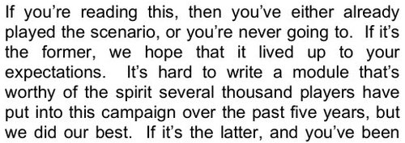

## p.4 (scan page 4)

Page contents: 972 words, 13 paragraphs | headings/entries: The Eye; Page 4

- **No single roster character (rules/setting/general)** — entry/section: GM Overview: "sorry; give yourself a Force point for making the heroic sacrifice!" Source: *515 - EndTimes - The Eye* (SWRPG d20 Revised Core), p.4
  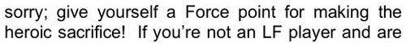
- **No single roster character (rules/setting/general)** — entry/section: GM Overview: "Besides, five years from now, nobody will remember who wrote any given module — but everybody remembers a great GM." Source: *515 - EndTimes - The Eye* (SWRPG d20 Revised Core), p.4
  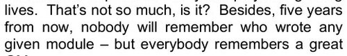
- **Darth Rivan** — entry/section: The darkstaff: "Forged ages ago by a Sith whose name has since been lost, the darkstaff was ancient when Darth Rivan came to Cularin. It has destroyed worlds, killed millions — and still, it wants." Source: *515 - EndTimes - The Eye* (SWRPG d20 Revised Core), p.4
  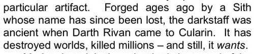
- **No single roster character (rules/setting/general)** — entry/section: Len Markus: "Markus has delusions that he is in control of the object. For the most part, he moves as if in a dream, doing what the thing wants him to do" Source: *515 - EndTimes - The Eye* (SWRPG d20 Revised Core), p.4
  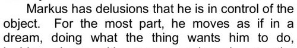
- **No single roster character (rules/setting/general)** — entry/section: The Eye of the Sun: "An artifact this powerful had to be kept in check by something for all those years it floated in the Asteroid Belt. In all things, after all, there must be balance." Source: *515 - EndTimes - The Eye* (SWRPG d20 Revised Core), p.4
  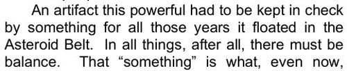
- **No single roster character (rules/setting/general)** — entry/section: The darkstaff: "Its nature is destruction. It is what the heroes have to stop. Their lives, and the lives of everyone they know and love, hang in the balance." Source: *515 - EndTimes - The Eye* (SWRPG d20 Revised Core), p.4
  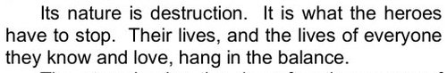
- **No single roster character (rules/setting/general)** — entry/section: GM Overview: "In many ways, this event takes the heroes back to the beginning. Our story began in the jungles of Cularin, and in those same jungles, it's going to end." Source: *515 - EndTimes - The Eye* (SWRPG d20 Revised Core), p.4
  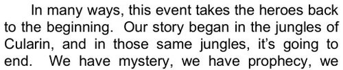
- **No single roster character (rules/setting/general)** — entry/section: GM Overview: "Even if they succeed in stopping Len Markus, somewhere out among the stars the Sith have named a new lord." Source: *515 - EndTimes - The Eye* (SWRPG d20 Revised Core), p.4
  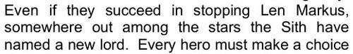

## p.5 (scan page 5)

Page contents: 868 words, 18 paragraphs | headings/entries: Encounter 1: Jax Warehouse; Encounter 2: The Eye of the Sun; Encounter 4: ...the Jungle; Encounter 6: ...wrong time

## p.1–5 (scan page 1)

Page contents: Title, house rules, GM notes, overview, encounter list, judges' note, crawl (hand-read)

## p.6 (scan page 6)

Page contents: 748 words, 20 paragraphs | headings/entries: Opening Crawl; Encounter 1: Jax Warehouse; The Eye; Page 6

- **No single roster character (rules/setting/general)** — entry/section: Judges' note: "there can be no more appropriate time to crank "Duel of the Fates" up to 11 than during the combat with Markus and his minions (you didn't think he'd be alone, did you?)." Source: *515 - EndTimes - The Eye* (SWRPG d20 Revised Core), p.6
  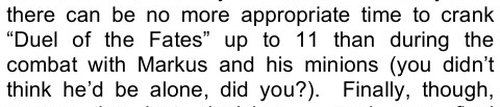
- **No single roster character (rules/setting/general)** — entry/section: Judges' note: "Nyub-nyub, my friends. Nyub. Nyub." Source: *515 - EndTimes - The Eye* (SWRPG d20 Revised Core), p.6
  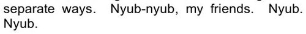
- **No single roster character (rules/setting/general)** — entry/section: Opening Crawl: "The smallest messages can hold the greatest meanings. As a shadow creeps across the face of Cularin, the system's heroes gather together once more." Source: *515 - EndTimes - The Eye* (SWRPG d20 Revised Core), p.6
  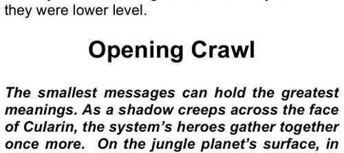
- **No single roster character (rules/setting/general)** — entry/section: Encounter 1: "Because, let's face it — if the heroes don't want to go after Len Markus now, they probably never will." Source: *515 - EndTimes - The Eye* (SWRPG d20 Revised Core), p.6
  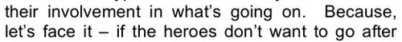
- **No single roster character (rules/setting/general)** — entry/section: Encounter 1: "Nobody here wants to see. Nobody here wants to be seen. Overhead hang Morasil and Termadus, much closer together than usual. As ever, they see it all." Source: *515 - EndTimes - The Eye* (SWRPG d20 Revised Core), p.6
  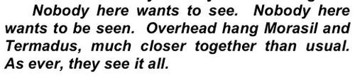

## p.7 (scan page 7)

Page contents: 809 words, 21 paragraphs | headings/entries: The Mural; Inside; The Eye; Page 7

- **No single roster character (rules/setting/general)** — entry/section: The Mural: "It hasn't changed. Literally. Not a bit." Source: *515 - EndTimes - The Eye* (SWRPG d20 Revised Core), p.7
  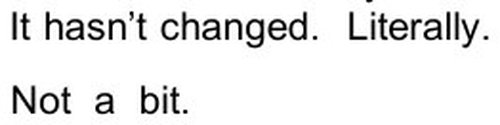
- **No single roster character (rules/setting/general)** — entry/section: Lora Nadad: ""Please, don't kill me, don't kill any of us, there's been too much death, please!"" Source: *515 - EndTimes - The Eye* (SWRPG d20 Revised Core), p.7
  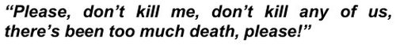

## p.8 (scan page 8)

Page contents: 845 words, 19 paragraphs | headings/entries: Encounter 2: The Eye of the Sun; The Eye; Page 8

- **No single roster character (rules/setting/general)** — entry/section: Ledis: ""Stand back!" She's holding the lightsaber backward; if she ignites it, she's going to impale herself." Source: *515 - EndTimes - The Eye* (SWRPG d20 Revised Core), p.8
  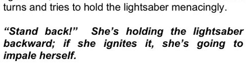
- **No single roster character (rules/setting/general)** — entry/section: Lora Nadad: "Lora hasn't gone over to the dark side. She has, however, given in to her fear, retreating into a very un-Jedi-like shell." Source: *515 - EndTimes - The Eye* (SWRPG d20 Revised Core), p.8
  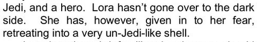
- **No single roster character (rules/setting/general)** — entry/section: Lora Nadad: ""It was horrible. All the burning, all the death. I couldn't do anything, all I could do was stand there and listen while the Academy crumbled! Was it the darkstaff that did it? You should be hiding. We should all be hiding. They'll come, they'll kill us all!" Source: *515 - EndTimes - The Eye* (SWRPG d20 Revised Core), p.8
  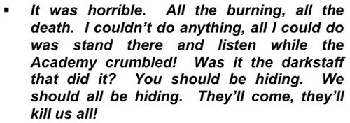
- **No single roster character (rules/setting/general)** — entry/section: Lora Nadad: "This is the nature of balance, but the battle of light and dark is one that can only be lost by one side. If the light should ever fade, if the suns of Cularin should cease to shine, then everything would be shadow. Don't you see? We can't ever win, but we can lose." Source: *515 - EndTimes - The Eye* (SWRPG d20 Revised Core), p.8
  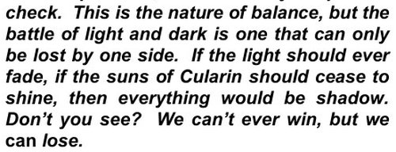
- **No single roster character (rules/setting/general)** — entry/section: Lora Nadad: "Minos used to say, "The Force is your ally. Call on its power and it will sustain you." He said it's in all of us. Master Lanius said it, too." Source: *515 - EndTimes - The Eye* (SWRPG d20 Revised Core), p.8
  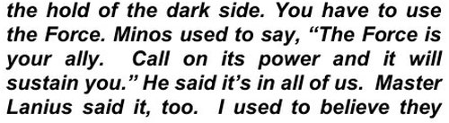
- **No single roster character (rules/setting/general)** — entry/section: Lora Nadad: ""Maybe there is hope. Klide said there was, he said he was going to find the truth in that mural." Source: *515 - EndTimes - The Eye* (SWRPG d20 Revised Core), p.8
  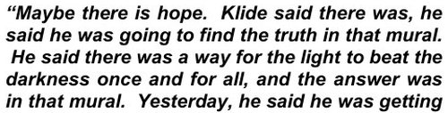
- **No single roster character (rules/setting/general)** — entry/section: Ledis: ""He said he got it. He said it this morning. He looked scared. Then he took his pack and left."" Source: *515 - EndTimes - The Eye* (SWRPG d20 Revised Core), p.8
  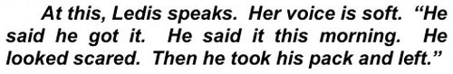

## p.9 (scan page 9)

Page contents: 864 words, 20 paragraphs | headings/entries: Um... yes, I'm Klide. Who are you?; The Eye; Page 9

- **No single roster character (rules/setting/general)** — entry/section: Len Markus: "Unfortunately for Klide, in the battle of "evil mastermind vs. academic researcher," the evil mastermind tends to have a slight advantage. It's that whole "evil" thing." Source: *515 - EndTimes - The Eye* (SWRPG d20 Revised Core), p.9
  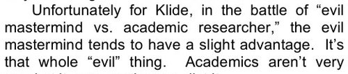
- **No single roster character (rules/setting/general)** — entry/section: Klide: "Um... yes, I'm Klide. Who are you?" Source: *515 - EndTimes - The Eye* (SWRPG d20 Revised Core), p.9
  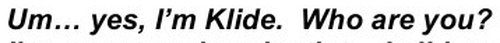
- **No single roster character (rules/setting/general)** — entry/section: Klide: "That mural has got to be a message of some kind. I've been working on deciphering it for most of my adult life." Source: *515 - EndTimes - The Eye* (SWRPG d20 Revised Core), p.9
  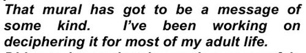
- **No single roster character (rules/setting/general)** — entry/section: Klide: "I'm pretty sure the Eye isn't supposed to be found." Source: *515 - EndTimes - The Eye* (SWRPG d20 Revised Core), p.9
  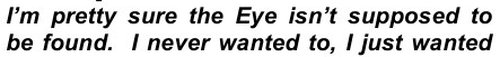

## p.10 (scan page 10)

Page contents: 856 words, 18 paragraphs | headings/entries: The Eye; Page 10

- **No single roster character (rules/setting/general)** — entry/section: Klide: "And the chart that is in that mural? It lines up in exactly that form just before sunset. Tonight. If you view the sky from the right spot on the planet." Source: *515 - EndTimes - The Eye* (SWRPG d20 Revised Core), p.10
  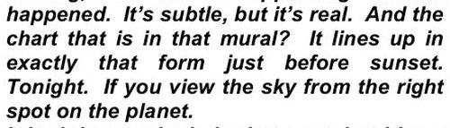
- **No single roster character (rules/setting/general)** — entry/section: Klide: ""If darkness finds the light, the shadow will engulf the planet and all will be destroyed."" Source: *515 - EndTimes - The Eye* (SWRPG d20 Revised Core), p.10
  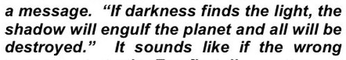
- **No single roster character (rules/setting/general)** — entry/section: Klide: "If something bad happens, somebody needs to be alive to write about it and explain it — right?" Source: *515 - EndTimes - The Eye* (SWRPG d20 Revised Core), p.10
  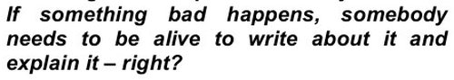
- **No single roster character (rules/setting/general)** — entry/section: The Eye of the Sun: "If he did, he would likely speculate that the Eye of the Sun must have given rise to the World Tree, and even now is nestled somewhere beneath the roots of the Heart Tree itself. Which, of course, is exactly the case." Source: *515 - EndTimes - The Eye* (SWRPG d20 Revised Core), p.10
  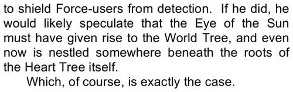
- **No single roster character (rules/setting/general)** — entry/section: Encounter 3: "There. We've said it. Let the stomping and shouting commence" Source: *515 - EndTimes - The Eye* (SWRPG d20 Revised Core), p.10
  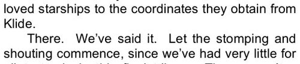

## p.6–10 (scan page 6)

Page contents: E1 Jax Warehouse and Lora Nadad; E2 Klide and the Eye of the Sun (hand-read)

## p.11 (scan page 11)

Page contents: 844 words, 18 paragraphs | headings/entries: The Eye; Page 11

- **No single roster character (rules/setting/general)** — entry/section: Len Markus: "Having dealt with the infamous "Sot-sirc" in the past to obtain information, Markus is uncertain whether Klide might actually be that rather notorious individual." Source: *515 - EndTimes - The Eye* (SWRPG d20 Revised Core), p.11
  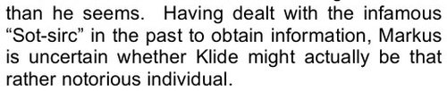
- **No single roster character (rules/setting/general)** — entry/section: Encounter 3: "Suddenly, two blaster bolts rip through the air on either side of your speeder!" Source: *515 - EndTimes - The Eye* (SWRPG d20 Revised Core), p.11
  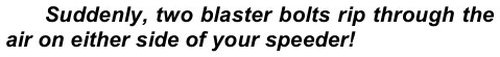
- **No single roster character (rules/setting/general)** — entry/section: Encounter 3: "Scare them, maybe crash them, but do try not to kill them yet. The darkstaff wants to suck their souls." Source: *515 - EndTimes - The Eye* (SWRPG d20 Revised Core), p.11
  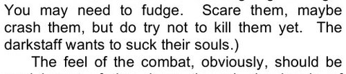
- **No single roster character (rules/setting/general)** — entry/section: Encounter 3: "This is the kind of fight where Force points can be come and go faster than dancing girls at Jabba's palace." Source: *515 - EndTimes - The Eye* (SWRPG d20 Revised Core), p.11
  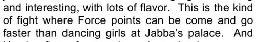

## p.12 (scan page 12)

Page contents: 790 words, 19 paragraphs | headings/entries: Encounter 4: ...the Jungle; The Eye; Page 12

- **No single roster character (rules/setting/general)** — entry/section: Encounter 4: "Something feels... odd. The air crackles like it does just after a lightning strike — or just before." Source: *515 - EndTimes - The Eye* (SWRPG d20 Revised Core), p.12
  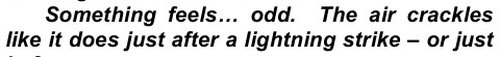
- **No single roster character (rules/setting/general)** — entry/section: Encounter 4: "Big-big brains, and more importantly big-big hearts, are much more critical in surviving the next three encounters." Source: *515 - EndTimes - The Eye* (SWRPG d20 Revised Core), p.12
  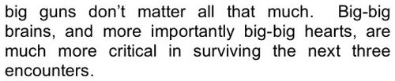
- **No single roster character (rules/setting/general)** — entry/section: Heart Tree vision: "A pale man stands at the base of the tree, a dead-black rod in his hand. On the ground before him lies a pulsing orb, its light so pure and white that it almost hurts you to look at it. Then he touches the rod to the orb and the light fades." Source: *515 - EndTimes - The Eye* (SWRPG d20 Revised Core), p.12
  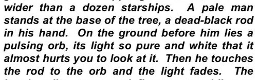
- **No single roster character (rules/setting/general)** — entry/section: Sithspawned mulissiki: "But you've never seen mulissiki with blood-red eyes, or green ichor dripping from twisted lips. And you've certainly never heard a mulissiki roar — but these are!" Source: *515 - EndTimes - The Eye* (SWRPG d20 Revised Core), p.12
  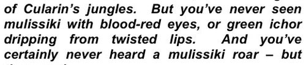

## p.13 (scan page 13)

Page contents: 848 words, 17 paragraphs | headings/entries: The Eye; Page 13

- **No single roster character (rules/setting/general)** — entry/section: Sithspawned mulissiki: "These smelly little dragon wanna-be's are pretty far outside anything the heroes have experienced on Cularin." Source: *515 - EndTimes - The Eye* (SWRPG d20 Revised Core), p.13
  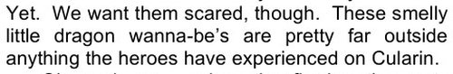
- **No single roster character (rules/setting/general)** — entry/section: San and Nia: "For all that, these mummified bodies look somehow... familiar." Source: *515 - EndTimes - The Eye* (SWRPG d20 Revised Core), p.13
  

## p.14 (scan page 14)

Page contents: 810 words, 18 paragraphs | headings/entries: Encounter 6: ...wrong time; The Eye; Page 14

- **No single roster character (rules/setting/general)** — entry/section: San and Nia: "everything from droid rights to the dangers of a Clone Army (they never did say, "We told you so")" Source: *515 - EndTimes - The Eye* (SWRPG d20 Revised Core), p.14
  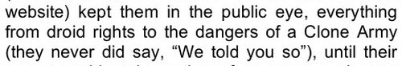
- **No single roster character (rules/setting/general)** — entry/section: Nia Reston: ""We are currently in pursuit — San, keep up! — of an individual we believe to be Len Markus. If he's back on Cularin, it can only be trouble." Source: *515 - EndTimes - The Eye* (SWRPG d20 Revised Core), p.14
  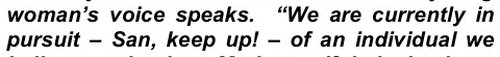
- **No single roster character (rules/setting/general)** — entry/section: Nia Reston: "It looks like it's just him, though, so we're going to catch him and contain him. We have to protect Cularin."" Source: *515 - EndTimes - The Eye* (SWRPG d20 Revised Core), p.14
  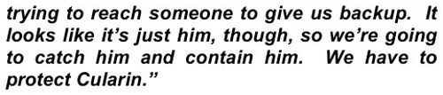
- **No single roster character (rules/setting/general)** — entry/section: San and Nia: "San and Nia were good kids. Idealistic to the point of wrong-headedness sometimes, but basically good all the same." Source: *515 - EndTimes - The Eye* (SWRPG d20 Revised Core), p.14
  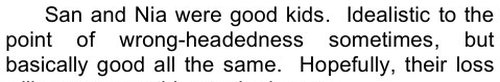
- **No single roster character (rules/setting/general)** — entry/section: Encounter 6: "But everything in LIVING FORCE has been building toward this climactic battle, deep within the jungles of Cularin, with the fate of the planet at stake." Source: *515 - EndTimes - The Eye* (SWRPG d20 Revised Core), p.14
  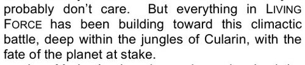

## p.10–14 (scan page 10)

Page contents: E3 speeder chase; E4 Sithspawned mulissiki; E5 San and Nia (hand-read)

## p.15 (scan page 15)

Page contents: 852 words, 18 paragraphs | headings/entries: The Box-Text; The Eye; Page 15

- **No single roster character (rules/setting/general)** — entry/section: Encounter 6: "Scratch that. We don't apologize." Source: *515 - EndTimes - The Eye* (SWRPG d20 Revised Core), p.15
  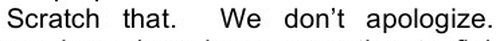
- **No single roster character (rules/setting/general)** — entry/section: Encounter 6: "We are well and truly into the time of the purge now, and Jedi — and those who associate with Jedi — are going to become much, much scarcer." Source: *515 - EndTimes - The Eye* (SWRPG d20 Revised Core), p.15
  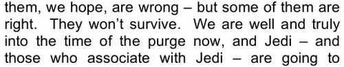
- **No single roster character (rules/setting/general)** — entry/section: Heart Tree: "For the first time since Reidi Artom came to Cularin, a single sun shines down on the Heart Tree." Source: *515 - EndTimes - The Eye* (SWRPG d20 Revised Core), p.15
  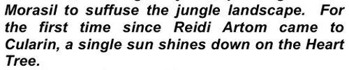
- **No single roster character (rules/setting/general)** — entry/section: Len Markus: ""Find it, you fools! Now! The time is now!"" Source: *515 - EndTimes - The Eye* (SWRPG d20 Revised Core), p.15
  

## p.16 (scan page 16)

Page contents: 824 words, 18 paragraphs | headings/entries: Options for Help; The Eye; Page 16

- **No single roster character (rules/setting/general)** — entry/section: Len Markus: ""Well, this was inevitable, wasn't it?"" Source: *515 - EndTimes - The Eye* (SWRPG d20 Revised Core), p.16
  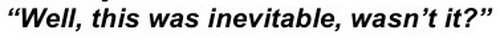
- **No single roster character (rules/setting/general)** — entry/section: Len Markus: ""So be it," he growls. "To me!"" Source: *515 - EndTimes - The Eye* (SWRPG d20 Revised Core), p.16
  
- **No single roster character (rules/setting/general)** — entry/section: Encounter 6: "PLAY TO THE STRENGTHS OF EACH HERO. This is meant to be their finest hour" Source: *515 - EndTimes - The Eye* (SWRPG d20 Revised Core), p.16
  
- **No single roster character (rules/setting/general)** — entry/section: Heart Tree: "Call it natural selection. The Heart Tree would." Source: *515 - EndTimes - The Eye* (SWRPG d20 Revised Core), p.16
  
- **No single roster character (rules/setting/general)** — entry/section: Heart Tree: "A familiar voice speaks in your mind. "Help comes."" Source: *515 - EndTimes - The Eye* (SWRPG d20 Revised Core), p.16
  
- **No single roster character (rules/setting/general)** — entry/section: King Kilassin: "All teeth and claws, the thing must be forty meters tall." Source: *515 - EndTimes - The Eye* (SWRPG d20 Revised Core), p.16
  

## p.17 (scan page 17)

Page contents: 911 words, 14 paragraphs | headings/entries: Len's Tactics; The Eye; Page 17

- **No single roster character (rules/setting/general)** — entry/section: King Kilassin: "Stop the tainted brothers from harming the small fleshy things. (It's a big lizard. Details are wasted on it.)" Source: *515 - EndTimes - The Eye* (SWRPG d20 Revised Core), p.17
  
- **No single roster character (rules/setting/general)** — entry/section: Len Markus: "("I was told this came from the corpse of a child; appropriate, that I should wield it against a child-like fool in his final hour!")" Source: *515 - EndTimes - The Eye* (SWRPG d20 Revised Core), p.17
  

## p.18 (scan page 18)

Page contents: 905 words, 14 paragraphs | headings/entries: Destroying the Darkstaff; The Eye; Page 18

- **No single roster character (rules/setting/general)** — entry/section: Len Markus: "It's not rational — seriously, who's NOT going to attack the Sith artifact first?" Source: *515 - EndTimes - The Eye* (SWRPG d20 Revised Core), p.18
  
- **No single roster character (rules/setting/general)** — entry/section: Len Markus: "Grand and heroic. That's the order of the day. And Len? Evil and twisted. And in the end, kind of pathetic." Source: *515 - EndTimes - The Eye* (SWRPG d20 Revised Core), p.18
  
- **No single roster character (rules/setting/general)** — entry/section: The darkstaff: "You call on the Force and feel your essence begin to drain away, into the black of the darkstaff. You feel... tired. The world arounds you starts to fade. The darkstaff is weakening — but so are you." Source: *515 - EndTimes - The Eye* (SWRPG d20 Revised Core), p.18
  

## p.19 (scan page 19)

Page contents: 799 words, 22 paragraphs | headings/entries: The Eye; Page 19

- **No single roster character (rules/setting/general)** — entry/section: Len Markus: "Len Markus staggers backward, the hand that held the darkstaff an empty mass of blackened flesh. He raises both hands to his head and wails. "No!"" Source: *515 - EndTimes - The Eye* (SWRPG d20 Revised Core), p.19
  
- **No single roster character (rules/setting/general)** — entry/section: Lanius Qel-Bertuk: "you hear Master Lanius's voice. "Use the Force."" Source: *515 - EndTimes - The Eye* (SWRPG d20 Revised Core), p.19
  
- **No single roster character (rules/setting/general)** — entry/section: Lanius Qel-Bertuk: "Then Master Lanius's voice comes once more. "Use the Force!"" Source: *515 - EndTimes - The Eye* (SWRPG d20 Revised Core), p.19
  

## p.20 (scan page 20)

Page contents: 779 words, 25 paragraphs | headings/entries: The Aftermath; The Eye; Page 20

- **No single roster character (rules/setting/general)** — entry/section: The darkstaff: "what destroys the darkstaff is compassion, love, and self-sacrifice." Source: *515 - EndTimes - The Eye* (SWRPG d20 Revised Core), p.20
  
- **Darth Vader (Anakin Skywalker)** — entry/section: GM FAQ: "Don't you think that self-sacrifice thing is a little predictable? Everyone knew Anakin was going to fall to the dark side and become Darth Vader, too. What's your point?" Source: *515 - EndTimes - The Eye* (SWRPG d20 Revised Core), p.20
  
- **No single roster character (rules/setting/general)** — entry/section: GM FAQ: "They can literally pry it from his cold, dead fingers." Source: *515 - EndTimes - The Eye* (SWRPG d20 Revised Core), p.20
  
- **No single roster character (rules/setting/general)** — entry/section: Len Markus: ""Can you see it? I can't find it... the Force is gone. Can you even comprehend? The FORCE is GONE!"" Source: *515 - EndTimes - The Eye* (SWRPG d20 Revised Core), p.20
  

## p.21 (scan page 21)

Page contents: 821 words, 17 paragraphs | headings/entries: Conclusion; The Eye; Page 21

- **No single roster character (rules/setting/general)** — entry/section: The Eye of the Sun: "Markus actually stepped on it, at one point — stepped on it, but never knew it was there." Source: *515 - EndTimes - The Eye* (SWRPG d20 Revised Core), p.21
  
- **No single roster character (rules/setting/general)** — entry/section: Conclusion: "As the saying goes, "When the monster's dead, the movie's over."" Source: *515 - EndTimes - The Eye* (SWRPG d20 Revised Core), p.21
  
- **No single roster character (rules/setting/general)** — entry/section: Conclusion: "There always had to be a celebration in the jungle at the end of the campaign. We don't even care that it was predictable." Source: *515 - EndTimes - The Eye* (SWRPG d20 Revised Core), p.21
  
- **No single roster character (rules/setting/general)** — entry/section: Lora Nadad: ""I'm still needed. Minos is leading a group of Jedi against the person who's said he's going to hunt down all the Jedi." Source: *515 - EndTimes - The Eye* (SWRPG d20 Revised Core), p.21
  
- **Darth Vader (Anakin Skywalker)** — entry/section: Conclusion: "The basic plan is to hunt down Darth Vader, and kill him. They know him only as Vader, based on the message that went out from the Jedi Temple on Coruscant, and do not know his true identity." Source: *515 - EndTimes - The Eye* (SWRPG d20 Revised Core), p.21
  
- **Darth Vader (Anakin Skywalker)** — entry/section: Conclusion: "The players have to know that this will fail. A hero who goes Vader-hunting isn't coming back." Source: *515 - EndTimes - The Eye* (SWRPG d20 Revised Core), p.21
  

## p.14–21 (scan page 14)

Page contents: E6 final battle with Len Markus and the darkstaff; FAQ; aftermath (hand-read)

## p.22 (scan page 22)

Page contents: 707 words, 23 paragraphs | headings/entries: Here Ends, "The Eye"; Experience Point Summary; Experience is calculated as follows for LIVING; The Eye; Page 22

- **No single roster character (rules/setting/general)** — entry/section: Mother Dariana: ""What happened here, today, was wonderful. But it changes a great deal. The destruction of the darkstaff will draw attention to Cularin. We must hide our young, hide as many of our Force-users as we can, and we must do it soon." Source: *515 - EndTimes - The Eye* (SWRPG d20 Revised Core), p.22
  
- **No single roster character (rules/setting/general)** — entry/section: Mother Dariana: "Be here at dawn, if you wish safe harbor."" Source: *515 - EndTimes - The Eye* (SWRPG d20 Revised Core), p.22
  
- **No single roster character (rules/setting/general)** — entry/section: Senator Wren: ""My friends," the lady senator says, her voice rising above the fading music, "today is a glorious day." Source: *515 - EndTimes - The Eye* (SWRPG d20 Revised Core), p.22
  
- **No single roster character (rules/setting/general)** — entry/section: Senator Wren: "A tool of the darkside exists no more!" Source: *515 - EndTimes - The Eye* (SWRPG d20 Revised Core), p.22
  

## p.23 (scan page 23)

Page contents: 573 words, 14 paragraphs | headings/entries: Loot Summary; The Eye; Page 23

- **No single roster character (rules/setting/general)** — entry/section: Noble Sacrifice: "For the love of their home and the protection of innocents, these individuals gave their lives. There can be no nobler sacrifice." Source: *515 - EndTimes - The Eye* (SWRPG d20 Revised Core), p.23
  
- **Darth Vader (Anakin Skywalker)** — entry/section: Hunting Vader: "Hunting Vader: The hero named above joined an expeditionary team led by Jedi Master Minos Fel'Kona to hunt down and kill Darth Vader. After the expeditionary team left Cularin, they were never heard from again. The fate of the hero remains unclear." Source: *515 - EndTimes - The Eye* (SWRPG d20 Revised Core), p.23
  
- **No single roster character (rules/setting/general)** — entry/section: A Hero of Cularin... Always: "the individual named on this cert will forever be remembered as a true Hero of Cularin." Source: *515 - EndTimes - The Eye* (SWRPG d20 Revised Core), p.23
  

## p.21–23 (scan page 21)

Page contents: Conclusion celebration and choices; XP; certificates (hand-read)

## p.24 (scan page 24)

Page contents: 441 words, 7 paragraphs | headings/entries: Begin Transcription:; The Eye Page 24

- **No single roster character (rules/setting/general)** — entry/section: Player Handout 1: "There is, in all things, balance." Source: *515 - EndTimes - The Eye* (SWRPG d20 Revised Core), p.24
  

## p.25 (scan page 25)

Page contents: 380 words, 8 paragraphs | headings/entries: The Eye Page 25

## p.26 (scan page 26)

Page contents: 385 words, 7 paragraphs | headings/entries: The Eye Page 26

- **No single roster character (rules/setting/general)** — entry/section: Player Handout 1: "The sphere looked back at them, one brilliant yellow eye — and then it blinked." Source: *515 - EndTimes - The Eye* (SWRPG d20 Revised Core), p.26
  
- **No single roster character (rules/setting/general)** — entry/section: Player Handout 1: "They spoke these things of the Eye... Later generations spoke of it not at all." Source: *515 - EndTimes - The Eye* (SWRPG d20 Revised Core), p.26
  

## p.27 (scan page 27)

Page contents: 110 words, 4 paragraphs | headings/entries: Player Handout 2: Message from Tilnes; The Eye Page 27

- **No single roster character (rules/setting/general)** — entry/section: Nerra Ziveri: "Seek out the darkness. Where the focus is found, look to the stone beneath for the missing piece of the picture. Through stone and star, find the darkness, and bring it to the light." Source: *515 - EndTimes - The Eye* (SWRPG d20 Revised Core), p.27
  

## p.28 (scan page 28)

Page contents: 552 words, 20 paragraphs | headings/entries: GM Aid #1: Combat Statistics; Encounter 3; Aratech 74-Z Military Speeder Bike; Encounter 4 Tier 1; The Eye Page 28

## p.29 (scan page 29)

Page contents: 674 words, 17 paragraphs | headings/entries: Tier 2; Tier 3; Encounter 5 All Tiers; The Eye Page 29

### Stat block notes (game mechanics, not feats)

- Sithspawned Mulissiki: Sithspawned Mulissiki (6) (Tier 3): Winged Scavenger 8; VP/WP 75/18; breath weapons 8d6 (Reflex DC 18 half) (Source: *515 - EndTimes - The Eye* (SWRPG d20 Revised Core), p.29)

## p.30 (scan page 30)

Page contents: 599 words, 20 paragraphs | headings/entries: Encounter 6 All tiers; The Eye Page 30

### Stat block notes (game mechanics, not feats)

- Len Markus: Len Markus: Dark side Human male Force Adept 3/Soldier 3/Dark Side Devotee 4/Dark Side Marauder 4/Scoundrel 2; Defense 24; VP/WP 125/14; Atk +17/+12/+7 melee (1d6+5/18-20, darkstaff); FP 4; DSP 9; Fear +25, Force Lightning +23, Force Grip +17; Wounding Bond (Source: *515 - EndTimes - The Eye* (SWRPG d20 Revised Core), p.30)

## p.31 (scan page 31)

Page contents: 657 words, 21 paragraphs | headings/entries: Tier 1; Tier 2; The Eye Page 31

## p.32 (scan page 32)

Page contents: 277 words, 10 paragraphs | headings/entries: Tier 3; The Eye Page 32

### Stat block notes (game mechanics, not feats)

- Kluuus: Kluuus (Tier 3): Gamorrean Male Soldier 12; Defense 20; VP/WP 106/22; Atk +18/+13/+8 melee (2d10+8/19-20, vibroaxe wielded two-handed) (Source: *515 - EndTimes - The Eye* (SWRPG d20 Revised Core), p.32)

## p.33 (scan page 33)

Page contents: 781 words, 11 paragraphs | headings/entries: GM Aid #2: The Darkstaff; The Eye Page 33

- **Darth Rivan** — entry/section: 515 - EndTimes - The Eye: "Darth Rivan, the Sith Lord who took up residence on Almas for some time and who built the Sith fortress that even now rises out of the desert, feared the darkstaff." Source: *515 - EndTimes - The Eye* (SWRPG d20 Revised Core), p.33
  
- **Darth Rivan** — entry/section: The darkstaff: "If everything were destroyed, what would be left for him to rule?" Source: *515 - EndTimes - The Eye* (SWRPG d20 Revised Core), p.33
  
- **No single roster character (rules/setting/general)** — entry/section: The darkstaff: "The darkstaff plays on greed and ambition. No one comes in contact with it accidentally." Source: *515 - EndTimes - The Eye* (SWRPG d20 Revised Core), p.33
  

### Stat block notes (game mechanics, not feats)

- The darkstaff: The darkstaff: immune to energy damage and all Force abilities; DR 40, 200 WP, break DC 80; Lifedrain 1d6+2 Con per round (Fort DC 20 half), +8 grapple (Source: *515 - EndTimes - The Eye* (SWRPG d20 Revised Core), p.33)

## p.34 (scan page 34)

Page contents: 210 words, 11 paragraphs | headings/entries: GM Aid #3: Animated Creature Template; The Eye Page 34

## p.24–34 (scan page 24)

Page contents: Handouts; GM Aids #1-#3 (hand-read)

