# Owner Material 037 — Star Wars D20 Drive folder (Core, Revised Core and Saga Edition): Living Force Campaign/Adventures/Law and Order/101 - Trade War - Consignment.pdf [Star Wars Roleplaying Game Revised Core (d20, 2002)]

- **Source:** Wizards of the Coast Star Wars Roleplaying Game books, web enhancements, Living Force campaign modules and articles (2000–2010), from the owner's "Star Wars D20" Drive folder (only the three edition subfolders; "General" was not read, as instructed). Secondary source (licensed Legends reference). Scan OCR'd on the box; the scan stays box-only and is **not** published.
- **Method:** every scanned page was OCR'd and machine-screened sentence by sentence for power-relevant statements (fights, kills, defeats, Force feats, rankings, superweapons) that name a character on our roster; each kept sentence is quoted verbatim from the OCR text and has a crop of the printed passage directly under it. Pages with nothing power-relevant are still listed with what is on them.
- **Citation:** "*101 - Trade War - Consignment* (SWRPG d20 Revised Core), p.X" by printed page ("scan p.X" where no printed number applies). **Weight:** Licensed RPG material: a secondary source. Narrative text sums up Legends lore; game statistics are rules for players, not canon power levels, and rank lowest.

## p.1 (scan page 1)

Page contents: 90 words, 6 paragraphs | headings/entries: Consignment; A One-Round Living Force Scenario

- **No single roster character (rules/setting/general)** — entry/section: Blurb: ""Wanted: Trustworthy individuals to arrange reception and transportation of cargo from starport to warehouse."" Source: *101 - Trade War - Consignment* (SWRPG d20 Revised Core), p.1
  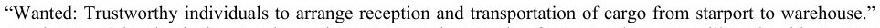
- **No single roster character (rules/setting/general)** — entry/section: Blurb: "A merchant explains that he is expecting an important consignment but for personal reasons will not be able to oversee its delivery himself. Can you help?" Source: *101 - Trade War - Consignment* (SWRPG d20 Revised Core), p.1
  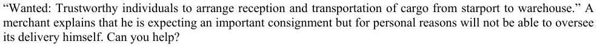

## p.2 (scan page 2)

Page contents: 871 words, 22 paragraphs | headings/entries: Consignment; Character Earnings; General Notes to the GM; GM Overview; Page 2

- **No single roster character (rules/setting/general)** — entry/section: General Notes to the GM: "keep in mind the Star Wars adventures should seem like the Star Wars movies." Source: *101 - Trade War - Consignment* (SWRPG d20 Revised Core), p.2
  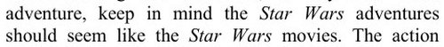
- **No single roster character (rules/setting/general)** — entry/section: GM Overview: "he is a) unprepared to deal with it himself and b) too mean to pay for proper security" Source: *101 - Trade War - Consignment* (SWRPG d20 Revised Core), p.2
  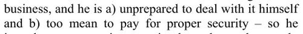
- **No single roster character (rules/setting/general)** — entry/section: GM Overview: "However, he appears nervous and the real story will come out if the characters choose to press him. Or so they think..." Source: *101 - Trade War - Consignment* (SWRPG d20 Revised Core), p.2
  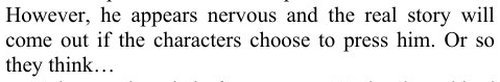
- **No single roster character (rules/setting/general)** — entry/section: GM Overview: "The merchant is in fact an actor. He has been hired by rivals of the concern he purports to represent with the aim of bringing trouble, lots of trouble, down on their heads. The characters are unwitting pawns in this plot." Source: *101 - Trade War - Consignment* (SWRPG d20 Revised Core), p.2
  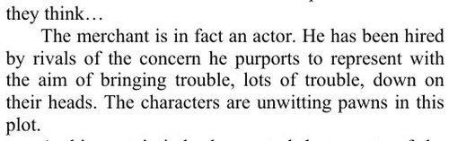

## p.3 (scan page 3)

Page contents: 861 words, 21 paragraphs | headings/entries: Encounter 1: All Very Simple; Encounter 2: Getting the Goods; Encounter 3: Take A Good Look; Consignment; Encounter 4: Ride Across Town; Encounter 5: Options; Encounter 6: Investigations and Recriminations; Encounter 7: Let's Make Amends; Page 3

- **No single roster character (rules/setting/general)** — entry/section: Frome Eubarus: "However, if he does not attend his daughter's school concert, both his wife and his daughter will make his life not worth living for the next few weeks. Surely the characters understand..." Source: *101 - Trade War - Consignment* (SWRPG d20 Revised Core), p.3
  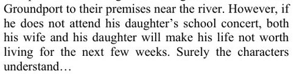
- **No single roster character (rules/setting/general)** — entry/section: GM Overview: "However, he does not get a chance to open it, this is just as well - the container is booby-trapped!" Source: *101 - Trade War - Consignment* (SWRPG d20 Revised Core), p.3
  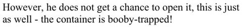
- **No single roster character (rules/setting/general)** — entry/section: GM Overview: "(or decide not to wait and attempt to sneak it out, but then, these guys are heroes, aren't they?)" Source: *101 - Trade War - Consignment* (SWRPG d20 Revised Core), p.3
  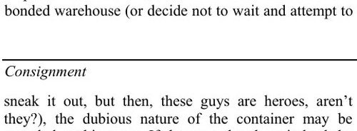
- **No single roster character (rules/setting/general)** — entry/section: GM Overview: "he has been on vacation on Genarius for the past two weeks (and is single without children anyway!)" Source: *101 - Trade War - Consignment* (SWRPG d20 Revised Core), p.3
  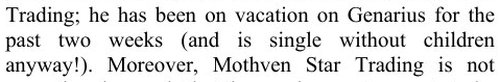

## p.4 (scan page 4)

Page contents: 791 words, 23 paragraphs | headings/entries: Opening Crawl; Encounter 1: All Very Simple; Consignment; Either way: -; Page 4

- **No single roster character (rules/setting/general)** — entry/section: Jarett Hurgen: "Jarett Hurgen, a well-known scoundrel, who will do just about anything if you pay him enough, but who is not particularly bright." Source: *101 - Trade War - Consignment* (SWRPG d20 Revised Core), p.4
  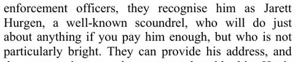
- **No single roster character (rules/setting/general)** — entry/section: Opening Crawl: "Whatever skills or employment you have, there are times when your expenditure exceeds your income, and you need to take on the odd job to make ends meet." Source: *101 - Trade War - Consignment* (SWRPG d20 Revised Core), p.4
  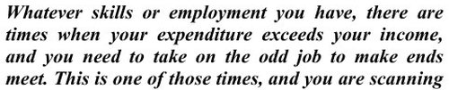
- **No single roster character (rules/setting/general)** — entry/section: Opening Crawl: "Along with several others, you hasten to apply..." Source: *101 - Trade War - Consignment* (SWRPG d20 Revised Core), p.4
  
- **No single roster character (rules/setting/general)** — entry/section: Frome Eubarus: "Frome Eubarus is a small man, dressed in neat but nondescript grey business clothing. He seems nervous and fidgets as he talks to you." Source: *101 - Trade War - Consignment* (SWRPG d20 Revised Core), p.4
  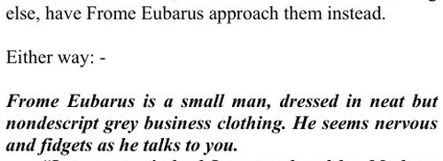
- **No single roster character (rules/setting/general)** — entry/section: Frome Eubarus: ""I represent, indeed I am employed by, Mothven Star Trading... we are importers, mostly of small, high value items. You name it; Mothven will obtain it for you — if it's legal, of course." Source: *101 - Trade War - Consignment* (SWRPG d20 Revised Core), p.4
  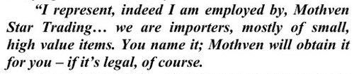
- **No single roster character (rules/setting/general)** — entry/section: Frome Eubarus: "if I do not attend, her mother will make my life a living hell for the next few weeks... and for that matter she's getting quite good at complaining about Daddy's shortcomings herself. I'm sure you understand... so if you could possibly?" Source: *101 - Trade War - Consignment* (SWRPG d20 Revised Core), p.4
  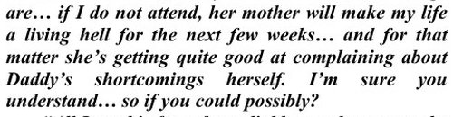
- **No single roster character (rules/setting/general)** — entry/section: Frome Eubarus: "Simple really, but it must be done tonight. I'll pay you — shall we say, 100 dataries apiece?"" Source: *101 - Trade War - Consignment* (SWRPG d20 Revised Core), p.4
  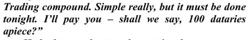
- **No single roster character (rules/setting/general)** — entry/section: Frome Eubarus: "Fidgeting in your chair while playing this character may reinforce this in the players' minds." Source: *101 - Trade War - Consignment* (SWRPG d20 Revised Core), p.4
  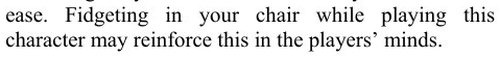

## p.1–4 (scan page 1)

Page contents: Title, RPGA notes, GM overview, encounter summaries, crawl (hand-read)

## p.5 (scan page 5)

Page contents: 787 words, 18 paragraphs | headings/entries: Consignment; Encounter 2: Getting the Goods; Page 5

- **No single roster character (rules/setting/general)** — entry/section: Frome Eubarus: ""Yes... you are quite right. There is a little more to the story... word has reached me that agents of a rival concern, erm, the, ah, Universal Importation Company, have laid plans to intercept the consignment... Er, perhaps if I offer you something extra, say an extra 50 dataries each?"" Source: *101 - Trade War - Consignment* (SWRPG d20 Revised Core), p.5
  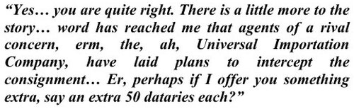
- **No single roster character (rules/setting/general)** — entry/section: Frome Eubarus: "Note that this is only the second layer of a complicated web of deceit." Source: *101 - Trade War - Consignment* (SWRPG d20 Revised Core), p.5
  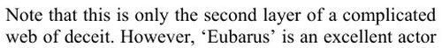
- **No single roster character (rules/setting/general)** — entry/section: Frome Eubarus: "This is unsurprising, as the company does not exist: Eubarus made it up on the spur of the moment." Source: *101 - Trade War - Consignment* (SWRPG d20 Revised Core), p.5
  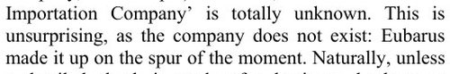
- **No single roster character (rules/setting/general)** — entry/section: Customs Receiving Area: "Note that normal belt knives, staves and lightsabres (provided that they remain unlit — but you can trust a Jedi to behave, can't you?) are excluded from the regulations." Source: *101 - Trade War - Consignment* (SWRPG d20 Revised Core), p.5
  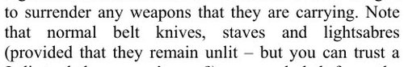
- **No single roster character (rules/setting/general)** — entry/section: Customs Receiving Area: "At this hour, most of the Customs Receiving Area is in darkness." Source: *101 - Trade War - Consignment* (SWRPG d20 Revised Core), p.5
  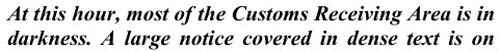

## p.6 (scan page 6)

Page contents: 881 words, 23 paragraphs | headings/entries: Feats: Dodge, Skill Emphasis: Knowledge; Consignment; Page 6

- **No single roster character (rules/setting/general)** — entry/section: Teelasin: "The Tarasin customs officer is called Teelasin, and she is a bit annoyed at being disturbed. She'd been hoping for a quiet night" Source: *101 - Trade War - Consignment* (SWRPG d20 Revised Core), p.6
  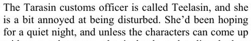
- **No single roster character (rules/setting/general)** — entry/section: Teelasin: "However, appeals to duty, bribes or repeated requests will work equally well to get her to come out although she'll continue to grumble all the while." Source: *101 - Trade War - Consignment* (SWRPG d20 Revised Core), p.6
  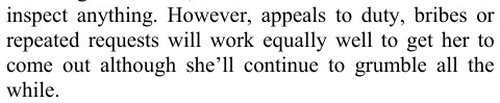
- **No single roster character (rules/setting/general)** — entry/section: Digby: "(and any use of Sense Motive or Empathy with a DC of 10 will pick up the waves of guilt and "They've caught me" emanating from him)" Source: *101 - Trade War - Consignment* (SWRPG d20 Revised Core), p.6
  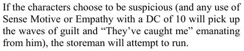
- **No single roster character (rules/setting/general)** — entry/section: Digby: "Digby would much rather get away than fight" Source: *101 - Trade War - Consignment* (SWRPG d20 Revised Core), p.6
  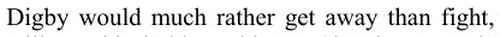

### Stat block notes (game mechanics, not feats)

- Teelasin: Teelasin, Tarasin Customs Officer (Administrator 4); Defence 11; VP/WP -/8; Knowledge (Romantic Stories) +10 (Source: *101 - Trade War - Consignment* (SWRPG d20 Revised Core), p.6)
- Digby: Digby, Human thief (Scoundrel 4); Defence 19; VP/WP 20/8; Atk +6 ranged (3d4 holdout blaster); Disable Device +12 (Source: *101 - Trade War - Consignment* (SWRPG d20 Revised Core), p.6)

## p.7 (scan page 7)

Page contents: 832 words, 19 paragraphs | headings/entries: Encounter 3: Take a Good Look; Here is a detailed external description: -; Consignment; Page 7

- **No single roster character (rules/setting/general)** — entry/section: Digby: "he is just light fingered and always on the lookout for a way to supplement his wages" Source: *101 - Trade War - Consignment* (SWRPG d20 Revised Core), p.7
  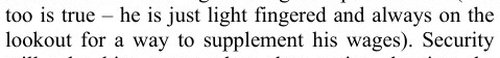
- **No single roster character (rules/setting/general)** — entry/section: Hedrett Groundport: "Petty theft is a commonplace event here." Source: *101 - Trade War - Consignment* (SWRPG d20 Revised Core), p.7
  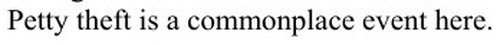
- **No single roster character (rules/setting/general)** — entry/section: Encounter 3: "Be careful: the thing is booby-trapped!" Source: *101 - Trade War - Consignment* (SWRPG d20 Revised Core), p.7
  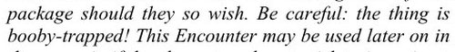
- **No single roster character (rules/setting/general)** — entry/section: Teelasin: "As Teelasin is anxious to get back to her romantic holovid, she gives the container a cursory glance, reads over the paperwork and stamps it" Source: *101 - Trade War - Consignment* (SWRPG d20 Revised Core), p.7
  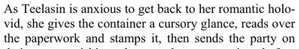
- **No single roster character (rules/setting/general)** — entry/section: The package: "an illegal drug called banthazolate that gives users +2 to Str and psychedelic hallucinations. The amount in the package has a street value of some 50,000 dataries." Source: *101 - Trade War - Consignment* (SWRPG d20 Revised Core), p.7
  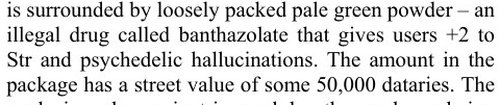

## p.4–7 (scan page 4)

Page contents: E1 Frome Eubarus; E2 customs, Teelasin and Digby; E3 the booby-trapped box (hand-read)

## p.8 (scan page 8)

Page contents: 811 words, 23 paragraphs | headings/entries: Encounter 4: Ride Across Town; Consignment; Encounter 5: Options; Page 8

- **No single roster character (rules/setting/general)** — entry/section: Encounter 4: "Should they have caused an explosion, well — that gives them a REAL reason to avoid the authorities, especially with all those drugs around!" Source: *101 - Trade War - Consignment* (SWRPG d20 Revised Core), p.8
  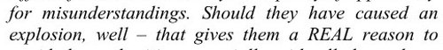
- **No single roster character (rules/setting/general)** — entry/section: Frome Eubarus: ""This is Eubarus. Have you got the consignment? Good — now listen carefully. I have just been advised that our enemies have disguised themselves as OPS officers and are going to try to 'arrest' you and obtain the package that way." Source: *101 - Trade War - Consignment* (SWRPG d20 Revised Core), p.8
  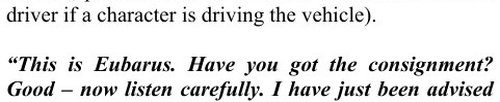
- **No single roster character (rules/setting/general)** — entry/section: Frome Eubarus: "So if you see anyone who appears to be a peace officer, avoid them; and if they attempt to stop you — well, you'll know that you have met the bad guys and had better make a run for it. Or fight them off, your option. Good luck..."" Source: *101 - Trade War - Consignment* (SWRPG d20 Revised Core), p.8
  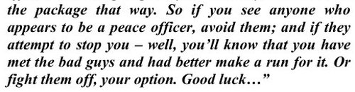
- **No single roster character (rules/setting/general)** — entry/section: OPS: "Three gleaming white OPS speeders converge on your position, lights flashing blue and purple and yellow." Source: *101 - Trade War - Consignment* (SWRPG d20 Revised Core), p.8
  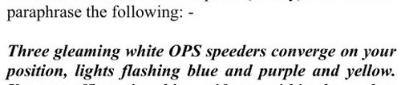
- **No single roster character (rules/setting/general)** — entry/section: OPS: "An amplified voice says, "Land your vehicle and get out with your hands in the air."" Source: *101 - Trade War - Consignment* (SWRPG d20 Revised Core), p.8
  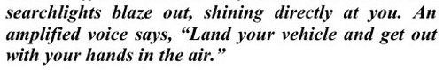
- **No single roster character (rules/setting/general)** — entry/section: OPS: "The OPS officers expect to be obeyed — this is Hedrett, after all, not one of the lawless platforms let alone one of the Genarius floating cities" Source: *101 - Trade War - Consignment* (SWRPG d20 Revised Core), p.8
  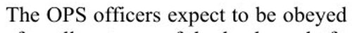

### Stat block notes (game mechanics, not feats)

- OPS Officer: OPS Officer (Scoundrel 2/Thug 1/Soldier 1): Defence 18; VP/WP 22/13; Atk +4 melee (1d6 stun baton), +5 (1d8 heavy blaster pistol); SQ Authority, Resources (Source: *101 - Trade War - Consignment* (SWRPG d20 Revised Core), p.8)

## p.9 (scan page 9)

Page contents: 789 words, 22 paragraphs | headings/entries: Encounter 6: Investigations and Recriminations; Consignment; Encounter 7: Let's Make Amends; Page 9

- **No single roster character (rules/setting/general)** — entry/section: Jak Dexter: "He will soon, unless the characters prove remarkably stupid, realise that they are NOT terrorists." Source: *101 - Trade War - Consignment* (SWRPG d20 Revised Core), p.9
  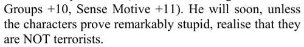
- **No single roster character (rules/setting/general)** — entry/section: OPS technician: "(She's good, and has plenty of time and facilities to investigate potential explosive devices with care.)" Source: *101 - Trade War - Consignment* (SWRPG d20 Revised Core), p.9
  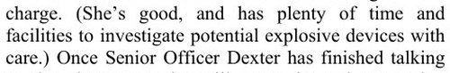
- **No single roster character (rules/setting/general)** — entry/section: Mothven Star Trading: "Questioning will then proceed as detailed above... but will probably be more hostile as the characters are now (or so it appears) responsible for an explosion in the central business district of Hedrett." Source: *101 - Trade War - Consignment* (SWRPG d20 Revised Core), p.9
  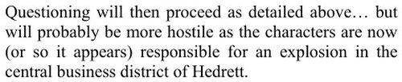
- **No single roster character (rules/setting/general)** — entry/section: Mirri Thebes: "being single, he left saying that he was looking forwards to a fortnight of gambling and female company. To prove once and for all that the 'Frome Eubarus' the party met was an imposter; the real one is a Twi'Lek like herself!" Source: *101 - Trade War - Consignment* (SWRPG d20 Revised Core), p.9
  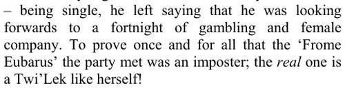
- **No single roster character (rules/setting/general)** — entry/section: Jarett Hurgen: "This individual is known as a talented actor who probably earns as much as a con man as he does treading the boards." Source: *101 - Trade War - Consignment* (SWRPG d20 Revised Core), p.9
  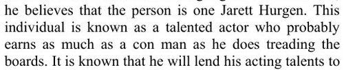
- **No single roster character (rules/setting/general)** — entry/section: Jak Dexter: "it isn't the sort of thing Hurgen would come up with on his own, there is no obvious profit to be made." Source: *101 - Trade War - Consignment* (SWRPG d20 Revised Core), p.9
  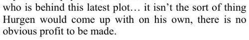

## p.10 (scan page 10)

Page contents: 767 words, 21 paragraphs | headings/entries: Conclusion; Consignment; Experience Point Summary; Adventure Experience Award:; Page 10

- **No single roster character (rules/setting/general)** — entry/section: Jak Dexter: "If anyone spots the obvious: 'Eubarus' never told them where he lived, Dexter looks slightly embarrassed and changes his proposal" Source: *101 - Trade War - Consignment* (SWRPG d20 Revised Core), p.10
  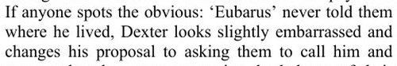
- **No single roster character (rules/setting/general)** — entry/section: Jarett Hurgen: "Hurgen is at home, enjoying a glass of wine and relaxing after his latest operation, and he is not a man of violence anyway." Source: *101 - Trade War - Consignment* (SWRPG d20 Revised Core), p.10
  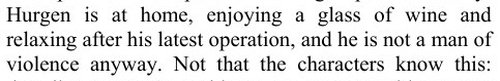
- **No single roster character (rules/setting/general)** — entry/section: Jarett Hurgen: "He never heard their names, didn't ask — "Had they wished me to know, they would have told me."" Source: *101 - Trade War - Consignment* (SWRPG d20 Revised Core), p.10
  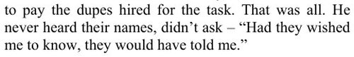
- **No single roster character (rules/setting/general)** — entry/section: Jarett Hurgen: "there are certain standards to be maintained and one of those relates to client confidentiality." Source: *101 - Trade War - Consignment* (SWRPG d20 Revised Core), p.10
  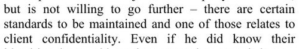
- **No single roster character (rules/setting/general)** — entry/section: Conclusion: "Some days later, the characters hear on the news that the actor Jarett Hurgen died in a tragic speeder accident. Foul play has not been ruled out." Source: *101 - Trade War - Consignment* (SWRPG d20 Revised Core), p.10
  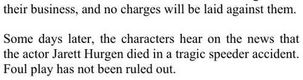

## p.8–10 (scan page 8)

Page contents: E4 chase; E5 OPS; E6 Mirri Thebes; E7 Jarett Hurgen; conclusion, XP (hand-read)

## p.11 (scan page 11)

Page contents: 178 words, 10 paragraphs | headings/entries: Loot Summary; Consignment; Page 11

## p.12 (scan page 12)

Page contents: 36 words, 9 paragraphs | headings/entries: Player Handout 1: The Job Advertisement; Apply:; Frome Eubarus ComCode # 109-4957-184; Consignment Page 12

- **No single roster character (rules/setting/general)** — entry/section: Player Handout 1: "Wanted: Trustworthy individuals to arrange reception and transportation of cargo from starport to warehouse. Good rate of pay." Source: *101 - Trade War - Consignment* (SWRPG d20 Revised Core), p.12
  

## p.13 (scan page 13)

Page contents: 0 words, 0 paragraphs | headings/entries: 

## p.14 (scan page 14)

Page contents: 123 words, 16 paragraphs | headings/entries: Critical Event Summary: Consignment; Yes; No; Convention Coordinator:; Or email to: [email removed]; Consignment; Page 14

## p.11–14 (scan page 11)

Page contents: Loot, handout, DM Aid (maps list), critical events (hand-read)

