# Owner Material 037 — Star Wars D20 Drive folder (Core, Revised Core and Saga Edition): Living Force Campaign/Adventures/Law and Order/102 - Trade War - Mix and Match.pdf [Star Wars Roleplaying Game Revised Core (d20, 2002)]

- **Source:** Wizards of the Coast Star Wars Roleplaying Game books, web enhancements, Living Force campaign modules and articles (2000–2010), from the owner's "Star Wars D20" Drive folder (only the three edition subfolders; "General" was not read, as instructed). Secondary source (licensed Legends reference). Scan OCR'd on the box; the scan stays box-only and is **not** published.
- **Method:** every scanned page was OCR'd and machine-screened sentence by sentence for power-relevant statements (fights, kills, defeats, Force feats, rankings, superweapons) that name a character on our roster; each kept sentence is quoted verbatim from the OCR text and has a crop of the printed passage directly under it. Pages with nothing power-relevant are still listed with what is on them.
- **Citation:** "*102 - Trade War - Mix and Match* (SWRPG d20 Revised Core), p.X" by printed page ("scan p.X" where no printed number applies). **Weight:** Licensed RPG material: a secondary source. Narrative text sums up Legends lore; game statistics are rules for players, not canon power levels, and rank lowest.

## p.1 (scan page 1)

Page contents: 90 words, 6 paragraphs | headings/entries: Mix and Match; Episode 2 of the Trade War Trilogy; A One-Round Living Force Scenario

- **No single roster character (rules/setting/general)** — entry/section: Blurb: "A consignment of valuable research specimens has gone missing, and she does not know whom within her own department she can trust." Source: *102 - Trade War - Mix and Match* (SWRPG d20 Revised Core), p.1
  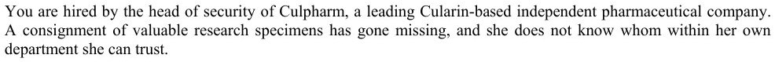

## p.2 (scan page 2)

Page contents: 840 words, 22 paragraphs | headings/entries: Mix and Match; Character Earnings; General Notes to the GM; GM Overview; Page 2

- **No single roster character (rules/setting/general)** — entry/section: GM Overview: "Their head of security, a Twi'lek, is not sure who she can trust even in her own department, so has chosen to go outside, to some people who have a growing reputation for being able to deal quickly and effectively with matters of law and order." Source: *102 - Trade War - Mix and Match* (SWRPG d20 Revised Core), p.2
  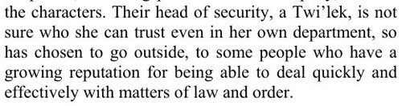
- **No single roster character (rules/setting/general)** — entry/section: GM Overview: "If the trail is followed, it eventually can be traced back to a rather confused environmentalist who is married to one of the company's graphic designers." Source: *102 - Trade War - Mix and Match* (SWRPG d20 Revised Core), p.2
  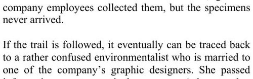

## p.3 (scan page 3)

Page contents: 852 words, 18 paragraphs | headings/entries: Encounter 1: Perhaps You Can Help?; Encounter 2: Home at the Lab; Encounter 3: The Records Never Lie; Encounter 4: I'll Rip Your Arms Off; Mix and Match; Encounter 5: Meanwhile Back at Culpharm; Page 3

- **No single roster character (rules/setting/general)** — entry/section: Caleb Clancy: "He does remember a fellow who came in and enquired about... well, he doesn't remember what, but the fellow looked very closely at him while making his enquiries and made him nervous." Source: *102 - Trade War - Mix and Match* (SWRPG d20 Revised Core), p.3
  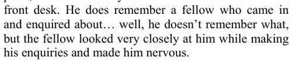
- **No single roster character (rules/setting/general)** — entry/section: Mourne Blee: "Apart from it being a requirement of the company not to speak about things they are creating for other companies, it's far too boring, dahling. Who'd care about a security uniform?" Source: *102 - Trade War - Mix and Match* (SWRPG d20 Revised Core), p.3
  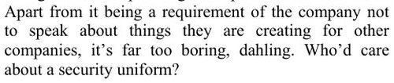
- **No single roster character (rules/setting/general)** — entry/section: Mambo Farls: "So of course he didn't say anything about the designs, oh, well, apart from to his wife, but that's not public, is it?" Source: *102 - Trade War - Mix and Match* (SWRPG d20 Revised Core), p.3
  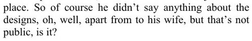

## p.4 (scan page 4)

Page contents: 750 words, 23 paragraphs | headings/entries: Encounter 7: Meaning No Harm?; Opening Crawl; Encounter 1: Perhaps you can help?; The Culpharm building shows the concern's; Mix and Match; Page 4

- **No single roster character (rules/setting/general)** — entry/section: Important Note to Judges: "The key point is the ethical dilemma: do the characters reveal the whole plot or do they keep the environmentalists' role secret in return for Gelly's cooperation?" Source: *102 - Trade War - Mix and Match* (SWRPG d20 Revised Core), p.4
  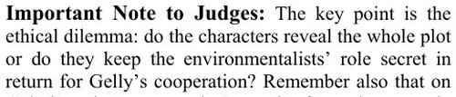
- **No single roster character (rules/setting/general)** — entry/section: Important Note to Judges: "Remember also that on Cularin, private companies' security forces have nearly as much power as more conventional forces of law and order" Source: *102 - Trade War - Mix and Match* (SWRPG d20 Revised Core), p.4
  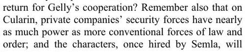
- **No single roster character (rules/setting/general)** — entry/section: Opening Crawl: "A comlink signal from Culpharm, a Cularin-based Pharmaceutical company, marked the beginning. Faced with internal turmoil, the company has turned to external resources in the hope of resolving its problems." Source: *102 - Trade War - Mix and Match* (SWRPG d20 Revised Core), p.4
  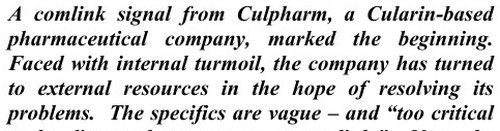
- **No single roster character (rules/setting/general)** — entry/section: Opening Crawl: "The specifics are vague — and "too critical to be discussed over an open comlink." Now, the heroes of Cularin must investigate, and discover what has gone wrong..." Source: *102 - Trade War - Mix and Match* (SWRPG d20 Revised Core), p.4
  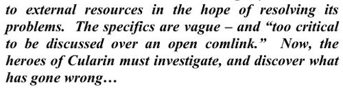
- **No single roster character (rules/setting/general)** — entry/section: Carlitina Semla: ""Thank you for coming," she says. "Please make yourselves comfortable. As I mentioned, I have a problem that I think you might be able to help me with." Source: *102 - Trade War - Mix and Match* (SWRPG d20 Revised Core), p.4
  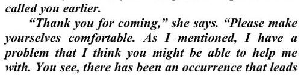
- **No single roster character (rules/setting/general)** — entry/section: Carlitina Semla: "But I am not sure who, or how far it spreads... not to beat about the territory too much, I am not sure whom I can trust. Hence the need for outside assistance." Source: *102 - Trade War - Mix and Match* (SWRPG d20 Revised Core), p.4
  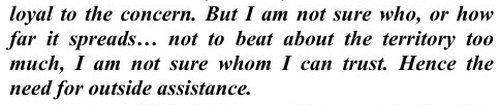
- **No single roster character (rules/setting/general)** — entry/section: Carlitina Semla: ""Do you think that you could spare me a few days to undertake an investigation?"" Source: *102 - Trade War - Mix and Match* (SWRPG d20 Revised Core), p.4
  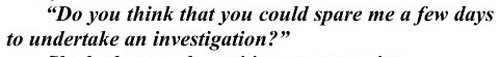
- **No single roster character (rules/setting/general)** — entry/section: Waz-alem Amir: "While this is contrary to company policy, they indulge him as they feel that losing him would be an even greater disaster to the bottom line." Source: *102 - Trade War - Mix and Match* (SWRPG d20 Revised Core), p.4
  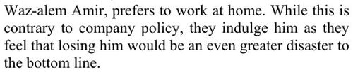
- **No single roster character (rules/setting/general)** — entry/section: Carlitina Semla: "Without going into confidential details — and anyway, she's a security specialist, not a biochemist!" Source: *102 - Trade War - Mix and Match* (SWRPG d20 Revised Core), p.4
  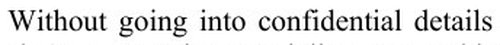

## p.1–4 (scan page 1)

Page contents: Title, RPGA notes, overview, encounter summaries, crawl (hand-read)

## p.5 (scan page 5)

Page contents: 783 words, 19 paragraphs | headings/entries: Encounter 2: Home at the Lab; Mix and Match; Page 5

- **No single roster character (rules/setting/general)** — entry/section: Waz-alem Amir: "Amir himself is somewhat vague but hospitable. He will invite the characters in and offer fruit juice and cookies" Source: *102 - Trade War - Mix and Match* (SWRPG d20 Revised Core), p.5
  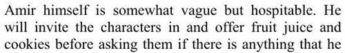
- **No single roster character (rules/setting/general)** — entry/section: Waz-alem Amir: "Anyway, they were wearing the new company uniform, bit garish really, yellow trousers and green and yellow shirts" Source: *102 - Trade War - Mix and Match* (SWRPG d20 Revised Core), p.5
  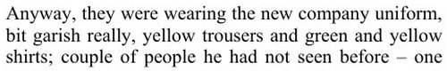
- **No single roster character (rules/setting/general)** — entry/section: Important Note to Judges: "This is the key clue that must be dropped; without this information, the heroes cannot complete the event, so make sure you mention the uniforms, even if it's in an off-hand manner." Source: *102 - Trade War - Mix and Match* (SWRPG d20 Revised Core), p.5
  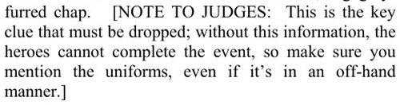
- **No single roster character (rules/setting/general)** — entry/section: Waz-alem Amir: "they'd left, promising to wring the dispatcher's neck." Source: *102 - Trade War - Mix and Match* (SWRPG d20 Revised Core), p.5
  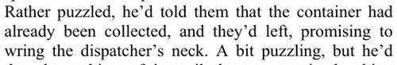
- **No single roster character (rules/setting/general)** — entry/section: Waz-alem Amir: "speaking precisely and covering the details as if he were writing an experimental report." Source: *102 - Trade War - Mix and Match* (SWRPG d20 Revised Core), p.5
  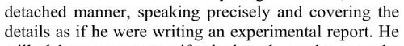
- **No single roster character (rules/setting/general)** — entry/section: Waz-alem Amir: "however he feels very strongly that whatever has gone wrong is not his fault — he followed the procedures he'd been given." Source: *102 - Trade War - Mix and Match* (SWRPG d20 Revised Core), p.5
  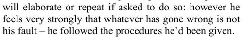

## p.6 (scan page 6)

Page contents: 856 words, 16 paragraphs | headings/entries: Encounter 3: The Records Never Lie; Mix and Match; Encounter 4: I'll Rip Your Arms Off; Page 6

- **No single roster character (rules/setting/general)** — entry/section: Carlitina Semla: "would they like her to call ahead or would they prefer to arrive 'from behind the stars' [a Twi'lek expression equivalent to 'out of the blue'] and not have him pre-warned?" Source: *102 - Trade War - Mix and Match* (SWRPG d20 Revised Core), p.6
  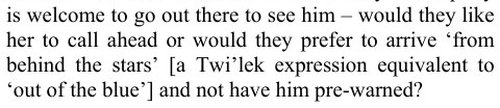
- **No single roster character (rules/setting/general)** — entry/section: Caleb Clancy: "When the characters meet Clancy, he's a small and rather grumpy human with 'buzz-cut' blond hair." Source: *102 - Trade War - Mix and Match* (SWRPG d20 Revised Core), p.6
  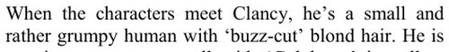
- **No single roster character (rules/setting/general)** — entry/section: Caleb Clancy: "A waste of a perfectly good day off, that was." Source: *102 - Trade War - Mix and Match* (SWRPG d20 Revised Core), p.6
  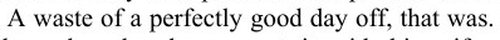
- **No single roster character (rules/setting/general)** — entry/section: Caleb Clancy: "not sitting around in some clearing surrounded by the people he has to live near and all their noisy brats. Get the picture?" Source: *102 - Trade War - Mix and Match* (SWRPG d20 Revised Core), p.6
  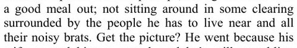
- **No single roster character (rules/setting/general)** — entry/section: Landing Lights Bar: "There is no music, however - the last band left after a drunken brawl that spread onto the bandstand and smashed several instruments. It's that sort of place." Source: *102 - Trade War - Mix and Match* (SWRPG d20 Revised Core), p.6
  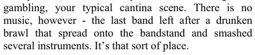

## p.7 (scan page 7)

Page contents: 786 words, 21 paragraphs | headings/entries: Skills: Intimidate +6, Profession (Security Guard) +5; Feats: Toughness, Weapon Group Proficiency Exotic (Bowcaster); Equipment: Bandolier, bowcaster, comlink; Mix and Match; Feats: Toughness. Equipment: Coveralls; Page 7

- **No single roster character (rules/setting/general)** — entry/section: Sabacc Wookiees: "They don't cheat; they don't feel that they need to." Source: *102 - Trade War - Mix and Match* (SWRPG d20 Revised Core), p.7
  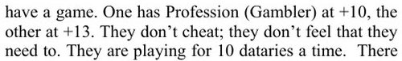
- **No single roster character (rules/setting/general)** — entry/section: Sabacc Wookiees: "this will upset the Wookiees, and as we all know, it's unwise to upset a Wookiee." Source: *102 - Trade War - Mix and Match* (SWRPG d20 Revised Core), p.7
  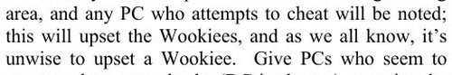
- **No single roster character (rules/setting/general)** — entry/section: Arrogha: "He has a translator droid, but it has been programmed to filter out the swear words." Source: *102 - Trade War - Mix and Match* (SWRPG d20 Revised Core), p.7
  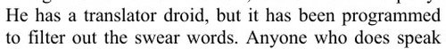
- **No single roster character (rules/setting/general)** — entry/section: Arrogha: "He does not like anyone to question his integrity" Source: *102 - Trade War - Mix and Match* (SWRPG d20 Revised Core), p.7
  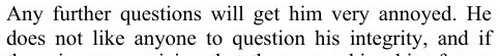
- **No single roster character (rules/setting/general)** — entry/section: Landing Lights Bar: "Most enjoy a good brawl but there is no malice in them, they do not really want to harm anyone." Source: *102 - Trade War - Mix and Match* (SWRPG d20 Revised Core), p.7
  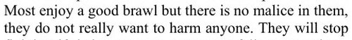
- **No single roster character (rules/setting/general)** — entry/section: Landing Lights Bar: "A brawl in the Landing Lights is a common occurrence." Source: *102 - Trade War - Mix and Match* (SWRPG d20 Revised Core), p.7
  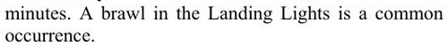

### Stat block notes (game mechanics, not feats)

- Arrogha: Arrogha, Culpharm Security Guard (Thug 4): Def 11; VP/WP -/15; Atks +7 melee (fist 1d3+4), +4 ranged (bowcaster 3d10); Str 18 (Source: *102 - Trade War - Mix and Match* (SWRPG d20 Revised Core), p.7)
- Typical Cantina Patron: Typical Cantina Patron (Thug 6): Defence 12; VP/WP -/16; Atks +7/+2 melee (Source: *102 - Trade War - Mix and Match* (SWRPG d20 Revised Core), p.7)

## p.4–7 (scan page 4)

Page contents: E1 Carlitina Semla; E2 Waz-alem Amir; E3 Caleb Clancy; E4 Arrogha and the bar brawl (hand-read)

## p.8 (scan page 8)

Page contents: 818 words, 20 paragraphs | headings/entries: Encounter 5: Meanwhile Back at Culpharm; Mix and Match; Encounter 6: Espionage for Breakfast; Page 8

- **No single roster character (rules/setting/general)** — entry/section: Culpharm launch: ""Good afternoon, gentlebeings, and welcome to the launch of Culpharm's new visual identity." Source: *102 - Trade War - Mix and Match* (SWRPG d20 Revised Core), p.8
  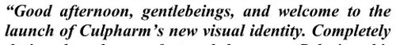
- **No single roster character (rules/setting/general)** — entry/section: Culpharm launch: "Gentlebeings of the Press, I present — the New Culpharm!"" Source: *102 - Trade War - Mix and Match* (SWRPG d20 Revised Core), p.8
  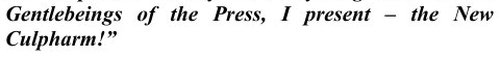
- **No single roster character (rules/setting/general)** — entry/section: Culpharm guard: "She is eyeing the new uniform with a less than enthusiastic eye." Source: *102 - Trade War - Mix and Match* (SWRPG d20 Revised Core), p.8
  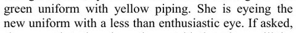
- **No single roster character (rules/setting/general)** — entry/section: Carlitina Semla: "And from that requirement has come a complete redesign of the corporate image! Mad, isn't it?"" Source: *102 - Trade War - Mix and Match* (SWRPG d20 Revised Core), p.8
  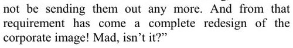
- **No single roster character (rules/setting/general)** — entry/section: Mourne Blee: "Play Blee with lots of hand gestures and a slightly higher-than-normal voice. He's an artist, trapped in commercial uniform creation to make a cred." Source: *102 - Trade War - Mix and Match* (SWRPG d20 Revised Core), p.8
  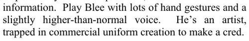
- **No single roster character (rules/setting/general)** — entry/section: Mourne Blee: "He's almost embarrassed that he has anything to do with such mundane clothing." Source: *102 - Trade War - Mix and Match* (SWRPG d20 Revised Core), p.8
  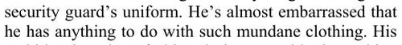
- **No single roster character (rules/setting/general)** — entry/section: Mambo Farls: "Mambo Farls is a very bouncy and enthusiastic person — something like a Gungan mentality in a human body." Source: *102 - Trade War - Mix and Match* (SWRPG d20 Revised Core), p.8
  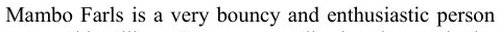

## p.9 (scan page 9)

Page contents: 796 words, 22 paragraphs | headings/entries: Encounter 7: Meaning No Harm; Mix and Match; Page 9

- **No single roster character (rules/setting/general)** — entry/section: Mambo Farls: "Oh yes, he does talk to her... but that doesn't count. She knows not to discuss things outside of the home" Source: *102 - Trade War - Mix and Match* (SWRPG d20 Revised Core), p.9
  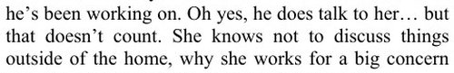
- **No single roster character (rules/setting/general)** — entry/section: Mambo Farls: "He's beginning to worry, to babble a bit, by now." Source: *102 - Trade War - Mix and Match* (SWRPG d20 Revised Core), p.9
  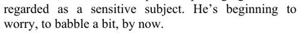
- **No single roster character (rules/setting/general)** — entry/section: Gelly Farls: "Since college days, she has been an enthusiastic environmentalist." Source: *102 - Trade War - Mix and Match* (SWRPG d20 Revised Core), p.9
  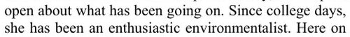
- **No single roster character (rules/setting/general)** — entry/section: Gelly Farls: "Biotherapy is not above a spot of industrial espionage either" Source: *102 - Trade War - Mix and Match* (SWRPG d20 Revised Core), p.9
  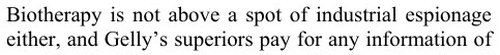
- **No single roster character (rules/setting/general)** — entry/section: Gelly Farls: "the environmentalists hoped that Biotherapy would do something illegal that they could expose." Source: *102 - Trade War - Mix and Match* (SWRPG d20 Revised Core), p.9
  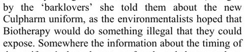

### Stat block notes (game mechanics, not feats)

- Biotherapy Black Ops Trooper: Biotherapy 'Black Ops' Trooper (Human Soldier 4): Defence 16; VP/WP 34/15; Atk +6 ranged (heavy blaster pistol 3d8); Heroic Surge (Source: *102 - Trade War - Mix and Match* (SWRPG d20 Revised Core), p.9)
- Biotherapy Black Ops Trooper: Biotherapy 'Black Ops' Trooper (Gungan Scoundrel 3): Defence 17; VP/WP 16/10; Pilot +8, Bluff +10 (Source: *102 - Trade War - Mix and Match* (SWRPG d20 Revised Core), p.9)

## p.10 (scan page 10)

Page contents: 525 words, 24 paragraphs | headings/entries: Conclusion; Here Ends Mix and Match; Experience Point Summary; Adventure Experience Award:; Adventure Experience: Roleplaying Experience:; Mix and Match; Loot Summary; Encounter 7:; Conclusion:; Page 10

- **No single roster character (rules/setting/general)** — entry/section: OPS: "OPS will take the weapons and Culpharm may petition for their return, if the head of security needs them (which she doesn't, and therefore, won't)." Source: *102 - Trade War - Mix and Match* (SWRPG d20 Revised Core), p.10
  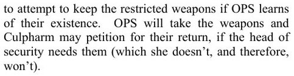
- **No single roster character (rules/setting/general)** — entry/section: Conclusion: "She calls in a Culpharm PR, who writes up a news story about the dastardly actions of Biotherapy." Source: *102 - Trade War - Mix and Match* (SWRPG d20 Revised Core), p.10
  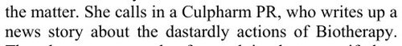
- **No single roster character (rules/setting/general)** — entry/section: Conclusion: "Mambo Farls gets a formal warning about his behaviour, and shortly thereafter resigns from Culpharm to go into partnership with Mourne Blee." Source: *102 - Trade War - Mix and Match* (SWRPG d20 Revised Core), p.10
  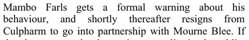
- **No single roster character (rules/setting/general)** — entry/section: Loot Summary: "The speeder was confiscated by OPS, as it was one of theirs which was stolen several months ago." Source: *102 - Trade War - Mix and Match* (SWRPG d20 Revised Core), p.10
  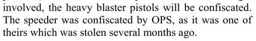
- **No single roster character (rules/setting/general)** — entry/section: Favor of the Barklovers: "It's not clear now what this favor will mean, but having someone owe you is always a good thing." Source: *102 - Trade War - Mix and Match* (SWRPG d20 Revised Core), p.10
  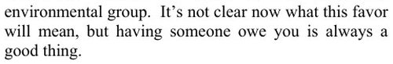

## p.11 (scan page 11)

Page contents: 132 words, 7 paragraphs | headings/entries: Critical Event Summary: Mix and Match; Mix and Match Page 11

## p.8–11 (scan page 8)

Page contents: E5 the press launch and Mourne Blee; E6 Mambo Farls; E7 Gelly Farls and the chase; conclusion, XP, loot, critical events (hand-read)

