# Owner Material 037 — Star Wars D20 Drive folder (Core, Revised Core and Saga Edition): Living Force Campaign/Adventures/Law and Order/103 - Trade War - Find The Lady.pdf [Star Wars Roleplaying Game Revised Core (d20, 2002)]

- **Source:** Wizards of the Coast Star Wars Roleplaying Game books, web enhancements, Living Force campaign modules and articles (2000–2010), from the owner's "Star Wars D20" Drive folder (only the three edition subfolders; "General" was not read, as instructed). Secondary source (licensed Legends reference). Scan OCR'd on the box; the scan stays box-only and is **not** published.
- **Method:** every scanned page was OCR'd and machine-screened sentence by sentence for power-relevant statements (fights, kills, defeats, Force feats, rankings, superweapons) that name a character on our roster; each kept sentence is quoted verbatim from the OCR text and has a crop of the printed passage directly under it. Pages with nothing power-relevant are still listed with what is on them.
- **Citation:** "*103 - Trade War - Find The Lady* (SWRPG d20 Revised Core), p.X" by printed page ("scan p.X" where no printed number applies). **Weight:** Licensed RPG material: a secondary source. Narrative text sums up Legends lore; game statistics are rules for players, not canon power levels, and rank lowest.

## p.1 (scan page 1)

Page contents: 77 words, 6 paragraphs | headings/entries: Find the Lady; Episode 3 of the Trade War Trilogy; A One-Round Living Force Scenario

- **No single roster character (rules/setting/general)** — entry/section: Blurb: "Your assistance is required to locate the missing daughter of the Baron-administrator of one of the Cularin platform cities. Where could she have got to?" Source: *103 - Trade War - Find The Lady* (SWRPG d20 Revised Core), p.1
  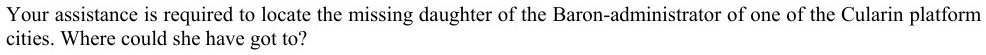

## p.2 (scan page 2)

Page contents: 862 words, 22 paragraphs | headings/entries: Find the Lady; Character Earnings; General Notes to the GM; GM Overview; Encounter 1: Desperately Seeking Selima; Page 2

- **No single roster character (rules/setting/general)** — entry/section: GM Overview: "has joined a radical environmental group, more because she has fallen in love with its leader than due to any real commitment to its aims." Source: *103 - Trade War - Find The Lady* (SWRPG d20 Revised Core), p.2
  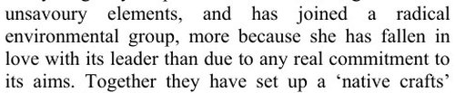
- **No single roster character (rules/setting/general)** — entry/section: GM Overview: "By the time the characters find out where the young lady is, the two concerns are engaged in a pitched battle around the store..." Source: *103 - Trade War - Find The Lady* (SWRPG d20 Revised Core), p.2
  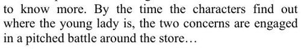
- **No single roster character (rules/setting/general)** — entry/section: Selima DeWitt: "His daughter Selima, a young and beautiful girl but oh so willful has gone missing." Source: *103 - Trade War - Find The Lady* (SWRPG d20 Revised Core), p.2
  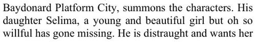

## p.3 (scan page 3)

Page contents: 945 words, 18 paragraphs | headings/entries: Encounter 3: Going Dirtside; Encounter 4: Contraband; Find the Lady; Encounter 5: Bright Lights of Gadrin Town; Encounter 6: Shoot-out at Natural; Page 3

- **No single roster character (rules/setting/general)** — entry/section: Davin DeWitt: "He has rivals, both here in Baydonard and elsewhere, who would make much of his lack of control of his own family." Source: *103 - Trade War - Find The Lady* (SWRPG d20 Revised Core), p.3
  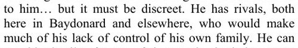
- **No single roster character (rules/setting/general)** — entry/section: Space Monkey Cafe: "This is the sort of place all the tour guides warn you to avoid." Source: *103 - Trade War - Find The Lady* (SWRPG d20 Revised Core), p.3
  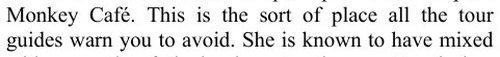
- **No single roster character (rules/setting/general)** — entry/section: Tyburn Welles: "Welles believes that Selima has gone 'dirtside' with some fellow she took up with, as a discarded suitor he's quite sore about it." Source: *103 - Trade War - Find The Lady* (SWRPG d20 Revised Core), p.3
  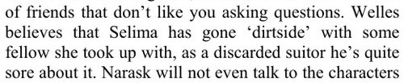
- **No single roster character (rules/setting/general)** — entry/section: Jee Sallis: "Sorry... can't stop to chat, time to go back to the comet broom vessel." Source: *103 - Trade War - Find The Lady* (SWRPG d20 Revised Core), p.3
  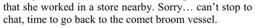
- **No single roster character (rules/setting/general)** — entry/section: Lethbridge Grimes: "(he doesn't like to admit he was caught smuggling and was in jail!)" Source: *103 - Trade War - Find The Lady* (SWRPG d20 Revised Core), p.3
  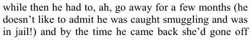
- **No single roster character (rules/setting/general)** — entry/section: Sandi: "(really, Shrandghnrignh, but only Wookiees can say that so she answers to Sandi!)" Source: *103 - Trade War - Find The Lady* (SWRPG d20 Revised Core), p.3
  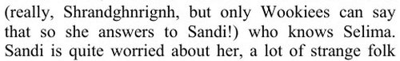
- **No single roster character (rules/setting/general)** — entry/section: Percival Vale: "but got kind of sidetracked along the way, met with some Tarasin and fell in love with their precious trees..." Source: *103 - Trade War - Find The Lady* (SWRPG d20 Revised Core), p.3
  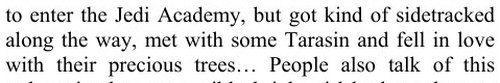
- **No single roster character (rules/setting/general)** — entry/section: Natural: "The general impression is that they are a bit mad, but harmlessly so." Source: *103 - Trade War - Find The Lady* (SWRPG d20 Revised Core), p.3
  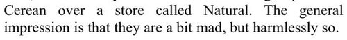

## p.4 (scan page 4)

Page contents: 746 words, 18 paragraphs | headings/entries: Encounter 7: Tales Out of School; Opening Crawl; Find the Lady; Encounter 1: Desperately Seeking Selima; Page 4

- **No single roster character (rules/setting/general)** — entry/section: Higgie Sethven: "He contacted a friend who works for Genasys, but had not expected an armed response!" Source: *103 - Trade War - Find The Lady* (SWRPG d20 Revised Core), p.4
  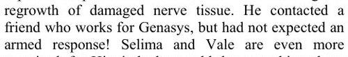
- **No single roster character (rules/setting/general)** — entry/section: Important Note to Judges: "The objective of this scenario is to demonstrate the lengths that even quite 'reasonable' concerns will go to when attempting to gain a competitive advantage." Source: *103 - Trade War - Find The Lady* (SWRPG d20 Revised Core), p.4
  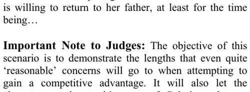
- **No single roster character (rules/setting/general)** — entry/section: Opening Crawl: "High above the jungles of Cularin, platform cities seem to stand aloof from the life below. Yet there is much more going on than meets the eye." Source: *103 - Trade War - Find The Lady* (SWRPG d20 Revised Core), p.4
  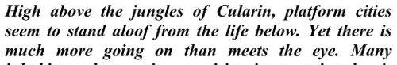
- **No single roster character (rules/setting/general)** — entry/section: Opening Crawl: "Many inhabitants have quite surprising interests in what is going on a kilometre or more below them on the planet's surface. Here is just one of their tales..." Source: *103 - Trade War - Find The Lady* (SWRPG d20 Revised Core), p.4
  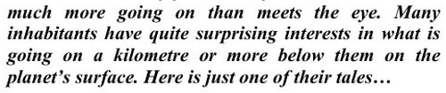
- **No single roster character (rules/setting/general)** — entry/section: Encounter 1: "It seems that your reputation is growing." Source: *103 - Trade War - Find The Lady* (SWRPG d20 Revised Core), p.4
  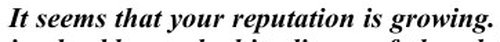
- **No single roster character (rules/setting/general)** — entry/section: Encounter 1: "As you travel over the jungle, marvelling again at the purple and green swirls of the vegetation beneath you, you pass several other platforms." Source: *103 - Trade War - Find The Lady* (SWRPG d20 Revised Core), p.4
  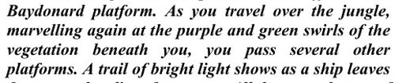
- **No single roster character (rules/setting/general)** — entry/section: Bayonard: "it is city policy to maintain them in this state to discourage — and starve out — any mulissiki that venture up here." Source: *103 - Trade War - Find The Lady* (SWRPG d20 Revised Core), p.4
  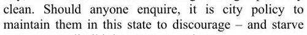

## p.1–4 (scan page 1)

Page contents: Title, RPGA notes, overview, encounter summaries, crawl (hand-read)

## p.5 (scan page 5)

Page contents: 923 words, 13 paragraphs | headings/entries: Find the Lady; Page 5

- **No single roster character (rules/setting/general)** — entry/section: Davin DeWitt: ""Welcome to Bayonard," he says. "Although I am sorry about the circumstances. Permit me to introduce myself, Baron Davin DeWitt, the administrator." Source: *103 - Trade War - Find The Lady* (SWRPG d20 Revised Core), p.5
  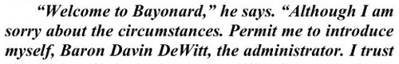
- **No single roster character (rules/setting/general)** — entry/section: Davin DeWitt: "To be honest, she's a bit of a wild one, and has run off before; indeed she's been gone for several months." Source: *103 - Trade War - Find The Lady* (SWRPG d20 Revised Core), p.5
  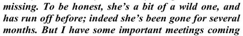
- **No single roster character (rules/setting/general)** — entry/section: Davin DeWitt: "I am certain that word has got out and they are setting traps for me." Source: *103 - Trade War - Find The Lady* (SWRPG d20 Revised Core), p.5
  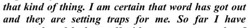
- **No single roster character (rules/setting/general)** — entry/section: Davin DeWitt: "to be fair to them, their expertise is in administration not investigation. So, would you be prepared to seek Selima out and ask her to come back, if only for a few days?"" Source: *103 - Trade War - Find The Lady* (SWRPG d20 Revised Core), p.5
  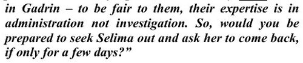
- **No single roster character (rules/setting/general)** — entry/section: Selima DeWitt: "Since her return to Cularin, her main interests appeared to be partying — usually with the wrong sort of man!" Source: *103 - Trade War - Find The Lady* (SWRPG d20 Revised Core), p.5
  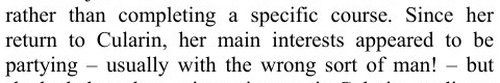
- **No single roster character (rules/setting/general)** — entry/section: Selima DeWitt: "One thing she had shown absolutely no interest in was the administration of Bayonard." Source: *103 - Trade War - Find The Lady* (SWRPG d20 Revised Core), p.5
  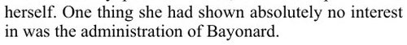
- **No single roster character (rules/setting/general)** — entry/section: Davin DeWitt: "His concept of meeting her needs appears to lie solely in paying her allowance and letting her go out at night as she pleased." Source: *103 - Trade War - Find The Lady* (SWRPG d20 Revised Core), p.5
  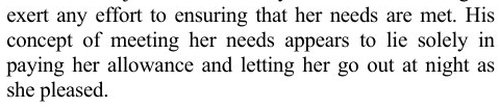

## p.6 (scan page 6)

Page contents: 936 words, 16 paragraphs | headings/entries: Find the Lady; Page 6

- **No single roster character (rules/setting/general)** — entry/section: Space Monkey Cafe: "It is said that the only reason that the administration permits it to remain open is that at least it provides a place where the more unpleasant members of the community are welcome!" Source: *103 - Trade War - Find The Lady* (SWRPG d20 Revised Core), p.6
  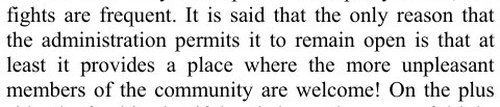
- **No single roster character (rules/setting/general)** — entry/section: Space Monkeys: "a keyboard player who looks like a small fat pink elephant (and has caused more than one drinker to wonder if he has had too much when he looks towards the stage!)" Source: *103 - Trade War - Find The Lady* (SWRPG d20 Revised Core), p.6
  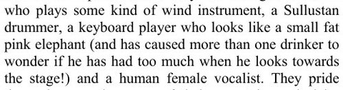
- **No single roster character (rules/setting/general)** — entry/section: Space Monkeys: "the vocalist is singing a truly ancient classic, 'Summertime' — the origins of which are lost in the mists of antiquity." Source: *103 - Trade War - Find The Lady* (SWRPG d20 Revised Core), p.6
  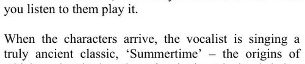
- **No single roster character (rules/setting/general)** — entry/section: Narask: "Narask is a surly-looking individual and, like many of his species, detests Wookiees." Source: *103 - Trade War - Find The Lady* (SWRPG d20 Revised Core), p.6
  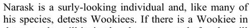
- **No single roster character (rules/setting/general)** — entry/section: Narask: "Seems that Selima fancies Jedi" Source: *103 - Trade War - Find The Lady* (SWRPG d20 Revised Core), p.6
  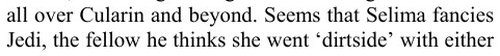

### Stat block notes (game mechanics, not feats)

- Typical Cafe Patron: Typical Café Patron (Thug 6): Defence 12; VP/WP -/16; Atks +7/+2 melee (Source: *103 - Trade War - Find The Lady* (SWRPG d20 Revised Core), p.6)

## p.7 (scan page 7)

Page contents: 927 words, 14 paragraphs | headings/entries: Feats: Toughness. Equipment: Coveralls; Find the Lady; Encounter 3: Going Dirtside; Page 7

- **No single roster character (rules/setting/general)** — entry/section: Tyburn Welles: "If confronted about possessing the lightsaber, he will claim it is his own, which he made himself, and it's not at all polite to accuse him otherwise." Source: *103 - Trade War - Find The Lady* (SWRPG d20 Revised Core), p.7
  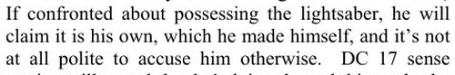
- **No single roster character (rules/setting/general)** — entry/section: Tyburn Welles: "Vale was some kind of environmental nut, though" Source: *103 - Trade War - Find The Lady* (SWRPG d20 Revised Core), p.7
  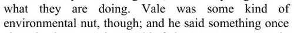
- **No single roster character (rules/setting/general)** — entry/section: Tyburn Welles: "but likes to give the impression that he is still a Padawan." Source: *103 - Trade War - Find The Lady* (SWRPG d20 Revised Core), p.7
  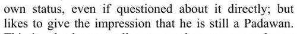
- **No single roster character (rules/setting/general)** — entry/section: Tyger: "If he didn't have the club to run, he would probably have gone looking for her." Source: *103 - Trade War - Find The Lady* (SWRPG d20 Revised Core), p.7
  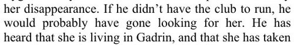
- **No single roster character (rules/setting/general)** — entry/section: Comet broom: "(The 'comet broom' is a ship that patrols the outer reaches of the Cularin system and diverts or destroys any comets that look like they are going to become a menace to navigation.)" Source: *103 - Trade War - Find The Lady* (SWRPG d20 Revised Core), p.7
  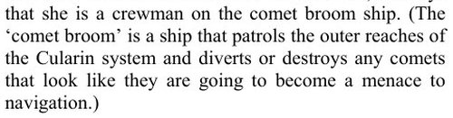

## p.8 (scan page 8)

Page contents: 852 words, 19 paragraphs | headings/entries: Encounter 4: Contraband; Find the Lady; Page 8

- **No single roster character (rules/setting/general)** — entry/section: Lethbridge Grimes: "(He was in jail, actually, but does not wish to admit this!)" Source: *103 - Trade War - Find The Lady* (SWRPG d20 Revised Core), p.8
  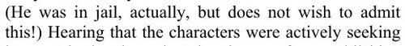
- **No single roster character (rules/setting/general)** — entry/section: OPS: "an amplified voice booms, "Come out with your hands up — Office of Peace and Security, you are surrounded."" Source: *103 - Trade War - Find The Lady* (SWRPG d20 Revised Core), p.8
  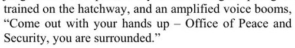
- **No single roster character (rules/setting/general)** — entry/section: Lethbridge Grimes: "Grimes is frozen in shock, an expression of, "Oh no, not again" writ plain across his face." Source: *103 - Trade War - Find The Lady* (SWRPG d20 Revised Core), p.8
  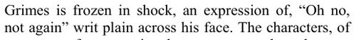
- **No single roster character (rules/setting/general)** — entry/section: OPS: "(give him a +4 Authority bonus and a more heavily-decorated uniform!)" Source: *103 - Trade War - Find The Lady* (SWRPG d20 Revised Core), p.8
  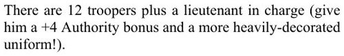
- **No single roster character (rules/setting/general)** — entry/section: Hanes Croft: "Force users may attempt Affect Mind in true cinematic style." Source: *103 - Trade War - Find The Lady* (SWRPG d20 Revised Core), p.8
  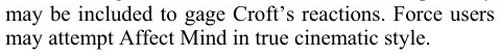

## p.9 (scan page 9)

Page contents: 832 words, 15 paragraphs | headings/entries: Encounter 5: Bright Lights of Gadrin Town; Find the Lady; Page 9

- **No single roster character (rules/setting/general)** — entry/section: Bark Lovers' Alliance: ""Oh, you are just a bunch of Bark Lovers!" Tarasin present could not see why this was construed as an insult, and gleefully adopted the term to describe their new organisation." Source: *103 - Trade War - Find The Lady* (SWRPG d20 Revised Core), p.9
  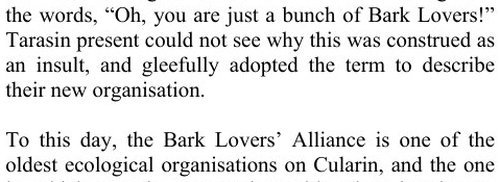
- **No single roster character (rules/setting/general)** — entry/section: Waif: "She welcomes the characters — as far as she is concerned everybody is a friend and potential recruit to the cause." Source: *103 - Trade War - Find The Lady* (SWRPG d20 Revised Core), p.9
  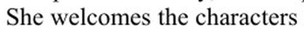
- **No single roster character (rules/setting/general)** — entry/section: Waif: "Natural, she says, is a good model for the future; a place where commercial awareness is in harmony with ecological considerations." Source: *103 - Trade War - Find The Lady* (SWRPG d20 Revised Core), p.9
  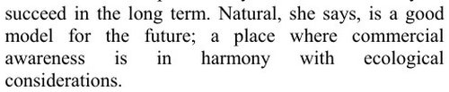

## p.4–9 (scan page 4)

Page contents: E1 Baron DeWitt; E2 Bayonard dives; E3 Jee Sallis; E4 Lethbridge Grimes and the OPS (hand-read)

## p.10 (scan page 10)

Page contents: 830 words, 21 paragraphs | headings/entries: Encounter 6: Shoot-out at Natural; Find the Lady; Page 10

- **No single roster character (rules/setting/general)** — entry/section: Waif: "Waif is an enthusiastic evangelist for her cause!" Source: *103 - Trade War - Find The Lady* (SWRPG d20 Revised Core), p.10
  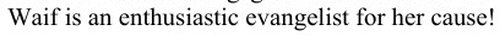
- **No single roster character (rules/setting/general)** — entry/section: Percival Vale: "Percival Vale is regarded by Tarasin as one of the few humans to be attuned with the Ch'hala trees to such an extent that he is permitted to visit the sacred groves." Source: *103 - Trade War - Find The Lady* (SWRPG d20 Revised Core), p.10
  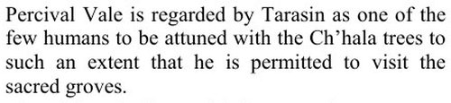
- **No single roster character (rules/setting/general)** — entry/section: Genasys trooper: ""As you can see, it's getting a bit hot here."" Source: *103 - Trade War - Find The Lady* (SWRPG d20 Revised Core), p.10
  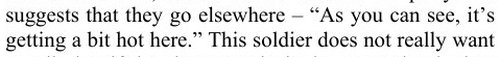
- **No single roster character (rules/setting/general)** — entry/section: Genasys trooper: "Otherwise, they had better clear off!" Source: *103 - Trade War - Find The Lady* (SWRPG d20 Revised Core), p.10
  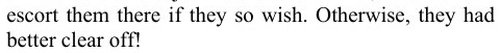

## p.11 (scan page 11)

Page contents: 807 words, 22 paragraphs | headings/entries: Skills: Intimidate +6, Profession (Security Guard) +5; Find the Lady; Skills: Intimidate +6, Profession (Security Guard) ED:; Encounter 7: Tales out of School; Page 11

- **No single roster character (rules/setting/general)** — entry/section: Carlitina Semla: "As soon as she had enquired of lead elements of the Genasys forces as to the reasons for their presence, they had opened fire, killing two of her troopers and wounding her." Source: *103 - Trade War - Find The Lady* (SWRPG d20 Revised Core), p.11
  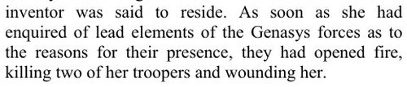
- **No single roster character (rules/setting/general)** — entry/section: Jopari Haines: "(although Jopari Haines will grumble)" Source: *103 - Trade War - Find The Lady* (SWRPG d20 Revised Core), p.11
  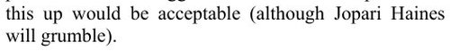
- **No single roster character (rules/setting/general)** — entry/section: Encounter 6: "Alternatively, the characters can engage in combat with either or both sides. This is likely to be messy." Source: *103 - Trade War - Find The Lady* (SWRPG d20 Revised Core), p.11
  
- **No single roster character (rules/setting/general)** — entry/section: Percival Vale: "shortly afterwards all of them will hear a voice saying, "Who's there?"" Source: *103 - Trade War - Find The Lady* (SWRPG d20 Revised Core), p.11
  

### Stat block notes (game mechanics, not feats)

- Culpharm Security Guard: Culpharm Security Guard (Thug 4): Defence 16; VP/WP -/15; Atks +4 ranged (blaster rifle 3d8) (Source: *103 - Trade War - Find The Lady* (SWRPG d20 Revised Core), p.11)
- Genasys Security Guard: Genasys Security Guard (Thug 4): Defence 15; VP/WP -/15; Atks +2 melee (vibroblade 2d6+2), +4 ranged (blaster rifle 3d8) (Source: *103 - Trade War - Find The Lady* (SWRPG d20 Revised Core), p.11)

## p.12 (scan page 12)

Page contents: 911 words, 14 paragraphs | headings/entries: Find the Lady; Conclusion; Page 12

- **No single roster character (rules/setting/general)** — entry/section: Percival Vale: "He introduces them, and asks if the party has any idea what is going on outside, it sounds like a young war!" Source: *103 - Trade War - Find The Lady* (SWRPG d20 Revised Core), p.12
  
- **No single roster character (rules/setting/general)** — entry/section: Higgie Sethven: "it barely takes a Sense Motive check (DC 10 if someone insists on rolling one) to tell that he is lying and really intended to keep all the proceeds for himself." Source: *103 - Trade War - Find The Lady* (SWRPG d20 Revised Core), p.12
  
- **No single roster character (rules/setting/general)** — entry/section: Percival Vale: "He does look rather wistfully at any obvious Jedi in the party" Source: *103 - Trade War - Find The Lady* (SWRPG d20 Revised Core), p.12
  
- **No single roster character (rules/setting/general)** — entry/section: Conclusion: "her father has bowed to the inevitable and has decided that it will be better to allow her to go her own way with his support and approval rather than forcing her to stay at home." Source: *103 - Trade War - Find The Lady* (SWRPG d20 Revised Core), p.12
  

## p.13 (scan page 13)

Page contents: 385 words, 21 paragraphs | headings/entries: Here Ends Find the Lady; Experience Point Summary; Loot Summary; Find the Lady; Encounter |; Conclusion; Page 13

- **No single roster character (rules/setting/general)** — entry/section: Higgie Sethven: "but keeps most of the proceeds from his star-mist discovery for himself and becomes quite comfortably off." Source: *103 - Trade War - Find The Lady* (SWRPG d20 Revised Core), p.13
  

## p.9–13 (scan page 9)

Page contents: E5 Gadrin, Sandi, Waif; E6 the Genasys-Culpharm shoot-out; E7 Natural; conclusion, XP, loot (hand-read)

## p.14 (scan page 14)

Page contents: 169 words, 8 paragraphs | headings/entries: Find the Lady Page 14

- **No single roster character (rules/setting/general)** — entry/section: Player Handout 1: "Tyburn Welles — believed to be a Padawan learner at the Jedi Academy, and often seen in the Space Monkey Café." Source: *103 - Trade War - Find The Lady* (SWRPG d20 Revised Core), p.14
  

## p.15 (scan page 15)

Page contents: 157 words, 8 paragraphs | headings/entries: Critical Event Summary: Find the Lady; Yes No; Yes No; Find the Lady Page 15

## p.14–15 (scan page 14)

Page contents: Handout 1; critical events (hand-read)

