# Owner Material 037 — Star Wars D20 Drive folder (Core, Revised Core and Saga Edition): Living Force Campaign/Adventures/Law and Order/104 - Operation Blue Star.pdf [Star Wars Roleplaying Game Revised Core (d20, 2002)]

- **Source:** Wizards of the Coast Star Wars Roleplaying Game books, web enhancements, Living Force campaign modules and articles (2000–2010), from the owner's "Star Wars D20" Drive folder (only the three edition subfolders; "General" was not read, as instructed). Secondary source (licensed Legends reference). Scan OCR'd on the box; the scan stays box-only and is **not** published.
- **Method:** every scanned page was OCR'd and machine-screened sentence by sentence for power-relevant statements (fights, kills, defeats, Force feats, rankings, superweapons) that name a character on our roster; each kept sentence is quoted verbatim from the OCR text and has a crop of the printed passage directly under it. Pages with nothing power-relevant are still listed with what is on them.
- **Citation:** "*104 - Operation Blue Star* (SWRPG d20 Revised Core), p.X" by printed page ("scan p.X" where no printed number applies). **Weight:** Licensed RPG material: a secondary source. Narrative text sums up Legends lore; game statistics are rules for players, not canon power levels, and rank lowest.

## p.1 (scan page 1)

Page contents: 106 words, 5 paragraphs | headings/entries: Operation Blue Star; A One-Round Living Force Adventure

- **No single roster character (rules/setting/general)** — entry/section: Blurb: "The peace of the side streets of Gadrin is shattered by an explosion and gunfire, emanating from the Blue Star Centre, home to a group of Cerean-led philosophers. It sounds like some Heroes are required..." Source: *104 - Operation Blue Star* (SWRPG d20 Revised Core), p.1
  

## p.2 (scan page 2)

Page contents: 893 words, 25 paragraphs | headings/entries: Operation Blue Star; Hero Earnings; Issuing Force and Dark Side Points; Page 2

- **No single roster character (rules/setting/general)** — entry/section: Issuing Force Points: "Because this is a heroic campaign, we expect heroism - and encourage judges to reward it." Source: *104 - Operation Blue Star* (SWRPG d20 Revised Core), p.2
  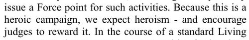
- **No single roster character (rules/setting/general)** — entry/section: Issuing Force Points: "but if a hero does something that makes you, the judge, say, 'Wow,' then they should probably get a FP." Source: *104 - Operation Blue Star* (SWRPG d20 Revised Core), p.2
  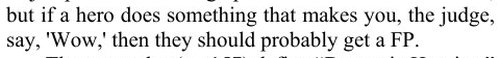

## p.3 (scan page 3)

Page contents: 842 words, 21 paragraphs | headings/entries: General Notes to the GM; GM Overview; Operation Blue Star; Background Information; Encounter 1: Disturbing the Peace; Encounter 2: What's Going On Here?; Page 3

- **No single roster character (rules/setting/general)** — entry/section: General Notes to the GM: "The point of Living Force is not to kill heroes." Source: *104 - Operation Blue Star* (SWRPG d20 Revised Core), p.3
  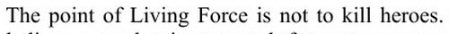
- **No single roster character (rules/setting/general)** — entry/section: General Notes to the GM: "But let's not have any "dumb" deaths. That's not what Star Wars, or Living Force, is about." Source: *104 - Operation Blue Star* (SWRPG d20 Revised Core), p.3
  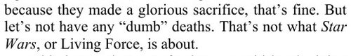
- **No single roster character (rules/setting/general)** — entry/section: GM Overview: "or they can mount a frontal assault (which is not only a bad idea, it is likely to get them taken hostage as well)." Source: *104 - Operation Blue Star* (SWRPG d20 Revised Core), p.3
  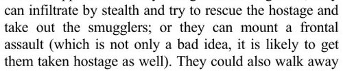
- **No single roster character (rules/setting/general)** — entry/section: GM Overview: "They could also walk away and not get involved, but that would make for a very brief scenario." Source: *104 - Operation Blue Star* (SWRPG d20 Revised Core), p.3
  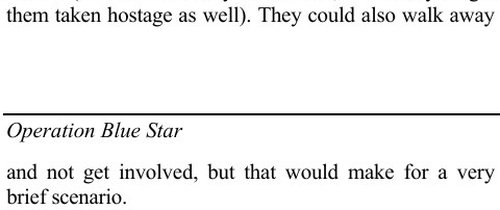
- **No single roster character (rules/setting/general)** — entry/section: Intarsa League: "this motley group of criminals seeks to make a fast credit by any means they can, generally preferring trickery and guile to outright violence... although when pushed, they trade blaster bolts with the best of them." Source: *104 - Operation Blue Star* (SWRPG d20 Revised Core), p.3
  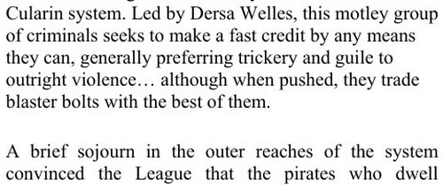
- **No single roster character (rules/setting/general)** — entry/section: Dersa Welles: "Dersa would avow that it was merely a 'misunderstanding.' In the circles in which she moves, though, misunderstandings are often debated at blaster-point." Source: *104 - Operation Blue Star* (SWRPG d20 Revised Core), p.3
  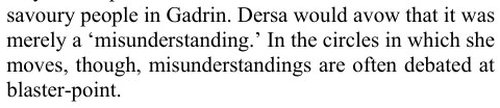
- **No single roster character (rules/setting/general)** — entry/section: Encounter 1: "Heroes who are reluctant to get involved may be approached by an officer of the Office of Peace and Security asking for their assistance "as known local heroes."" Source: *104 - Operation Blue Star* (SWRPG d20 Revised Core), p.3
  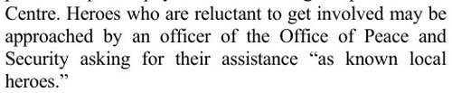

## p.4 (scan page 4)

Page contents: 754 words, 24 paragraphs | headings/entries: Encounter 3: Can We Be of Assistance?; Encounter 4: It's Good to Talk; Encounter 5: Infiltration; Encounter 6: Peace and Love; Operation Blue Star; Opening Crawl; Encounter 1: Disturbing the Peace; Page 4

- **No single roster character (rules/setting/general)** — entry/section: Blue Star Centre: "The Center, designed for contemplation and aesthetics, is not easilly secured." Source: *104 - Operation Blue Star* (SWRPG d20 Revised Core), p.4
  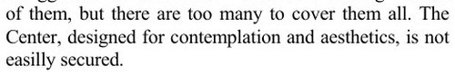
- **No single roster character (rules/setting/general)** — entry/section: Blue Star Centre: "they are non-violent to such a level that the mere concept is unthinkable, and yet they are determined that their main texts must remain undamaged, whatever else goes on." Source: *104 - Operation Blue Star* (SWRPG d20 Revised Core), p.4
  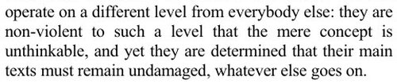
- **No single roster character (rules/setting/general)** — entry/section: Important Note to Judges: "(and yes, there is a skylight for just such an option)" Source: *104 - Operation Blue Star* (SWRPG d20 Revised Core), p.4
  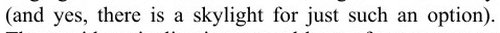
- **No single roster character (rules/setting/general)** — entry/section: Important Note to Judges: "Keep it fast, keep it tense and most of all, keep it fun!" Source: *104 - Operation Blue Star* (SWRPG d20 Revised Core), p.4
  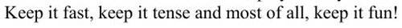
- **No single roster character (rules/setting/general)** — entry/section: Opening Crawl: "Set amidst groves of trees, and built upon a network of small islands in a spring-fed ornamental lake, the Centre is a haven amidst the hustle and bustle of Gadrin. Until today..." Source: *104 - Operation Blue Star* (SWRPG d20 Revised Core), p.4
  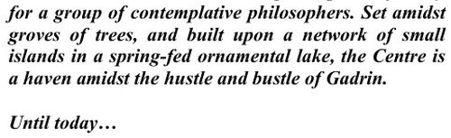

## p.1–4 (scan page 1)

Page contents: Title, RPGA notes, Force and DSP guidance, GM overview, background, encounter summaries, crawl (hand-read)

## p.5 (scan page 5)

Page contents: 817 words, 23 paragraphs | headings/entries: Heading toward the crash:; Hanging back:; Waiting for the Authorities; Operation Blue Star; Encounter 2: What's Going on Here?; Approaching the shuttle:; Page 5

- **No single roster character (rules/setting/general)** — entry/section: Avenue of the Flowering Trees: "Many people regard this sight as worth a trip to the city — or even to Cularin — all by itself." Source: *104 - Operation Blue Star* (SWRPG d20 Revised Core), p.5
  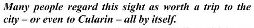
- **No single roster character (rules/setting/general)** — entry/section: Encounter 1: "Suddenly, from somewhere off to your left, there is a sudden explosion, shaking the ground beneath your feet. Clouds of dark oily smoke rise skywards as those on the street turn to look. Then blaster fire and screams rend the air..." Source: *104 - Operation Blue Star* (SWRPG d20 Revised Core), p.5
  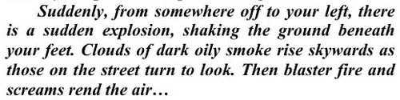
- **No single roster character (rules/setting/general)** — entry/section: Tarasin student: ""Help — please help!" he gasps" Source: *104 - Operation Blue Star* (SWRPG d20 Revised Core), p.5
  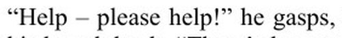
- **No single roster character (rules/setting/general)** — entry/section: Tarasin student: "He is bright red and his fan stands out from his neck — he's clearly already past the edge of panic." Source: *104 - Operation Blue Star* (SWRPG d20 Revised Core), p.5
  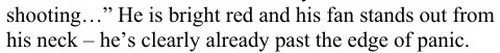
- **No single roster character (rules/setting/general)** — entry/section: OPS patrol officer: "he is cut down by a burst of blaster fire and falls, the fabric of his crisp, white uniform charred, at their feet." Source: *104 - Operation Blue Star* (SWRPG d20 Revised Core), p.5
  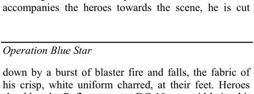

## p.6 (scan page 6)

Page contents: 865 words, 18 paragraphs | headings/entries: Position and strategy:; Encounter 3: Can We Be of Assistance?; Operation Blue Star; Page 6

- **No single roster character (rules/setting/general)** — entry/section: Encounter 2: "Particularly observant heroes with tactical or military background might realize that the fire is meant as suppressing fire, and no one is actually trying to kill them." Source: *104 - Operation Blue Star* (SWRPG d20 Revised Core), p.6
  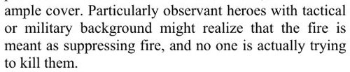
- **No single roster character (rules/setting/general)** — entry/section: Dersa Welles: ""Keep away, whoever you are!" a woman's voice orders from the first of the low, white office buildings." Source: *104 - Operation Blue Star* (SWRPG d20 Revised Core), p.6
  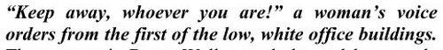
- **No single roster character (rules/setting/general)** — entry/section: Dersa Welles: "Dersa may be a thoroughgoing villain, but she does try to take care of her people." Source: *104 - Operation Blue Star* (SWRPG d20 Revised Core), p.6
  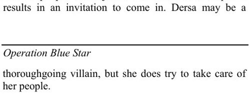
- **No single roster character (rules/setting/general)** — entry/section: Dersa Welles: "While those capable may use the Force to divert the search ("These are not the weapons you are looking for"!)" Source: *104 - Operation Blue Star* (SWRPG d20 Revised Core), p.6
  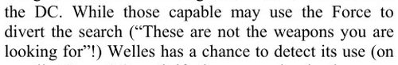

## p.7 (scan page 7)

Page contents: 858 words, 17 paragraphs | headings/entries: Operation Blue Star; Encounter 4a: It's Good to Talk; Page 7

- **No single roster character (rules/setting/general)** — entry/section: Dersa Welles: "Dersa is a being on the edge, pushed to the boundaries of her ability to cope and reading to make someone pay for her frustration and fury." Source: *104 - Operation Blue Star* (SWRPG d20 Revised Core), p.7
  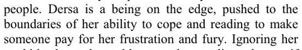
- **No single roster character (rules/setting/general)** — entry/section: Dersa Welles: ""If you're having trouble triaging, it will be simpler if this one is dead, won't it?"" Source: *104 - Operation Blue Star* (SWRPG d20 Revised Core), p.7
  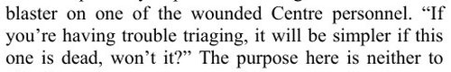
- **No single roster character (rules/setting/general)** — entry/section: Dersa Welles: ""I suppose there may be some, but that's their problem."" Source: *104 - Operation Blue Star* (SWRPG d20 Revised Core), p.7
  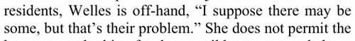
- **No single roster character (rules/setting/general)** — entry/section: Dersa Welles: ""I am Dersa Welles of the Intarsa League. Our demands are as follows: we require that whoever it was that attacked us be taken into custody and dealt with under the full severity of the law for their unprovoked violence against us." Source: *104 - Operation Blue Star* (SWRPG d20 Revised Core), p.7
  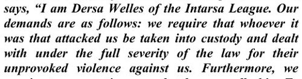
- **No single roster character (rules/setting/general)** — entry/section: Dersa Welles: "Any deviation from these terms and we cannot guarantee the safety of the occupants of this place."" Source: *104 - Operation Blue Star* (SWRPG d20 Revised Core), p.7
  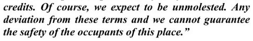

## p.8 (scan page 8)

Page contents: 836 words, 20 paragraphs | headings/entries: Operation Blue Star; Page 8

- **No single roster character (rules/setting/general)** — entry/section: Hanes Croft: "indeed, as he's Cerean, his display is quite significant... and due to the fact that his brother is a teacher at the Centre." Source: *104 - Operation Blue Star* (SWRPG d20 Revised Core), p.8
  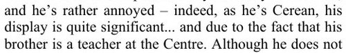
- **No single roster character (rules/setting/general)** — entry/section: Hanes Croft: "His worry over his brother overshadows him, though he is doing a masterful job of keeping his thoughts on the business of disarming this crisis." Source: *104 - Operation Blue Star* (SWRPG d20 Revised Core), p.8
  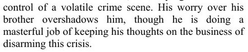
- **No single roster character (rules/setting/general)** — entry/section: Barnab Chistor: "When he is contacted, he is adamant that there is to be no negotiation with terrorists and that they must be arrested forthwith." Source: *104 - Operation Blue Star* (SWRPG d20 Revised Core), p.8
  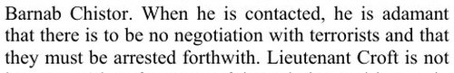
- **No single roster character (rules/setting/general)** — entry/section: OPS: ""This is the Office of Peace and Security. You are surrounded. Throw down your weapons and come out with your hands in the air."" Source: *104 - Operation Blue Star* (SWRPG d20 Revised Core), p.8
  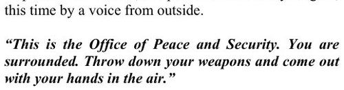
- **No single roster character (rules/setting/general)** — entry/section: Dersa Welles: ""You're locals, aren't you? Could they surround this place? It looked quite big from the air. How good are these Peace and Security people anyway? I've not been to Cularin before... and I don't think I'm coming back!"" Source: *104 - Operation Blue Star* (SWRPG d20 Revised Core), p.8
  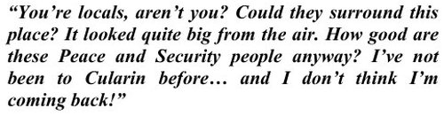
- **No single roster character (rules/setting/general)** — entry/section: Dersa Welles: "The light of revenge burns in her eyes." Source: *104 - Operation Blue Star* (SWRPG d20 Revised Core), p.8
  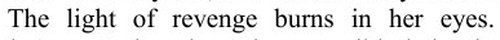

## p.9 (scan page 9)

Page contents: 801 words, 19 paragraphs | headings/entries: Encounter 5a: Infiltration; Operation Blue Star; Encounter 5b: Exfiltration; Page 9

- **No single roster character (rules/setting/general)** — entry/section: Nirama: "Intelligence check of 10 can deduce that this is not Nirama's style. If he wanted them dead, they'd be dead already." Source: *104 - Operation Blue Star* (SWRPG d20 Revised Core), p.9
  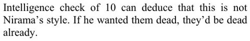
- **No single roster character (rules/setting/general)** — entry/section: Intarsa League: "They all know that once someone dies, the penalty if they are caught increases significantly." Source: *104 - Operation Blue Star* (SWRPG d20 Revised Core), p.9
  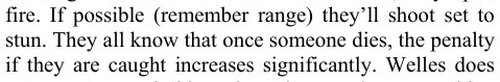
- **No single roster character (rules/setting/general)** — entry/section: Encounter 5a: "There are endless possibilities here, which can be fueled by every action movie you've ever seen." Source: *104 - Operation Blue Star* (SWRPG d20 Revised Core), p.9
  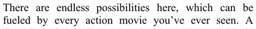

## p.4–9 (scan page 4)

Page contents: E1 explosion; E2 the shuttle; E3 inside with the wounded; E4 negotiations (hand-read)

## p.10 (scan page 10)

Page contents: 798 words, 22 paragraphs | headings/entries: Encounter 6: Peace and Love; Operation Blue Star; Showdown at the Centre; Encounter 7: Picking up the Pieces; Page 10

- **No single roster character (rules/setting/general)** — entry/section: Barnab Chistor: "(Governor Chistor insists that more and more troopers be thrown at the problem until they are!)" Source: *104 - Operation Blue Star* (SWRPG d20 Revised Core), p.10
  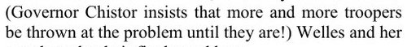
- **No single roster character (rules/setting/general)** — entry/section: Amin Galingal: "Poor Lector Galingal is prostrate with terror" Source: *104 - Operation Blue Star* (SWRPG d20 Revised Core), p.10
  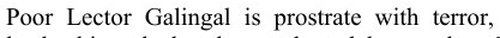
- **No single roster character (rules/setting/general)** — entry/section: Gars Croft: "Gars is passionate and charismatic, and clearly is willing to lay down his life for his principles." Source: *104 - Operation Blue Star* (SWRPG d20 Revised Core), p.10
  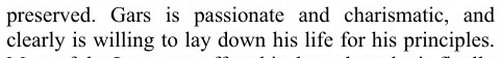
- **No single roster character (rules/setting/general)** — entry/section: Encounter 7: "(Visions of Jedi and Scoundrels rappeling down from the skylight...)" Source: *104 - Operation Blue Star* (SWRPG d20 Revised Core), p.10
  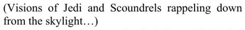

## p.11 (scan page 11)

Page contents: 751 words, 21 paragraphs | headings/entries: Conclusion; Operation Blue Star; Here Ends Operation Blue Star; Experience Point Summary; Adventure Experience Award:; Page 11

- **No single roster character (rules/setting/general)** — entry/section: Dersa Welles: "Note that she does not really want to shoot him, but has at this point reached the end of her tether." Source: *104 - Operation Blue Star* (SWRPG d20 Revised Core), p.11
  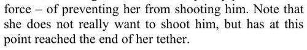
- **No single roster character (rules/setting/general)** — entry/section: Conclusion: "Once the crisis is over, Lector Amin Galingal comes out of his state of 'funk' and is most gracious to the heroes for their assistance." Source: *104 - Operation Blue Star* (SWRPG d20 Revised Core), p.11
  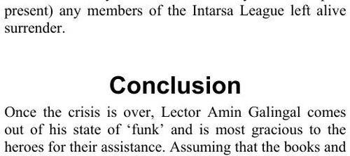
- **No single roster character (rules/setting/general)** — entry/section: Nirama: "Nirama's people, who Welles claims attacked her, are never found — mostly because they were not involved: her real attackers elude detection too." Source: *104 - Operation Blue Star* (SWRPG d20 Revised Core), p.11
  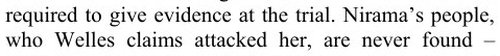
- **No single roster character (rules/setting/general)** — entry/section: Intarsa League: "Either way, they have long memories..." Source: *104 - Operation Blue Star* (SWRPG d20 Revised Core), p.11
  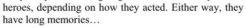

## p.12 (scan page 12)

Page contents: 434 words, 24 paragraphs | headings/entries: Loot Summary; Encounter 2: -; From the dead Rodian on the walk; The rest of the adventure: -; Conclusion: -; If the heroes helped Dersa escape:; Operation Blue Star; Page 12

- **No single roster character (rules/setting/general)** — entry/section: Favor of Dersa Welles: "having assisted Dersa Welles through the midst of a terrible misunderstanding, may ask for one illicit item to be brought in system at list price" Source: *104 - Operation Blue Star* (SWRPG d20 Revised Core), p.12
  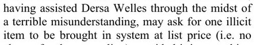
- **No single roster character (rules/setting/general)** — entry/section: Favor of Dersa Welles: "(i.e. no blaster rifles or vibroaxes and no thermal detonators! )" Source: *104 - Operation Blue Star* (SWRPG d20 Revised Core), p.12
  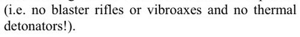

## p.9–12 (scan page 9)

Page contents: E5 infiltration/exfiltration; E6 the philosophers; E7 showdown; conclusion, XP, loot (hand-read)

## p.13 (scan page 13)

Page contents: 403 words, 7 paragraphs | headings/entries: Player Handout 2: Dersa Welles; Operation Blue Star Page 13

- **No single roster character (rules/setting/general)** — entry/section: Dee-lyn Cance: "a Cerean philosopher and former Jedi who had found even the life of a Jedi Consular to be too active and 'in your face' for his contemplative tastes." Source: *104 - Operation Blue Star* (SWRPG d20 Revised Core), p.13
  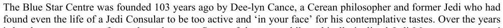
- **No single roster character (rules/setting/general)** — entry/section: Blue Star Centre: "It has been said that those who go to the Centre to undertake the meditation exercises necessary to attune lightsabre crystals have a greater chance of success when they come to construct their lightsabres." Source: *104 - Operation Blue Star* (SWRPG d20 Revised Core), p.13
  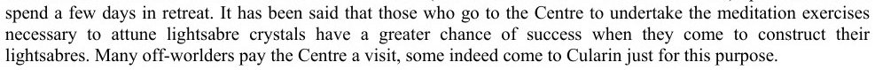
- **No single roster character (rules/setting/general)** — entry/section: Hagrana Memuna: "was arrested recently after she protested one of Governor Chistor's decisions by uprooting all the flowers from the garden at his official residence and replanting them in a clearing outside town." Source: *104 - Operation Blue Star* (SWRPG d20 Revised Core), p.13
  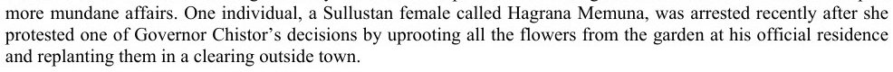
- **No single roster character (rules/setting/general)** — entry/section: Dersa Welles: "She has a reputation for layers of deceit and for always having another trick up her sleeve." Source: *104 - Operation Blue Star* (SWRPG d20 Revised Core), p.13
  

## p.14 (scan page 14)

Page contents: 102 words, 3 paragraphs | headings/entries: Operation Blue Star Page 14

- **No single roster character (rules/setting/general)** — entry/section: DM Aid #1: "It would, it happens, make an excellent place to land a shuttle or a large speeder." Source: *104 - Operation Blue Star* (SWRPG d20 Revised Core), p.14
  

## p.15 (scan page 15)

Page contents: 54 words, 5 paragraphs | headings/entries: First Floor Inn); Study Desk = MY; Operation Blue Star Page 15

## p.16 (scan page 16)

Page contents: 52 words, 5 paragraphs | headings/entries: First Floor; Study Desk =; Operation Blue Star Page 16

## p.17 (scan page 17)

Page contents: 51 words, 6 paragraphs | headings/entries: L; Operation Blue Star Page 17

## p.18 (scan page 18)

Page contents: 788 words, 26 paragraphs | headings/entries: Appendix A: NPCs; Operation Blue Star; Demolitions +7,; Page 18

- **No single roster character (rules/setting/general)** — entry/section: Dersa Welles: "Never before have her plans gone so far awry, never before has she been so comprehensively double-crossed: indeed, it is normally she who DOES the double-crossing!" Source: *104 - Operation Blue Star* (SWRPG d20 Revised Core), p.18
  
- **No single roster character (rules/setting/general)** — entry/section: Dersa Welles: "this time she is certain that they will pay in bitter coin for what they have done to her plans — whoever they are." Source: *104 - Operation Blue Star* (SWRPG d20 Revised Core), p.18
  
- **No single roster character (rules/setting/general)** — entry/section: Blandos Deena: "He is a control freak, and dislikes any situation that he has not had opportunity to scout out ahead of time." Source: *104 - Operation Blue Star* (SWRPG d20 Revised Core), p.18
  
- **No single roster character (rules/setting/general)** — entry/section: Lindo Peate: "He is determined to see that the Centre and its inhabitants come to no harm during this occupation even if it brings him into conflict with the rest of the League." Source: *104 - Operation Blue Star* (SWRPG d20 Revised Core), p.18
  

### Stat block notes (game mechanics, not feats)

- Dersa Welles: Dersa Welles (Human female Force Adept 1/Scoundrel 2/Noble 2): Defence 16; VP/WP 12/9; Blaster pistol +3 ranged 3d6; Force Points 3, Dark Side Points 2; Reputation 6; Sense Motive +12 (Source: *104 - Operation Blue Star* (SWRPG d20 Revised Core), p.18)
- Blandos Deena: Blandos Deena (Human male soldier 4): Defence 17; VP/WP 34/15; Blaster Pistol +6 ranged 3d6 (Source: *104 - Operation Blue Star* (SWRPG d20 Revised Core), p.18)

## p.19 (scan page 19)

Page contents: 763 words, 38 paragraphs | headings/entries: Demolitions +7,; Skill; Operation Blue Star; Page 19

- **No single roster character (rules/setting/general)** — entry/section: Lorcan Neeblo: "His best friend and lover gunned down in the ambush, Lorcan just doesn't care any more." Source: *104 - Operation Blue Star* (SWRPG d20 Revised Core), p.19
  
- **No single roster character (rules/setting/general)** — entry/section: Corkash Fence: "It's not so much revenge that motivates him; he hates not to know what is going on..." Source: *104 - Operation Blue Star* (SWRPG d20 Revised Core), p.19
  
- **No single roster character (rules/setting/general)** — entry/section: Leftan Harris: "He is resisting an almost overwhelming urge to curl up in a whimpering ball, covering it up with a display of strutting bravado." Source: *104 - Operation Blue Star* (SWRPG d20 Revised Core), p.19
  
- **No single roster character (rules/setting/general)** — entry/section: Gellar Domo: "if he cannot intimidate people into seeing things his way, a tap or two from a baton on a sensitive spot usually proves convincing." Source: *104 - Operation Blue Star* (SWRPG d20 Revised Core), p.19
  

## p.20 (scan page 20)

Page contents: 581 words, 25 paragraphs | headings/entries: Skill; Demolitions +7,; Operation Blue Star; Demolitions +7,; Page 20

- **No single roster character (rules/setting/general)** — entry/section: Harko Wooley: "he is fond of her in a mushy, romantic way." Source: *104 - Operation Blue Star* (SWRPG d20 Revised Core), p.20
  
- **No single roster character (rules/setting/general)** — entry/section: Estan Carolinden: "Estan is interested in one person: himself." Source: *104 - Operation Blue Star* (SWRPG d20 Revised Core), p.20
  
- **No single roster character (rules/setting/general)** — entry/section: Lidan Bleeker: "With his mercenary mindset, he's loyal to whoever is paying him." Source: *104 - Operation Blue Star* (SWRPG d20 Revised Core), p.20
  

### Stat block notes (game mechanics, not feats)

- Intarsa League cannon fodder: 'Cannon Fodder' Intarsa League Members - 6 Human or Rodian soldier 4: Defence 17; VP/WP 34/15 (Source: *104 - Operation Blue Star* (SWRPG d20 Revised Core), p.20)

## p.21 (scan page 21)

Page contents: 147 words, 7 paragraphs | headings/entries: Yes No; Yes No; Operation Blue Star Page 21

## p.13–21 (scan page 13)

Page contents: Handouts; DM Aid maps; Appendix A NPCs; critical events (hand-read)

