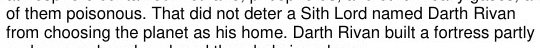
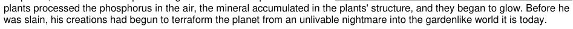
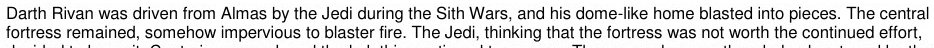
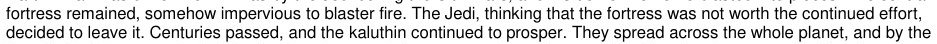
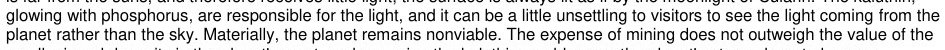
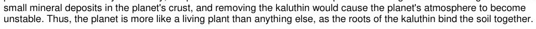
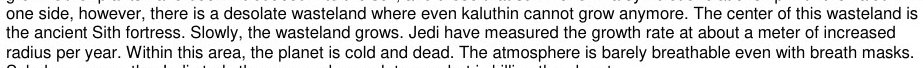
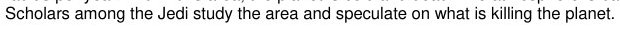
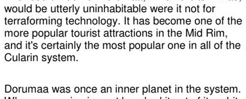

# Owner Material 037 — Star Wars D20 Drive folder (Core, Revised Core and Saga Edition): Living Force Campaign/Articles/General Articles/Almas.pdf [Star Wars Roleplaying Game Revised Core (d20, 2002)]

- **Source:** Wizards of the Coast Star Wars Roleplaying Game books, web enhancements, Living Force campaign modules and articles (2000–2010), from the owner's "Star Wars D20" Drive folder (only the three edition subfolders; "General" was not read, as instructed). Secondary source (licensed Legends reference). Scan OCR'd on the box; the scan stays box-only and is **not** published.
- **Method:** every scanned page was OCR'd and machine-screened sentence by sentence for power-relevant statements (fights, kills, defeats, Force feats, rankings, superweapons) that name a character on our roster; each kept sentence is quoted verbatim from the OCR text and has a crop of the printed passage directly under it. Pages with nothing power-relevant are still listed with what is on them.
- **Citation:** "*Almas* (SWRPG d20 Revised Core), p.X" by printed page ("scan p.X" where no printed number applies). **Weight:** Licensed RPG material: a secondary source. Narrative text sums up Legends lore; game statistics are rules for players, not canon power levels, and rank lowest.

## scan p.1 (scan page 1)

Page contents: Almas and the Darth Rivan history; Dorumaa sidebar (hand-read)

- **Darth Rivan** — entry/section: Almas: "That did not deter a Sith Lord named Darth Rivan from choosing the planet as his home." Source: *Almas* (SWRPG d20 Revised Core), scan p.1
  
- **Darth Rivan** — entry/section: Almas: "Before he was slain, his creations had begun to terraform the planet from an unlivable nightmare into the gardenlike world it is today." Source: *Almas* (SWRPG d20 Revised Core), scan p.1
  
- **Darth Rivan** — entry/section: Almas: "Darth Rivan was driven from Almas by the Jedi during the Sith Wars, and his dome-like home blasted into pieces. The central fortress remained, somehow impervious to blaster fire." Source: *Almas* (SWRPG d20 Revised Core), scan p.1
  
- **No single roster character (rules/setting/general)** — entry/section: Almas: "The Jedi, thinking that the fortress was not worth the continued effort, decided to leave it." Source: *Almas* (SWRPG d20 Revised Core), scan p.1
  
- **No single roster character (rules/setting/general)** — entry/section: Almas: "it can be a little unsettling to visitors to see the light coming from the planet rather than the sky." Source: *Almas* (SWRPG d20 Revised Core), scan p.1
  
- **No single roster character (rules/setting/general)** — entry/section: Almas: "Thus, the planet is more like a living plant than anything else, as the roots of the kaluthin bind the soil together." Source: *Almas* (SWRPG d20 Revised Core), scan p.1
  
- **No single roster character (rules/setting/general)** — entry/section: Almas: "The center of this wasteland is the ancient Sith fortress. Slowly, the wasteland grows. Jedi have measured the growth rate at about a meter of increased radius per year." Source: *Almas* (SWRPG d20 Revised Core), scan p.1
  
- **No single roster character (rules/setting/general)** — entry/section: Almas: "Scholars among the Jedi study the area and speculate on what is killing the planet." Source: *Almas* (SWRPG d20 Revised Core), scan p.1
  
- **No single roster character (rules/setting/general)** — entry/section: Dorumaa: "It has become one of the more popular tourist attractions in the Mid Rim, and it's certainly the most popular one in all of the Cularin system." Source: *Almas* (SWRPG d20 Revised Core), scan p.1
  
