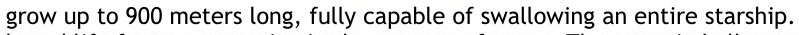
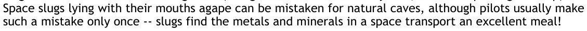
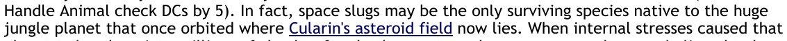
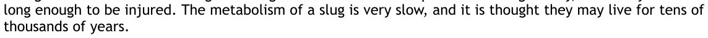
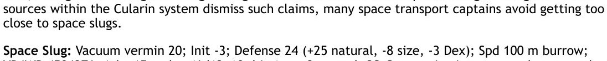

# Owner Material 037 — Star Wars D20 Drive folder (Core, Revised Core and Saga Edition): Living Force Campaign/Articles/General Articles/Creature Feature - Cularin Space Slug.pdf [Star Wars Roleplaying Game Revised Core (d20, 2002)]

- **Source:** Wizards of the Coast Star Wars Roleplaying Game books, web enhancements, Living Force campaign modules and articles (2000–2010), from the owner's "Star Wars D20" Drive folder (only the three edition subfolders; "General" was not read, as instructed). Secondary source (licensed Legends reference). Scan OCR'd on the box; the scan stays box-only and is **not** published.
- **Method:** every scanned page was OCR'd and machine-screened sentence by sentence for power-relevant statements (fights, kills, defeats, Force feats, rankings, superweapons) that name a character on our roster; each kept sentence is quoted verbatim from the OCR text and has a crop of the printed passage directly under it. Pages with nothing power-relevant are still listed with what is on them.
- **Citation:** "*Creature Feature - Cularin Space Slug* (SWRPG d20 Revised Core), p.X" by printed page ("scan p.X" where no printed number applies). **Weight:** Licensed RPG material: a secondary source. Narrative text sums up Legends lore; game statistics are rules for players, not canon power levels, and rank lowest.

## scan p.1 (scan page 1)

Page contents: Cularin space slug description and stats (hand-read)

- **No single roster character (rules/setting/general)** — entry/section: Cularin Space Slug: "grow up to 900 meters long, fully capable of swallowing an entire starship." Source: *Creature Feature - Cularin Space Slug* (SWRPG d20 Revised Core), scan p.1
  
- **No single roster character (rules/setting/general)** — entry/section: Cularin Space Slug: "Space slugs lying with their mouths agape can be mistaken for natural caves, although pilots usually make such a mistake only once -- slugs find the metals and minerals in a space transport an excellent meal!" Source: *Creature Feature - Cularin Space Slug* (SWRPG d20 Revised Core), scan p.1
  
- **No single roster character (rules/setting/general)** — entry/section: Cularin Space Slug: "space slugs may be the only surviving species native to the huge jungle planet that once orbited where Cularin's asteroid field now lies." Source: *Creature Feature - Cularin Space Slug* (SWRPG d20 Revised Core), scan p.1
  
- **No single roster character (rules/setting/general)** — entry/section: Cularin Space Slug: "The metabolism of a slug is very slow, and it is thought they may live for tens of thousands of years." Source: *Creature Feature - Cularin Space Slug* (SWRPG d20 Revised Core), scan p.1
  
- **No single roster character (rules/setting/general)** — entry/section: Cularin Space Slug: "many space transport captains avoid getting too close to space slugs." Source: *Creature Feature - Cularin Space Slug* (SWRPG d20 Revised Core), scan p.1
  

### Stat block notes (game mechanics, not feats)

- Cularin Space Slug: Space Slug: Vacuum vermin 20; Defense 24; VP/WP 450/376; Atk +15 melee (6d12+10, bite); damage reduction 25; SZ C; Str 31, Con 47; Challenge Code: G (Source: *Creature Feature - Cularin Space Slug* (SWRPG d20 Revised Core), scan p.1)
