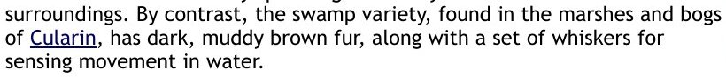
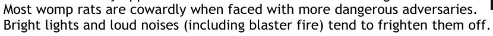
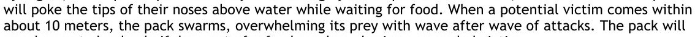
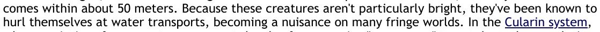
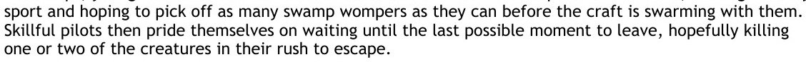

# Owner Material 037 — Star Wars D20 Drive folder (Core, Revised Core and Saga Edition): Living Force Campaign/Articles/General Articles/Creature Feature - The Swamp Womp Rat!.pdf [Star Wars Roleplaying Game Revised Core (d20, 2002)]

- **Source:** Wizards of the Coast Star Wars Roleplaying Game books, web enhancements, Living Force campaign modules and articles (2000–2010), from the owner's "Star Wars D20" Drive folder (only the three edition subfolders; "General" was not read, as instructed). Secondary source (licensed Legends reference). Scan OCR'd on the box; the scan stays box-only and is **not** published.
- **Method:** every scanned page was OCR'd and machine-screened sentence by sentence for power-relevant statements (fights, kills, defeats, Force feats, rankings, superweapons) that name a character on our roster; each kept sentence is quoted verbatim from the OCR text and has a crop of the printed passage directly under it. Pages with nothing power-relevant are still listed with what is on them.
- **Citation:** "*Creature Feature - The Swamp Womp Rat!* (SWRPG d20 Revised Core), p.X" by printed page ("scan p.X" where no printed number applies). **Weight:** Licensed RPG material: a secondary source. Narrative text sums up Legends lore; game statistics are rules for players, not canon power levels, and rank lowest.

## scan p.1 (scan page 1)

Page contents: Swamp womp rat description, tactics, stats (hand-read)

- **No single roster character (rules/setting/general)** — entry/section: Swamp Womp Rat: "By contrast, the swamp variety, found in the marshes and bogs of Cularin, has dark, muddy brown fur, along with a set of whiskers for sensing movement in water." Source: *Creature Feature - The Swamp Womp Rat!* (SWRPG d20 Revised Core), scan p.1
  
- **No single roster character (rules/setting/general)** — entry/section: Swamp Womp Rat: "Most womp rats are cowardly when faced with more dangerous adversaries. Bright lights and loud noises (including blaster fire) tend to frighten them off." Source: *Creature Feature - The Swamp Womp Rat!* (SWRPG d20 Revised Core), scan p.1
  
- **No single roster character (rules/setting/general)** — entry/section: Swamp Womp Rat: "When a potential victim comes within about 10 meters, the pack swarms, overwhelming its prey with wave after wave of attacks." Source: *Creature Feature - The Swamp Womp Rat!* (SWRPG d20 Revised Core), scan p.1
  
- **No single roster character (rules/setting/general)** — entry/section: Swamp Womp Rat: "Because these creatures aren't particularly bright, they've been known to hurl themselves at water transports, becoming a nuisance on many fringe worlds." Source: *Creature Feature - The Swamp Womp Rat!* (SWRPG d20 Revised Core), scan p.1
  
- **No single roster character (rules/setting/general)** — entry/section: Swamp Womp Rat: "Skillful pilots then pride themselves on waiting until the last possible moment to leave, hopefully killing one or two of the creatures in their rush to escape." Source: *Creature Feature - The Swamp Womp Rat!* (SWRPG d20 Revised Core), scan p.1
  

### Stat block notes (game mechanics, not feats)

- Swamp Womp Rat: Swamp Womp Rat: Swamp predator 1; Defense 13; Spd 10 m, swim 10 m; VP/WP 4/11; Atk +1 melee (1d6, bite); Challenge Code: B (Source: *Creature Feature - The Swamp Womp Rat!* (SWRPG d20 Revised Core), scan p.1)
