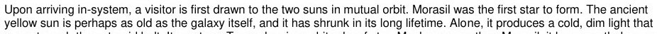
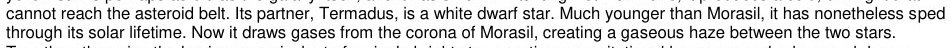

# Owner Material 037 — Star Wars D20 Drive folder (Core, Revised Core and Saga Edition): Living Force Campaign/Articles/General Articles/Cularin System.pdf [Star Wars Roleplaying Game Revised Core (d20, 2002)]

- **Source:** Wizards of the Coast Star Wars Roleplaying Game books, web enhancements, Living Force campaign modules and articles (2000–2010), from the owner's "Star Wars D20" Drive folder (only the three edition subfolders; "General" was not read, as instructed). Secondary source (licensed Legends reference). Scan OCR'd on the box; the scan stays box-only and is **not** published.
- **Method:** every scanned page was OCR'd and machine-screened sentence by sentence for power-relevant statements (fights, kills, defeats, Force feats, rankings, superweapons) that name a character on our roster; each kept sentence is quoted verbatim from the OCR text and has a crop of the printed passage directly under it. Pages with nothing power-relevant are still listed with what is on them.
- **Citation:** "*Cularin System* (SWRPG d20 Revised Core), p.X" by printed page ("scan p.X" where no printed number applies). **Weight:** Licensed RPG material: a secondary source. Narrative text sums up Legends lore; game statistics are rules for players, not canon power levels, and rank lowest.

## scan p.1 (scan page 1)

Page contents: Cularin system overview (hand-read)

- **No single roster character (rules/setting/general)** — entry/section: Morasil: "The ancient yellow sun is perhaps as old as the galaxy itself, and it has shrunk in its long lifetime." Source: *Cularin System* (SWRPG d20 Revised Core), scan p.1
  
- **No single roster character (rules/setting/general)** — entry/section: Termadus: "Its partner, Termadus, is a white dwarf star. Much younger than Morasil, it has nonetheless sped through its solar lifetime." Source: *Cularin System* (SWRPG d20 Revised Core), scan p.1
  
- **No single roster character (rules/setting/general)** — entry/section: Cularin System: "Making jumps into the Cularin system under these conditions is extremely difficult for normal nav computer programs, but it can be done." Source: *Cularin System* (SWRPG d20 Revised Core), scan p.1
  
- **No single roster character (rules/setting/general)** — entry/section: Cularin System: "Occasionally they collide, showering frozen debris and creating smaller comets that take their place in the strange cosmic dance." Source: *Cularin System* (SWRPG d20 Revised Core), scan p.1
  
