# Owner Material 037 — Star Wars D20 Drive folder (Core, Revised Core and Saga Edition): Living Force Campaign/Articles/General Articles/Cularin.pdf [Star Wars Roleplaying Game Revised Core (d20, 2002)]

- **Source:** Wizards of the Coast Star Wars Roleplaying Game books, web enhancements, Living Force campaign modules and articles (2000–2010), from the owner's "Star Wars D20" Drive folder (only the three edition subfolders; "General" was not read, as instructed). Secondary source (licensed Legends reference). Scan OCR'd on the box; the scan stays box-only and is **not** published.
- **Method:** every scanned page was OCR'd and machine-screened sentence by sentence for power-relevant statements (fights, kills, defeats, Force feats, rankings, superweapons) that name a character on our roster; each kept sentence is quoted verbatim from the OCR text and has a crop of the printed passage directly under it. Pages with nothing power-relevant are still listed with what is on them.
- **Citation:** "*Cularin* (SWRPG d20 Revised Core), p.X" by printed page ("scan p.X" where no printed number applies). **Weight:** Licensed RPG material: a secondary source. Narrative text sums up Legends lore; game statistics are rules for players, not canon power levels, and rank lowest.

## scan p.1 (scan page 1)

Page contents: Cularin planet, ch'hala, kilassin, mulissiki, Kiallquis; Rennokk; Tilnes; Tarasin (hand-read)

- **No single roster character (rules/setting/general)** — entry/section: Ch'hala trees: "Their greenish-purple bark produces swirling color patterns across its surface." Source: *Cularin* (SWRPG d20 Revised Core), scan p.1
  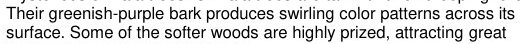
- **No single roster character (rules/setting/general)** — entry/section: Kilassin: "Great lizards called kilassin occupy the top of the food chain." Source: *Cularin* (SWRPG d20 Revised Core), scan p.1
  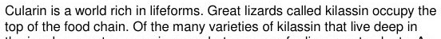
- **No single roster character (rules/setting/general)** — entry/section: Kilassin: "Corporations such as the Metatheran Cartel use them as labor beasts when they cannot take repulsorsleds into the jungles." Source: *Cularin* (SWRPG d20 Revised Core), scan p.1
  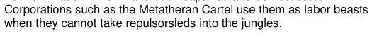
- **No single roster character (rules/setting/general)** — entry/section: Mulissiki: "these scavengers keep villages clean by devouring waste just about as fast as it is produced." Source: *Cularin* (SWRPG d20 Revised Core), scan p.1
  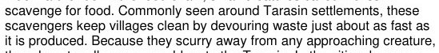
- **No single roster character (rules/setting/general)** — entry/section: Mulissiki: "Once they get into the platform cities, they cannot escape. Instead, they make nests in whatever dark corners they can find." Source: *Cularin* (SWRPG d20 Revised Core), scan p.1
  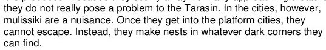
- **No single roster character (rules/setting/general)** — entry/section: Kiallquis: "In the past, the Tarasin used it to test the truth claims of suspected criminals (by lowering them over the edge), but in modern times, the ridge is used more for sponsored speeder races." Source: *Cularin* (SWRPG d20 Revised Core), scan p.1
  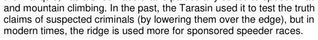
- **No single roster character (rules/setting/general)** — entry/section: Rennokk: "Apparently, kind of creature lives in its lava sea, though the only report of it is confusing." Source: *Cularin* (SWRPG d20 Revised Core), scan p.1
  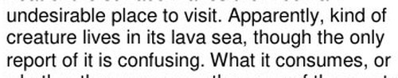
- **No single roster character (rules/setting/general)** — entry/section: Tilnes: "including the rare crystals used to focus energy through lightsabers to create their blades." Source: *Cularin* (SWRPG d20 Revised Core), scan p.1
  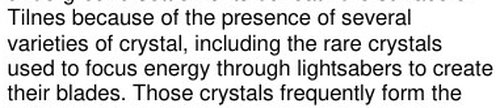
- **No single roster character (rules/setting/general)** — entry/section: T-32S light blaster: "a favorite among smugglers for its compact size and powerful penetration." Source: *Cularin* (SWRPG d20 Revised Core), scan p.1
  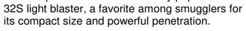
- **No single roster character (rules/setting/general)** — entry/section: Tarasin: "Through an attunement to the natural world, Tarasin can sense the Force naturally." Source: *Cularin* (SWRPG d20 Revised Core), scan p.1
  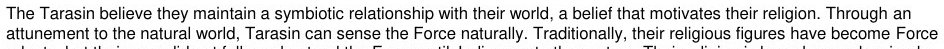
- **No single roster character (rules/setting/general)** — entry/section: Tarasin: "They sense life around them through their quills and value it too much to break the circle of symbiosis." Source: *Cularin* (SWRPG d20 Revised Core), scan p.1
  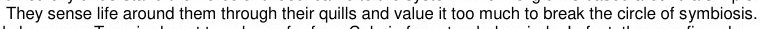

## scan p.2 (scan page 2)

Page contents: Tarasin leadership: Irstat-Kes and Mothers (hand-read)

- **No single roster character (rules/setting/general)** — entry/section: Tarasin: "protective of their world and its resources, violently protecting it from outsiders. This attitude has forced them into conflict with offworlders twice in their history." Source: *Cularin* (SWRPG d20 Revised Core), scan p.2
  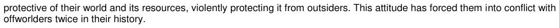
- **No single roster character (rules/setting/general)** — entry/section: Tarasin Mothers: "Tarasin Mothers embody the best aspects of the Tarasin way of life, and all look up to them." Source: *Cularin* (SWRPG d20 Revised Core), scan p.2
  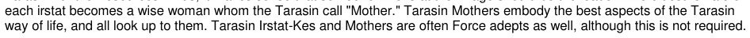
