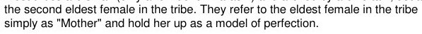
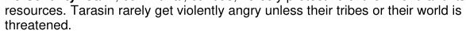
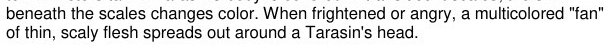
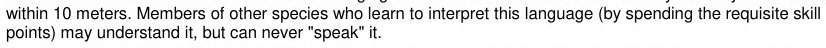

# Owner Material 037 — Star Wars D20 Drive folder (Core, Revised Core and Saga Edition): Living Force Campaign/Articles/General Articles/Tarasin.pdf [Star Wars Roleplaying Game Revised Core (d20, 2002)]

- **Source:** Wizards of the Coast Star Wars Roleplaying Game books, web enhancements, Living Force campaign modules and articles (2000–2010), from the owner's "Star Wars D20" Drive folder (only the three edition subfolders; "General" was not read, as instructed). Secondary source (licensed Legends reference). Scan OCR'd on the box; the scan stays box-only and is **not** published.
- **Method:** every scanned page was OCR'd and machine-screened sentence by sentence for power-relevant statements (fights, kills, defeats, Force feats, rankings, superweapons) that name a character on our roster; each kept sentence is quoted verbatim from the OCR text and has a crop of the printed passage directly under it. Pages with nothing power-relevant are still listed with what is on them.
- **Citation:** "*Tarasin* (SWRPG d20 Revised Core), p.X" by printed page ("scan p.X" where no printed number applies). **Weight:** Licensed RPG material: a secondary source. Narrative text sums up Legends lore; game statistics are rules for players, not canon power levels, and rank lowest.

## scan p.1 (scan page 1)

Page contents: Tarasin species description and traits (hand-read)

- **No single roster character (rules/setting/general)** — entry/section: Tarasin: "They refer to the eldest female in the tribe simply as "Mother" and hold her up as a model of perfection." Source: *Tarasin* (SWRPG d20 Revised Core), scan p.1
  
- **No single roster character (rules/setting/general)** — entry/section: Tarasin: "Tarasin rarely get violently angry unless their tribes or their world is threatened." Source: *Tarasin* (SWRPG d20 Revised Core), scan p.1
  
- **No single roster character (rules/setting/general)** — entry/section: Tarasin: "When frightened or angry, a multicolored "fan" of thin, scaly flesh spreads out around a Tarasin's head." Source: *Tarasin* (SWRPG d20 Revised Core), scan p.1
  
- **No single roster character (rules/setting/general)** — entry/section: Tarasin: "Members of other species who learn to interpret this language (by spending the requisite skill points) may understand it, but can never "speak" it." Source: *Tarasin* (SWRPG d20 Revised Core), scan p.1
  

### Stat block notes (game mechanics, not feats)

- Tarasin: Tarasin Species Traits: +2 Intelligence, -2 Strength; +4 species bonus to Fortitude vs heat; +4 Hide; +2 See Force; -2 Bluff (Source: *Tarasin* (SWRPG d20 Revised Core), scan p.1)
