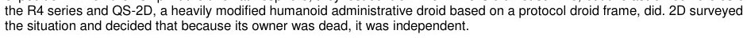
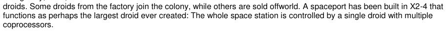
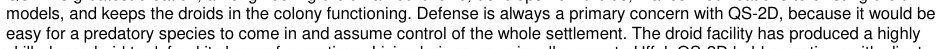
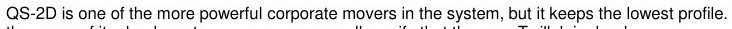
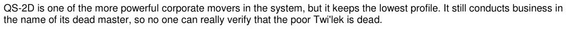

# Owner Material 037 — Star Wars D20 Drive folder (Core, Revised Core and Saga Edition): Living Force Campaign/Articles/General Articles/Uffel.pdf [Star Wars Roleplaying Game Revised Core (d20, 2002)]

- **Source:** Wizards of the Coast Star Wars Roleplaying Game books, web enhancements, Living Force campaign modules and articles (2000–2010), from the owner's "Star Wars D20" Drive folder (only the three edition subfolders; "General" was not read, as instructed). Secondary source (licensed Legends reference). Scan OCR'd on the box; the scan stays box-only and is **not** published.
- **Method:** every scanned page was OCR'd and machine-screened sentence by sentence for power-relevant statements (fights, kills, defeats, Force feats, rankings, superweapons) that name a character on our roster; each kept sentence is quoted verbatim from the OCR text and has a crop of the printed passage directly under it. Pages with nothing power-relevant are still listed with what is on them.
- **Citation:** "*Uffel* (SWRPG d20 Revised Core), p.X" by printed page ("scan p.X" where no printed number applies). **Weight:** Licensed RPG material: a secondary source. Narrative text sums up Legends lore; game statistics are rules for players, not canon power levels, and rank lowest.

## scan p.1 (scan page 1)

Page contents: Uffel and QS-2D entry (hand-read)

- **No single roster character (rules/setting/general)** — entry/section: QS-2D: "2D surveyed the situation and decided that because its owner was dead, it was independent." Source: *Uffel* (SWRPG d20 Revised Core), scan p.1
  
- **No single roster character (rules/setting/general)** — entry/section: X2-4: "A spaceport has been built in X2-4 that functions as perhaps the largest droid ever created: The whole space station is controlled by a single droid with multiple coprocessors." Source: *Uffel* (SWRPG d20 Revised Core), scan p.1
  
- **No single roster character (rules/setting/general)** — entry/section: QS-2D: "Defense is always a primary concern with QS-2D, because it would be easy for a predatory species to come in and assume control of the whole settlement." Source: *Uffel* (SWRPG d20 Revised Core), scan p.1
  
- **No single roster character (rules/setting/general)** — entry/section: QS-2D: "QS-2D is one of the more powerful corporate movers in the system, but it keeps the lowest profile." Source: *Uffel* (SWRPG d20 Revised Core), scan p.1
  
- **No single roster character (rules/setting/general)** — entry/section: QS-2D: "It still conducts business in the name of its dead master, so no one can really verify that the poor Twi'lek is dead." Source: *Uffel* (SWRPG d20 Revised Core), scan p.1
  
