# Owner Material 037 — Star Wars D20 Drive folder (Core, Revised Core and Saga Edition): Living Force Campaign/Articles/Year 1/02:08:01 - The Force is With Us!.pdf [Star Wars Roleplaying Game Revised Core (d20, 2002)]

- **Source:** Wizards of the Coast Star Wars Roleplaying Game books, web enhancements, Living Force campaign modules and articles (2000–2010), from the owner's "Star Wars D20" Drive folder (only the three edition subfolders; "General" was not read, as instructed). Secondary source (licensed Legends reference). Scan OCR'd on the box; the scan stays box-only and is **not** published.
- **Method:** every scanned page was OCR'd and machine-screened sentence by sentence for power-relevant statements (fights, kills, defeats, Force feats, rankings, superweapons) that name a character on our roster; each kept sentence is quoted verbatim from the OCR text and has a crop of the printed passage directly under it. Pages with nothing power-relevant are still listed with what is on them.
- **Citation:** "*02:08:01 - The Force is With Us!* (SWRPG d20 Revised Core), p.X" by printed page ("scan p.X" where no printed number applies). **Weight:** Licensed RPG material: a secondary source. Narrative text sums up Legends lore; game statistics are rules for players, not canon power levels, and rank lowest.

## scan p.1 (scan page 1)

Page contents: Launch report; campaign concept; Cularin setting; An Uneasy Peace setup (hand-read)

- **No single roster character (rules/setting/general)** — entry/section: Living Force: "A not so long time ago, in a galaxy very much like Fort Wayne, Ind., the Living Force campaign launched like a rocket." Source: *02:08:01 - The Force is With Us!* (SWRPG d20 Revised Core), scan p.1
  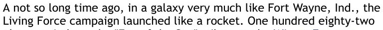
- **No single roster character (rules/setting/general)** — entry/section: Living Force: "In short - it's all about Star Wars." Source: *02:08:01 - The Force is With Us!* (SWRPG d20 Revised Core), scan p.1
  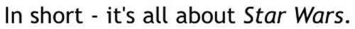
- **No single roster character (rules/setting/general)** — entry/section: Living Force: "We are attempting to tell a continuing story, one where the actions of the heroes have an impact on the outcome." Source: *02:08:01 - The Force is With Us!* (SWRPG d20 Revised Core), scan p.1
  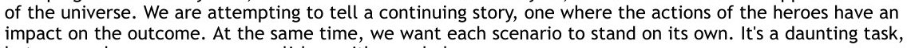
- **No single roster character (rules/setting/general)** — entry/section: Cularin: "With its new visibility, however, have come problems." Source: *02:08:01 - The Force is With Us!* (SWRPG d20 Revised Core), scan p.1
  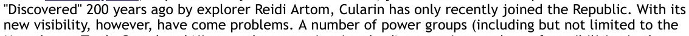
- **No single roster character (rules/setting/general)** — entry/section: Lanius Qel-Bertuk: "In addition, the system has a Jedi Academy, overseen by Jedi Master Lanius Qel-Bertuk." Source: *02:08:01 - The Force is With Us!* (SWRPG d20 Revised Core), scan p.1
  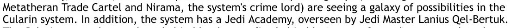
- **No single roster character (rules/setting/general)** — entry/section: Cularin: "During the first year of the campaign we'll introduce you to the richly detailed worlds of Cularin and the... er... interesting beings that reside there." Source: *02:08:01 - The Force is With Us!* (SWRPG d20 Revised Core), scan p.1
  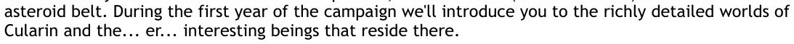
- **No single roster character (rules/setting/general)** — entry/section: Vanster Enan's Cantina: "Vanster Enan's Cantina was full to overflowing, featuring gambling, gossip, black market dealings and Wookiee arm-wrestling" Source: *02:08:01 - The Force is With Us!* (SWRPG d20 Revised Core), scan p.1
  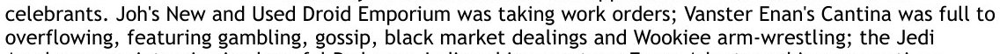

## scan p.2 (scan page 2)

Page contents: The interactive vote and its results (hand-read)

- **No single roster character (rules/setting/general)** — entry/section: An Uneasy Peace: "a number of unidentified individuals circulated through the crowd, offering 5,000 credits each to buy datapads and the ability to vote them." Source: *02:08:01 - The Force is With Us!* (SWRPG d20 Revised Core), scan p.2
  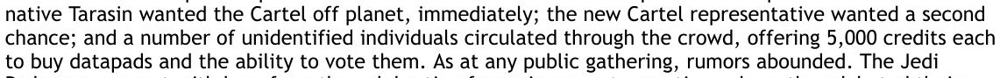
- **No single roster character (rules/setting/general)** — entry/section: An Uneasy Peace: "Many Jedi did abstain from the vote, feeling that it was not their place to meddle in Cularin's internal affairs." Source: *02:08:01 - The Force is With Us!* (SWRPG d20 Revised Core), scan p.2
  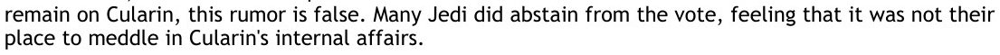
- **No single roster character (rules/setting/general)** — entry/section: An Uneasy Peace: "We all had brief hallucinations of being in Florida...)" Source: *02:08:01 - The Force is With Us!* (SWRPG d20 Revised Core), scan p.2
  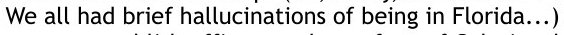
- **No single roster character (rules/setting/general)** — entry/section: Thurm Loogg: "As a goodwill gesture, Thurm Loogg (the new Cartel representative) presented the people of Cularin with a warship for the defense of the system. Tours were provided, and the various attempts to hijack the ship all failed." Source: *02:08:01 - The Force is With Us!* (SWRPG d20 Revised Core), scan p.2
  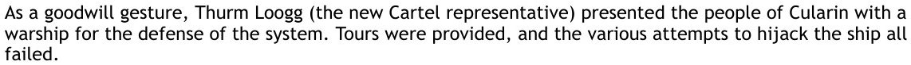
