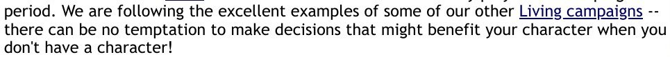
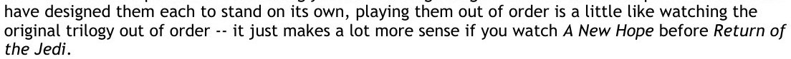
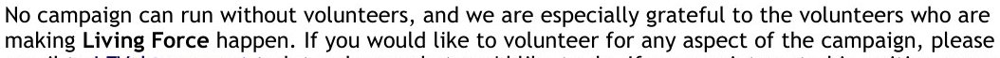
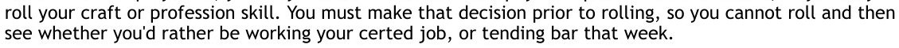

# Owner Material 037 — Star Wars D20 Drive folder (Core, Revised Core and Saga Edition): Living Force Campaign/Articles/Year 1/03:01:01 - What's New In Living Force.pdf [Star Wars Roleplaying Game Revised Core (d20, 2002)]

- **Source:** Wizards of the Coast Star Wars Roleplaying Game books, web enhancements, Living Force campaign modules and articles (2000–2010), from the owner's "Star Wars D20" Drive folder (only the three edition subfolders; "General" was not read, as instructed). Secondary source (licensed Legends reference). Scan OCR'd on the box; the scan stays box-only and is **not** published.
- **Method:** every scanned page was OCR'd and machine-screened sentence by sentence for power-relevant statements (fights, kills, defeats, Force feats, rankings, superweapons) that name a character on our roster; each kept sentence is quoted verbatim from the OCR text and has a crop of the printed passage directly under it. Pages with nothing power-relevant are still listed with what is on them.
- **Citation:** "*03:01:01 - What's New In Living Force* (SWRPG d20 Revised Core), p.X" by printed page ("scan p.X" where no printed number applies). **Weight:** Licensed RPG material: a secondary source. Narrative text sums up Legends lore; game statistics are rules for players, not canon power levels, and rank lowest.

## scan p.1 (scan page 1)

Page contents: Council, playtesters, release schedule, volunteers, errata intro (hand-read)

- **No single roster character (rules/setting/general)** — entry/section: Living Force Council: "there can be no temptation to make decisions that might benefit your character when you don't have a character!" Source: *03:01:01 - What's New In Living Force* (SWRPG d20 Revised Core), scan p.1
  
- **No single roster character (rules/setting/general)** — entry/section: Living Force: "playing them out of order is a little like watching the original trilogy out of order -- it just makes a lot more sense if you watch A New Hope before Return of the Jedi." Source: *03:01:01 - What's New In Living Force* (SWRPG d20 Revised Core), scan p.1
  
- **No single roster character (rules/setting/general)** — entry/section: Living Force: "No campaign can run without volunteers, and we are especially grateful to the volunteers who are making Living Force happen." Source: *03:01:01 - What's New In Living Force* (SWRPG d20 Revised Core), scan p.1
  

## scan p.2 (scan page 2)

Page contents: Errata: Padawan XP; profession income (hand-read)

- **No single roster character (rules/setting/general)** — entry/section: Errata: "so you cannot roll and then see whether you'd rather be working your certed job, or tending bar that week." Source: *03:01:01 - What's New In Living Force* (SWRPG d20 Revised Core), scan p.2
  
