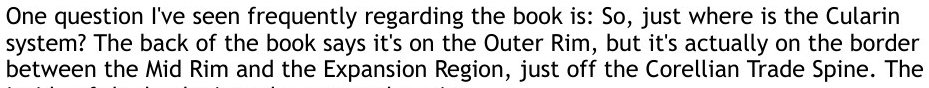

# Owner Material 037 — Star Wars D20 Drive folder (Core, Revised Core and Saga Edition): Living Force Campaign/Articles/Year 1/04:26:01 - News From the Director.pdf [Star Wars Roleplaying Game Revised Core (d20, 2002)]

- **Source:** Wizards of the Coast Star Wars Roleplaying Game books, web enhancements, Living Force campaign modules and articles (2000–2010), from the owner's "Star Wars D20" Drive folder (only the three edition subfolders; "General" was not read, as instructed). Secondary source (licensed Legends reference). Scan OCR'd on the box; the scan stays box-only and is **not** published.
- **Method:** every scanned page was OCR'd and machine-screened sentence by sentence for power-relevant statements (fights, kills, defeats, Force feats, rankings, superweapons) that name a character on our roster; each kept sentence is quoted verbatim from the OCR text and has a crop of the printed passage directly under it. Pages with nothing power-relevant are still listed with what is on them.
- **Citation:** "*04:26:01 - News From the Director* (SWRPG d20 Revised Core), p.X" by printed page ("scan p.X" where no printed number applies). **Weight:** Licensed RPG material: a secondary source. Narrative text sums up Legends lore; game statistics are rules for players, not canon power levels, and rank lowest.

## scan p.1 (scan page 1)

Page contents: Campaign Guide; Cularin location; passports and stickers; metagaming; ships (hand-read)

- **No single roster character (rules/setting/general)** — entry/section: Living Force Campaign Guide: "Note that it is a snapshot of the Cularin system at the start of the campaign, and things may change..." Source: *04:26:01 - News From the Director* (SWRPG d20 Revised Core), scan p.1
  
- **No single roster character (rules/setting/general)** — entry/section: Cularin: "The back of the book says it's on the Outer Rim, but it's actually on the border between the Mid Rim and the Expansion Region, just off the Corellian Trade Spine." Source: *04:26:01 - News From the Director* (SWRPG d20 Revised Core), scan p.1
  
- **No single roster character (rules/setting/general)** — entry/section: Living Force: "Instead of log sheets, Living Force uses nifty little passports to track which scenarios your character has played." Source: *04:26:01 - News From the Director* (SWRPG d20 Revised Core), scan p.1
  
- **No single roster character (rules/setting/general)** — entry/section: Living Force: "If we don't know that you played, we can't send you stickers!" Source: *04:26:01 - News From the Director* (SWRPG d20 Revised Core), scan p.1
  

## scan p.2 (scan page 2)

Page contents: Credit chips; ordering scenarios; AlphaCon box (hand-read)

- **No single roster character (rules/setting/general)** — entry/section: Republic Credit Chips: "Since we don't have log sheets, we need some mechanism for telling when you can afford such things, and thus the Republic Credit Chips were born." Source: *04:26:01 - News From the Director* (SWRPG d20 Revised Core), scan p.2
  
