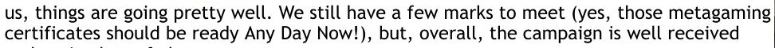
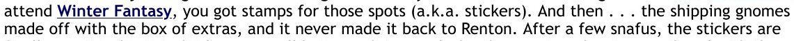
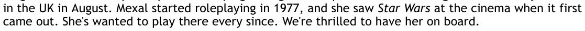
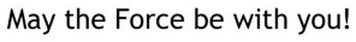

# Owner Material 037 — Star Wars D20 Drive folder (Core, Revised Core and Saga Edition): Living Force Campaign/Articles/Year 1/06:28:01 - News From The Living Force Campaign.pdf [Star Wars Roleplaying Game Revised Core (d20, 2002)]

- **Source:** Wizards of the Coast Star Wars Roleplaying Game books, web enhancements, Living Force campaign modules and articles (2000–2010), from the owner's "Star Wars D20" Drive folder (only the three edition subfolders; "General" was not read, as instructed). Secondary source (licensed Legends reference). Scan OCR'd on the box; the scan stays box-only and is **not** published.
- **Method:** every scanned page was OCR'd and machine-screened sentence by sentence for power-relevant statements (fights, kills, defeats, Force feats, rankings, superweapons) that name a character on our roster; each kept sentence is quoted verbatim from the OCR text and has a crop of the printed passage directly under it. Pages with nothing power-relevant are still listed with what is on them.
- **Citation:** "*06:28:01 - News From The Living Force Campaign* (SWRPG d20 Revised Core), p.X" by printed page ("scan p.X" where no printed number applies). **Weight:** Licensed RPG material: a secondary source. Narrative text sums up Legends lore; game statistics are rules for players, not canon power levels, and rank lowest.

## scan p.1 (scan page 1)

Page contents: Six-month update, stickers, new staff, release schedule (hand-read)

- **No single roster character (rules/setting/general)** — entry/section: Living Force: "We still have a few marks to meet (yes, those metagaming certificates should be ready Any Day Now!)" Source: *06:28:01 - News From The Living Force Campaign* (SWRPG d20 Revised Core), scan p.1
  
- **No single roster character (rules/setting/general)** — entry/section: Living Force: "And then. . . the shipping gnomes made off with the box of extras, and it never made it back to Renton." Source: *06:28:01 - News From The Living Force Campaign* (SWRPG d20 Revised Core), scan p.1
  
- **No single roster character (rules/setting/general)** — entry/section: Mexal: "Mexal started roleplaying in 1977, and she saw Star Wars at the cinema when it first came out. She's wanted to play there every since." Source: *06:28:01 - News From The Living Force Campaign* (SWRPG d20 Revised Core), scan p.1
  
- **No single roster character (rules/setting/general)** — entry/section: Living Force: "May the Force be with you!" Source: *06:28:01 - News From The Living Force Campaign* (SWRPG d20 Revised Core), scan p.1
  
