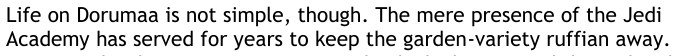
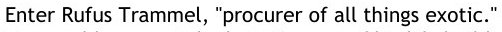
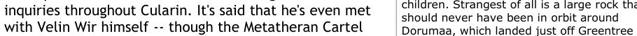
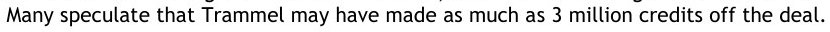
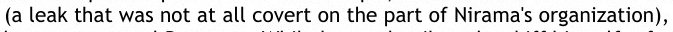
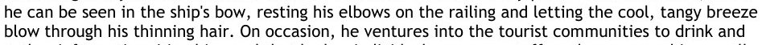
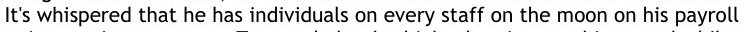
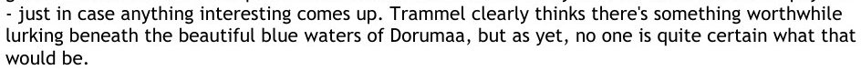
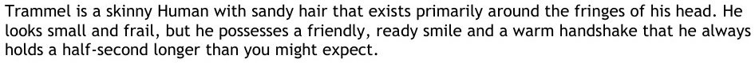

# Owner Material 037 — Star Wars D20 Drive folder (Core, Revised Core and Saga Edition): Living Force Campaign/Articles/Year 1/08:30:01 - New Crimelord - Rufus Trammel.pdf [Star Wars Roleplaying Game Revised Core (d20, 2002)]

- **Source:** Wizards of the Coast Star Wars Roleplaying Game books, web enhancements, Living Force campaign modules and articles (2000–2010), from the owner's "Star Wars D20" Drive folder (only the three edition subfolders; "General" was not read, as instructed). Secondary source (licensed Legends reference). Scan OCR'd on the box; the scan stays box-only and is **not** published.
- **Method:** every scanned page was OCR'd and machine-screened sentence by sentence for power-relevant statements (fights, kills, defeats, Force feats, rankings, superweapons) that name a character on our roster; each kept sentence is quoted verbatim from the OCR text and has a crop of the printed passage directly under it. Pages with nothing power-relevant are still listed with what is on them.
- **Citation:** "*08:30:01 - New Crimelord - Rufus Trammel* (SWRPG d20 Revised Core), p.X" by printed page ("scan p.X" where no printed number applies). **Weight:** Licensed RPG material: a secondary source. Narrative text sums up Legends lore; game statistics are rules for players, not canon power levels, and rank lowest.

## scan p.1 (scan page 1)

Page contents: Dorumaa, Trammel's background, adventure summary box (hand-read)

- **No single roster character (rules/setting/general)** — entry/section: Dorumaa: "The mere presence of the Jedi Academy has served for years to keep the garden-variety ruffian away." Source: *08:30:01 - New Crimelord - Rufus Trammel* (SWRPG d20 Revised Core), scan p.1
  
- **No single roster character (rules/setting/general)** — entry/section: Rufus Trammel: "Enter Rufus Trammel, "procurer of all things exotic."" Source: *08:30:01 - New Crimelord - Rufus Trammel* (SWRPG d20 Revised Core), scan p.1
  
- **No single roster character (rules/setting/general)** — entry/section: Rufus Trammel: "It's said that he's even met with Velin Wir himself" Source: *08:30:01 - New Crimelord - Rufus Trammel* (SWRPG d20 Revised Core), scan p.1
  
- **No single roster character (rules/setting/general)** — entry/section: Rufus Trammel: "Many speculate that Trammel may have made as much as 3 million credits off the deal." Source: *08:30:01 - New Crimelord - Rufus Trammel* (SWRPG d20 Revised Core), scan p.1
  
- **No single roster character (rules/setting/general)** — entry/section: Rufus Trammel: "(a leak that was not at all covert on the part of Nirama's organization)" Source: *08:30:01 - New Crimelord - Rufus Trammel* (SWRPG d20 Revised Core), scan p.1
  
- **No single roster character (rules/setting/general)** — entry/section: Rufus Trammel: "letting the cool, tangy breeze blow through his thinning hair." Source: *08:30:01 - New Crimelord - Rufus Trammel* (SWRPG d20 Revised Core), scan p.1
  
- **No single roster character (rules/setting/general)** — entry/section: Rufus Trammel: "It's whispered that he has individuals on every staff on the moon on his payroll" Source: *08:30:01 - New Crimelord - Rufus Trammel* (SWRPG d20 Revised Core), scan p.1
  
- **No single roster character (rules/setting/general)** — entry/section: Rufus Trammel: "Trammel clearly thinks there's something worthwhile lurking beneath the beautiful blue waters of Dorumaa, but as yet, no one is quite certain what that would be." Source: *08:30:01 - New Crimelord - Rufus Trammel* (SWRPG d20 Revised Core), scan p.1
  

## scan p.2 (scan page 2)

Page contents: Rufus Trammel stats and description (hand-read)

- **No single roster character (rules/setting/general)** — entry/section: Rufus Trammel: "He looks small and frail, but he possesses a friendly, ready smile and a warm handshake that he always holds a half-second longer than you might expect." Source: *08:30:01 - New Crimelord - Rufus Trammel* (SWRPG d20 Revised Core), scan p.2
  

### Stat block notes (game mechanics, not feats)

- Rufus Trammel: Rufus Trammel, Human Scoundrel 8/Noble 1/Crimelord 4; Def 20; VP/WP 65/13; +10/+5 ranged (3d6, blaster pistol); Sneak Attack +2d6; DSP 6; Rep 13; Bluff +22 (Source: *08:30:01 - New Crimelord - Rufus Trammel* (SWRPG d20 Revised Core), scan p.2)
