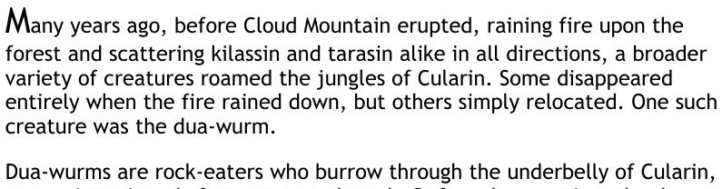
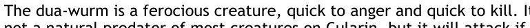
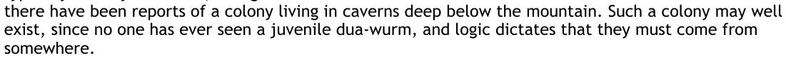

# Owner Material 037 — Star Wars D20 Drive folder (Core, Revised Core and Saga Edition): Living Force Campaign/Articles/Year 1/09:06:01 - Two Heads Aren't Better Than One.pdf [Star Wars Roleplaying Game Revised Core (d20, 2002)]

- **Source:** Wizards of the Coast Star Wars Roleplaying Game books, web enhancements, Living Force campaign modules and articles (2000–2010), from the owner's "Star Wars D20" Drive folder (only the three edition subfolders; "General" was not read, as instructed). Secondary source (licensed Legends reference). Scan OCR'd on the box; the scan stays box-only and is **not** published.
- **Method:** every scanned page was OCR'd and machine-screened sentence by sentence for power-relevant statements (fights, kills, defeats, Force feats, rankings, superweapons) that name a character on our roster; each kept sentence is quoted verbatim from the OCR text and has a crop of the printed passage directly under it. Pages with nothing power-relevant are still listed with what is on them.
- **Citation:** "*09:06:01 - Two Heads Aren't Better Than One* (SWRPG d20 Revised Core), p.X" by printed page ("scan p.X" where no printed number applies). **Weight:** Licensed RPG material: a secondary source. Narrative text sums up Legends lore; game statistics are rules for players, not canon power levels, and rank lowest.

## scan p.1 (scan page 1)

Page contents: Dua-wurm history, behaviour, description, sidebar, stats (hand-read)

- **No single roster character (rules/setting/general)** — entry/section: Dua-wurm: "Many years ago, before Cloud Mountain erupted, raining fire upon the forest and scattering kilassin and tarasin alike in all directions, a broader variety of creatures roamed the jungles of Cularin." Source: *09:06:01 - Two Heads Aren't Better Than One* (SWRPG d20 Revised Core), scan p.1
  
- **No single roster character (rules/setting/general)** — entry/section: Dua-wurm: "The dua-wurm is a ferocious creature, quick to anger and quick to kill." Source: *09:06:01 - Two Heads Aren't Better Than One* (SWRPG d20 Revised Core), scan p.1
  
- **No single roster character (rules/setting/general)** — entry/section: Dua-wurm: "Such a colony may well exist, since no one has ever seen a juvenile dua-wurm, and logic dictates that they must come from somewhere." Source: *09:06:01 - Two Heads Aren't Better Than One* (SWRPG d20 Revised Core), scan p.1
  

### Stat block notes (game mechanics, not feats)

- Dua-wurm: Dua-wurm: Predator 6; Def 17; Spd 15 m (burrow 20 m); VP/WP 46/17; Atk +7 melee (bite x 2; 1d4+2 bite + 1d2 acid); SZ L (Source: *09:06:01 - Two Heads Aren't Better Than One* (SWRPG d20 Revised Core), scan p.1)

## scan p.2 (scan page 2)

Page contents: Skills/feats; acid damage rules; scenario tie-in (hand-read)

