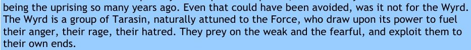
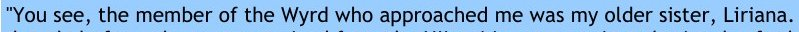
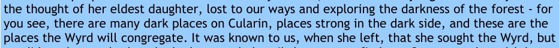
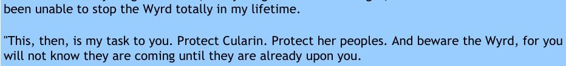
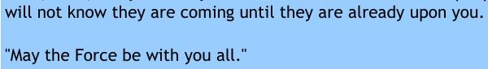
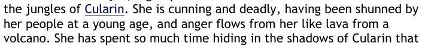
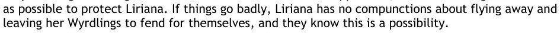

# Owner Material 037 — Star Wars D20 Drive folder (Core, Revised Core and Saga Edition): Living Force Campaign/Articles/Year 1/09:13:01 - Liriana - Dark Force Witch of Cularin.pdf [Star Wars Roleplaying Game Revised Core (d20, 2002)]

- **Source:** Wizards of the Coast Star Wars Roleplaying Game books, web enhancements, Living Force campaign modules and articles (2000–2010), from the owner's "Star Wars D20" Drive folder (only the three edition subfolders; "General" was not read, as instructed). Secondary source (licensed Legends reference). Scan OCR'd on the box; the scan stays box-only and is **not** published.
- **Method:** every scanned page was OCR'd and machine-screened sentence by sentence for power-relevant statements (fights, kills, defeats, Force feats, rankings, superweapons) that name a character on our roster; each kept sentence is quoted verbatim from the OCR text and has a crop of the printed passage directly under it. Pages with nothing power-relevant are still listed with what is on them.
- **Citation:** "*09:13:01 - Liriana - Dark Force Witch of Cularin* (SWRPG d20 Revised Core), p.X" by printed page ("scan p.X" where no printed number applies). **Weight:** Licensed RPG material: a secondary source. Narrative text sums up Legends lore; game statistics are rules for players, not canon power levels, and rank lowest.

## scan p.1 (scan page 1)

Page contents: 678 words, 12 paragraphs | headings/entries: Liriana: Dark Force Witch of Cularin

- **No single roster character (rules/setting/general)** — entry/section: Dariana: "I fear such a time is nearly upon us." Source: *09:13:01 - Liriana - Dark Force Witch of Cularin* (SWRPG d20 Revised Core), scan p.1
  
- **No single roster character (rules/setting/general)** — entry/section: Dariana: "My body grows weak, and I am tired, and a great sleep calls to me from just beyond the horizon." Source: *09:13:01 - Liriana - Dark Force Witch of Cularin* (SWRPG d20 Revised Core), scan p.1
  
- **No single roster character (rules/setting/general)** — entry/section: Dariana: "I have read everything the offworlders have written about the Tarasin. Read it, and approved of it, but it never came close to the truth in some areas." Source: *09:13:01 - Liriana - Dark Force Witch of Cularin* (SWRPG d20 Revised Core), scan p.1
  
- **No single roster character (rules/setting/general)** — entry/section: Dariana: "The Wyrd is a group of Tarasin, naturally attuned to the Force, who draw upon its power to fuel their anger, their rage, their hatred. They prey on the weak and the fearful, and exploit them to their own ends." Source: *09:13:01 - Liriana - Dark Force Witch of Cularin* (SWRPG d20 Revised Core), scan p.1
  
- **No single roster character (rules/setting/general)** — entry/section: Dariana: "It promised power, but too quickly, and too easily, and I swore that I would never be taken in by those promises." Source: *09:13:01 - Liriana - Dark Force Witch of Cularin* (SWRPG d20 Revised Core), scan p.1
  
- **No single roster character (rules/setting/general)** — entry/section: Dariana: ""You see, the member of the Wyrd who approached me was my older sister, Liriana." Source: *09:13:01 - Liriana - Dark Force Witch of Cularin* (SWRPG d20 Revised Core), scan p.1
  
- **No single roster character (rules/setting/general)** — entry/section: Dariana: "there are many dark places on Cularin, places strong in the dark side, and these are the places the Wyrd will congregate." Source: *09:13:01 - Liriana - Dark Force Witch of Cularin* (SWRPG d20 Revised Core), scan p.1
  
- **No single roster character (rules/setting/general)** — entry/section: Dariana: "Secrecy and stealth have ever been their way." Source: *09:13:01 - Liriana - Dark Force Witch of Cularin* (SWRPG d20 Revised Core), scan p.1
  

## scan p.2 (scan page 2)

Page contents: 613 words, 11 paragraphs | headings/entries: 

- **No single roster character (rules/setting/general)** — entry/section: Dariana: ""The Wyrd, though, continues to grow." Source: *09:13:01 - Liriana - Dark Force Witch of Cularin* (SWRPG d20 Revised Core), scan p.2
  
- **No single roster character (rules/setting/general)** — entry/section: Dariana: ""Liriana now commands the Wyrd. She is nearly my equal in strength, but she lacks any compunction about utilizing her powers with the Force for ill ends." Source: *09:13:01 - Liriana - Dark Force Witch of Cularin* (SWRPG d20 Revised Core), scan p.2
  
- **No single roster character (rules/setting/general)** — entry/section: Dariana: "But to overcome the challenge, one must first know of it. Now you know." Source: *09:13:01 - Liriana - Dark Force Witch of Cularin* (SWRPG d20 Revised Core), scan p.2
  
- **No single roster character (rules/setting/general)** — entry/section: Dariana: "They fly, unaided, and when they are chased by individuals in ships, they land and summon storms to bring the ships crashing down." Source: *09:13:01 - Liriana - Dark Force Witch of Cularin* (SWRPG d20 Revised Core), scan p.2
  
- **No single roster character (rules/setting/general)** — entry/section: Dariana: ""This, then, is my task to you. Protect Cularin. Protect her peoples. And beware the Wyrd, for you will not know they are coming until they are already upon you." Source: *09:13:01 - Liriana - Dark Force Witch of Cularin* (SWRPG d20 Revised Core), scan p.2
  
- **No single roster character (rules/setting/general)** — entry/section: Dariana: ""May the Force be with you all."" Source: *09:13:01 - Liriana - Dark Force Witch of Cularin* (SWRPG d20 Revised Core), scan p.2
  
- **No single roster character (rules/setting/general)** — entry/section: Liriana: "She is cunning and deadly, having been shunned by her people at a young age, and anger flows from her like lava from a volcano." Source: *09:13:01 - Liriana - Dark Force Witch of Cularin* (SWRPG d20 Revised Core), scan p.2
  
- **No single roster character (rules/setting/general)** — entry/section: Liriana: "her scales have adopted a much darker brown hue than is normally found on Tarasin, and her eyes are dead black." Source: *09:13:01 - Liriana - Dark Force Witch of Cularin* (SWRPG d20 Revised Core), scan p.2
  
- **No single roster character (rules/setting/general)** — entry/section: Liriana: "That Dariana is willing to discuss it in such a frank fashion indicates that she may truly be dying." Source: *09:13:01 - Liriana - Dark Force Witch of Cularin* (SWRPG d20 Revised Core), scan p.2
  

### Stat block notes (game mechanics, not feats)

- Liriana: Liriana: Female Tarasin, Force Adept 2/Scoundrel 2/Dark Force Witch 10; Def 22; VP/WP 94/12; Force Flight (20m); FP 3; DSP 19; Move Object +21, Force Grip +20; Force Lightning (DC 15); Con 12, Int 18, Wis 15, Cha 12 (p3) (Source: *09:13:01 - Liriana - Dark Force Witch of Cularin* (SWRPG d20 Revised Core), scan p.2)

## scan p.1–2 (scan page 1)

Page contents: Dariana's datapad message about the Wyrd and Liriana (hand-read)

## scan p.3 (scan page 3)

Page contents: 470 words, 11 paragraphs | headings/entries: 

- **No single roster character (rules/setting/general)** — entry/section: Wyrd: "They are particularly dangerous in caves, because of their ability to climb the walls and blend in with the ceiling while waiting to attack intruders." Source: *09:13:01 - Liriana - Dark Force Witch of Cularin* (SWRPG d20 Revised Core), scan p.3
  
- **No single roster character (rules/setting/general)** — entry/section: Liriana: "If things go badly, Liriana has no compunctions about flying away and leaving her Wyrdlings to fend for themselves, and they know this is a possibility." Source: *09:13:01 - Liriana - Dark Force Witch of Cularin* (SWRPG d20 Revised Core), scan p.3
  

### Stat block notes (game mechanics, not feats)

- Standard Wyrd Member: Standard Wyrd Member: Female Tarasin, Force Adept 3/Dark Force Witch 2; Def 17; VP/WP 35/12; DSP 5; Fear +12 (Source: *09:13:01 - Liriana - Dark Force Witch of Cularin* (SWRPG d20 Revised Core), scan p.3)

## scan p.2–3 (scan page 2)

Page contents: Liriana description and stats; Wyrd; Standard Wyrd Member; tactics (hand-read)

