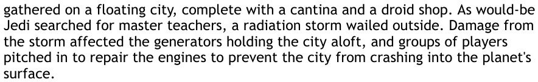
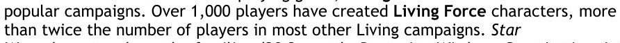
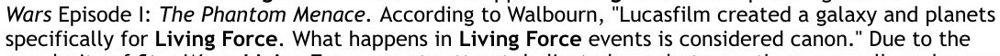
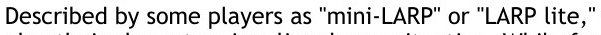
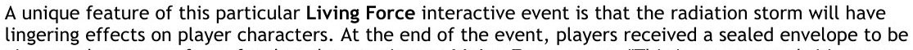

# Owner Material 037 — Star Wars D20 Drive folder (Core, Revised Core and Saga Edition): Living Force Campaign/Articles/Year 1/09:13:01 - RPGA Living Force Interactive.pdf [Star Wars Roleplaying Game Revised Core (d20, 2002)]

- **Source:** Wizards of the Coast Star Wars Roleplaying Game books, web enhancements, Living Force campaign modules and articles (2000–2010), from the owner's "Star Wars D20" Drive folder (only the three edition subfolders; "General" was not read, as instructed). Secondary source (licensed Legends reference). Scan OCR'd on the box; the scan stays box-only and is **not** published.
- **Method:** every scanned page was OCR'd and machine-screened sentence by sentence for power-relevant statements (fights, kills, defeats, Force feats, rankings, superweapons) that name a character on our roster; each kept sentence is quoted verbatim from the OCR text and has a crop of the printed passage directly under it. Pages with nothing power-relevant are still listed with what is on them.
- **Citation:** "*09:13:01 - RPGA Living Force Interactive* (SWRPG d20 Revised Core), p.X" by printed page ("scan p.X" where no printed number applies). **Weight:** Licensed RPG material: a secondary source. Narrative text sums up Legends lore; game statistics are rules for players, not canon power levels, and rank lowest.

## scan p.1 (scan page 1)

Page contents: Gen Con interactive report (hand-read)

- **No single roster character (rules/setting/general)** — entry/section: Living Force Interactive: "As would-be Jedi searched for master teachers, a radiation storm wailed outside. Damage from the storm affected the generators holding the city aloft, and groups of players pitched in to repair the engines to prevent the city from crashing into the planet's surface." Source: *09:13:01 - RPGA Living Force Interactive* (SWRPG d20 Revised Core), scan p.1
  
- **No single roster character (rules/setting/general)** — entry/section: Living Force: "Over 1,000 players have created Living Force characters, more than twice the number of players in most other Living campaigns." Source: *09:13:01 - RPGA Living Force Interactive* (SWRPG d20 Revised Core), scan p.1
  
- **No single roster character (rules/setting/general)** — entry/section: Living Force: "One unusual facet of Living Force is Lucasfilm's support." Source: *09:13:01 - RPGA Living Force Interactive* (SWRPG d20 Revised Core), scan p.1
  
- **No single roster character (rules/setting/general)** — entry/section: Living Force: ""Lucasfilm created a galaxy and planets specifically for Living Force. What happens in Living Force events is considered canon."" Source: *09:13:01 - RPGA Living Force Interactive* (SWRPG d20 Revised Core), scan p.1
  
- **No single roster character (rules/setting/general)** — entry/section: Living Force: "Described by some players as "mini-LARP" or "LARP lite,"" Source: *09:13:01 - RPGA Living Force Interactive* (SWRPG d20 Revised Core), scan p.1
  
- **No single roster character (rules/setting/general)** — entry/section: Living Force Interactive: "A unique feature of this particular Living Force interactive event is that the radiation storm will have lingering effects on player characters." Source: *09:13:01 - RPGA Living Force Interactive* (SWRPG d20 Revised Core), scan p.1
  
